# AgentAPI

English | [繁體中文](README.zh-TW.md)

Use AgentAPI to control [Claude Code](https://github.com/anthropics/claude-code),
[Codex](https://github.com/openai/codex) and [Pi](https://pi.dev/) with an HTTP API.

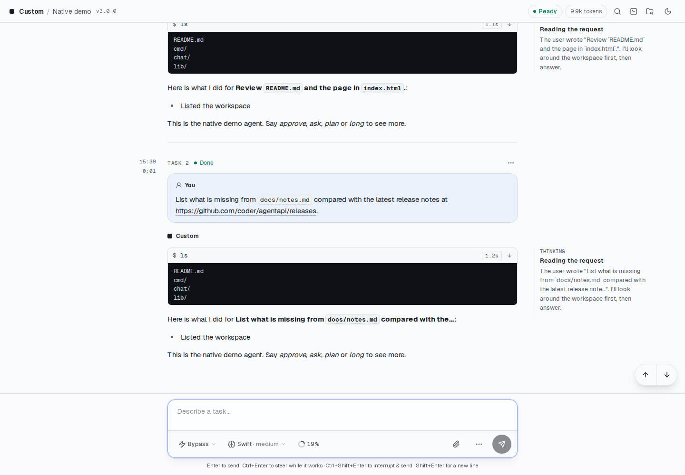

The screenshots show AgentAPI v3.1.0 running the built-in `native-demo` agent. Its replies, tool
results, models and usage are simulated. See the [chat UI guide](docs/chat-ui.md) for features and
animations, or the [screenshot guide](docs/screenshots/README.md) to reproduce the captures.

Use AgentAPI to:

- Build a unified chat interface for coding agents.
- Provide an MCP server backend that lets one agent control another coding agent.
- Create tools that delegate pull request reviews to an agent.
- Watch many agents from one dashboard. Each AgentAPI pushes its tasks, the requests that need
  you, its messages and heartbeats there with [webhooks](#webhooks), and a client that connects
  to many follows each through its [summary](#watching-many-instances). The built-in
  [hub](#running-a-hub) is such a dashboard, on a desktop or a phone.
- Hand GitHub issues to agents on your machines from the hub's [Issues](docs/hub.md#issues) page:
  each works on its own branch and opens a pull request.

## About this fork

[`k1dav-c/agentapi`](https://github.com/k1dav-c/agentapi) is an independently maintained fork of
[`coder/agentapi`](https://github.com/coder/agentapi), with its own versioned releases. Download
binaries from [this fork's releases](https://github.com/k1dav-c/agentapi/releases) and report
issues involving its added features in [this repository](https://github.com/k1dav-c/agentapi/issues).
Upstream changes should be reviewed and tested against the native transports, chat UI and hub
before integration; upstream and fork version numbers are separate release lines.

This fork builds on upstream v0.12.2. Since 3.0 it drives only Claude Code, Codex and Pi, through
their own protocols (the [native transport](#native-transport)); the PTY transport, which emulated
a terminal for other agents, ended with v2.5.1 (see [Agents](#agents)). Session management and
chat features support long-running tasks, and [webhooks](#webhooks) report them to a central
platform. [CHANGELOG.md](CHANGELOG.md) lists what
changed, [docs/architecture.md](docs/architecture.md) describes how it is built,
[docs/hub.md](docs/hub.md) how to watch many AgentAPIs from one page, and the
[full comparison with upstream](https://github.com/coder/agentapi/compare/main...k1dav-c:agentapi:main)
has the complete commit history.

## Contents

- [Features at a glance](#features-at-a-glance)
- [Quickstart](#quickstart)
- [Agents](#agents)
- [Chat UI](#chat-ui)
- [Native transport](#native-transport)
- [Conversation API](#conversation-api)
- [Integrations](#integrations)
- [Security](#security)
- [Resource usage](#resource-usage)
- [CLI reference](#cli-reference)
- [HTTP API reference](#http-api-reference)
- [Architecture](#architecture)
- [Development](#development)
- [Runtime reliability](#runtime-reliability)
- [Roadmap](#roadmap) and [long-term vision](#long-term-vision)

## Features at a glance

**Drive coding agents over HTTP**

- Drive Claude Code, Codex and Pi through their own protocols with the
  [native transport](#native-transport).
- Read structured activity (thinking, tool calls and their results, token
  usage) from `GET /rich-messages` and `GET /timeline`.
- Messages sent while the agent works wait in a [queue](#message-queue) that
  you can edit and reorder; they can also
  [steer or interrupt](#steer-interrupt-and-the-queue) the running turn.
- The server tracks each message and the agent's turn on it as a
  [task](#tasks): running, completed, failed, or stopped by a usage limit.
- Follow everything live over [server-sent events](#events-and-incremental-sync),
  with heartbeats and an incremental replay after a reconnect.
- A conversation that runs for months stays light: clients get the latest tasks and read earlier
  ones a page at a time, and with `--state-db` the server holds only the latest in memory
  ([Long conversations](#long-conversations)).

**Agents**

- Tool approvals, questions, and plans arrive as
  [requests](#requests-approvals-questions-and-plans), answered over HTTP or
  in the chat.
- Switch the [permission mode, model and reasoning effort](#settings-permission-mode-model-and-effort)
  while the agent runs: bypass (the default), auto, ask or plan.
- Switch Claude Code or Codex to [another model provider](#model-providers), such as a LiteLLM
  gateway, while it runs, and back; the conversation goes on. Define providers per machine or once
  on the hub.
- See how full the [context and the rate limits](#context-and-rate-limits)
  are, and [compact](#slash-commands-and-compaction) the context; the chat
  suggests it once Claude Code's prompt cache has expired.
- When a [usage limit](#usage-limits) stops a turn, the queue waits until the
  limit resets, and the turn can continue by itself then.
- A turn that fails on a [transient API error](#transient-api-errors) (a 502
  from a gateway, an overloaded API) is tried again after 30 seconds, 1 and 2
  minutes, then every 5 minutes, 15 times, before the queue goes on.
- AgentAPI reports a missing or expired [login](#logging-in) with the command
  to run, and starts the agent by itself once it is logged in.
- A shared [terminal](#terminal) in the agent's working directory, for logins
  and quick commands.
- [Persistent sessions](#persistent-sessions): with `--state-db`, the
  conversation survives an AgentAPI restart, and the agent resumes its own
  session.
- Open one of the agent's [earlier sessions](#earlier-sessions) in its working
  directory, or start a copy of one.
- See what each [session and task cost](#session-costs) at the model
  providers' list prices (the API-equivalent cost), subagents included, with
  totals for today and the last 7 and 30 days.

**Chat UI** (`/chat`)

- [Tasks](#tasks-and-the-transcript) read as a transcript, with tool calls as
  rows, thinking as margin notes and what each task cost, and can be exported
  as Markdown; the
  [Session Explorer](#session-explorer) has links, files, a task index, the
  agent's [earlier sessions](#earlier-sessions), Restart and the
  [webhook](#webhooks).
- [Lineage](#lineage): the subagents the agent ran, and what each did, step by
  step, even while it works.
- [Decision cards](#decision-cards) for requests,
  menus for the agent's settings, a ring for its context, and slash commands.
- A [file viewer](#file-viewer) with the file, its git diff and a preview of
  HTML, Markdown and images, which finds a file the agent named relative to a
  repository below its working directory; the [terminal](#terminal), also on
  phones.
- [Background alerts](#alerts-connection-recovery-and-caching), browser
  notifications, a transcript cache, and recovery from dropped connections.

**Operations and integrations**

- [A hub](#running-a-hub) (`agentapi hub serve`) watches the AgentAPIs of many
  machines, lists what needs you first, and opens any of them in the chat on a
  desktop or a phone, with favorite prompts it keeps for every chat it opens.
  [`agentapi hub join`](#joining-a-hub) connects a machine's AgentAPIs to it,
  and they stay connected after a restart.
- The hub's [issue dispatch](docs/hub.md#issues): its Issues page lists your repositories' open
  issues through the hub's own GitHub App, and **Assign** hands one to Claude Code, Codex or Pi on
  a machine whose launcher ([`agentapi host`](#agentapi-host)) starts an AgentAPI for it in a git
  worktree. The agent pushes a branch and opens a pull request; a review on it goes back to the
  same agent, and the page shows each job's state and what its runs cost.
- [Webhooks](#webhooks) push HMAC-signed tasks, requests, messages and
  heartbeats to a dashboard that watches many agents. A client that connects
  to many follows each through one [summary stream](#watching-many-instances).
  With the [human-reply API](#human-reply-api), a bot can tell you when the
  agent stops and pass your answer back.
- [Self-update](#agentapi-update), verified against the release's checksums,
  and [restarts in place](#agentapi-restart) into the new binary. Machines
  that opt in can also be [updated through the API](#updating-through-the-api),
  such as from the hub.
- [Security](#security): an API token (the chat signs in with a cookie), the
  listen address, and the allowed hosts and origins.

## Quickstart

1. Install `agentapi`:

   ```bash
   OS=$(uname -s | tr "[:upper:]" "[:lower:]");
   ARCH=$(uname -m | sed "s/x86_64/amd64/;s/aarch64/arm64/");
   curl -fsSL "https://github.com/k1dav-c/agentapi/releases/latest/download/agentapi-${OS}-${ARCH}" -o agentapi && chmod +x agentapi
   ```

   Or download this fork's latest binary from the
   [releases page](https://github.com/k1dav-c/agentapi/releases). Upstream
   `coder/agentapi` release binaries do not include this fork's features.

1. Verify the installation:

   ```bash
   agentapi --help
   ```

   > On macOS, if the system says it can't verify the binary, go to `System Settings -> Privacy & Security`, click "Open Anyway", and run the command again.

1. Run a Claude Code server (assumes `claude` is installed on your system and in the `PATH`):

   ```bash
   agentapi server -- claude
   ```

   > If you're getting an error that `claude` is not in the `PATH` but you can run it from your shell, try `which claude` to get the full path and use that instead.

   This drives Claude Code through its own protocol, the
   [native transport](#native-transport): approvals arrive as structured
   requests, its settings can be switched and the chat has a terminal.

1. Send a message to the agent:

   ```bash
   curl -X POST localhost:3284/message \
     -H "Content-Type: application/json" \
     -d '{"content": "Hello, agent!", "type": "user"}'
   ```

1. Get the conversation history:

   ```bash
   curl localhost:3284/messages
   ```

1. Try the chat web interface at http://localhost:3284/chat.

## Agents

Since 3.0, AgentAPI runs Claude Code, Codex and Pi through their own protocols, the
[native transport](#native-transport):

| Agent | Type | Protocol |
| --- | --- | --- |
| [Claude Code](https://github.com/anthropics/claude-code) | `claude` | `claude -p` stream-json |
| [Codex](https://github.com/openai/codex) | `codex` | `codex app-server` |
| [Pi](https://pi.dev/) | `pi` | `pi --mode rpc` |

`--type` sets the agent type; without it, AgentAPI takes it from the command's name, so
`agentapi server -- /usr/local/bin/codex` needs none. A wrapper script needs `--type`. The built-in
`native-demo` simulates an agent (see [Development](#development)).

```bash
agentapi server -- claude
agentapi server --state-db ~/.agentapi/myproject.db -- codex
agentapi server --type pi -- ./my-pi-wrapper
```

Any other agent stops AgentAPI at startup with an error that names v2.5.1. To run Aider, Goose,
Gemini CLI, Amp, Cursor CLI, Auggie, Amazon Q, Opencode, Copilot, Kimi Code or another terminal
program, use AgentAPI v2.5.1, the last release with the PTY transport:
download its binary from the [v2.5.1 release](https://github.com/k1dav-c/agentapi/releases/tag/v2.5.1)
and keep it. `agentapi update` only installs the latest release. An AgentAPI 2 that runs such an
agent with `--allow-update` checks the new program before it restarts into it, refuses AgentAPI 3
or later and keeps serving; but the update already replaced the program on disk, so put v2.5.1
back before that AgentAPI restarts some other way.

AgentAPI 4 has no `--transport` flag: drop it from command lines and config files. The
experimental ACP transport (`--experimental-acp`) was removed earlier; that flag stops AgentAPI with
an error.

## Chat UI

The chat UI at `/chat` is embedded in the binary and works on desktops and phones. It includes
searchable tool activity, compact tool-call cards and connection indicators.
The header shows the AgentAPI version and the agent's mark: the logo of Claude, OpenAI (Codex) or
Pi, or a square for other agents. See the [chat UI guide](docs/chat-ui.md) for screenshots and animations.

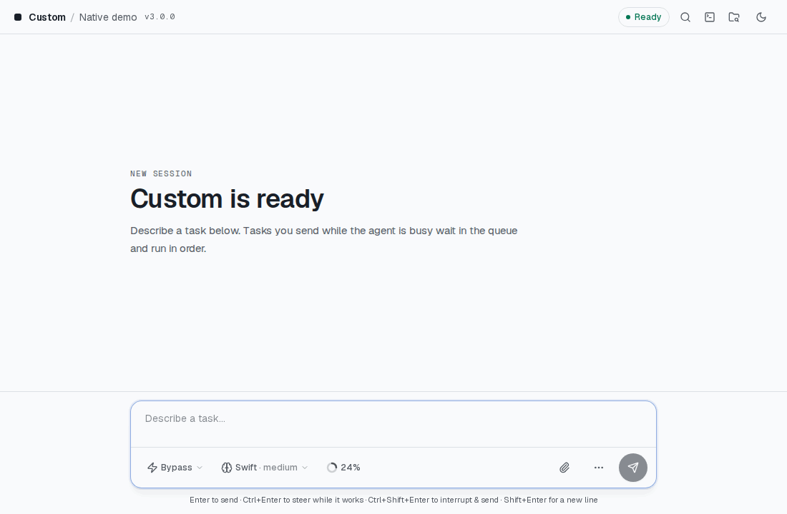

### Tasks and the transcript

The chat groups each user request with its response, thinking, tool calls and background activity
as a task. You can move between tasks in the transcript.

Each task has a timeline on the left: when it started, how long it took and, for Claude Code, Codex
and Pi, what it [cost](#session-costs). Your prompt appears in a tinted block labelled "You", followed
by the agent's logo, name, and reply in Markdown. Each tool call takes one row with its command
(`$ command`), exit code, duration, and output preview. On wide screens, thinking appears as margin
notes.

The server's [task](#tasks) determines the displayed state (Working, Done, Failed, Limit reached)
and which tool calls and thinking belong to it. A strip above the composer shows the agent's
current activity. While the agent waits for an answer or a login, or a usage limit stopped it, the
header, tab title and status strip show "Needs you", and queued tasks are marked as held. While a
failed turn waits to be [tried again](#transient-api-errors), the agent shows as working and queued
tasks are held too. A message steered into a task shows inside it, so the chat numbers tasks as the
server does. Long tasks show
their latest 40 steps first.

Each agent message has its own Markdown/raw toggle.

### Session Explorer

The Session Explorer (⌘K / Ctrl+K) provides:

- links and file paths discovered in the current conversation;
- an index for jumping directly to earlier tasks;
- a Session tab with the agent's [earlier sessions](#earlier-sessions) to open or copy, what they
  [cost](#session-costs), and a two-step restart confirmation;
- a Webhook tab that sets up the [webhook](#webhooks).

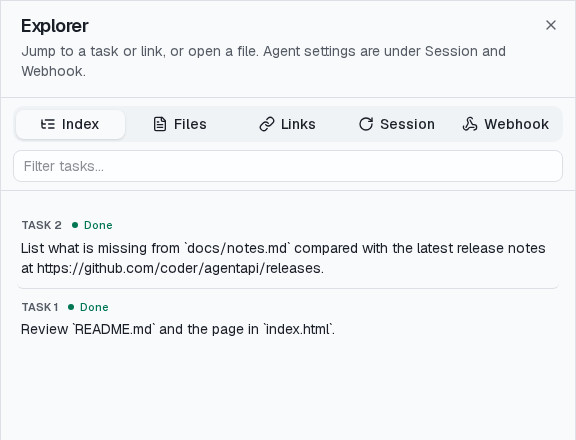

Each task's ⋯ menu previews, copies or exports the task as Markdown.

### Lineage

When Claude Code or Codex runs subagents, a header button shows their total and running counts. It
opens the Lineage panel, which lists each subagent's task, kind, state and elapsed time. Select one
to follow its thinking, tool calls, results and answer as it works. The **Steps** button on an Agent or spawn_agent tool call opens that subagent directly.

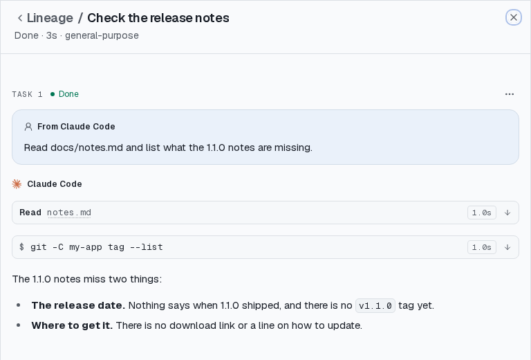

AgentAPI reads the steps from each subagent's log. Claude Code keeps these logs beside the parent
session's log. The panel includes subagents from [earlier sessions](#earlier-sessions) you open;
a copy of a session starts without the original's subagents. `GET /subagents` lists them, and
`GET /subagents/{id}` returns a subagent's task and messages.

Claude Code reports a subagent's state through its Agent tool call. Codex's spawn call returns
before the subagent finishes, so AgentAPI reads its state from its own log. Codex encrypts the task
sent to a subagent; the panel uses its task name and nickname as the label.

### Attachments and images

Paste an image into the composer to upload it as an attachment. Pasted text remains text. Image
attachments and images in sent messages appear as thumbnails; click one to view the full image. The
agent receives the file path.

### Decision cards

Items awaiting your response appear above the composer as decision cards: the agent's
[requests](#requests-approvals-questions-and-plans), and the [login card](#logging-in) while it
waits for a login. Number keys pick options. On a phone a card
takes at most 60% of the screen, and a title cut to two lines can be shown in full.

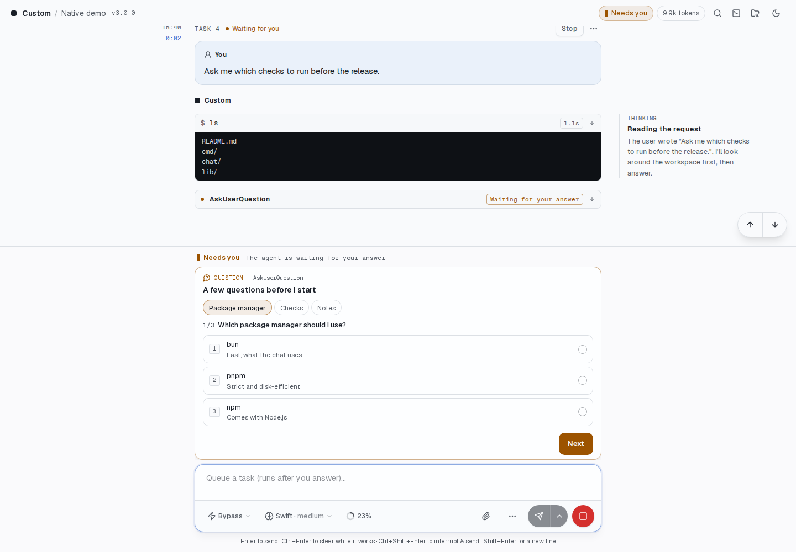

The agent's questions come one step at a time (here the package manager, then the checks and notes)
and are sent together. The header, the status line and the tool row show that the agent is waiting
for you.

### File viewer

File paths in the chat open the file the agent works on. The file name on a tool call's row (Claude
Code's Read, Write, Edit, MultiEdit and NotebookEdit; Codex's apply_patch and view_image; Pi's read,
write and edit), a path in inline code in the agent's reply (`lib/foo.go:12` opens at line 12) and
the Explorer's Files tab open a viewer with two tabs: File, with line numbers and syntax
highlighting, and Diff, with the tool call's own change and the file's uncommitted changes against
HEAD (`GET /files/content`, `GET /files/diff`, cut at 1 MiB). Only files inside the agent's working
directory can be opened. An expanded tool call lists its files and shows its change as a diff, with
the raw input a click away. On a phone the viewer is full screen.

If a path isn't in the working directory, AgentAPI looks for it below (`GET /files/find`), ignoring
case. This covers an agent whose working directory is a home directory and that names files
relative to a repository below it. One match opens with a note naming the path the agent wrote;
several are listed to choose from. The search leaves out hidden directories, dependencies and Go's
module cache unless the path goes into them, and stops after 50,000 entries or 2 seconds.

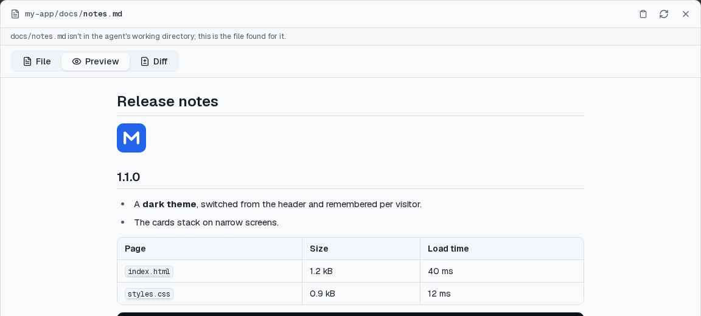

HTML, Markdown and SVG files have a third tab, Preview, and an image file shows as the image:

- An HTML page renders in an iframe, with the stylesheets, scripts, images,
  fonts and media it refers to by relative path inlined (`GET /files/preview`;
  up to 4 MiB each, 16 MiB in all; a note lists what was left out). The
  iframe is sandboxed without an origin of its own, so the page's scripts run
  but can't reach the chat, its session or the API; localStorage,
  sessionStorage and cookies are kept in memory while the preview is open.
  Script modules that import other files, and requests the page makes for
  relative URLs, don't load.
- A Markdown file opens on its preview: relative images load from the working
  directory, and relative links open their file in the viewer (`#L12` at its
  line).
- PNG, JPEG, GIF, WebP, BMP, ICO and SVG images show as images
  (`GET /files/image`).

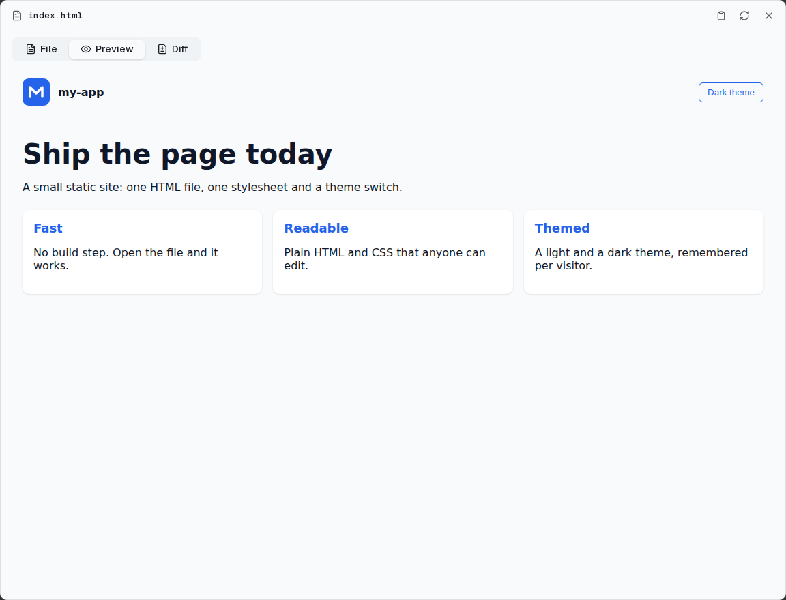

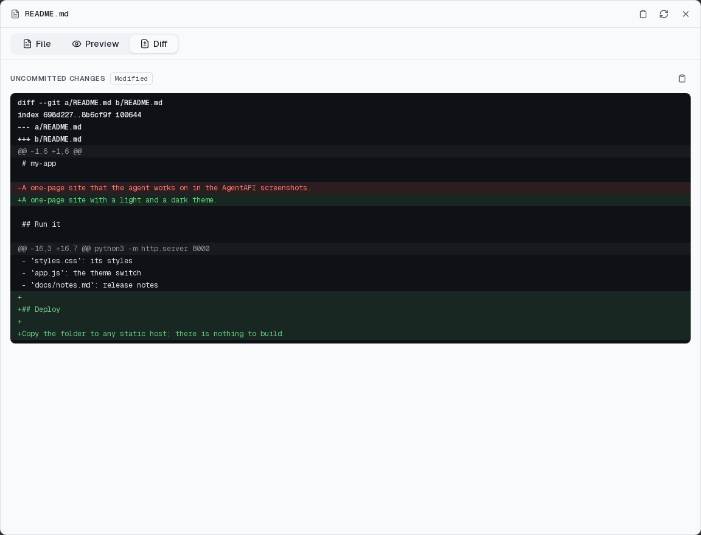

The [chat UI guide](docs/chat-ui.md#files) also shows the File tab and a Markdown preview.

### Agent controls

Requests for tool approval, answers or plan approval appear as cards above the composer. While the
agent works, the send menu can steer a message into the running turn or interrupt it. The toolbar
controls permission mode, model and reasoning effort, and shows context usage and rate limits.
Slash commands include `/model` and `/compact`. The terminal button opens a shell in the agent's
working directory. See [Native transport](#native-transport).

### Alerts, connection recovery and caching

While the tab is in the background, its icon shows an amber dot when the agent needs you, a blue dot
while it works, and a green dot when a task finishes. Turn on browser notifications (https pages
only) or a chime (**Play a sound**, which works over plain http too) from the status menu; the
hub's bell has the same two. The menu also downloads the conversation as JSONL, as does the
Explorer's Session tab; for Claude Code or Codex, its subagents' steps follow the agent's own.

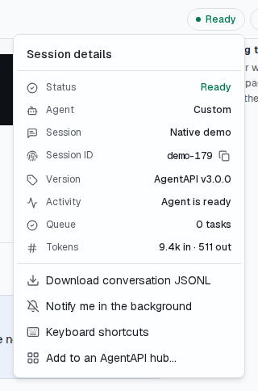

The agent's warnings and errors show as notifications that stay until you close them. The server
resends its recent ones on every connection, so the chat remembers per server which ones you
closed, and a reload doesn't bring them back. **Clear all**, below two or more, closes them at once.

Long-running browser sessions are protected by SSE heartbeats, automatic reconnection,
stale-connection detection, and local recovery of messages that failed before reaching the server.
The page title and session header show the current task, agent status, and connection state.

Reopening a long conversation is fast: the chat caches the transcript in the browser (IndexedDB),
shows it immediately, and then asks the server only for changes since the last sync.

## Native transport

Native transport uses the agent's structured protocol to receive replies, tool
calls, and usage, and to handle approvals, questions, and plans in the chat UI.

**Running an agent**

```bash
agentapi server -- claude --model sonnet
agentapi server -- codex -a on-request
agentapi server -- pi --provider openai-codex --model gpt-5.6-luna --thinking low
```

- AgentAPI selects the adapter from the command name. Specify `--type` for
  wrapper scripts.
- For UI development, `agentapi server -- native-demo` runs a simulated agent;
  see the [development guide](chat/README.md). With `--type claude`, `codex`
  or `pi`, the demo poses as that agent, and AgentAPI reads that agent's logs
  for its earlier sessions and subagents.

**What to expect**

- Replies, tool results, and thinking update live as the turn runs.
- Approvals and questions appear as decision cards above the composer; see
  [request handling](#requests-approvals-questions-and-plans).
- When the agent is stopped or restarted and doesn't exit within 3 seconds of
  its input closing, AgentAPI signals its whole process group, which also stops
  its MCP servers and child commands. Once the agent exits, however it exits,
  what it started and left running gets SIGTERM, then SIGKILL 2 seconds later.
- An agent that exits on its own, or fails to start, is started again on its
  session after 2, 10 and 30 seconds. Each attempt shows in the chat as an
  error, and the lifecycle is `restarting`. If all three fail, AgentAPI keeps
  serving with the lifecycle `failed` until you restart the agent (Explorer →
  Restart or `DELETE /messages`, which starts a new session; the Session
  Explorer reopens the old one). Once an agent has run 5 minutes, the count
  starts over. One that lost its login before it exited waits for the login
  instead; see [Logging in](#logging-in).

AgentAPI removes environment markers and secrets inherited from a parent agent
session while preserving login and provider configuration. See
[child process environment](docs/architecture.md#child-process-environment) for
the complete list.

<details>
<summary>Technical details: protocols, streaming, status fields, and shutdown</summary>

**Agent protocols and thinking**

| Agent | Protocol | Thinking |
| --- | --- | --- |
| Claude Code | stream-json and control protocol | Summarized adaptive thinking |
| Codex | `codex app-server`, using JSON-RPC over stdio | Detailed reasoning summaries requested each turn |
| Pi | `pi --mode rpc` | Streamed as Pi writes it |

Messages come directly from the protocol. Each streaming update replaces the
entire rich message, at most 10 snapshots per second per message. The latest
state arrives within 100 ms after the stream pauses.

**API status**

`GET /status` and `status_change` events include these fields:

| Field | Meaning |
| --- | --- |
| `transport` | always `native` |
| `capabilities` | Operations the agent supports |
| `pending_requests` | Number of requests waiting for a response |
| `settings` | Current session settings |
| `usage` | Context and usage information |
| `terminal` | Whether a separate shell terminal is available |

When the agent is only waiting for a request response, `status` is `stable`.

**Shutdown**

The agent runs in its own process group. Shutdown first interrupts a running
turn and waits up to 3 seconds for it to end, so the session log doesn't end in
a tool call without result. Then it closes the agent's input so it can exit; if
it is still running 3 seconds later, AgentAPI sends SIGTERM to the group, then
SIGKILL 2 seconds after that. The group outlives the agent while a process in
it runs, so AgentAPI signals it after the agent exited too, on its own or in a
restart: SIGTERM, then SIGKILL 2 seconds later.

</details>

### Logging in

AgentAPI uses the agent CLI's stored login. Log in as the same operating-system user that runs
AgentAPI. You can use the chat's [terminal](#terminal) or any terminal on the same machine. The login card's **Run in terminal** button and the `/login` command both run the login
command in the chat terminal.

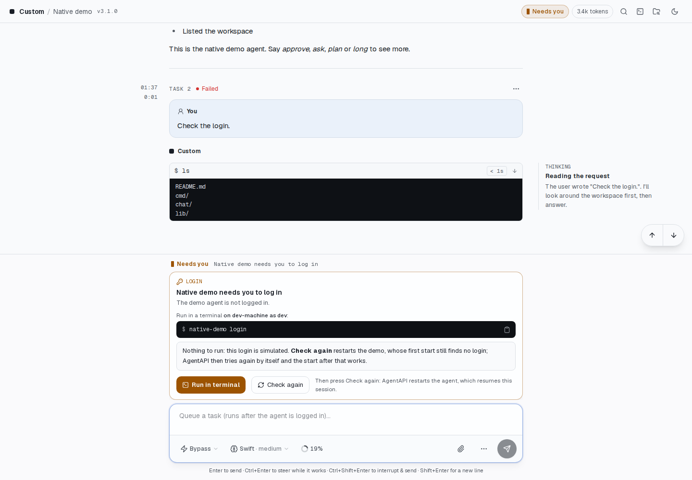

- Claude Code: `claude auth login` uses a Claude subscription by default;
  `--console` selects Anthropic Console API billing. On a machine without a
  browser, `claude setup-token` creates a token for `CLAUDE_CODE_OAUTH_TOKEN`.
  Check the login with `claude auth status`.
- Codex: `codex login --device-auth` signs in with a ChatGPT plan from any
  device: open the link it shows and enter its one-time code. The login card
  and `/login` run it because AgentAPI usually runs on a server without a
  browser: `codex login`'s browser sign-in redirects the browser to
  `localhost:1455` on the machine that runs Codex, which a browser elsewhere
  can't reach. `codex login` still works with a browser on the same machine,
  and `printenv OPENAI_API_KEY | codex login --with-api-key` uses an API key.
  Check the login with `codex login status`.
- Pi: run `/login` inside `pi`, or set a provider key such as
  `ANTHROPIC_API_KEY` in AgentAPI's environment.

AgentAPI checks authentication when starting the agent:

- Claude Code uses `claude auth status --json`. API keys,
  `CLAUDE_CODE_OAUTH_TOKEN`, `apiKeyHelper`, Bedrock, and Vertex count as
  authenticated. With `--settings`, the check is skipped because `auth status`
  cannot see an `apiKeyHelper` supplied that way.
- Codex uses app-server's `account/read`.
- Pi checks its state: no selected model and no available models indicate a
  missing login.

If authentication is missing, AgentAPI keeps running and queues messages. `GET /status` and
`status_change` report `login_required`, including the agent, problem, login command, help, host,
and operating-system user. The chat shows these details in a card above the composer, with a button
to copy the command.

AgentAPI retries startup every 5 seconds and detects a completed login automatically. **Check
again** (`POST /login/retry`) retries immediately; if a startup check is already running, that check
is reused. Startup warnings appear once rather than on every retry. If the check itself fails, for
example with an older CLI or a wrapper, AgentAPI starts the agent as before.

Authentication can also expire during a session. A turn that fails with a login error reports
`login_required` in the same way. Recognized errors include `Not logged in`, HTTP 401,
`Invalid API key`, an unusable refresh token, Pi's `No API key found`, and
`Authentication failed for "<provider>"` after a subscription login expires.

After logging in, select **Check again**. AgentAPI restarts the agent on the same session and
preserves the conversation. A completed model turn also clears the login error; interrupted turns
and messages handled by the agent itself do not. An agent that exits after it reported a lost login
isn't restarted as after a crash: it waits for the login like one that finds none at startup, and a
restart that finds no login does too.

### Requests: approvals, questions and plans

Tool approvals, questions (Claude's `AskUserQuestion`, Codex's `request_user_input`, dialogs from
Pi extensions) and plan approvals (Claude's `ExitPlanMode`) arrive as requests:

- `GET /requests` lists the pending requests and the 50 most recently closed
  ones, and `GET /requests/{id}` returns one. `/events` sends a
  `request_update` event whenever one opens or closes, and `GET /status`
  counts the pending ones in `pending_requests`.
- `POST /requests/{id}/respond` answers one: `option_id` for approvals and
  plans (with optional `text` as feedback when the request has `feedback`),
  `answers` keyed by question ID for questions. A request is answered at most
  once: 409 when it is no longer pending (already answered, withdrawn or
  expired, including a request restored from `--state-db`), 400 when the
  answer doesn't fit the request.
- Each request has a `status` (`pending`, `resolved`, `withdrawn`, `expired`)
  and a `response_capability`: `live` (the agent is waiting), `message` (the
  agent stopped waiting; answer with a new message) or `not_resumable` (it
  can't be answered any more: the agent that asked exited or was restarted,
  or stopped waiting for an approval or plan). When the agent stops waiting
  for a request (it withdraws it, or the turn ends), questions become
  `message` and approvals and plans `not_resumable`. An answer already on its
  way still counts if the agent takes it.
- Answers to secret questions are stored and reported as `[redacted]`; only the
  agent gets them.
- The [human-reply API](#human-reply-api) (`/handoff`) offers the oldest
  pending request with numbered choices: a number picks an option, other text
  answers a single question or goes with the deny option as feedback. A reply
  answers exactly the request that was offered; if that one was answered or
  withdrawn meanwhile, the reply is `superseded`, and one the request can't
  take is `invalid`.

In the chat, requests appear above the composer as decision cards:

- Approvals show the command and distinct Allow, Always allow, and Deny options.
  A denial can include feedback.
- Plans render as Markdown and can be approved or returned with feedback.
- Questions appear one step at a time, with single-choice, multiple-choice,
  typed, or hidden answers. All answers are submitted together.

Number keys select options. They are disabled while you type or while a dialog,
menu, or terminal has focus; holding a key does not repeat the action.

Tool rows show whether approval is pending, granted, or denied. Answer
`AskUserQuestion`, `request_user_input`, and `ExitPlanMode` calls on the card.
Requests answered elsewhere or no longer pending disappear from the card. If a
question expires with the turn or is withdrawn, the UI explains that you can
still answer it with a normal message.

While a request is pending, the header and tab title say "Needs you", the tab
icon shows an amber dot, the embed status bar's icon turns amber, and a
background tab with notifications turned on shows a notification that the agent
needs you.

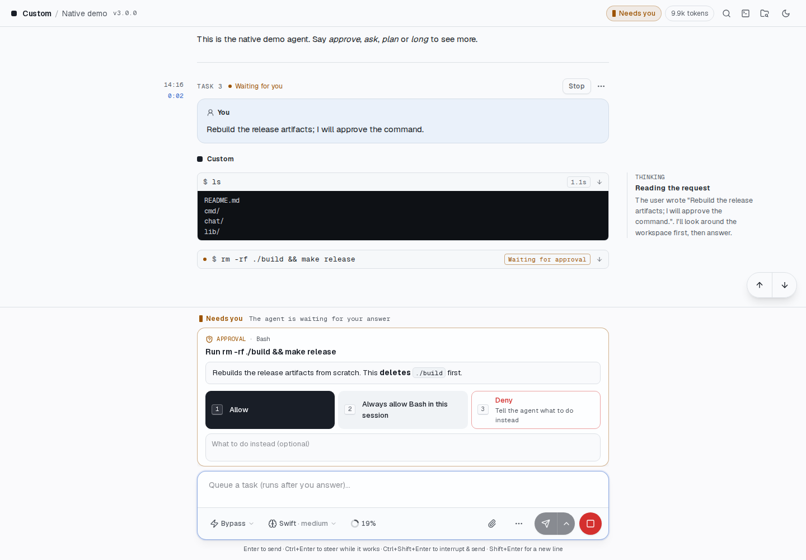

An approval shows what would run and why. **Allow** runs it once, **Always allow** stops asking for
the rest of the session, and **Deny** refuses it, with an optional note on what to do instead.

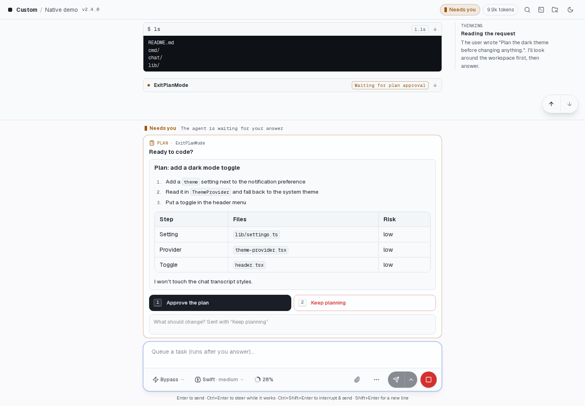

Plans stay above the composer while the agent waits. Read the plan, approve it, or enter feedback
and select **Keep planning** to ask for changes. The plan shown here is generated by `native-demo`;
approving it does not change files.

### Steer, interrupt and the queue

- `POST /message` takes `dispatch_mode`: `queue` (the default: send the
  message once the agent is idle), `steer` (add it to the
  turn the agent is working on; the reply says `steered`) or `interrupt` (stop
  that turn and send the message next). While a turn runs, `steer` and
  `interrupt` need the matching capability; otherwise the answer is 400.
  When no turn is running (including while the agent restarts or waits for a
  login), both send or queue the message as usual.
- `POST /interrupt` stops the running turn (409 if there is none, or while no
  agent runs).
- A queued message can be steered into the running turn too; see
  [Message queue](#message-queue) for the queue's endpoints.

`GET /status` reports the supported `capabilities`: `steer`, `interrupt`, `resume` (the session
can be resumed when AgentAPI starts again, see [Persistent sessions](#persistent-sessions)),
`settings` (see [Settings](#settings-permission-mode-model-and-effort)), `compact` (see
[Slash commands](#slash-commands-and-compaction)) and `images`. With `images`, image attachments
(`@"<path>"` references to PNG, JPEG, GIF or WebP files up to 10 MB) go to the agent as images as
well as paths; without it, only the paths are sent. While no agent runs (a restart, a wait for
a login), it reports what the last one supported.

In the chat, while the agent works, the send button's menu adds **Steer** (⌘/Ctrl+Enter) and
**Interrupt & send** (⌘/Ctrl+Shift+Enter) next to queueing (Enter), and Stop interrupts the turn
(`POST /interrupt`). Queued tasks can be steered in right away, and moved up and down.

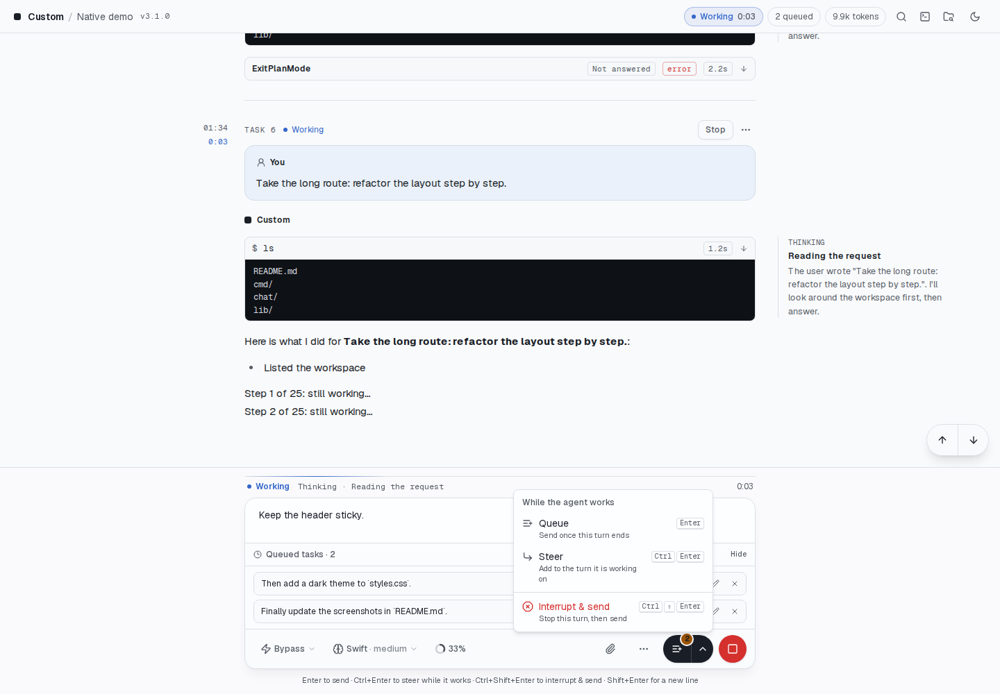

### Settings: permission mode, model and effort

You can change the agent's permission mode, model, and reasoning effort while it runs.
`GET /settings` returns the current settings and available choices, including models and their
supported effort levels.

`PUT /settings` updates only the fields in the request body, such as `{"permission_mode": "ask"}` or
`{"model": "sonnet", "effort": "high"}`. Unsupported values return 400. `GET /status` and
`status_change` also include the current settings.

The permission modes are **bypass** (tools run without asking; the default), **auto** (the agent's
own review decides what may run), **ask** (tool calls that need approval come as requests) and
**plan** (the agent proposes a plan, which comes as a plan request, before it changes anything):

| Mode | Claude Code | Codex | Pi |
| --- | --- | --- | --- |
| bypass | `bypassPermissions` | no approvals, no sandbox | how Pi always runs |
| auto | `auto` | workspace sandbox, escalations decided by Codex's auto review | — |
| ask | `default` | `untrusted`: asks for every command it doesn't trust | — |
| plan | `plan` | plan collaboration mode | — |

If the agent uses a policy outside these four modes, such as Claude Code's `acceptEdits` after plan
approval or a custom Codex command-line policy, the UI does not label it as one of these modes.
Claude Code and Pi apply changes immediately. Codex applies them on the next turn, when app-server
accepts settings. AgentAPI reapplies your choices after an agent restart or a new login; with
`--state-db`, it also restores them after an AgentAPI restart. The UI follows changes the agent
makes itself, such as switching modes after plan approval.

In the chat, the composer's toolbar has a menu for the mode and one for the model and effort (on a
phone in a row of their own above the buttons).

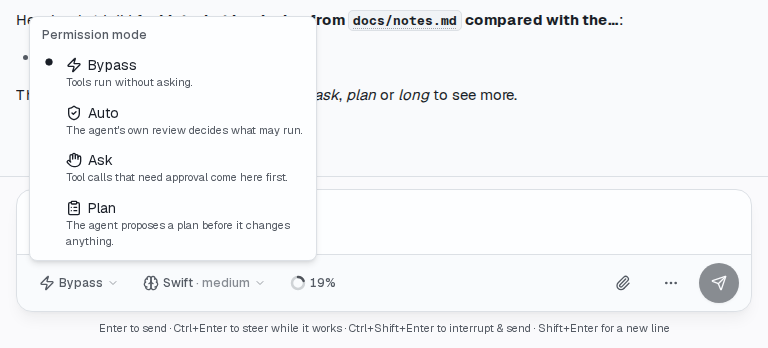

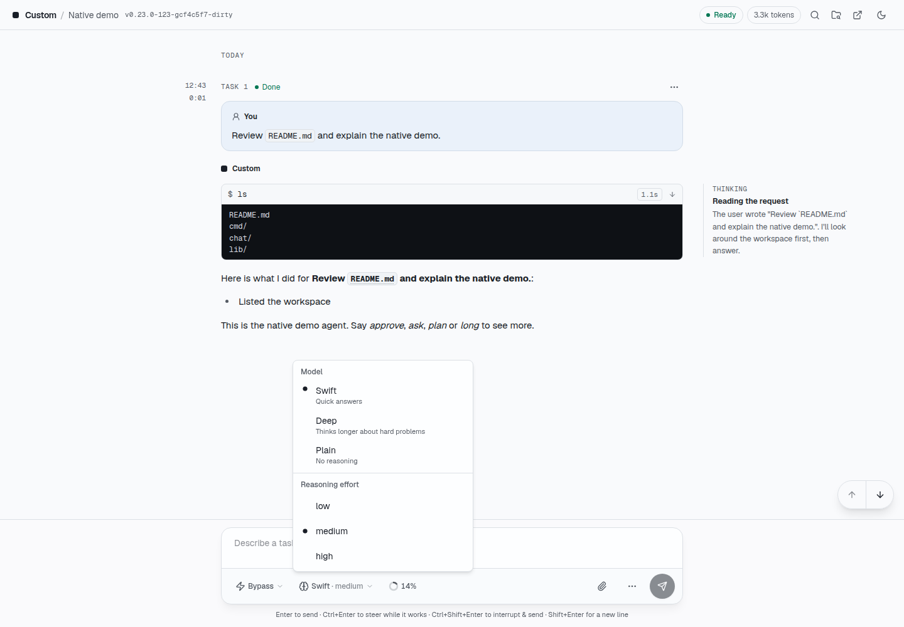

Swift, Deep, and Plain are demonstration models supplied by `native-demo`.

### Model providers

Claude Code and Codex can switch to another model provider while they run: an endpoint that speaks
the Anthropic Messages API (Claude Code) or the OpenAI Responses API (Codex), such as a LiteLLM or
vLLM gateway. One gateway that speaks both serves both agents. Define providers in the machine's
`~/.agentapi/config.yaml` (`--config`):

```yaml
providers:
  - id: kimi                      # lowercase letters, digits, - and _
    name: Kimi K3                 # optional
    base_url: https://gateway.example.com/v1
    api_key: sk-...               # optional
    models: [Kimi-K3-NVFP4]       # optional: by default, those GET <base_url>/models lists
```

Codex calls `<base_url>/responses`. Claude Code calls the same URL without `/v1`, plus
`/v1/messages`; set `anthropic_base_url` when its endpoint is elsewhere. A `base_url` without a
version gets `/v1` for Codex. AgentAPI reads the file again when it changes. Keep it readable by
you only (`chmod 600`): it holds the keys, and AgentAPI warns when others can read it.

A hub keeps providers for every machine that reports to it (see
[Running a hub](#running-a-hub)). On a machine, a provider of its config file wins over the hub's
with the same `id`.

`GET /settings` lists the providers under `options.providers`, with their models, and the setting
`provider` says which one the agent runs on: `default` for its own (Claude Code's Anthropic login or
key, Codex's OpenAI login or its config's `model_provider`). Switch with `PUT /settings`:

```bash
curl -X PUT localhost:3284/settings -d '{"provider": "kimi", "model": "Kimi-K3-NVFP4"}'
curl -X PUT localhost:3284/settings -d '{"provider": "default"}'
```

Without `model`, the agent takes the provider's first model; back on its own provider, the model
it had before. On a provider, `{"model": ...}` picks among that provider's models. In the chat, the
model menu lists the agent's own models, then each provider's.

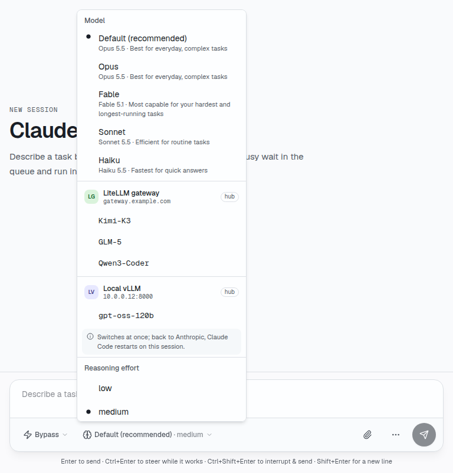

The two agents switch differently:

- **Claude Code** switches while it runs, from its next API call, also during a turn. Going back to
  its own provider starts it again on the same session, which takes a few seconds; during a turn it
  is refused (409). If a switch fails, AgentAPI restores the previous environment and model. If an
  answer is unconfirmed or restoration fails, it starts a replacement on the previous known provider
  instead of allowing another turn with settings that might not match the UI.
- **Codex** binds a thread to its provider, and an OpenAI thread holds items another provider
  refuses (OpenAI's tool definitions, encrypted reasoning). A switch starts app-server again on the
  other provider, in a new thread that gets the conversation's messages as text, without the tool
  calls. During a turn the switch is refused (409).

The chosen provider applies to every agent that starts in the session, also after an AgentAPI
restart with `--state-db`. A provider that is no longer defined is dropped, with a warning: the
agent starts on its own provider. The hub's providers are kept beside the config file
(`hub-providers.json`, sealed with the hub's secret) for the next start, so a session on one of
them starts on it again while the hub can't be reached. Until the hub answers, a chosen provider
that may be one of the hub's stays chosen while the agent starts on its own provider; the agent goes
back to it at its first start after the hub answered.

A provider's models (those it lists at `<base_url>/models`) are kept for 10 minutes, then listed
again in the background. `GET /settings` waits 3 seconds at most for a provider that doesn't
answer, and doesn't ask it again for a minute.

An agent on a provider can read that provider's key: it runs as your user, with the key in its
environment. Give a provider only a key you would give the agent. Model calls on a provider have no
known price, so they add tokens but no cost (`--prices` adds prices). `GET /sessions`, `GET /cost`
and the summary's `spend` count each provider's calls, tokens and cost apart (`providers`,
`default` for the agent's own); for Claude Code, whose log doesn't say which endpoint a call went
to, AgentAPI records which provider each session ran on from when in
`~/.agentapi/provider-ledger.jsonl`.

### Context and rate limits

`GET /status` and `status_change` report the agent's `usage`: how full its context window is after
the last turn (`context`: `used` and `size` in tokens) and the account's rate limits (`rate_limits`:
a label, how much is used, when it resets and, for Claude Code, whether it is close to or at the
limit). Claude Code reports its 5-hour and weekly limits and its context after every turn, Codex its
context and its usage windows, and Pi its context. A new session starts with an empty context; the
rate limits belong to the account and stay. In the chat, a ring in the composer's toolbar shows how
full the context is, and its menu shows the limits with the time to each reset.

Claude Code also reports its `prompt_cache`: how long the model provider keeps the conversation's
cache after its last use (`ttl_seconds`: an hour on a subscription, five minutes with an API key, on
Bedrock or Vertex) and when it expires (`expires_at`). Once it has expired, the model reads the
whole context again on the next message, at the full price and against the usage limits. While the
agent is idle with an expired cache and at least 50k tokens of context, the chat says so above the
composer and offers to compact first. A dismissed note stays hidden until the next turn.

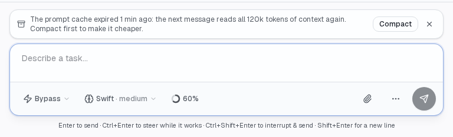

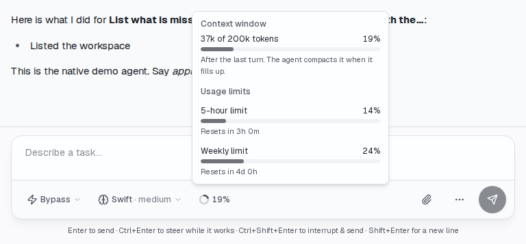

### Usage limits

When the account reaches a usage limit, the agent stops its turn: Claude Code says "You've hit your
limit", Codex reports `usageLimitExceeded`, Pi the provider's quota error. `GET /status` and
`status_change` then report `limit_stop`: the agent's `message`, when it stopped and, if the agent
says, when the limit resets (`resets_at`, else the reset of the limit `rate_limits` reports as
reached). Queued messages wait until then instead of failing one after another. A message you send
yourself goes out at once, ahead of them, and ends the stop.

- `POST /limit/continue` with `{"at": "now"}` sends a message that asks the
  agent to go on with the task; `{"at": "reset"}` schedules it for a minute
  after the reset (409 without a reset time). The queued messages go after it.
- `DELETE /limit/continue` cancels a scheduled continuation; the queue still
  waits for the reset.
- `DELETE /limit` forgets the stop, so the queued messages go out as soon as
  the agent can take them.
- `--auto-continue` schedules the continuation for every stop with a reset
  time. A continuation the limit stops again is scheduled again.

The stop is kept with `--state-db`, so a scheduled continuation still goes out after AgentAPI
restarts. In the chat, the stop is a card above the composer with the reset time, **Continue at
reset**, **Continue now**, and **Send queued tasks**, the queue says it waits for the limit, and the
header and tab title say "Needs you".

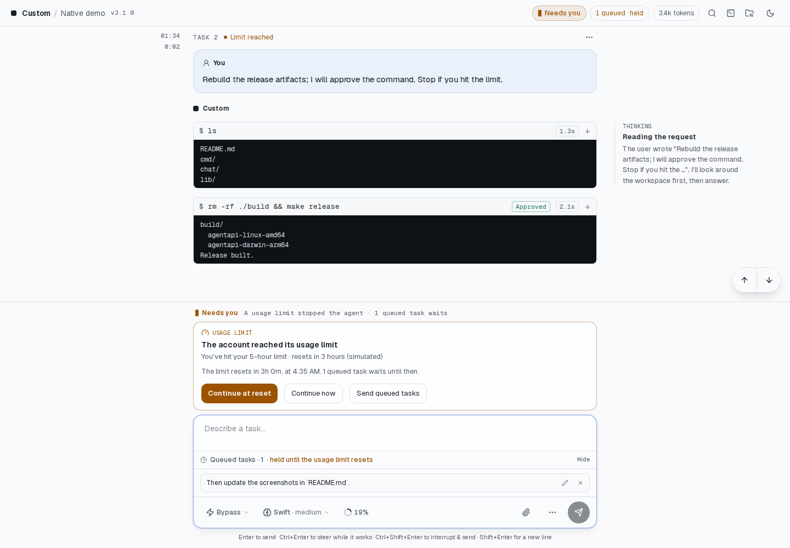

### Transient API errors

The agents retry a failed API request a few times themselves. When they give up on an error that
may pass, the turn fails: Claude Code says "API Error: 502 Bad Gateway. This is a server-side
issue, usually temporary", Codex reports `serverOverloaded` or a failed connection, Pi ends its
retries without success. AgentAPI then waits and tries the turn again instead of moving on to the
next queued message. It counts as transient:

- an HTTP status of 500 to 599 or 429 (`api_error_status` from Claude Code, `httpStatusCode` from
  Codex, or the status in the error's text);
- Codex's `serverOverloaded`, `internalServerError` and `rateLimitExceeded`, and a connection or
  stream that failed without a status;
- Pi's retries that ended without success;
- an error worded as one: bad gateway, service unavailable, overloaded, rate limit, timed out,
  connection error, and the like.

A usage limit (see [Usage limits](#usage-limits)) and a missing login come first: a 429 that says
"You've hit your limit" is a limit stop. A 400 or another client error isn't tried again.

`GET /status` and `status_change` report `retry_wait`: the agent's `message`, the `api_status`
when known, when the turn failed, which retry comes next (`attempt` of `attempts`) and `retry_at`.
The failure shows as a warning ("… AgentAPI tries again in 30s (1 of 15)."), and the queued messages
wait. At `retry_at` AgentAPI sends "Continue from where you left off.", so the agent goes on without
your message twice. A retry that fails the same way waits the next delay; after the last, the
failure is an error and the queue goes on. A turn that works, or a message you send yourself,
starts the count again.

- `POST /retry` tries again now.
- `DELETE /retry` cancels the retry, so the queued messages go out.
- `--retry-delays` sets the waits, one per retry, `5m*12` for 5 minutes twelve times: `30s,1m,2m,5m*12`
  by default, 15 retries in about an hour; `off` turns retries off.

The wait is kept with `--state-db`, so the retry still goes out after AgentAPI restarts. The failed
turn's [task](#tasks) ends `failed`; the retry is a task of its own. The summary's `attention` stays
`none`, and a hub shows the agent as working. In the chat, a card above the composer counts down to
the retry, with **Retry now** and **Cancel**.

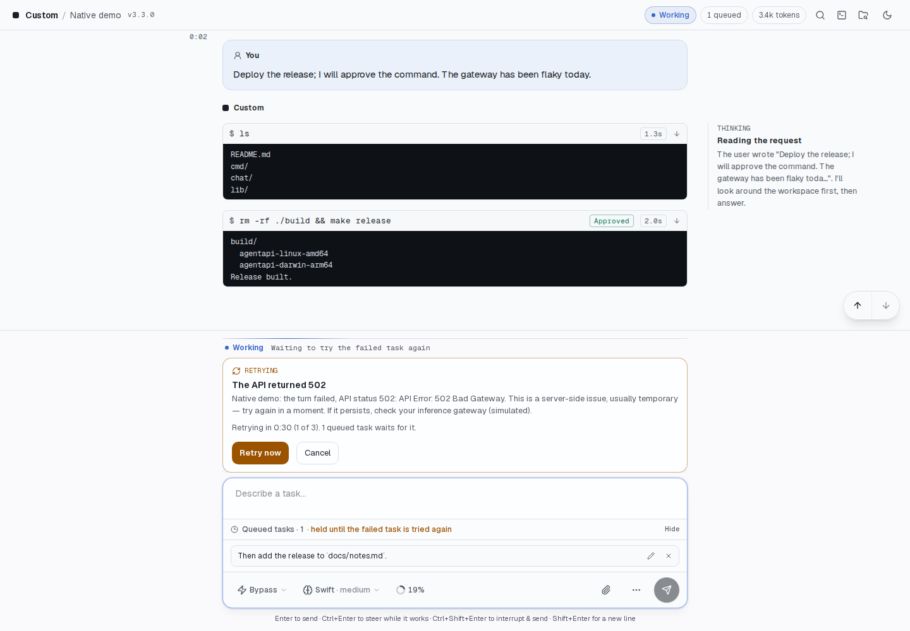

### Terminal

AgentAPI provides a shell in the agent's working directory for logins, git commands and
other work. It supports colors, cursor movement and full-screen programs, and fits the window on
desktops and phones. Everyone shares the same shell, like a tmux window. It keeps running with no
viewers; if it exits, opening the terminal starts a new one. Its environment matches the agent's,
with AgentAPI's own variables removed.

Web links are clickable even when wrapped across lines. The last link printed by a command, such
as a login URL, also appears above the terminal for opening or copying.

The key bar supplies arrows, Enter, Esc, Tab, Shift+Tab, Ctrl+C, Ctrl+R, Ctrl+A, Ctrl+E, Ctrl+U,
Ctrl+W, Home, End, Page up, Page down, / - | ~, Alt+↑ and Ctrl+L. Ctrl+D and Ctrl+Z require a second
press. The Ctrl and Alt buttons hold the modifier for the next key.

- `GET /terminal` streams its output as server-sent events (`output` events
  with base64 data, the first one the recent output to replay; `exit` when the
  shell exits) and starts the shell if it doesn't run.
- `POST /terminal/input` (`{"data": "..."}`) types into it, one request at a
  time, and `POST /terminal/resize` (`{"cols": 120, "rows": 40}`) sizes it.
  Input a busy program doesn't read gets 503 after 10 seconds; part of it may
  have been typed.
- It is on by default; `--terminal=false` turns it off. It has the same protection as the rest of
  the API, so use `--api-token` when others can reach the server.

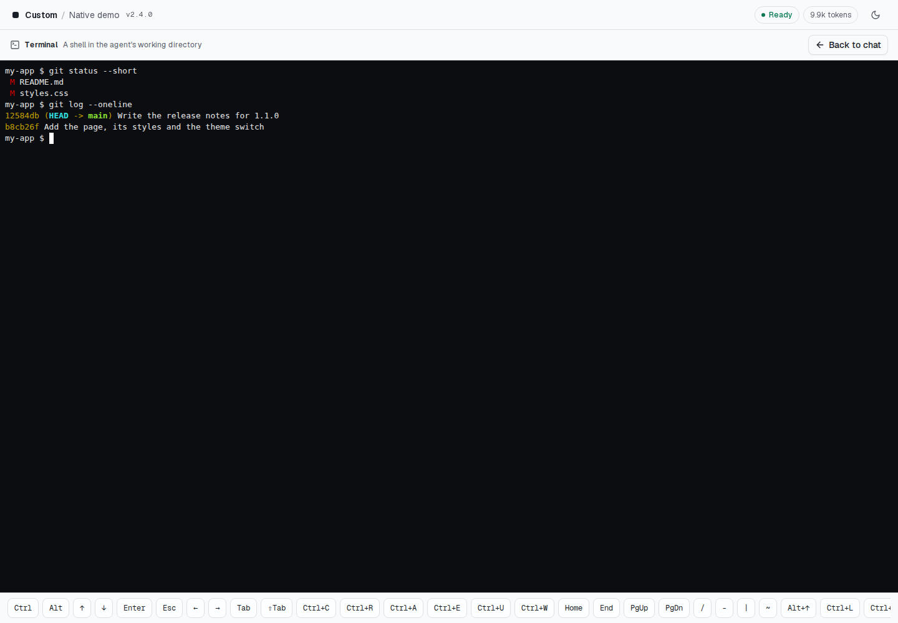

### Slash commands and compaction

The agents don't run their interactive terminal UI. The chat handles these slash commands for
them:

- `/model [model]`, `/effort [effort]` (`/think`) and `/mode [mode]`
  (`/permissions`) switch a setting by its id or name, or open its menu;
  `/plan` switches to the plan mode;
- `/compact` compacts the context;
- `/clear` (`/new`) starts a new conversation;
- `/terminal` opens the terminal, and `/login` runs the agent's login command
  in it;
- `/help` lists them.

The composer suggests commands as you type their names. Tab completes the first suggestion. Anything
else is sent to the agent as typed, so the agent's own commands (Claude Code's `/code-review`, Pi's
extension commands) still work. `POST /compact` compacts the context while the agent isn't working
on a turn: Codex (`thread/compact/start`) in a turn of its own, Pi (its `compact` command) before it
answers. Messages sent meanwhile wait in the queue, and the agent's refusal (Pi's "Nothing to
compact") is a 409 with its reason. Claude Code compacts with the `/compact` message, which the chat
sends it.

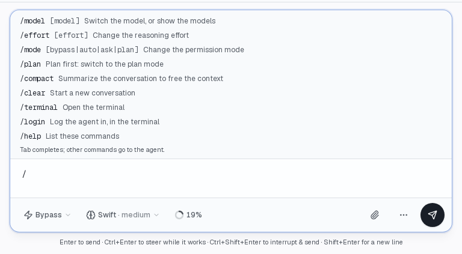

### Persistent sessions

`--state-db <file>` keeps the conversation in a SQLite file: messages, rich messages (tool calls,
thinking), the timeline, requests and the queue, plus the agent's own session ID and the webhook
settings changed through the API. When AgentAPI starts again with the same file, the chat shows the
conversation as it was and queued messages are still queued. The agent resumes its session, so it
remembers the conversation too. After a clean shutdown, browser caches
stay valid because the conversation keeps its epoch. Without `--state-db`, every start of AgentAPI
is a new conversation, except a [restart in place](#agentapi-restart), which resumes the agent's
session.

```bash
agentapi server --state-db ~/.agentapi/myproject.db -- claude
```

`{port}` and `{hostname}` in the path are filled in, so one line in the
[config file](#flags) gives every AgentAPI of the user a file of its own, such as the Claude Code
one on 3286 and the Codex one on 3285 that a Coder workspace starts:

```yaml
state-db: ~/.agentapi/state/{port}.db
```

- Every `agentapi server` reads the config file, and the first to start locks
  the database, so a `state-db` there without `{port}` is ignored with a
  warning rather than keeping the others from starting. `--state-db` and
  `AGENTAPI_STATE_DB` still set one.
- Requests that were open when AgentAPI stopped are marked expired: the agent
  that asked is gone.
- The server holds the tool calls and timeline of the latest 100 tasks in memory and reads earlier
  ones from the file when a client asks, so a conversation of months starts about as fast as a new
  one, and its memory stops growing with it ([Long conversations](#long-conversations)).
- Uploads are kept next to the file (`<file>.uploads`), because messages refer
  to them by path. One that nothing in the conversation (or the queue) refers
  to is removed once it is 7 days old, which leaves time for a draft's
  attachments; this is checked on start, hourly and after a restart.
- A file belongs to one agent type and working directory; AgentAPI refuses to
  start with another one's file. A file AgentAPI 2 wrote for a PTY agent
  opens: the agent starts a new session below its conversation, which goes
  on natively. It is locked while AgentAPI runs,
  so a second AgentAPI (or `sqlite3`) can't open it.
- A new file is created readable and writable by its owner only (0600), and missing
  directories are created (0700).
- An older AgentAPI keeps using a file a newer one wrote, unless the newer one
  changed the file in a way the older can't write: then the older refuses to
  start and names the version it needs. Releases after 1.9.0 check this;
  1.9.0 and earlier refuse any file whose schema is newer than theirs (the
  schema hasn't changed since 1.0).
- Restart (Explorer → Restart or `DELETE /messages`) clears the stored
  conversation and the queue and starts a new session. The settings chosen for
  the session are kept.
- Writes are batched every 200 ms, so streaming doesn't wait for the disk.
  After a crash the last of them may be missing, so the conversation gets a
  new epoch and clients load it again in full. Writes that keep failing are
  reported as an error.
- A restored conversation doesn't get `--initial-prompt` again.
- Webhook settings changed with `PUT /webhook` or in the Explorer apply after
  a restart, unless AgentAPI starts with other webhook flags.
- The time a client last showed the conversation (`POST /tasks/seen`) is
  kept, so a task that ended unseen is still [unread](#watching-many-instances)
  after a restart. A database written before 1.2 treats its tasks as seen.
- SIGUSR1 writes what the state database hasn't written yet.
- AgentAPI 4 no longer reads `--state-file`, the PTY transport's persistence
  before v1.0.0. AgentAPI 3 imported such a file into a state database next to
  it (the same name with `.db`) the first time it started with it: start with
  `--state-db` on that database. To import a file that never was imported, run AgentAPI
  3.16 once with `--state-file`.
- [`agentapi restart`](#agentapi-restart) (SIGUSR2) and
  `agentapi update --restart` keep the conversation, and the agent's
  session, of an AgentAPI with `--state-db`. Without it they keep the
  agent's session, and the conversation is read back from its log; the
  queue, open requests and chosen settings start anew.

### Earlier sessions

AgentAPI reads Claude Code, Codex and Pi session logs to list and open earlier sessions in the
working directory. This works without `--state-db`:

- `GET /sessions` lists them, the latest first, with the one the agent has
  open (`current`): each with its `id`, `title` (the agent's or the user's
  name for it), `first_prompt`, number of `prompts`, and when it started and
  last changed. Sessions in which the user sent nothing are left out. They
  are read from Claude Code's projects directory, Codex's sessions and Pi's
  session directory (`CLAUDE_CONFIG_DIR`, `CODEX_HOME`,
  `PI_CODING_AGENT_DIR`, `PI_CODING_AGENT_SESSION_DIR` and a `--session-dir`
  passed to Pi are honored). A session belongs to the directory its log
  records, even when AgentAPI runs in it through a symlink. Claude Code gives
  some directories the same name (`/w/a_b` and `/w/a-b`); AgentAPI keeps their
  sessions apart.
- `POST /sessions/{id}/resume` restarts the agent on that session, and
  replaces the conversation with the session's, read from its log. With
  `{"fork": true}` the agent opens a copy of it under a new id (Claude Code's
  `--fork-session`, Codex's `thread/fork`, Pi's `--fork`), and the session
  itself stays as it was. The queue and open requests are cleared, as on a
  restart. It returns 409 while the agent works on a turn, compacts its
  context or restarts, and the refused resume leaves the conversation as it
  was. An id that isn't one file name (a `/` or `\`, `.` or `..`, a control
  character) gets 400.

In the chat, the Explorer's Session tab lists the sessions with **Open** and **Start a copy**, which
ask for a second click.

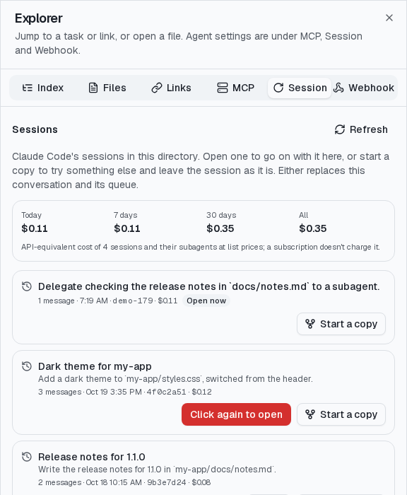

### Session costs

AgentAPI reads model calls from the agent's session logs and prices their tokens in USD at the
providers' list prices. This is an API-equivalent cost: Claude and ChatGPT subscriptions don't
charge per token, so it estimates what the same work would cost with an API key.

- Claude Code: every call in the session's log and in its subagents' logs, with the cache writes
  priced as Anthropic's 5-minute or one-hour cache. Tokens Claude Code counts in its own total but
  doesn't log call by call, such as compacting the context, are added from its cost records as
  unitemized calls, priced like the others. Where Claude Code's own cost of the same tokens differs
  (its prices aren't these), the costs stay AgentAPI's and the server logs a warning once per model.
- Codex: each turn's token counts, its subagents' included; input read from the cache is priced as a
  cache read, and the rest as input.
- Pi: the cost Pi reports for each call.

A call whose record has no model or usage, or usage that reads as no tokens, counts no cost, and the
server's log warns of it once per log: the agent may have changed its log format, renaming a field.

A call that a fork copied from another session counts in the session it came from, so totals don't
count it twice. The built-in prices cover Anthropic's and OpenAI's models; `--prices <file>` adds
models or replaces their prices, in USD per million tokens:

```json
{
  "my-model": {"input": 3, "output": 15, "cache_read": 0.3, "cache_write": 3.75},
  "gpt-6.1-sol": {"input": 2, "output": 10, "cache_read": 0.1, "cache_write": 2.5,
    "tiers": [{"input_tokens_above": 272000, "input": 4, "output": 15, "cache_read": 0.2, "cache_write": 5}]}
}
```

A tier applies to a call whose input (uncached, read from and written to the cache) is above
`input_tokens_above`. Model IDs are matched ignoring case, a provider prefix (`anthropic/`), a
context suffix (`[1m]`) and a release date, else by the longest known prefix
(`claude-opus-5-5-x` is priced as `claude-opus-5-5`), but not across a `-mini`, `-nano` or `-pro`
variant (`gpt-5.1-codex-mini` isn't a `gpt-5.1`). A call to a model without a price counts its
tokens but no cost (`priced: false`), and the server's log warns of the model once.
`scripts/prices.mjs` compares the built-in prices with Pi's model registry.

- `GET /sessions` gives each session's `cost`: `usd`, `tokens`, `calls`, the cost per model
  (`models`) and per hour (`hourly`, in UTC, with its `tokens`), and `total_cost`, the sum of all
  of them.
- `GET /cost` gives the open session's cost and its model `calls` (`time`, `model`, `tokens`, `usd`,
  `subagent_id`), from which a task's cost is the calls made from its message until the next. A
  client that has the first calls sends `from` (how many) and the `digest` it got with them, and
  gets the calls after them only (`from` in the answer); the answer's `total_calls` and `digest`
  are what to send next time. If those calls changed, it gets them all, with `from` 0.

In the chat, each task shows what it cost under its start time and duration (in its header on narrow
screens), with the tokens in the tooltip. The chat refreshes the cost when a turn ends, and every 15
seconds while one runs. The Explorer's Session tab shows what each session cost, and what all of
them cost today, in the last 7 and 30 days and in all, by your time zone.

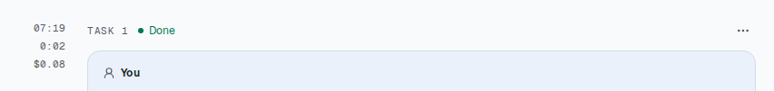

### Claude Code

AgentAPI runs `claude -p` headless with stream-json on stdin and stdout. Tool calls carry their
input, result, status and images, and each assistant message has its model, stop reason and token
usage.

The permission mode, model and effort switch with Claude Code's control requests
(`set_permission_mode`, `set_model`, `apply_flag_settings`); its models and their efforts come
from its initialize response, and the model and effort it runs with from `get_settings`.

- Approvals offer Allow, Deny (with optional feedback for Claude) and, when
  Claude Code suggests a permission rule, "Allow always", which applies the
  rule to this session only. Commands Claude Code considers read-only run
  without asking.
- Questions list Claude's options; any other answer is accepted too.
- Plans show the plan and offer "Yes, and bypass permissions" (when the
  session can switch to it), "Yes, and auto-accept edits", "Yes, and manually
  approve edits" and "No, keep planning". Feedback sent with No makes Claude
  revise the plan and ask again.

Claude Code supports `steer` (a steered message joins the running turn at Claude's next step),
`interrupt` (if Claude Code doesn't end the interrupted turn within 10 s, AgentAPI ends it),
`resume` and `images`. The session name is the title Claude Code generates after the first prompt;
after `/clear` the new session is titled too, and it is the one `--state-db` resumes. A turn ends
when Claude Code reports it is idle, so a background subagent and the turn it wakes up when it
finishes belong to the turn that started it. The subagent's own steps are left out of the
conversation, as in the session log, and its tool call shows as running until it reports.

Command line and environment:

- AgentAPI adds `-p --output-format stream-json --input-format stream-json
  --verbose --include-partial-messages --replay-user-messages
  --permission-prompt-tool stdio`, and `--session-id` for a new session or
  `--resume` for a resumed one.
- Unless you choose otherwise, it adds `--permission-mode bypassPermissions`,
  so tools run without asking. Questions (AskUserQuestion) and plans
  (ExitPlanMode) still come as requests, and approving a plan offers to
  bypass permissions. Pass `--permission-mode default` (or `acceptEdits`,
  `plan`, …) to start in another mode, or switch it while Claude Code runs
  (see [Settings](#settings-permission-mode-model-and-effort)). AgentAPI also
  adds `--allow-dangerously-skip-permissions`, so a session can switch to
  bypass later. Claude Code refuses `bypassPermissions` as root outside a
  sandbox. When AgentAPI runs as root, it adds `--permission-mode default`
  instead, leaves out `--allow-dangerously-skip-permissions` and logs a
  warning. Set `IS_SANDBOX=1` in a sandbox, or choose a mode yourself
  (`--allow-dangerously-skip-permissions` alone still makes Claude Code exit
  as root). It also adds `--thinking adaptive --thinking-display summarized`
  (without it thinking is empty). Your `--permission-mode`,
  `--dangerously-skip-permissions`, `--thinking`, `--max-thinking-tokens` or
  `--thinking-display` wins.
- Flags that conflict with the protocol or the session AgentAPI manages are
  rejected at startup: `-p`/`--print`, `--output-format`, `--input-format`,
  `-r`/`--resume`, `-c`/`--continue`, `--session-id`, `--fork-session`,
  `--from-pr`, `--teleport`, `--permission-prompt-tool`,
  `--permission-prompts`, `--bg`/`--background`, `--cloud`/`--remote`,
  `--desktop`, `--remote-control`/`--rc`, `--sdk-url`, `--resume-session-at`
  and `--resume-drops-turn`, even inside a group of short flags such as
  `-pc`. Your own copies of `--verbose`,
  `--include-partial-messages` and `--replay-user-messages` are dropped.
  Everything else (`--model`, `--allowedTools`, `--mcp-config`,
  `--append-system-prompt`, ...) is passed through.
- Besides removing a parent agent session's variables (see
  [Native transport](#native-transport)), AgentAPI sets
  `CLAUDE_CODE_EMIT_SESSION_STATE_EVENTS=1` and
  `CLAUDE_CODE_ENTRYPOINT=sdk-cli`.

Resuming a session keeps Claude's context; Claude Code doesn't replay the earlier messages, so the
chat shows them only from the `--state-db` file. A session can be resumed once it had a turn; with
`--no-session-persistence` it can't, and `resume` is false. Requests still open when Claude Code
exits or restarts can't be answered anymore. Slash commands that need the interactive UI don't work.

### Codex

AgentAPI starts `codex app-server` and starts or resumes a thread. Messages, rich messages and the
timeline have the same shape the session-log parser produces, so the chat shows Codex's replies,
reasoning summaries, commands (the command itself, not the `bash -lc` wrapper), file edits, MCP tool
calls, plan updates and token usage as they stream. Every turn asks for detailed reasoning summaries
unless you choose `model_reasoning_summary` with `-c`; whether the model writes any depends on the
model and the reasoning effort.

Codex's command line after `codex` is handled like this:

- `-c`/`--config`, `--enable`, `--disable`, `--code-mode-host`,
  `--strict-config` and `--analytics-default-enabled` are passed to
  `codex app-server`.
- `-m`/`--model`, `-s`/`--sandbox`, `-a`/`--ask-for-approval`
  (`untrusted`, `on-request`, `never`) and `-C`/`--cd` become the thread's
  settings; `--dangerously-bypass-approvals-and-sandbox` means `-a never -s
  danger-full-access`. Without them (or `-c approval_policy=...`,
  `sandbox_mode`, `approvals_reviewer`), the thread runs without approvals or
  sandbox (the native transport's bypass mode). Switch it from the chat or with
  `PUT /settings` (see [Settings](#settings-permission-mode-model-and-effort)).
  Codex 0.160 refuses `approval_policy = "untrusted"` in its config, so use
  `-a untrusted` for that policy.
- `--no-alt-screen`, `--no-daemon` and `--stdio` are ignored.
- Short flags take attached values as Codex does (`-mo3`, `-m=o3`); a value
  on a switch (`--dangerously-bypass-approvals-and-sandbox=false`) is
  rejected.
- A prompt, a subcommand (other than `app-server`), `-p`/`--profile`,
  `-i`/`--image`, `--oss`, `--local-provider`, `--search`, `--add-dir`,
  `--approve-for-me`, `--dangerously-bypass-hook-trust`, `--remote`,
  `--remote-auth-token-env`, `--worktree`, `--listen`, `--help`, `--version`
  and unknown flags are rejected at startup with an explanation. Use
  `--initial-prompt` for a first message and attach images to messages
  instead.

Codex supports `steer`, `interrupt`, `resume` and `images`. Command, file-edit and MCP tool
approvals, permission requests, MCP form elicitations and `request_user_input` questions arrive as
requests. Codex asks those questions in the plan mode; with codex-cli 0.160,
`--enable default_mode_request_user_input` lets it ask them in the default mode too. The plan mode
is Codex's plan collaboration mode, an experimental part of app-server's API that AgentAPI opts
into. Codex ends its turn with a plan, and AgentAPI asks "Implement this plan?" as the Codex TUI
does. The Yes options (`implement_bypass`, `implement_auto` and `implement_ask`, the mode before
the plan first) leave the plan mode for that permission mode, and Codex implements the plan in the
same turn. No (`keep_planning`) with feedback sends the feedback back to Codex, which keeps
planning; No alone ends the turn.

The other requests' option IDs are Codex's own decisions (`accept`, `acceptForSession`,
`acceptWithExecpolicyAmendment`, `decline`, `cancel`, …). Nothing is approved automatically, and
requests AgentAPI can't show are declined. A command approval shows the command that runs, without
the shell wrapper; Codex's reading of it (files it reads, searches) is in the detail. Requests still
open when a turn ends are declined (MCP elicitations cancelled), so neither Codex nor an MCP server
keeps waiting. A steered message joins the running turn at Codex's next model request (the current
output keeps streaming); the reply to it is filed under the steering message. An interrupt ends the
turn within milliseconds, and tool calls it cut short show as failed.

The session reference is Codex's thread ID. Resuming it continues the thread with its context. A
turn that was running when the process died comes back as interrupted, approvals that were pending
are gone, and Codex's earlier turns are not loaded into AgentAPI's conversation (the chat shows them
only from the `--state-db` file). A thread that can't be resumed is replaced by a new one, with a
warning. Codex doesn't name threads itself; a name set elsewhere (`thread/name/updated`) becomes the
session name.

Codex's own slash commands are TUI features; the chat runs `/model`, `/compact` and the others in
[Slash commands](#slash-commands-and-compaction) itself, and `/review` isn't available. Command
output streams as a preview that Codex may leave incomplete, and the full output replaces it when
the command ends.

### Pi

AgentAPI runs Pi in its RPC mode (`pi --mode rpc`, JSON over stdin and stdout).

- **Flags.** AgentAPI adds `--mode rpc --session-id <id>` (a new
  `agentapi-<hex>` ID for every new session, including after a restart). It
  refuses options that pick the mode or the session or make Pi exit (`--mode`,
  `--print`/`-p`, `--session`, `--session-id`, `--continue`/`-c`,
  `--resume`/`-r`, `--fork`, `--no-session`, `--export`, `--list-models`,
  `--help`/`-h`, `--version`/`-v`), `@file` arguments, messages (after `--` or
  as bare arguments, which RPC mode would ignore) and subcommands
  (`pi install`, `remove`, `uninstall`, `update`, `list`, `config`, `auth`,
  `mcp`), with an error that names the option. It drops the TUI-only
  `--tui-mode` and `--use-theme` with their values. Everything else is passed on
  (`--provider`, `--model`, `--thinking`, `--session-dir`, `-e`, `--approve`,
  extension flags); `--flag=value` is split for Pi's built-in options, which
  Pi only reads in the two-token form. Set the thinking level with
  `--thinking`.
- **Capabilities.** Steer (`dispatch_mode: "steer"` is sent as a prompt with
  `streamingBehavior: "steer"`), interrupt (`POST /interrupt` sends `abort`; the
  turn ends as interrupted, without the "This operation was aborted" error Pi
  adds when it aborts during a tool, and if Pi doesn't end the turn within 10
  seconds AgentAPI ends it), resume, and images (attached images go to Pi as
  base64 `images`; reported unless Pi says its model doesn't take images).
- **Messages.** Text and thinking stream into the rich messages as they arrive,
  bash output streams into the tool result, and the final messages have the
  same shape as the ones parsed from Pi's session log. Images in tool results
  (an image file Pi reads) are kept.
- **Requests.** Stock Pi has no tool approvals. Dialogs that extensions open
  (`select`, `confirm`, `input`, `editor`) become requests: a `select` or
  `confirm` while a tool runs is an approval of that tool call (option IDs are
  the extension's labels), any `confirm` takes `yes`/`no`, and other dialogs
  are questions (`choice` or `value`; option `cancel` dismisses them). A dialog
  Pi times out is withdrawn. Dialogs still open when the turn ends expire with
  it, like other agents' requests (a question can then be answered with a
  message), and the extension gets a cancel; interrupting an extension command
  that waits on a dialog withdraws the dialog. An extension command that runs
  without a model turn ends with the stop reason `handled`. An extension's
  `notify` with level error shows as an error, and its `setTitle` stands in
  for the session name until Pi has one; Pi's own name (`--name`, renames) is
  the session name.
- **Resume.** Pi's session ID is the session reference. Resuming starts Pi with
  the same `--session-id` (keep the same directory and `--session-dir`), so Pi
  keeps the context; Pi doesn't replay earlier messages, so the chat shows them
  only from the `--state-db` file.
- **Shutdown.** Stopping AgentAPI (or a restart) aborts a running turn first,
  so the session log doesn't end in a tool call without result, then stops Pi
  as described in [Native transport](#native-transport).
- **Settings.** Pi has no permission modes. Its model (`set_model`, from the
  models it has a provider for) and thinking level (`set_thinking_level`,
  with the levels each model supports) can change; Pi fits the level to a new
  model by itself.
- **Commands.** Pi's TUI commands (`/settings`, `/login` and the like) are
  unavailable; the chat runs `/model`, `/compact` and the others in
  [Slash commands](#slash-commands-and-compaction), and extension slash
  commands work. Log in from the chat's terminal (`pi`, then `/login`).

### Limitations

- The agent has no terminal of its own. The agent's slash commands that need
  its interactive UI don't work, apart from the ones the chat runs itself. The
  [terminal](#terminal) is a separate shell.
- Restart (Explorer → Restart or `DELETE /messages`) replaces the agent with a
  new one in a new session and clears the conversation and the queue; requests
  still open become `not_resumable`. The `--initial-prompt` is sent to the new
  session again, and Codex and Pi are updated first.
- Without `--state-db`, the next start of AgentAPI is a new session; the
  agent's earlier session isn't resumed. A [restart in place](#agentapi-restart)
  is the exception: it resumes the session.
- Images reach the agent only as `@"<path>"` attachments of a message, not as
  command-line flags (`codex -i` and Pi's `@file` are refused).

## Conversation API

The [HTTP API reference](#http-api-reference) lists all the endpoints.

### Messages and status

- `POST /message` sends a message: `{"content": "Hello, agent!", "type": "user"}`.
  A 200 means AgentAPI saw the agent start on it, or queued it (`queued`)
  because the agent is busy; `dispatch_mode` chooses what happens then (see
  [Steer, interrupt and the queue](#steer-interrupt-and-the-queue)).
- `GET /messages` returns the conversation; `GET /rich-messages` and
  `GET /timeline` return its structured form (see
  [Structured activity](#structured-activity)). `GET /messages` returns every message unless asked
  for a page; the other two, and `GET /tasks`, return the latest 20 tasks; all page back with
  `before` (see [Long conversations](#long-conversations)).
- A message that went out but wasn't confirmed (the call timed out, or
  AgentAPI was stopping) may have reached the agent: it isn't sent again,
  but leaves the queue with an error.
- `DELETE /messages` clears the conversation (messages, rich messages,
  requests, tasks, timeline, errors and the queue) and restarts the agent
  in a new session. While the agent restarts, messages wait in the queue;
  another restart and opening a session get 409, and so does a restart while AgentAPI is stopping. Before the
  restart AgentAPI updates Codex (`codex update`) and Pi (`pi update --self`)
  when it launches those CLIs directly, one AgentAPI at a time; an update that
  fails or takes over 3 minutes leaves the installed version. Claude Code
  updates itself.
- `GET /status` returns the backward-compatible `stable`/`running` status,
  the detailed lifecycle, the transport, `server_id` (a random identifier of
  this AgentAPI run, new at every start), `turn` (how many times the agent
  started working), the conversation's `epoch`, the session name, the
  AgentAPI version, `agent_session_id` (the agent's own session, which
  [`GET /sessions`](#earlier-sessions) lists), `capabilities`,
  `pending_requests`, `settings`, `usage`, `terminal` and `login_required`.
  The lifecycle is `starting`, `ready`, `running`, `restarting`, `exited` or
  `failed`. An agent that exits is `restarting` while AgentAPI starts
  it again, until the new agent accepts turns, and `failed` once it gives
  up. `restarting`, `exited` and `failed` don't change with the agent's
  status until the agent is back.
- `GET /tasks` returns the conversation's [tasks](#tasks).
- `GET /title` returns the session's human-readable title.
- `POST /upload` stores a file (up to 100 MB, else 400; a body over 101 MiB
  gets 413 when that much is read) and returns its path, which a message references as
  `@"<path>"`. The file keeps the base name it was sent with, without control
  characters and cut to 255 bytes; a name of `.` or `..` gets 400. A file
  the conversation doesn't refer to is removed after 7 days.

### Structured activity

- `GET /rich-messages` returns the structured conversation: thinking, tool
  calls with their results, usage and stable message identifiers, from the
  agent's protocol.
- `GET /timeline` returns normalized session events suitable for export,
  auditing, or building another UI. With `?subagents=true` (Claude Code and
  Codex), the events of the subagents the agent ran follow, read from their
  own logs. Each subagent's events come in turn, starting with a system
  event; each event has its `subagent_id` and, for Claude Code, the
  `parent_tool_use_id` of the Agent tool call that started it. The agent's
  own events only have the subagent's prompt and final answer.
- `GET /timeline/export` streams the whole timeline as JSON Lines, the subagents' events after
  the agent's own with `?subagents=true`: the chat's conversation download.

### Tasks

AgentAPI groups the conversation into tasks: a task is a message of yours and
the agent's turn on it. Messages you add while it runs (steering) belong to it; the next message
after it ends starts the next task. A task ends when the agent is idle again with no request open.
When answering a request leaves the agent idle, AgentAPI waits 3
seconds before ending the task, since the agent usually continues working.

`GET /tasks` lists them, the earliest first, each with:

- `id`: the ID of the message that started it, as in `GET /messages`;
- `number`: its place in the conversation, from 1 (the chat's Task *n*);
- `status`: `running`, `completed`, `failed` (the agent reported an error or
  exited; `errors` says what, also when AgentAPI tries a
  [transient error](#transient-api-errors) again) or `limited` (a
  [usage limit](#usage-limits) stopped it; `limit` has the stop);
- `prompt` (the start of the message), `started_at` and `ended_at`;
- `reply_id`: the agent's last message of the task;
- `steered`: the IDs of the messages added while it ran.

Each rich message carries the `task_id` of the task it began in, so a client groups the tool calls
and thinking by task without guessing from timestamps; a resumed session's rich messages have none.
Messages restored or opened from before AgentAPI started are history: their tasks are completed. The
[state database](#persistent-sessions) keeps the tasks, and a task that ran when AgentAPI stopped is
over after a restart. `/events?sync=1` sends `task_update` when a task starts or changes, and the
chat and the [webhook](#webhooks)'s `task.*` events use the same tasks.

### Message queue

Messages submitted while an agent is busy are placed in a FIFO queue instead of being rejected.
The API and the chat UI can show, edit or delete a queued message before it goes out.

- `GET /queue` lists the queued messages.
- `PUT /queue/{id}` edits a queued message and `DELETE /queue/{id}` removes
  it.
- `PUT /queue` with `{"ids": [...]}` reorders the queue. It must list every
  queued message once (409 otherwise).
- `POST /queue/{id}/steer` moves a queued message into the running turn (409
  if no turn is running; the message stays queued).
- If the agent refuses a queued message, AgentAPI tries it up to 5 times in
  all, then drops it with an error that quotes it. A message the agent didn't
  answer in time is dropped at once: it may have reached the agent, and
  sending it again could run the task twice.
- With `?sync=1`, `/events` sends a `queue_update` with the whole queue
  whenever it changes, so a client sees what another client queued without
  asking.

### Events and incremental sync

`GET /events` streams server-sent events: `message_update`, `status_change`,
`rich_message_update`, `agent_error`, `request_update` and a `heartbeat` every
15 seconds, so clients can detect a lost connection. With `?sync=1` the stream starts with a
`session_sync` event, adds `task_update` and `queue_update`, and every update carries a `seq`;
reconnecting with `&since=<seq>&epoch=<epoch>` replays only what changed. Clients without `sync`
don't get those three events: some (such as agentapi-sdk-go) reject event types they don't know.

With `?sync=1`, events also carry SSE IDs (the end of the replay has the replay's `seq`, later
changes their own), so a plain `EventSource` that reconnects by itself resumes from its
`Last-Event-ID`; put the `epoch` from `GET /status` in the URL. When a message is taken back (a
turn the agent refused to start), the conversation gets a new epoch and the server ends the event
streams: clients reconnect, and with their old epoch get the whole state
again. Opening a session with more than 256 rich messages ends them too, rather than streaming it.

The full replay (a new client, another epoch) holds the latest 20 tasks, not the whole
conversation; the earlier ones are read a page at a time (below). A client that resumes from
before a change the server no longer holds gets the full replay too. With `?sync=1` it comes the
newest task first: the status and errors, then each task's messages and its rich messages, and
what came before the first task last. Without `sync` it keeps the order it always had: the
messages, the status, then the rich messages.

### Long conversations

An agent that works for months on one conversation builds up about 100 KB a task (its tool calls,
their output, the timeline). AgentAPI keeps that bounded:

- `GET /rich-messages`, `GET /timeline` and `GET /tasks` return a page of tasks and what belongs to
  them: without parameters the latest 20, as the full `/events` replay holds them. `GET /messages`
  pages the same way with `before` or `limit`; without either it returns every message, as it
  always did, since the server keeps the messages (they are small) and upstream's clients expect
  them all. `has_more` says earlier tasks exist; pass `next_before` (the ID of the page's first task)
  as `before` for the page before, and `limit` (up to 100) for its size. The page that reaches the
  start also holds what came before the first task.
- With `--state-db`, the server holds the rich messages and the timeline of the latest 100 tasks
  in memory, and reads earlier pages from the file; a restart loads only those. The messages and
  tasks, a few KB a task, stay in memory. Nothing is deleted: `GET /timeline/export` streams the
  whole timeline from the file a part at a time.
- Without `--state-db` the server holds the whole conversation in memory, as before, and the lists
  page it the same way.
- The chat loads the latest tasks and reads earlier ones as you scroll up; see the
  [chat guide](docs/chat-ui.md#long-conversations).

AgentAPI 4.2 and earlier returned every message, rich message, event and task from these lists.
A client that wants all of them reads the pages until `has_more` is false.

## Integrations

Use [webhooks](#webhooks) to send tasks, requests, messages and heartbeats to a receiver,
the [summary](#watching-many-instances) to monitor several AgentAPIs, and
the [human-reply API](#human-reply-api) to answer the agent through a bot.

### Watching many instances

To display several AgentAPIs in a sidebar or dashboard, read one summary response or stream per
instance:

- `GET /summary` returns the `instance` identity (as in [webhook](#webhooks) events: `id`, `name`,
  `server_id`, host, port, directory, agent and `url`), `status`, `lifecycle` and a `title` from the
  session name or the start of the latest prompt. It also includes the latest [task](#tasks), task
  count, `pending_requests`, the oldest pending `request` (its kind, title and when the agent
  asked), `queued_messages`, `login_required`, `limit_stop`, `retry_wait`, `usage` (context window and account
  limits) and, for Claude Code, Codex and Pi, `spend`: the API-equivalent cost of the agent's
  sessions in the working directory over the last 24 hours (`day_usd`) and 7 days (`week_usd`),
  worked out from its logs once a minute, the tokens of the same calls (`day_tokens` and
  `week_tokens`: `input`, `output`, `cache_write`, `cache_read` and their `total`), when the amounts
  last changed (`updated_at`), a `scope`, and from 4.2 the hours behind them (`hours`: each of the
  last 25 hours with calls, its start in UTC, `usd` and `tokens`; the hub's
  [activity](docs/hub.md#activity) keeps them for a year). AgentAPIs of one agent in one directory
  of a machine report the same sessions, with the same `scope`: a client that adds up many counts each scope
  once. Its `update` says whether a client can [update the AgentAPI](#updating-through-the-api), and
  how far an update is.
- `attention` identifies why the agent needs you, in priority order: `login`, `request` (approval,
  question or plan), `limit` (a usage limit stopped the turn), `exited`, or `none`.
- `GET /events?only=summary` sends `summary_update` on connection and when the summary changes,
  plus heartbeats. It omits messages, so a client can follow dozens of
  instances. Reply text growing doesn't change the summary; task starts and ends, requests, status
  changes and queue changes do. One change sends one `summary_update` with all it changed: a turn's
  end sends the agent stable with its task done. Other `/events` clients don't receive
  `summary_update`.
- `unread` is true when the latest task ended after a client last showed the conversation, and
  `seen_at` says when that was. `POST /tasks/seen` marks the tasks seen for every client of the
  instance; the chat calls it while it shows the conversation. The
  [state database](#persistent-sessions) keeps it, so an unseen task stays unread after a restart.

To find the instances on a machine, read the registry: while it serves, each AgentAPI keeps an
entry in `~/.agentapi/instances` (`--registry-dir`; `--registry=false` turns it off) with its `id`,
`name`, `server_id`, `url` (`--public-url`, else its listen address), PID, directory, agent,
`auth_required` (never the token) and `restarts_in_place` (it restarts in place on SIGUSR2, see
[`agentapi restart`](#agentapi-restart)) and, on Linux and macOS, `process_start` (when its process
started, as the system counts it). It removes the entry when it stops; an entry whose process is
gone (after a crash) is removed when the registry is listed, also when another process has since
taken its PID (it started at another time). Check that `GET /summary` returns the
entry's `server_id` before using one: another AgentAPI may have taken the port.
[`agentapi list`](#agentapi-list) shows the registered instances with their summaries.

Set `--instance-id` to identify the instance (default `<hostname>:<port>`), `--name` for its display
name (default the working directory's name), and `--public-url` for its address. `PUT /webhook` can
change the ID and URL at runtime.

For a browser client on another origin, add that origin to
[`--allowed-origins`](#allowed-origins). To send an [API token](#api-token-authentication), read the
stream with `fetch` and an `Authorization` header; `EventSource` can't set that header.

#### Running a hub

A hub watches many AgentAPIs on any machines it can reach. Run it somewhere that stays up, such as
an always-on workspace, and reach it and the AgentAPIs over a private network such as your own VPN.
The [hub guide](docs/hub.md) covers setup step by step, every state, tokens, troubleshooting and the
hub's API.

```bash
agentapi hub serve --token "$HUB_TOKEN" --secret "$HUB_SECRET" --instance-token "$AGENTAPI_TOKEN"
```

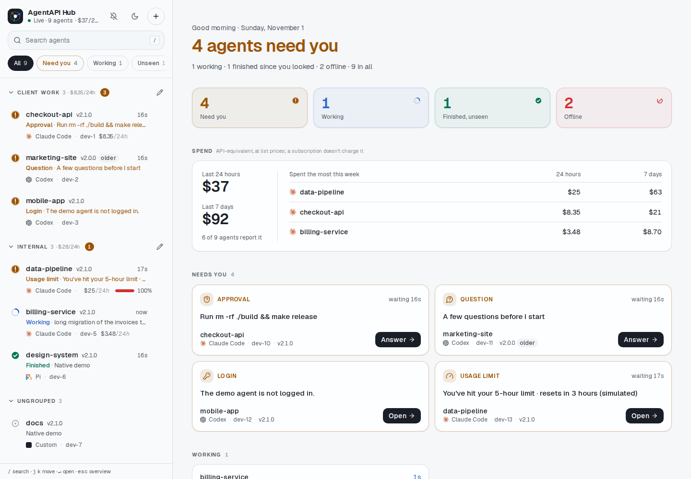

Open `http://<hub>:3290/` on a desktop or a phone and sign in with `--token`. The list shows every
instance: the ones you pinned on top, then those that need you first by group, or the latest change
first; **By machine** puts each machine's agents together in one card, a tab each, in either order.
Each shows its state (the reason it waits, such as an approval or question, a login or a usage
limit; or working, finished a task you haven't seen, idle, unreachable or stopped) with its title,
agent, machine, AgentAPI version, queue and usage limit. The tab title counts what needs you. Pick
one to open it in the chat. On a phone the list and the chat take turns.

- AgentAPIs join it with [`agentapi hub join`](#joining-a-hub): their signed `instance.*` events
  add them, and the hub follows each one's [summary stream](#watching-many-instances) from one
  connection. `+` has the join command for a machine, with the hub's address and secret filled in,
  and a prompt for an agent there; it also adds an instance by its URL (and token). Each row's `⋯`
  menu pins the instance to the top, puts it in a group of your own, mutes what it waits for until
  that changes (a login you won't do), or forgets a stopped or unreachable one. The Offline tile
  and filter forget every stopped one at once.
- The gear opens the hub's settings. There you keep [favorite prompts](docs/hub.md#favorites),
  which ☆ in the composer of a chat the hub opens inserts in the message, keep the
  [model providers](docs/hub.md#model-providers) every machine's sessions can switch to, and
  connect the hub's [GitHub App](docs/hub.md#github-settings).
- ◎ (or `i`) opens [Issues](docs/hub.md#issues), the issue dispatch: the open issues of your
  repositories by stage, the machines whose launchers report (an offline one can be forgotten
  there), and each job's agent, pull request and cost. Machines take issues with
  [`agentapi host`](#agentapi-host).
- The hub opens an instance through itself (`/i/<id>/...`), sending the instance's API token
  (`--instance-token`, or the one given when it was added) in place of your credentials. The
  browser never holds the instances' tokens or reaches them itself, so no instance needs CORS for
  it.
- It accepts only events signed with `--secret`, at most 10 minutes old and with a delivery ID, and
  ignores a delivery it already received, because an event names the URL the hub sends an instance
  token to. An event never moves an instance the hub follows, or one added by hand; see the
  [hub guide](docs/hub.md#tokens-and-security) for what one can do.
- An instance the hub can't reach that also missed three heartbeats (3 minutes by default), such
  as one whose workspace was killed, counts as stopped; its next heartbeat brings it back.
- The overview adds up the agents' spend, tokens and work time over the last 24 hours and 7 days,
  and its [Activity](docs/hub.md#activity) card shades each day of the last year by work time,
  tokens or spend, as GitHub draws contributions. Each card folds to its headline.
- It keeps the instances and the favorites in `~/.agentapi/hub/instances.json` (`--state`,
  readable by its owner only), so it knows them after a restart, and the activity of the last year
  in `activity.json` next to it.
- `--port` (default 3290) and `--bind` (such as the VPN address) set where it listens. Serve it
  over HTTPS, or only on the private network: signing in sends the token. A sign-in lasts 30 days.
  To reach the instances through a VPN client running in userspace, set `ALL_PROXY` to its SOCKS5
  proxy.
- The hub serves the chat of its own version: run the same AgentAPI version on the hub and the
  instances. A row marks an instance older than the hub, and the overview counts the versions and
  says how to update the older ones.

#### Joining a hub

[`agentapi hub join`](#agentapi-hub) connects a machine's AgentAPIs
to it without changing how they start, so it also works for AgentAPIs a script starts with fixed
flags, such as a Coder workspace's:

```bash
sudo agentapi update   # the latest release reads the config file
agentapi hub join http://hub.vpn:3290/hooks --secret "$HUB_SECRET" --public-url 'http://{ip}:{port}'
```

`join` writes the hub's webhook (`webhook-url`, `webhook-secret`, `webhook-events`, `public-url`)
into `~/.agentapi/config.yaml`, which every `agentapi server` of the user reads when it starts, and
applies it to the registered AgentAPIs running now: each sends `instance.heartbeat` to the hub at
once. After a restart (of the workspace, for example), the AgentAPIs send `instance.started` from
the file. `--public-url` is where the hub reaches them; `{port}` and `{hostname}` are filled in for
each, and `{ip}` with the machine's IPv4 address on the route to the hub, which each AgentAPI looks
up again while it runs: when DHCP gives the machine another address, the next heartbeat names it and
the hub follows. AgentAPIs that started before 1.2 aren't registered: restart them once. `agentapi hub status`
shows the hub and where each running AgentAPI reports; `agentapi hub leave` removes it. With
`--allow-update`, the hub can also [update them](#updating-through-the-api). `join`
first sends the hub a signed test event and stops if the hub doesn't take it (not reached, a sign-in
page in front of it, or another secret); `--no-check` skips that for a hub that doesn't run yet. The
hub's page has the command ready: `+` fills in the hub's address and, on a hub with a token, its
secret, next to a prompt that has an agent on the machine join it. The hub also logs the command for
each of its addresses when it starts, without the secret. An agent can do it for you with the
[agentapi-hub-join skill](skills/agentapi-hub-join/SKILL.md); see the
[hub guide](docs/hub.md#3-join-each-machines-agentapis) to install it.

#### Updating through the API

A client that watches many AgentAPIs, such as the hub, can update one to the latest release. Only
machines that opt in allow it: start AgentAPI with `--allow-update` (or set
`AGENTAPI_ALLOW_UPDATE=true`), or add `allow-update: true` to `~/.agentapi/config.yaml` for every
AgentAPI of the user, which `agentapi hub join --allow-update` does. AgentAPIs that run take the
setting up when they restart (`agentapi restart --all`).

```bash
curl -X POST localhost:3284/update -H 'Content-Type: application/json' -d '{"when": "idle"}'
```

- `POST /update` installs the latest official release of k1dav-c/agentapi for the machine's OS and
  architecture, then restarts AgentAPI in place into it, as [`agentapi restart`](#agentapi-restart)
  does: the same PID, a new `server_id` and version. The download must match the release's
  `checksums.txt` and run as that version. The request can't choose a version or a URL. A release
  that wouldn't start with this AgentAPI's settings or state database fails the update before it
  replaces the program, which stays as it was, and AgentAPI goes on serving. (Before 4.3.1 the
  update replaced the program first: such an AgentAPI keeps serving, but its next start runs the
  release that refuses the setting; drop the setting before it restarts.)
- `"when": "idle"`, the default, installs at once and restarts once the agent is idle: no turn
  runs and no request (approval, question or plan) is open. An agent that exited and isn't started
  again counts as idle. Queued messages stay queued and go out after the restart, and so does a
  continuation after a usage limit or a retry of a failed turn that falls due meanwhile. `"now"`
  restarts at once and interrupts the agent.
- With [`--state-db`](#persistent-sessions), the conversation and the agent's session carry over
  the restart. Without it, the agent resumes its session and the chat reads the conversation back
  from the session's log, as when you open it from the [earlier sessions](#earlier-sessions); the
  queue, open requests and chosen settings start anew.
- It answers 200 with `"up_to_date": true` when AgentAPI runs the latest release already, else 202
  with the `state` and the `target` version. While an update is under way it answers its state,
  and `"now"` hurries it. `DELETE /update` cancels it until it restarts; what it installed stays.
  403 means updates are off, 409 that AgentAPI can't replace its program (see below) or stops, and
  502 that GitHub didn't answer.
- The [summary](#watching-many-instances)'s `update` follows it: `allowed`, `blocked`, the `state`
  (`idle`, `checking`, `downloading`, `waiting`, `restarting`, or `failed` with an `error`), the
  `target`, `keeps_conversation` (it runs with `--state-db`), and `keeps_session` (the agent resumes
  its session after the restart; earlier releases don't send it). Every change sends
  `summary_update`. Earlier releases have no `update`.
- AgentAPIs that share a binary replace it one at a time, under a lock file next to it
  (`.agentapi.lock`). One that finds the binary on disk newer than the one it runs, because another
  updated it, only restarts.

AgentAPI never runs `sudo`. It writes the new binary next to the real file behind any symlinks and
renames it over that file, so the user it runs as must be able to write to that directory. Move a
binary in a system directory such as `/usr/local/bin` once to a directory of yours, and leave a
symlink behind:

```bash
mkdir -p ~/.local/bin && cp /usr/local/bin/agentapi ~/.local/bin/agentapi && sudo ln -sf ~/.local/bin/agentapi /usr/local/bin/agentapi
```

Until then the summary's `blocked` says why and gives this command with the actual paths. Running
AgentAPIs notice the move within a minute, without a restart, and `agentapi update` no longer needs
`sudo`.

### Webhooks

AgentAPI POSTs JSON events to `--webhook-url`, for example to a dashboard monitoring several agents.
It sends only `run.status_changed` by default. Select events with `--webhook-events` by type
(`task.completed`), group (`task.*`) or all events (`*`):

| Event | Sent when | `data` |
| --- | --- | --- |
| `run.status_changed` | The agent changes between `running` and `stable` | `status`, `previous_status`, `server_id`, `agent_type`, `transport` |
| `instance.started`, `instance.heartbeat`, `instance.stopped` | AgentAPI starts, every `--webhook-heartbeat` (60s) and when `PUT /webhook` points the webhook at a new URL, and shuts down | What the agent does: `status`, `lifecycle`, `session_name`, `pending_requests`, `queued_messages`, and `agent_session_id`, `login_required`, `limit_stop`, `retry_wait`, `usage`, `settings` when set; `heartbeat_seconds`, how often the heartbeat comes (missing when it is off) |
| `task.started` | A [task](#tasks) starts: a message of yours reaches the agent | The task as `GET /tasks` has it: `id` (the message's), `status`, `prompt`, `started_at` |
| `task.completed`, `task.failed` | The [task](#tasks) ends: `completed`, or `failed` and `limited` (`task.failed`) | The task with `status`, `ended_at`, `duration_seconds`, the agent's last message (`reply`, `reply_id`), `steered`, `errors`, `limit`, `session_name`, and for Claude Code, Codex and Pi its API-equivalent `cost` (see [Session costs](#session-costs)) |
| `request.opened`, `request.closed` | An approval, question or plan (the request as `GET /requests` has it) opens or closes | The request |
| `login.required`, `login.completed` | The agent needs a login, or no longer does | `agent`, `message`, `command` to run |
| `limit.stopped`, `limit.cleared` | A usage limit stopped a turn, or the stop is over | `message`, `stopped_at`, `resets_at` |
| `agent.error` | The agent reported an error or a warning | `message`, `level`, `time` |
| `message.created` | A message of yours or a final message of the agent's | `id`, `role`, `content` (cut at 64 KiB, with `truncated`), `time` |
| `tool.completed` | A tool call returned | `tool_use_id`, `name`, `input`, `result` and `is_error`, each cut at 4 KiB |

Every event names the AgentAPI it comes from, so one receiver can tell many apart:

```json
{
  "id": "unique-delivery-id",
  "type": "task.completed",
  "created_at": "2026-10-22T12:00:00Z",
  "instance": {
    "id": "my-host:3284",
    "server_id": "agentapi-run-id",
    "hostname": "my-host",
    "port": 3284,
    "pid": 4242,
    "cwd": "/home/me/project",
    "agent_type": "claude",
    "transport": "native",
    "agentapi_version": "1.0.0",
    "url": "https://agent.example.com",
    "workspace_url": "https://coder.example.com/@me/dev"
  },
  "data": {
    "id": 4,
    "prompt": "Fix the failing test",
    "started_at": "2026-10-22T11:58:30Z",
    "ended_at": "2026-10-22T12:00:00Z",
    "duration_seconds": 90,
    "status": "completed",
    "reply_id": 5,
    "reply": "Fixed: the test compared times in two time zones.",
    "cost": {"usd": 0.42, "tokens": {"input": 12, "cache_read": 81000, "cache_write": 4200, "output": 1900}, "calls": 6},
    "session_name": "Fix the failing test"
  }
}
```

The instance `id` is `--instance-id`, by default `<hostname>:<port>`, and `name` is `--name`, by
default the working directory's name. `url` is `--public-url`, where the receiver can reach this
AgentAPI to open its chat or call its API, and `workspace_url` the Coder workspace it runs in, if
any. Messages and tool calls from before AgentAPI started, or of a session it opened from the
agent's history, are not sent again.

```bash
agentapi server \
  --webhook-url https://dashboard.example.com/agentapi/events \
  --webhook-events 'task.*,request.*,login.*,limit.*,instance.*' \
  --webhook-secret "$WEBHOOK_SECRET" \
  --public-url https://agent.example.com \
  -- claude
```

Each request includes `X-AgentAPI-Delivery`, `X-AgentAPI-Event`, `X-AgentAPI-Timestamp` and
`X-AgentAPI-Instance` headers. With `--webhook-secret`, `X-AgentAPI-Signature-256` signs it:
`sha256=` and the hex HMAC-SHA256, keyed with the secret, of the timestamp, a `.` and the body. A
receiver checks it, and that the timestamp is recent, before trusting the event:

```python
expected = "sha256=" + hmac.new(secret, f"{timestamp}.".encode() + body, hashlib.sha256).hexdigest()
valid = hmac.compare_digest(expected, signature) and abs(time.time() - int(timestamp)) < 300
```

Events are delivered in order, one at a time. Network errors, timeouts, redirects and HTTP 5xx,
408 or 429 responses trigger retries after 1, 2, 4… seconds, capped at 30 seconds. Other 4xx
responses aren't retried. A redirect isn't followed, so a sign-in page in front of the receiver
doesn't count as a delivery; the log names where it pointed. Each delivery allows
`--webhook-max-attempts` (3) attempts, each with a `--webhook-timeout` (10s) timeout; exhausted
deliveries are logged and discarded.

The queue holds 1,024 events and drops new ones when full. A receiver that misses events should
read the current state from the API or the next heartbeat. On shutdown, AgentAPI waits up to
2 seconds to deliver `instance.stopped`.

An optional Go `text/template` (`--webhook-payload-template`) reshapes the body for the receiver,
such as a chat service's incoming webhook. Available fields are `.ID`, `.Type`, `.CreatedAt`,
`.Instance` and `.Data` (the event's data with its JSON field names, such as `{{.Data.prompt}}`), and
for `run.status_changed` `.ServerID`, `.Status`, `.PreviousStatus`, `.AgentType` and `.Transport`.
A template that uses another field (such as `.RunID`, named `.ServerID` since 1.0) is refused at
startup and by `PUT /webhook`, since it would fail every delivery.

All flags have `AGENTAPI_` environment variables (`AGENTAPI_WEBHOOK_URL`, `AGENTAPI_WEBHOOK_EVENTS`
with the events separated by spaces, `AGENTAPI_WEBHOOK_SECRET`, and so on). `GET /webhook` shows the
configuration (whether a secret is set, never the secret) and `PUT /webhook` changes it without a
restart; its `events`, `secret`, `heartbeat_seconds`, `instance_id` and `public_url` are kept when
left out. Its `public_url` may hold `{port}`, `{hostname}` and `{ip}`, and `GET /webhook` returns it as set; the
events and the summary fill them in.

The Explorer's Webhook tab configures the receiver URL, event groups, signing secret, instance ID,
heartbeat and public URL. **Delivery and payload** contains the timeout, attempt count and template.
You can configure a webhook here even if AgentAPI started without one.

Changes made here or through `PUT /webhook` last until AgentAPI restarts. With
[`--state-db`](#persistent-sessions), they survive restarts unless different webhook flags override
them. **Send test event** (`POST /webhook/test`) sends one signed `webhook.test` event to the saved
URL, regardless of the event selection, and shows the receiver's response.

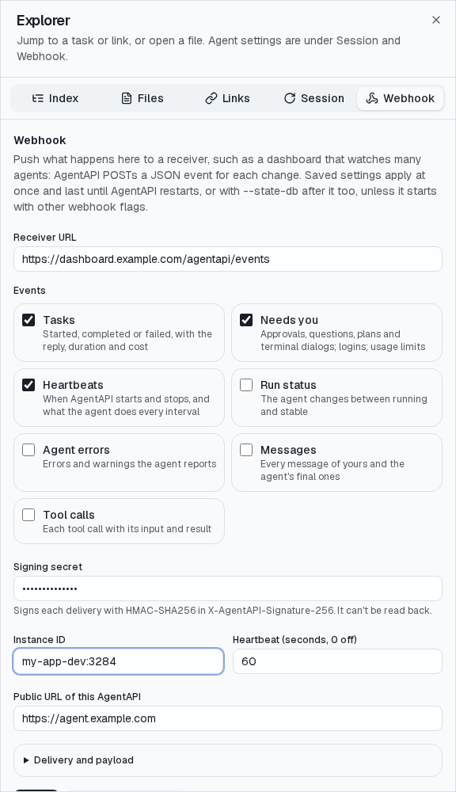

The run-status event, which AgentAPI sends when `--webhook-events` isn't given:

```json
{
  "id": "unique-delivery-id",
  "type": "run.status_changed",
  "created_at": "2026-07-26T12:00:00Z",
  "instance": {"id": "my-host:3284", "server_id": "agentapi-run-id", "agent_type": "claude", "transport": "native"},
  "data": {
    "server_id": "agentapi-run-id",
    "status": "stable",
    "previous_status": "running",
    "agent_type": "claude",
    "transport": "native"
  }
}
```

### Human-reply API

Another client, such as a chat bot, can answer the agent without the web UI. While the agent waits
for you, `GET /handoff` returns what it waits on, with an `id` and a `kind`: the oldest pending
request (`request`) or else its latest response (`message`). Otherwise it returns `{"request": null}`.

`POST /handoff/reply` with that `request_id`, a unique reply `id` and the `content` answers it. A
reply to a response is sent as a normal user message, the way `POST /message` sends one: if the
agent got busy meanwhile, it waits in the [queue](#message-queue). A reply to a request answers it
as described under [Requests](#requests-approvals-questions-and-plans). The `outcome` is `applied`, `queued` (the reply waits in the queue
and goes out once the agent can take it), `superseded` (no longer open, for example because it was
answered in the web UI), `invalid` (the reply doesn't fit; it stays open) or `uncertain`, and
nothing is answered twice. Combined with the webhooks above, an integration can tell you when the
agent stops and pass your answer back.

## Security

AgentAPI has no users or roles: whoever can reach the API can do what the agent can. Out of the box
it takes no token and accepts any connection whose `Host` header names the machine itself
(`localhost`, `127.0.0.1`, `[::1]`), on every network interface. The host check keeps web pages
from calling it through DNS rebinding; it doesn't stop a program on the network, which can send any
`Host` header. Protect the server before anyone else can reach the port. When it takes no token and
listens on an address other machines can reach, AgentAPI logs a warning at startup.

### API token authentication

All API endpoints can be protected with a Bearer token. Authentication is **disabled by default**
for backward compatibility.

```bash
# Auto-generate a random token (printed to stderr on startup)
agentapi server --api-token -- claude

# Use a specific token
agentapi server --api-token=my-secret -- claude

# Via environment variable
AGENTAPI_API_TOKEN=my-secret agentapi server -- claude
```

A generated token stays the same across a restart in place (SIGUSR2, `POST /update`,
`agentapi restart`), so clients stay signed in; a new `agentapi server` generates a new one.

With authentication on, every API request must include `Authorization: Bearer <token>` or the chat UI's
session cookie. Static file routes (`/`, `/chat/*`) are exempt so browsers can open the chat UI
without a token. Tokens are compared in constant time.

The chat UI signs in by trading the token for a cookie, since browsers can't add an `Authorization`
header to the event stream or to images:

- Open `http://localhost:3284/chat/embed#token=<token>`. With an auto-generated
  token the server prints this link on startup. The token is in the URL
  fragment, which the browser never sends to the server, a proxy or an access
  log; the page exchanges it and removes it from the address bar. A link to a
  server without `--api-token` just opens the chat.
- Or just open the chat: when the server answers 401 it asks for the token.
  The dialog names the server that asks and warns when it isn't the page's
  own origin, and says so when the browser didn't keep the session cookie.
  After Cancel, **Reconnect now** asks again.

`POST /auth/session` with `Authorization: Bearer <token>` sets the cookie
(`agentapi_session_<hash>`, HttpOnly, SameSite=Strict, `Path=/`, and Secure over HTTPS or behind a
proxy that sends `X-Forwarded-Proto: https`). It holds an HMAC of the token, not the token, so
changing the token signs every browser out. Its name comes from the token, so servers with
different tokens on one host keep their own sign-ins. `DELETE /auth/session` signs out, and
`GET /auth/session` (no credentials needed) reports `auth_required` and `authenticated`. Because
the cookie is SameSite=Strict, pages on other sites can't make requests with it. A chat UI served
from another origin (e.g. `bun run dev` on port 3000) needs that origin in `--allowed-origins`;
`--allowed-origins '*'` doesn't allow requests with cookies. A different port is not a different
site, and the default allowed origins include `http://localhost:3000` and `http://localhost:3001`
for chat development. On a shared machine, set `--allowed-origins` to the origins you use, so a
signed-in browser's cookie only works for them.

### Bind address

By default, the server listens on all network interfaces. Use `--bind` (or `AGENTAPI_BIND`) to
listen on one address only, e.g. loopback so nothing else on the network can connect. It takes an IP
address or hostname without a port; the port stays `--port`.

```bash
agentapi server --bind 127.0.0.1 -- claude
agentapi server --bind ::1 -- claude          # IPv6 loopback
AGENTAPI_BIND=127.0.0.1 agentapi server -- claude
```

`--bind` decides who can connect; `--allowed-hosts` below decides which `Host` headers are accepted
from those who can.

### Allowed hosts

By default, the server only allows requests with the `Host` header set to `localhost`, `127.0.0.1`
or `[::1]`. To host AgentAPI elsewhere, set `AGENTAPI_ALLOWED_HOSTS` or `--allowed-hosts`.
Hosts must be hostnames only (no ports); the server ignores the port portion of incoming requests
when authorizing. This checks the `Host` header only; to keep the server off the network
altogether, also listen on loopback with `--bind 127.0.0.1` (see [Bind address](#bind-address)).

To allow requests from any host, use `*` as the allowed host.

```bash
agentapi server --allowed-hosts '*' -- claude
```

To allow a specific host, use:

```bash
agentapi server --allowed-hosts 'example.com' -- claude
```

To specify multiple hosts, use a comma-separated list in the `--allowed-hosts` flag, or a
space-separated list in the `AGENTAPI_ALLOWED_HOSTS` environment variable.

```bash
agentapi server --allowed-hosts 'example.com,example.org' -- claude
# or
AGENTAPI_ALLOWED_HOSTS='example.com example.org' agentapi server -- claude
```

### Allowed origins

By default, the server allows CORS requests from `http://localhost:3284`, `http://localhost:3000`,
and `http://localhost:3001`. Set `AGENTAPI_ALLOWED_ORIGINS` or `--allowed-origins` to change which
origins may make cross-origin requests.

To allow requests from any origin, use `*` as the allowed origin:

```bash
agentapi server --allowed-origins '*' -- claude
```

To allow a specific origin, use:

```bash
agentapi server --allowed-origins 'https://example.com' -- claude
```

To specify multiple origins, use a comma-separated list in the `--allowed-origins` flag, or a
space-separated list in the `AGENTAPI_ALLOWED_ORIGINS` environment variable. Origins must
include the protocol (`http://` or `https://`) and may use wildcards (e.g.,
`https://*.example.com`):

```bash
agentapi server --allowed-origins 'https://example.com,http://localhost:3000' -- claude
# or
AGENTAPI_ALLOWED_ORIGINS='https://example.com http://localhost:3000' agentapi server -- claude
```

A page of another origin can't make the server change anything (any method but GET, HEAD and
OPTIONS) unless its origin is listed. Browsers send such requests without asking first (a form, a
`fetch` in `no-cors` mode); CORS only keeps the page from reading the answer, so without
`--api-token` any site you open could send the agent a task or type into the terminal. `*` lets
every page read the answers but trusts none to send these: list the origins that need to. The
server tells pages apart by the `Sec-Fetch-Site` and `Origin` headers browsers add, so clients
other than browsers (curl, SDKs, the hub) aren't affected.

### What an API client can do

- Have the agent run anything it can. Agents start in the bypass
  permission mode, where tools run without asking, unless the command line
  picks another mode or Claude Code runs as root outside a sandbox (it then
  starts in `default`). Claude Code gets `--allow-dangerously-skip-permissions`
  (except as root outside a sandbox), so a client can switch any session to
  bypass. Codex's default overrides the policies in `~/.codex/config.toml`
  unless the command line picks one.
- Run commands in the [terminal](#terminal) (on by default;
  `--terminal=false` turns it off).
- Read files in the agent's working directory with the file viewer endpoints;
  paths outside it, even through symlinks, are refused, and the diff only
  reads the git repository. An HTML preview's scripts run in a sandbox
  without access to the chat or the API. `GET /files/find` lists the paths of
  files below the working directory whose path ends with the one asked for.
- Read the conversations, subagent steps and costs of the agent's earlier
  sessions in its working directory from the agent's own logs (`~/.claude`,
  `~/.codex`, `~/.pi`), and open any of those sessions.
- Upload files of up to 100 MB; only images are served back.
- Change the webhook and restart the agent. The webhook can send the
  conversation (`message.created`, `tool.completed`) to any URL; `GET /webhook` never returns its
  secret.
- With `--allow-update`, [update AgentAPI](#updating-through-the-api) to the latest official
  release and restart it. A client can't choose the version or where it comes from.

Use `--api-token` together with `--bind` or a reverse proxy whenever someone else can reach the
server.

## Resource usage

AgentAPI itself is small: one Go process of about 30 MiB that uses about 0.1% of a CPU core while
the agent is idle. Most of the cost is the agent CLI it runs, at 100–350 MiB.

These numbers were measured on 2026-10-18 with AgentAPI v0.24.0 (a 29.5 MiB binary), Claude Code
2.1.302, codex-cli 0.163.0 and Pi 1.3.0, on Linux with a 4-core Intel Xeon Silver 4210 (2.2 GHz)
and one chat (an SSE client) connected. Each case had one short turn: a reply of about 200 words,
without tools. Memory is resident memory (RSS); CPU is a share of one core while idle, and CPU
seconds for a whole turn.

| Transport | Agent | AgentAPI memory | AgentAPI CPU, idle | AgentAPI CPU per turn | Agent memory | Agent CPU per turn |
| --- | --- | --- | --- | --- | --- | --- |
| Native | Claude Code | 27–30 MiB | 0.1% | 0.08 s | 230–290 MiB | 1.1 s |
| Native | Codex | 27–28 MiB | 0.1% | 0.11 s | 205–265 MiB | 0.43 s |
| Native | Pi | 27–28 MiB | 0.1% | 0.12 s | 100–120 MiB | 0.37 s |
| Native | `native-demo` (no agent process) | 27 MiB | 0.03% | 0.07 s | | |

- An agent's own memory moves during a session: Claude Code grew to 314 MiB about a minute and a
  half after it started (its own background work, 0.1% CPU idle otherwise), and Codex gave back
  about 55 MiB after its first turn.
- AgentAPI's code (about 17 MiB of its memory) is shared by instances started from the same binary:
  with four running, each costs about 13–24 MiB (PSS).
- Not counted: MCP servers the agent starts, the commands it runs, the shell terminal (one shell
  while it is open) and the browser tab.

A long conversation grows by about 100 KB a task in its state database. On 2026-11-10, with a
conversation of 100 KB tasks restored from `--state-db` (`native-demo`, the same machine), AgentAPI
4.2.0 held all of it, and 4.3.0 holds the latest 100 tasks
([Long conversations](#long-conversations)):

| Tasks | State database | Memory, 4.2.0 | Memory, after | First `/events?sync=1` replay, 4.2.0 | After |
| --- | --- | --- | --- | --- | --- |
| 0 | | 38 MiB | 34 MiB | 0.6 KB | 0.6 KB |
| 250 | 26 MB | 71–86 MiB | 49–52 MiB | 11 MB | 0.9 MB |
| 1,000 | 105 MB | 193–245 MiB | 55 MiB | 44 MB | 0.9 MB |

The memory that remains grows with the messages and tasks, a few KB a task.

To size a machine, plan per session about 30 MiB for AgentAPI plus the agent (about 350 MiB for
Claude Code or Codex, 150 MiB for Pi) and whatever its MCP servers and commands need.

## CLI reference

### `agentapi server`

Start an HTTP server to control an agent. To pass startup arguments to the agent, place the full
agent command after the `--` separator.

```bash
agentapi server -- claude --allowedTools "Bash(git*) Edit Replace"
```

The agent is Claude Code, Codex or Pi (see [Agents](#agents)):

```bash
agentapi server -- codex -a on-request
agentapi server -- pi
```

#### Flags

Flags can also be set with environment variables: `AGENTAPI_` and the flag's name in capitals, with
`_` for `-` (`AGENTAPI_ALLOWED_HOSTS`). Lists are comma-separated in a flag and space-separated in a
variable.

They can also be set by the flag's name in `~/.agentapi/config.yaml` (`--config` names another
file) for every server the user starts; a flag or a variable overrides the file. A setting that
names no flag is reported in the log, and a file AgentAPI can't read is reported and ignored, so the
agent still starts. [`agentapi hub join`](#agentapi-hub) writes it; keep it readable by its owner
only (`chmod 600`) when it holds a secret. A leading `~` in a file or directory setting is the home
directory, wherever the setting comes from. `state-db` and `pid-file` name a file that only one
server can use, so in the file each needs `{port}` in its path (`{hostname}` is filled in too);
without it, every server ignores the setting with a warning, and a flag or a variable still sets it.

```yaml
webhook-url: http://hub.vpn:3290/hooks
webhook-secret: s3cret
webhook-events: [instance.*, task.*, request.*]
public-url: http://dev-1.vpn:{port}
state-db: ~/.agentapi/state/{port}.db
```

| Flag | Default | Description |
| --- | --- | --- |
| `-t`, `--type` | from the agent command | Agent type: `claude`, `codex`, `pi` or `native-demo`; see [Agents](#agents) |
| `-p`, `--port` | `3284` | Port to listen on |
| `--bind` | all interfaces | Address to listen on; see [Bind address](#bind-address) |
| `--state-db` | | SQLite file that keeps the conversation and resumes the agent's session; `{port}` and `{hostname}` are filled in; see [Persistent sessions](#persistent-sessions) |
| `--terminal` | `true` | Shell in the agent's working directory for the chat; see [Terminal](#terminal) |
| `--auto-continue` | `false` | Continue a turn stopped by a usage limit once the limit resets; see [Usage limits](#usage-limits) |
| `--retry-delays` | `30s,1m,2m,5m*12` | Waits before a turn that failed on a transient API error is tried again, one per retry (`5m*12`: twelve times); `off` turns retries off; see [Transient API errors](#transient-api-errors) |
| `--prices` | | JSON file of model prices per million tokens, which add to or replace the built-in ones; see [Session costs](#session-costs) |
| `-I`, `--initial-prompt` | | First message for the agent; read from stdin when piped |
| `-W`, `--term-width`, `-H`, `--term-height` | | Deprecated and without effect: the PTY transport's terminal size |
| `--api-token` | off | Require a Bearer token; without a value, a random token is generated and printed; see [API token authentication](#api-token-authentication) |
| `-a`, `--allowed-hosts` | `localhost`, `127.0.0.1`, `[::1]` | Accepted `Host` headers, `*` for any; see [Allowed hosts](#allowed-hosts) |
| `-o`, `--allowed-origins` | `http://localhost:3284`, `http://localhost:3000`, `http://localhost:3001` | Origins allowed to call the API from a browser, `*` for any; see [Allowed origins](#allowed-origins) |
| `--webhook-url` | | URL the webhook events are POSTed to; see [Webhooks](#webhooks) |
| `--webhook-events` | `run.status_changed` | Events to send: types, groups (`task.*`) or `*` |
| `--webhook-secret` | | Secret that signs every delivery (`X-AgentAPI-Signature-256`) |
| `--webhook-heartbeat` | `60s` | How often `instance.heartbeat` is sent; `0` turns it off |
| `--instance-id` | `<hostname>:<port>` | Identifies this AgentAPI in `GET /summary` and every webhook event; see [Watching many instances](#watching-many-instances) |
| `--name` | the working directory's name | What clients that watch many AgentAPIs call this one |
| `--registry` | `true` | Keep an entry in the registry directory while serving; see [Watching many instances](#watching-many-instances) |
| `--registry-dir` | `~/.agentapi/instances` | Registry directory |
| `--public-url` | | URL this AgentAPI is reached at, in `GET /summary` and every webhook event; `{port}` and `{hostname}` are filled in, and `{ip}` with the machine's IPv4 address on the route to the webhook URL (without one, its first private, then CGNAT, address), looked up again at most every 30 seconds while it runs; when none is found the last one stays. The address `{ip}` stands for is an allowed host |
| `--config` | `~/.agentapi/config.yaml` | Settings file: flags by name, below flags and variables |
| `--allow-update` | `false` | Let API clients, such as the hub, update AgentAPI to the latest release, which then restarts in place; see [Updating through the API](#updating-through-the-api) |
| `--webhook-timeout` | `10s` | Timeout of each delivery attempt |
| `--webhook-max-attempts` | `3` | Delivery attempts |
| `--webhook-payload-template` | | Go `text/template` for the POST body |
| `-c`, `--chat-base-path` | `/chat` | Base path of the chat UI |
| `--pid-file` | | File to write the server's process ID to, for shutdown scripts; `{port}` and `{hostname}` are filled in |
| `--log-level` | `info` | Least important level to log: `debug`, `info`, `warn` or `error` |
| `-P`, `--print-openapi` | | Print the OpenAPI schema and exit |

AgentAPI logs to standard output, one `time=… level=… msg=…` line per entry. `--log-level debug`
(or `AGENTAPI_LOG_LEVEL`, or `log-level` in the config file) adds what it logs for troubleshooting,
such as the agent's command line, its login checks and the reads that worked (`GET`, `HEAD` and
`OPTIONS` requests below 400, which Info leaves out because clients poll `GET /status`); `warn` and
`error` leave out the routine lines. An unknown level stops the server before it starts.

### `agentapi update`

Update the AgentAPI binary to the latest release from GitHub.

```bash
agentapi update            # download and install the latest version
agentapi update --check    # only check if an update is available
agentapi update --force    # update even if already at the latest version
agentapi update --restart  # then restart the running AgentAPIs into it
agentapi update --restart --allow-update  # and let a hub update them from now on
```

Release binaries are verified against the release's `checksums.txt` SHA-256 manifest before the
running executable is replaced. An update is rejected if the manifest is missing, malformed, or does
not match the download, or if the download doesn't run as the release's version. The binary is
replaced under the lock file that [updates through the API](#updating-through-the-api) take too.
The release lookup gets 1 minute; waiting for the lock, the download and the replacement get 10.

Running AgentAPIs keep the old version until they restart. `--restart` restarts the ones that run
the binary it replaced, as [`agentapi restart --all`](#agentapi-restart) does, and restarts them
when the binary is already up to date too: another update may have replaced it. Under `sudo` (an
install in `/usr/local/bin`), it restarts the AgentAPIs of the user who ran `sudo`, from that user's
registry. The hub isn't one of them: restart it with its service manager, such as
`systemctl restart agentapi-hub`.

`--allow-update` also writes `allow-update: true` into the config file (`--config`, by default
`~/.agentapi/config.yaml` of the user who ran `sudo`, which stays theirs), before `--restart`, so
the restarted AgentAPIs take updates from a [hub](docs/hub.md#updating-from-the-hub) from then on.
It keeps the rest of the file, as `agentapi hub join --allow-update` does. With `--check` it writes
nothing. An older `agentapi` has no such flag: add the line to the file, then run
`agentapi update --restart`.

### `agentapi restart`

Restart running AgentAPIs in place, for example after an update replaced the binary:

```bash
agentapi restart 3285 3286  # the AgentAPIs on these ports
agentapi restart --all      # every AgentAPI of yours on this machine
```

`agentapi restart` finds them in the [registry](#watching-many-instances) and sends each SIGUSR2.
An AgentAPI first runs the program it was started from with `--version`, then with the arguments
and environment it will run with and a check that it would start with them: its flags, `AGENTAPI_*`
variables and config file, its agent's arguments, and a state database it can write. If either
fails (an update brought a release that refuses a setting, say), it logs why and goes on serving,
and `agentapi restart` reports that it still runs as before. Otherwise it stops as for a shutdown (the agent is interrupted and closed, the
state database written, the registry entry removed, and the webhook sends `instance.stopped`), then
runs the same path again with the same arguments and environment, in the same process. Its PID
stays, so a PID file and a parent shell that waits for it, such as a Coder workspace's start
script, stay valid, and its output goes to the same place. The command waits until each AgentAPI
answers on its port again with a new `server_id`, and prints its new version.

- With `--state-db`, the conversation stays and the agent resumes its
  session. Without it, the agent resumes its session too: the restart
  carries the session's ID to the new program, which reads the conversation
  back from the session's log, as when you open it from the
  [earlier sessions](#earlier-sessions). Claude Code, Codex and Pi only. The
  queue, open requests, chosen settings and a usage-limit stop or retry wait
  start anew, and the `--initial-prompt` isn't sent again. A session whose
  log is gone starts anew, with a warning in the chat. The restart that
  updates from an earlier release starts a new session: the earlier release
  doesn't carry it.
- Only your own AgentAPIs restart, and only when the registry entry names a
  running `agentapi server`. Under `sudo`, they are those of the user who ran
  `sudo`. An AgentAPI of an earlier release can't restart in place:
  `agentapi restart` says so, and you restart that one yourself, once.
- The AgentAPI this command runs under, if any (an agent that runs
  `agentapi update --restart`), restarts last. Restarting it closes the
  agent, which can end the command.
- `--registry-dir` reads another registry, and `--timeout` (default `1m`)
  bounds the wait for each one.
- Not available on Windows.

### `agentapi list`

List the AgentAPIs running on this machine from the [registry](#watching-many-instances), with
what each `GET /summary` says: idle, working, what it needs from you (`needs request`), and an
unread task.

```bash
agentapi list
NAME      AGENT   STATE                  URL                    TITLE
api       claude  needs request, unread  http://localhost:3284  Fix the failing test
frontend  codex   working                http://localhost:3285  Add the settings page
```

`--json` prints the entries and summaries as JSON, `--registry-dir` reads another directory, and
`--api-token` (or `AGENTAPI_API_TOKEN`) is sent to the instances that need a token.

### `agentapi hub`

Run a hub that watches many AgentAPIs, or connect this machine's AgentAPIs to one; see
[Running a hub](#running-a-hub) and [Joining a hub](#joining-a-hub).

```bash
agentapi hub serve --token "$HUB_TOKEN" --secret "$HUB_SECRET" --instance-token "$AGENTAPI_TOKEN"
agentapi hub join http://hub.vpn:3290/hooks --secret "$HUB_SECRET" --public-url 'http://{ip}:{port}'
agentapi hub status
agentapi hub leave
```

`serve` runs the hub: `--token` (or `AGENTAPI_HUB_TOKEN`) is what you sign in with (`--no-token`
instead skips signing in, for a hub behind a sign-in of its own such as a Coder workspace app),
`--secret` (or `AGENTAPI_HUB_SECRET`) checks the AgentAPIs' events, `--instance-token` (or
`AGENTAPI_HUB_INSTANCE_TOKEN`, else `AGENTAPI_API_TOKEN`) is sent to them, `--state` keeps the
instances, `--port` and `--bind` set where it listens, `--allowed-hosts` the names browsers may
open it by (any without it), and `--log-level` (or
`AGENTAPI_HUB_LOG_LEVEL`) how much it logs. For the [issue dispatch](docs/hub.md#issues),
`--dispatch-token` (or `AGENTAPI_HUB_DISPATCH_TOKEN`) is the token a client (a GitHub workflow's
runner) calls `POST /api/dispatch` with, and nothing else, and `--github-app-file` the file of the
hub's GitHub App (default `github-app.json` next to `--state`).

`join` writes the hub's webhook into `~/.agentapi/config.yaml` and applies it to the registered
AgentAPIs running now. `--secret` (or `AGENTAPI_HUB_SECRET`) signs the events, `--events` picks them
(default `instance.*`, all the hub needs: it follows the rest from each summary), `--public-url`
is where the hub reaches them (`{ip}` follows the machine's address; the config file and the
AgentAPIs newer than 2.1.2 keep it, older ones get the address now), `--api-token` (or `AGENTAPI_API_TOKEN`) is sent to the ones that need
a token, and `--config` and `--registry-dir` name other files. An AgentAPI that `join` can't
update now applies the file when it restarts. `--allow-update` also writes `allow-update: true`, so
the hub can [update the AgentAPIs through their API](#updating-through-the-api) once they restart;
`leave` keeps it.

### `agentapi host`

Run the launcher of the [issue dispatch](docs/hub.md#issues) on a machine that joined a hub: it
starts an AgentAPI for each GitHub issue the hub dispatches here, in a git worktree on the issue's
branch, and stops it again. [examples/issue-dispatch](examples/issue-dispatch/README.md) sets up
the whole dispatch.

A machine needs the launcher only to take issues. `agentapi hub join` alone has its AgentAPIs report
to the hub, which lists them and opens them. The launcher reports the machine itself (its agents,
repositories, room and jobs), which Issues shows among the machines, and lets the hub start
AgentAPIs there; those report like any other. The launcher needs no hub settings of its own: it
reads the ones `hub join` wrote. The two are separate because the launcher lets the hub start
programs on the machine, which joining doesn't.

```bash
agentapi hub join http://hub.vpn:3290/hooks --secret "$HUB_SECRET" --public-url 'http://{ip}:{port}'
echo "$INSTANCE_TOKEN" > ~/.agentapi/instance.token && chmod 600 ~/.agentapi/instance.token
agentapi host install --now
agentapi host status
```

| Command | Flags | Does |
| --- | --- | --- |
| `serve` | `--config`, `--log-level` (`info`) | Runs the launcher in the foreground |
| `status` | `--config` | Shows the launcher, its hub, agents and repositories, and its jobs |
| `install` | `--config`, `--now` | Writes `~/.config/systemd/user/agentapi-host.service` (`agentapi host serve`) and enables it; `--now` also starts it, or restarts it if it runs. Running it again rewrites the unit, as after the program moved |
| `uninstall` | | Disables, stops and removes the service; the jobs' AgentAPIs keep running, and their files stay |

The service has `KillMode=process`: restarting or stopping the launcher leaves the jobs' AgentAPIs
running, and the next launcher takes them over. `install` needs a systemd user instance; when your
services stop at logout, it says so, and `sudo loginctl enable-linger <user>` keeps them running.

Without systemd, as in a container such as a Coder workspace, `install` stops with
`no systemd user instance`. Start `agentapi host serve` the way the machine starts its other
programs instead, as yourself rather than with `sudo` (the launcher reads your
`~/.agentapi/config.yaml` and keeps its token in your `~/.agentapi`):

```bash
nohup agentapi host serve >~/.agentapi/host.log 2>&1 &
```

That lasts until the workspace stops. For a Coder workspace, start it from the template, so it runs
on every start:

```hcl
resource "coder_script" "agentapi_host" {
  agent_id     = coder_agent.main.id
  display_name = "AgentAPI launcher"
  run_on_start = true
  script       = "nohup agentapi host serve >\"$HOME/.agentapi/host.log\" 2>&1 &"
}
```

The launcher reads the hub's `webhook-url` and `webhook-secret`, which `agentapi hub join` writes,
and the `host` section of `~/.agentapi/config.yaml` (`--config` names another file; the launcher
keeps its files next to it):

```yaml
host:
  port: 3291                    # the launcher's API, which the hub calls
  bind: ""                      # all interfaces; better the VPN address
  public-url: http://{ip}:3291  # where the hub reaches it
  workdir: ~/work               # clones and worktrees
  scan: [~/work, ~/src]         # where it looks for repositories it has (two levels deep)
  ports: 4100-4199              # the jobs' AgentAPIs
  max-jobs: 4
  agents: [claude, codex]       # default: those installed (claude, codex, pi)
  agent: claude                 # an issue's agent when the dispatch names none
  clone: true                   # clone a repository it doesn't have
```

| File | Holds |
| --- | --- |
| `~/.agentapi/host.token` | The token the hub calls the launcher with, made on first start. The hub pins the machine's name to it: a launcher with a new one (the file deleted, the machine set up again) joins only after the hub forgets the machine: **×** on it in the hub's Issues, or `DELETE /api/hosts/{name}` ([Troubleshooting](docs/hub.md#troubleshooting)) |
| `~/.agentapi/instance.token` | The API token of every job's AgentAPI; it must be the hub's `--instance-token` |
| `~/.agentapi/host.sock` | Where the jobs' `git` and `gh` get their GitHub token from the launcher |
| `~/.agentapi/jobs.json`, `~/.agentapi/jobs/` | The jobs, and each one's state database, log and `gh` shim |

## HTTP API reference

The server describes its API with OpenAPI: [openapi.json](openapi.json) in this repository,
`/openapi.json` on a running server, and a documentation UI at `/docs`. It listens on port 3284 by
default.

### Conversation

| Endpoint | Description |
| --- | --- |
| `GET /messages` | Every message of the conversation; with `before` or `limit`, those of a page of tasks ([Long conversations](#long-conversations)) |
| `POST /message` | Send a message, or queue it while the agent is busy; `dispatch_mode` is `queue` (default), `steer` or `interrupt` |
| `DELETE /messages` | Clear the conversation and the queue, and restart the agent in a new session |
| `GET /rich-messages` | The structured conversation: thinking, tool calls with results, usage; paged as `GET /messages` |
| `GET /timeline` | Normalized session events, for export or another UI, paged as `GET /messages`; `?subagents=true` adds the subagents' |
| `GET /timeline/export` | The whole timeline as JSON Lines, streamed; `?subagents=true` adds the subagents' |
| `GET /status` | Status, lifecycle, server ID, turn, epoch, session name, version, the agent's session ID, capabilities, pending requests, settings, usage, usage limit stop, retry wait, terminal, login |
| `GET /title` | The session's human-readable title |
| `GET /events` | Server-sent events; `?sync=1` for incremental replay on reconnect, and task and queue updates; `?only=summary` for the summary alone |
| `GET /summary` | What a client that watches many AgentAPIs shows of this one: instance, status, attention, title, latest task, requests, queue, usage; see [Watching many instances](#watching-many-instances) |
| `GET /tasks` | The conversation's [tasks](#tasks), the latest 20 by default: each message of yours and the agent's turn on it |
| `POST /tasks/seen` | Mark the tasks seen for every client: the summary's `unread` is false until a task ends again |
| `GET /workspace` | The Coder workspace URL, when AgentAPI runs in one |

### Queue

| Endpoint | Description |
| --- | --- |
| `GET /queue` | The messages waiting for the agent |
| `PUT /queue` | Reorder the queue (`{"ids": [...]}`, every queued message once) |
| `PUT /queue/{id}`, `DELETE /queue/{id}` | Edit or remove a queued message |
| `POST /queue/{id}/steer` | Move a queued message into the running turn |

### Agent control

| Endpoint | Description |
| --- | --- |
| `POST /interrupt` | Stop the running turn |
| `GET /requests`, `GET /requests/{id}` | The requests the agent waits on (approvals, questions, plans) and the recently closed ones |
| `POST /requests/{id}/respond` | Answer a request: `option_id`, or `answers` keyed by question, with optional `text` |
| `GET /settings`, `PUT /settings` | The permission mode, model and reasoning effort, with the values they can take; PUT changes the ones in its body |
| `POST /compact` | Compact the agent's context (Codex, Pi) |
| `POST /login/retry` | Check the agent's login again now, while `login_required` is reported (409 when no login is needed) |
| `POST /limit/continue`, `DELETE /limit/continue` | Continue a turn stopped by a usage limit, now or at the reset; cancel a scheduled continuation |
| `DELETE /limit` | Forget a usage limit stop, so the queued messages go out |
| `POST /retry`, `DELETE /retry` | Try a turn that failed on a transient API error again now; cancel the retry, so the queued messages go out |
| `GET /sessions` | The agent's sessions in its working directory (Claude Code, Codex, Pi), with what each cost and the total |
| `GET /cost` | What the open session cost, and its model calls (Claude Code, Codex, Pi) |
| `GET /subagents`, `GET /subagents/{id}` | The subagents the agent ran in its session, and one's task and messages (Claude Code, Codex) |
| `POST /sessions/{id}/resume` | Open one of them, or a copy of it (`{"fork": true}`), in place of the conversation |

### Terminal and files

| Endpoint | Description |
| --- | --- |
| `GET /terminal` | The shell's output as server-sent events (unless `--terminal=false`) |
| `POST /terminal/input`, `POST /terminal/resize` | Type into the shell; set its size |
| `GET /files/content` | A file in the agent's working directory, cut at 1 MiB |
| `GET /files/diff` | The file's uncommitted changes against HEAD |
| `GET /files/preview` | An HTML file with the files it refers to inlined, for a sandboxed iframe |
| `GET /files/image` | An image file in the agent's working directory (raster images judged by content, and SVG) |
| `GET /files/find` | The files below the working directory whose path ends with the one given, ignoring case |

### Uploads

| Endpoint | Description |
| --- | --- |
| `POST /upload` | Store a file (up to 100 MB) and return its path, for `@"<path>"` in a message |
| `GET /uploads/{checksum}/{name}` | An uploaded image (PNG, JPEG, GIF, WebP or BMP, judged by content), for the chat |

### Integration endpoints

| Endpoint | Description |
| --- | --- |
| `GET /handoff`, `POST /handoff/reply` | The [human-reply API](#human-reply-api): what the agent waits on, and an answer to it |
| `GET /webhook`, `PUT /webhook` | Read or change the [webhook](#webhooks): its URL, events, secret, heartbeat and instance |
| `POST /webhook/test` | Send a `webhook.test` event to the webhook URL once, and return the receiver's answer |
| `POST /update`, `DELETE /update` | [Update AgentAPI](#updating-through-the-api) to the latest release and restart it in place, once the agent is idle or now (`--allow-update`); cancel an update until it restarts |

### Authentication

| Endpoint | Description |
| --- | --- |
| `GET /auth/session` | Whether the API needs a token, and whether the caller has one (no credentials needed) |
| `POST /auth/session`, `DELETE /auth/session` | Sign a browser in with the token (session cookie), or sign it out |

The chat itself is served at `/chat/` (and `/chat/embed`).

## Architecture

AgentAPI is a single Go binary: an HTTP server (chi, with huma generating the OpenAPI schema) that
runs one agent process and serves the chat UI, a Next.js app embedded in the binary. The agent's
native adapter reports to an event emitter, which the HTTP API, the event stream, the queue and the
chat read. See [docs/architecture.md](docs/architecture.md) for the packages, the data flow, the
event stream, persistence and the security model.

## Development

```bash
make build      # out/agentapi, with the chat UI embedded
make gen        # regenerate openapi.json and the version
make lint       # Go, TypeScript, shellcheck and actionlint
go test ./...   # Go tests, including the e2e smoke test
cd chat && bun test  # the chat UI's tests
```

AgentAPI builds with Go 1.26 (`go.mod`; the `go` command fetches it) and the chat with Bun. Tests
run with `CGO_ENABLED=0`. Commit `openapi.json` with every API change, and regenerate it only
with `make gen` (see [AGENTS.md](AGENTS.md)). The chat UI lives in [chat/](chat/README.md):
`bun run dev` serves it against a running AgentAPI, and
`agentapi server -- native-demo` runs a simulated agent for working on it
without a real one. [MAINTAINERS.md](MAINTAINERS.md) describes how CI tests and releases a commit.

## Runtime reliability

The fork fixes concurrent event delivery, message tracking races and content-block merging during
Claude delta streaming. These fixes address long sessions, process replacement and temporary
browser or network interruptions.

## Roadmap

Pending feedback, we're considering the following features:

- [Support the MCP protocol](https://github.com/coder/agentapi/issues/1)
- [Support the Agent2Agent Protocol](https://github.com/coder/agentapi/issues/2)

## Long-term vision

AgentAPI lets developers control coding agents programmatically. We hope the major agents
will eventually offer official SDKs. Whether AgentAPI is still needed will depend on whether vendors
adopt a common API or continue to use their own formats.

If vendors adopt a common API, we'll deprecate AgentAPI and recommend the official SDKs. If their
formats remain different, we'll work toward a universal adapter so developers can switch agents
without changing their code.
