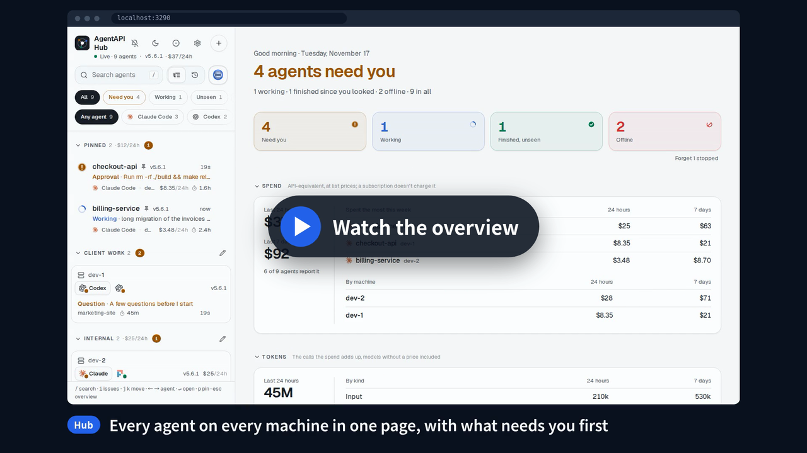

# Tendyard

English | [繁體中文](README.zh-TW.md)

Tendyard lets developers run Claude Code, Codex and Pi on their own machines and manage the work
from an issue to a reviewed pull request. Use one chat for a single agent, or a hub across laptops,
workspaces and servers.

- **Dispatch across machines.** Assign a GitHub issue from the hub's [Issues page](docs/hub.md#issues).
  The launcher starts an agent in a worktree on the issue branch; the GitHub workflow returns reviews
  to that agent and stops the job when the PR closes. The hub shows progress, spend and provider health.
- **Work with the agent.** Read replies and tool results, inspect diffs and answer requests from the
  built-in chat on a desktop or a phone. Supported agents are [Claude Code](https://github.com/anthropics/claude-code),
  [Codex](https://github.com/openai/codex) and [Pi](https://pi.dev/).
- **Keep work recoverable.** Queues, persistent conversations, retries after temporary API failures
  and recovery after usage limits support long-running tasks.
- **Connect other tools.** The [HTTP API and webhooks](docs/api.md) let scripts, bots and other agents
  control and monitor the same work.

Tendyard is the product name. It currently ships as the `agentapi` binary: `agentapi server`
runs one agent, `agentapi hub serve` provides the central workspace, and `agentapi host` runs the
launcher on each machine. Existing configuration uses `~/.agentapi/`; the API and repository
links below retain their current names. The chat, the hub and what the hub posts on GitHub say
Tendyard; earlier releases, the command line's help and messages, and the API's descriptions still
say AgentAPI.

[](docs/videos/tendyard-overview.mp4)

The [overview video](docs/videos/tendyard-overview.mp4) (1 min 34 s, also with
[Traditional Chinese captions](docs/videos/tendyard-overview.zh-TW.mp4)) and the screenshots show
AgentAPI v5.6 running the built-in `native-demo` agent. Its replies, tool results, models and usage
are simulated. See the [chat UI guide](docs/chat-ui.md) for features and
animations, or the [screenshot guide](docs/screenshots/README.md) to reproduce the captures.

Deploy it in an environment you trust: access uses tokens, with no individual users or roles.
See [Security](docs/security.md) before connecting other machines.

<a id="about-this-fork"></a>

## This fork has its own releases and compatibility rules

Tendyard is developed in [`k1dav-c/agentapi`](https://github.com/k1dav-c/agentapi), an independently maintained fork of
[`coder/agentapi`](https://github.com/coder/agentapi), with its own versioned releases. Download
binaries from [this fork's releases](https://github.com/k1dav-c/agentapi/releases) and report
issues involving its added features in [this repository](https://github.com/k1dav-c/agentapi/issues).
Upstream changes should be reviewed and tested against the native transports, chat UI and hub
before integration; upstream and fork version numbers are separate release lines.

This fork builds on upstream v0.12.2. Since 3.0 it drives only Claude Code, Codex and Pi, through
their own protocols (the [native transport](docs/agents.md)); the PTY transport, which emulated
a terminal for other agents, ended with v2.5.1 (see [Current releases run Claude Code, Codex and Pi natively](#agents)). Session management and
chat features support long-running tasks, and [webhooks](docs/api.md#webhooks) report them to a central
platform. [CHANGELOG.md](CHANGELOG.md) lists what
changed, [docs/architecture.md](docs/architecture.md) describes how it is built,
[docs/hub.md](docs/hub.md) how to watch many Tendyard instances from one page, and the
[full comparison with upstream](https://github.com/coder/agentapi/compare/main...k1dav-c:agentapi:main)
has the complete commit history.

## Contents

- [Four capabilities take agent work from assignment to review](#features-at-a-glance)
- [Start one agent, then connect machines when needed](#quickstart)
- [Current releases run Claude Code, Codex and Pi natively](#agents)
- [Choose a guide for the work you need to do](#documentation)
- [One binary connects agent protocols to the API and chat](#architecture)
- [Build and test the backend and chat together](#development)
- [Reliability fixes cover long sessions and interruptions](#runtime-reliability)
- [Next priorities are setup, recovery and traceability](#roadmap) and [long-term vision](#long-term-vision)

<a id="features-at-a-glance"></a>

## Four capabilities take agent work from assignment to review

**The hub dispatches and supervises work across machines**

- The [hub](docs/api.md#running-a-hub) lists instances across machines, puts what needs you first,
  and opens their chats on a desktop or phone. [Join each machine](docs/api.md#joining-a-hub)
  once with `agentapi hub join`;
  it stays configured after a restart. Favorite prompts are shared across chats opened by the hub.
- [Issue dispatch](docs/hub.md#issues) uses the hub's GitHub App to list open issues and assign one
  to Claude Code, Codex or Pi. A [launcher](docs/cli.md#agentapi-host) starts its worktree and agent;
  the agent pushes a branch and opens a PR, reviews return to it, and the hub tracks each job's runs.
- Maintain instances with checksum-verified [updates](docs/cli.md#agentapi-update) and
  [restarts in place](docs/cli.md#agentapi-restart). Opted-in machines also accept
  [updates through the API](docs/api.md#updating-through-the-api), including from the hub.

**The chat keeps agent interaction in one place**

- Read each [task](docs/chat-ui.md#tasks-and-the-transcript) as a transcript of tool calls, thinking
  and replies, with its cost and Markdown export. The [Session Explorer](docs/chat-ui.md#session-explorer)
  brings together links, files, the task index, earlier sessions, Restart and webhook settings.
- Answer approvals, questions and plans with [decision cards](docs/chat-ui.md#requests-and-decision-cards).
  Change [permissions, model and effort](docs/agents.md#settings-permission-mode-model-and-effort)
  during the session: bypass is the default, with auto, ask and plan also available.
- Inspect source, git diffs and HTML, Markdown or image previews in the [file viewer](docs/chat-ui.md#files).
  It resolves paths inside repositories below the working directory; the shared
  [terminal](docs/agents.md#terminal) handles logins and commands, on phones too.
- Follow each subagent's steps in [Lineage](docs/chat-ui.md#lineage), including while it works.
- Use [background alerts](docs/chat-ui.md#session-details-and-alerts), browser notifications and
  cached transcripts to follow work through tab changes and dropped connections.

**Queues and recovery mechanisms support long-running work**

- Messages wait in an editable, reorderable [queue](docs/api.md#message-queue), or
  [steer or interrupt](docs/agents.md#steer-interrupt-and-the-queue) the running turn.
  [Context and rate-limit](docs/agents.md#context-and-rate-limits) indicators and
  [compaction](docs/agents.md#slash-commands-and-compaction) help manage the next turn;
  the chat suggests compaction after Claude Code's prompt cache expires.
- A missing or expired [login](docs/agents.md#logging-in) pauses work and shows the command to run;
  Tendyard starts the agent once it is logged in.
- A [usage limit](docs/agents.md#usage-limits) holds the queue until the reset, with an option to
  continue the stopped turn automatically.
- A [temporary API failure](docs/agents.md#transient-api-errors) retries after 30 seconds, 1 and 2
  minutes, then every 5 minutes, for 15 attempts before the queue moves on.
- With `--state-db`, [conversations survive restarts](docs/agents.md#persistent-sessions) and the
  agent resumes its session. You can also [reopen or fork earlier sessions](docs/agents.md#earlier-sessions).
  [Long histories](docs/api.md#long-conversations) load in pages; rich messages and timelines for the
  latest 100 tasks stay in memory, while plain messages and task records still grow with the history.

**Integrations share the API, usage data and access controls**

- The [native transport](docs/agents.md) drives agent protocols over HTTP. Read structured activity
  from `GET /rich-messages` and `GET /timeline`; [tasks](docs/api.md#tasks) track each prompt's
  outcome. [Event streams](docs/api.md#events-and-incremental-sync) provide live updates, heartbeats
  and incremental replay after reconnecting.
- [Signed webhooks](docs/api.md#webhooks) push task, request, message and heartbeat events. One
  [summary stream](docs/api.md#watching-many-instances) per instance supports monitoring, and the
  [human-reply API](docs/api.md#human-reply-api) lets a bot notify you and return your answer.
- Switch Claude Code or Codex to another [model provider](docs/providers.md), such as a LiteLLM
  gateway, and back. Define providers per machine or on the hub; a local proxy keeps their keys
  out of agent environments and reports provider failures.
- Estimate [task and session costs](docs/agents.md#session-costs) at model list prices, including
  subagents, with totals for today and the last 7 and 30 days. These are API-equivalent costs.
- Set [access controls](docs/security.md): an API token, a listen address, and allowed hosts and
  origins. The chat exchanges the token for a session cookie.

<a id="quickstart"></a>

## Start one agent, then connect machines when needed

<a id="install"></a>

### Install the binary from this fork

Download a binary from [this fork's releases](https://github.com/k1dav-c/agentapi/releases), or
install it in your user's `~/.local/bin`:

```bash
OS=$(uname -s | tr "[:upper:]" "[:lower:]")
ARCH=$(uname -m | sed "s/x86_64/amd64/;s/aarch64/arm64/")
curl -fsSL "https://github.com/k1dav-c/agentapi/releases/latest/download/agentapi-${OS}-${ARCH}" -o agentapi
chmod +x agentapi
mkdir -p "$HOME/.local/bin"
mv agentapi "$HOME/.local/bin/agentapi"
export PATH="$HOME/.local/bin:$PATH"
agentapi --help
```

The `export` applies to this shell; add `~/.local/bin` to your shell's `PATH` for later sessions.
Upstream `coder/agentapi` binaries do not include this fork's hub, issue dispatch and native-agent features.
On macOS, if the system can't verify the binary, go to `System Settings → Privacy & Security`,
click **Open Anyway**, and run it again.

<a id="work-with-one-agent"></a>

### One server gives you a local agent workspace

Install and log in to Claude Code, Codex or Pi on the machine first. From the repository you want
the agent to work in, start it with Tendyard. For Claude Code:

```bash
agentapi server --bind 127.0.0.1 -- claude
```

Open http://localhost:3284/chat and send a task. Follow tool calls, read file diffs and answer
questions in the same page. Use `codex` or `pi` in place of `claude` for another agent.

To try the interface without an agent installed, use `agentapi server --bind 127.0.0.1 -- native-demo`.
Its work and replies are simulated. For real work that should survive a restart, add
`--state-db ~/.agentapi/myproject.db` before `--`, with a separate database path for each instance.
See [persistent sessions](docs/agents.md#persistent-sessions).

<a id="take-an-issue-through-to-a-pull-request"></a>

### A hub and launchers carry an issue through to a pull request

You need a hub reachable from your browser and the machines that will run agents, a launcher on
each of those machines, and a GitHub App to list your repositories' issues. To send GitHub reviews
back to agents and stop jobs when pull requests close, also set up the dispatch workflow on a
self-hosted GitHub Actions runner that can reach the hub.

1. [Set up the hub](docs/hub.md#setting-it-up) on a machine that stays on, and join the machines
   that will run agents. Use an address those machines can reach; the loopback address in the
   single-agent example above is only for local use.
2. Follow the [issue dispatch setup](examples/issue-dispatch/README.md) (in Traditional Chinese)
   to install the launchers, connect the GitHub App and configure the runner and workflow.
3. Open **Issues** in the hub, choose a repository and press **Assign** on an issue. Pick the
   agent and machine. The issue should move from **Starting** to working; if it fails, open its
   detail to see why.
4. Open the agent's chat to follow its work or answer a request. When it opens a pull request,
   review it on GitHub. With the workflow configured, review comments return to that agent;
   merging or closing the pull request stops the job. Its detail shows the runs and their costs.

For the board and its controls, see [Issues](docs/hub.md#issues).

<a id="use-the-http-api"></a>

### Scripts can control the same agent through HTTP

Scripts and integrations can send work to the same local instance:

```bash
curl -X POST localhost:3284/message \
  -H "Content-Type: application/json" \
  -d '{"content": "Summarize this repository", "type": "user"}'
```

Read its conversation with `GET /messages`, or follow structured events over SSE. See the
[API guide](docs/api.md) for tasks, requests, webhooks and authentication.

<a id="agents"></a>

## Current releases run Claude Code, Codex and Pi natively

Since 3.0, Tendyard runs Claude Code, Codex and Pi through their own protocols, the
[native transport](docs/agents.md):

| Agent | Type | Protocol |
| --- | --- | --- |
| [Claude Code](https://github.com/anthropics/claude-code) | `claude` | `claude -p` stream-json |
| [Codex](https://github.com/openai/codex) | `codex` | `codex app-server` |
| [Pi](https://pi.dev/) | `pi` | `pi --mode rpc` |

`--type` sets the agent type; without it, Tendyard takes it from the command's name, so
`agentapi server -- /usr/local/bin/codex` needs none. A wrapper script needs `--type`. The built-in
`native-demo` simulates an agent (see [Build and test the backend and chat together](#development)).

```bash
agentapi server -- claude
agentapi server --state-db ~/.agentapi/myproject.db -- codex
agentapi server --type pi -- ./my-pi-wrapper
```

Any other agent stops Tendyard at startup with an error that names v2.5.1. To run Aider, Goose,
Gemini CLI, Amp, Cursor CLI, Auggie, Amazon Q, Opencode, Copilot, Kimi Code or another terminal
program, use AgentAPI v2.5.1, the last release with the PTY transport:
download its binary from the [v2.5.1 release](https://github.com/k1dav-c/agentapi/releases/tag/v2.5.1)
and keep it. `agentapi update` only installs the latest release. An AgentAPI 2 that runs such an
agent with `--allow-update` checks the new program before it restarts into it, refuses AgentAPI 3
or later and keeps serving; but the update already replaced the program on disk, so put v2.5.1
back before that instance restarts some other way.

AgentAPI 4 has no `--transport` flag: drop it from command lines and config files. The
experimental ACP transport (`--experimental-acp`) was removed earlier; that flag stops Tendyard with
an error.

<a id="documentation"></a>

## Choose a guide for the work you need to do

- [Chat UI](docs/chat-ui.md): the chat at `/chat`, on a desktop and a phone.
- [Agents and the native transport](docs/agents.md): logging in, requests, steering and the queue,
  settings, limits, the terminal, sessions and their costs, and what Claude Code, Codex and Pi each
  do.
- [Model providers](docs/providers.md): Claude Code and Codex on another endpoint, such as a
  LiteLLM gateway, and each provider's usage.
- [HTTP API](docs/api.md): the conversation API, watching many instances, webhooks, the human-reply
  API and the endpoint reference.
- [Security](docs/security.md): the API token, the bind address, allowed hosts and origins, and what
  an API client can do.
- [CLI reference](docs/cli.md): `agentapi server`, `update`, `restart`, `list`, `hub` and `host`,
  and resource usage.
- [The hub](docs/hub.md): many Tendyard instances on one page, and GitHub issues handed to agents.
- [Architecture](docs/architecture.md): packages, the data flow, persistence and the security
  model.

<a id="architecture"></a>

## One binary connects agent protocols to the API and chat

Tendyard is a single Go binary: an HTTP server (chi, with huma generating the OpenAPI schema) that
runs one agent process and serves the chat UI, a Next.js app embedded in the binary. The agent's
native adapter reports to an event emitter, which the HTTP API, the event stream, the queue and the
chat read. See [docs/architecture.md](docs/architecture.md) for the packages, the data flow, the
event stream, persistence and the security model.

<a id="development"></a>

## Build and test the backend and chat together

```bash
make build      # out/agentapi, with the chat UI embedded
make gen        # regenerate openapi.json and the version
make lint       # Go, TypeScript, shellcheck and actionlint
go test ./...   # Go tests, including the e2e smoke test
cd chat && bun test  # the chat UI's tests
```

Tendyard builds with Go 1.26 (`go.mod`; the `go` command fetches it) and the chat with Bun. Tests
run with `CGO_ENABLED=0`. Commit `openapi.json` with every API change, and regenerate it only
with `make gen` (see [AGENTS.md](AGENTS.md)). The chat UI lives in [chat/](chat/README.md):
`bun run dev` serves it against a running Tendyard, and
`agentapi server -- native-demo` runs a simulated agent for working on it
without a real one. [MAINTAINERS.md](MAINTAINERS.md) describes how CI tests and releases a commit.

<a id="runtime-reliability"></a>

## Reliability fixes cover long sessions and interruptions

The fork fixes concurrent event delivery, message tracking races and content-block merging during
Claude delta streaming. These fixes address long sessions, process replacement and temporary
browser or network interruptions.

<a id="roadmap"></a>

## Next priorities are setup, recovery and traceability

Future work should make it easier to complete and supervise development tasks on your own
machines. Priorities are:

- Shorten the setup from installing Tendyard to finishing a first issue and pull request.
- Keep long-running jobs recoverable across agent failures, usage limits and machine restarts,
  with a clear explanation when work needs intervention.
- Make it easier to trace an issue's runs, review feedback and costs from the hub.

Protocol integrations such as MCP and Agent2Agent should serve these workflows. The
[HTTP API](docs/api.md) remains available for building other interfaces and integrations.

<a id="long-term-vision"></a>

## Developers should stay in control from issue to reviewed PR

Tendyard should let a developer hand work to coding agents on their own machines and stay in
control as it moves from an issue to a reviewed pull request. The chat, hub and launchers handle
the conversation, dispatch, human decisions and recovery along the way.

Official agent SDKs or shared protocols can simplify the adapters. Tendyard's role is to manage
the work across agents and machines, with its state, results and costs available through both
the built-in interface and the API.
