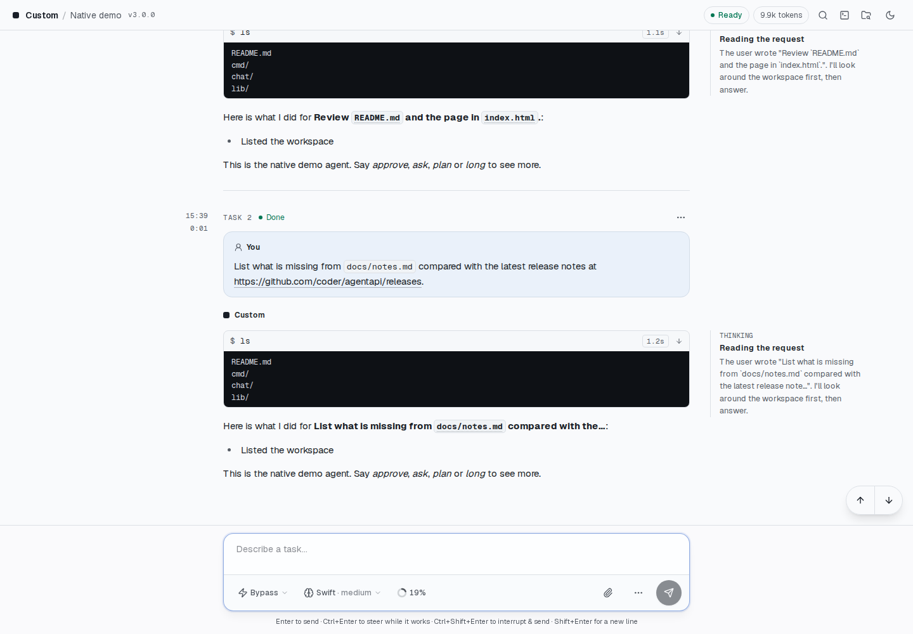

# AgentAPI

[English](README.md) | 繁體中文

AgentAPI 提供統一的 HTTP API，讓你控制 [Claude Code](https://github.com/anthropics/claude-code)、[Codex](https://github.com/openai/codex) 和 [Pi](https://pi.dev/)。



截圖使用 AgentAPI v3.1.0 與內建的 `native-demo` agent；回覆、工具結果、模型和用量都是模擬的。
功能與動畫見[聊天介面導覽](docs/chat-ui.zh-TW.md)，重新擷取的方法見[截圖說明](docs/screenshots/README.md)。

AgentAPI 可以用來：

- 為各種程式開發代理（coding agent）打造統一的聊天介面
- 作為 MCP 伺服器的後端，讓一個 agent 控制另一個 coding agent
- 建立把 pull request 審查交給 agent 處理的工具
- 從一個中控平台監看多個 agent：每個 AgentAPI 用 [webhook](docs/api.zh-TW.md#webhook) 推送任務、需要你處理的
  請求、訊息和心跳。連到多個 AgentAPI 的用戶端則透過[摘要](docs/api.zh-TW.md#監看多個實例)追蹤每一個。
  內建的 [hub](docs/api.zh-TW.md#執行-hub) 就是這樣的儀表板，桌面和手機都能用
- 從 hub 的 [Issues](docs/hub.zh-TW.md#issues) 頁把 GitHub issue 交給你各台主機上的 agent：每個
  agent 在自己的分支上工作，完成後開 pull request

## 關於這個 fork

[`k1dav-c/agentapi`](https://github.com/k1dav-c/agentapi) 是獨立維護的
[`coder/agentapi`](https://github.com/coder/agentapi) fork，使用自己的版本與發版流程。
執行檔請從[此 fork 的 releases](https://github.com/k1dav-c/agentapi/releases) 下載，
新增功能的問題請回報至[此 repo](https://github.com/k1dav-c/agentapi/issues)。
整合上游變更前，應先驗證 native transports、聊天介面與 hub；上游與此 fork 的版本號分開管理。

此 fork 以上游 v0.12.2 為基礎。從 3.0 起只透過 Claude Code、Codex 和 Pi 自己的協定
（[native transport](docs/agents.zh-TW.md)）驅動這三個 agent；給其他 agent 用的終端機模擬方式（PTY transport）到 v2.5.1
為止（見 [Agent](#agent)）。工作階段管理與聊天功能可用來處理長時間執行的任務；
[webhook](docs/api.zh-TW.md#webhook) 會把任務狀態回報給中控平台。[CHANGELOG.md](CHANGELOG.md) 列出變更，
[docs/architecture.zh-TW.md](docs/architecture.zh-TW.md) 說明架構，
[docs/hub.zh-TW.md](docs/hub.zh-TW.md) 說明怎麼在一個頁面監看多個 AgentAPI，完整的 commit 歷史
請參閱[與上游的完整比較](https://github.com/coder/agentapi/compare/main...k1dav-c:agentapi:main)。

## 目錄

- [功能總覽](#功能總覽)
- [快速開始](#快速開始)
- [Agent](#agent)
- [文件](#文件)
- [架構](#架構)
- [開發](#開發)
- [執行穩定性](#執行穩定性)
- [開發藍圖](#開發藍圖)與[長期願景](#長期願景)

## 功能總覽

**透過 HTTP 驅動 coding agent**

- 透過 Claude Code、Codex 和 Pi 自己的協定（[native transport](docs/agents.zh-TW.md)）驅動
  這三個 agent。
- 從 `GET /rich-messages` 和 `GET /timeline` 讀取結構化的活動：思考內容、工具呼叫與結果、
  token 用量。
- agent 工作中時送出的訊息會在可以編輯、重新排序的[佇列](docs/api.zh-TW.md#訊息佇列)中等待；也可以把訊息 [steer 進執行中的回合或中斷它](docs/agents.zh-TW.md#steerinterrupt-與佇列)。
- 你的每則訊息和 agent 處理它的回合都是伺服器追蹤的[任務](docs/api.zh-TW.md#任務)：執行中、已完成、失敗，
  或因用量限制而停止。
- 透過 [server-sent events](docs/api.zh-TW.md#事件與增量同步) 即時追蹤一切，有心跳，重新連線後只重播
  有變動的部分。
- 跑了好幾個月的對話也不會越來越重：用戶端先拿到最近的任務，較早的再一頁一頁讀；有
  `--state-db` 時，伺服器只把最近的任務放在記憶體（[長對話](docs/api.zh-TW.md#長對話)）。

**Agent**

- agent 提出的需求（工具核准、提問、計畫）會以[請求](docs/agents.zh-TW.md#請求核准提問與計畫)送達，可以透過
  HTTP 或在聊天介面中回覆。
- 在 agent 執行中切換[權限模式、模型和推理強度](docs/agents.zh-TW.md#工作階段設定)：bypass（預設）、auto、ask
  或 plan。
- 在 Claude Code 或 Codex 執行中把它換到[其他模型供應商](docs/providers.zh-TW.md)，例如 LiteLLM
  gateway，也能換回來，對話照常接續。供應商可以在每台主機各自設定，也可以在 hub 設定一次。
- 查看 [context 與用量限制](docs/agents.zh-TW.md#context-與用量限制)用了多少，並[壓縮](docs/agents.zh-TW.md#斜線指令與壓縮) context；
  Claude Code 的 prompt cache 過期後，聊天介面會建議先壓縮。
- 回合因為[達到用量限制](docs/agents.zh-TW.md#達到用量限制時)而停下時，佇列會等到限制重置，回合也可以在重置後
  自動繼續。
- 回合因[暫時性的 API 錯誤](docs/agents.zh-TW.md#暫時性的-api-錯誤)失敗時（例如 gateway 回 502、API 過載），
  AgentAPI 會在 30 秒、1 分鐘、2 分鐘後再試，之後每 5 分鐘再試，共 15 次，之後才輪到佇列。
- AgentAPI 會回報缺少或過期的[登入](docs/agents.zh-TW.md#登入)並附上要執行的指令，登入之後會自己啟動 agent。
- agent 工作目錄中共用的[終端機](docs/agents.zh-TW.md#終端機)，方便登入和執行簡單的指令。
- [持久保存的工作階段](docs/agents.zh-TW.md#持久保存的工作階段)：使用 `--state-db` 時，對話在 AgentAPI 重新啟動後
  會保留，agent 也會接續它自己的工作階段。
- 開啟 agent 在工作目錄中的[先前的工作階段](docs/agents.zh-TW.md#先前的工作階段)，或從其中一個開始一份副本。
- 以模型供應商的牌價查看每個[工作階段與任務的花費](docs/agents.zh-TW.md#工作階段花費)（API 等價金額），含 sub agent，
  並加總今天、最近 7 天和 30 天的花費。

**聊天介面**（`/chat`）

- [任務](docs/chat-ui.zh-TW.md#任務與對話紀錄)以對話紀錄呈現：工具呼叫一行一列，思考內容是旁註，每個任務標出花費，
  可匯出成 Markdown。[工作階段瀏覽器](docs/chat-ui.zh-TW.md#工作階段瀏覽器)提供連結、檔案、任務索引、
  agent [先前的工作階段](docs/agents.zh-TW.md#先前的工作階段)、重新啟動和 [webhook](docs/api.zh-TW.md#webhook)。
- [Lineage](docs/chat-ui.zh-TW.md#lineage)：agent 執行過的 sub agent，以及每一個做了什麼，一步一步呈現，執行中也能看。
- 請求的[決策卡片](docs/chat-ui.zh-TW.md#請求與決策卡片)、agent 設定的選單、顯示 context 的圓環，
  以及斜線指令。
- [檔案檢視器](docs/chat-ui.zh-TW.md#檔案)：查看檔案和 git diff，預覽 HTML、Markdown 和圖片。agent 提到的路徑
  若是相對於工作目錄底下某個 repo，也找得到。[終端機](docs/agents.zh-TW.md#終端機)在手機上也能使用。
- [背景提醒](docs/chat-ui.zh-TW.md#工作階段詳細資訊與提醒)、瀏覽器通知、對話紀錄快取，以及斷線後的復原。

**維運與整合**

- [hub](docs/api.zh-TW.md#執行-hub)（`agentapi hub serve`）監看多台主機上的 AgentAPI，需要你處理的排最前面，並能在
  聊天介面中開啟任何一個，桌面和手機都能用。hub 開啟的聊天介面都能插入保存在 hub 上的我的最愛。
  [`agentapi hub join`](docs/api.zh-TW.md#加入-hub) 把一台主機上的
  AgentAPI 接到 hub，重新啟動後也一樣。
- hub 的 [issue 派工](docs/hub.zh-TW.md#issues)：Issues 頁透過 hub 自己的 GitHub App 列出各 repo
  的 open issue，按 **Assign** 就交給某台主機上的 Claude Code、Codex 或 Pi；主機上的 launcher
  （[`agentapi host`](docs/cli.zh-TW.md#agentapi-host)）會在 git worktree 裡為它啟動一個 AgentAPI。agent 推送分支並
  開 pull request，PR 上的 review 會回到同一個 agent；頁面顯示每個 job 的狀態和各次 run 的花費。
- [Webhook](docs/api.zh-TW.md#webhook) 把任務、請求、訊息和心跳推送到監看多個 agent 的中控平台，並以 HMAC
  簽章。連到多個 AgentAPI 的用戶端，每個只要開一條[摘要串流](docs/api.zh-TW.md#監看多個實例)。搭配
  [人工回覆 API](docs/api.zh-TW.md#人工回覆-api)，機器人可以在 agent 停下來時通知你，並把你的回覆傳回去。
- AgentAPI [自我更新](docs/cli.zh-TW.md#agentapi-update)時會比對發行版的 checksum，並可[原地重新啟動](docs/cli.zh-TW.md#agentapi-restart)
  成新的執行檔。選擇開放的主機也能[透過 API 更新](docs/api.zh-TW.md#透過-api-更新)，例如從 hub 更新。
- [安全性](docs/security.zh-TW.md)：API token（聊天介面以 cookie 登入）、監聽位址，以及允許的主機與來源。

## 快速開始

1. 安裝 `agentapi`：

   ```bash
   OS=$(uname -s | tr "[:upper:]" "[:lower:]");
   ARCH=$(uname -m | sed "s/x86_64/amd64/;s/aarch64/arm64/");
   curl -fsSL "https://github.com/k1dav-c/agentapi/releases/latest/download/agentapi-${OS}-${ARCH}" -o agentapi && chmod +x agentapi
   ```

   你也可以從[發行頁面](https://github.com/k1dav-c/agentapi/releases)下載這個 fork
   最新的二進位檔。上游 `coder/agentapi` 的發行版二進位檔不包含這個 fork 的功能。

1. 確認安裝成功：

   ```bash
   agentapi --help
   ```

   > 在 macOS 上，如果系統提示無法驗證此二進位檔，請前往 `System Settings -> Privacy & Security`，點選「Open Anyway」（強制打開），然後再執行一次指令。

1. 執行 Claude Code 伺服器（假設系統已安裝 `claude`，且位於 `PATH` 中）：

   ```bash
   agentapi server -- claude
   ```

   > 如果出現 `claude` 不在 `PATH` 中的錯誤，但你在 shell 裡可以執行它，請用 `which claude` 取得完整路徑，改用完整路徑執行。

   這會透過 Claude Code 自己的協定驅動它，也就是 [native transport](docs/agents.zh-TW.md)：
   核准會以結構化的請求送來、設定可以切換、聊天介面裡有終端機。

1. 傳送訊息給 agent：

   ```bash
   curl -X POST localhost:3284/message \
     -H "Content-Type: application/json" \
     -d '{"content": "Hello, agent!", "type": "user"}'
   ```

1. 取得對話紀錄：

   ```bash
   curl localhost:3284/messages
   ```

1. 開啟 http://localhost:3284/chat 試試聊天網頁介面。

## Agent

從 3.0 起，AgentAPI 透過 Claude Code、Codex 和 Pi 自己的協定驅動它們，也就是
[native transport](docs/agents.zh-TW.md)：

| Agent | 類型 | 協定 |
| --- | --- | --- |
| [Claude Code](https://github.com/anthropics/claude-code) | `claude` | `claude -p` 的 stream-json |
| [Codex](https://github.com/openai/codex) | `codex` | `codex app-server` |
| [Pi](https://pi.dev/) | `pi` | `pi --mode rpc` |

`--type` 指定 agent 類型；沒有指定時，AgentAPI 從指令名稱判斷，所以
`agentapi server -- /usr/local/bin/codex` 不必指定。包裝腳本則需要 `--type`。內建的
`native-demo` 是模擬的 agent（見[開發](#開發)）。

```bash
agentapi server -- claude
agentapi server --state-db ~/.agentapi/myproject.db -- codex
agentapi server --type pi -- ./my-pi-wrapper
```

其他 agent 會讓 AgentAPI 在啟動時停止，錯誤訊息會指出 v2.5.1。要執行
Aider、Goose、Gemini CLI、Amp、Cursor CLI、Auggie、Amazon Q、Opencode、Copilot、Kimi Code 或其他
終端機程式，請使用最後一個有 PTY transport 的版本 AgentAPI v2.5.1：從
[v2.5.1 release](https://github.com/k1dav-c/agentapi/releases/tag/v2.5.1) 下載執行檔並保留它。
`agentapi update` 只會安裝最新版。以 `--allow-update` 執行這類 agent 的 AgentAPI 2，重新啟動
成新程式前會先檢查它，所以會拒絕 AgentAPI 3 以後的版本，繼續提供服務。但更新已經換掉磁碟上的程式：
那個 AgentAPI 以其他方式重新啟動之前，請把 v2.5.1 放回去。

AgentAPI 4 沒有 `--transport` 旗標：請從指令和設定檔中拿掉。實驗性的 ACP transport
（`--experimental-acp`）先前已移除，使用這個旗標時 AgentAPI 會停止並顯示錯誤。

## 文件

- [聊天介面](docs/chat-ui.zh-TW.md)：`/chat` 的聊天介面，桌面與手機都適用。
- [Agent 與 native transport](docs/agents.zh-TW.md)：登入、請求、steer 與佇列、設定、用量限制、終端機、
  工作階段與花費，以及 Claude Code、Codex 和 Pi 各自的行為。
- [模型供應商](docs/providers.zh-TW.md)：讓 Claude Code 和 Codex 改用其他端點（例如 LiteLLM gateway），
  以及各供應商的用量。
- [HTTP API](docs/api.zh-TW.md)：對話 API、監看多個實例、webhook、人工回覆 API 與端點參考。
- [安全性](docs/security.zh-TW.md)：API token、監聽位址、允許的主機與來源，以及 API 用戶端能做什麼。
- [CLI 參考](docs/cli.zh-TW.md)：`agentapi server`、`update`、`restart`、`list`、`hub`、`host`，
  以及資源用量。
- [Hub](docs/hub.zh-TW.md)：在一個頁面監看多個 AgentAPI，並把 GitHub issue 交給 agent。
- [架構](docs/architecture.zh-TW.md)：套件、資料流、持久保存與安全模型。

## 架構

AgentAPI 是單一的 Go 執行檔：一個 HTTP 伺服器（chi，並由 huma 產生 OpenAPI schema），
負責執行一個 agent 行程，並提供嵌入在執行檔裡的聊天介面（Next.js）。agent 的 native adapter
回報給事件發送器，HTTP API、事件串流、佇列和聊天介面都從它讀取。套件、資料流、事件串流、
持久保存與安全模型，請參閱
[docs/architecture.zh-TW.md](docs/architecture.zh-TW.md)。

## 開發

```bash
make build      # 建置 out/agentapi，內含聊天介面
make gen        # 重新產生 openapi.json 與版本資訊
make lint       # 執行 Go、TypeScript、shellcheck 與 actionlint 檢查
go test ./...   # 執行 Go 測試，包含端對端冒煙測試
cd chat && bun test  # 聊天介面的測試
```

AgentAPI 以 Go 1.26 建置（見 `go.mod`，`go` 指令會自動下載），聊天介面用 Bun。
測試以 `CGO_ENABLED=0` 執行。每次修改 API 都要一併 commit `openapi.json`，而且只能用
`make gen` 重新產生（見 [AGENTS.md](AGENTS.md)）。聊天介面在 [chat/](chat/README.md)：
`bun run dev` 會連到執行中的 AgentAPI 提供介面，
`agentapi server -- native-demo` 則會執行一個模擬的 agent，不需要真正的
agent 就能開發介面。CI 怎麼測試和發布一個 commit，見 [MAINTAINERS.md](MAINTAINERS.md)。

## 執行穩定性

此 fork 修正了並行事件傳送、訊息追蹤的競爭條件，以及 Claude delta 串流期間的內容區塊合併。
這些修正處理長時間工作階段、行程替換，以及瀏覽器或網路暫時中斷時的問題。

## 開發藍圖

視使用者回饋而定，我們正在考慮以下功能：

- [支援 MCP 協定](https://github.com/coder/agentapi/issues/1)
- [支援 Agent2Agent 協定](https://github.com/coder/agentapi/issues/2)

## 長期願景

AgentAPI 目前讓開發者能以程式控制 coding agent。我們期待主要的 agent 未來都能提供正式的 SDK。
屆時是否仍需要 AgentAPI，將取決於各家廠商是採用共同的 API，還是繼續使用各自的格式。

若各家採用共同 API，我們會停止維護 AgentAPI，改為推薦官方 SDK。若格式仍各不相同，
我們會繼續朝通用轉接層的方向開發，讓開發者不必修改程式碼就能切換 agent。
