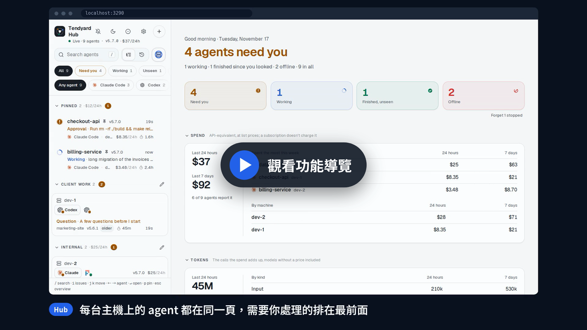

# Tendyard

[English](README.md) | 繁體中文

Tendyard 讓開發者在自己的主機上執行 Claude Code、Codex 與 Pi，管理從 issue 到完成 review 的
pull request。處理單一 agent 可用聊天介面；跨筆電、工作區與伺服器工作則使用 hub。

- **跨主機派工。** 在 hub 的 [Issues 頁](docs/hub.zh-TW.md#issues)指派 GitHub issue。launcher 會在
  issue 分支的 worktree 裡啟動 agent；GitHub workflow 把 review 意見送回同一個 agent，PR 關閉時停止 job。
  hub 會顯示進度、花費與 provider 的健康狀態。
- **與 agent 協作。** 在桌機或手機上的內建聊天介面閱讀回覆與工具結果、檢查 diff、回覆請求。支援的 agent 有
  [Claude Code](https://github.com/anthropics/claude-code)、[Codex](https://github.com/openai/codex)
  與 [Pi](https://pi.dev/)。
- **工作不會中斷。** 佇列、保存的對話、API 暫時性錯誤後的重試，以及用量限制後的恢復，支援長時間執行的任務。
- **串接其他工具。** 腳本、機器人與其他 agent 可以透過 [HTTP API 與 webhook](docs/api.zh-TW.md)
  控制與監看同一份工作。

Tendyard 是產品名稱，目前以 `agentapi` 執行檔提供：`agentapi server` 執行一個 agent，
`agentapi hub serve` 提供集中管理的工作介面，`agentapi host` 則是各主機上的 launcher。
現有設定使用 `~/.agentapi/`，下方的 API 與 repo 連結沿用目前名稱。聊天介面、hub 與 hub 在 GitHub
上留的內容都顯示 Tendyard；舊版發行、命令列的說明與訊息，以及 API 的說明仍沿用 AgentAPI。

[](docs/videos/tendyard-overview.zh-TW.mp4)

[功能導覽影片](docs/videos/tendyard-overview.zh-TW.mp4)（1 分 33 秒，另有[英文字幕版](docs/videos/tendyard-overview.mp4)）
與截圖都使用 Tendyard v5.7.0 與內建的 `native-demo` agent；回覆、工具結果、模型和用量都是模擬的。
功能與動畫見[聊天介面導覽](docs/chat-ui.zh-TW.md)，重新擷取的方法見[截圖說明](docs/screenshots/README.md)。

請部署在你信任的環境中：存取權限以 token 管理，沒有個別使用者或角色。
連接其他主機前，請先看[安全性](docs/security.zh-TW.md)。

<a id="關於這個-fork"></a>

## 此 fork 獨立發版，與上游分開管理相容性

Tendyard 在 [`k1dav-c/agentapi`](https://github.com/k1dav-c/agentapi) 開發；這是獨立維護的
[`coder/agentapi`](https://github.com/coder/agentapi) fork，使用自己的版本與發版流程。
執行檔請從[此 fork 的 releases](https://github.com/k1dav-c/agentapi/releases) 下載，
新增功能的問題請回報至[此 repo](https://github.com/k1dav-c/agentapi/issues)。
整合上游變更前，應先驗證 native transports、聊天介面與 hub；上游與此 fork 的版本號分開管理。

此 fork 以上游 v0.12.2 為基礎，透過 Claude Code、Codex 和 Pi 自己的協定
（[native transport](docs/agents.zh-TW.md)）驅動這三個 agent（見
[目前版本透過原生協定執行 Claude Code、Codex 與 Pi](#agent)）。工作階段管理與聊天功能可用來處理長時間執行的任務；
[webhook](docs/api.zh-TW.md#webhook) 會把任務狀態回報給中控平台。[CHANGELOG.md](CHANGELOG.md) 列出變更，
[docs/architecture.zh-TW.md](docs/architecture.zh-TW.md) 說明架構，
[docs/hub.zh-TW.md](docs/hub.zh-TW.md) 說明怎麼在一個頁面監看多個實例，完整的 commit 歷史
請參閱[與上游的完整比較](https://github.com/coder/agentapi/compare/main...k1dav-c:agentapi:main)。

## 目錄

- [四項能力串起 agent 從接案到 review 的工作](#功能總覽)
- [先啟動一個 agent，再按需要連接其他主機](#快速開始)
- [目前版本透過原生協定執行 Claude Code、Codex 與 Pi](#agent)
- [依照要完成的工作選擇指南](#文件)
- [單一執行檔把 agent 協定接到 API 與聊天介面](#架構)
- [後端與聊天介面一起建置及測試](#開發)
- [穩定性修正涵蓋長工作階段與執行中斷](#執行穩定性)
- [下一步優先改善上手、恢復與追蹤](#開發藍圖)與[開發者應能掌握從 issue 到完成 review 的 PR](#長期願景)

<a id="功能總覽"></a>

## 四項能力串起 agent 從接案到 review 的工作

**hub 跨主機派工並監看工作**

- [hub](docs/api.zh-TW.md#執行-hub) 集中列出各主機的實例，優先顯示需要你處理的事，並在桌面或手機
  開啟聊天介面。每台主機以 `agentapi hub join` [加入一次](docs/api.zh-TW.md#加入-hub)，
  重新啟動後仍保留設定；hub 開啟的
  聊天介面可共用我的最愛提示。
- [Issue 派工](docs/hub.zh-TW.md#issues)透過 hub 的 GitHub App 列出 open issue，交給 Claude Code、
  Codex 或 Pi。[Launcher](docs/cli.zh-TW.md#agentapi-host) 建立 worktree 並啟動 agent；agent 推送分支與
  開 PR，review 回到同一個 agent，hub 追蹤各 job 的 run。
- 透過比對 checksum 的[更新](docs/cli.zh-TW.md#agentapi-update)與[原地重新啟動](docs/cli.zh-TW.md#agentapi-restart)
  維護實例。允許更新的主機也能[透過 API 更新](docs/api.zh-TW.md#透過-api-更新)，包括由 hub 發起。

**聊天介面集中處理與 agent 的互動**

- 每項[任務](docs/chat-ui.zh-TW.md#任務與對話紀錄)把工具呼叫、思考與回覆整理成對話紀錄，附上花費並可
  匯出 Markdown。[Session Explorer](docs/chat-ui.zh-TW.md#工作階段瀏覽器) 集中提供連結、檔案、任務索引、
  先前工作階段、Restart 與 webhook 設定。
- 用[決策卡片](docs/chat-ui.zh-TW.md#請求與決策卡片)回覆核准、問題與計畫。在工作階段內調整
  [權限、模型與推理強度](docs/agents.zh-TW.md#工作階段設定)：bypass 為預設，另有 auto、ask 與 plan。
- 在[檔案檢視器](docs/chat-ui.zh-TW.md#檔案)查看原始內容、git 差異，以及 HTML、Markdown 與圖片預覽。
  它能尋找工作目錄下其他 repo 中的路徑；共用[終端機](docs/agents.zh-TW.md#終端機)處理登入與指令，手機也能用。
- 用 [Lineage](docs/chat-ui.zh-TW.md#lineage) 追蹤各 subagent 的步驟，執行中也能查看。
- 用[背景提醒](docs/chat-ui.zh-TW.md#工作階段詳細資訊與提醒)、瀏覽器通知與對話快取，在切換分頁或連線中斷後繼續追蹤工作。

**佇列與恢復機制支援長時間工作**

- 訊息先進入可編輯、重排的[佇列](docs/api.zh-TW.md#訊息佇列)，也能[引導或中斷](docs/agents.zh-TW.md#steerinterrupt-與佇列)
  目前這一輪。[Context 與用量限制](docs/agents.zh-TW.md#context-與用量限制)指示和
  [壓縮功能](docs/agents.zh-TW.md#斜線指令與壓縮)可協助安排下一輪；Claude Code 的 prompt cache
  過期後，聊天介面會建議壓縮。
- [登入](docs/agents.zh-TW.md#登入)缺少或過期時，系統暫停工作並顯示登入指令，登入後再啟動 agent。
- [用量限制](docs/agents.zh-TW.md#達到用量限制時)會暫停佇列直到重設，也可選擇自動繼續被停止的那一輪。
- [暫時性 API 錯誤](docs/agents.zh-TW.md#暫時性的-api-錯誤)會在 30 秒、1 分鐘、2 分鐘後重試，之後每 5 分鐘一次，
  共 15 次，再處理下一則訊息。
- 使用 `--state-db`，[對話能在重新啟動後保留](docs/agents.zh-TW.md#持久保存的工作階段)，agent 接回原工作階段；
  也能[重新開啟或分支先前工作階段](docs/agents.zh-TW.md#先前的工作階段)。
  [長紀錄](docs/api.zh-TW.md#長對話)以分頁載入；最近 100 項任務的 rich message 與 timeline 留在記憶體，
  一般訊息與任務紀錄仍隨歷史增長。

**整合工具共用 API、用量資料與存取控制**

- [Native transport](docs/agents.zh-TW.md) 把 agent 協定接到 HTTP，從 `GET /rich-messages` 與 `GET /timeline`
  讀取結構化活動，[任務](docs/api.zh-TW.md#任務)記錄每個提示的結果。
  [事件串流](docs/api.zh-TW.md#事件與增量同步)提供即時更新、心跳與重新連線後的增量重播。
- [簽章 webhook](docs/api.zh-TW.md#webhook) 推送任務、請求、訊息與心跳事件。每個實例一條
  [摘要串流](docs/api.zh-TW.md#監看多個實例)即可監看；[人工回覆 API](docs/api.zh-TW.md#人工回覆-api)
  讓機器人通知你並把答案送回 agent。
- Claude Code 與 Codex 可切換到其他[模型供應商](docs/providers.zh-TW.md)，例如 LiteLLM gateway，再切回。
  供應商可在各主機或 hub 定義；本機代理保管金鑰，不交給 agent，並回報供應商失敗狀況。
- 以模型牌價估算[任務與工作階段花費](docs/agents.zh-TW.md#工作階段花費)，包含 subagent，並加總今天及最近
  7 天、30 天的花費。這些數字是 API 等值估算。
- 設定[存取控制](docs/security.zh-TW.md)：API token、監聽位址、允許的主機與來源；聊天介面把 token 換成 session cookie。

<a id="快速開始"></a>

## 先啟動一個 agent，再按需要連接其他主機

<a id="安裝"></a>

### 安裝此 fork 提供的執行檔

從[此 fork 的 releases](https://github.com/k1dav-c/agentapi/releases) 下載執行檔，或安裝到
使用者的 `~/.local/bin`：

```bash
OS=$(uname -s | tr "[:upper:]" "[:lower:]")
ARCH=$(uname -m | sed "s/x86_64/amd64/;s/aarch64/arm64/")
curl -fsSL "https://github.com/k1dav-c/agentapi/releases/latest/download/agentapi-${OS}-${ARCH}" -o agentapi
chmod +x agentapi
mkdir -p "$HOME/.local/bin"
mv agentapi "$HOME/.local/bin/agentapi"
export PATH="$HOME/.local/bin:$PATH"
agentapi --help
```

這行 `export` 只對目前的 shell 生效；之後的工作階段也要使用，請把 `~/.local/bin` 加進 shell 的 `PATH`。
上游 `coder/agentapi` 的執行檔不包含此 fork 的 hub、issue 派工與 native agent 功能。
在 macOS 上，如果系統提示無法驗證執行檔，請到 `System Settings → Privacy & Security`，
點選 **Open Anyway** 後再執行。

<a id="先和一個-agent-工作"></a>

### 一個 server 就能提供本機 agent 工作介面

先在主機上安裝 Claude Code、Codex 或 Pi，並完成登入。在你要讓 agent 工作的 repo 目錄中，
透過 Tendyard 啟動它。以 Claude Code 為例：

```bash
agentapi server --bind 127.0.0.1 -- claude
```

開啟 http://localhost:3284/chat，送出一個任務。同一個頁面就能追蹤工具呼叫、查看檔案 diff 和回答問題。
要用其他 agent，把 `claude` 換成 `codex` 或 `pi`。

還沒安裝 agent，也可以用 `agentapi server --bind 127.0.0.1 -- native-demo` 試用介面；
它的工作和回覆都是模擬的。實際工作若要在重新啟動後保留，請在 `--` 前加上
`--state-db ~/.agentapi/myproject.db`，每個實例使用各自的資料庫路徑。
詳見[持久保存的工作階段](docs/agents.zh-TW.md#持久保存的工作階段)。

<a id="把一個-issue-做成-pull-request"></a>

### hub 與 launcher 把 issue 推進到 pull request

你需要一個瀏覽器與各台 agent 主機都連得到的 hub、各主機上的 launcher，以及用來列出 repo issue 的
GitHub App。若要把 GitHub review 傳回 agent，並在 PR 關閉時停止 job，還要在連得到 hub 的
self-hosted GitHub Actions runner 上設好派工 workflow。[架設 Tendyard](docs/setup.zh-TW.md)
依序說明全部步驟，每一步後面都附上檢查方式。

1. 在一台會持續開機的主機上[架設 hub](docs/hub.zh-TW.md#架設)，再讓各台 agent 主機加入。
   請使用這些主機連得到的位址；上方單一 agent 範例中的 loopback 位址只供本機使用。
2. 依[issue 派工架設說明](examples/issue-dispatch/README.md)（繁體中文）安裝 launcher、
   連接 GitHub App，並設定 runner 與 workflow。
3. 在 hub 開啟 **Issues**，選擇 repo，在一個 issue 上按 **Assign**，挑選 agent 與主機。
   issue 應從 **Starting** 進入工作中；如果失敗，開啟詳細資訊查看原因。
4. 開啟 agent 的聊天介面追蹤工作或回覆請求。agent 開好 PR 後，到 GitHub review。
   設好 workflow 後，review 意見會回到該 agent；merge 或關閉 PR 就會停止 job。
   issue 詳細資訊會列出各次 run 與花費。

看板與操作方式見 [Issues](docs/hub.zh-TW.md#issues)。

<a id="使用-http-api"></a>

### 腳本也能透過 HTTP 控制同一個 agent

腳本與整合工具也能把工作送給同一個本機實例：

```bash
curl -X POST localhost:3284/message \
  -H "Content-Type: application/json" \
  -d '{"content": "Summarize this repository", "type": "user"}'
```

用 `GET /messages` 讀取對話，或透過 SSE 追蹤結構化事件。
任務、請求、webhook 與驗證方式見 [API 指南](docs/api.zh-TW.md)。

<a id="agent"></a>

## 目前版本透過原生協定執行 Claude Code、Codex 與 Pi

Tendyard 透過 Claude Code、Codex 和 Pi 自己的協定驅動它們，也就是
[native transport](docs/agents.zh-TW.md)：

| Agent | 類型 | 協定 |
| --- | --- | --- |
| [Claude Code](https://github.com/anthropics/claude-code) | `claude` | `claude -p` 的 stream-json |
| [Codex](https://github.com/openai/codex) | `codex` | `codex app-server` |
| [Pi](https://pi.dev/) | `pi` | `pi --mode rpc` |

`--type` 指定 agent 類型；沒有指定時，Tendyard 從指令名稱判斷，所以
`agentapi server -- /usr/local/bin/codex` 不必指定。包裝腳本則需要 `--type`。內建的
`native-demo` 是模擬的 agent（見[後端與聊天介面一起建置及測試](#開發)）。

```bash
agentapi server -- claude
agentapi server --state-db ~/.agentapi/myproject.db -- codex
agentapi server --type pi -- ./my-pi-wrapper
```

其他 agent 會讓 Tendyard 在啟動時停止並顯示錯誤；不支援 Aider、Goose、Gemini CLI 等其他終端機程式。

<a id="文件"></a>

## 依照要完成的工作選擇指南

- [架設 Tendyard](docs/setup.zh-TW.md)：從空白主機到派出 issue：hub、工作主機與 launcher、GitHub App、
  runner 與 workflow，每一步都附上檢查方式。
- [聊天介面](docs/chat-ui.zh-TW.md)：`/chat` 的聊天介面，桌面與手機都適用。
- [Agent 與 native transport](docs/agents.zh-TW.md)：登入、請求、steer 與佇列、設定、用量限制、終端機、
  工作階段與花費，以及 Claude Code、Codex 和 Pi 各自的行為。
- [模型供應商](docs/providers.zh-TW.md)：讓 Claude Code 和 Codex 改用其他端點（例如 LiteLLM gateway），
  以及各供應商的用量。
- [HTTP API](docs/api.zh-TW.md)：對話 API、監看多個實例、webhook、人工回覆 API 與端點參考。
- [安全性](docs/security.zh-TW.md)：API token、監聽位址、允許的主機與來源，以及 API 用戶端能做什麼。
- [CLI 參考](docs/cli.zh-TW.md)：`agentapi server`、`update`、`restart`、`list`、`hub`、`host`，
  以及資源用量。
- [Hub](docs/hub.zh-TW.md)：在一個頁面監看多個實例，並把 GitHub issue 交給 agent。
- [架構](docs/architecture.zh-TW.md)：套件、資料流、持久保存與安全模型。

<a id="架構"></a>

## 單一執行檔把 agent 協定接到 API 與聊天介面

Tendyard 是單一的 Go 執行檔：一個 HTTP 伺服器（chi，並由 huma 產生 OpenAPI schema），
負責執行一個 agent 行程，並提供嵌入在執行檔裡的聊天介面（Next.js）。agent 的 native adapter
回報給事件發送器，HTTP API、事件串流、佇列和聊天介面都從它讀取。套件、資料流、事件串流、
持久保存與安全模型，請參閱
[docs/architecture.zh-TW.md](docs/architecture.zh-TW.md)。

<a id="開發"></a>

## 後端與聊天介面一起建置及測試

```bash
make build      # 建置 out/agentapi，內含聊天介面
make gen        # 重新產生 openapi.json 與版本資訊
make lint       # 執行 Go、TypeScript、shellcheck 與 actionlint 檢查
go test ./...   # 執行 Go 測試，包含端對端冒煙測試
cd chat && bun test  # 聊天介面的測試
```

Tendyard 以 Go 1.26 建置（見 `go.mod`，`go` 指令會自動下載），聊天介面用 Bun。
測試以 `CGO_ENABLED=0` 執行。每次修改 API 都要一併 commit `openapi.json`，而且只能用
`make gen` 重新產生（見 [AGENTS.md](AGENTS.md)）。聊天介面在 [chat/](chat/README.md)：
`bun run dev` 會連到執行中的實例提供介面，
`agentapi server -- native-demo` 則會執行一個模擬的 agent，不需要真正的
agent 就能開發介面。CI 怎麼測試和發布一個 commit，見 [MAINTAINERS.md](MAINTAINERS.md)。

<a id="執行穩定性"></a>

## 穩定性修正涵蓋長工作階段與執行中斷

此 fork 修正了並行事件傳送、訊息追蹤的競爭條件，以及 Claude delta 串流期間的內容區塊合併。
這些修正處理長時間工作階段、行程替換，以及瀏覽器或網路暫時中斷時的問題。

<a id="開發藍圖"></a>

## 下一步優先改善上手、恢復與追蹤

後續開發應讓你更容易在自己的主機上完成並監督開發任務，優先處理：

- 縮短從安裝 Tendyard 到完成第一個 issue 與 pull request 的架設流程。
- 讓長時間執行的 job 在 agent 失敗、碰到用量限制或主機重新啟動後能恢復，
  需要介入時清楚說明原因。
- 讓 hub 更容易追溯一個 issue 的各次 run、review 意見與花費。

MCP、Agent2Agent 等協定整合應服務這些工作流程。
[HTTP API](docs/api.zh-TW.md) 會繼續提供給其他介面與整合工具使用。

<a id="長期願景"></a>

## 開發者應能掌握從 issue 到完成 review 的 PR

Tendyard 要讓開發者把工作交給自己主機上的 coding agent，從 issue 到經過 review 的 pull request，
都能掌握進度並介入。聊天介面、hub 與 launcher 負責這段過程中的對話、派工、人工決策和工作恢復。

官方 agent SDK 或共同協定可以簡化 adapter。Tendyard 的角色是管理跨 agent、跨主機的工作，
讓工作狀態、成果與花費都能從內建介面和 API 取得。
