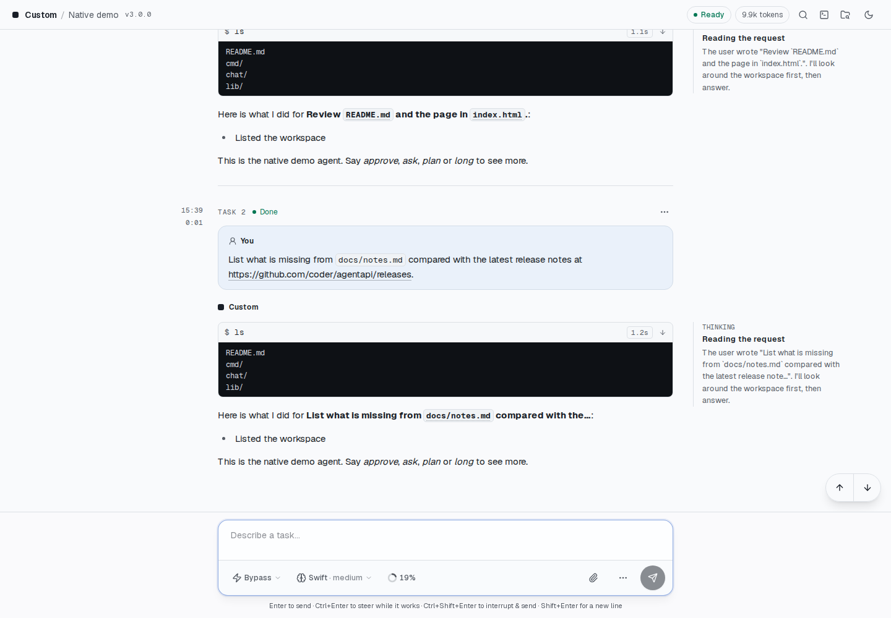
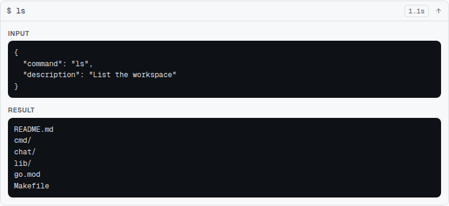
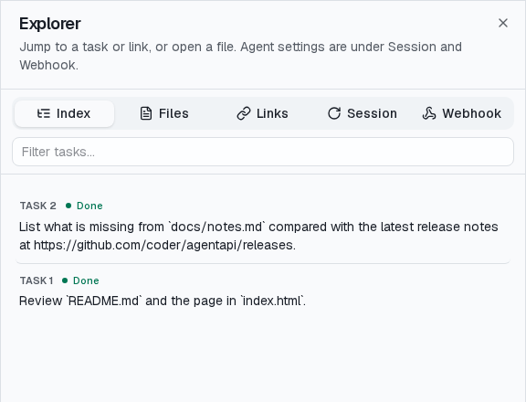
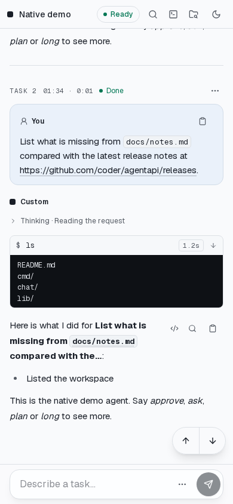

# AgentAPI Chat Interface

The AgentAPI web chat groups conversations by task and displays tool activity, attachments and a
terminal. It is also an example client for the AgentAPI HTTP API.

## Development Setup

1. Start the AgentAPI backend on `localhost:3284`. From the repository root, run:

   ```bash
   go run main.go server -- claude
   ```

2. In the `chat/` directory, install dependencies:

   ```bash
   bun install
   ```

3. Start the development server:

   ```bash
   bun run dev
   ```

4. Open <http://localhost:3000/chat/?url=http://localhost:3284> in your browser.

### Developing the hub's page

The hub's page (`src/app/hub/`, `src/components/hub-view.tsx`) talks to `agentapi hub serve` on the
same origin, so build the chat into the binary (`make embed` from the repository root), run a hub
and join a demo instance to it:

```bash
go run main.go hub serve --token dev --secret dev --state /tmp/hub-dev.json &
# A config file of its own: hub join would otherwise change ~/.agentapi/config.yaml.
go run main.go hub join http://localhost:3290/hooks --secret dev --public-url 'http://localhost:{port}' --config /tmp/hub-dev.yaml
go run main.go server --config /tmp/hub-dev.yaml -- native-demo
```

Then open <http://localhost:3290/> and sign in with `dev`.

### Developing without an agent

`native-demo` simulates an agent for developing request cards, steering, interrupts, and queue
controls without installing or paying for a real agent. Select it with this exact program name:

```bash
go run main.go server -- native-demo
```

Each turn streams thinking, a simulated tool call, and a reply. Include these keywords in a message
to try specific interactions:

- `approve`: a command that needs approval (allow, always allow, or deny with
  feedback)
- `ask`: a question request with a single-choice, a multiple-choice and a
  free-text question; add `secret` for a hidden answer
- `plan`: a Markdown plan to approve or send back with feedback
- `long`: a turn that keeps working for about half a minute, to try steering,
  Stop, Interrupt & send and reordering the queue
- `login`: the agent loses its login, so the login card docks above the
  composer. Check again restarts the demo, but its first start still finds no
  login: the card stays and now says AgentAPI checks by itself. The next start
  (about 5 seconds later, or Check again) works
- `limit`: the account reaches its 5-hour limit after the message's requests,
  so the usage limit card docks above the composer and queued tasks wait
- `gateway`: the API's gateway answers 502 after the message's requests, so
  the retry card docks above the composer and counts down to the retry; the
  retry (Continue from where you left off.) works
- `cold`: the turn leaves a large context whose prompt cache already expired,
  for the note that suggests compacting
- `delegate`: the agent hands a task to a subagent with an Agent tool call
- `crash`: the agent's process exits mid-turn. AgentAPI shows the error and
  starts it again on its session 2 seconds later
- `crashloop`: the same, and the session can't be resumed: each start fails,
  so after the attempts at 2, 10 and 30 seconds AgentAPI gives up and shows the
  agent failed. Restart starts a new session that works

To try earlier sessions, costs and Lineage, run the demo as Claude Code with
`--type claude -- native-demo`, or use the Codex or Pi type. AgentAPI reads that agent's log
directories and shows the sessions, subagents and model calls it finds. The demo writes no session
log, so its own tasks have no cost.

Its settings can change from the composer's menus or slash commands: models Swift, Deep, and Plain
(which has no effort setting) and all four permission modes. In ask mode every turn's first command
needs approval; in plan mode every turn ends with a plan, whose approval switches back to
bypass. Every turn reports simulated context and rate-limit usage that grows with each turn, and
`/compact` empties the context. The terminal button opens a real shell in the working directory, as
for any agent.

Steering appends to the reply, and Stop ends the turn as interrupted. The adapter lives in
`lib/native/demo`.

The demo has no [model providers](../docs/providers.md), even posing as Claude Code: the
model menu's provider groups need a real Claude Code or Codex. The hub's Providers tab works with
the hub above.

## Code layout

- `src/app/`: the routes: the chat (`/chat/`), its embeddable version (`/chat/embed`) and the hub's
  page (`/chat/hub/`).
- `src/components/chat-provider.tsx`: the chat's state and actions, read with `useChatSelector`
  and `useChatActions`. The conversation is one reducer, `lib/conversation-state.ts`; the hooks
  beside the provider (`use-event-stream.ts`, `use-drafts.ts`, `use-queue.ts`,
  `use-session-cache.ts`) feed it.
- `src/components/message-input.tsx` with `message-input/` (the buttons in
  `composer-actions.tsx`, attachments, slash command suggestions, favorites) is the composer;
  `message-list/` the transcript; `hub-view.tsx` with `hub/` the hub's page.
- `src/lib/`: the logic as plain modules with bun tests beside them, and the API client
  (`chat-api.ts`, its types and routes from the generated `api-schema.ts`). `lib/` never imports
  from `components/`.
- Hooks: one that reads the chat's state, or serves one component, sits beside what uses it in
  `src/components/`; one that knows nothing of the chat (`use-loaded.ts`, `use-copy.ts`,
  `use-persisted.ts`) in `src/lib/`.
- `src/test/`: fixtures and fakes the tests share. A test file that renders with effects
  (react-dom/client, a hook) calls `withDOM` (`dom.ts`) for happy-dom's document and mounts with
  `render.tsx`; the others render on the server.

Run `bun run typecheck`, `bun lint` and `bun test` before a change goes in.

## What the chat keeps in the browser

The chat stores one conversation per server in IndexedDB. Reopening shows the cached transcript
immediately, then fetches changes; saves write only changed messages. Caches expire after 14 days
without use, and beyond 100 servers or 50,000 records in all, the least recently used go; a hub
opens each instance as a server of its own.

Drafts, failed messages and dismissed notices stay in localStorage. If the chat crashes, the error
screen shows the error and offers to clear that server's cached conversation and reload.

## Interface screenshots

These Chromium captures show the production chat UI built with `make build`, served by a dedicated
AgentAPI server running `native-demo`. The backend delivers real native events and requests;
agent replies and tool results are simulated.



The task groups the prompt, tool activity, and reply. Session controls appear in the composer,
and wide screens show thinking alongside the transcript.



Expand a tool row to inspect its input and full output. This demo lists a simulated workspace; it
does not run the displayed command.



Open Explorer with ⌘K / Ctrl+K to jump to a task, open a discovered file, or reach Session and
Webhook settings.



On phones, thinking collapses into the conversation and the composer stays at the bottom with the
permission mode, model, and context controls.

The [screenshot guide](../docs/screenshots/README.md) includes native question and plan cards, the
file viewer, the model menu, and instructions for regenerating the images with
[scripts/capture-docs.mjs](../scripts/capture-docs.mjs).
