# Agents and the native transport

English | [繁體中文](agents.zh-TW.md)

Native transport uses the agent's structured protocol to receive replies, tool
calls, and usage, and to handle approvals, questions, and plans in the chat UI.

**Running an agent**

```bash
agentapi server -- claude --model sonnet
agentapi server -- codex -a on-request
agentapi server -- pi --provider openai-codex --model gpt-5.6-luna --thinking low
```

- AgentAPI selects the adapter from the command name. Specify `--type` for
  wrapper scripts.
- For UI development, `agentapi server -- native-demo` runs a simulated agent;
  see the [development guide](../chat/README.md). With `--type claude`, `codex`
  or `pi`, the demo poses as that agent, and AgentAPI reads that agent's logs
  for its earlier sessions and subagents.

**What to expect**

- Replies, tool results, and thinking update live as the turn runs.
- Approvals and questions appear as decision cards above the composer; see
  [request handling](#requests-approvals-questions-and-plans).
- When the agent is stopped or restarted and doesn't exit within 3 seconds of
  its input closing, AgentAPI signals its whole process group, which also stops
  its MCP servers and child commands. Once the agent exits, however it exits,
  what it started and left running gets SIGTERM, then SIGKILL 2 seconds later.
- An agent that exits on its own, or fails to start, is started again on its
  session after 2, 10 and 30 seconds. Each attempt shows in the chat as an
  error, and the lifecycle is `restarting`. If all three fail, AgentAPI keeps
  serving with the lifecycle `failed` until you restart the agent (Explorer →
  Restart or `DELETE /messages`, which starts a new session; the Session
  Explorer reopens the old one). Once an agent has run 5 minutes, the count
  starts over. One that lost its login before it exited waits for the login
  instead; see [Logging in](#logging-in).

AgentAPI removes environment markers and secrets inherited from a parent agent
session while preserving login and provider configuration. See
[child process environment](architecture.md#child-process-environment) for
the complete list.

<details>
<summary>Technical details: protocols, streaming, status fields, and shutdown</summary>

**Agent protocols and thinking**

| Agent | Protocol | Thinking |
| --- | --- | --- |
| Claude Code | stream-json and control protocol | Summarized adaptive thinking |
| Codex | `codex app-server`, using JSON-RPC over stdio | Detailed reasoning summaries requested each turn |
| Pi | `pi --mode rpc` | Streamed as Pi writes it |

Messages come directly from the protocol. Each streaming update replaces the
entire rich message, at most 10 snapshots per second per message. The latest
state arrives within 100 ms after the stream pauses.

**API status**

`GET /status` and `status_change` events include these fields:

| Field | Meaning |
| --- | --- |
| `transport` | always `native` |
| `capabilities` | Operations the agent supports |
| `pending_requests` | Number of requests waiting for a response |
| `settings` | Current session settings |
| `usage` | Context and usage information |
| `terminal` | Whether a separate shell terminal is available |

When the agent is only waiting for a request response, `status` is `stable`.

**Shutdown**

The agent runs in its own process group. Shutdown first interrupts a running
turn and waits up to 3 seconds for it to end, so the session log doesn't end in
a tool call without result. Then it closes the agent's input so it can exit; if
it is still running 3 seconds later, AgentAPI sends SIGTERM to the group, then
SIGKILL 2 seconds after that. The group outlives the agent while a process in
it runs, so AgentAPI signals it after the agent exited too, on its own or in a
restart: SIGTERM, then SIGKILL 2 seconds later.

</details>

## Logging in

AgentAPI uses the agent CLI's stored login. Log in as the same operating-system user that runs
AgentAPI. You can use the chat's [terminal](#terminal) or any terminal on the same machine. The login card's **Run in terminal** button and the `/login` command both run the login
command in the chat terminal.

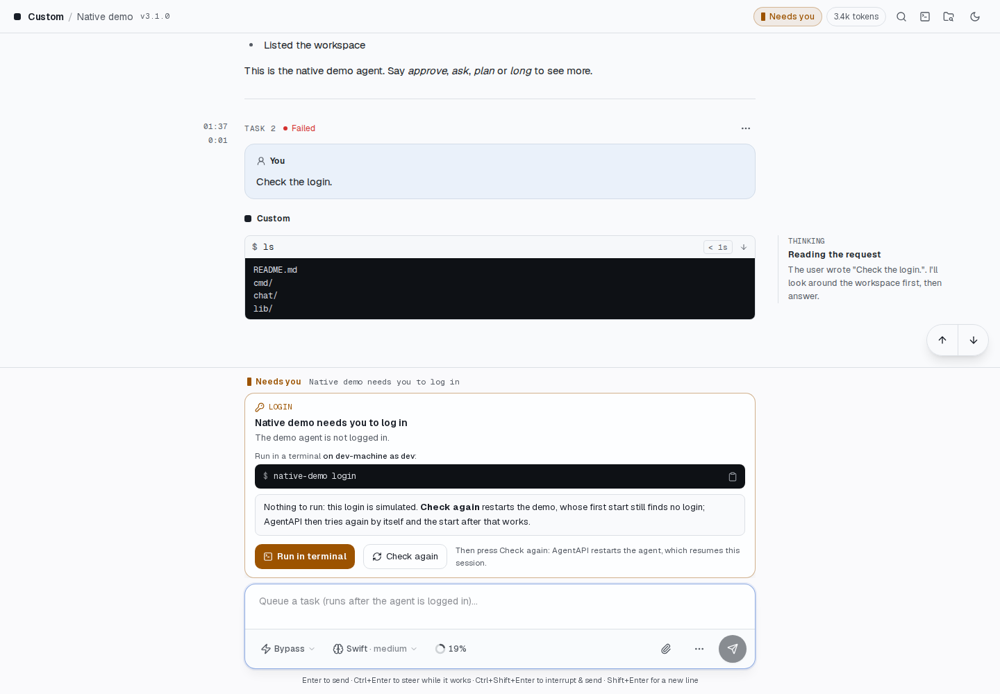

- Claude Code: `claude auth login` uses a Claude subscription by default;
  `--console` selects Anthropic Console API billing. On a machine without a
  browser, `claude setup-token` creates a token for `CLAUDE_CODE_OAUTH_TOKEN`.
  Check the login with `claude auth status`.
- Codex: `codex login --device-auth` signs in with a ChatGPT plan from any
  device: open the link it shows and enter its one-time code. The login card
  and `/login` run it because AgentAPI usually runs on a server without a
  browser: `codex login`'s browser sign-in redirects the browser to
  `localhost:1455` on the machine that runs Codex, which a browser elsewhere
  can't reach. `codex login` still works with a browser on the same machine,
  and `printenv OPENAI_API_KEY | codex login --with-api-key` uses an API key.
  Check the login with `codex login status`.
- Pi: run `/login` inside `pi`, or set a provider key such as
  `ANTHROPIC_API_KEY` in AgentAPI's environment.

AgentAPI checks authentication when starting the agent:

- Claude Code uses `claude auth status --json`. API keys,
  `CLAUDE_CODE_OAUTH_TOKEN`, `apiKeyHelper`, Bedrock, and Vertex count as
  authenticated. With `--settings`, the check is skipped because `auth status`
  cannot see an `apiKeyHelper` supplied that way.
- Codex uses app-server's `account/read`.
- Pi checks its state: no selected model and no available models indicate a
  missing login.

If authentication is missing, AgentAPI keeps running and queues messages. `GET /status` and
`status_change` report `login_required`, including the agent, problem, login command, help, host,
and operating-system user. The chat shows these details in a card above the composer, with a button
to copy the command.

AgentAPI retries startup every 5 seconds and detects a completed login automatically. **Check
again** (`POST /login/retry`) retries immediately; if a startup check is already running, that check
is reused. Startup warnings appear once rather than on every retry. If the check itself fails, for
example with an older CLI or a wrapper, AgentAPI starts the agent as before.

Authentication can also expire during a session. A turn that fails with a login error reports
`login_required` in the same way. Recognized errors include `Not logged in`, HTTP 401,
`Invalid API key`, an unusable refresh token, Pi's `No API key found`, and
`Authentication failed for "<provider>"` after a subscription login expires.

After logging in, select **Check again**. AgentAPI restarts the agent on the same session and
preserves the conversation. A completed model turn also clears the login error; interrupted turns
and messages handled by the agent itself do not. An agent that exits after it reported a lost login
isn't restarted as after a crash: it waits for the login like one that finds none at startup, and a
restart that finds no login does too.

## Requests: approvals, questions and plans

Tool approvals, questions (Claude's `AskUserQuestion`, Codex's `request_user_input`, dialogs from
Pi extensions) and plan approvals (Claude's `ExitPlanMode`) arrive as requests:

- `GET /requests` lists the pending requests and the 50 most recently closed
  ones, and `GET /requests/{id}` returns one. `/events` sends a
  `request_update` event whenever one opens or closes, and `GET /status`
  counts the pending ones in `pending_requests`.
- `POST /requests/{id}/respond` answers one: `option_id` for approvals and
  plans (with optional `text` as feedback when the request has `feedback`),
  `answers` keyed by question ID for questions. A request is answered at most
  once: 409 when it is no longer pending (already answered, withdrawn or
  expired, including a request restored from `--state-db`), 400 when the
  answer doesn't fit the request.
- Each request has a `status` (`pending`, `resolved`, `withdrawn`, `expired`)
  and a `response_capability`: `live` (the agent is waiting), `message` (the
  agent stopped waiting; answer with a new message) or `not_resumable` (it
  can't be answered any more: the agent that asked exited or was restarted,
  or stopped waiting for an approval or plan). When the agent stops waiting
  for a request (it withdraws it, or the turn ends), questions become
  `message` and approvals and plans `not_resumable`. An answer already on its
  way still counts if the agent takes it.
- Answers to secret questions are stored and reported as `[redacted]`; only the
  agent gets them.
- The [human-reply API](api.md#human-reply-api) (`/handoff`) offers the oldest
  pending request with numbered choices: a number picks an option, other text
  answers a single question or goes with the deny option as feedback. A reply
  answers exactly the request that was offered; if that one was answered or
  withdrawn meanwhile, the reply is `superseded`, and one the request can't
  take is `invalid`.

In the chat, requests appear above the composer as decision cards:

- Approvals show the command and distinct Allow, Always allow, and Deny options.
  A denial can include feedback.
- Plans render as Markdown and can be approved or returned with feedback.
- Questions appear one step at a time, with single-choice, multiple-choice,
  typed, or hidden answers. All answers are submitted together.

Number keys select options. They are disabled while you type or while a dialog,
menu, or terminal has focus; holding a key does not repeat the action.

Tool rows show whether approval is pending, granted, or denied. Answer
`AskUserQuestion`, `request_user_input`, and `ExitPlanMode` calls on the card.
Requests answered elsewhere or no longer pending disappear from the card. If a
question expires with the turn or is withdrawn, the UI explains that you can
still answer it with a normal message.

While a request is pending, the header and tab title say "Needs you", the tab
icon shows an amber dot, the embed status bar's icon turns amber, and a
background tab with notifications turned on shows a notification that the agent
needs you.

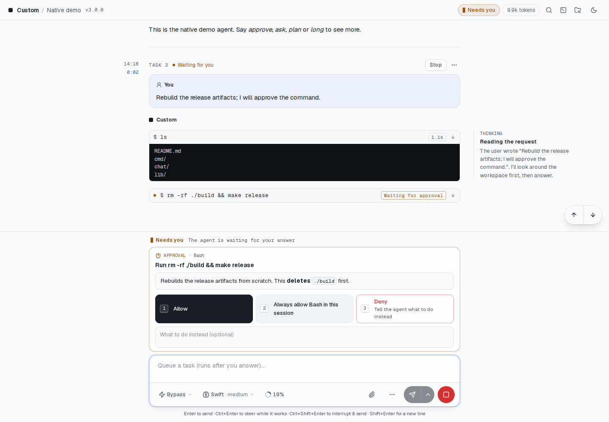

An approval shows what would run and why. **Allow** runs it once, **Always allow** stops asking for
the rest of the session, and **Deny** refuses it, with an optional note on what to do instead.

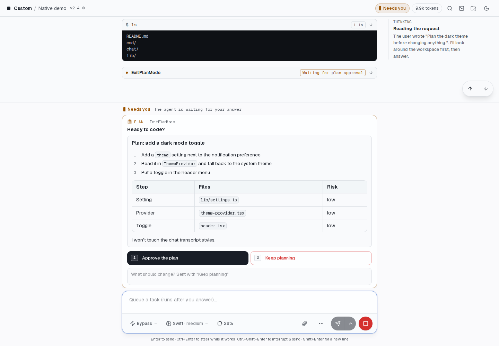

Plans stay above the composer while the agent waits. Read the plan, approve it, or enter feedback
and select **Keep planning** to ask for changes. The plan shown here is generated by `native-demo`;
approving it does not change files.

## Steer, interrupt and the queue

- `POST /message` takes `dispatch_mode`: `queue` (the default: send the
  message once the agent is idle), `steer` (add it to the
  turn the agent is working on; the reply says `steered`) or `interrupt` (stop
  that turn and send the message next). While a turn runs, `steer` and
  `interrupt` need the matching capability; otherwise the answer is 400.
  When no turn is running (including while the agent restarts or waits for a
  login), both send or queue the message as usual.
- `POST /interrupt` stops the running turn (409 if there is none, or while no
  agent runs).
- A queued message can be steered into the running turn too; see
  [Message queue](api.md#message-queue) for the queue's endpoints.

`GET /status` reports the supported `capabilities`: `steer`, `interrupt`, `resume` (the session
can be resumed when AgentAPI starts again, see [Persistent sessions](#persistent-sessions)),
`settings` (see [Settings](#settings-permission-mode-model-and-effort)), `compact` (see
[Slash commands](#slash-commands-and-compaction)) and `images`. With `images`, image attachments
(`@"<path>"` references to PNG, JPEG, GIF or WebP files up to 10 MB) go to the agent as images as
well as paths; without it, only the paths are sent. While no agent runs (a restart, a wait for
a login), it reports what the last one supported.

In the chat, while the agent works, the send button's menu adds **Steer** (⌘/Ctrl+Enter) and
**Interrupt & send** (⌘/Ctrl+Shift+Enter) next to queueing (Enter), and Stop interrupts the turn
(`POST /interrupt`). Queued tasks can be steered in right away, and moved up and down.

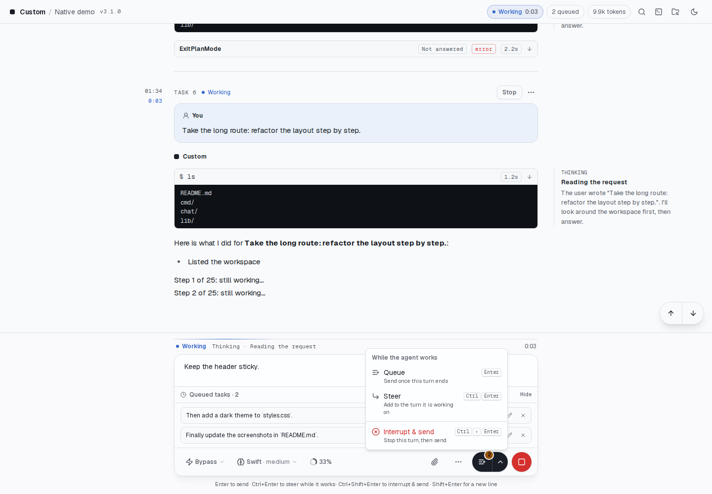

## Settings: permission mode, model and effort

You can change the agent's permission mode, model, and reasoning effort while it runs.
`GET /settings` returns the current settings and available choices, including models and their
supported effort levels.

`PUT /settings` updates only the fields in the request body, such as `{"permission_mode": "ask"}` or
`{"model": "sonnet", "effort": "high"}`. Unsupported values return 400. `GET /status` and
`status_change` also include the current settings.

The permission modes are **bypass** (tools run without asking; the default), **auto** (the agent's
own review decides what may run), **ask** (tool calls that need approval come as requests) and
**plan** (the agent proposes a plan, which comes as a plan request, before it changes anything):

| Mode | Claude Code | Codex | Pi |
| --- | --- | --- | --- |
| bypass | `bypassPermissions` | no approvals, no sandbox | how Pi always runs |
| auto | `auto` | workspace sandbox, escalations decided by Codex's auto review | — |
| ask | `default` | `untrusted`: asks for every command it doesn't trust | — |
| plan | `plan` | plan collaboration mode | — |

If the agent uses a policy outside these four modes, such as Claude Code's `acceptEdits` after plan
approval or a custom Codex command-line policy, the UI does not label it as one of these modes.
Claude Code and Pi apply changes immediately. Codex applies them on the next turn, when app-server
accepts settings. AgentAPI reapplies your choices after an agent restart or a new login; with
`--state-db`, it also restores them after an AgentAPI restart. The UI follows changes the agent
makes itself, such as switching modes after plan approval.

In the chat, the composer's toolbar has a menu for the mode and one for the model and effort (on a
phone in a row of their own above the buttons).

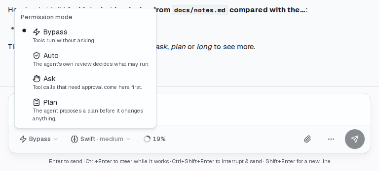

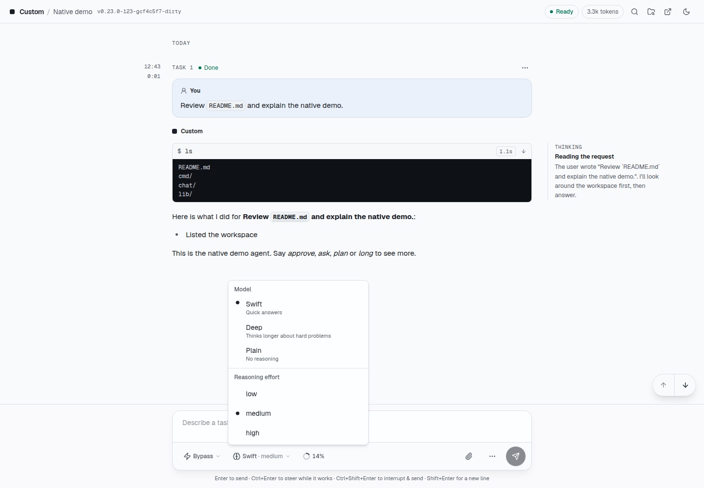

Swift, Deep, and Plain are demonstration models supplied by `native-demo`.

## Context and rate limits

`GET /status` and `status_change` report the agent's `usage`: how full its context window is after
the last turn (`context`: `used` and `size` in tokens) and the account's rate limits (`rate_limits`:
a label, how much is used, when it resets and, for Claude Code, whether it is close to or at the
limit). Claude Code reports its 5-hour and weekly limits and its context after every turn, Codex its
context and its usage windows, and Pi its context. A new session starts with an empty context; the
rate limits belong to the account and stay. In the chat, a ring in the composer's toolbar shows how
full the context is, and its menu shows the limits with the time to each reset.

Claude Code also reports its `prompt_cache`: how long the model provider keeps the conversation's
cache after its last use (`ttl_seconds`: an hour on a subscription, five minutes with an API key, on
Bedrock or Vertex) and when it expires (`expires_at`). Once it has expired, the model reads the
whole context again on the next message, at the full price and against the usage limits. While the
agent is idle with an expired cache and at least 50k tokens of context, the chat says so above the
composer and offers to compact first. A dismissed note stays hidden until the next turn.

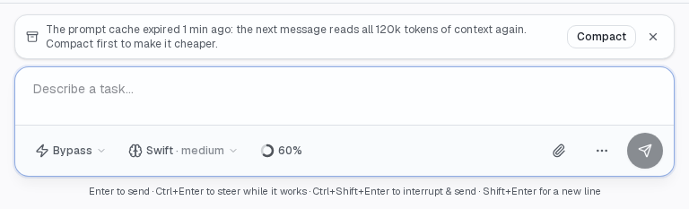

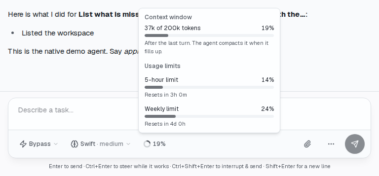

## Usage limits

When the account reaches a usage limit, the agent stops its turn: Claude Code says "You've hit your
limit", Codex reports `usageLimitExceeded`, Pi the provider's quota error. `GET /status` and
`status_change` then report `limit_stop`: the agent's `message`, when it stopped and, if the agent
says, when the limit resets (`resets_at`, else the reset of the limit `rate_limits` reports as
reached). Queued messages wait until then instead of failing one after another. A message you send
yourself goes out at once, ahead of them, and ends the stop.

- `POST /limit/continue` with `{"at": "now"}` sends a message that asks the
  agent to go on with the task; `{"at": "reset"}` schedules it for a minute
  after the reset (409 without a reset time). The queued messages go after it.
- `DELETE /limit/continue` cancels a scheduled continuation; the queue still
  waits for the reset.
- `DELETE /limit` forgets the stop, so the queued messages go out as soon as
  the agent can take them.
- `--auto-continue` schedules the continuation for every stop with a reset
  time. A continuation the limit stops again is scheduled again.

The stop is kept with `--state-db`, so a scheduled continuation still goes out after AgentAPI
restarts. In the chat, the stop is a card above the composer with the reset time, **Continue at
reset**, **Continue now**, and **Send queued tasks**, the queue says it waits for the limit, and the
header and tab title say "Needs you".

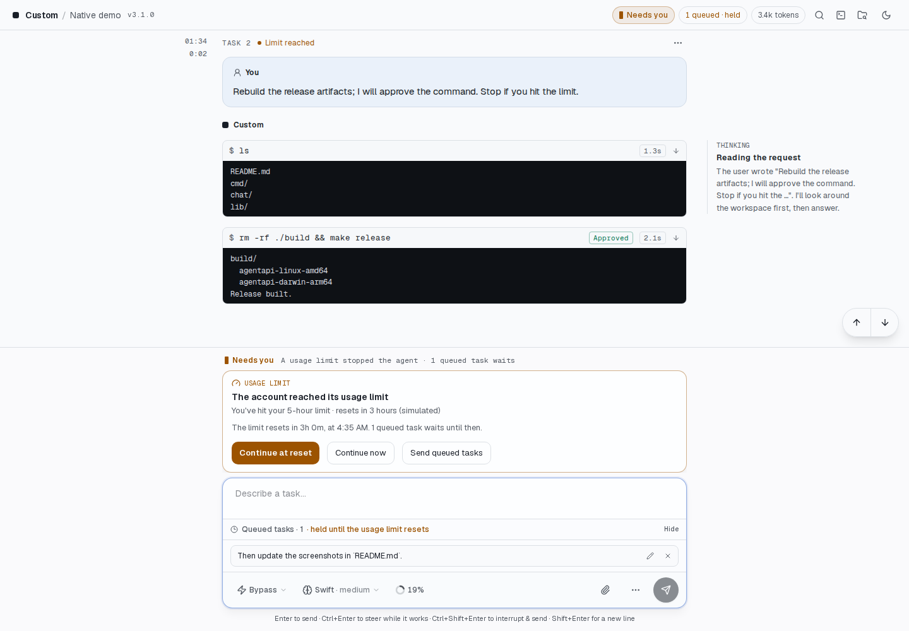

## Transient API errors

The agents retry a failed API request a few times themselves. When they give up on an error that
may pass, the turn fails: Claude Code says "API Error: 502 Bad Gateway. This is a server-side
issue, usually temporary", Codex reports `serverOverloaded` or a failed connection, Pi ends its
retries without success. AgentAPI then waits and tries the turn again instead of moving on to the
next queued message. It counts as transient:

- an HTTP status of 500 to 599 or 429 (`api_error_status` from Claude Code, `httpStatusCode` from
  Codex, or the status in the error's text);
- Codex's `serverOverloaded`, `internalServerError` and `rateLimitExceeded`, and a connection or
  stream that failed without a status;
- Pi's retries that ended without success;
- an error worded as one: bad gateway, service unavailable, overloaded, rate limit, timed out,
  connection error, and the like.

A usage limit (see [Usage limits](#usage-limits)) and a missing login come first: a 429 that says
"You've hit your limit" is a limit stop. A 400 or another client error isn't tried again.

`GET /status` and `status_change` report `retry_wait`: the agent's `message`, the `api_status`
when known, when the turn failed, which retry comes next (`attempt` of `attempts`) and `retry_at`.
The failure shows as a warning ("… AgentAPI tries again in 30s (1 of 15)."), and the queued messages
wait. At `retry_at` AgentAPI sends "Continue from where you left off.", so the agent goes on without
your message twice. A retry that fails the same way waits the next delay; after the last, the
failure is an error and the queue goes on. A turn that works, or a message you send yourself,
starts the count again.

- `POST /retry` tries again now.
- `DELETE /retry` cancels the retry, so the queued messages go out.
- `--retry-delays` sets the waits, one per retry, `5m*12` for 5 minutes twelve times: `30s,1m,2m,5m*12`
  by default, 15 retries in about an hour; `off` turns retries off.

The wait is kept with `--state-db`, so the retry still goes out after AgentAPI restarts. The failed
turn's [task](api.md#tasks) ends `failed`; the retry is a task of its own. The summary's `attention` stays
`none`, and a hub shows the agent as working. In the chat, a card above the composer counts down to
the retry, with **Retry now** and **Cancel**.

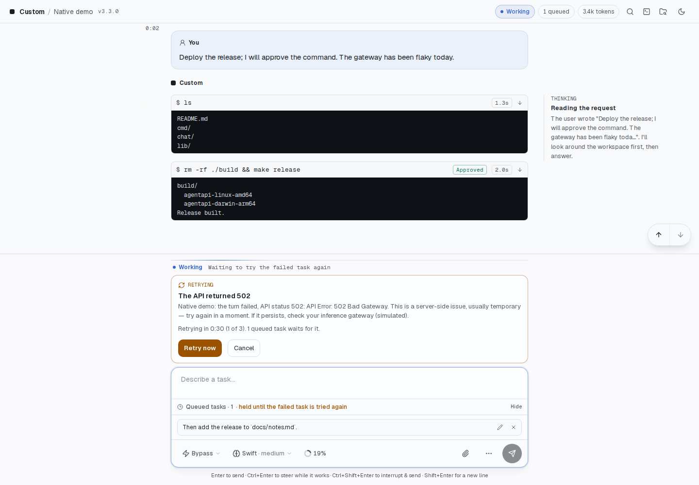

## Terminal

AgentAPI provides a shell in the agent's working directory for logins, git commands and
other work. It supports colors, cursor movement and full-screen programs, and fits the window on
desktops and phones. Everyone shares the same shell, like a tmux window. It keeps running with no
viewers; if it exits, opening the terminal starts a new one. Its environment matches the agent's,
with AgentAPI's own variables removed.

Web links are clickable even when wrapped across lines. The last link printed by a command, such
as a login URL, also appears above the terminal for opening or copying.

The key bar supplies arrows, Enter, Esc, Tab, Shift+Tab, Ctrl+C, Ctrl+R, Ctrl+A, Ctrl+E, Ctrl+U,
Ctrl+W, Home, End, Page up, Page down, / - | ~, Alt+↑ and Ctrl+L. Ctrl+D and Ctrl+Z require a second
press. The Ctrl and Alt buttons hold the modifier for the next key.

- `GET /terminal` streams its output as server-sent events (`output` events
  with base64 data, the first one the recent output to replay; `exit` when the
  shell exits) and starts the shell if it doesn't run.
- `POST /terminal/input` (`{"data": "..."}`) types into it, one request at a
  time, and `POST /terminal/resize` (`{"cols": 120, "rows": 40}`) sizes it.
  Input a busy program doesn't read gets 503 after 10 seconds; part of it may
  have been typed.
- It is on by default; `--terminal=false` turns it off. It has the same protection as the rest of
  the API, so use `--api-token` when others can reach the server.

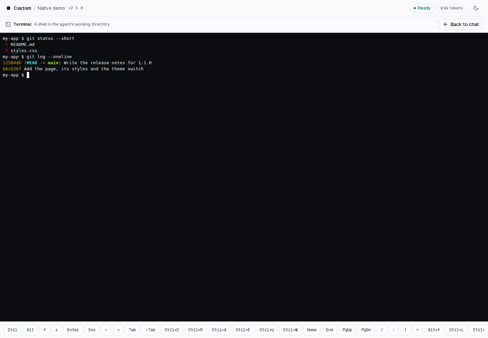

## Slash commands and compaction

The agents don't run their interactive terminal UI. The chat handles these slash commands for
them:

- `/model [model]`, `/effort [effort]` (`/think`) and `/mode [mode]`
  (`/permissions`) switch a setting by its id or name, or open its menu;
  `/plan` switches to the plan mode;
- `/compact` compacts the context;
- `/clear` (`/new`) starts a new conversation;
- `/terminal` opens the terminal, and `/login` runs the agent's login command
  in it;
- `/help` lists them.

The composer suggests commands as you type their names. Tab completes the first suggestion. Anything
else is sent to the agent as typed, so the agent's own commands (Claude Code's `/code-review`, Pi's
extension commands) still work. `POST /compact` compacts the context while the agent isn't working
on a turn: Codex (`thread/compact/start`) in a turn of its own, Pi (its `compact` command) before it
answers. Messages sent meanwhile wait in the queue, and the agent's refusal (Pi's "Nothing to
compact") is a 409 with its reason. Claude Code compacts with the `/compact` message, which the chat
sends it.

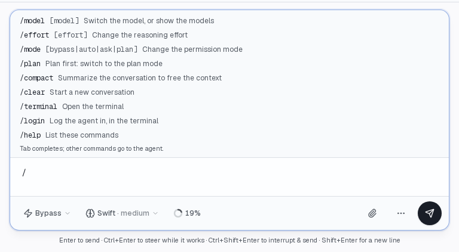

## Persistent sessions

`--state-db <file>` keeps the conversation in a SQLite file: messages, rich messages (tool calls,
thinking), the timeline, requests and the queue, plus the agent's own session ID and the webhook
settings changed through the API. When AgentAPI starts again with the same file, the chat shows the
conversation as it was and queued messages are still queued. The agent resumes its session, so it
remembers the conversation too. After a clean shutdown, browser caches
stay valid because the conversation keeps its epoch. Without `--state-db`, every start of AgentAPI
is a new conversation, except a [restart in place](cli.md#agentapi-restart), which resumes the agent's
session.

```bash
agentapi server --state-db ~/.agentapi/myproject.db -- claude
```

`{port}` and `{hostname}` in the path are filled in, so one line in the
[config file](cli.md#flags) gives every AgentAPI of the user a file of its own, such as the Claude Code
one on 3286 and the Codex one on 3285 that a Coder workspace starts:

```yaml
state-db: ~/.agentapi/state/{port}.db
```

- Every `agentapi server` reads the config file, and the first to start locks
  the database, so a `state-db` there without `{port}` is ignored with a
  warning rather than keeping the others from starting. `--state-db` and
  `AGENTAPI_STATE_DB` still set one.
- Requests that were open when AgentAPI stopped are marked expired: the agent
  that asked is gone.
- The server holds the tool calls and timeline of the latest 100 tasks in memory and reads earlier
  ones from the file when a client asks, so a conversation of months starts about as fast as a new
  one, and its memory stops growing with it ([Long conversations](api.md#long-conversations)).
- Uploads are kept next to the file (`<file>.uploads`), because messages refer
  to them by path. One that nothing in the conversation (or the queue) refers
  to is removed once it is 7 days old, which leaves time for a draft's
  attachments; this is checked on start, hourly and after a restart.
- A file belongs to one agent type and working directory; AgentAPI refuses to
  start with another one's file. A file AgentAPI 2 wrote for a PTY agent
  opens: the agent starts a new session below its conversation, which goes
  on natively. It is locked while AgentAPI runs,
  so a second AgentAPI (or `sqlite3`) can't open it.
- A new file is created readable and writable by its owner only (0600), and missing
  directories are created (0700).
- An older AgentAPI keeps using a file a newer one wrote, unless the newer one
  changed the file in a way the older can't write: then the older refuses to
  start and names the version it needs. Releases after 1.9.0 check this;
  1.9.0 and earlier refuse any file whose schema is newer than theirs (the
  schema hasn't changed since 1.0).
- Restart (Explorer → Restart or `DELETE /messages`) clears the stored
  conversation and the queue and starts a new session. The settings chosen for
  the session are kept.
- Writes are batched every 200 ms, so streaming doesn't wait for the disk.
  After a crash the last of them may be missing, so the conversation gets a
  new epoch and clients load it again in full. Writes that keep failing are
  reported as an error.
- A restored conversation doesn't get `--initial-prompt` again.
- Webhook settings changed with `PUT /webhook` or in the Explorer apply after
  a restart, unless AgentAPI starts with other webhook flags.
- The time a client last showed the conversation (`POST /tasks/seen`) is
  kept, so a task that ended unseen is still [unread](api.md#watching-many-instances)
  after a restart. A database written before 1.2 treats its tasks as seen.
- SIGUSR1 writes what the state database hasn't written yet.
- AgentAPI 4 no longer reads `--state-file`, the PTY transport's persistence
  before v1.0.0. AgentAPI 3 imported such a file into a state database next to
  it (the same name with `.db`) the first time it started with it: start with
  `--state-db` on that database. To import a file that never was imported, run AgentAPI
  3.16 once with `--state-file`.
- [`agentapi restart`](cli.md#agentapi-restart) (SIGUSR2) and
  `agentapi update --restart` keep the conversation, and the agent's
  session, of an AgentAPI with `--state-db`. Without it they keep the
  agent's session, and the conversation is read back from its log; the
  queue, open requests and chosen settings start anew.

## Earlier sessions

AgentAPI reads Claude Code, Codex and Pi session logs to list and open earlier sessions in the
working directory. This works without `--state-db`:

- `GET /sessions` lists them, the latest first, with the one the agent has
  open (`current`): each with its `id`, `title` (the agent's or the user's
  name for it), `first_prompt`, number of `prompts`, and when it started and
  last changed. Sessions in which the user sent nothing are left out. They
  are read from Claude Code's projects directory, Codex's sessions and Pi's
  session directory (`CLAUDE_CONFIG_DIR`, `CODEX_HOME`,
  `PI_CODING_AGENT_DIR`, `PI_CODING_AGENT_SESSION_DIR` and a `--session-dir`
  passed to Pi are honored). A session belongs to the directory its log
  records, even when AgentAPI runs in it through a symlink. Claude Code gives
  some directories the same name (`/w/a_b` and `/w/a-b`); AgentAPI keeps their
  sessions apart.
- `POST /sessions/{id}/resume` restarts the agent on that session, and
  replaces the conversation with the session's, read from its log. With
  `{"fork": true}` the agent opens a copy of it under a new id (Claude Code's
  `--fork-session`, Codex's `thread/fork`, Pi's `--fork`), and the session
  itself stays as it was. The queue and open requests are cleared, as on a
  restart. It returns 409 while the agent works on a turn, compacts its
  context or restarts, and the refused resume leaves the conversation as it
  was. An id that isn't one file name (a `/` or `\`, `.` or `..`, a control
  character) gets 400.

In the chat, the Explorer's Session tab lists the sessions with **Open** and **Start a copy**, which
ask for a second click.

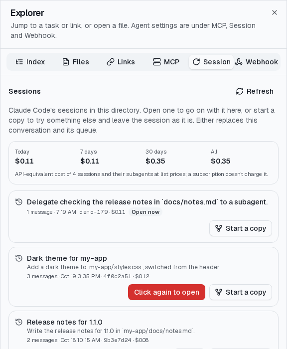

## Session costs

AgentAPI reads model calls from the agent's session logs and prices their tokens in USD at the
providers' list prices. This is an API-equivalent cost: Claude and ChatGPT subscriptions don't
charge per token, so it estimates what the same work would cost with an API key.

- Claude Code: every call in the session's log and in its subagents' logs, with the cache writes
  priced as Anthropic's 5-minute or one-hour cache. Tokens Claude Code counts in its own total but
  doesn't log call by call, such as compacting the context, are added from its cost records as
  unitemized calls, priced like the others. Where Claude Code's own cost of the same tokens differs
  (its prices aren't these), the costs stay AgentAPI's and the server logs a warning once per model.
- Codex: each turn's token counts, its subagents' included; input read from the cache is priced as a
  cache read, and the rest as input.
- Pi: the cost Pi reports for each call.

A call whose record has no model or usage, or usage that reads as no tokens, counts no cost, and the
server's log warns of it once per log: the agent may have changed its log format, renaming a field.

A call that a fork copied from another session counts in the session it came from, so totals don't
count it twice. The built-in prices cover Anthropic's and OpenAI's models; `--prices <file>` adds
models or replaces their prices, in USD per million tokens:

```json
{
  "my-model": {"input": 3, "output": 15, "cache_read": 0.3, "cache_write": 3.75},
  "gpt-6.1-sol": {"input": 2, "output": 10, "cache_read": 0.1, "cache_write": 2.5,
    "tiers": [{"input_tokens_above": 272000, "input": 4, "output": 15, "cache_read": 0.2, "cache_write": 5}]}
}
```

A tier applies to a call whose input (uncached, read from and written to the cache) is above
`input_tokens_above`. Model IDs are matched ignoring case, a provider prefix (`anthropic/`), a
context suffix (`[1m]`) and a release date, else by the longest known prefix
(`claude-opus-5-5-x` is priced as `claude-opus-5-5`), but not across a `-mini`, `-nano` or `-pro`
variant (`gpt-5.1-codex-mini` isn't a `gpt-5.1`). A call to a model without a price counts its
tokens but no cost (`priced: false`), and the server's log warns of the model once.
`scripts/prices.mjs` compares the built-in prices with Pi's model registry.

- `GET /sessions` gives each session's `cost`: `usd`, `tokens`, `calls`, the cost per model
  (`models`) and per hour (`hourly`, in UTC, with its `tokens`), and `total_cost`, the sum of all
  of them.
- `GET /cost` gives the open session's cost and its model `calls` (`time`, `model`, `tokens`, `usd`,
  `subagent_id`), from which a task's cost is the calls made from its message until the next. A
  client that has the first calls sends `from` (how many) and the `digest` it got with them, and
  gets the calls after them only (`from` in the answer); the answer's `total_calls` and `digest`
  are what to send next time. If those calls changed, it gets them all, with `from` 0.

In the chat, each task shows what it cost under its start time and duration (in its header on narrow
screens), with the tokens in the tooltip. The chat refreshes the cost when a turn ends, and every 15
seconds while one runs. The Explorer's Session tab shows what each session cost, and what all of
them cost today, in the last 7 and 30 days and in all, by your time zone.


## Claude Code

AgentAPI runs `claude -p` headless with stream-json on stdin and stdout. Tool calls carry their
input, result, status and images, and each assistant message has its model, stop reason and token
usage.

The permission mode, model and effort switch with Claude Code's control requests
(`set_permission_mode`, `set_model`, `apply_flag_settings`); its models and their efforts come
from its initialize response, and the model and effort it runs with from `get_settings`.

- Approvals offer Allow, Deny (with optional feedback for Claude) and, when
  Claude Code suggests a permission rule, "Allow always", which applies the
  rule to this session only. Commands Claude Code considers read-only run
  without asking.
- Questions list Claude's options; any other answer is accepted too.
- Plans show the plan and offer "Yes, and bypass permissions" (when the
  session can switch to it), "Yes, and auto-accept edits", "Yes, and manually
  approve edits" and "No, keep planning". Feedback sent with No makes Claude
  revise the plan and ask again.

Claude Code supports `steer` (a steered message joins the running turn at Claude's next step),
`interrupt` (if Claude Code doesn't end the interrupted turn within 10 s, AgentAPI ends it),
`resume` and `images`. The session name is the title Claude Code generates after the first prompt;
after `/clear` the new session is titled too, and it is the one `--state-db` resumes. A turn ends
when Claude Code reports it is idle, so a background subagent and the turn it wakes up when it
finishes belong to the turn that started it. The subagent's own steps are left out of the
conversation, as in the session log, and its tool call shows as running until it reports.

Command line and environment:

- AgentAPI adds `-p --output-format stream-json --input-format stream-json
  --verbose --include-partial-messages --replay-user-messages
  --permission-prompt-tool stdio`, and `--session-id` for a new session or
  `--resume` for a resumed one.
- Unless you choose otherwise, it adds `--permission-mode bypassPermissions`,
  so tools run without asking. Questions (AskUserQuestion) and plans
  (ExitPlanMode) still come as requests, and approving a plan offers to
  bypass permissions. Pass `--permission-mode default` (or `acceptEdits`,
  `plan`, …) to start in another mode, or switch it while Claude Code runs
  (see [Settings](#settings-permission-mode-model-and-effort)). AgentAPI also
  adds `--allow-dangerously-skip-permissions`, so a session can switch to
  bypass later. Claude Code refuses `bypassPermissions` as root outside a
  sandbox. When AgentAPI runs as root, it adds `--permission-mode default`
  instead, leaves out `--allow-dangerously-skip-permissions` and logs a
  warning. Set `IS_SANDBOX=1` in a sandbox, or choose a mode yourself
  (`--allow-dangerously-skip-permissions` alone still makes Claude Code exit
  as root). It also adds `--thinking adaptive --thinking-display summarized`
  (without it thinking is empty). Your `--permission-mode`,
  `--dangerously-skip-permissions`, `--thinking`, `--max-thinking-tokens` or
  `--thinking-display` wins.
- Flags that conflict with the protocol or the session AgentAPI manages are
  rejected at startup: `-p`/`--print`, `--output-format`, `--input-format`,
  `-r`/`--resume`, `-c`/`--continue`, `--session-id`, `--fork-session`,
  `--from-pr`, `--teleport`, `--permission-prompt-tool`,
  `--permission-prompts`, `--bg`/`--background`, `--cloud`/`--remote`,
  `--desktop`, `--remote-control`/`--rc`, `--sdk-url`, `--resume-session-at`
  and `--resume-drops-turn`, even inside a group of short flags such as
  `-pc`. Your own copies of `--verbose`,
  `--include-partial-messages` and `--replay-user-messages` are dropped.
  Everything else (`--model`, `--allowedTools`, `--mcp-config`,
  `--append-system-prompt`, ...) is passed through.
- Besides removing a parent agent session's variables (see
  [Native transport](agents.md)), AgentAPI sets
  `CLAUDE_CODE_EMIT_SESSION_STATE_EVENTS=1` and
  `CLAUDE_CODE_ENTRYPOINT=sdk-cli`.

Resuming a session keeps Claude's context; Claude Code doesn't replay the earlier messages, so the
chat shows them only from the `--state-db` file. A session can be resumed once it had a turn; with
`--no-session-persistence` it can't, and `resume` is false. Requests still open when Claude Code
exits or restarts can't be answered anymore. Slash commands that need the interactive UI don't work.

## Codex

AgentAPI starts `codex app-server` and starts or resumes a thread. Messages, rich messages and the
timeline have the same shape the session-log parser produces, so the chat shows Codex's replies,
reasoning summaries, commands (the command itself, not the `bash -lc` wrapper), file edits, MCP tool
calls, plan updates and token usage as they stream. Every turn asks for detailed reasoning summaries
unless you choose `model_reasoning_summary` with `-c`; whether the model writes any depends on the
model and the reasoning effort.

Codex's command line after `codex` is handled like this:

- `-c`/`--config`, `--enable`, `--disable`, `--code-mode-host`,
  `--strict-config` and `--analytics-default-enabled` are passed to
  `codex app-server`.
- `-m`/`--model`, `-s`/`--sandbox`, `-a`/`--ask-for-approval`
  (`untrusted`, `on-request`, `never`) and `-C`/`--cd` become the thread's
  settings; `--dangerously-bypass-approvals-and-sandbox` means `-a never -s
  danger-full-access`. Without them (or `-c approval_policy=...`,
  `sandbox_mode`, `approvals_reviewer`), the thread runs without approvals or
  sandbox (the native transport's bypass mode). Switch it from the chat or with
  `PUT /settings` (see [Settings](#settings-permission-mode-model-and-effort)).
  Codex 0.160 refuses `approval_policy = "untrusted"` in its config, so use
  `-a untrusted` for that policy.
- `--no-alt-screen`, `--no-daemon` and `--stdio` are ignored.
- Short flags take attached values as Codex does (`-mo3`, `-m=o3`); a value
  on a switch (`--dangerously-bypass-approvals-and-sandbox=false`) is
  rejected.
- A prompt, a subcommand (other than `app-server`), `-p`/`--profile`,
  `-i`/`--image`, `--oss`, `--local-provider`, `--search`, `--add-dir`,
  `--approve-for-me`, `--dangerously-bypass-hook-trust`, `--remote`,
  `--remote-auth-token-env`, `--worktree`, `--listen`, `--help`, `--version`
  and unknown flags are rejected at startup with an explanation. Use
  `--initial-prompt` for a first message and attach images to messages
  instead.

Codex supports `steer`, `interrupt`, `resume` and `images`. Command, file-edit and MCP tool
approvals, permission requests, MCP form elicitations and `request_user_input` questions arrive as
requests. Codex asks those questions in the plan mode; with codex-cli 0.160,
`--enable default_mode_request_user_input` lets it ask them in the default mode too. The plan mode
is Codex's plan collaboration mode, an experimental part of app-server's API that AgentAPI opts
into. Codex ends its turn with a plan, and AgentAPI asks "Implement this plan?" as the Codex TUI
does. The Yes options (`implement_bypass`, `implement_auto` and `implement_ask`, the mode before
the plan first) leave the plan mode for that permission mode, and Codex implements the plan in the
same turn. No (`keep_planning`) with feedback sends the feedback back to Codex, which keeps
planning; No alone ends the turn.

The other requests' option IDs are Codex's own decisions (`accept`, `acceptForSession`,
`acceptWithExecpolicyAmendment`, `decline`, `cancel`, …). Nothing is approved automatically, and
requests AgentAPI can't show are declined. A command approval shows the command that runs, without
the shell wrapper; Codex's reading of it (files it reads, searches) is in the detail. Requests still
open when a turn ends are declined (MCP elicitations cancelled), so neither Codex nor an MCP server
keeps waiting. A steered message joins the running turn at Codex's next model request (the current
output keeps streaming); the reply to it is filed under the steering message. An interrupt ends the
turn within milliseconds, and tool calls it cut short show as failed.

The session reference is Codex's thread ID. Resuming it continues the thread with its context. A
turn that was running when the process died comes back as interrupted, approvals that were pending
are gone, and Codex's earlier turns are not loaded into AgentAPI's conversation (the chat shows them
only from the `--state-db` file). A thread that can't be resumed is replaced by a new one, with a
warning. Codex doesn't name threads itself; a name set elsewhere (`thread/name/updated`) becomes the
session name.

Codex's own slash commands are TUI features; the chat runs `/model`, `/compact` and the others in
[Slash commands](#slash-commands-and-compaction) itself, and `/review` isn't available. Command
output streams as a preview that Codex may leave incomplete, and the full output replaces it when
the command ends.

## Pi

AgentAPI runs Pi in its RPC mode (`pi --mode rpc`, JSON over stdin and stdout).

- **Flags.** AgentAPI adds `--mode rpc --session-id <id>` (a new
  `agentapi-<hex>` ID for every new session, including after a restart). It
  refuses options that pick the mode or the session or make Pi exit (`--mode`,
  `--print`/`-p`, `--session`, `--session-id`, `--continue`/`-c`,
  `--resume`/`-r`, `--fork`, `--no-session`, `--export`, `--list-models`,
  `--help`/`-h`, `--version`/`-v`), `@file` arguments, messages (after `--` or
  as bare arguments, which RPC mode would ignore) and subcommands
  (`pi install`, `remove`, `uninstall`, `update`, `list`, `config`, `auth`,
  `mcp`), with an error that names the option. It drops the TUI-only
  `--tui-mode` and `--use-theme` with their values. Everything else is passed on
  (`--provider`, `--model`, `--thinking`, `--session-dir`, `-e`, `--approve`,
  extension flags); `--flag=value` is split for Pi's built-in options, which
  Pi only reads in the two-token form. Set the thinking level with
  `--thinking`.
- **Capabilities.** Steer (`dispatch_mode: "steer"` is sent as a prompt with
  `streamingBehavior: "steer"`), interrupt (`POST /interrupt` sends `abort`; the
  turn ends as interrupted, without the "This operation was aborted" error Pi
  adds when it aborts during a tool, and if Pi doesn't end the turn within 10
  seconds AgentAPI ends it), resume, and images (attached images go to Pi as
  base64 `images`; reported unless Pi says its model doesn't take images).
- **Messages.** Text and thinking stream into the rich messages as they arrive,
  bash output streams into the tool result, and the final messages have the
  same shape as the ones parsed from Pi's session log. Images in tool results
  (an image file Pi reads) are kept.
- **Requests.** Stock Pi has no tool approvals. Dialogs that extensions open
  (`select`, `confirm`, `input`, `editor`) become requests: a `select` or
  `confirm` while a tool runs is an approval of that tool call (option IDs are
  the extension's labels), any `confirm` takes `yes`/`no`, and other dialogs
  are questions (`choice` or `value`; option `cancel` dismisses them). A dialog
  Pi times out is withdrawn. Dialogs still open when the turn ends expire with
  it, like other agents' requests (a question can then be answered with a
  message), and the extension gets a cancel; interrupting an extension command
  that waits on a dialog withdraws the dialog. An extension command that runs
  without a model turn ends with the stop reason `handled`. An extension's
  `notify` with level error shows as an error, and its `setTitle` stands in
  for the session name until Pi has one; Pi's own name (`--name`, renames) is
  the session name.
- **Resume.** Pi's session ID is the session reference. Resuming starts Pi with
  the same `--session-id` (keep the same directory and `--session-dir`), so Pi
  keeps the context; Pi doesn't replay earlier messages, so the chat shows them
  only from the `--state-db` file.
- **Shutdown.** Stopping AgentAPI (or a restart) aborts a running turn first,
  so the session log doesn't end in a tool call without result, then stops Pi
  as described in [Native transport](agents.md).
- **Settings.** Pi has no permission modes. Its model (`set_model`, from the
  models it has a provider for) and thinking level (`set_thinking_level`,
  with the levels each model supports) can change; Pi fits the level to a new
  model by itself.
- **Commands.** Pi's TUI commands (`/settings`, `/login` and the like) are
  unavailable; the chat runs `/model`, `/compact` and the others in
  [Slash commands](#slash-commands-and-compaction), and extension slash
  commands work. Log in from the chat's terminal (`pi`, then `/login`).

## Limitations

- The agent has no terminal of its own. The agent's slash commands that need
  its interactive UI don't work, apart from the ones the chat runs itself. The
  [terminal](#terminal) is a separate shell.
- Restart (Explorer → Restart or `DELETE /messages`) replaces the agent with a
  new one in a new session and clears the conversation and the queue; requests
  still open become `not_resumable`. The `--initial-prompt` is sent to the new
  session again, and Codex and Pi are updated first.
- Without `--state-db`, the next start of AgentAPI is a new session; the
  agent's earlier session isn't resumed. A [restart in place](cli.md#agentapi-restart)
  is the exception: it resumes the session.
- Images reach the agent only as `@"<path>"` attachments of a message, not as
  command-line flags (`codex -i` and Pi's `@file` are refused).
