# Agent 與 native transport

[English](agents.md) | 繁體中文

Native transport 讓 AgentAPI 直接使用 agent 的結構化協定，取得回覆、工具呼叫與用量，
並在聊天介面中處理核准、提問和計畫。

**執行 agent**

```bash
agentapi server -- claude --model sonnet
agentapi server -- codex -a on-request
agentapi server -- pi --provider openai-codex --model gpt-5.6-luna --thinking low
```

- AgentAPI 依指令名稱選擇對應的 adapter；使用包裝腳本時，請用 `--type` 指定類型。
- 開發聊天介面時，可用 `agentapi server -- native-demo` 執行模擬 agent，詳見[開發指南](../chat/README.md)。改用 `--type claude`、`codex` 或 `pi` 時，demo 會扮演那個 agent：AgentAPI 會替它讀取那個 agent 的紀錄，用於先前的工作階段和 sub agent。

**使用時會看到什麼**

- 回覆、工具結果和思考內容會隨回合進行即時更新。
- 需要你核准或回答時，輸入框上方會顯示決策卡片，詳見[請求處理](#請求核准提問與計畫)。
- 關閉或重新啟動 agent 時，若它在輸入關閉後 3 秒內沒有自行結束，AgentAPI 會向它的整個行程
  群組送出訊號，它啟動的 MCP 伺服器和指令也會一併停止。agent 結束後（不論如何結束），它啟動
  而仍在執行的行程會收到 SIGTERM，2 秒後再收到 SIGKILL。
- agent 自行結束或啟動失敗時，AgentAPI 會在 2、10、30 秒後接續原工作階段重新啟動。每次嘗試
  都會以錯誤顯示在聊天介面，生命週期為 `restarting`。三次都失敗時，AgentAPI 仍繼續提供服務，
  生命週期維持 `failed`，直到你重新啟動 agent（Explorer → Restart 或 `DELETE /messages`，會開始
  新的工作階段；原本的工作階段可從 Session Explorer 重新開啟）。agent 執行滿 5 分鐘後，又有三次
  機會。結束前已回報登入失效的 agent 則改為等待登入，見[登入](#登入)。

AgentAPI 會清除上層 agent 工作階段留下的環境標記與機密資訊，保留登入與供應商設定。
完整清單見[子行程環境](architecture.zh-TW.md#子行程環境)。

<details>
<summary>技術細節：協定、串流更新、狀態欄位與關閉流程</summary>

**各 agent 使用的協定與思考內容**

| Agent | 協定 | 思考內容 |
| --- | --- | --- |
| Claude Code | stream-json 與 control protocol | 要求摘要式 adaptive thinking |
| Codex | `codex app-server`，透過 stdio 傳送 JSON-RPC | 每個回合要求詳細的推理摘要 |
| Pi | `pi --mode rpc` | 隨 Pi 的輸出串流顯示 |

訊息直接來自協定。串流期間，每次更新會取代整則
rich message；每則訊息每秒最多送出 10 次快照，串流暫停後的最新狀態會在 100 毫秒內送達。

**API 狀態**

`GET /status` 與 `status_change` 事件包含下列欄位：

| 欄位 | 說明 |
| --- | --- |
| `transport` | 一律為 `native` |
| `capabilities` | agent 支援的操作 |
| `pending_requests` | 等待回應的請求數量 |
| `settings` | 目前的工作階段設定 |
| `usage` | context 與用量資訊 |
| `terminal` | 是否提供獨立的 shell 終端機 |

agent 只是在等待請求回覆（沒有其他工作）時，`status` 為 `stable`。

**關閉流程**

agent 在獨立的行程群組中執行。停止時先中斷進行中的回合，最多等 3 秒讓它結束，工作階段紀錄
才不會停在沒有結果的工具呼叫；接著關閉輸入，讓 agent 自行結束；3 秒後若仍在執行，才向行程
群組送出 SIGTERM，再過 2 秒送出 SIGKILL。只要群組裡還有行程在執行，群組就會比 agent 活得久，
所以 agent 結束後（自行結束或重新啟動時），AgentAPI 也會向群組送出 SIGTERM，2 秒後再送出
SIGKILL。

</details>

## 登入

AgentAPI 使用 agent CLI 儲存的登入資訊。請以執行 AgentAPI 的同一個作業系統帳號登入，
可以使用聊天介面的[終端機](#終端機)或同一台主機上的其他終端機。
登入卡片的 **Run in terminal** 按鈕與 `/login` 指令，都會在聊天介面的終端機執行登入指令。

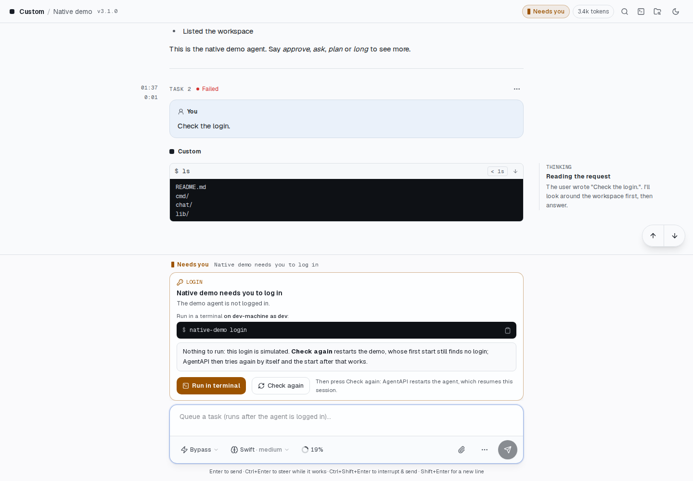

- Claude Code：`claude auth login` 預設使用 Claude 訂閱；加上 `--console` 則使用
  Anthropic Console 的 API 計費。在沒有瀏覽器的主機上，可用 `claude setup-token` 建立
  `CLAUDE_CODE_OAUTH_TOKEN` 所需的 token。用 `claude auth status` 檢查登入狀態。
- Codex：`codex login --device-auth` 讓你從任何裝置以 ChatGPT 方案登入：開啟它顯示的連結，
  再輸入它提供的一次性代碼。登入卡片和 `/login` 執行的就是這個指令，因為 AgentAPI 通常在沒有
  瀏覽器的伺服器上執行。`codex login` 的瀏覽器登入會導向執行 Codex 那台主機的
  `localhost:1455`，其他主機上的瀏覽器連不到；同一台主機上有瀏覽器時仍可使用。
  使用 API 金鑰時執行 `printenv OPENAI_API_KEY | codex login --with-api-key`。
  用 `codex login status` 檢查登入狀態。
- Pi：在 `pi` 中執行 `/login`，或在 AgentAPI 的環境中設定供應商金鑰，例如 `ANTHROPIC_API_KEY`。

AgentAPI 啟動 agent 時，會依下列方式檢查登入：

- Claude Code：執行 `claude auth status --json`。API 金鑰、`CLAUDE_CODE_OAUTH_TOKEN`、
  `apiKeyHelper`、Bedrock 與 Vertex 都視為已驗證。使用 `--settings` 時會略過檢查，
  因為 `auth status` 無法讀取透過該參數提供的 `apiKeyHelper`。
- Codex：使用 app-server 的 `account/read`。
- Pi：檢查目前狀態；未選取模型且沒有可用模型時，視為尚未登入。

尚未登入時，AgentAPI 會持續執行，並將訊息排入佇列。`GET /status` 和 `status_change`
會回報 `login_required`，包含 agent、問題、登入指令、說明、主機與執行帳號。
聊天介面會在輸入框上方顯示這些資訊，並提供複製指令的按鈕。

AgentAPI 每 5 秒重試啟動，完成登入後會自動偵測。按下 **Check again**（`POST /login/retry`）
可立即重試；若啟動檢查已在執行，則沿用該次檢查。啟動警告只會顯示一次，不會隨每次重試
重複出現。若檢查本身失敗，例如 CLI 版本較舊或使用包裝程式，AgentAPI 會照常啟動 agent。

登入也可能在工作階段中失效。回合因登入錯誤而失敗時，同樣會回報 `login_required`。
可辨識的錯誤包括 `Not logged in`、HTTP 401、`Invalid API key`、無法使用的 refresh token、
Pi 的 `No API key found`，以及訂閱登入過期後的 `Authentication failed for "<provider>"`。

完成登入後，按下 **Check again**。AgentAPI 會接續原工作階段重新啟動 agent，並保留對話。
模型成功完成一個回合時，也會清除登入錯誤；被中斷的回合或 agent 自行處理的訊息則不會。
agent 回報登入失效後才結束時，不會像當掉那樣重新啟動，而是和啟動時找不到登入一樣等待登入；
重新啟動時找不到登入也是如此。

## 請求：核准、提問與計畫

工具核准、提問（Claude 的 `AskUserQuestion`、Codex 的 `request_user_input`、Pi 擴充功能
開啟的對話框）和計畫核准（Claude 的 `ExitPlanMode`）都會以請求送達：

- `GET /requests` 列出待處理的請求，以及最近關閉的 50 個請求；`GET /requests/{id}` 回傳
  單一請求。每當有請求開啟或關閉，`/events` 都會送出 `request_update` 事件；
  `GET /status` 的 `pending_requests` 是待處理請求的數量。
- `POST /requests/{id}/respond` 回覆一個請求：核准和計畫用 `option_id`（請求帶有
  `feedback` 時，可以另外用 `text` 附上回饋），提問則用以問題 ID 為鍵的 `answers`。每個
  請求最多只能回覆一次：請求已不再待處理（已回覆、已撤回或已過期，從 `--state-db` 還原的
  請求也一樣）時回傳 409，答案不符合請求時回傳 400。
- 每個請求都有 `status`（`pending`、`resolved`、`withdrawn`、`expired`）和
  `response_capability`：`live`（agent 正在等待）、`message`（agent 已不再等待；請改用
  新訊息回答）或 `not_resumable`（已經無法回覆：提出請求的 agent 已結束或重新啟動，或已不再
  等待某個核准或計畫）。agent 不再等待某個請求時（撤回請求，或回合結束），提問會變成
  `message`，核准和計畫則變成 `not_resumable`。已經在送達途中的答案，只要 agent 收下仍然
  算數。
- 祕密問題的答案在保存和回報時都會換成 `[redacted]`，只有 agent 會收到原本的答案。
- [人工回覆 API](api.zh-TW.md#人工回覆-api)（`/handoff`）會提供最早的待處理請求，並附上編號選項：輸入
  數字選擇選項，其他文字則用來回答單一提問，或作為拒絕選項的回饋。回覆只會回答當初
  提供的那個請求；如果那個請求在這段期間已經回覆或撤回，回覆結果是 `superseded`，請求無法
  接受的回覆則是 `invalid`。

聊天介面會在輸入框上方顯示決策卡片：

- 核准：顯示指令，並以不同樣式區分 Allow、Always allow 和 Deny；拒絕時可附上回饋。
- 計畫：以 Markdown 顯示，可直接核准或附上回饋退回。
- 提問：每題各占一個步驟，支援單選、複選、文字輸入與隱藏答案，最後一起送出。

數字鍵可選擇選項。輸入文字，或對話框、選單、終端機取得焦點時，數字快捷鍵不會作用；
按住按鍵也不會重複觸發。

工具呼叫列會標示等待核准、已核准或已拒絕。`AskUserQuestion`、`request_user_input` 和
`ExitPlanMode` 呼叫需在卡片上回答。已在其他地方回覆，或已不再待處理的請求會離開卡片。
若提問隨回合過期或被 agent 撤回，介面會提示你仍可用一般訊息回答。

有待處理請求時，標頭和分頁標題會顯示「Needs you」，分頁圖示會出現琥珀色圓點，embed 狀態列
的圖示也會變成琥珀色；開啟通知時，背景分頁也會跳出 agent 需要你回應的通知。

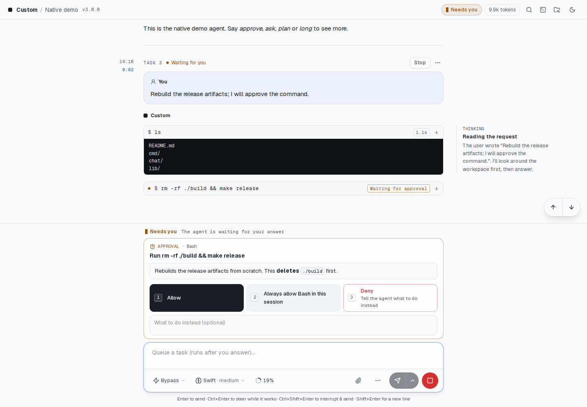

核准卡片會顯示將要執行什麼，以及原因。**Allow** 只執行這一次，**Always allow** 在這個
工作階段剩下的時間裡不再詢問，**Deny** 則拒絕它，並可附註要改做什麼。

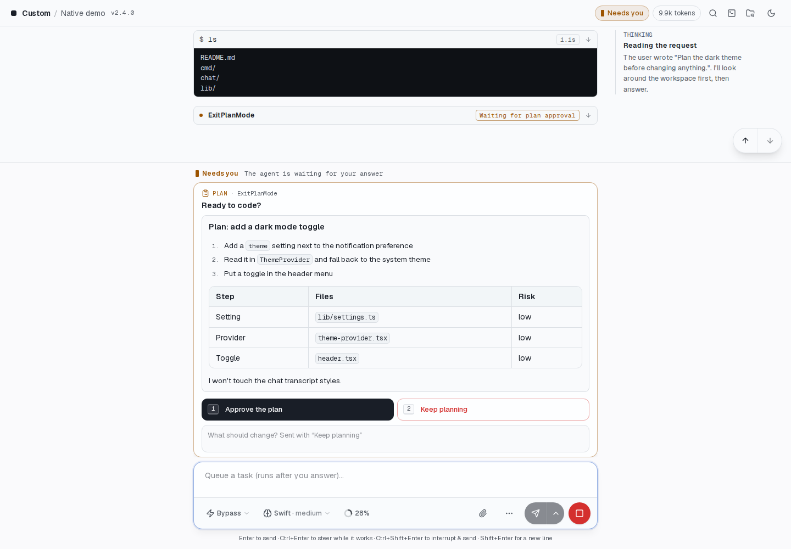

等待核准的計畫會固定在輸入框上方。閱讀後可以核准，或填寫回饋並選擇 **Keep planning**，
請 agent 調整計畫。圖中是 `native-demo` 的模擬計畫，核准後不會實際修改檔案。

## Steer、interrupt 與佇列

- `POST /message` 接受 `dispatch_mode`：`queue`（預設值：等 agent 閒置時再送出）、`steer`（把訊息加進 agent 正在進行的回合；回應會標示 `steered`）或
  `interrupt`（停止那個回合，接著送出這則訊息）。有回合在執行時，它們需要對應的能力，否則回傳 400。沒有回合在執行時（包括 agent 正在重新啟動或等待登入），
  兩者都會照常送出或排入佇列。
- `POST /interrupt` 停止執行中的回合（沒有回合在執行，或沒有 agent 在執行時回傳 409）。
- 排隊中的訊息也可以移進執行中的回合；佇列的端點見[訊息佇列](api.zh-TW.md#訊息佇列)。

`GET /status` 會回報 `capabilities`：`steer`、`interrupt`、`resume`（AgentAPI 再次啟動時
可以接續工作階段，見[持久保存的工作階段](#持久保存的工作階段)）、`settings`（見
[工作階段設定](#工作階段設定)）、`compact`（見[斜線指令與壓縮](#斜線指令與壓縮)）和
`images`。支援 `images` 時，附加的圖片（指向 10 MB 以內 PNG、JPEG、GIF 或 WebP 檔案的
`@"<路徑>"`）除了路徑之外也會以圖片送給 agent；不支援時只會送出路徑。沒有 agent 在執行時
（重新啟動、等待登入），會回報上一個 agent 支援的能力。

在聊天介面中，agent 工作中時，送出按鈕的選單除了排入佇列（Enter），還有 **Steer**
（⌘/Ctrl+Enter）和 **Interrupt & send**（⌘/Ctrl+Shift+Enter），Stop 則會中斷目前的回合
（`POST /interrupt`）。佇列中的任務可以立即 steer 進去，也可以上下移動。

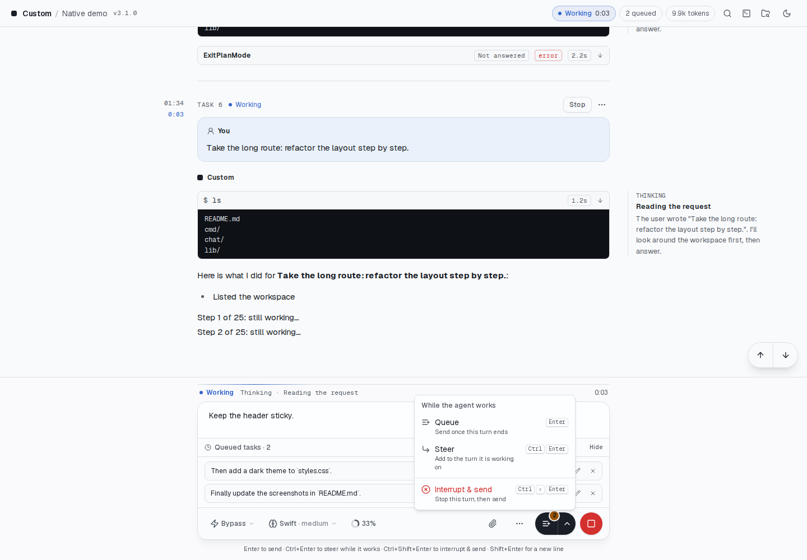

## 工作階段設定

agent 執行期間，可以切換權限模式、模型和推理強度。`GET /settings` 回傳目前的設定與
可選項目，包含各模型支援的推理強度。

`PUT /settings` 只更新請求內容中列出的欄位，例如 `{"permission_mode": "ask"}` 或
`{"model": "sonnet", "effort": "high"}`；不支援的值會回傳 400。`GET /status` 和
`status_change` 也會包含目前的設定。

權限模式有 **bypass**（工具直接執行、不詢問；預設值）、**auto**（由 agent 自己的審查決定
什麼可以執行）、**ask**（需要核准的工具呼叫會以請求送來）和 **plan**（agent 先提出計畫，
以計畫請求送來，核准後才動手）：

| 模式 | Claude Code | Codex | Pi |
| --- | --- | --- | --- |
| bypass | `bypassPermissions` | 不需核准、不使用沙箱 | Pi 一向如此 |
| auto | `auto` | 工作區沙箱，升級權限由 Codex 的 auto review 決定 | — |
| ask | `default` | `untrusted`：不信任的指令都會詢問 | — |
| plan | `plan` | plan collaboration mode | — |

若 agent 使用未對應到上述四種模式的設定，例如 Claude Code 核准計畫後的 `acceptEdits`，
或命令列指定的 Codex 政策，介面不會標示其中任何一種模式。Claude Code 和 Pi 會立即套用
變更；Codex 則在下一個回合套用，因為 app-server 只在那時接受設定。

AgentAPI 會在 agent 重新啟動或重新登入後，再次套用你選擇的設定；使用 `--state-db` 時，
AgentAPI 重新啟動後也會還原設定。agent 自行變更的設定，例如核准計畫後切換的模式，也會反映在介面上。

在聊天介面中，輸入框的工具列有一個模式選單，以及一個模型與推理強度的選單（手機上會放在按鈕
上方的獨立一列）。

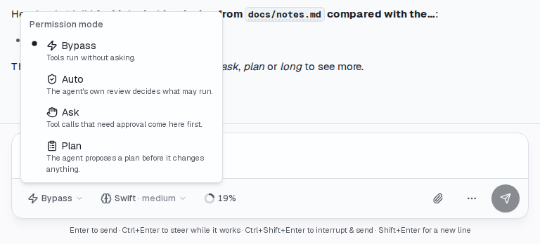

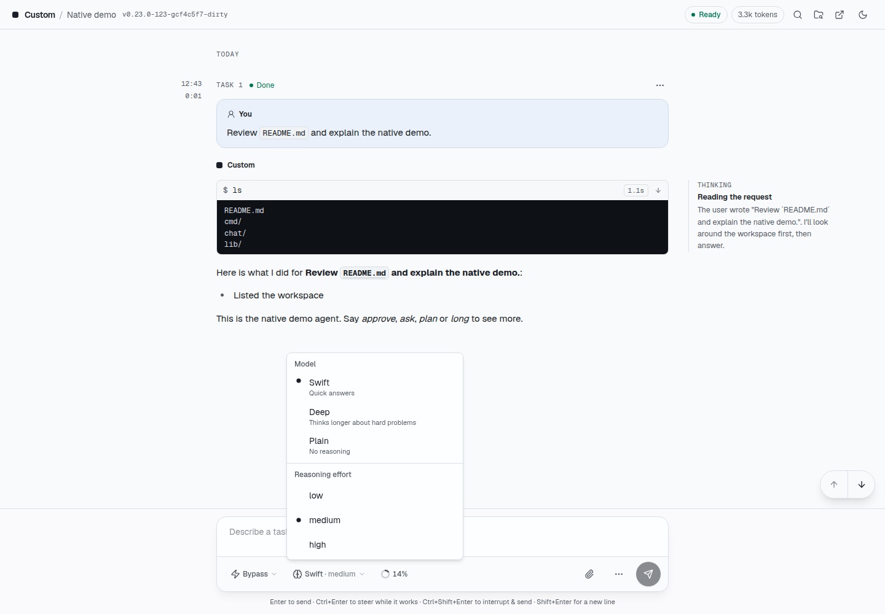

圖中的 Swift、Deep 和 Plain 都是 `native-demo` 提供的示範模型。

## Context 與用量限制

`GET /status` 和 `status_change` 透過 `usage` 回報上一個回合後的 context window 使用量，
以及帳號的用量限制。`context` 包含以 token 計的 `used` 和 `size`；`rate_limits` 列出名稱、
使用量和重置時間，Claude Code 另會標示是否接近或已達上限。
Claude Code 會在每個回合之後回報 5 小時與每週限制和 context，Codex 回報 context
和用量週期，Pi 回報 context。新工作階段的 context 會歸零；帳號的用量限制則維持原狀。
在聊天介面中，輸入框工具列上的圓環顯示 context 用了多少，它的選單則列出各項限制和重置倒數。

Claude Code 也會回報 `prompt_cache`：`ttl_seconds` 是模型供應商在最後一次使用後保留對話
快取的時間（訂閱帳號為一小時，使用 API key、Bedrock 或 Vertex 時為五分鐘），`expires_at` 是快取
過期的時間。過期之後，下一則訊息會讓模型重新讀取整個 context，以全額計價，也會算進
用量限制。agent 閒置、快取已過期且 context 至少有 50k token 時，聊天介面會在輸入框上方提醒，
並提供先壓縮的按鈕；關掉提醒後，要到下一個回合結束才會再出現。

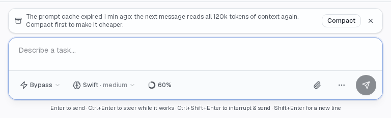

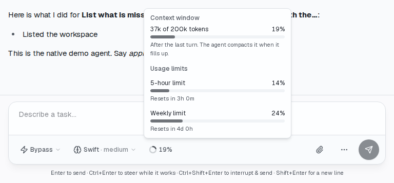

## 達到用量限制時

帳號達到用量限制時，agent 會停下回合：Claude Code 會說「You've hit your limit」，Codex 回報
`usageLimitExceeded`，Pi 則是模型供應商的額度錯誤。這時 `GET /status` 和 `status_change` 會回報
`limit_stop`：agent 的 `message`、停下的時間，以及 agent 有說明時限制何時重置（`resets_at`；
沒有的話，就用 `rate_limits` 中已達上限那一項的重置時間）。排隊中的訊息會等到那時再送出，
而不是一則接一則失敗；你自己送出的訊息會立刻送出，排在它們前面，並結束這個停止狀態。

- `POST /limit/continue` 帶 `{"at": "now"}` 會送出一則請 agent 繼續任務的訊息；帶
  `{"at": "reset"}` 則排定在重置一分鐘後送出（沒有重置時間時回傳 409）。排隊中的訊息會在它
  之後送出。
- `DELETE /limit/continue` 取消排定的繼續；佇列仍會等到重置。
- `DELETE /limit` 忽略這次停止，讓排隊中的訊息在 agent 能接收時就送出。
- `--auto-continue` 會為每次有重置時間的停止排定繼續。繼續的回合又被限制停下時，會再排定
  一次。

使用 `--state-db` 時停止狀態會保留，所以 AgentAPI 重新啟動後，排定的繼續仍會送出。在聊天介面中，
停止狀態是輸入框上方的一張卡片，顯示重置時間，以及 **Continue at reset**、**Continue now** 和
**Send queued tasks**，佇列也會標示它在等用量限制，標頭和分頁標題則顯示「Needs you」。

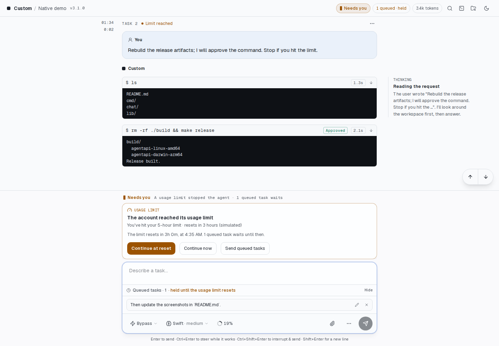

## 暫時性的 API 錯誤

API 請求失敗時，agent 自己會先重試幾次。放棄後如果錯誤可能自行恢復，回合就會失敗：Claude Code
會說「API Error: 502 Bad Gateway. This is a server-side issue, usually temporary」，Codex 回報
`serverOverloaded` 或連線失敗，Pi 則是重試沒有成功就結束。這時 AgentAPI 不會直接處理佇列中的下一則
訊息，而是等一段時間再試這個回合。以下情況算是暫時性錯誤：

- HTTP 狀態碼 500 到 599 或 429（Claude Code 的 `api_error_status`、Codex 的 `httpStatusCode`，
  或錯誤訊息中的狀態碼）；
- Codex 的 `serverOverloaded`、`internalServerError` 和 `rateLimitExceeded`，以及沒有狀態碼就失敗
  的連線或串流；
- Pi 重試後仍沒有成功；
- 措辭像這類錯誤的訊息：bad gateway、service unavailable、overloaded、rate limit、timed out、
  connection error 等。

AgentAPI 會先判斷是不是用量限制（見[達到用量限制時](#達到用量限制時)）或缺少登入：寫著
「You've hit your limit」的 429 算是用量限制造成的停止。400 等用戶端錯誤不會再試。

`GET /status` 和 `status_change` 會回報 `retry_wait`：agent 的 `message`、已知時的 `api_status`、
回合失敗的時間、下一次是第幾次重試（`attempt`／`attempts`），以及 `retry_at`。這次失敗會以警告
顯示（「… AgentAPI tries again in 30s (1 of 15).」），排隊中的訊息會等著。到了 `retry_at`，AgentAPI
送出「Continue from where you left off.」，agent 就會接著做，你的訊息不會重送一次。重試又以同樣
方式失敗時，改等下一個間隔；最後一次也失敗的話，就當成錯誤，佇列繼續送出。回合成功，或你自己
送出訊息，都會重新計算次數。

- `POST /retry` 立刻再試。
- `DELETE /retry` 取消重試，讓排隊中的訊息送出。
- `--retry-delays` 設定每次重試前等多久，`5m*12` 表示 5 分鐘重複 12 次：預設 `30s,1m,2m,5m*12`，
  約一小時內重試 15 次；`off` 關閉重試。

使用 `--state-db` 時等待狀態會保留，所以 AgentAPI 重新啟動後仍會重試。失敗那個回合的[任務](api.zh-TW.md#任務)
以 `failed` 結束；重試是另一個任務。摘要的 `attention` 維持 `none`，hub 會把 agent 顯示為工作中。
在聊天介面中，輸入框上方的卡片會倒數到下一次重試，並提供 **Retry now** 和 **Cancel**。

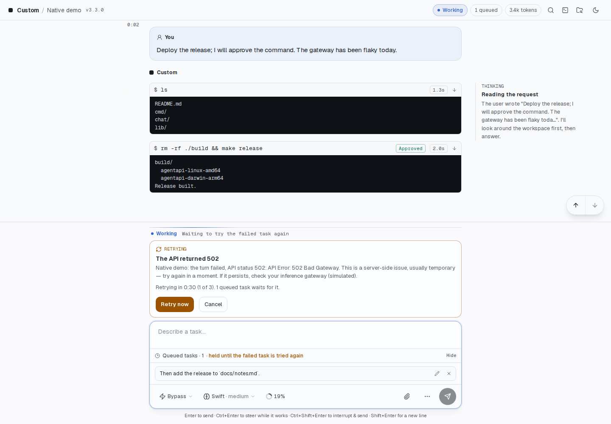

## 終端機

AgentAPI 在 agent 的工作目錄中提供 shell，可用來登入、執行 git 指令或處理其他工作。
終端機支援顏色、游標移動與全螢幕程式，大小會配合桌面或手機視窗。所有人共用同一個 shell，
就像 tmux 視窗；沒有人觀看時仍會執行，結束後再次開啟則啟動新的 shell。環境變數與 agent 相同，
但會移除 AgentAPI 自己的變數。

網頁連結可以直接點選，跨行的連結也一樣。指令最後印出的連結，例如登入網址，會額外顯示在終端機
上方，方便開啟或複製。

按鍵列提供方向鍵、Enter、Esc、Tab、Shift+Tab、Ctrl+C、Ctrl+R、Ctrl+A、Ctrl+E、Ctrl+U、
Ctrl+W、Home、End、Page up、Page down、/ - | ~、Alt+↑ 和 Ctrl+L。Ctrl+D 與 Ctrl+Z 需要再按一次。
Ctrl 和 Alt 按鈕會按住修飾鍵，套用到下一個輸入的按鍵。

- `GET /terminal` 以 server-sent events 串流輸出（`output` 事件帶 base64 資料，第一個
  事件是最近的輸出，供重播；shell 結束時送出 `exit`），shell 沒有在執行時會啟動它。
- `POST /terminal/input`（`{"data": "..."}`）輸入按鍵，一次一個請求；`POST /terminal/resize`
  （`{"cols": 120, "rows": 40}`）調整大小。忙碌的程式 10 秒內沒讀走輸入時回傳 503，這時
  輸入可能已經送出一部分。
- 預設開啟，`--terminal=false` 可以關閉。它和 API 的其他部分受到相同
  的保護，所以別人連得到伺服器時，請使用 `--api-token`。

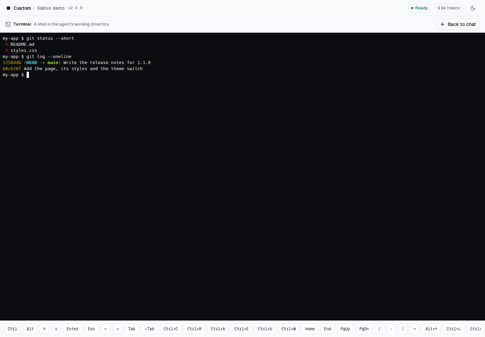

## 斜線指令與壓縮

agent 不會執行自己的互動式終端機介面，因此下列斜線指令由聊天介面處理：

- `/model [模型]`、`/effort [強度]`（`/think`）和 `/mode [模式]`（`/permissions`）依 id 或
  名稱切換設定，不帶參數則開啟對應的選單；`/plan` 切換到 plan 模式；
- `/compact` 壓縮 context；
- `/clear`（`/new`）開始新的對話；
- `/terminal` 開啟終端機，`/login` 在終端機裡執行 agent 的登入指令；
- `/help` 列出這些指令。

輸入指令名稱時，輸入框會提示可用的指令，按 Tab 會補完第一個。其他內容會原樣送給 agent，所以
agent 自己的指令（Claude Code 的 `/code-review`、Pi 擴充功能的指令）仍然可以使用。
`POST /compact` 會在 agent 沒有在執行回合時壓縮 context：Codex（`thread/compact/start`）
會用一個獨立回合壓縮，Pi（它的 `compact` 指令）會在完成後才回覆。壓縮期間送出的訊息會在
佇列中等待；agent 拒絕壓縮時（例如 Pi 的「Nothing to compact」）會回傳 409 並附上原因。
Claude Code 則用 `/compact` 訊息壓縮，聊天介面會把這則訊息送給它。

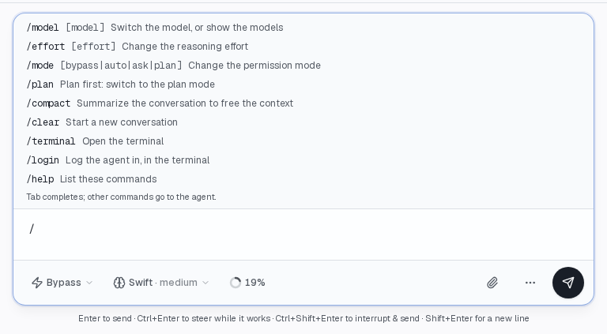

## 持久保存的工作階段

`--state-db <檔案>` 會把對話保存在一個 SQLite 檔案裡：訊息、結構化訊息（工具呼叫、
思考）、時間軸、請求和佇列，以及 agent 的工作階段 ID 和透過 API 修改的 webhook 設定。AgentAPI
用同一個檔案再次啟動時，聊天介面會顯示原本的對話，排隊中的訊息仍在佇列裡。agent 會接續自己的
工作階段，所以也記得先前的對話。正常關閉後再啟動時，對話的 epoch 不變，瀏覽器的快取也仍然
有效。沒有 `--state-db` 時，AgentAPI 每次啟動都是新的對話；只有[原地重新啟動](cli.zh-TW.md#agentapi-restart)
例外，它會接續 agent 的工作階段。

```bash
agentapi server --state-db ~/.agentapi/myproject.db -- claude
```

路徑中的 `{port}` 和 `{hostname}` 會自動填入，所以在[設定檔](cli.zh-TW.md#旗標)寫一行，就能讓這個使用者的
每個 AgentAPI 各有自己的檔案，例如 Coder 工作區啟動的 Claude Code（3286）和 Codex（3285）：

```yaml
state-db: ~/.agentapi/state/{port}.db
```

- 每個 `agentapi server` 都會讀取設定檔，而第一個啟動的會鎖住資料庫檔案，所以設定檔中沒有
  `{port}` 的 `state-db` 會略過並記下警告，否則其他伺服器都無法啟動。`--state-db` 和
  `AGENTAPI_STATE_DB` 仍然有效。
- AgentAPI 停止時尚未回覆的請求會標示為已過期：提出請求的 agent 已經不在了。
- 伺服器只把最近 100 個任務的工具呼叫和時間軸放在記憶體，用戶端要讀較早的內容時才從檔案讀取，
  所以跑了好幾個月的對話，啟動速度和新對話差不多，記憶體也不會跟著對話一直增加（[長對話](api.zh-TW.md#長對話)）。
- 上傳的檔案會保存在資料庫旁（`<檔案>.uploads`），因為訊息是用路徑引用它們。對話（和佇列）
  都沒有引用的檔案超過 7 天後會刪除，讓草稿的附件有時間送出；啟動時、每小時和重新啟動後會檢查。
- 一個檔案只屬於一種 agent 類型和工作目錄；遇到屬於其他組合的檔案，AgentAPI 會拒絕啟動。
  AgentAPI 2 為 PTY agent 寫的檔案可以開啟：agent 在原本的對話下方開始新的工作階段，之後以
  native 方式繼續。AgentAPI 執行期間會鎖住檔案，所以第二個 AgentAPI（或
  `sqlite3`）無法開啟它。
- 新建立的檔案只有擁有者能讀寫（0600），缺少的目錄也會一併建立（0700）。
- 較新的 AgentAPI 寫過的檔案，較舊的 AgentAPI 仍可繼續使用，除非較新的版本以舊版無法寫入的方式
  改了檔案：這時舊版會拒絕啟動，並指出需要的版本。1.9.0 之後的版本才會這樣檢查；1.9.0 以前的
  版本遇到結構比自己新的檔案一律拒絕（結構從 1.0 起就沒有改變）。
- 重新啟動（Explorer → Restart 或 `DELETE /messages`）會清除保存的對話和佇列，並開始新的
  工作階段。為工作階段選擇的設定會保留。
- 寫入會每 200 毫秒批次處理一次，所以串流不必等待磁碟。當機後最後一批寫入可能遺失，對話因此會
  換成新的 epoch，用戶端會重新載入完整的對話。持續失敗的寫入會以錯誤回報。
- 還原的對話不會再收到 `--initial-prompt`。
- 用 `PUT /webhook` 或 Explorer 修改的 webhook 設定在重新啟動後仍然有效，除非 AgentAPI 以不同的
  webhook 參數啟動。
- 用戶端上次顯示對話的時間（`POST /tasks/seen`）會保存下來，所以沒看過就結束的任務在重新啟動後
  仍是[未讀](api.zh-TW.md#監看多個實例)。1.2 之前寫入的資料庫，任務會視為已讀。
- SIGUSR1 會寫入狀態資料庫尚未寫入的變更。
- AgentAPI 4 不再讀取 `--state-file`，也就是 PTY transport 在 v1.0.0 之前的保存方式。AgentAPI 3
  第一次帶著這個檔案啟動時，已把它匯入旁邊的狀態資料庫（同名、副檔名改為 `.db`）：請改用
  `--state-db` 指定那個資料庫。從沒匯入過的檔案，請先用 AgentAPI 3.16 帶 `--state-file` 執行一次。
- 使用 `--state-db` 的 AgentAPI 經 [`agentapi restart`](cli.zh-TW.md#agentapi-restart)（SIGUSR2）或
  `agentapi update --restart` 重新啟動後，對話和 agent 的工作階段都會保留。沒有 `--state-db`
  時會保留 agent 的工作階段，對話則從它的紀錄讀回；佇列、待回覆的請求和選擇的設定會重新開始。

## 先前的工作階段

AgentAPI 讀取 Claude Code、Codex 和 Pi 的紀錄，列出並開啟工作目錄中先前的工作階段。
這項功能不需要 `--state-db`：

- `GET /sessions` 由新到舊列出它們，以及 agent 目前開啟的那一個（`current`）：每一個都有
  `id`、`title`（agent 或使用者為它取的名字）、`first_prompt`、`prompts`（訊息數），以及開始和
  最後變動的時間。使用者沒送過訊息的工作階段不會列出。資料來自 Claude Code 的 projects 目錄、
  Codex 的 sessions 和 Pi 的工作階段目錄（會參考 `CLAUDE_CONFIG_DIR`、`CODEX_HOME`、
  `PI_CODING_AGENT_DIR`、`PI_CODING_AGENT_SESSION_DIR`，以及傳給 Pi 的 `--session-dir`）。工作階段
  屬於它的紀錄所記載的目錄，AgentAPI 經由 symlink 在該目錄中執行時也一樣；Claude Code 會把某些
  目錄取成相同的名稱（例如 `/w/a_b` 和 `/w/a-b`），它們的工作階段也能分辨出來。
- `POST /sessions/{id}/resume` 讓 agent 在那個工作階段上重新啟動，並把對話換成從紀錄讀出的
  內容。帶 `{"fork": true}` 時，agent 會以新的 id 開啟它的副本（Claude Code 的
  `--fork-session`、Codex 的 `thread/fork`、Pi 的 `--fork`），原本的工作階段維持不變。佇列和尚未
  回覆的請求會像重新啟動時一樣清除；agent 正在執行回合、壓縮 context 或重新啟動時回傳 409，
  遭拒的開啟不會改動目前的對話。id 不是單一檔名（含 `/` 或 `\`、是 `.` 或 `..`、含控制字元）時
  回傳 400。

在聊天介面中，Explorer 的 Session 分頁會列出這些工作階段，並提供 **Open** 和
**Start a copy**，兩者都要點第二次確認。

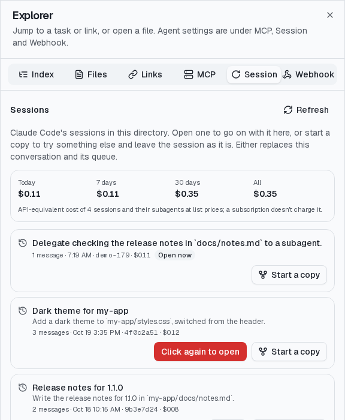

## 工作階段花費

AgentAPI 從 agent 的工作階段紀錄讀出每次模型呼叫用掉的 tokens，以模型供應商的牌價換算成
美元金額。這是 API 等價金額：Claude 或 ChatGPT 訂閱不按 token 計費，所以它代表的是改用 API
key 做同樣的工作要花多少錢。

- Claude Code：工作階段紀錄和它的 sub agent 紀錄中的每次呼叫，cache 寫入分別以 Anthropic 的
  5 分鐘或一小時 cache 計價。Claude Code 計入自己的總額、卻沒有逐筆記錄的 token（例如壓縮
  context），會從它的花費紀錄補上，列為未逐筆列出（unitemized）的呼叫，計價方式和其他呼叫相同。
  同樣的 token 在 Claude Code 自己算出的金額不同時（它用的價格不同），花費仍以 AgentAPI 的為準，
  伺服器會為每個模型記錄一次警告。
- Codex：每個回合的 token 計數，含它的 sub agent；從 cache 讀取的輸入以 cache 讀取計價，其餘以
  輸入計價。
- Pi：Pi 為每次呼叫回報的金額。

紀錄中沒有模型或用量、或讀出的用量是 0 的呼叫不計花費，伺服器的 log 會對每個紀錄檔警告一次：
agent 可能改了紀錄格式，例如把欄位改了名。

分支（fork）從另一個工作階段複製來的呼叫，算在原本的工作階段，所以加總時不會重複計算。內建
價格涵蓋 Anthropic 和 OpenAI 的模型；`--prices <檔案>` 可以新增模型或取代它們的價格，單位是
每百萬 tokens 的美元：

```json
{
  "my-model": {"input": 3, "output": 15, "cache_read": 0.3, "cache_write": 3.75},
  "gpt-6.1-sol": {"input": 2, "output": 10, "cache_read": 0.1, "cache_write": 2.5,
    "tiers": [{"input_tokens_above": 272000, "input": 4, "output": 15, "cache_read": 0.2, "cache_write": 5}]}
}
```

一次呼叫的輸入（未快取的、從 cache 讀取的和寫入 cache 的）超過 `input_tokens_above` 時，
套用該級距（tier）的價格。比對模型 ID 時不分大小寫，並忽略供應商前綴（`anthropic/`）、
context 後綴（`[1m]`）和發布日期；找不到時取最長的已知前綴（`claude-opus-5-5-x` 以
`claude-opus-5-5` 計價），但不跨過 `-mini`、`-nano` 或 `-pro` 這類變體（`gpt-5.1-codex-mini`
不算 `gpt-5.1`）。沒有價格的模型只計 tokens、不計金額（`priced: false`），伺服器的 log 會對
每個這種模型警告一次。`scripts/prices.mjs` 會比對內建價格和 Pi 的模型清單。

- `GET /sessions` 為每個工作階段提供 `cost`：`usd`、`tokens`、`calls`、每個模型的花費
  （`models`）和每小時的花費（`hourly`，UTC，含當小時的 `tokens`），以及全部加總的 `total_cost`。
- `GET /cost` 提供目前開啟的工作階段的花費和它的模型呼叫 `calls`（`time`、`model`、`tokens`、
  `usd`、`subagent_id`）；一個任務的花費，就是從它的訊息到下一個任務之間的呼叫。已經有前面幾筆呼叫的
  用戶端可以帶上 `from`（筆數）和當時拿到的 `digest`，只取得之後的呼叫（回應裡的 `from` 會標示起點）；
  回應的 `total_calls` 和 `digest` 就是下次要帶的值。若那些呼叫有變動，則會拿到全部，`from` 為 0。

在聊天介面中，每個任務的開始時間和耗時下方會顯示它的花費（窄螢幕上在任務標頭），滑鼠移上去
可以看到 tokens；回合結束時會重新讀取，回合執行中則每 15 秒讀取一次。Explorer 的 Session 分頁
會顯示每個工作階段的花費，以及全部工作階段今天、最近 7 天、30 天和全部的花費（依你的時區）。


## Claude Code

AgentAPI 會以 headless 模式執行 `claude -p`，stdin 和 stdout 都使用 stream-json。工具
呼叫會帶有輸入、結果、狀態和圖片，每則 assistant 訊息都有模型、停止原因和 token 用量。

權限模式、模型和推理強度透過 Claude Code 的 control request（`set_permission_mode`、
`set_model`、`apply_flag_settings`）切換；可選的模型和推理強度來自它的 initialize 回應，
目前使用的模型和推理強度則來自 `get_settings`。

- 核准提供 Allow、Deny（可附上給 Claude 的回饋），以及在 Claude Code 建議了權限規則時的
  「Allow always」，這個規則只套用在這個工作階段。Claude Code 認定為唯讀的指令不會詢問就
  直接執行。
- 問題會列出 Claude 提供的選項；也接受其他答案。
- 計畫會顯示計畫內容，並提供「Yes, and bypass permissions」（工作階段可以切換到 bypass
  時）、「Yes, and auto-accept edits」、「Yes, and manually approve edits」和「No, keep
  planning」。選 No 時附上的回饋會讓 Claude 修改計畫後再詢問一次。

Claude Code 支援 `steer`（steer 的訊息會在 Claude 的下一步加入正在進行的回合）、
`interrupt`（Claude Code 在 10 秒內沒有結束被中斷的回合時，AgentAPI 會結束它）、`resume`
和 `images`。工作階段名稱是 Claude Code 在第一個提示之後產生的標題；`/clear` 之後的新工作
階段也會取得標題，而 `--state-db` 接續的就是這個新工作階段。回合會在 Claude Code 回報閒置時
結束，所以背景 sub agent 以及它完成時喚醒的回合，都屬於啟動它的那個回合。sub agent 自己的步驟
不會出現在對話中（和工作階段紀錄檔一樣），它的工具呼叫在它回報之前會顯示為執行中。

命令列與環境變數：

- AgentAPI 會加上 `-p --output-format stream-json --input-format stream-json --verbose
  --include-partial-messages --replay-user-messages --permission-prompt-tool stdio`，
  新工作階段加上 `--session-id`，接續工作階段時加上 `--resume`。
- 除非你另有指定，否則會加上 `--permission-mode bypassPermissions`，工具直接執行、不詢問。
  提問（AskUserQuestion）和計畫（ExitPlanMode）仍會以請求出現，核准計畫時也可以選擇略過權限。
  想以其他模式啟動，請加上 `--permission-mode default`（或 `acceptEdits`、`plan` 等），也可以
  在 Claude Code 執行中切換（見[工作階段設定](#工作階段設定)）。AgentAPI 也會加上
  `--allow-dangerously-skip-permissions`，讓工作階段之後可以切換到 bypass。
- Claude Code 不允許在沙箱外以 root 使用 `bypassPermissions`，所以 AgentAPI 以 root 執行時會
  改加 `--permission-mode default`、不加 `--allow-dangerously-skip-permissions`，並記錄一則
  警告。在沙箱中請設定 `IS_SANDBOX=1`，或自己指定模式（單獨使用
  `--allow-dangerously-skip-permissions` 仍會讓 Claude Code 以 root 執行時直接結束）。
- 另外也會加上 `--thinking adaptive --thinking-display summarized`（少了它思考內容會是空的）。
  你自己的 `--permission-mode`、`--dangerously-skip-permissions`、`--thinking`、
  `--max-thinking-tokens` 或 `--thinking-display` 優先。
- 和協定或 AgentAPI 管理的工作階段衝突的參數，會在啟動時拒絕：`-p`/`--print`、
  `--output-format`、`--input-format`、`-r`/`--resume`、`-c`/`--continue`、
  `--session-id`、`--fork-session`、`--from-pr`、`--teleport`、
  `--permission-prompt-tool`、`--permission-prompts`、`--bg`/`--background`、
  `--cloud`/`--remote`、`--desktop`、`--remote-control`/`--rc`、`--sdk-url`、
  `--resume-session-at` 和 `--resume-drops-turn`，寫在短旗標群組裡（例如 `-pc`）也一樣。
  你自己傳入的 `--verbose`、`--include-partial-messages` 和 `--replay-user-messages` 會移除。
  其他參數（`--model`、`--allowedTools`、`--mcp-config`、`--append-system-prompt` 等）都會原樣
  傳遞。
- 除了移除上層 agent 工作階段的環境變數（見 [Native transport](architecture.zh-TW.md#native-transport)），
  AgentAPI 還會設定 `CLAUDE_CODE_EMIT_SESSION_STATE_EVENTS=1` 和
  `CLAUDE_CODE_ENTRYPOINT=sdk-cli`。

恢復工作階段會保留 Claude 的 context；Claude Code 不會重播先前的訊息，所以聊天介面只能從
`--state-db` 檔案顯示它們。工作階段在有過一個回合之後才能恢復；使用
`--no-session-persistence` 時則無法恢復，`resume` 為 false。Claude Code 結束或重新啟動時
仍未處理的請求就無法再回答。需要互動式介面的斜線指令無法運作。

## Codex

AgentAPI 會啟動 `codex app-server`，並開始或恢復一個 thread。訊息、結構化訊息和時間軸的
格式與工作階段紀錄檔解析器產生的相同，因此聊天介面會即時串流顯示 Codex 的回覆、推理摘要、
指令（指令本身，而不是 `bash -lc` 包裝）、檔案編輯、MCP 工具呼叫、計畫更新和 token 用量。
每個回合都會要求詳細的推理摘要，除非你用 `-c` 自己指定 `model_reasoning_summary`；模型
會不會寫出摘要，取決於模型和推理強度。

`codex` 後面的命令列參數會這樣處理：

- `-c`/`--config`、`--enable`、`--disable`、`--code-mode-host`、`--strict-config` 和
  `--analytics-default-enabled` 會傳給 `codex app-server`。
- `-m`/`--model`、`-s`/`--sandbox`、`-a`/`--ask-for-approval`（`untrusted`、`on-request`、
  `never`）和 `-C`/`--cd` 會變成 thread 的設定；`--dangerously-bypass-approvals-and-sandbox`
  等同 `-a never -s danger-full-access`。沒有指定這些（或 `-c approval_policy=...`、
  `sandbox_mode`、`approvals_reviewer`）時，thread 會不經核准、不用沙箱執行，也就是
  native transport 的 bypass 模式；可以在聊天介面或用 `PUT /settings` 切換（見
  [工作階段設定](#工作階段設定)）。Codex 0.160 不接受設定檔裡的
  `approval_policy = "untrusted"`，要用這個政策請改用 `-a untrusted`。
- `--no-alt-screen`、`--no-daemon` 和 `--stdio` 會忽略。
- 短旗標可以像 Codex 一樣直接接上值（`-mo3`、`-m=o3`）；開關旗標帶值
  （`--dangerously-bypass-approvals-and-sandbox=false`）會拒絕。
- 提示文字、子指令（`app-server` 以外）、`-p`/`--profile`、`-i`/`--image`、`--oss`、
  `--local-provider`、`--search`、`--add-dir`、`--approve-for-me`、
  `--dangerously-bypass-hook-trust`、`--remote`、`--remote-auth-token-env`、`--worktree`、
  `--listen`、`--help`、`--version` 和未知的旗標，啟動時會拒絕並說明原因。第一則訊息
  請用 `--initial-prompt`，圖片請附加在訊息上。

Codex 支援 `steer`、`interrupt`、`resume` 和 `images`。指令、檔案編輯和 MCP 工具的核准、
權限請求、MCP 表單 elicitation，以及 `request_user_input` 問題都會變成請求（Codex 會在
plan 模式提出這類問題；codex-cli 0.160 可以用 `--enable default_mode_request_user_input`
讓 Codex 在預設模式也提出）。plan 模式就是 Codex 的 plan collaboration mode，這是
app-server API 的實驗性功能，AgentAPI 會啟用它：Codex 以一份計畫結束回合，AgentAPI 接著像
Codex TUI 一樣詢問「Implement this plan?」。Yes 選項（`implement_bypass`、`implement_auto`
和 `implement_ask`，進入 plan 前的模式排在最前面）會離開 plan 模式、切換到該權限模式，讓 Codex
在同一個回合裡實作。選 No（`keep_planning`）並附上回饋，會把回饋送回給 Codex 繼續規劃；只選 No
則結束這個回合。

其他請求的選項 ID 就是 Codex 自己的決定值（`accept`、`acceptForSession`、
`acceptWithExecpolicyAmendment`、`decline`、`cancel` 等）。AgentAPI 不會自動核准請求，無法
顯示的請求則會拒絕。指令核准會顯示實際執行的指令（不含 shell 包裝），Codex 對它的解讀（讀取的
檔案、搜尋）放在詳細資訊中。回合結束時仍未回覆的請求會拒絕（MCP elicitation 則取消），
所以 Codex 和 MCP 伺服器都不會一直等待。steer 的訊息會在 Codex 下一次向模型發出請求時加入
執行中的回合（目前的輸出會繼續串流），對它的回覆會歸在該則 steer 訊息底下。interrupt 會在
幾毫秒內結束回合，被中斷的工具呼叫會顯示為失敗。

工作階段參照是 Codex 的 thread ID。接續時會保留該 thread 和它的 context；行程結束時正在執行
的回合還原後會標示為 interrupted，當時待處理的核准會消失，Codex 先前的回合也不會載入
AgentAPI 的對話（聊天介面只能從 `--state-db` 檔案顯示它們）。無法恢復的 thread 會換成新的
thread，並顯示警告。Codex 不會自己替 thread 命名；在別處設定的名稱（`thread/name/updated`）
會成為工作階段名稱。

Codex 自己的斜線指令是 TUI 功能；`/model`、`/compact` 以及[斜線指令與壓縮](#斜線指令與壓縮)
中的其他指令由聊天介面自己處理，`/review` 則無法使用。指令輸出串流時只是預覽，Codex 可能
漏掉部分內容，指令結束後會換成完整輸出。

## Pi

AgentAPI 會以 RPC 模式執行 Pi（`pi --mode rpc`，經由 stdin 與 stdout 傳送 JSON）。

- **旗標。** AgentAPI 會加上 `--mode rpc --session-id <id>`（每個新工作階段都會用新的
  `agentapi-<hex>` ID，重新啟動後也是）。會挑選模式或工作階段、或讓 Pi 直接結束的選項
  （`--mode`、`--print`/`-p`、`--session`、`--session-id`、`--continue`/`-c`、
  `--resume`/`-r`、`--fork`、`--no-session`、`--export`、`--list-models`、`--help`/`-h`、
  `--version`/`-v`）、`@file` 參數、訊息（`--` 之後的，或是 RPC 模式會忽略的單純參數），以及
  子命令（`pi install`、`remove`、`uninstall`、`update`、`list`、`config`、`auth`、`mcp`）
  都會拒絕，錯誤訊息會指出是哪個選項。只影響 TUI 的 `--tui-mode` 與 `--use-theme` 會連同
  值一起丟棄。其他參數都會原樣傳下去（`--provider`、`--model`、`--thinking`、
  `--session-dir`、`-e`、`--approve`、擴充功能的旗標）。Pi 內建選項的 `--flag=value` 會拆成
  兩個參數，因為 Pi 只認得這種寫法。思考等級請用 `--thinking` 設定。
- **能力。** 支援 steer（`dispatch_mode: "steer"` 會以帶 `streamingBehavior: "steer"` 的
  prompt 送出）、interrupt（`POST /interrupt` 會送出 `abort`；回合會以中斷結束，不會出現 Pi
  在工具執行中中止時多加的「This operation was aborted」錯誤；Pi 在 10 秒內沒有結束回合時，
  AgentAPI 會結束它）、resume，以及圖片（附加的圖片會以 base64 的 `images` 交給 Pi；除非 Pi
  表示它的模型不接受圖片，否則都會回報這項能力）。
- **訊息。** 文字與思考內容會在抵達時串流進 rich messages，bash 的輸出會串流進工具結果，
  最終訊息的格式和從 Pi 工作階段紀錄檔解析出來的相同。工具結果中的圖片（Pi 讀取的圖片檔）
  也會保留。
- **請求。** 原版 Pi 沒有工具核准。擴充功能開啟的對話框（`select`、`confirm`、`input`、
  `editor`）會變成請求：工具執行中出現的 `select` 或 `confirm` 是對那次工具呼叫的核准（選項 ID
  就是擴充功能給的標籤），所有 `confirm` 都用 `yes`/`no` 回答，其他對話框則是問題（`choice` 或
  `value`；選項 `cancel` 會關掉對話框）。Pi 逾時的對話框會撤回。回合結束時仍開著的對話框
  會隨回合過期，和其他 agent 的請求一樣（提問之後仍可用訊息回答），擴充功能會收到 cancel；
  中斷正在等待對話框的擴充功能命令時，對話框會撤回。沒有經過模型回合的擴充功能命令會以
  停止原因 `handled` 結束。擴充功能以 error 等級發出的 `notify` 會顯示為錯誤，它的 `setTitle`
  會在 Pi 還沒有名稱時暫代工作階段名稱；Pi 自己的名稱（`--name`、重新命名）就是工作階段名稱。
- **續接。** Pi 的工作階段 ID 就是工作階段參照。續接時會用同一個 `--session-id` 啟動 Pi
  （請維持相同的目錄與 `--session-dir`），所以 Pi 會保留 context；Pi 不會重播先前的訊息，所以
  聊天介面只能從 `--state-db` 檔案顯示它們。
- **關閉。** 停止 AgentAPI（或重新啟動）時會先中止正在執行的回合，這樣工作階段紀錄檔就不會
  停在一個沒有結果的工具呼叫上，接著依 [Native transport](architecture.zh-TW.md#native-transport) 所述停止 Pi。
- **設定。** Pi 沒有權限模式。模型（`set_model`，可選有供應商的模型）和思考等級
  （`set_thinking_level`，各模型支援的等級）可以切換；換模型時 Pi 會自己調整等級。
- **命令。** 無法使用 Pi 的 TUI 命令（`/settings`、`/login` 等）；`/model`、`/compact` 以及
  [斜線指令與壓縮](#斜線指令與壓縮)中的其他指令由聊天介面處理，擴充功能的斜線命令可以使用。
  可以在聊天介面的終端機裡登入（執行 `pi`，再輸入 `/login`）。

## 限制

- agent 沒有自己的終端機。需要 agent 互動式介面的斜線指令無法運作，聊天介面自己處理的指令
  除外。[終端機](#終端機)是另一個獨立的 shell。
- 重新啟動（Explorer → Restart 或 `DELETE /messages`）會換成新的 agent 並開始新的工作階段，
  同時清除對話和佇列；尚未回覆的請求會變成 `not_resumable`。`--initial-prompt` 會再送給新的
  工作階段，Codex 和 Pi 也會先更新。
- 沒有 `--state-db` 時，AgentAPI 下次啟動就是新的工作階段，不會接續 agent 先前的工作階段。
  [原地重新啟動](cli.zh-TW.md#agentapi-restart)是例外：它會接續工作階段。
- 圖片只能當成訊息附件（`@"<路徑>"`）交給 agent，不能用命令列旗標（`codex -i` 和 Pi
  的 `@file` 都會被拒絕）。
