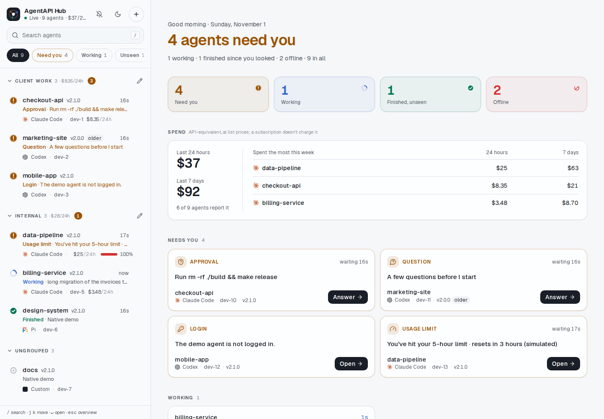
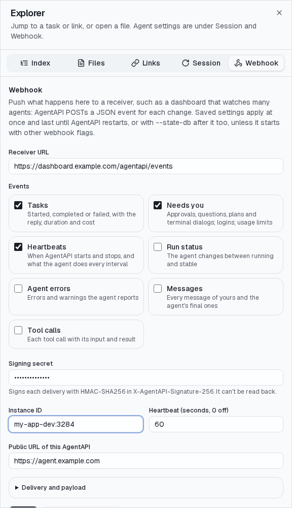

# HTTP API

English | [繁體中文](api.zh-TW.md)

This page covers the [conversation API](#conversation-api), the [integrations](#integrations)
(watching many AgentAPIs, the hub, webhooks and the human-reply API) and the
[reference](#http-api-reference) of every endpoint.

## Conversation API

### Messages and status

- `POST /message` sends a message: `{"content": "Hello, agent!", "type": "user"}`.
  A 200 means AgentAPI saw the agent start on it, or queued it (`queued`)
  because the agent is busy; `dispatch_mode` chooses what happens then (see
  [Steer, interrupt and the queue](agents.md#steer-interrupt-and-the-queue)).
- `GET /messages` returns the conversation; `GET /rich-messages` and
  `GET /timeline` return its structured form (see
  [Structured activity](#structured-activity)). `GET /messages` returns every message unless asked
  for a page; the other two, and `GET /tasks`, return the latest 20 tasks; all page back with
  `before` (see [Long conversations](#long-conversations)).
- A message that went out but wasn't confirmed (the call timed out, or
  AgentAPI was stopping) may have reached the agent: it isn't sent again,
  but leaves the queue with an error.
- `DELETE /messages` clears the conversation (messages, rich messages,
  requests, tasks, timeline, errors and the queue) and restarts the agent
  in a new session. While the agent restarts, messages wait in the queue;
  another restart and opening a session get 409, and so does a restart while AgentAPI is stopping. Before the
  restart AgentAPI updates Codex (`codex update`) and Pi (`pi update --self`)
  when it launches those CLIs directly, one AgentAPI at a time; an update that
  fails or takes over 3 minutes leaves the installed version. Claude Code
  updates itself.
- `GET /status` returns the backward-compatible `stable`/`running` status,
  the detailed lifecycle, the transport, `server_id` (a random identifier of
  this AgentAPI run, new at every start), `turn` (how many times the agent
  started working), the conversation's `epoch`, the session name, the
  AgentAPI version, `agent_session_id` (the agent's own session, which
  [`GET /sessions`](agents.md#earlier-sessions) lists), `capabilities`,
  `pending_requests`, `settings`, `usage`, `terminal` and `login_required`.
  The lifecycle is `starting`, `ready`, `running`, `restarting`, `exited` or
  `failed`. An agent that exits is `restarting` while AgentAPI starts
  it again, until the new agent accepts turns, and `failed` once it gives
  up. `restarting`, `exited` and `failed` don't change with the agent's
  status until the agent is back.
- `GET /tasks` returns the conversation's [tasks](#tasks).
- `GET /title` returns the session's human-readable title.
- `POST /upload` stores a file (up to 100 MB, else 400; a body over 101 MiB
  gets 413 when that much is read) and returns its path, which a message references as
  `@"<path>"`. The file keeps the base name it was sent with, without control
  characters and cut to 255 bytes; a name of `.` or `..` gets 400. A file
  the conversation doesn't refer to is removed after 7 days.

### Structured activity

- `GET /rich-messages` returns the structured conversation: thinking, tool
  calls with their results, usage and stable message identifiers, from the
  agent's protocol.
- `GET /timeline` returns normalized session events suitable for export,
  auditing, or building another UI. With `?subagents=true` (Claude Code and
  Codex), the events of the subagents the agent ran follow, read from their
  own logs. Each subagent's events come in turn, starting with a system
  event; each event has its `subagent_id` and, for Claude Code, the
  `parent_tool_use_id` of the Agent tool call that started it. The agent's
  own events only have the subagent's prompt and final answer.
- `GET /timeline/export` streams the whole timeline as JSON Lines, the subagents' events after
  the agent's own with `?subagents=true`: the chat's conversation download.

### Tasks

AgentAPI groups the conversation into tasks: a task is a message of yours and
the agent's turn on it. Messages you add while it runs (steering) belong to it; the next message
after it ends starts the next task. A task ends when the agent is idle again with no request open.
When answering a request leaves the agent idle, AgentAPI waits 3
seconds before ending the task, since the agent usually continues working.

`GET /tasks` lists them, the earliest first, each with:

- `id`: the ID of the message that started it, as in `GET /messages`;
- `number`: its place in the conversation, from 1 (the chat's Task *n*);
- `status`: `running`, `completed`, `failed` (the agent reported an error or
  exited; `errors` says what, also when AgentAPI tries a
  [transient error](agents.md#transient-api-errors) again) or `limited` (a
  [usage limit](agents.md#usage-limits) stopped it; `limit` has the stop);
- `prompt` (the start of the message), `started_at` and `ended_at`;
- `reply_id`: the agent's last message of the task;
- `steered`: the IDs of the messages added while it ran.

Each rich message carries the `task_id` of the task it began in, so a client groups the tool calls
and thinking by task without guessing from timestamps; a resumed session's rich messages have none.
Messages restored or opened from before AgentAPI started are history: their tasks are completed. The
[state database](agents.md#persistent-sessions) keeps the tasks, and a task that ran when AgentAPI stopped is
over after a restart. `/events?sync=1` sends `task_update` when a task starts or changes, and the
chat and the [webhook](#webhooks)'s `task.*` events use the same tasks.

### Message queue

Messages submitted while an agent is busy are placed in a FIFO queue instead of being rejected.
The API and the chat UI can show, edit or delete a queued message before it goes out.

- `GET /queue` lists the queued messages.
- `PUT /queue/{id}` edits a queued message and `DELETE /queue/{id}` removes
  it.
- `PUT /queue` with `{"ids": [...]}` reorders the queue. It must list every
  queued message once (409 otherwise).
- `POST /queue/{id}/steer` moves a queued message into the running turn (409
  if no turn is running; the message stays queued).
- If the agent refuses a queued message, AgentAPI tries it up to 5 times in
  all, then drops it with an error that quotes it. A message the agent didn't
  answer in time is dropped at once: it may have reached the agent, and
  sending it again could run the task twice.
- With `?sync=1`, `/events` sends a `queue_update` with the whole queue
  whenever it changes, so a client sees what another client queued without
  asking.

### Events and incremental sync

`GET /events` streams server-sent events: `message_update`, `status_change`,
`rich_message_update`, `agent_error`, `request_update` and a `heartbeat` every
15 seconds, so clients can detect a lost connection. With `?sync=1` the stream starts with a
`session_sync` event, adds `task_update` and `queue_update`, and every update carries a `seq`;
reconnecting with `&since=<seq>&epoch=<epoch>` replays only what changed. Clients without `sync`
don't get those three events: some (such as agentapi-sdk-go) reject event types they don't know.

With `?sync=1`, events also carry SSE IDs (the end of the replay has the replay's `seq`, later
changes their own), so a plain `EventSource` that reconnects by itself resumes from its
`Last-Event-ID`; put the `epoch` from `GET /status` in the URL. When a message is taken back (a
turn the agent refused to start), the conversation gets a new epoch and the server ends the event
streams: clients reconnect, and with their old epoch get the whole state
again. Opening a session with more than 256 rich messages ends them too, rather than streaming it.

The full replay (a new client, another epoch) holds the latest 20 tasks, not the whole
conversation; the earlier ones are read a page at a time (below). A client that resumes from
before a change the server no longer holds gets the full replay too. With `?sync=1` it comes the
newest task first: the status and errors, then each task's messages and its rich messages, and
what came before the first task last. Without `sync` it keeps the order it always had: the
messages, the status, then the rich messages.

### Long conversations

An agent that works for months on one conversation builds up about 100 KB a task (its tool calls,
their output, the timeline). AgentAPI keeps that bounded:

- `GET /rich-messages`, `GET /timeline` and `GET /tasks` return a page of tasks and what belongs to
  them: without parameters the latest 20, as the full `/events` replay holds them. `GET /messages`
  pages the same way with `before` or `limit`; without either it returns every message, as it
  always did, since the server keeps the messages (they are small) and upstream's clients expect
  them all. `has_more` says earlier tasks exist; pass `next_before` (the ID of the page's first task)
  as `before` for the page before, and `limit` (up to 100) for its size. The page that reaches the
  start also holds what came before the first task.
- With `--state-db`, the server holds the rich messages and the timeline of the latest 100 tasks
  in memory, and reads earlier pages from the file; a restart loads only those. The messages and
  tasks, a few KB a task, stay in memory. Nothing is deleted: `GET /timeline/export` streams the
  whole timeline from the file a part at a time.
- Without `--state-db` the server holds the whole conversation in memory, as before, and the lists
  page it the same way.
- The chat loads the latest tasks and reads earlier ones as you scroll up; see the
  [chat guide](chat-ui.md#long-conversations).

AgentAPI 4.2 and earlier returned every message, rich message, event and task from these lists.
A client that wants all of them reads the pages until `has_more` is false.

## Integrations

Use [webhooks](#webhooks) to send tasks, requests, messages and heartbeats to a receiver,
the [summary](#watching-many-instances) to monitor several AgentAPIs, and
the [human-reply API](#human-reply-api) to answer the agent through a bot.

### Watching many instances

To display several AgentAPIs in a sidebar or dashboard, read one summary response or stream per
instance:

- `GET /summary` returns the `instance` identity (as in [webhook](#webhooks) events: `id`, `name`,
  `server_id`, host, port, directory, agent and `url`), `status`, `lifecycle` and a `title` from the
  session name or the start of the latest prompt. It also includes the latest [task](#tasks), task
  count, `pending_requests`, the oldest pending `request` (its kind, title and when the agent
  asked), `queued_messages`, `login_required`, `limit_stop`, `retry_wait` and `usage` (context window and
  account limits). For Claude Code, Codex and Pi it also has `spend`: the API-equivalent cost of the agent's
  sessions in the working directory over the last 24 hours (`day_usd`) and 7 days (`week_usd`),
  worked out from its logs once a minute, the tokens of the same calls (`day_tokens` and
  `week_tokens`: `input`, `output`, `cache_write`, `cache_read` and their `total`), when the amounts
  last changed (`updated_at`), a `scope`, and from 4.2 the hours behind them (`hours`: each of the
  last 25 hours with calls, its start in UTC, `usd` and `tokens`; the hub's
  [activity](hub.md#activity) keeps them for a year). AgentAPIs of one agent in one directory
  of a machine report the same sessions, with the same `scope`: a client that adds up many counts each scope
  once. Its `update` says whether a client can [update the AgentAPI](#updating-through-the-api), and
  how far an update is. For Claude Code and Codex, `provider_health` says how each
  [model provider](providers.md) the agent called in the last hour answered, through AgentAPI's
  proxy: its `provider`, `requests`, `failures` (no answer, 5xx, 429, an answer that broke off),
  `client_errors` (another 4xx), `first_byte_p50_ms` and `first_byte_p95_ms` (of the latest 100
  answers), `last_success_at` and `last_failure` (`at`, `kind`, `status`, `message`), worked out every
  30 seconds; `GET /settings` has the same in each provider's `health`.
- `attention` identifies why the agent needs you, in priority order: `login`, `request` (approval,
  question or plan), `limit` (a usage limit stopped the turn), `exited`, or `none`.
- `GET /events?only=summary` sends `summary_update` on connection and when the summary changes,
  plus heartbeats. It omits messages, so a client can follow dozens of
  instances. Reply text growing doesn't change the summary; task starts and ends, requests, status
  changes and queue changes do. One change sends one `summary_update` with all it changed: a turn's
  end sends the agent stable with its task done. Other `/events` clients don't receive
  `summary_update`.
- `unread` is true when the latest task ended after a client last showed the conversation, and
  `seen_at` says when that was. `POST /tasks/seen` marks the tasks seen for every client of the
  instance; the chat calls it while it shows the conversation. The
  [state database](agents.md#persistent-sessions) keeps it, so an unseen task stays unread after a restart.

To find the instances on a machine, read the registry: while it serves, each AgentAPI keeps an
entry in `~/.agentapi/instances` (`--registry-dir`; `--registry=false` turns it off) with its `id`,
`name`, `server_id`, `url` (`--public-url`, else its listen address), PID, directory, agent,
`auth_required` (never the token) and `restarts_in_place` (it restarts in place on SIGUSR2, see
[`agentapi restart`](cli.md#agentapi-restart)) and, on Linux and macOS, `process_start` (when its process
started, as the system counts it). It removes the entry when it stops; an entry whose process is
gone (after a crash) is removed when the registry is listed, also when another process has since
taken its PID (it started at another time). Check that `GET /summary` returns the
entry's `server_id` before using one: another AgentAPI may have taken the port.
[`agentapi list`](cli.md#agentapi-list) shows the registered instances with their summaries.

Set `--instance-id` to identify the instance (default `<hostname>:<port>`), `--name` for its display
name (default the working directory's name), and `--public-url` for its address. `PUT /webhook` can
change the ID and URL at runtime.

For a browser client on another origin, add that origin to
[`--allowed-origins`](security.md#allowed-origins). To send an [API token](security.md#api-token-authentication), read the
stream with `fetch` and an `Authorization` header; `EventSource` can't set that header.

#### Running a hub

A hub watches many AgentAPIs on any machines it can reach. Run it somewhere that stays up, such as
an always-on workspace, and reach it and the AgentAPIs over a private network such as your own VPN.
The [hub guide](hub.md) covers setup step by step, every state, tokens, troubleshooting and the
hub's API.

```bash
agentapi hub serve --token "$HUB_TOKEN" --secret "$HUB_SECRET" --instance-token "$AGENTAPI_TOKEN"
```



Open `http://<hub>:3290/` on a desktop or a phone and sign in with `--token`. The list shows every
instance: the ones you pinned on top, then those that need you first by group, or the latest change
first; **By machine** puts each machine's agents together in one card, a tab each, in either order.
Each shows its state (the reason it waits, such as an approval or question, a login or a usage
limit; or working, finished a task you haven't seen, idle, unreachable or stopped) with its title,
agent, machine, AgentAPI version, queue and usage limit. The tab title counts what needs you. Pick
one to open it in the chat. On a phone the list and the chat take turns.

- AgentAPIs join it with [`agentapi hub join`](#joining-a-hub): their signed `instance.*` events
  add them, and the hub follows each one's [summary stream](#watching-many-instances) from one
  connection. `+` has the join command for a machine, with the hub's address and secret filled in,
  and a prompt for an agent there; it also adds an instance by its URL (and token). Each row's `⋯`
  menu pins the instance to the top, puts it in a group of your own, mutes what it waits for until
  that changes (a login you won't do), or forgets a stopped or unreachable one. The Offline tile
  and filter forget every stopped one at once.
- The gear opens the hub's settings. There you keep [favorite prompts](hub.md#favorites)
  (☆ in the composer of a chat the hub opens inserts one), keep the
  [model providers](hub.md#model-providers) every machine's sessions can switch to, with their
  models' prices from OpenRouter, and
  connect the hub's [GitHub App](hub.md#github-settings).
- ◎ (or `i`) opens [Issues](hub.md#issues), the issue dispatch: the open issues of your
  repositories by stage, the machines whose launchers report (an offline one can be forgotten
  there), and each job's agent, pull request and cost. Machines take issues with
  [`agentapi host`](cli.md#agentapi-host).
- The hub opens an instance through itself (`/i/<id>/...`), sending the instance's API token
  (`--instance-token`, or the one given when it was added) in place of your credentials. The
  browser never holds the instances' tokens or reaches them itself, so no instance needs CORS for
  it.
- It accepts only events signed with `--secret`, at most 10 minutes old and with a delivery ID, and
  ignores a delivery it already received, because an event names the URL the hub sends an instance
  token to. An event never moves an instance the hub follows, or one added by hand; see the
  [hub guide](hub.md#tokens-and-security) for what one can do.
- An instance the hub can't reach that also missed three heartbeats (3 minutes by default), such
  as one whose workspace was killed, counts as stopped; its next heartbeat brings it back.
- The overview adds up the agents' spend, tokens and work time over the last 24 hours and 7 days,
  and its [Activity](hub.md#activity) card shades each day of the last year by work time,
  tokens or spend, as GitHub draws contributions. Each card folds to its headline.
- It keeps the instances and the favorites in `~/.agentapi/hub/instances.json` (`--state`,
  readable by its owner only), so it knows them after a restart, and the activity of the last year
  in `activity.json` next to it.
- `--port` (default 3290) and `--bind` (such as the VPN address) set where it listens. Serve it
  over HTTPS, or only on the private network: signing in sends the token. A sign-in lasts 30 days.
  To reach the instances through a VPN client running in userspace, set `ALL_PROXY` to its SOCKS5
  proxy.
- The hub serves the chat of its own version: run the same AgentAPI version on the hub and the
  instances. A row marks an instance older than the hub, and the overview counts the versions and
  says how to update the older ones.

#### Joining a hub

[`agentapi hub join`](cli.md#agentapi-hub) connects a machine's AgentAPIs
to it without changing how they start, so it also works for AgentAPIs a script starts with fixed
flags, such as a Coder workspace's:

```bash
sudo agentapi update   # the latest release reads the config file
agentapi hub join http://hub.vpn:3290/hooks --secret "$HUB_SECRET" --public-url 'http://{ip}:{port}'
```

`join` writes the hub's webhook (`webhook-url`, `webhook-secret`, `webhook-events`, `public-url`)
into `~/.agentapi/config.yaml`, which every `agentapi server` of the user reads when it starts, and
applies it to the registered AgentAPIs running now: each sends `instance.heartbeat` to the hub at
once. After a restart (of the workspace, for example), the AgentAPIs send `instance.started` from
the file. `--public-url` is where the hub reaches them; `{port}` and `{hostname}` are filled in for
each, and `{ip}` with the machine's IPv4 address on the route to the hub, which each AgentAPI looks
up again while it runs: when DHCP gives the machine another address, the next heartbeat names it and
the hub follows. AgentAPIs that started before 1.2 aren't registered: restart them once. `agentapi hub status`
shows the hub and where each running AgentAPI reports; `agentapi hub leave` removes the hub. With
`--allow-update`, the hub can also [update them](#updating-through-the-api). `join`
first sends the hub a signed test event and stops if the hub doesn't take it (not reached, a sign-in
page in front of it, or another secret); `--no-check` skips that for a hub that doesn't run yet. The
hub's page has the command ready: `+` fills in the hub's address and, on a hub with a token, its
secret, next to a prompt that has an agent on the machine join it. The hub also logs the command for
each of its addresses when it starts, without the secret. An agent can do it for you with the
[agentapi-hub-join skill](../skills/agentapi-hub-join/SKILL.md); see the
[hub guide](hub.md#3-join-each-machines-agentapis) to install it.

#### Updating through the API

A client that watches many AgentAPIs, such as the hub, can update one to the latest release. Only
machines that opt in allow it: start AgentAPI with `--allow-update` (or set
`AGENTAPI_ALLOW_UPDATE=true`), or add `allow-update: true` to `~/.agentapi/config.yaml` for every
AgentAPI of the user, which `agentapi hub join --allow-update` does. AgentAPIs that run take the
setting up when they restart (`agentapi restart --all`).

```bash
curl -X POST localhost:3284/update -H 'Content-Type: application/json' -d '{"when": "idle"}'
```

- `POST /update` installs the latest official release of k1dav-c/agentapi for the machine's OS and
  architecture, then restarts AgentAPI in place into it, as [`agentapi restart`](cli.md#agentapi-restart)
  does: the same PID, a new `server_id` and version. The download must match the release's
  `checksums.txt` and run as that version. The request can't choose a version or a URL. A release
  that wouldn't start with this AgentAPI's settings or state database fails the update before it
  replaces the program, which stays as it was, and AgentAPI goes on serving. (Before 4.3.1 the
  update replaced the program first: such an AgentAPI keeps serving, but its next start runs the
  release that refuses the setting; drop the setting before it restarts.)
- `"when": "idle"`, the default, installs at once and restarts once the agent is idle: no turn
  runs and no request (approval, question or plan) is open. An agent that exited and isn't started
  again counts as idle. Queued messages stay queued and go out after the restart, and so does a
  continuation after a usage limit or a retry of a failed turn that falls due meanwhile. `"now"`
  restarts at once and interrupts the agent.
- With [`--state-db`](agents.md#persistent-sessions), the conversation and the agent's session carry over
  the restart. Without it, the agent resumes its session and the chat reads the conversation back
  from the session's log, as when you open it from the [earlier sessions](agents.md#earlier-sessions); the
  queue, open requests and chosen settings start anew.
- It answers 200 with `"up_to_date": true` when AgentAPI runs the latest release already, else 202
  with the `state` and the `target` version. While an update is under way it answers its state,
  and `"now"` hurries it. `DELETE /update` cancels it until it restarts; what it installed stays.
  403 means updates are off, 409 that AgentAPI can't replace its program (see below) or stops, and
  502 that GitHub didn't answer.
- The [summary](#watching-many-instances)'s `update` follows it: `allowed`, `blocked`, the `state`
  (`idle`, `checking`, `downloading`, `waiting`, `restarting`, or `failed` with an `error`), the
  `target`, `keeps_conversation` (it runs with `--state-db`), and `keeps_session` (the agent resumes
  its session after the restart; earlier releases don't send it). Every change sends
  `summary_update`. Earlier releases have no `update`.
- AgentAPIs that share a binary replace it one at a time, under a lock file next to it
  (`.agentapi.lock`). One that finds the binary on disk newer than the one it runs, because another
  updated it, only restarts.

AgentAPI never runs `sudo`. It writes the new binary next to the real file behind any symlinks and
renames it over that file, so the user it runs as must be able to write to that directory. Move a
binary in a system directory such as `/usr/local/bin` once to a directory of yours, and leave a
symlink behind:

```bash
mkdir -p ~/.local/bin && cp /usr/local/bin/agentapi ~/.local/bin/agentapi && sudo ln -sf ~/.local/bin/agentapi /usr/local/bin/agentapi
```

Until then the summary's `blocked` says why and gives this command with the actual paths. Running
AgentAPIs notice the move within a minute, without a restart, and `agentapi update` no longer needs
`sudo`.

### Webhooks

AgentAPI POSTs JSON events to `--webhook-url`, for example to a dashboard monitoring several agents.
It sends only `run.status_changed` by default. Select events with `--webhook-events` by type
(`task.completed`), group (`task.*`) or all events (`*`):

| Event | Sent when | `data` |
| --- | --- | --- |
| `run.status_changed` | The agent changes between `running` and `stable` | `status`, `previous_status`, `server_id`, `agent_type`, `transport` |
| `instance.started`, `instance.heartbeat`, `instance.stopped` | AgentAPI starts, every `--webhook-heartbeat` (60s) and when `PUT /webhook` points the webhook at a new URL, and shuts down | What the agent does: `status`, `lifecycle`, `session_name`, `pending_requests`, `queued_messages`, and `agent_session_id`, `login_required`, `limit_stop`, `retry_wait`, `usage`, `settings` when set; `heartbeat_seconds`, how often the heartbeat comes (missing when it is off) |
| `task.started` | A [task](#tasks) starts: a message of yours reaches the agent | The task as `GET /tasks` has it: `id` (the message's), `status`, `prompt`, `started_at` |
| `task.completed`, `task.failed` | The [task](#tasks) ends: `completed`, or `failed` and `limited` (`task.failed`) | The task with `status`, `ended_at`, `duration_seconds`, the agent's last message (`reply`, `reply_id`), `steered`, `errors`, `limit`, `session_name`, and for Claude Code, Codex and Pi its API-equivalent `cost` (see [Session costs](agents.md#session-costs)) |
| `request.opened`, `request.closed` | An approval, question or plan (the request as `GET /requests` has it) opens or closes | The request |
| `login.required`, `login.completed` | The agent needs a login, or no longer does | `agent`, `message`, `command` to run |
| `limit.stopped`, `limit.cleared` | A usage limit stopped a turn, or the stop is over | `message`, `stopped_at`, `resets_at` |
| `agent.error` | The agent reported an error or a warning | `message`, `level`, `time` |
| `message.created` | A message of yours or a final message of the agent's | `id`, `role`, `content` (cut at 64 KiB, with `truncated`), `time` |
| `tool.completed` | A tool call returned | `tool_use_id`, `name`, `input`, `result` and `is_error`, each cut at 4 KiB |

Every event names the AgentAPI it comes from, so one receiver can tell many apart:

```json
{
  "id": "unique-delivery-id",
  "type": "task.completed",
  "created_at": "2026-10-22T12:00:00Z",
  "instance": {
    "id": "my-host:3284",
    "server_id": "agentapi-run-id",
    "hostname": "my-host",
    "port": 3284,
    "pid": 4242,
    "cwd": "/home/me/project",
    "agent_type": "claude",
    "transport": "native",
    "agentapi_version": "1.0.0",
    "url": "https://agent.example.com",
    "workspace_url": "https://coder.example.com/@me/dev"
  },
  "data": {
    "id": 4,
    "prompt": "Fix the failing test",
    "started_at": "2026-10-22T11:58:30Z",
    "ended_at": "2026-10-22T12:00:00Z",
    "duration_seconds": 90,
    "status": "completed",
    "reply_id": 5,
    "reply": "Fixed: the test compared times in two time zones.",
    "cost": {"usd": 0.42, "tokens": {"input": 12, "cache_read": 81000, "cache_write": 4200, "output": 1900}, "calls": 6},
    "session_name": "Fix the failing test"
  }
}
```

The instance `id` is `--instance-id`, by default `<hostname>:<port>`, and `name` is `--name`, by
default the working directory's name. `url` is `--public-url`, where the receiver can reach this
AgentAPI to open its chat or call its API, and `workspace_url` the Coder workspace it runs in, if
any. Messages and tool calls from before AgentAPI started, or of a session it opened from the
agent's history, are not sent again.

```bash
agentapi server \
  --webhook-url https://dashboard.example.com/agentapi/events \
  --webhook-events 'task.*,request.*,login.*,limit.*,instance.*' \
  --webhook-secret "$WEBHOOK_SECRET" \
  --public-url https://agent.example.com \
  -- claude
```

Each request includes `X-AgentAPI-Delivery`, `X-AgentAPI-Event`, `X-AgentAPI-Timestamp` and
`X-AgentAPI-Instance` headers. With `--webhook-secret`, `X-AgentAPI-Signature-256` signs it:
`sha256=` and the hex HMAC-SHA256, keyed with the secret, of the timestamp, a `.` and the body. A
receiver checks it, and that the timestamp is recent, before trusting the event:

```python
expected = "sha256=" + hmac.new(secret, f"{timestamp}.".encode() + body, hashlib.sha256).hexdigest()
valid = hmac.compare_digest(expected, signature) and abs(time.time() - int(timestamp)) < 300
```

Events are delivered in order, one at a time. Network errors, timeouts, redirects and HTTP 5xx,
408 or 429 responses trigger retries after 1, 2, 4… seconds, capped at 30 seconds. Other 4xx
responses aren't retried. A redirect isn't followed, so a sign-in page in front of the receiver
doesn't count as a delivery; the log names where it pointed. Each delivery allows
`--webhook-max-attempts` (3) attempts, each with a `--webhook-timeout` (10s) timeout; exhausted
deliveries are logged and discarded.

The queue holds 1,024 events and drops new ones when full. A receiver that misses events should
read the current state from the API or the next heartbeat. On shutdown, AgentAPI waits up to
2 seconds to deliver `instance.stopped`.

An optional Go `text/template` (`--webhook-payload-template`) reshapes the body for the receiver,
such as a chat service's incoming webhook. Available fields are `.ID`, `.Type`, `.CreatedAt`,
`.Instance` and `.Data` (the event's data with its JSON field names, such as `{{.Data.prompt}}`), and
for `run.status_changed` `.ServerID`, `.Status`, `.PreviousStatus`, `.AgentType` and `.Transport`.
A template that uses another field (such as `.RunID`, named `.ServerID` since 1.0) is refused at
startup and by `PUT /webhook`, since it would fail every delivery.

All flags have `AGENTAPI_` environment variables (`AGENTAPI_WEBHOOK_URL`, `AGENTAPI_WEBHOOK_EVENTS`
with the events separated by spaces, `AGENTAPI_WEBHOOK_SECRET`, and so on). `GET /webhook` shows the
configuration (whether a secret is set, never the secret) and `PUT /webhook` changes it without a
restart; its `events`, `secret`, `heartbeat_seconds`, `instance_id` and `public_url` are kept when
left out. Its `public_url` may hold `{port}`, `{hostname}` and `{ip}`, and `GET /webhook` returns it as set; the
events and the summary fill them in.

The Explorer's Webhook tab configures the receiver URL, event groups, signing secret, instance ID,
heartbeat and public URL. **Delivery and payload** contains the timeout, attempt count and template.
You can configure a webhook here even if AgentAPI started without one.

Changes made here or through `PUT /webhook` last until AgentAPI restarts. With
[`--state-db`](agents.md#persistent-sessions), they survive restarts unless different webhook flags override
them. **Send test event** (`POST /webhook/test`) sends one signed `webhook.test` event to the saved
URL, regardless of the event selection, and shows the receiver's response.



The run-status event, which AgentAPI sends when `--webhook-events` isn't given:

```json
{
  "id": "unique-delivery-id",
  "type": "run.status_changed",
  "created_at": "2026-07-26T12:00:00Z",
  "instance": {"id": "my-host:3284", "server_id": "agentapi-run-id", "agent_type": "claude", "transport": "native"},
  "data": {
    "server_id": "agentapi-run-id",
    "status": "stable",
    "previous_status": "running",
    "agent_type": "claude",
    "transport": "native"
  }
}
```

### Human-reply API

Another client, such as a chat bot, can answer the agent without the web UI. While the agent waits
for you, `GET /handoff` returns what it waits on, with an `id` and a `kind`: the oldest pending
request (`request`) or else its latest response (`message`). Otherwise it returns `{"request": null}`.

`POST /handoff/reply` with that `request_id`, a unique reply `id` and the `content` answers it. A
reply to a response is sent as a normal user message, the way `POST /message` sends one: if the
agent got busy meanwhile, it waits in the [queue](#message-queue). A reply to a request answers it
as described under [Requests](agents.md#requests-approvals-questions-and-plans). The `outcome` is `applied`, `queued` (the reply waits in the queue
and goes out once the agent can take it), `superseded` (no longer open, for example because it was
answered in the web UI), `invalid` (the reply doesn't fit; it stays open) or `uncertain`, and
nothing is answered twice. Combined with the webhooks above, an integration can tell you when the
agent stops and pass your answer back.

## HTTP API reference

The server describes its API with OpenAPI: [openapi.json](../openapi.json) in this repository,
`/openapi.json` on a running server, and a documentation UI at `/docs`. It listens on port 3284 by
default.

### Conversation

| Endpoint | Description |
| --- | --- |
| `GET /messages` | Every message of the conversation; with `before` or `limit`, those of a page of tasks ([Long conversations](#long-conversations)) |
| `POST /message` | Send a message, or queue it while the agent is busy; `dispatch_mode` is `queue` (default), `steer` or `interrupt` |
| `DELETE /messages` | Clear the conversation and the queue, and restart the agent in a new session |
| `GET /rich-messages` | The structured conversation: thinking, tool calls with results, usage; paged as `GET /messages` |
| `GET /timeline` | Normalized session events, for export or another UI, paged as `GET /messages`; `?subagents=true` adds the subagents' |
| `GET /timeline/export` | The whole timeline as JSON Lines, streamed; `?subagents=true` adds the subagents' |
| `GET /status` | Status, lifecycle, server ID, turn, epoch, session name, version, the agent's session ID, capabilities, pending requests, settings, usage, usage limit stop, retry wait, terminal, login |
| `GET /title` | The session's human-readable title |
| `GET /events` | Server-sent events; `?sync=1` for incremental replay on reconnect, and task and queue updates; `?only=summary` for the summary alone |
| `GET /summary` | What a client that watches many AgentAPIs shows of this one: instance, status, attention, title, latest task, requests, queue, usage; see [Watching many instances](#watching-many-instances) |
| `GET /tasks` | The conversation's [tasks](#tasks), the latest 20 by default: each message of yours and the agent's turn on it |
| `POST /tasks/seen` | Mark the tasks seen for every client: the summary's `unread` is false until a task ends again |
| `GET /workspace` | The Coder workspace URL, when AgentAPI runs in one |

### Queue

| Endpoint | Description |
| --- | --- |
| `GET /queue` | The messages waiting for the agent |
| `PUT /queue` | Reorder the queue (`{"ids": [...]}`, every queued message once) |
| `PUT /queue/{id}`, `DELETE /queue/{id}` | Edit or remove a queued message |
| `POST /queue/{id}/steer` | Move a queued message into the running turn |

### Agent control

| Endpoint | Description |
| --- | --- |
| `POST /interrupt` | Stop the running turn |
| `GET /requests`, `GET /requests/{id}` | The requests the agent waits on (approvals, questions, plans) and the recently closed ones |
| `POST /requests/{id}/respond` | Answer a request: `option_id`, or `answers` keyed by question, with optional `text` |
| `GET /settings`, `PUT /settings` | The permission mode, model and reasoning effort, with the values they can take (and each model provider's health of the last hour); PUT changes the ones in its body |
| `POST /compact` | Compact the agent's context (Codex, Pi) |
| `POST /login/retry` | Check the agent's login again now, while `login_required` is reported (409 when no login is needed) |
| `POST /limit/continue`, `DELETE /limit/continue` | Continue a turn stopped by a usage limit, now or at the reset; cancel a scheduled continuation |
| `DELETE /limit` | Forget a usage limit stop, so the queued messages go out |
| `POST /retry`, `DELETE /retry` | Try a turn that failed on a transient API error again now; cancel the retry, so the queued messages go out |
| `GET /sessions` | The agent's sessions in its working directory (Claude Code, Codex, Pi), with what each cost and the total, by model, hour and [model provider](agents.md#session-costs) (named) |
| `GET /cost` | What the open session cost, and its model calls (Claude Code, Codex, Pi) |
| `GET /subagents`, `GET /subagents/{id}` | The subagents the agent ran in its session, and one's task and messages (Claude Code, Codex) |
| `POST /sessions/{id}/resume` | Open one of them, or a copy of it (`{"fork": true}`), in place of the conversation |

### Terminal and files

| Endpoint | Description |
| --- | --- |
| `GET /terminal` | The shell's output as server-sent events (unless `--terminal=false`) |
| `POST /terminal/input`, `POST /terminal/resize` | Type into the shell; set its size |
| `GET /files/content` | A file in the agent's working directory, cut at 1 MiB |
| `GET /files/diff` | The file's uncommitted changes against HEAD |
| `GET /files/preview` | An HTML file with the files it refers to inlined, for a sandboxed iframe |
| `GET /files/image` | An image file in the agent's working directory (raster images judged by content, and SVG) |
| `GET /files/find` | The files below the working directory whose path ends with the one given, ignoring case |

### Uploads

| Endpoint | Description |
| --- | --- |
| `POST /upload` | Store a file (up to 100 MB) and return its path, for `@"<path>"` in a message |
| `GET /uploads/{checksum}/{name}` | An uploaded image (PNG, JPEG, GIF, WebP or BMP, judged by content), for the chat |

### Integration endpoints

| Endpoint | Description |
| --- | --- |
| `GET /handoff`, `POST /handoff/reply` | The [human-reply API](#human-reply-api): what the agent waits on, and an answer to it |
| `GET /webhook`, `PUT /webhook` | Read or change the [webhook](#webhooks): its URL, events, secret, heartbeat and instance |
| `POST /webhook/test` | Send a `webhook.test` event to the webhook URL once, and return the receiver's answer |
| `POST /update`, `DELETE /update` | [Update AgentAPI](#updating-through-the-api) to the latest release and restart it in place, once the agent is idle or now (`--allow-update`); cancel an update until it restarts |

### Authentication

| Endpoint | Description |
| --- | --- |
| `GET /auth/session` | Whether the API needs a token, and whether the caller has one (no credentials needed) |
| `POST /auth/session`, `DELETE /auth/session` | Sign a browser in with the token (session cookie), or sign it out |

The chat itself is served at `/chat/` (and `/chat/embed`).
