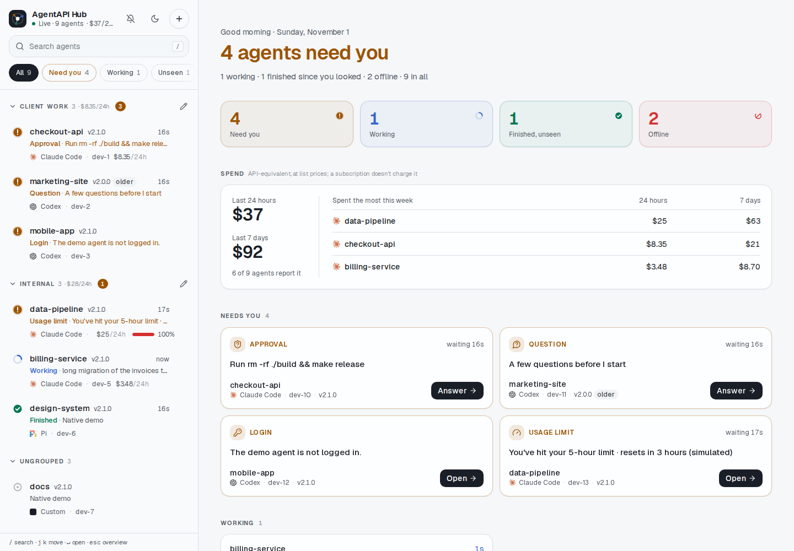
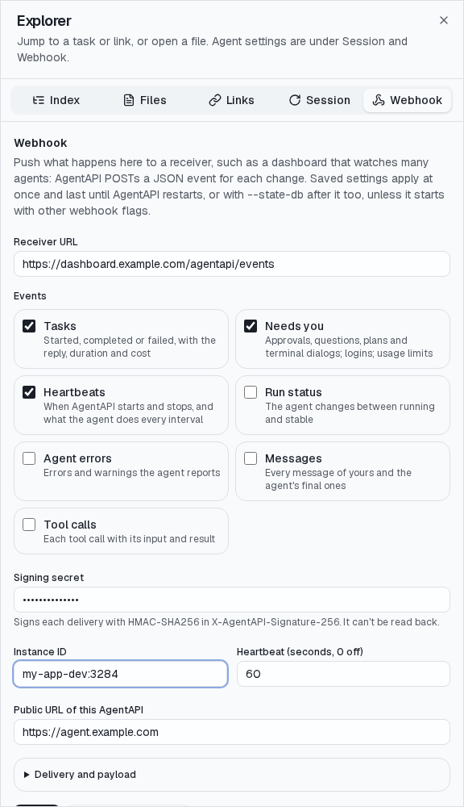

# HTTP API

[English](api.md) | 繁體中文

這一頁說明[對話 API](#對話-api)、[整合](#整合)（監看多個 AgentAPI、hub、webhook 和人工回覆 API），
以及所有端點的[參考](#http-api-參考)。

## 對話 API

### 訊息與狀態

- `POST /message` 傳送訊息：`{"content": "Hello, agent!", "type": "user"}`。回傳 200 表示
  AgentAPI 已偵測到 agent 開始處理，或是在 agent 忙碌時把它排入佇列（`queued`）；
  `dispatch_mode` 決定 agent 忙碌時怎麼處理（見 [Steer、interrupt 與佇列](agents.zh-TW.md#steerinterrupt-與佇列)）。
- `GET /messages` 回傳對話；`GET /rich-messages` 和 `GET /timeline` 回傳結構化的形式（見
  [結構化活動](#結構化活動)）。`GET /messages` 沒指定分頁時回傳所有訊息；另外兩個和 `GET /tasks`
  回傳最近 20 個任務；都可以用 `before` 往前翻頁（見[長對話](#長對話)）。
- 已經送出、但沒有得到確認的訊息（呼叫逾時，或 AgentAPI 正在停止）可能已經送到 agent：這則訊息不會
  再送一次，而是以錯誤離開佇列。
- `DELETE /messages` 清除對話（訊息、結構化訊息、請求、任務、時間軸、錯誤和佇列），並重新
  啟動 agent，開始新的工作階段。agent 重新啟動期間，訊息會在佇列中等待；
  另一次重新啟動和開啟工作階段會回傳 409，AgentAPI 停止期間的重新啟動也一樣。
  重新啟動前，AgentAPI 會先更新 Codex（`codex update`）和 Pi（`pi update --self`），限直接
  啟動這些 CLI 的情況，多個 AgentAPI 會輪流更新；更新失敗或超過 3 分鐘時，仍會啟動已安裝的
  版本。Claude Code 會自行更新。
- `GET /status` 回傳向下相容的 `stable`/`running` 狀態、詳細的生命週期、transport、`server_id`（這次
  AgentAPI 執行的隨機識別碼，每次啟動都會不同）、`turn`（agent 開始工作的次數）、對話的
  `epoch`、工作階段名稱、AgentAPI 版本、`agent_session_id`（agent 自己的
  工作階段，即 [`GET /sessions`](agents.zh-TW.md#先前的工作階段) 列出的那些）、`capabilities`、
  `pending_requests`、`settings`、`usage`、`terminal` 和 `login_required`。生命週期為 `starting`、
  `ready`、`running`、`restarting`、`exited` 或 `failed`。agent 結束後，AgentAPI 重新啟動
  期間為 `restarting`（直到新的 agent 可以接受回合），放棄後為 `failed`。`restarting`、`exited` 和
  `failed` 在 agent 回來之前不會隨 agent 的狀態改變。
- `GET /tasks` 回傳對話的[任務](#任務)。
- `GET /title` 回傳工作階段的可讀標題。
- `POST /upload` 儲存檔案（最大 100 MB，超過時回傳 400；內容超過 101 MiB 時，讀到上限就回傳
  413）並回傳路徑，訊息以 `@"<路徑>"` 引用它。檔案沿用上傳時的檔名（不含路徑），去掉控制字元並截到 255 bytes；
  檔名是 `.` 或 `..` 時回傳 400。對話沒有引用的檔案會在 7 天後刪除。

### 結構化活動

- `GET /rich-messages` 回傳結構化的對話：思考內容、工具呼叫與結果、用量和穩定的訊息識別碼，
  來自 agent 的協定。
- `GET /timeline` 回傳正規化後的工作階段事件，適合用來匯出、稽核或打造其他介面。加上
  `?subagents=true`（Claude Code 和 Codex）時，agent 執行過的每個 sub agent，事件都會
  接在後面，從各自的紀錄讀出：一個 sub agent 接一個，各自以一筆 system 事件開頭，每筆事件都帶有
  `subagent_id`，Claude Code 另有 `parent_tool_use_id`，指向啟動它的 Agent 工具呼叫。agent 自己的
  事件裡只有交給 sub agent 的任務和它最後的回答。
- `GET /timeline/export` 以 JSON Lines 串流整條時間軸，加上 `?subagents=true` 時 sub agent 的
  事件接在 agent 自己的後面：聊天介面下載對話用的就是它。

### 任務

AgentAPI 把對話分成一個個任務：一個任務是你的一則訊息，加上 agent 處理
它的回合。任務執行中你加進去的訊息（steering）屬於這個任務；它結束後的下一則訊息才會開始下一個
任務。agent 回到閒置、而且沒有開著的請求時，任務就結束。如果是因為回答了請求才讓 agent 閒置
下來，AgentAPI 會先等 3 秒再結束任務，因為 agent 通常會繼續工作。

`GET /tasks` 由舊到新列出任務，每個都有：

- `id`：開始這個任務的訊息 ID，同 `GET /messages`；
- `number`：它在對話中的順序，從 1 起算（聊天介面的「Task *n*」）；
- `status`：`running`、`completed`、`failed`（agent 回報錯誤或結束；`errors` 說明原因；AgentAPI
  會再試的[暫時性錯誤](agents.zh-TW.md#暫時性的-api-錯誤)也是）或
  `limited`（[用量限制](agents.zh-TW.md#達到用量限制時)讓它停下；`limit` 是那次停止）；
- `prompt`（訊息的開頭）、`started_at` 和 `ended_at`；
- `reply_id`：agent 在這個任務的最後一則訊息；
- `steered`：任務執行中加進去的訊息 ID。

每則結構化訊息都帶有它開始時所屬任務的 `task_id`，所以用戶端可以把工具呼叫和思考內容依任務
分組，不必從時間戳記猜；接續的工作階段中的結構化訊息則沒有。AgentAPI 啟動前就存在、或從歷史
開啟的訊息屬於過去：它們的任務是已完成。[狀態資料庫](agents.zh-TW.md#持久保存的工作階段)會保存任務，AgentAPI
停止時還在執行的任務，重新啟動後就算結束。`/events?sync=1` 會在任務開始或改變時送出
`task_update`；聊天介面和 [webhook](#webhook) 的 `task.*` 事件都使用同一份任務。

### 訊息佇列

agent 忙碌時收到的訊息不會被拒絕，而是依先進先出（FIFO）的順序排入佇列。訊息送出前，
可以透過 API 或聊天介面查看、編輯或刪除。

- `GET /queue` 列出排隊中的訊息。
- `PUT /queue/{id}` 編輯、`DELETE /queue/{id}` 移除一則排隊中的訊息。
- `PUT /queue` 以 `{"ids": [...]}` 重新排列佇列，必須把每則排隊中的訊息各列出一次（否則
  回傳 409）。
- `POST /queue/{id}/steer` 把排隊中的訊息移進執行中的回合（沒有回合在執行時回傳 409，
  訊息仍留在佇列中）。
- agent 拒絕的排隊訊息總共最多嘗試 5 次，之後就丟棄，並以引用該訊息的錯誤告知。agent 沒有及時
  回應的訊息會立刻丟棄：訊息可能已經送達，再送一次可能讓任務執行兩次。
- 加上 `?sync=1` 時，`/events` 會在佇列改變時送出包含整個佇列的 `queue_update`，所以用戶端
  不必詢問就能看到別人排了什麼。

### 事件與增量同步

`GET /events` 以 server-sent events 串流事件：`message_update`、`status_change`、
`rich_message_update`、`agent_error`、`request_update`，以及每 15 秒
一次的 `heartbeat`，讓用戶端能察覺連線已經失效。加上 `?sync=1` 時，串流會以 `session_sync`
事件開頭，另外加上 `task_update` 和 `queue_update`，每次更新都會帶有 `seq`；用
`&since=<seq>&epoch=<epoch>` 重新連線時，只會重播有變動的部分。沒有加 `sync` 的用戶端收不到
這三種事件：有些用戶端（例如 agentapi-sdk-go）遇到不認得的事件類型就會出錯。

加上 `?sync=1` 時，事件也會帶有 SSE id（重播的最後一個事件是重播的 `seq`，之後的變更
各自帶自己的 `seq`），所以一般的 `EventSource` 自動重新連線時，會從它的 `Last-Event-ID`
接續；請把 `GET /status` 回傳的 `epoch` 放進網址。有訊息被收回時（agent 拒絕開始的回合），
對話會換成新的 epoch，伺服器會結束事件串流：用戶端重新連線，用舊的 epoch
就會再拿到完整的狀態。開啟超過 256 則結構化訊息的工作階段時，也會結束串流，而不是逐則送出。

完整重播（新的用戶端、不同的 epoch）只包含最近 20 個任務，較早的任務要一頁一頁讀（見下節）。
用戶端要從伺服器已經不在記憶體裡的變更接續時，也會拿到完整重播。加上 `?sync=1` 時，完整重播
從最新的任務開始：先是狀態和錯誤，接著每個任務的訊息和結構化訊息，第一個任務之前的內容最後才送。
沒有 `sync` 的用戶端維持原本的順序：訊息、狀態，然後是結構化訊息。

### 長對話

agent 在同一段對話裡工作好幾個月，每個任務大約會累積 100 KB（工具呼叫和輸出、時間軸）。
AgentAPI 會把這些控制在一定範圍內：

- `GET /rich-messages`、`GET /timeline` 和 `GET /tasks` 回傳一頁任務和屬於它們的內容：不帶參數時是
  最近 20 個，和 `/events` 的完整重播一樣。`GET /messages` 帶 `before` 或 `limit` 時也一樣分頁；兩個都
  不帶時照舊回傳所有訊息，因為訊息很小、伺服器會全部保留，上游的用戶端也是這樣讀取。
  `has_more` 表示還有更早的任務；
  把 `next_before`（這一頁第一個任務的 ID）當成 `before` 傳入，就能讀前一頁，`limit`（最多 100）
  決定一頁的大小。讀到最前面的那一頁，也會包含第一個任務之前的內容。
- 有 `--state-db` 時，伺服器只把最近 100 個任務的結構化訊息和時間軸放在記憶體，較早的頁面從
  檔案讀取；重新啟動時也只載入這些。訊息和任務本身每個任務只佔幾 KB，會留在記憶體。資料不會
  刪除：`GET /timeline/export` 會從檔案分段讀出整條時間軸並串流回傳。
- 沒有 `--state-db` 時，伺服器和以前一樣把整段對話放在記憶體，清單一樣分頁回傳。
- 聊天介面先載入最近的任務，往上捲動時再讀較早的；見[聊天介面指南](chat-ui.zh-TW.md#長對話)。

AgentAPI 4.2 以前，這些清單會回傳所有訊息、結構化訊息、事件和任務。需要全部內容的用戶端，
就一頁一頁讀到 `has_more` 為 false。

## 整合

用 [webhook](#webhook) 向接收端推送任務、請求、訊息和心跳，用[摘要](#監看多個實例)監看多個
AgentAPI，用[人工回覆 API](#人工回覆-api)讓機器人代為回覆 agent。

### 監看多個實例

在側邊欄或儀表板顯示多個 AgentAPI 時，每個實例讀取一份摘要回應，或開啟一條摘要串流即可：

- `GET /summary` 回傳實例身分 `instance`（與 [webhook](#webhook) 事件相同：`id`、`name`、
  `server_id`、主機、port、目錄、agent 與 `url`）、`status`、`lifecycle`，以及取自工作階段名稱
  或最新提示開頭的 `title`。另外包含最新[任務](#任務)、任務數、`pending_requests`、最早的待處理
  `request`（類型、標題和 agent 提出的時間）、`queued_messages`、
  `login_required`、`limit_stop`、`retry_wait`、`usage`（context window 與帳號用量限制）。
  Claude Code、Codex 和 Pi 另有 `spend`：agent 在工作目錄裡所有工作階段最近 24 小時（`day_usd`）
  和 7 天（`week_usd`）換算成 API 價格的金額，每分鐘從紀錄檔重新計算一次，並附上同一批呼叫的 token
  （`day_tokens` 和 `week_tokens`：`input`、`output`、`cache_write`、`cache_read` 和合計 `total`）、
  金額最後變動的時間（`updated_at`）、`scope`，以及從 4.2 起這些金額的每小時明細（`hours`：最近
  25 小時中有呼叫的每一小時，含 UTC 的開始時間、`usd` 和 `tokens`；hub 的[活動](hub.zh-TW.md#活動)
  會保留一年）。同一台主機上，同一個 agent 在同一個目錄的 AgentAPI 回報的是同一批
  工作階段，`scope` 也相同：加總多個 AgentAPI 的用戶端每個 scope 只算一次。`update` 則說明用戶端
  能不能[更新這個 AgentAPI](#透過-api-更新)，以及更新進行到哪裡。Claude Code 和 Codex 的摘要還有
  `provider_health`，說明 agent 過去一小時呼叫過的每個[模型供應商](providers.zh-TW.md)透過 AgentAPI 的
  代理回應得如何：`provider`、`requests`、`failures`（沒有回應、5xx、429、回應中途斷掉）、
  `client_errors`（其他 4xx）、`first_byte_p50_ms` 與 `first_byte_p95_ms`（最近 100 次非失敗的回應）、
  `last_success_at` 和 `last_failure`（`at`、`kind`、`status`、`message`），每 30 秒計算一次；
  `GET /settings` 在每個供應商的 `health` 也有相同的內容。
- `attention` 依優先順序標示需要使用者處理的原因：`login`、`request`（核准、提問或計畫）、
  `limit`（用量限制使回合停止）、`exited`，或 `none`。
- `GET /events?only=summary` 在連線時及摘要變動時送出 `summary_update`，另有心跳。
  串流省略訊息，讓用戶端能同時追蹤幾十個實例。回覆文字增長不會改變摘要；
  任務開始或結束、請求、狀態與佇列的變更才會。一次變更只送出一個包含所有改動的
  `summary_update`：回合結束時，摘要會同時顯示 agent 已閒置、任務已完成。其他 `/events`
  用戶端不會收到 `summary_update`。
- 最新任務在用戶端上次顯示對話之後才結束時，`unread` 為 true，`seen_at` 則是上次顯示的時間。
  `POST /tasks/seen` 會替這個實例的所有用戶端把任務標為已讀；聊天介面顯示對話時會自動呼叫它。
  [狀態資料庫](agents.zh-TW.md#持久保存的工作階段)會保存這項資訊，所以沒看過的任務在重新啟動後仍是未讀。

要找出一台主機上的實例，可以讀取登記目錄：每個 AgentAPI 執行期間會在 `~/.agentapi/instances`
（`--registry-dir`；`--registry=false` 可關閉）保留一份登記檔，內容有 `id`、`name`、`server_id`、
`url`（`--public-url`，沒有的話是監聽位址）、PID、目錄、agent、`auth_required`（不含 token）和
`restarts_in_place`（收到 SIGUSR2 會原地重新啟動，見 [`agentapi restart`](cli.zh-TW.md#agentapi-restart)），
在 Linux 和 macOS 上還有 `process_start`（系統記錄的行程啟動時間）。停止時會刪除登記檔；行程已經
不在（當掉）的登記檔，會在列出登記目錄時刪除，PID 後來被別的行程拿到（啟動時間不同）時也一樣。使用前請先確認
`GET /summary` 回傳的 `server_id` 與登記檔相同：該 port 可能已被另一個 AgentAPI 使用。
[`agentapi list`](cli.zh-TW.md#agentapi-list) 會列出已登記的實例和它們的摘要。

用 `--instance-id` 指定實例識別碼（預設 `<hostname>:<port>`），`--name` 指定顯示名稱
（預設為工作目錄名稱），`--public-url` 指定連線網址。執行中可透過 `PUT /webhook` 修改 ID 與網址。

瀏覽器用戶端若來自其他來源，需將該來源加入 [`--allowed-origins`](security.zh-TW.md#允許的來源)。
使用 [API token](security.zh-TW.md#api-token-驗證) 時，以 `fetch` 加上 `Authorization` 標頭讀取串流；
`EventSource` 無法設定該標頭。

#### 執行 hub

hub 監看連得到的任何主機上的多個 AgentAPI：把它放在會一直開著的地方（例如常開的
workspace），並透過私有網路（例如你自己的 VPN）連到它和各個 AgentAPI。一步步的架設方式、每種
狀態、各個 token、疑難排解和 hub 的 API，見 [hub 指南](hub.zh-TW.md)。

```bash
agentapi hub serve --token "$HUB_TOKEN" --secret "$HUB_SECRET" --instance-token "$AGENTAPI_TOKEN"
```



在桌面或手機開啟 `http://<hub>:3290/`，用 `--token` 登入。清單列出每個實例：釘選的排在最上方，
其他的則依群組把需要你處理的排前面，也可以改依最近一次變動排序；打開 **By machine**，兩種排序都會把
同一台主機的 agent 收進一張卡片，每個 agent 一個分頁。
每個實例顯示它在等什麼（核准或提問、登入、用量限制）、工作中、完成了你還沒看過的任務、閒置、
連不到或已停止，以及標題、agent、主機、AgentAPI 版本、佇列和用量限制。分頁標題會顯示需要你處理的
數量。點選一個就會在聊天介面中開啟。手機上清單和聊天介面輪流顯示。

- AgentAPI 用 [`agentapi hub join`](#加入-hub) 加入：hub 收到它們有簽章的 `instance.*` 事件就會新增實例，
  hub 再以一條連線追蹤每個實例的[摘要串流](#監看多個實例)。`+` 備有讓主機加入的指令，已填好 hub 的位址
  和 secret，另附給那台主機上 agent 的提示；也可以在那裡輸入網址（和 token）手動加入。每一列的 `⋯`
  選單可以把實例釘選在最上方、放進自己建立的群組、把它正在等的事
  靜音到改變為止（例如不打算處理的登入），或移除已停止、連不到的實例。Offline 狀態格和篩選可以一次
  移除所有已停止的實例。
- 齒輪按鈕會開啟 hub 的設定，可以在那裡保存[我的最愛](hub.zh-TW.md#我的最愛)提示；在 hub 開啟的
  聊天介面裡，輸入框的 ☆ 會把它插入訊息。也可以在那裡保存每台主機的工作階段都能換用的
  [模型供應商](hub.zh-TW.md#模型供應商)（附上 OpenRouter 的模型價格），以及連接 hub 的
  [GitHub App](hub.zh-TW.md#github-設定)。
- ◎（或 `i`）開啟 [Issues](hub.zh-TW.md#issues)，也就是 issue 派工：依階段列出各 repo 的 open
  issue、有 launcher 回報的主機（離線的可以在這裡移除），以及每個 job 的 agent、PR 和花費。主機要用
  [`agentapi host`](cli.zh-TW.md#agentapi-host) 才能接 issue。
- hub 透過自己開啟實例（`/i/<id>/...`），以實例的 API token（`--instance-token`，或加入時給的）
  取代你的憑證。瀏覽器不會拿到實例的 token，也不會直接連到實例，所以實例不必為它設定 CORS。
- 只接受以 `--secret` 簽章、不超過 10 分鐘而且帶有 delivery ID 的事件，已處理過的傳送一律忽略：
  事件裡的網址就是 hub 送出實例 token 的地方。hub 正在追蹤的實例和手動加入的實例，事件都改不了
  它們的網址；事件能做什麼，見 [hub 指南](hub.zh-TW.md#token-與安全性)。
- hub 連不到、又錯過三次 heartbeat（預設 3 分鐘）的實例，例如 workspace 被強制關掉的，視為已停止；
  它下一次送 heartbeat 時就會回來。
- 總覽加總所有 agent 最近 24 小時和 7 天的花費、token 和工作時間；[活動](hub.zh-TW.md#活動)卡片
  像 GitHub 的貢獻圖一樣，依工作時間、token 或花費替最近一年的每一天上色。每張卡片都能收合成一行。
- 實例和我的最愛會保存在 `~/.agentapi/hub/instances.json`（`--state`，只有擁有者能讀取），重新啟動後
  仍記得；最近一年的活動保存在同一個目錄的 `activity.json`。
- `--port`（預設 3290）和 `--bind`（例如 VPN 位址）設定監聽位置。請用 HTTPS 提供，或只開在私有
  網路上：登入時會送出 token。登入的有效期限是 30 天。若 VPN 用戶端以 userspace 模式執行，
  把 `ALL_PROXY` 設成它的 SOCKS5 proxy，hub 才連得到實例。
- hub 提供的是自己版本的聊天介面：hub 和實例請使用相同的 AgentAPI 版本。比 hub 舊的實例會在清單上
  標出來，總覽也會依版本統計，並說明怎麼更新。

#### 加入 hub

[`agentapi hub join`](cli.zh-TW.md#agentapi-hub) 不必改變 AgentAPI 的啟動方式就能把一台主機上的 AgentAPI
接到 hub，所以由腳本以固定參數啟動的 AgentAPI（例如 Coder workspace 的）也適用：

```bash
sudo agentapi update   # 最新版才會讀設定檔
agentapi hub join http://hub.vpn:3290/hooks --secret "$HUB_SECRET" --public-url 'http://{ip}:{port}'
```

`join` 會把 hub 的 webhook（`webhook-url`、`webhook-secret`、`webhook-events`、`public-url`）寫進
`~/.agentapi/config.yaml`，這個使用者的每個 `agentapi server` 啟動時都會讀取；同時套用到正在執行、
已登記的 AgentAPI：它們會立刻送 `instance.heartbeat` 給 hub。重新啟動（例如 workspace 重開）後，
AgentAPI 會依設定檔送出 `instance.started`。`--public-url` 是 hub 連回它們的網址，`{port}` 和
`{hostname}` 會替每個實例填入；`{ip}` 則是這台主機通往 hub 那條路由上的 IPv4 位址，每個 AgentAPI
執行期間會重新查詢：DHCP 給了主機新位址時，下一次 heartbeat 就會帶著它，hub 也會跟著改用。1.2 之前啟動的 AgentAPI 沒有登記，需要重新啟動一次。
`agentapi hub status` 顯示 hub 以及每個執行中的 AgentAPI 回報到哪裡；`agentapi hub leave` 會移除 hub。
加上 `--allow-update` 時，hub 也能[更新它們](#透過-api-更新)。
`join` 會先送給 hub 一個有簽章的測試事件，hub 沒收下就停止（連不到、被登入頁擋住，或 secret 不同）；
hub 還沒啟動時，可以用 `--no-check` 略過。
hub 的頁面已經備好這行指令：`+` 會填好 hub 的位址，設了 token 的 hub 也會填好 secret，旁邊還有一段
提示，讓那台主機上的 agent 替你加入。hub 啟動時也會在 log 裡為它的每個位址寫下這行指令，但不含 secret。
也可以用 [agentapi-hub-join skill](../skills/agentapi-hub-join/SKILL.md) 交給 agent 處理，安裝方式見
[hub 指南](hub.zh-TW.md#3-讓每台主機的-agentapi-加入)。

#### 透過 API 更新

監看多個 AgentAPI 的用戶端（例如 hub）可以把其中一個更新到最新發行版。只有選擇開放的主機才行：
以 `--allow-update`（或 `AGENTAPI_ALLOW_UPDATE=true`）啟動 AgentAPI，或在 `~/.agentapi/config.yaml`
加上 `allow-update: true`，讓這個使用者的每個 AgentAPI 都開放；`agentapi hub join --allow-update`
會替你寫入。執行中的 AgentAPI 要重新啟動（`agentapi restart --all`）才會套用。

```bash
curl -X POST localhost:3284/update -H 'Content-Type: application/json' -d '{"when": "idle"}'
```

- `POST /update` 安裝 k1dav-c/agentapi 符合這台主機作業系統與架構的最新正式發行版，再像
  [`agentapi restart`](cli.zh-TW.md#agentapi-restart) 一樣原地重新啟動成新版本：PID 不變，`server_id` 和版本
  換新。下載的檔案必須符合發行版的 `checksums.txt`，執行起來也必須是那個版本。請求無法指定版本或網址。
  新發行版若無法以這個 AgentAPI 的設定或狀態資料庫啟動，更新會在替換程式之前失敗，磁碟上的程式維持原樣，
  AgentAPI 繼續提供服務。（4.3.1 以前會先替換程式：這樣的 AgentAPI 雖然繼續服務，下次啟動時卻會執行那個不接受
  該設定的版本；請在它重新啟動前拿掉那個設定。）
- 預設的 `"when": "idle"` 會立刻安裝，等 agent 閒置再重新啟動，也就是沒有進行中的回合，也沒有待回覆的
  請求（核准、提問或計畫）。已經結束、不會再被啟動的 agent 也算閒置。佇列中的訊息會留在佇列，重新
  啟動後再送出；這段期間到期的繼續（用量限制後）或重試（失敗的回合）也一樣。`"now"` 會立刻
  重新啟動，中斷 agent 手上的工作。
- 使用 [`--state-db`](agents.zh-TW.md#持久保存的工作階段) 時，對話和 agent 的工作階段會延續到重新啟動之後；
  沒有的話，agent 會接續自己的工作階段，聊天介面從工作階段的紀錄讀回對話，就像從
  [先前的工作階段](agents.zh-TW.md#先前的工作階段)開啟它一樣；佇列、待回覆的請求和選擇的設定會重新開始。
- 已經是最新發行版時回應 200 和 `"up_to_date": true`，否則回應 202，附上 `state` 和目標版本 `target`。
  更新進行中再送一次，會回應目前的狀態，`"now"` 則讓它不再等待。`DELETE /update` 在重新啟動前都能
  取消更新，已經安裝的執行檔會留著。403 表示沒有開放更新；409 表示 AgentAPI 無法取代自己的程式
  （見下方）或正在關閉；502 表示 GitHub 沒有回應。
- [摘要](#監看多個實例)的 `update` 會跟著更新變化：`allowed`、`blocked`、`state`（`idle`、`checking`、
  `downloading`、`waiting`、`restarting`，或附上 `error` 的 `failed`）、`target`、
  `keeps_conversation`（有使用 `--state-db`），以及 `keeps_session`（agent 重新啟動後會接續自己的
  工作階段；較早的版本不會送出）。每次變化都會送出 `summary_update`。較早的版本沒有 `update`。
- 共用同一個執行檔的多個 AgentAPI，會以執行檔旁的鎖定檔（`.agentapi.lock`）輪流取代它。發現磁碟上的
  執行檔比自己正在執行的版本新（另一個 AgentAPI 已經更新過）時，就只重新啟動。

AgentAPI 從不執行 `sudo`。它把新的執行檔寫在實際檔案（symlink 最終指向的檔案）旁邊，再改名蓋過去，
所以執行 AgentAPI 的使用者必須能寫入那個目錄。執行檔放在 `/usr/local/bin` 這類系統目錄時，請把它
搬到自己的目錄一次，原處留下 symlink：

```bash
mkdir -p ~/.local/bin && cp /usr/local/bin/agentapi ~/.local/bin/agentapi && sudo ln -sf ~/.local/bin/agentapi /usr/local/bin/agentapi
```

搬好之前，摘要的 `blocked` 會說明原因，並以實際路徑列出這行指令。執行中的 AgentAPI 不必重新啟動，
一分鐘內就會發現；之後 `agentapi update` 也不再需要 `sudo`。

### Webhook

AgentAPI 會把 JSON 事件 POST 到 `--webhook-url`，例如同時監看多個 agent 的中控平台。
預設只送 `run.status_changed`；可用 `--webhook-events` 依類型（`task.completed`）、群組
（`task.*`）或全部（`*`）選擇事件：

| 事件 | 何時送出 | `data` |
| --- | --- | --- |
| `run.status_changed` | agent 在 `running` 與 `stable` 之間切換 | `status`、`previous_status`、`server_id`、`agent_type`、`transport` |
| `instance.started`、`instance.heartbeat`、`instance.stopped` | AgentAPI 啟動時、每隔 `--webhook-heartbeat`（60 秒）、`PUT /webhook` 把 webhook 指向新網址時，以及關閉時 | agent 的狀況：`status`、`lifecycle`、`session_name`、`pending_requests`、`queued_messages`，以及有值時的 `agent_session_id`、`login_required`、`limit_stop`、`retry_wait`、`usage`、`settings`；`heartbeat_seconds` 是 heartbeat 的間隔（關閉時沒有這個欄位） |
| `task.started` | [任務](#任務)開始：你的一則訊息送到 agent | 任務，同 `GET /tasks`：`id`（那則訊息的 ID）、`status`、`prompt`、`started_at` |
| `task.completed`、`task.failed` | [任務](#任務)結束：`completed`，或 `failed` 與 `limited`（`task.failed`） | 任務加上 `status`、`ended_at`、`duration_seconds`、agent 最後一則訊息（`reply`、`reply_id`）、`steered`、`errors`、`limit`、`session_name`，以及 Claude Code、Codex 和 Pi 的 API 等價花費 `cost`（見[工作階段花費](agents.zh-TW.md#工作階段花費)） |
| `request.opened`、`request.closed` | 核准、提問或計畫（請求內容同 `GET /requests`）開啟或關閉 | 請求 |
| `login.required`、`login.completed` | agent 需要登入，或不再需要 | `agent`、`message`、要執行的 `command` |
| `limit.stopped`、`limit.cleared` | 用量限制讓回合停下，或停止狀態結束 | `message`、`stopped_at`、`resets_at` |
| `agent.error` | agent 回報錯誤或警告 | `message`、`level`、`time` |
| `message.created` | 你的訊息，或 agent 的最終訊息 | `id`、`role`、`content`（超過 64 KiB 會截斷並標示 `truncated`）、`time` |
| `tool.completed` | 工具呼叫回傳結果 | `tool_use_id`、`name`、`input`、`result` 和 `is_error`，各截斷至 4 KiB |

每個事件都會註明它來自哪一個 AgentAPI，讓一個接收端可以分辨多個實例：

```json
{
  "id": "unique-delivery-id",
  "type": "task.completed",
  "created_at": "2026-10-22T12:00:00Z",
  "instance": {
    "id": "my-host:3284",
    "server_id": "agentapi-run-id",
    "hostname": "my-host",
    "port": 3284,
    "pid": 4242,
    "cwd": "/home/me/project",
    "agent_type": "claude",
    "transport": "native",
    "agentapi_version": "1.0.0",
    "url": "https://agent.example.com",
    "workspace_url": "https://coder.example.com/@me/dev"
  },
  "data": {
    "id": 4,
    "prompt": "Fix the failing test",
    "started_at": "2026-10-22T11:58:30Z",
    "ended_at": "2026-10-22T12:00:00Z",
    "duration_seconds": 90,
    "status": "completed",
    "reply_id": 5,
    "reply": "Fixed: the test compared times in two time zones.",
    "cost": {"usd": 0.42, "tokens": {"input": 12, "cache_read": 81000, "cache_write": 4200, "output": 1900}, "calls": 6},
    "session_name": "Fix the failing test"
  }
}
```

`instance` 的 `id` 是 `--instance-id`，預設為 `<hostname>:<port>`；`name` 是 `--name`，預設為工作
目錄的名稱。`url` 是 `--public-url`，接收端可以從這個網址開啟這個 AgentAPI 的聊天介面或呼叫它的
API；`workspace_url` 則是它所在的 Coder workspace（如果有）。AgentAPI 啟動之前的訊息和工具
呼叫，以及從 agent 歷史紀錄開啟的工作階段中的訊息，都不會再送一次。

```bash
agentapi server \
  --webhook-url https://dashboard.example.com/agentapi/events \
  --webhook-events 'task.*,request.*,login.*,limit.*,instance.*' \
  --webhook-secret "$WEBHOOK_SECRET" \
  --public-url https://agent.example.com \
  -- claude
```

每個請求都帶有 `X-AgentAPI-Delivery`、`X-AgentAPI-Event`、`X-AgentAPI-Timestamp` 和
`X-AgentAPI-Instance` 標頭。設定 `--webhook-secret` 時，`X-AgentAPI-Signature-256` 會為請求簽章：
`sha256=` 加上以 secret 為金鑰、對「時間戳記、`.`、body」計算的 HMAC-SHA256（hex）。接收端在
信任事件之前，應先驗證簽章並確認時間戳記夠新：

```python
expected = "sha256=" + hmac.new(secret, f"{timestamp}.".encode() + body, hashlib.sha256).hexdigest()
valid = hmac.compare_digest(expected, signature) and abs(time.time() - int(timestamp)) < 300
```

事件依序傳送，一次一個。網路錯誤、逾時、重新導向和 HTTP 5xx、408 或 429 回應會觸發重試，間隔為
1、2、4……秒，最多 30 秒；其他 4xx 回應不重試。傳送不會跟著重新導向走，所以接收端前面的登入頁不算
送達，log 會寫出它導向哪裡。每次傳送總共允許 `--webhook-max-attempts`
（3）次嘗試，每次逾時為 `--webhook-timeout`（10 秒）；用完次數後會放棄並記錄在 log。

佇列最多保存 1,024 個事件，滿了就丟棄新事件。漏收事件的接收端應透過 API 或下一次心跳取得目前
狀態。關閉時，AgentAPI 最多等 2 秒讓 `instance.stopped` 送達。

可以用 Go `text/template`（`--webhook-payload-template`）改寫 body 的格式以符合接收端，例如聊天
服務的 incoming webhook。可用欄位有 `.ID`、`.Type`、`.CreatedAt`、`.Instance` 和 `.Data`（事件的
data，欄位名稱同 JSON，例如 `{{.Data.prompt}}`），`run.status_changed` 另有 `.ServerID`、`.Status`、
`.PreviousStatus`、`.AgentType` 和 `.Transport`。用到其他欄位的範本（例如 1.0 起改名為 `.ServerID` 的
`.RunID`）每次送出都會失敗，所以啟動時和 `PUT /webhook` 會直接拒絕。

每個參數都有對應的 `AGENTAPI_` 環境變數（`AGENTAPI_WEBHOOK_URL`、以空白分隔事件的
`AGENTAPI_WEBHOOK_EVENTS`、`AGENTAPI_WEBHOOK_SECRET` 等）。`GET /webhook` 顯示目前設定（只顯示
是否設定了 secret，不會回傳 secret 本身），`PUT /webhook` 不需重新啟動就能修改；省略的
`events`、`secret`、`heartbeat_seconds`、`instance_id` 和 `public_url` 會維持原值。`public_url`
可以含有 `{port}`、`{hostname}` 和 `{ip}`，`GET /webhook` 照原樣回傳；事件和摘要裡才會填入。

Explorer 的 Webhook 分頁可設定接收端網址、事件群組、簽章 secret、instance ID、心跳間隔與
公開網址；**Delivery and payload** 提供逾時、嘗試次數與範本。即使 AgentAPI 啟動時沒有設定
webhook，也能在這裡設定。

這裡或 `PUT /webhook` 的變更會維持到 AgentAPI 重新啟動。使用
[`--state-db`](agents.zh-TW.md#持久保存的工作階段) 時，重新啟動後也會保留，除非新的 webhook 參數覆蓋設定。
**Send test event**（`POST /webhook/test`）會向已儲存的網址送出一次已簽章的 `webhook.test`
事件，不受事件選擇影響，並顯示接收端回應。



沒有設定 `--webhook-events` 時，AgentAPI 送出的執行狀態事件：

```json
{
  "id": "unique-delivery-id",
  "type": "run.status_changed",
  "created_at": "2026-07-26T12:00:00Z",
  "instance": {"id": "my-host:3284", "server_id": "agentapi-run-id", "agent_type": "claude", "transport": "native"},
  "data": {
    "server_id": "agentapi-run-id",
    "status": "stable",
    "previous_status": "running",
    "agent_type": "claude",
    "transport": "native"
  }
}
```

### 人工回覆 API

其他用戶端（例如聊天機器人）不必透過網頁介面也能回覆 agent。agent 在等你時，
`GET /handoff` 會回傳等待回應的項目，並附上 `id` 和 `kind`：最早的待處理請求（`request`），
沒有時則是它最新的回覆（`message`）；否則回傳 `{"request": null}`。

帶著該 `request_id`、一個唯一的回覆 `id` 和 `content` 呼叫 `POST /handoff/reply`，
就能回覆它。對一般回應的回覆會當成一般的使用者訊息，像 `POST /message` 一樣送出：agent
若在這段期間忙了起來，回覆會在[佇列](#訊息佇列)中等待。對請求的回覆則依
[請求](agents.zh-TW.md#請求核准提問與計畫)一節所述回答該請求。`outcome` 為 `applied`、`queued`（回覆在佇列中等待，agent 能接收時就會送出）、
`superseded`（已不再開啟，例如已在網頁介面回覆）、`invalid`（回覆不符合，仍保持開啟）
或 `uncertain`；同一個項目不會回覆兩次。搭配上面的 webhook，整合服務就能在 agent 停下來
時通知你，並把你的回覆傳回來。

## HTTP API 參考

伺服器以 OpenAPI 描述自己的 API：儲存庫中的 [openapi.json](../openapi.json)、執行中伺服器的
`/openapi.json`，以及 `/docs` 的文件介面。伺服器預設在 3284 連接埠執行。

### 對話

| 端點 | 說明 |
| --- | --- |
| `GET /messages` | 對話的所有訊息；帶 `before` 或 `limit` 時是一頁任務的訊息（[長對話](#長對話)） |
| `POST /message` | 傳送訊息，agent 忙碌時排入佇列；`dispatch_mode` 為 `queue`（預設）、`steer` 或 `interrupt` |
| `DELETE /messages` | 清除對話和佇列，並重新啟動 agent，開始新的工作階段 |
| `GET /rich-messages` | 結構化的對話：思考內容、工具呼叫與結果、用量；分頁方式同 `GET /messages` |
| `GET /timeline` | 正規化的工作階段事件，可用於匯出或其他介面，分頁方式同 `GET /messages`；`?subagents=true` 會加上 sub agent 的事件 |
| `GET /timeline/export` | 以 JSON Lines 串流整條時間軸；`?subagents=true` 會加上 sub agent 的事件 |
| `GET /status` | 狀態、生命週期、server ID、回合數、epoch、工作階段名稱、版本、agent 的工作階段 ID、能力、待處理請求、設定、用量、用量限制停止、等待重試、終端機、登入 |
| `GET /title` | 工作階段的可讀標題 |
| `GET /events` | Server-sent events；`?sync=1` 會在重新連線時增量重播，並送出任務與佇列的更新；`?only=summary` 只送摘要 |
| `GET /summary` | 監看多個 AgentAPI 的用戶端要顯示的內容：instance、狀態、attention、標題、最新任務、請求、佇列、用量；見[監看多個實例](#監看多個實例) |
| `GET /tasks` | 對話的[任務](#任務)，預設是最近 20 個：你的每則訊息和 agent 處理它的回合 |
| `POST /tasks/seen` | 替所有用戶端把任務標為已讀：摘要的 `unread` 會是 false，直到下一個任務結束 |
| `GET /workspace` | AgentAPI 在 Coder workspace 中執行時，該 workspace 的網址 |

### 佇列

| 端點 | 說明 |
| --- | --- |
| `GET /queue` | 等待送給 agent 的訊息 |
| `PUT /queue` | 重新排列佇列（`{"ids": [...]}`，每則排隊中的訊息各列一次） |
| `PUT /queue/{id}`、`DELETE /queue/{id}` | 編輯或移除一則排隊中的訊息 |
| `POST /queue/{id}/steer` | 把排隊中的訊息移進執行中的回合 |

### 控制 agent

| 端點 | 說明 |
| --- | --- |
| `POST /interrupt` | 停止執行中的回合 |
| `GET /requests`、`GET /requests/{id}` | agent 正在等待的請求（核准、提問、計畫），以及最近關閉的請求 |
| `POST /requests/{id}/respond` | 回覆請求：`option_id`，或以問題為鍵的 `answers`，可另附 `text` |
| `GET /settings`、`PUT /settings` | 權限模式、模型和推理強度，以及可選的值（和每個模型供應商過去一小時的狀況）；PUT 會修改請求內容中列出的欄位 |
| `POST /compact` | 壓縮 agent 的 context（Codex、Pi） |
| `POST /login/retry` | 回報 `login_required` 期間，立刻再檢查一次 agent 的登入（不需要登入時回傳 409） |
| `POST /limit/continue`、`DELETE /limit/continue` | 現在或在重置時繼續因用量限制停下的回合；取消排定的繼續 |
| `DELETE /limit` | 忽略用量限制造成的停止，讓排隊中的訊息送出 |
| `POST /retry`、`DELETE /retry` | 立刻再試因暫時性 API 錯誤失敗的回合；取消重試，讓排隊中的訊息送出 |
| `GET /sessions` | agent 在工作目錄中的工作階段（Claude Code、Codex、Pi），以及各自的花費和總額，依模型、小時和[模型供應商](agents.zh-TW.md#工作階段花費)（附名稱）分開 |
| `GET /cost` | 目前開啟的工作階段的花費和它的模型呼叫（Claude Code、Codex、Pi） |
| `GET /subagents`、`GET /subagents/{id}` | agent 在工作階段中執行過的 sub agent，以及其中一個的任務和訊息（Claude Code、Codex） |
| `POST /sessions/{id}/resume` | 開啟其中一個，或它的副本（`{"fork": true}`），取代目前的對話 |

### 終端機與檔案

| 端點 | 說明 |
| --- | --- |
| `GET /terminal` | 以 server-sent events 送出 shell 的輸出（除非 `--terminal=false`） |
| `POST /terminal/input`、`POST /terminal/resize` | 在 shell 中輸入按鍵；設定它的大小 |
| `GET /files/content` | agent 工作目錄中的檔案，超過 1 MiB 會截斷 |
| `GET /files/diff` | 檔案相對於 HEAD 尚未 commit 的變更 |
| `GET /files/preview` | 內嵌了引用檔案的 HTML 檔，供有 sandbox 的 iframe 顯示 |
| `GET /files/image` | agent 工作目錄中的圖片檔（點陣圖依內容判斷，以及 SVG） |
| `GET /files/find` | 工作目錄底下路徑結尾相符的檔案（不分大小寫） |

### 上傳

| 端點 | 說明 |
| --- | --- |
| `POST /upload` | 儲存檔案（最大 100 MB）並回傳路徑，供訊息以 `@"<路徑>"` 引用 |
| `GET /uploads/{checksum}/{name}` | 上傳的圖片（依內容判斷 PNG、JPEG、GIF、WebP 或 BMP），供聊天介面顯示 |

### 整合端點

| 端點 | 說明 |
| --- | --- |
| `GET /handoff`、`POST /handoff/reply` | [人工回覆 API](#人工回覆-api)：agent 在等什麼，以及對它的回覆 |
| `GET /webhook`、`PUT /webhook` | 讀取或修改 [webhook](#webhook)：網址、事件、secret、心跳和 instance |
| `POST /webhook/test` | 對 webhook 網址送一次 `webhook.test` 事件，並回傳接收端的回應 |
| `POST /update`、`DELETE /update` | 把 AgentAPI [更新](#透過-api-更新)到最新發行版並原地重新啟動，等 agent 閒置或立刻進行（需要 `--allow-update`）；在重新啟動前取消更新 |

### 驗證

| 端點 | 說明 |
| --- | --- |
| `GET /auth/session` | API 是否需要 token，以及呼叫端是否已驗證（不需要憑證） |
| `POST /auth/session`、`DELETE /auth/session` | 用 token 讓瀏覽器登入（session cookie），或登出 |

聊天介面本身位於 `/chat/`（以及 `/chat/embed`）。
