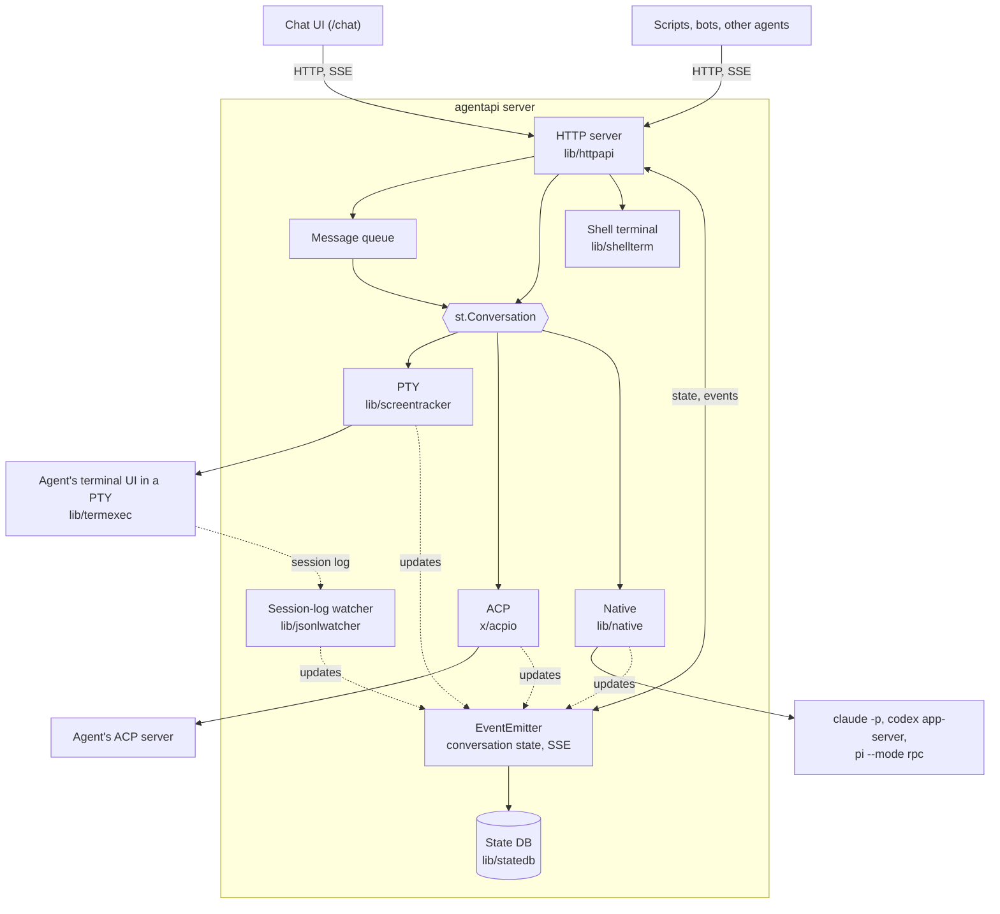
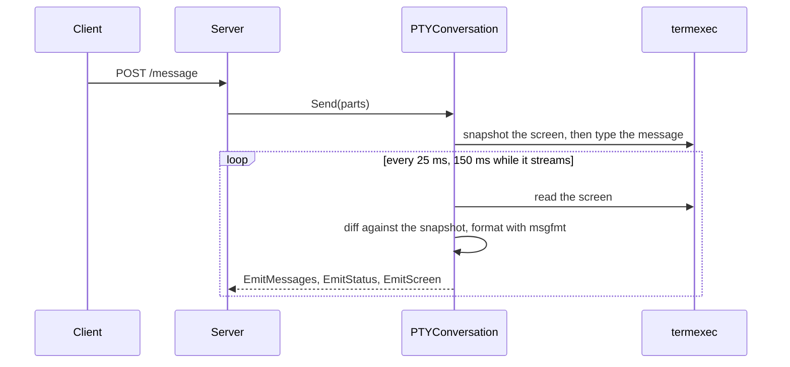
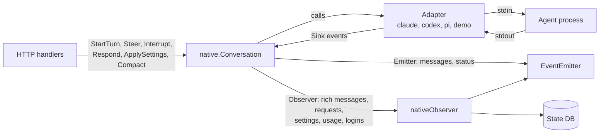

# Architecture

English | [繁體中文](architecture.zh-TW.md)

AgentAPI is a single Go binary. It starts one coding agent, drives it through
one of three transports, and serves an HTTP API, an event stream and a chat UI
for it. This document describes how it is built; the [README](../README.md)
describes what it does and how to use it.

## Contents

- [Overview](#overview)
- [Repository layout](#repository-layout)
- [Startup and shutdown](#startup-and-shutdown)
- [The HTTP server](#the-http-server)
- [Conversations and transports](#conversations-and-transports)
  - [PTY](#pty)
  - [ACP](#acp)
  - [Native](#native)
- [Events and the conversation state](#events-and-the-conversation-state)
- [The message queue](#the-message-queue)
- [Persistence](#persistence)
- [Restarts and updates](#restarts-and-updates)
- [The shell terminal](#the-shell-terminal)
- [Files](#files)
- [MCP management](#mcp-management)
- [Security model](#security-model)
- [The chat UI](#the-chat-ui)
- [Testing](#testing)
- [Design principles](#design-principles)

## Overview



One AgentAPI process runs one agent. Every transport implements
`st.Conversation`, the interface the server uses to send messages and read the
conversation, and reports what changes to the same emitter. The HTTP API, the
event stream, the queue and the chat therefore work the same over every
transport; what only one transport has (native requests, settings, the shell
terminal) has endpoints of its own. Handlers never talk to the agent process
directly: they go through the conversation, and read state from the emitter.

## Repository layout

| Path | What it holds |
| --- | --- |
| `main.go`, `cmd/` | The cobra CLI: `server` (flags, agent type, transport, starting the agent, signals), `attach`, and `update` (self-update with checksum verification) |
| `lib/httpapi/` | The HTTP server: routes and handlers, the `EventEmitter`, the queue, token auth, webhooks, the MCP, files and terminal endpoints, and the embedded chat UI |
| `lib/screentracker/` | The `Conversation` and `Emitter` interfaces, and the PTY conversation: screen snapshots, message splitting, stability detection |
| `lib/termexec/` | Runs the agent in a pseudo-terminal with an in-memory VT100 emulator (`xpty`, `vt10x`); the process can be swapped for a restart |
| `lib/msgfmt/` | Per-agent formatting of screen output: echoed input, input boxes, status lines, tool calls, readiness for the first prompt |
| `lib/jsonlwatcher/` | Finds and tails the Claude Code, Codex and Pi session logs and parses them into rich messages and timeline events |
| `lib/native/` | The native transport: `Conversation`, the `Adapter` and `Sink` contracts, requests, settings, usage, logins |
| `lib/native/claude`, `codex`, `pi` | One adapter per agent protocol |
| `lib/native/demo` | `native-demo`, a simulated agent for working on the chat |
| `lib/native/nativetest` | A scriptable fake adapter for tests |
| `lib/native/procutil` | Child processes: process groups and a graceful stop |
| `lib/statedb/` | SQLite persistence for `--state-db` |
| `lib/shellterm/` | The shared shell terminal of native sessions |
| `lib/mcpconfig/` | Reads and writes the agents' MCP configuration files |
| `lib/procenv/` | The environment of the processes AgentAPI starts: agents on every transport, the terminal's shell |
| `lib/agenthome/` | Where the agents keep their state (`CLAUDE_CONFIG_DIR`, `CODEX_HOME`, `PI_CODING_AGENT_DIR`) |
| `lib/handoff/` | Types of the human-reply API |
| `lib/logctx/`, `lib/util/` | A logger carried in the context; small helpers |
| `x/acpio/` | The experimental ACP transport |
| `internal/version/` | The version, stamped at build time |
| `chat/` | The chat UI (Next.js) |
| `e2e/` | End-to-end tests against a scripted echo agent |

## Startup and shutdown

`agentapi server [flags] -- <agent command>` (`cmd/server/server.go`):

1. Flags come from the command line or from `AGENTAPI_*` environment
   variables (viper). The agent type is `--type`, else the agent command when
   it is a type name, else `custom`.
2. The transport starts the agent:
   - PTY: `termexec` runs the command in a pseudo-terminal of `--term-width`
     by `--term-height` cells.
   - ACP: `acpio` starts the command and opens an ACP session over its stdio.
   - Native: `nativeFactory` builds a `native.Factory` for the agent type
     (Claude Code, Codex, Pi or `native-demo`). Each adapter checks the
     agent's arguments first and refuses the ones that conflict with its
     protocol.
3. With `--state-db`, `statedb.Open` opens and locks the file and checks that
   it belongs to the same agent type, transport and working directory.
4. `httpapi.NewServer` creates the emitter, restores the saved state, creates
   the conversation, registers the routes, and starts the conversation, the
   queue loop, the webhook dispatcher and (PTY) the session-log watcher.
5. On SIGINT or SIGTERM the HTTP server shuts down, the native agent and the
   shell terminal are closed, and the state DB is flushed and closed. With
   `--state-file`, the PTY conversation saves its messages.

## The HTTP server

`lib/httpapi` routes with chi and declares typed operations with huma, which
also produce the OpenAPI schema (`make gen` writes `openapi.json`). Requests
pass these middlewares in order:

1. Host authorization: the `Host` header must name an allowed host (the port
   is ignored).
2. The request log, which skips static files, event streams and the terminal.
3. CORS for the allowed origins, with credentials, so the chat's cookie works
   from another origin.
4. Token auth, with `--api-token`: a Bearer token or the chat's session
   cookie. It runs after CORS, so preflights pass and a 401 carries the CORS
   headers the chat needs to read it.

The handlers are grouped by file:

| File | Handles |
| --- | --- |
| `server.go`, `queue.go` | Messages, status, events, the queue, uploads; the server's setup and routes |
| `backend.go`, `backend_pty.go`, `backend_native.go` | What depends on the transport: dispatching the queue, delivering a message, restarts, the human-reply protocol's pending request |
| `native.go` | Requests, settings, interrupt, compaction, login retry; the native observer |
| `terminal.go`, `files.go`, `file_preview.go` | The shell terminal and the file viewer |
| `mcp.go`, `mcp_management.go` | MCP servers and profiles |
| `webhook.go`, `handoff.go`, `dialog_reply.go` | Run-status webhooks, the human-reply API, answers to terminal dialogs |
| `auth.go` | Token auth and the chat's sign-in |
| `restart.go`, `statedb.go` | Restarts; restoring and persisting the state |
| `events.go`, `models.go` | The emitter and the API's types |
| `embed.go`, `uploads.go` | The embedded chat UI; uploaded files |

Plain chi routes serve the chat (`/chat/*`), uploaded images
(`/uploads/{checksum}/{name}`) and the screen stream of TTY mode
(`/internal/screen`). The `Server` holds the conversation, the emitter, the
queue and its lock (`s.mu`), the webhook dispatcher, the MCP store, the shell
terminal and the state DB. Where the transports differ, handlers call the
`agentBackend` of the server's transport: `ptyBackend` drives a terminal or ACP
conversation, `nativeBackend` a native one.

## Conversations and transports

```go
// lib/screentracker
type Conversation interface {
	Messages() []ConversationMessage
	Send(...MessagePart) error
	Start(context.Context)
	Status() ConversationStatus // initializing, changing or stable
	Text() string
	SaveState() error
	Reset()
}

type Emitter interface {
	EmitMessages([]ConversationMessage)
	EmitStatus(ConversationStatus)
	EmitScreen(string)
	EmitError(message string, level ErrorLevel)
}
```

`stable` becomes the API's backward-compatible `stable` status (the agent is
idle, or only waits for an answer); `initializing` and `changing` become
`running`.

### PTY



- `termexec` keeps the agent's screen in an in-memory emulator. Before a
  message is typed, the conversation takes a snapshot of the screen; what
  appears below it afterwards is the agent's reply, updated while the screen
  changes. The screen counts as stable once it hasn't changed for 2 seconds.
- `msgfmt` removes what isn't part of the reply (the echoed input, the input
  box, status lines), and knows when each agent is ready for the first
  prompt.
- `jsonlwatcher` finds the Claude Code, Codex or Pi session log that belongs
  to the agent's process (by its process ID and working directory) and tails
  it. Agent-specific parsers turn its lines into rich messages (thinking, tool
  calls with their results, usage) and timeline events, which reach the
  emitter next to the screen-derived messages.
- Terminal dialogs (Claude Code's plan approval and permission prompts, Codex
  approvals, Pi's trust prompt) are recognized on the screen and reported as
  `terminal_prompt`; `dialog_reply.go` turns an answer into the keys the
  dialog expects.

### ACP

`x/acpio` speaks the Agent Client Protocol over the agent's stdio. A message
is one prompt with the message's text. `POST /message` returns once the turn
has started; messages sent during the turn wait in the queue, and a failed
prompt is reported as an `agent_error`. Message chunks become the agent's
reply, tool calls are appended to it as lines of text, and permission requests
are approved automatically. The transport is experimental.

### Native



`native.Conversation` implements `st.Conversation` on top of an `Adapter`,
one per agent protocol:

```go
// lib/native
type Adapter interface {
	Start(ctx context.Context, sink Sink) error
	StartTurn(ctx context.Context, input Input) error
	Steer(ctx context.Context, input Input) error
	Interrupt(ctx context.Context) error
	Respond(ctx context.Context, requestID string, response Response) error
	Capabilities() Capabilities
	Wait() error
	Close() error
}

type Factory func(resumeRef string) (Adapter, error)
```

- **Sink.** An adapter reports what its agent does through a `Sink`: turns
  started and completed, rich messages, timeline events, requests opened and
  closed, the session name and the reference that resumes the session, a
  lost login, errors. Sink calls come from the adapter's read loop and never
  overlap. A rich message is sent whole each time it grows (a snapshot, not a
  delta), and message and request IDs never repeat across the adapters of one
  factory, because the conversation outlives its adapters.
- **Optional parts.** An adapter that implements `Configurable` has settings
  (permission mode, model, reasoning effort) and reports the ones the agent
  changes by itself through `SettingsSink`; `Compacter` compacts the context
  on request; `UsageSink` takes the context and rate limit usage.
  `Capabilities` says which of steer, interrupt, resume, images, settings and
  compact the agent supports. The API and the chat decide what to offer from
  it, never from the agent type.
- **Generations.** Every adapter belongs to a generation. Restarting or
  replacing the agent starts a new one, and events from an older adapter are
  ignored, so an agent that was replaced can't change the conversation.
- **Lifecycle.** Launching an adapter starts the process and its session, new
  or resumed from the session reference. An adapter that finds no login
  returns `LoginRequiredError`: the conversation reports `login_required` and
  launches it again every 5 seconds, or when `POST /login/retry` asks. Once
  the agent runs, the conversation gives it the settings chosen for the
  session, reports its capabilities and sends the initial prompt. `Restart`
  replaces it with a new session; `Reload` resumes the same session, so a
  changed MCP configuration is read again and the conversation stays.
- **Turns.** A message starts a turn only while the agent is idle; otherwise
  `StartTurn` returns `ErrMessageValidationChanging` and the server queues the
  message. Turns wait the same way while the agent compacts its context.
- **Requests.** Approvals, questions and plans become `RequestState`s with a
  status (`pending`, `resolved`, `withdrawn`, `expired`) and a
  `response_capability` (`live`, `message`, `not_resumable`). An answer
  reaches the adapter at most once, and requests still open when a turn ends
  expire. Secret answers are redacted everywhere but in what the agent gets.
- **Observer.** Changes besides messages and status (rich messages, requests,
  settings, usage, the session reference, logins) go to an `Observer`, which
  the server implements to update the emitter and the state DB. It is called
  with the conversation's lock held, so it must not call back into the
  conversation.
- **Processes.** `procutil` starts the agent in its own process group, without
  the variables of a parent agent session. Stopping it closes its input, then
  sends the group SIGTERM after 3 seconds and SIGKILL 2 seconds later.

The adapters:

| Adapter | Process | Protocol |
| --- | --- | --- |
| `claude` | `claude -p --input-format stream-json --output-format stream-json ...` | Stream-json messages on stdin and stdout, plus Claude Code's control protocol: `initialize`, `can_use_tool` (approvals, questions, plans), `set_permission_mode`, `set_model`, `apply_flag_settings`, `get_settings`, `get_context_usage`, `interrupt` |
| `codex` | `codex app-server` | JSON-RPC: `thread/start` or `thread/resume`, `turn/start` (carrying the settings), `turn/steer`, `turn/interrupt`, `thread/compact/start`, `model/list`; approvals, questions and MCP elicitations arrive as server requests; the plan mode is a collaboration mode |
| `pi` | `pi --mode rpc --session-id <id>` | JSON lines: `prompt` (also for steering), `abort`, `get_state`, `get_available_models`, `set_model`, `set_thinking_level`, `compact`; extension dialogs arrive as UI requests and are answered with `extension_ui_response` |
| `demo` | none | A simulated agent that streams thinking, a tool call and a reply, and opens every kind of request |

## Events and the conversation state

The `EventEmitter` (`lib/httpapi/events.go`) holds what clients read: the
messages, rich messages, the timeline, requests, the status snapshot (status,
lifecycle, run ID, capabilities, settings, usage, login, terminal prompt) and
the latest screen.

- Every change gets the next sequence number (`seq`). The conversation is
  identified by an `epoch`, which changes when its history is rewritten: a
  message taken back, a reset, a restore after a crash.
- `GET /events` streams the changes as server-sent events: `message_update`,
  `status_change`, `rich_message_update`, `agent_error`, `request_update`, and
  a `heartbeat` every 15 seconds. With `?sync=1` the stream starts with a
  `session_sync` event, replays only what changed since `since=<seq>` when the
  epoch matches, and gives events SSE IDs, so a reconnecting `EventSource`
  resumes from `Last-Event-ID`.
- `/internal/screen` streams the screen (`screen_update`) for TTY mode.
- A status change between `running` and `stable` triggers the run-status
  webhook.
- With a state DB, the emitter hands every change to its `Persister`.

## The message queue

A message sent while the agent is busy waits in the server's queue
(`s.messageQueue`, guarded by `s.mu`). A loop checks every 500 ms whether the
head can go: for a native agent when the conversation is idle, for a PTY
agent when the screen is stable and shows no dialog. A message the agent
refuses is tried again up to 5 times; one the agent didn't answer in time is
dropped at once, because it may have arrived. With the native transport a
message can also steer the running turn or interrupt it. The queue is part of
the persisted state.

## Persistence

`lib/statedb` keeps a native session in SQLite through `modernc.org/sqlite`,
which is pure Go, so `CGO_ENABLED=0` builds work.

- The tables are `messages`, `rich_messages`, `session_events`, `requests`,
  `queue`, and `meta`, which holds the agent type, transport and working
  directory, the epoch and seq, the session reference and name, and the
  settings chosen for the session.
- Writes are queued and flushed every 200 ms in a transaction, so streaming
  never waits for the disk. A clean shutdown marks the file clean; after a
  crash the conversation gets a new epoch and clients load it again in full.
- The file is opened in exclusive locking mode with WAL, so no second
  AgentAPI can use it, and is created with mode 0600.
- On startup the server restores the conversation, the queue and the session
  reference, which the native conversation passes to the factory so the agent
  resumes its own session. Requests that were open come back expired.

`--state-file` is the older PTY mechanism: it saves the screen-derived
messages as JSON on shutdown and loads them on startup.

## Restarts and updates

- `DELETE /messages`: a native agent is closed, the updater runs
  (`codex update`, `pi update --self`), and `Restart` starts a new session;
  the conversation, requests and queue are cleared. A PTY agent gets a new
  process in the swappable terminal and a new session-log watcher.
- MCP changes with `?restart=true`: a native agent is reloaded on its session
  (`Reload`), so the conversation stays; it is refused with 409 while a turn
  runs. An agent that can't resume its session is restarted instead.
- `/status` reports the lifecycle: `starting`, `ready`, `running`,
  `restarting`, `exited` or `failed`.

## The shell terminal

`lib/shellterm` runs one login shell in a pseudo-terminal (`creack/pty`) in
the agent's working directory, with the agent's environment minus AgentAPI's
own variables. It starts when the first client watches it and keeps running
while nobody does. Its output goes to a 256 KiB scrollback, trimmed at a line
start, and to each watcher's buffer; a watcher that falls 512 chunks behind is
dropped and reconnects for the scrollback. `GET /terminal` streams `output`
(base64) and `exit` events, and `POST /terminal/input` and `/terminal/resize`
type into and size it, the last resize winning. Closing hangs up the terminal
and kills the shell's process group after 2 seconds.

## Files

`GET /files/content` and `GET /files/diff` serve the chat's file viewer.
Paths resolve inside the agent's working directory, with symlinks followed and
checked; only regular files are read, up to 1 MiB. The diff runs git
read-only in the repository (`rev-parse`, `ls-files`, `cat-file`, with
fsmonitor off) and compares copies of the committed and current file with
`git diff --no-index` in a temporary directory, without the user's or the
system's git configuration, so no program the repository configures runs.

The previews read through the same root. `GET /files/preview` (`lib/htmlpreview`)
returns an HTML file with the stylesheets, scripts, images, fonts and media it
refers to by relative path turned into data: URLs: only files whose extension
fits their use (a stylesheet must be `.css`, a script `.js`), none in a hidden
directory or above the working directory, up to 4 MiB each and 16 MiB in all.
The chat shows the page in an iframe sandboxed with `allow-scripts` but without
`allow-same-origin`: the page has no origin, so its scripts can't read the
chat, send its session cookie or call the API with it, and nothing it refers to
is loaded from AgentAPI (which a proxy's cookie wouldn't reach either).
`GET /files/image` serves image files as `GET /uploads` serves uploads: raster
images judged by content, SVG by extension, with `nosniff` and a sandboxing
Content-Security-Policy.

## MCP management

`lib/mcpconfig` reads and writes each agent's MCP configuration (Claude
Code's `.mcp.json` in the working directory, Codex's `$CODEX_HOME/config.toml`,
Pi's `~/.pi/agent/mcp.json`) and keeps unrelated settings. Profiles are saved
configurations that can be applied. Agents read these files when they start,
so a change takes effect with a restart (for a native agent, a reload on the
same session).

## Security model

- There are no users. Whoever gets past the token (if there is one) and the
  host and origin checks can do what the agent can: native agents start in
  the bypass permission mode, the ACP transport approves every permission
  request, and the shell terminal runs commands.
- `--api-token`: compared in constant time. Browsers sign in with
  `POST /auth/session`, which sets an HttpOnly, SameSite=Strict cookie holding
  an HMAC of the token rather than the token, so changing the token signs
  every browser out. The static chat files and `/auth/session` skip the
  token check; signing in checks the token itself.
- `--bind` limits who can connect, `--allowed-hosts` which `Host` headers are
  accepted (by default `localhost`, `127.0.0.1` and `[::1]`, against DNS
  rebinding), and `--allowed-origins` which origins may call the API from a
  browser.
- Uploads go to a private directory, and only images are served back. Files
  outside the working directory can't be opened.
- Agents, on every transport, don't inherit the variables (one of them a
  secret) that a parent agent session sets for the commands it runs, nor
  AgentAPI's API token (`lib/procenv`).

## The chat UI

`chat/` is a Next.js 15 and React 19 app, built with bun as a static export.
`make embed` copies the build into `lib/httpapi/chat/`, which `embed.go`
embeds with `go:embed`. The build uses a placeholder base path that the server
rewrites to `--chat-base-path` (default `/chat`). The same build runs on its
own too (`bun run dev`, with `?url=<server>`), and `/chat/embed` is a variant
for embedding in other pages.

- `components/chat-provider.tsx` holds the client state. It subscribes to
  `/events?sync=1`, keeps the last sequence number to resume from, caches the
  transcript in IndexedDB (`lib/session-cache.ts`) so the next visit shows it
  at once, and reconnects with a backoff (`lib/reconnect.ts`).
  `lib/chat-api.ts` is the typed client of the HTTP API.
- `components/chat.tsx` lays out the page: the message list (tasks, tool rows,
  thinking), the dock above the composer (the status strip, decision cards
  for terminal dialogs, the login card, request cards), the composer
  (`message-input.tsx`, with slash commands, the session settings and the
  usage meter), the Explorer, the file viewer, TTY mode (`tty-view.tsx`, from
  `/internal/screen`) and the native terminal (`shell-view.tsx`, from
  `/terminal`).
- `lib/` holds the logic in plain modules with bun tests: task grouping, tool
  formatting, file references, diffs, slash commands, settings, usage,
  terminal keys, auth.

## Testing

- Go tests sit next to the code and run with `CGO_ENABLED=0`; code that
  depends on time uses `coder/quartz` clocks.
- The native adapters have harnesses that fake the agent process, replay
  tests built from sanitized captures of the real CLIs (`testdata/`), and
  parity tests that compare their rich messages with what the session-log
  parsers produce. `nativetest` provides a fake adapter for the conversation
  and HTTP tests.
- `e2e/` runs the server against a scripted echo agent.
- `golangci-lint` (including the exhaustive check over enums),
  `paralleltestctx` and `make gen` (the OpenAPI schema must match the code)
  run in CI; the chat has eslint, `bun test` and `tsc`.

## Design principles

- The PTY transport stays the default and works with any terminal agent; the
  native transport is opt-in.
- Clients decide what to offer from capabilities, never from the agent type.
- Adapters report full snapshots; the conversation and the emitter turn them
  into updates.
- Generations and unique IDs keep a replaced agent from changing the
  conversation.
- What reaches the browser can be replayed: every change has a sequence
  number, and a client that fell behind loads the state again.
