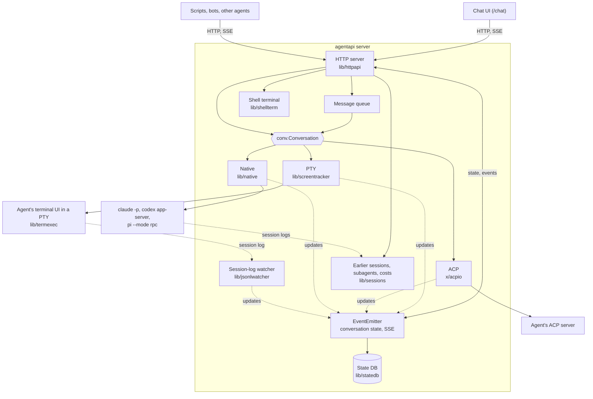
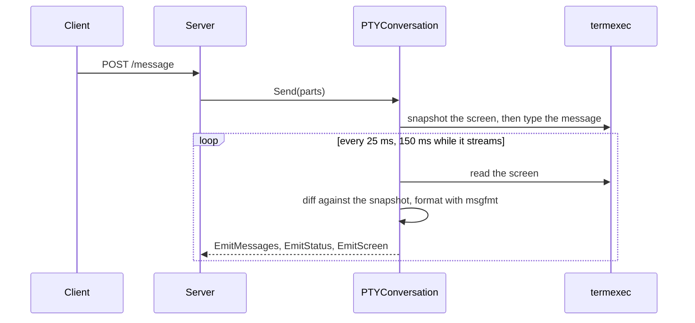
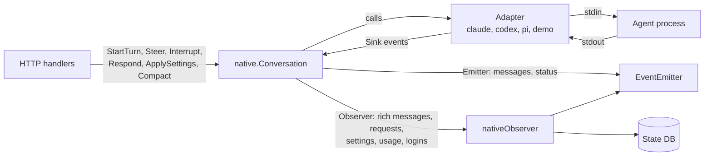

# Architecture

English | [繁體中文](architecture.zh-TW.md)

Each AgentAPI process runs one coding agent through one of three transports and exposes it through
an HTTP API, an event stream and an embedded chat UI. This guide covers the implementation of the
single Go binary; see the [README](../README.md) for features and usage.

## Contents

- [Overview](#overview)
- [Repository layout](#repository-layout)
- [Startup and shutdown](#startup-and-shutdown)
- [The HTTP server](#the-http-server)
- [Conversations and transports](#conversations-and-transports)
  - [PTY](#pty)
  - [ACP](#acp)
  - [Native](#native)
- [Events and the conversation state](#events-and-the-conversation-state)
- [The message queue](#the-message-queue)
- [Persistence](#persistence)
- [Restarts and updates](#restarts-and-updates)
- [The shell terminal](#the-shell-terminal)
- [Files](#files)
- [MCP management](#mcp-management)
- [Security model](#security-model)
  - [Child process environment](#child-process-environment)
- [The chat UI](#the-chat-ui)
- [Testing](#testing)
- [Design principles](#design-principles)

## Overview



Every transport implements `conv.Conversation`, the server's interface for sending messages and
reading the conversation, and reports changes to the same event emitter.

The core HTTP API, event stream, queue and chat UI therefore work the same across transports.
Native requests, settings and the shell terminal have separate endpoints. Handlers call the
conversation interface and read state from the emitter. Only raw messages and terminal-dialog
answers write keys directly to the agent's terminal.

## Repository layout

| Path | What it holds |
| --- | --- |
| `main.go`, `cmd/` | The Cobra CLI: `server` (flags, agent type, transport, starting the agent, signals), `attach`, `list` (the registered AgentAPIs and their summaries), `hub` (`serve`: the hub; `join`, `leave` and `status`: a hub's webhook in the config file and in the running AgentAPIs), and `update` (self-update with checksum verification) |
| `lib/httpapi/` | The HTTP server: routes and handlers, the `EventEmitter`, the queue, token auth, webhooks, the MCP, files and terminal endpoints, and the embedded chat UI |
| `lib/conversation/` | Shared types (imported as `conv`): messages, roles, status and error levels. The server calls transports through `Conversation`; transports report changes through `Emitter` |
| `lib/screentracker/` | The PTY conversation: screen snapshots, message splitting, stability detection, and typing parts into the agent's terminal (`AgentIO`, `TerminalPart`) |
| `lib/termexec/` | Runs the agent in a pseudo-terminal with an in-memory VT100 emulator (`xpty`, `vt10x`); the process can be swapped for a restart |
| `lib/msgfmt/` | Per-agent formatting of screen output: echoed input, input boxes, status lines, tool calls, readiness for the first prompt |
| `lib/transcript/` | The structured transcript's types, which the transports share: rich messages with their content blocks, and timeline events |
| `lib/agentlog/` | The agents' session-log formats, one package each (`claudelog`, `codexlog`, `pilog`): their records, the parsers into rich messages and timeline events (the native adapters use them too), prompts and injected context, model calls, file layout and resolvers; plus line reading, the incremental file index and format-drift warnings |
| `lib/sessions/` | A server-held `Store` reads earlier sessions and their conversations (`history.go`), subagents (`subagents.go`) and costs (`cost.go`) for a directory |
| `lib/jsonlwatcher/` | Finds and tails the session log of a PTY agent's process, for its rich messages |
| `lib/pricing/` | Model prices per million tokens (built-in `prices.json` and a `--prices` file), and per-call cost calculation |
| `lib/native/` | The native transport: `Conversation`, the `Adapter` and `Sink` contracts, requests, settings, usage, logins |
| `lib/native/claude`, `codex`, `pi` | One adapter per agent protocol |
| `lib/native/agentio` | The JSON-lines plumbing those adapters share: reading the agent's output line by line, writing to its stdin, matching its responses to the requests waiting for them |
| `lib/native/demo` | `native-demo`, a simulated agent for working on the chat |
| `lib/native/nativetest` | A scriptable fake adapter for tests |
| `lib/native/procutil` | Child process groups and graceful shutdown |
| `lib/statedb/` | SQLite persistence for `--state-db` (native and PTY), and the import of a `--state-file` |
| `lib/hub/` | `agentapi hub serve`: the instances and the groups set on its page (`store.go`, kept in a file), the signed webhook receiver (`webhook.go`), each instance's summary stream (`watch.go`), sign-in, the browser's event stream and the proxy to the instances (`hub.go`, `proxy.go`); the user guide is [hub.md](hub.md) |
| `lib/userconfig/` | The user's settings file, `~/.agentapi/config.yaml`: flags by name, read by `agentapi server`, written by `agentapi hub` |
| `lib/registry/` | The entries of the AgentAPIs running on a machine (`~/.agentapi/instances`): writing one atomically, listing them and removing those whose process is gone |
| `lib/shellterm/` | The shared shell terminal of native sessions |
| `lib/htmlpreview/` | Makes HTML previews self-contained for `GET /files/preview` by embedding resources referenced by relative paths as data: URLs |
| `lib/mcpconfig/` | Reads and writes the agents' MCP configuration files |
| `lib/procenv/` | The environment of the processes AgentAPI starts: agents on every transport, the terminal's shell |
| `lib/agenthome/` | Where the agents keep their state (`CLAUDE_CONFIG_DIR`, `CODEX_HOME`, `PI_CODING_AGENT_DIR`) |
| `lib/handoff/` | Types of the human-reply API |
| `lib/logctx/`, `lib/util/` | Context-based logging and shared helpers |
| `x/acpio/` | The experimental ACP transport |
| `internal/version/` | The version, stamped at build time |
| `chat/` | The chat UI (Next.js) |
| `e2e/` | End-to-end tests against a scripted echo agent |

## Startup and shutdown

`agentapi server [flags] -- <agent command>` (`cmd/server/server.go`):

1. Flags come from the command line, `AGENTAPI_*` environment variables or
   `~/.agentapi/config.yaml` (`--config`), in that order (viper).
   `cmd/server/userconfig.go` reports names that aren't flags and ignores a
   file it can't read. The agent type is `--type`, else the agent command
   when it is a type name, else `custom`. The transport is `--transport`, else
   native for an agent `hasNativeAdapter` covers (Claude Code, Codex, Pi and
   `native-demo`) unless the deprecated `--state-file` is set, else PTY.
2. The transport starts the agent:
   - PTY: `termexec` runs the command in a pseudo-terminal of `--term-width`
     by `--term-height` cells.
   - ACP: `httpapi.SetupACP` starts the command, and `acpio` opens an ACP
     session over its stdio.
   - Native: `nativeFactory` builds a `native.Factory` for the agent type
     (Claude Code, Codex, Pi or `native-demo`). Each adapter checks the
     agent's arguments first and refuses the ones that conflict with its
     protocol.
3. With `--state-db` (or next to a `--state-file`), `statedb.Open` opens the
   file, takes its exclusive lock and migrates its schema; a `--state-file`
   is imported into it if it holds no conversation yet.
4. `httpapi.NewServer` creates the emitter, restores the saved state (refusing
   a file written for another agent type, transport or working directory),
   creates the conversation, registers the routes, and starts the conversation,
   the queue loop, the webhook dispatcher and (PTY) the session-log watcher.
   `Start` listens, then writes the registry entry (unless `--registry=false`)
   and serves.
5. On SIGINT, SIGTERM or SIGHUP, or when the agent exits, the webhook sends
   `instance.stopped` and the registry entry is removed. A restart under way
   is cancelled, the HTTP server shuts down, and the queue loop and the
   session-log watcher stop. A native or PTY agent that still runs and the
   shell terminal are closed, and the state DB is flushed and closed. SIGUSR1
   flushes the state DB without stopping.

## The HTTP server

`lib/httpapi` uses chi for routing and huma for typed API operations. Huma also produces the OpenAPI
schema, which `make gen` writes to `openapi.json`. Requests pass through the following middleware
in order:

1. Host authorization: the `Host` header must name an allowed host (the port
   is ignored).
2. Request logging, which skips static files, event streams and the terminal.
3. Compression (`compress.go`): text, JSON, the event streams (flushed event by
   event) and the chat's files are gzipped for clients that take it; images
   go as they are. The hub uses the same middleware, and its proxy passes an
   instance's compressed responses on as they are.
4. CORS for the allowed origins, with credentials, so the chat's cookie works
   from another origin.
5. Token auth, with `--api-token`: a Bearer token or the chat's session
   cookie. It runs after CORS, so preflights pass and a 401 carries the CORS
   headers the chat needs to read it.

The handlers are grouped by file:

| File | Handles |
| --- | --- |
| `server.go`, `routes.go`, `hosts.go`, `middleware.go`, `compress.go` | The server's setup, start and stop; the routes, which each feature registers; allowed hosts and origins; request logging; compression |
| `conversation_api.go`, `queue.go`, `sse.go`, `jsonl_watcher.go` | Messages, status and timeline; the queue, its dispatch and `queue_update`; `GET /events` and the screen stream; the PTY transport's session log watcher |
| `tasks.go` | The tasks the emitter derives from the conversation (`taskTracker`), `task_update` and `GET /tasks` |
| `summary.go`, `spend.go`, `registry.go` | The summary for clients that watch many AgentAPIs (`attention`, title, latest task, `unread`, `spend`), `summary_update`, `GET /summary` and `POST /tasks/seen`; the spend worked out once a minute; the server's registry entry (`instanceRegistry`) |
| `backend.go`, `backend_pty.go`, `backend_native.go` | What depends on the transport: dispatching the queue and the work each tick (`beforeQueue`: a scheduled continuation, Codex's update prompt), delivering a message, restarts (`beginRestart`, `beginReload`), the human-reply protocol (`handoffOffer`, `answerHandoff`) |
| `setup.go` | Starting the process of a PTY or ACP agent |
| `native.go` | Requests, settings, interrupt, compaction, login retry; the native observer |
| `limit.go`, `sessions.go`, `subagents.go` | A turn a usage limit stopped (`/limit`); the agent's earlier sessions and what they cost (`/sessions`, `/cost`); its subagents (`/subagents`) |
| `terminal.go`, `files.go`, `file_preview.go`, `files_find.go` | The shell terminal (`terminalAPI`) and the file viewer and the search for a file the agent named relative to a repository (`fileAPI`) |
| `mcp.go`, `mcp_management.go` | MCP servers and profiles |
| `webhook.go`, `webhook_events.go`, `handoff.go`, `dialog_reply.go` | Webhook delivery (queue, retries, signatures, heartbeats) and the observer that turns the conversation's events into webhook events; the human-reply API; answers to terminal dialogs |
| `auth.go` | Token auth and the chat's sign-in (`authAPI`) |
| `restart.go`, `statedb.go` | Restarts; restoring and persisting the state |
| `events.go`, `events_*.go`, `models.go` | The emitter (subscriptions and replay; the status, screen, requests and messages it keeps) and the API's types |
| `embed.go`, `uploads.go` | The embedded chat UI; uploaded files (`uploadAPI`, which serves `POST /upload` from the operation's middleware: huma v2.32 changes the shared operation on every multipart request) |

Chi routes outside huma serve the chat (`/chat/*`, with `/` redirecting there), uploaded images
(`/uploads/{checksum}/{name}`) and workspace images (`/files/image`). TTY mode's screen stream
(`/internal/screen`) is a huma operation hidden from the OpenAPI schema.

`Server` holds the conversation, emitter, queue and its lock (`s.mu`), webhook dispatcher, MCP store,
shell terminal and state DB. Features outside conversation changes use modules created during route
registration: `fileAPI` holds the working directory, `terminalAPI` the shell, `uploadAPI` the upload
store, `authAPI` the token check, and `webhookAPI` the dispatcher and state DB.

For operations that differ by transport, handlers call `agentBackend`: `ptyBackend` drives terminal
and ACP conversations; `nativeBackend` drives native conversations.

## Conversations and transports

```go
// lib/conversation (imported as conv)
type Conversation interface {
	Messages() []Message
	Send(...MessagePart) error
	Start(context.Context)
	Status() Status // initializing, changing or stable
	Reset()
}

type Emitter interface {
	EmitMessages([]Message)
	EmitStatus(Status)
	EmitScreen(string)
	EmitError(message string, level ErrorLevel)
}
```

`stable` becomes the API's backward-compatible `stable` status (the agent is idle, or only waits for
an answer); `initializing` and `changing` become `running`.

### PTY



- `termexec` keeps the agent's screen in an in-memory emulator. Before a
  message is typed, the conversation takes a snapshot of the screen; what
  appears below it afterwards is the agent's reply, updated while the screen
  changes. The screen counts as stable once it hasn't changed for 2 seconds.
- `msgfmt` removes what isn't part of the reply (the echoed input, the input
  box, status lines), and knows when each agent is ready for the first
  prompt: when its input box shows, or, for a `custom` agent that may draw
  none (a shell, a REPL), also once its screen is stable.
- `jsonlwatcher` finds the Claude Code, Codex or Pi session log that belongs
  to the agent's process (by its process ID and working directory) and tails
  it. The parsers of `lib/agentlog` turn its lines into rich messages
  (thinking, tool calls with their results, usage) and timeline events, which
  reach the emitter next to the screen-derived messages.
- Terminal dialogs (Claude Code's plan approval and permission prompts, Codex
  approvals, Pi's trust prompt) are recognized on the screen and reported as
  `terminal_prompt`. `handoff.go` turns an answer into the keys the dialog
  expects, and `dialog_reply.go` opens a dialog's free-text field so that a
  chat message can answer it.

### ACP

`x/acpio` speaks the Agent Client Protocol over the agent's stdio. A message is one prompt with the
message's text. `POST /message` returns once the turn has started; messages sent during the turn
wait in the queue, and a failed prompt is reported as an `agent_error`. Message chunks become the
agent's reply, tool calls are appended to it as lines of text, and permission requests are approved
automatically. The transport is experimental.

### Native



`native.Conversation` implements `conv.Conversation` on top of an `Adapter`, one per agent protocol:

```go
// lib/native
type Adapter interface {
	Start(ctx context.Context, sink Sink) error
	StartTurn(ctx context.Context, input Input) error
	Steer(ctx context.Context, input Input) error
	Interrupt(ctx context.Context) error
	Respond(ctx context.Context, requestID string, response Response) error
	Capabilities() Capabilities
	Wait() error
	Close() error
}

// Resume says which session an adapter opens: Ref, or a copy of it with
// Fork, or a new one when Ref is empty.
type Factory func(resume Resume) (Adapter, error)
```

- **Sink.** An adapter reports what its agent does through a `Sink`: turns
  started and completed, rich messages, timeline events, requests opened and
  closed, the session name and the reference that resumes the session, a
  lost login, errors. Sink calls come from the adapter's read loop and never
  overlap. A rich message is sent whole each time it grows (a snapshot, not a
  delta), and message and request IDs never repeat across the adapters of one
  factory, because the conversation remains active across adapter replacements.
- **Optional parts.** An adapter that implements `Configurable` has settings
  (permission mode, model, reasoning effort) and reports the ones the agent
  changes by itself through `SettingsSink`; `Compacter` compacts the context
  on request; `UsageSink` takes the context and rate limit usage.
  `Capabilities` says which of steer, interrupt, resume, images, settings and
  compact the agent supports. The API and chat offer operations from these
  capabilities, not from the agent type.
- **Generations.** Every adapter belongs to a generation. Restarting or
  replacing the agent starts a new one, and events from an older adapter are
  ignored, so an agent that was replaced can't change the conversation.
- **Lifecycle.** Launching an adapter starts the process and its session, new
  or resumed from the session reference. An adapter that finds no login
  returns `LoginRequiredError`: the conversation reports `login_required` and
  launches it again every 5 seconds, or when `POST /login/retry` asks. Once
  the agent runs, the conversation gives it the settings chosen for the
  session, reports its capabilities and sends the initial prompt. `Restart`
  replaces it with a new session. `Reload` resumes the same session, so a
  changed MCP configuration is read again and the conversation stays.
  `Switch` opens another session, or a copy of it, with that session's
  messages. The server reads them from the agent's session log
  (`sessions.Store.ReadHistory`; `GET /sessions` lists the sessions). The
  subagents the agent ran in the session are read the same way, from their
  own logs (`sessions.Store.Subagents`), for `GET /subagents` and the chat's
  Lineage panel. Their state comes from the Agent tool call that started
  them.
- **Costs.** `sessions.Store.Costs` reads the model calls of every session
  in the directory, its subagents' included, from the same logs (`GET
  /sessions`, `GET /cost`): Claude Code's assistant messages (one per message
  id), Codex's token counts, Pi's reported costs. `lib/pricing` prices each
  call; Claude Code's `cost-state` records add what its log doesn't list
  (compaction) as unitemized calls. Calls copied by a fork count once, in the
  earliest session. The Store indexes each log's size, read offset and reader
  state. It reads only complete new lines from growing logs and rereads logs
  that shrink or are replaced. Concurrent requests share the read. The index
  has a size limit and removes logs that no longer exist.
- **Log formats.** Each format is decoded in one place (`lib/agentlog`):
  what is a prompt, injected context or a tool result is decided once, for
  the native adapters, the history, the costs and the PTY watcher alike.
  Records a parser doesn't know, and lines it can't decode, are logged once
  per log at Warn with the CLI version the log records, so a changed format
  shows in the server's log.
- **Usage limits.** When the account's usage limit stops a turn, the adapter
  ends it with the `limited` stop reason (Claude Code's limit messages and a
  `rejected` rate limit event, Codex's `usageLimitExceeded`, a quota error of
  Pi's provider). The conversation keeps it as a `LimitStop` with the reset
  time until a turn starts: the server's queue waits while it holds
  (`HoldsQueue`), and a continuation scheduled for the reset
  (`ScheduleContinue`, `--auto-continue`) goes out on the queue's tick before
  the queued messages.
- **Turns.** A message starts a turn only while the agent is idle; otherwise
  `StartTurn` returns `ErrMessageValidationChanging` and the server queues the
  message. Turns wait the same way while the agent compacts its context.
- **Requests.** Approvals, questions and plans become `RequestState`s with a
  status (`pending`, `resolved`, `withdrawn`, `expired`) and a
  `response_capability` (`live`, `message`, `not_resumable`). An answer
  reaches the adapter at most once, and requests still open when a turn ends
  expire. Secret answers are redacted everywhere except the input sent to the agent.
- **Observer.** Changes besides messages and status (rich messages, requests,
  settings, usage, the session reference, logins) go to an `Observer`, which
  the server implements to update the emitter and the state DB. It is called
  with the conversation's lock held, so it must not call back into the
  conversation.
- **Processes.** `procutil` starts the agent in its own process group, with the
  environment the adapter builds with `lib/procenv`, which leaves out the
  variables of a parent agent session. Stopping it closes its input, then
  sends the group SIGTERM after 3 seconds and SIGKILL 2 seconds later. Before
  that, the adapters interrupt a running turn and wait up to 3 seconds for it
  to end, so the agent's session log doesn't end in a tool call without result.

The adapters:

| Adapter | Process | Protocol |
| --- | --- | --- |
| `claude` | `claude -p --input-format stream-json --output-format stream-json ...` | Stream-json messages on stdin and stdout, plus Claude Code's control protocol: `initialize`, `can_use_tool` (approvals, questions, plans), `set_permission_mode`, `set_model`, `apply_flag_settings`, `get_settings`, `get_context_usage`, `interrupt` |
| `codex` | `codex app-server` | JSON-RPC: `thread/start`, `thread/resume` or `thread/fork`, `turn/start` (carrying the settings), `turn/steer`, `turn/interrupt`, `thread/compact/start`, `model/list`; approvals, questions and MCP elicitations arrive as server requests; the plan mode is a collaboration mode |
| `pi` | `pi --mode rpc --session-id <id>` (`--fork <id>` for a copy) | JSON lines: `prompt` (also for steering), `abort`, `get_state`, `get_available_models`, `set_model`, `set_thinking_level`, `compact`; extension dialogs arrive as UI requests and are answered with `extension_ui_response` |
| `demo` | none | A simulated agent that streams thinking, a tool call and a reply, and opens every kind of request |

## Events and the conversation state

The `EventEmitter` (`lib/httpapi/events.go`) stores the state clients read: the messages, rich
messages, the timeline, requests, the tasks, the queue, the status snapshot (status, lifecycle,
server ID, turn, the agent's session ID, capabilities, settings, usage with the prompt cache, a
usage limit stop, login, terminal prompt) and the latest screen.

- Every change to a message, a rich message, a request, a task or the queue
  gets the next sequence number (`seq`); the status, errors and the screen
  are replayed whole, and the timeline is read with `GET /timeline`. The
  conversation is identified by an `epoch`, which changes when its history is
  rewritten: a message taken back, a reset, a restore after a crash. Rich
  messages are found by their key through an index, so a resumed session of
  tens of thousands of them loads at once.
- `GET /events` streams the changes as server-sent events: `message_update`,
  `status_change`, `rich_message_update`, `agent_error`, `request_update`, and
  a `heartbeat` every 15 seconds. With `?sync=1` the stream starts with a
  `session_sync` event, adds `task_update` and `queue_update` (which clients
  that don't opt in never get: some reject event types they don't know),
  replays only what changed since `since=<seq>` when the epoch matches, and
  gives events SSE IDs, so a reconnecting `EventSource` resumes from
  `Last-Event-ID`.
- Changes that updates can't express, such as retracting a message, create
  a new epoch and close the conversation's subscriptions. Clients reconnect
  with the old epoch to receive a full replay with the correct SSE IDs.
  Subscriptions also close if they fall behind their buffer, or if opening
  a session would stream more than a quarter of a buffer of rich messages.
- The emitter derives tasks (`tasks.go`) for every transport. A user message
  starts a task; messages added during it steer the task. It ends when the
  agent is idle with no open request or terminal dialog. After an answer
  leaves the agent idle, a timer allows 3 seconds for work to resume before
  ending the task. Rich messages get the running task's `task_id` on arrival.
  Restored and resumed messages are treated as completed history.
- The emitter maintains a conversation summary (`summary.go`) with the
  instance, status, `attention` (why the agent needs the user), title, latest
  task, pending requests, queue and usage. While a summary subscriber exists,
  it recalculates after every change except screen changes and sends
  `summary_update` only if the summary differs. Growing reply text therefore
  sends no summary update. Only `/events?only=summary` subscribes to these
  updates; its stream also sends heartbeats. `PUT /webhook` triggers another
  check, and rewrites the registry entry, because it can change the instance
  ID and URL.
- For an agent whose session logs it reads, the server works out the summary's
  `spend` once a minute (`spend.go`): `sessions.Store.Costs` reads the logs
  incrementally, and the hours of its total that end within the last 24 hours
  and 7 days are added up. `EventEmitter.SetSpend` sends the summary only when
  the amounts change.
- The emitter also records when a client last showed the conversation
  (`POST /tasks/seen`, which the chat calls while it shows it). The latest
  task is `unread` when it ended after that. The state DB keeps the time; a
  restore without it marks the restored tasks as seen.
- `/internal/screen` streams the screen as `screen` events for TTY mode.
- A status change between `running` and `stable` triggers the
  `run.status_changed` webhook event. The webhook observer subscribes to the
  emitter like an `/events` client and turns its events into the other
  webhook events: the emitter's task updates into `task.*`, an agent message
  once the next one starts or the turn ends. It doesn't send what the emitter
  held when the observer subscribed, or messages older than AgentAPI's start
  (a resumed session's). The dispatcher delivers the events one at a time
  from a queue, with retries, and signs them with `--webhook-secret`.
- With a state DB, the emitter hands every change to its `Persister`, which
  encodes messages and rich messages on its writer goroutine from a copy, so
  a long message streaming in doesn't hold up the emitter.

## The message queue

Messages sent while the agent is busy wait in `s.queue`. The queue has its own lock so reads don't
wait on the server lock; mutations also hold `s.mu`. Every 500 ms, a loop checks whether the first
message can be delivered. Native agents must be idle without a usage limit holding the queue.
PTY agents need a stable screen with no dialog. Neither accepts queued messages during a restart.

Rejected messages get up to 5 attempts. Messages that might be delivered twice are dropped
immediately: a native write without confirmation (`native.ErrUnconfirmed`, caused by timeout,
cancellation or agent exit), or a PTY message typed but not submitted. Native stdin writes end with
the call's context, so an agent that stops reading can't hold `s.mu`.

Native messages can also steer or interrupt a running turn. Queue changes reach the emitter as
`queue_update` events outside the queue lock, with versions to discard late reports of older changes.
The queue is persisted with the conversation.

## Persistence

`lib/statedb` stores conversations in SQLite using the pure-Go `modernc.org/sqlite`, which supports
`CGO_ENABLED=0` builds. The emitter sends it every change on native and PTY transports. ACP doesn't
use persistence.

- The tables are `messages`, `rich_messages`, `session_events`, `requests`,
  `queue`, `tasks` (each as the server encoded it, by the ID of the message
  that started it), and `meta`, which holds the agent type, transport and working
  directory, the epoch and seq, the session reference and name, the
  settings chosen for the session, a usage limit stop, the webhook settings
  changed through the API (with a fingerprint of the startup flags, which win
  when they change), the initial prompt a PTY conversation got and when a
  client last showed the conversation (`seen_at`).
- Writes are queued and flushed every 200 ms in a transaction, so streaming
  never waits for the disk. A clean shutdown marks the file clean; after a
  crash the conversation gets a new epoch and clients load it again in full.
- The file is opened in exclusive locking mode with WAL, so no second
  AgentAPI can use it, and is created with mode 0600.
- On startup the server restores the conversation, the queue and the session
  reference, which the native conversation passes to the factory so the agent
  resumes its own session. The PTY conversation gets the restored messages
  when it is built (`InitialMessages`): its first snapshot then continues
  them instead of replacing them, and the last agent message keeps its text
  until the user sends the next one. Requests that were open come back
  expired.
- Unreadable rows are logged and skipped so the server can start. Numbered
  migrations update the schema; `PRAGMA user_version` records its version.

`--state-file`, the older PTY mechanism (JSON written on shutdown), is deprecated: `cmd/server`
imports it once into a state database next to it (`statedb.ImportStateFile`, only into an empty
one), which keeps the conversation from then on. SIGUSR1 flushes the state database.

## Restarts and updates

- `DELETE /messages` clears the conversation, requests and queue and restarts
  the agent; before the new agent starts, AgentAPI runs `codex update` or
  `pi update --self` for Codex and Pi. A native agent is closed and `Restart`
  starts a new session. A PTY agent gets a new process in the swappable
  terminal and a new session-log watcher. Under ACP the request fails with
  400, as the agent can't be restarted.
- A replacement of the native agent (a restart, a reload, opening another
  session) has two steps. `BeginRestart`, `BeginReload` and `BeginSwitch`
  retire the agent under `s.mu`, and its events are ignored from then on.
  While a turn runs or the context is compacted, `BeginSwitch` refuses with
  `ErrTurnActive` and changes nothing. `Replacement.Start` then closes the
  old agent, updates the CLI and starts the new one without `s.mu`
  (`runRestartLocked`). Meanwhile `s.restarting` holds the queue, and other
  replacements, raw keys and the human-reply protocol get 409 or nothing.
  Requests that don't take `s.mu` (`/status`, `/handoff`, `/queue`)
  answer. Stop cancels a restart under way. A resumed session's history is
  read before `s.mu` is taken.
- MCP changes with `?restart=true`: a native agent is reloaded on its session
  (`Reload`), so the conversation stays. While a turn runs, the configuration
  is written but the reload is refused with 409. An agent that can't
  resume its session is restarted instead.
- `/status` reports the lifecycle: `starting`, `ready`, `running`,
  `restarting`, `exited` or `failed`.

## The shell terminal

`lib/shellterm` runs one login shell in a pseudo-terminal (`creack/pty`) in the agent's working
directory, with the agent's environment minus AgentAPI's own variables. It starts when the first
client subscribes and keeps running after all clients disconnect. Its output goes to a 256 KiB
scrollback, trimmed at a line start, and to each watcher's buffer; a watcher that falls 512 chunks
behind is dropped and reconnects for the scrollback. `GET /terminal` streams base64-encoded `output`
and `exit` events. `POST /terminal/input` sends input, and `/terminal/resize` changes the
dimensions; the most recent resize applies. Closing hangs up the terminal and kills the shell's
process group after 2 seconds.

## Files

`GET /files/content` and `GET /files/diff` serve the chat's file viewer. When a path isn't there,
the viewer asks `GET /files/find` for the files below the working directory whose path ends with it,
ignoring case. The search walks breadth-first, leaves out hidden directories, dependencies and Go's
module cache unless the path goes into them, and stops after 50,000 entries or 2 seconds. Paths
resolve inside the agent's working directory, with symlinks followed and checked; only regular files
are read, up to 1 MiB. The diff runs git read-only in the repository (`rev-parse`, `ls-files`,
`cat-file`, with fsmonitor off) and compares copies of the committed and current file with
`git diff --no-index` in a temporary directory, without the user's or the system's git
configuration, so repository-configured programs are not executed.

Previews use the same working-directory root. `GET /files/preview` (`lib/htmlpreview`) returns an
HTML file with the stylesheets, scripts, images, fonts and media it references by relative path
embedded as data URLs: only files whose extension matches their resource type (a stylesheet must be
`.css`, a script `.js`), none in a hidden directory or above the working directory, up to 4 MiB
each and 16 MiB in all. The chat shows the page in an iframe sandboxed with `allow-scripts` but
without `allow-same-origin`: the page has no origin, so its scripts can't read the chat, send its
session cookie or call the API with it, and nothing it refers to is loaded from AgentAPI (which a
proxy's cookie wouldn't reach either). `GET /files/image` serves raster images judged by content, as
`GET /uploads` does, and SVG judged by extension, which `GET /uploads` never serves; both send
`nosniff` and a sandboxing Content-Security-Policy.

## MCP management

`lib/mcpconfig` reads and writes each agent's MCP configuration (Claude Code's `.mcp.json` in the
working directory, Codex's `$CODEX_HOME/config.toml`, Pi's `$PI_CODING_AGENT_DIR/mcp.json`, by
default `~/.pi/agent/mcp.json`) and keeps unrelated settings. Profiles save reusable server
configurations. Agents read configuration on startup, so changes require a restart, or a reload of
the same session for native agents.

## Security model

- There are no separate user accounts or roles. A client that passes the
  host and origin checks, and token authentication when enabled, has the
  agent's capabilities: native agents start in the bypass permission mode,
  the ACP transport approves every permission request, and the shell
  terminal runs commands.
- `--api-token`: compared in constant time. Browsers sign in with
  `POST /auth/session`, which sets an HttpOnly, SameSite=Strict cookie holding
  an HMAC of the token rather than the token, so changing the token signs
  every browser out. The static chat files and `/auth/session` skip the
  token check; signing in checks the token itself.
- `--bind` limits who can connect, `--allowed-hosts` which `Host` headers are
  accepted (by default `localhost`, `127.0.0.1` and `[::1]`, against DNS
  rebinding), and `--allowed-origins` which origins may call the API from a
  browser.
- Uploads go to a private directory, and only images are served back. Files
  outside the working directory can't be opened.
- The webhook sends its configured events, the conversation included, to
  its URL, which `PUT /webhook` can change; its HMAC secret is write-only.
- The hub (`lib/hub`) holds the instances' API tokens and sends them only to
  instance URLs from events signed with its secret (HMAC of the timestamp and
  body, at most 10 minutes old, each delivery once) or added by someone signed
  in. Browsers sign in with the hub token for an HttpOnly, SameSite=Lax cookie
  derived from it. The proxy drops their cookies and `Authorization`, `Origin`
  and `Referer` headers and the instances' `Set-Cookie`, so neither side's
  credentials reach the other.
- Agents, on every transport, don't inherit the variables (one of them a
  secret) that a parent agent session sets for the commands it runs, nor
  AgentAPI's API token (`lib/procenv`).

### Child process environment

When AgentAPI starts inside another agent session, it removes inherited session
markers and secrets before launching agents on any transport, and before the
CLI update that precedes a restart (`codex update`, `pi update --self`). This
prevents a child agent from inheriting the parent session's identity or sandbox
markers. The filtering is implemented in [lib/procenv/procenv.go](../lib/procenv/procenv.go).

**Claude Code session variables**

| Variable |
| --- |
| `CLAUDECODE` |
| `CLAUDE_CODE_ENTRYPOINT` |
| `CLAUDE_CODE_SESSION_ID` |
| `CLAUDE_CODE_CHILD_SESSION` |
| `CLAUDE_CODE_SESSION_ATTENDED` |
| `CLAUDE_CODE_EXECPATH` |
| `CLAUDE_CODE_MESSAGING_SOCKET` |
| `CLAUDE_CODE_MESSAGING_TOKEN` |
| `CLAUDE_CODE_SSE_PORT` |
| `CLAUDE_PID` |
| `CLAUDE_EFFORT` |
| `CLAUDE_AGENT_SDK_VERSION` |
| `CLAUDE_CODE_EMIT_SESSION_STATE_EVENTS` |
| `CLAUDE_CODE_SDK_READS_SESSION_STATE` |

**Codex session variables**

| Variable |
| --- |
| `CODEX_THREAD_ID` |
| `CODEX_SANDBOX` |
| `CODEX_SANDBOX_NETWORK_DISABLED` |
| `CODEX_CI` |
| `CODEX_INTERNAL_ORIGINATOR_OVERRIDE` |
| `CODEX_TUI_RECORD_SESSION` |
| `CODEX_TUI_SESSION_LOG_PATH` |

**Other removed variables**

| Variable |
| --- |
| `PI_CODING_AGENT` |
| `AI_AGENT` |
| `AGENTAPI_API_TOKEN` |

Configuration such as `CLAUDE_CONFIG_DIR`, `CODEX_HOME`, `PI_CODING_AGENT_DIR`,
and `ANTHROPIC_*` is preserved. After filtering, the native Claude Code adapter
sets `CLAUDE_CODE_ENTRYPOINT=sdk-cli` and `CLAUDE_CODE_EMIT_SESSION_STATE_EVENTS=1`
again, with the values its protocol relies on. The shared shell also removes
AgentAPI's own `AGENTAPI_*` variables.

## The chat UI

`chat/` is a Next.js 15 and React 19 app, built with bun as a static export. `make embed` copies the
build into `lib/httpapi/chat/`, which `embed.go` embeds with `go:embed`. The build uses a
placeholder base path that the server rewrites to `--chat-base-path` (default `/chat`). The UI also
runs as a standalone development server (`bun run dev`, with `?url=<server>`), and `/chat/embed` is
a variant for embedding in other pages (`hub=1`: in the hub's frame it draws the hub's bar for the instance, from what the hub sends it in window messages, `lib/hub-frame.ts`). `/chat/hub/`
is the hub's page (`components/hub-view.tsx`, its parts in `components/hub/`, its logic in
`lib/hub.ts`), which `agentapi hub serve` serves with the same build.

- `components/chat-provider.tsx` composes the client state and API operations.
  Actions and API calls come from `useChatActions()`, an object that never
  changes, so components that only act don't render again; state is read in
  slices with `useChatSelector` (`lib/store.ts`), so a component renders again
  only when its slice changes. The hooks `use-event-stream.ts`, `use-queue.ts`
  and `use-session-cache.ts` apply the events to the state, follow the queued
  messages, and cache the transcript.
- The event stream uses `/events?sync=1` and keeps the last sequence number
  for incremental replay (`lib/chat-stream.ts`). `EventSourceConnection`
  (`lib/event-source.ts`, and the `use-event-source.ts` hook) keeps it, the
  hub page's stream and the terminals' open: a stream that ends is opened
  again at once, without a notice, unless that keeps failing; one that fails
  (a 401, a proxy's 502), after a backoff; one with heartbeats that goes
  quiet, by a watchdog; and any when the browser comes back online or to the
  tab. The payload types come from
  the generated schema (`lib/events.ts`), and null lists are made empty where
  events arrive. A status the chat doesn't know, from a newer server (the hub
  serves its own build to instances of every version), becomes one it does
  there too: a task's, a subagent's. IndexedDB keeps each server's conversation for the next
  visit, one record per message, writing only what changed, with the sequence
  number of what it saved; a server's cache goes after 14 days without use,
  and only the 10 most recently used are kept (`lib/session-cache.ts`).
- `TimelineBuilder` in `lib/task-timeline.ts` groups messages into tasks.
  It rebuilds from the first change and preserves unchanged objects, so
  memoized tasks and tool calls don't render again. A section takes
  its state from the server's task (`task_update`, held and cached like the
  requests), the one its prompt started or was steered into; rich activity
  goes to the task its `task_id` names, and only untagged activity is placed
  by time. A task's cost is the model calls made while it ran. The queue
  follows `queue_update` events; `GET /queue` is read on each connection,
  and every 60 seconds only while no event came. A render error
  shows `chat-error-boundary.tsx`, which offers to clear the cached
  conversation and reload.
- `lib/chat-api.ts` is the typed HTTP client; `lib/api-schema.ts` contains
  types generated from the OpenAPI schema.
- `components/chat.tsx` lays out the page: the message list (tasks, tool rows,
  thinking), the dock above the composer (the status strip, decision cards
  for terminal dialogs, the login card, request cards, the usage limit card,
  the cold prompt cache note), the composer (`message-input.tsx`, with slash
  commands, the session settings and the usage meter), the Explorer (with the
  earlier sessions and what they cost, `session-history.tsx`, and the webhook,
  `webhook-settings.tsx`), the Lineage panel of the
  subagents (`lineage.tsx`), the file viewer, TTY mode (`tty-view.tsx`, from
  `/internal/screen`) and the native terminal (`shell-view.tsx`, from
  `/terminal`).
- `lib/` holds the logic in plain modules with bun tests: task grouping, tool
  formatting, file references, diffs, slash commands, settings, usage, costs
  (`cost.ts`: a task's share of the session's calls, totals by period),
  terminal keys, auth. `use-session-cost.ts` reads `GET /cost` when a turn
  ends and while one runs; after the first read it sends `from` and `digest`,
  and gets only the calls made since.

## Testing

- Go tests sit next to the code and run with `CGO_ENABLED=0`; code that
  depends on time uses `coder/quartz` clocks.
- The native adapters have harnesses that fake the agent process, replay
  tests built from sanitized captures of the real CLIs (`testdata/`), and
  parity tests that compare their rich messages with what the session-log
  parsers produce. `nativetest` provides a fake adapter for the conversation
  and HTTP tests.
- `e2e/` runs the server against a scripted echo agent.
- `golangci-lint` (including the exhaustive check over enums),
  `paralleltestctx` and `make gen` (the OpenAPI schema must match the code)
  run in CI; the chat has eslint, `bun test` and `tsc`.

## Design principles

- Claude Code, Codex and Pi use the native transport by default; the PTY
  transport works with any terminal agent and stays the default for the others.
- Clients decide what to offer from capabilities, never from the agent type.
- Adapters report full snapshots; the conversation and the emitter turn them
  into updates.
- Generations and unique IDs keep a replaced agent from changing the
  conversation.
- What reaches the browser can be replayed: every change to a message, rich
  message or request has a sequence number, the rest is replayed whole, and a
  client that fell behind loads the state again.
