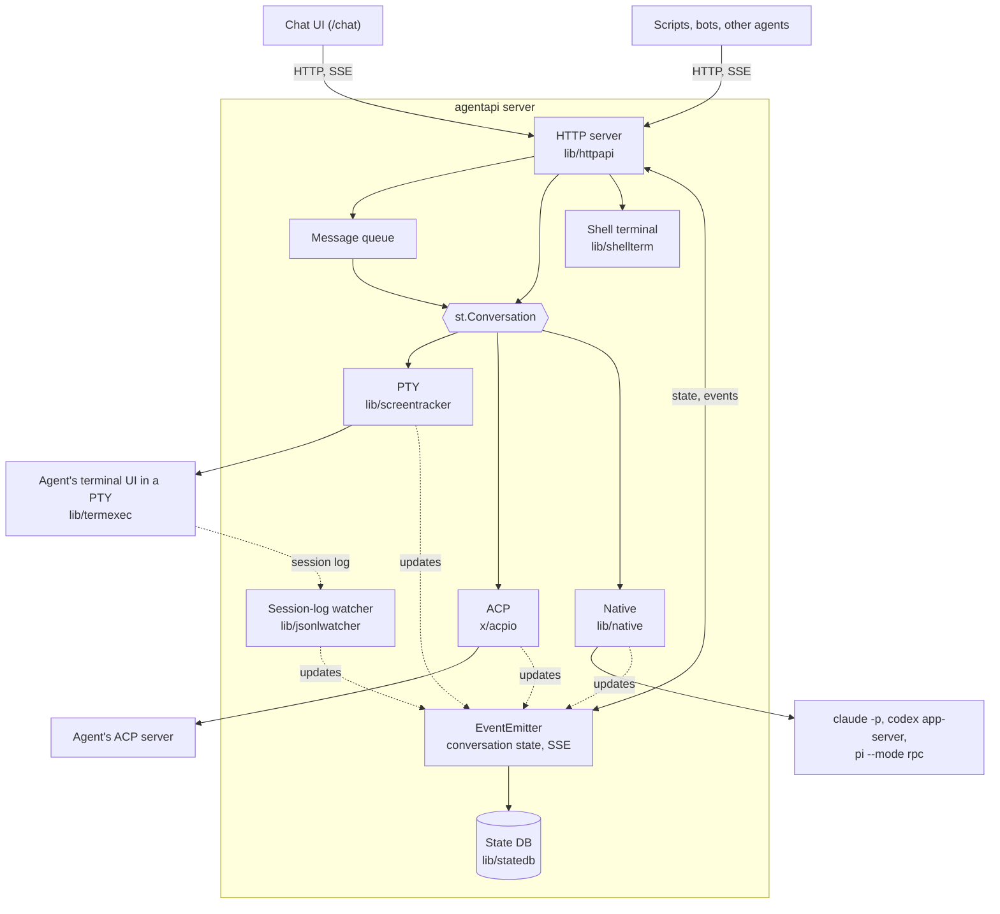
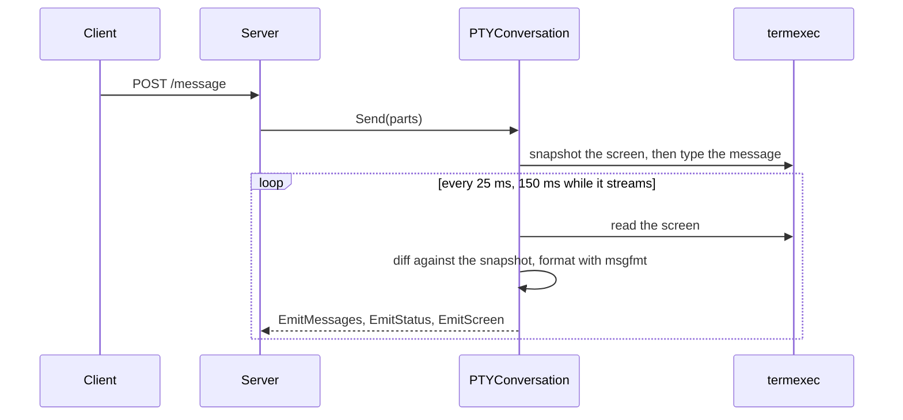
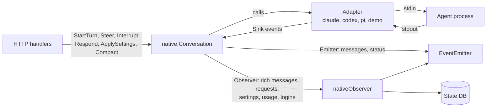

# Architecture

English | [繁體中文](architecture.zh-TW.md)

AgentAPI is a single Go binary that runs one coding agent through one of three transports. It
exposes the agent through an HTTP API, an event stream, and an embedded chat UI. This document
explains the implementation; the [README](../README.md) covers features and usage.

## Contents

- [Overview](#overview)
- [Repository layout](#repository-layout)
- [Startup and shutdown](#startup-and-shutdown)
- [The HTTP server](#the-http-server)
- [Conversations and transports](#conversations-and-transports)
  - [PTY](#pty)
  - [ACP](#acp)
  - [Native](#native)
- [Events and the conversation state](#events-and-the-conversation-state)
- [The message queue](#the-message-queue)
- [Persistence](#persistence)
- [Restarts and updates](#restarts-and-updates)
- [The shell terminal](#the-shell-terminal)
- [Files](#files)
- [MCP management](#mcp-management)
- [Security model](#security-model)
  - [Child process environment](#child-process-environment)
- [The chat UI](#the-chat-ui)
- [Testing](#testing)
- [Design principles](#design-principles)

## Overview



Each AgentAPI process runs one agent. Every transport implements `st.Conversation`, the server's
interface for sending messages and reading the conversation, and reports changes to the same event
emitter.

Because of this, the core HTTP API, event stream, queue, and chat UI work the same over every
transport. Transport-specific features, such as native requests, settings, and the shell terminal,
have separate endpoints. Handlers operate through the conversation and read state from the emitter
rather than accessing the agent process directly; only raw messages and the keys that answer a
terminal dialog are written to the agent's terminal directly.

## Repository layout

| Path | What it holds |
| --- | --- |
| `main.go`, `cmd/` | The Cobra CLI: `server` (flags, agent type, transport, starting the agent, signals), `attach`, and `update` (self-update with checksum verification) |
| `lib/httpapi/` | The HTTP server: routes and handlers, the `EventEmitter`, the queue, token auth, webhooks, the MCP, files and terminal endpoints, and the embedded chat UI |
| `lib/screentracker/` | The `Conversation` and `Emitter` interfaces, and the PTY conversation: screen snapshots, message splitting, stability detection |
| `lib/termexec/` | Runs the agent in a pseudo-terminal with an in-memory VT100 emulator (`xpty`, `vt10x`); the process can be swapped for a restart |
| `lib/msgfmt/` | Per-agent formatting of screen output: echoed input, input boxes, status lines, tool calls, readiness for the first prompt |
| `lib/transcript/` | The structured transcript's types, which the transports share: rich messages with their content blocks, and timeline events |
| `lib/jsonlwatcher/` | Finds and tails the Claude Code, Codex and Pi session logs and parses them into rich messages and timeline events; lists the agent's earlier sessions in a directory and reads one's conversation (`history.go`), and reads the logs of the subagents a session ran (`subagents.go`) |
| `lib/native/` | The native transport: `Conversation`, the `Adapter` and `Sink` contracts, requests, settings, usage, logins |
| `lib/native/claude`, `codex`, `pi` | One adapter per agent protocol |
| `lib/native/agentio` | The JSON-lines plumbing those adapters share: reading the agent's output line by line, writing to its stdin, matching its responses to the requests waiting for them |
| `lib/native/demo` | `native-demo`, a simulated agent for working on the chat |
| `lib/native/nativetest` | A scriptable fake adapter for tests |
| `lib/native/procutil` | Child process groups and graceful shutdown |
| `lib/statedb/` | SQLite persistence for `--state-db` |
| `lib/shellterm/` | The shared shell terminal of native sessions |
| `lib/htmlpreview/` | Turns an HTML file into a page that shows by itself, for `GET /files/preview`: what it refers to by relative path becomes data: URLs |
| `lib/mcpconfig/` | Reads and writes the agents' MCP configuration files |
| `lib/procenv/` | The environment of the processes AgentAPI starts: agents on every transport, the terminal's shell |
| `lib/agenthome/` | Where the agents keep their state (`CLAUDE_CONFIG_DIR`, `CODEX_HOME`, `PI_CODING_AGENT_DIR`) |
| `lib/handoff/` | Types of the human-reply API |
| `lib/logctx/`, `lib/util/` | Context-based logging and shared helpers |
| `x/acpio/` | The experimental ACP transport |
| `internal/version/` | The version, stamped at build time |
| `chat/` | The chat UI (Next.js) |
| `e2e/` | End-to-end tests against a scripted echo agent |

## Startup and shutdown

`agentapi server [flags] -- <agent command>` (`cmd/server/server.go`):

1. Flags come from the command line or from `AGENTAPI_*` environment
   variables (viper). The agent type is `--type`, else the agent command when
   it is a type name, else `custom`. The transport is `--transport`, else
   native for an agent `hasNativeAdapter` covers (Claude Code, Codex, Pi and
   `native-demo`) unless `--state-file` is set, else PTY.
2. The transport starts the agent:
   - PTY: `termexec` runs the command in a pseudo-terminal of `--term-width`
     by `--term-height` cells.
   - ACP: `httpapi.SetupACP` starts the command, and `acpio` opens an ACP
     session over its stdio.
   - Native: `nativeFactory` builds a `native.Factory` for the agent type
     (Claude Code, Codex, Pi or `native-demo`). Each adapter checks the
     agent's arguments first and refuses the ones that conflict with its
     protocol.
3. With `--state-db`, `statedb.Open` opens the file, takes its exclusive lock
   and migrates its schema.
4. `httpapi.NewServer` creates the emitter, restores the saved state (refusing
   a file written for another agent type, transport or working directory),
   creates the conversation, registers the routes, and starts the conversation,
   the queue loop, the webhook dispatcher and (PTY) the session-log watcher.
5. On SIGINT, SIGTERM or SIGHUP, or when the agent exits, the HTTP server
   shuts down, a native or PTY agent that still runs and the shell terminal
   are closed, and the state DB is flushed and closed. With `--state-file`,
   the PTY conversation saves its messages first; SIGUSR1 saves them without
   stopping.

## The HTTP server

`lib/httpapi` uses chi for routing and huma for typed API operations. Huma also produces the OpenAPI
schema, which `make gen` writes to `openapi.json`. Requests pass through the following middleware
in order:

1. Host authorization: the `Host` header must name an allowed host (the port
   is ignored).
2. Request logging, which skips static files, event streams and the terminal.
3. CORS for the allowed origins, with credentials, so the chat's cookie works
   from another origin.
4. Token auth, with `--api-token`: a Bearer token or the chat's session
   cookie. It runs after CORS, so preflights pass and a 401 carries the CORS
   headers the chat needs to read it.

The handlers are grouped by file:

| File | Handles |
| --- | --- |
| `server.go`, `routes.go`, `hosts.go`, `middleware.go` | The server's setup, start and stop; the routes, which each feature registers; allowed hosts and origins; request logging |
| `conversation_api.go`, `queue.go`, `sse.go`, `jsonl_watcher.go` | Messages, status and timeline; the queue and its dispatch; `GET /events` and the screen stream; the PTY transport's session log watcher |
| `backend.go`, `backend_pty.go`, `backend_native.go` | What depends on the transport: dispatching the queue, delivering a message, restarts, the human-reply protocol's pending request |
| `setup.go` | Starting the process of a PTY or ACP agent |
| `native.go` | Requests, settings, interrupt, compaction, login retry; the native observer |
| `limit.go`, `sessions.go`, `subagents.go` | A turn a usage limit stopped (`/limit`); the agent's earlier sessions (`/sessions`); its subagents (`/subagents`) |
| `terminal.go`, `files.go`, `file_preview.go`, `files_find.go` | The shell terminal and the file viewer, and the search for a file the agent named relative to a repository |
| `mcp.go`, `mcp_management.go` | MCP servers and profiles |
| `webhook.go`, `handoff.go`, `dialog_reply.go` | Run-status webhooks, the human-reply API, answers to terminal dialogs |
| `auth.go` | Token auth and the chat's sign-in |
| `restart.go`, `statedb.go` | Restarts; restoring and persisting the state |
| `events.go`, `events_*.go`, `models.go` | The emitter (subscriptions and replay; the status, screen, requests and messages it keeps) and the API's types |
| `embed.go`, `uploads.go` | The embedded chat UI; uploaded files |

Chi routes without huma serve the chat (`/chat/*`, with `/` redirecting to it), uploaded images
(`/uploads/{checksum}/{name}`) and the working directory's image files (`/files/image`). The screen
stream of TTY mode (`/internal/screen`) is a huma operation hidden from the OpenAPI schema. The
`Server` holds the conversation, the emitter, the queue and its lock (`s.mu`), the webhook
dispatcher, the MCP store, the shell terminal and the state DB. Where the transports differ,
handlers call the `agentBackend` of the server's transport: `ptyBackend` drives a terminal or ACP
conversation, `nativeBackend` a native one.

## Conversations and transports

```go
// lib/screentracker
type Conversation interface {
	Messages() []ConversationMessage
	Send(...MessagePart) error
	Start(context.Context)
	Status() ConversationStatus // initializing, changing or stable
	SaveState() error
	Reset()
}

type Emitter interface {
	EmitMessages([]ConversationMessage)
	EmitStatus(ConversationStatus)
	EmitScreen(string)
	EmitError(message string, level ErrorLevel)
}
```

`stable` becomes the API's backward-compatible `stable` status (the agent is idle, or only waits for
an answer); `initializing` and `changing` become `running`.

### PTY



- `termexec` keeps the agent's screen in an in-memory emulator. Before a
  message is typed, the conversation takes a snapshot of the screen; what
  appears below it afterwards is the agent's reply, updated while the screen
  changes. The screen counts as stable once it hasn't changed for 2 seconds.
- `msgfmt` removes what isn't part of the reply (the echoed input, the input
  box, status lines), and knows when each agent is ready for the first
  prompt: when its input box shows, or, for a `custom` agent that may draw
  none (a shell, a REPL), also once its screen is stable.
- `jsonlwatcher` finds the Claude Code, Codex or Pi session log that belongs
  to the agent's process (by its process ID and working directory) and tails
  it. Agent-specific parsers turn its lines into rich messages (thinking, tool
  calls with their results, usage) and timeline events, which reach the
  emitter next to the screen-derived messages.
- Terminal dialogs (Claude Code's plan approval and permission prompts, Codex
  approvals, Pi's trust prompt) are recognized on the screen and reported as
  `terminal_prompt`. `handoff.go` turns an answer into the keys the dialog
  expects, and `dialog_reply.go` opens a dialog's free-text field so that a
  chat message can answer it.

### ACP

`x/acpio` speaks the Agent Client Protocol over the agent's stdio. A message is one prompt with the
message's text. `POST /message` returns once the turn has started; messages sent during the turn
wait in the queue, and a failed prompt is reported as an `agent_error`. Message chunks become the
agent's reply, tool calls are appended to it as lines of text, and permission requests are approved
automatically. The transport is experimental.

### Native



`native.Conversation` implements `st.Conversation` on top of an `Adapter`, one per agent protocol:

```go
// lib/native
type Adapter interface {
	Start(ctx context.Context, sink Sink) error
	StartTurn(ctx context.Context, input Input) error
	Steer(ctx context.Context, input Input) error
	Interrupt(ctx context.Context) error
	Respond(ctx context.Context, requestID string, response Response) error
	Capabilities() Capabilities
	Wait() error
	Close() error
}

// Resume says which session an adapter opens: Ref, or a copy of it with
// Fork, or a new one when Ref is empty.
type Factory func(resume Resume) (Adapter, error)
```

- **Sink.** An adapter reports what its agent does through a `Sink`: turns
  started and completed, rich messages, timeline events, requests opened and
  closed, the session name and the reference that resumes the session, a
  lost login, errors. Sink calls come from the adapter's read loop and never
  overlap. A rich message is sent whole each time it grows (a snapshot, not a
  delta), and message and request IDs never repeat across the adapters of one
  factory, because the conversation remains active across adapter replacements.
- **Optional parts.** An adapter that implements `Configurable` has settings
  (permission mode, model, reasoning effort) and reports the ones the agent
  changes by itself through `SettingsSink`; `Compacter` compacts the context
  on request; `UsageSink` takes the context and rate limit usage.
  `Capabilities` says which of steer, interrupt, resume, images, settings and
  compact the agent supports. The API and chat use these capabilities
  to determine which operations to offer, independently of the agent type.
- **Generations.** Every adapter belongs to a generation. Restarting or
  replacing the agent starts a new one, and events from an older adapter are
  ignored, so an agent that was replaced can't change the conversation.
- **Lifecycle.** Launching an adapter starts the process and its session, new
  or resumed from the session reference. An adapter that finds no login
  returns `LoginRequiredError`: the conversation reports `login_required` and
  launches it again every 5 seconds, or when `POST /login/retry` asks. Once
  the agent runs, the conversation gives it the settings chosen for the
  session, reports its capabilities and sends the initial prompt. `Restart`
  replaces it with a new session; `Reload` resumes the same session, so a
  changed MCP configuration is read again and the conversation stays;
  `Switch` opens another session, or a copy of it, with that session's
  messages, which the server reads from the agent's session log
  (`jsonlwatcher.ReadSessionHistory`; `GET /sessions` lists them). The
  subagents the agent ran in the session are read the same way, from their
  own logs (`jsonlwatcher.Subagents`), for `GET /subagents` and the chat's
  Lineage panel; their state comes from the Agent tool call that started
  them.
- **Usage limits.** An adapter ends a turn the account's usage limit stopped
  with the `limited` stop reason (Claude Code's limit messages and a
  `rejected` rate limit event, Codex's `usageLimitExceeded`, a quota error of
  Pi's provider). The conversation keeps it as a `LimitStop` with the reset
  time until a turn starts: the server's queue waits while it holds
  (`HoldsQueue`), and a continuation scheduled for the reset
  (`ScheduleContinue`, `--auto-continue`) goes out on the queue's tick before
  the queued messages.
- **Turns.** A message starts a turn only while the agent is idle; otherwise
  `StartTurn` returns `ErrMessageValidationChanging` and the server queues the
  message. Turns wait the same way while the agent compacts its context.
- **Requests.** Approvals, questions and plans become `RequestState`s with a
  status (`pending`, `resolved`, `withdrawn`, `expired`) and a
  `response_capability` (`live`, `message`, `not_resumable`). An answer
  reaches the adapter at most once, and requests still open when a turn ends
  expire. Secret answers are redacted everywhere except the input sent to the agent.
- **Observer.** Changes besides messages and status (rich messages, requests,
  settings, usage, the session reference, logins) go to an `Observer`, which
  the server implements to update the emitter and the state DB. It is called
  with the conversation's lock held, so it must not call back into the
  conversation.
- **Processes.** `procutil` starts the agent in its own process group, with the
  environment the adapter builds with `lib/procenv`, which leaves out the
  variables of a parent agent session. Stopping it closes its input, then
  sends the group SIGTERM after 3 seconds and SIGKILL 2 seconds later. Before
  that, the adapters interrupt a running turn and wait up to 3 seconds for it
  to end, so the agent's session log doesn't end in a tool call without result.

The adapters:

| Adapter | Process | Protocol |
| --- | --- | --- |
| `claude` | `claude -p --input-format stream-json --output-format stream-json ...` | Stream-json messages on stdin and stdout, plus Claude Code's control protocol: `initialize`, `can_use_tool` (approvals, questions, plans), `set_permission_mode`, `set_model`, `apply_flag_settings`, `get_settings`, `get_context_usage`, `interrupt` |
| `codex` | `codex app-server` | JSON-RPC: `thread/start`, `thread/resume` or `thread/fork`, `turn/start` (carrying the settings), `turn/steer`, `turn/interrupt`, `thread/compact/start`, `model/list`; approvals, questions and MCP elicitations arrive as server requests; the plan mode is a collaboration mode |
| `pi` | `pi --mode rpc --session-id <id>` (`--fork <id>` for a copy) | JSON lines: `prompt` (also for steering), `abort`, `get_state`, `get_available_models`, `set_model`, `set_thinking_level`, `compact`; extension dialogs arrive as UI requests and are answered with `extension_ui_response` |
| `demo` | none | A simulated agent that streams thinking, a tool call and a reply, and opens every kind of request |

## Events and the conversation state

The `EventEmitter` (`lib/httpapi/events.go`) stores the state clients read: the messages, rich
messages, the timeline, requests, the status snapshot (status, lifecycle, run ID, capabilities,
settings, usage with the prompt cache, a usage limit stop, login, terminal prompt) and the latest
screen.

- Every change to a message, a rich message or a request gets the next
  sequence number (`seq`); the status, errors and the screen are replayed
  whole, and the timeline is read with `GET /timeline`. The conversation is
  identified by an `epoch`, which changes when its history is rewritten: a
  message taken back, a reset, a restore after a crash.
- `GET /events` streams the changes as server-sent events: `message_update`,
  `status_change`, `rich_message_update`, `agent_error`, `request_update`, and
  a `heartbeat` every 15 seconds. With `?sync=1` the stream starts with a
  `session_sync` event, replays only what changed since `since=<seq>` when the
  epoch matches, and gives events SSE IDs, so a reconnecting `EventSource`
  resumes from `Last-Event-ID`.
- `/internal/screen` streams the screen as `screen` events for TTY mode.
- A status change between `running` and `stable` triggers the run-status
  webhook.
- With a state DB, the emitter hands every change to its `Persister`.

## The message queue

A message sent while the agent is busy waits in the server's queue (`s.queue`; whatever changes it
holds `s.mu`). A loop checks every 500 ms whether the first message can be delivered: for a native
agent when the conversation is idle and no usage limit stop holds the queue, for a PTY agent when
the screen is stable and shows no dialog.
A rejected message is tried up to 5 times in all, but one that could arrive twice is dropped at
once: a native send that timed out, which may already have reached the agent, and a PTY message that
was typed but not submitted, which would be typed again. With the native transport a message can
also steer the running turn or interrupt it. The queue is part of the persisted state.

## Persistence

`lib/statedb` keeps a native session in SQLite through `modernc.org/sqlite`, which is pure Go, so
`CGO_ENABLED=0` builds work.

- The tables are `messages`, `rich_messages`, `session_events`, `requests`,
  `queue`, and `meta`, which holds the agent type, transport and working
  directory, the epoch and seq, the session reference and name, the
  settings chosen for the session, and a usage limit stop.
- Writes are queued and flushed every 200 ms in a transaction, so streaming
  never waits for the disk. A clean shutdown marks the file clean; after a
  crash the conversation gets a new epoch and clients load it again in full.
- The file is opened in exclusive locking mode with WAL, so no second
  AgentAPI can use it, and is created with mode 0600.
- On startup the server restores the conversation, the queue and the session
  reference, which the native conversation passes to the factory so the agent
  resumes its own session. Requests that were open come back expired.
- A row that can't be read is skipped, and logged, rather than keeping the
  server from starting. The schema changes through numbered migrations,
  whose version is the file's `PRAGMA user_version`.

`--state-file` is the older PTY mechanism: it saves the screen-derived messages as JSON on shutdown
and loads them on startup.

## Restarts and updates

- `DELETE /messages` clears the conversation, requests and queue and restarts
  the agent; before the new agent starts, AgentAPI runs `codex update` or
  `pi update --self` for Codex and Pi. A native agent is closed and `Restart`
  starts a new session. A PTY agent gets a new process in the swappable
  terminal and a new session-log watcher. Under ACP the request fails with
  400, as the agent can't be restarted.
- MCP changes with `?restart=true`: a native agent is reloaded on its session
  (`Reload`), so the conversation stays. While a turn runs, the reload is
  refused with 409, after the configuration was written. An agent that can't
  resume its session is restarted instead.
- `/status` reports the lifecycle: `starting`, `ready`, `running`,
  `restarting`, `exited` or `failed`.

## The shell terminal

`lib/shellterm` runs one login shell in a pseudo-terminal (`creack/pty`) in the agent's working
directory, with the agent's environment minus AgentAPI's own variables. It starts when the first
client subscribes and keeps running after all clients disconnect. Its output goes to a 256 KiB
scrollback, trimmed at a line start, and to each watcher's buffer; a watcher that falls 512 chunks
behind is dropped and reconnects for the scrollback. `GET /terminal` streams base64-encoded `output`
and `exit` events. `POST /terminal/input` sends input, and `/terminal/resize` changes the
dimensions; the most recent resize applies. Closing hangs up the terminal and kills the shell's
process group after 2 seconds.

## Files

`GET /files/content` and `GET /files/diff` serve the chat's file viewer. When a path isn't there,
the viewer asks `GET /files/find` for the files below the working directory whose path ends with it,
ignoring case: a breadth-first walk that leaves out hidden directories, dependencies and Go's module
cache unless the path goes into them, and stops after 50,000 entries or 2 seconds. Paths resolve inside the
agent's working directory, with symlinks followed and checked; only regular files are read, up to 1
MiB. The diff runs git read-only in the repository (`rev-parse`, `ls-files`, `cat-file`, with
fsmonitor off) and compares copies of the committed and current file with `git diff --no-index` in a
temporary directory, without the user's or the system's git configuration, so repository-configured
programs are not executed.

Previews use the same working-directory root. `GET /files/preview` (`lib/htmlpreview`) returns an
HTML file with the stylesheets, scripts, images, fonts and media it references by relative path
embedded as data URLs: only files whose extension matches their resource type (a stylesheet must be
`.css`, a script `.js`), none in a hidden directory or above the working directory, up to 4 MiB
each and 16 MiB in all. The chat shows the page in an iframe sandboxed with `allow-scripts` but
without `allow-same-origin`: the page has no origin, so its scripts can't read the chat, send its
session cookie or call the API with it, and nothing it refers to is loaded from AgentAPI (which a
proxy's cookie wouldn't reach either). `GET /files/image` serves raster images judged by content, as
`GET /uploads` does, and SVG judged by extension, which `GET /uploads` never serves; both send
`nosniff` and a sandboxing Content-Security-Policy.

## MCP management

`lib/mcpconfig` reads and writes each agent's MCP configuration (Claude Code's `.mcp.json` in the
working directory, Codex's `$CODEX_HOME/config.toml`, Pi's `$PI_CODING_AGENT_DIR/mcp.json`, by
default `~/.pi/agent/mcp.json`) and keeps unrelated settings. Profiles store reusable server
configurations. Agents read these files when they start, so a change takes effect with a restart
(for a native agent, a reload on the same session).

## Security model

- There are no separate user accounts or roles. A client that passes token
  authentication, when enabled, and the host and origin checks has the agent's capabilities: native agents start in
  the bypass permission mode, the ACP transport approves every permission
  request, and the shell terminal runs commands.
- `--api-token`: compared in constant time. Browsers sign in with
  `POST /auth/session`, which sets an HttpOnly, SameSite=Strict cookie holding
  an HMAC of the token rather than the token, so changing the token signs
  every browser out. The static chat files and `/auth/session` skip the
  token check; signing in checks the token itself.
- `--bind` limits who can connect, `--allowed-hosts` which `Host` headers are
  accepted (by default `localhost`, `127.0.0.1` and `[::1]`, against DNS
  rebinding), and `--allowed-origins` which origins may call the API from a
  browser.
- Uploads go to a private directory, and only images are served back. Files
  outside the working directory can't be opened.
- Agents, on every transport, don't inherit the variables (one of them a
  secret) that a parent agent session sets for the commands it runs, nor
  AgentAPI's API token (`lib/procenv`).

### Child process environment

When AgentAPI starts inside another agent session, it removes inherited session
markers and secrets before launching agents on any transport, and before the
CLI update that precedes a restart (`codex update`, `pi update --self`). This
prevents a child agent from inheriting the parent session's identity or sandbox
markers. The filtering is implemented in [lib/procenv/procenv.go](../lib/procenv/procenv.go).

**Claude Code session variables**

| Variable |
| --- |
| `CLAUDECODE` |
| `CLAUDE_CODE_ENTRYPOINT` |
| `CLAUDE_CODE_SESSION_ID` |
| `CLAUDE_CODE_CHILD_SESSION` |
| `CLAUDE_CODE_SESSION_ATTENDED` |
| `CLAUDE_CODE_EXECPATH` |
| `CLAUDE_CODE_MESSAGING_SOCKET` |
| `CLAUDE_CODE_MESSAGING_TOKEN` |
| `CLAUDE_CODE_SSE_PORT` |
| `CLAUDE_PID` |
| `CLAUDE_EFFORT` |
| `CLAUDE_AGENT_SDK_VERSION` |
| `CLAUDE_CODE_EMIT_SESSION_STATE_EVENTS` |
| `CLAUDE_CODE_SDK_READS_SESSION_STATE` |

**Codex session variables**

| Variable |
| --- |
| `CODEX_THREAD_ID` |
| `CODEX_SANDBOX` |
| `CODEX_SANDBOX_NETWORK_DISABLED` |
| `CODEX_CI` |
| `CODEX_INTERNAL_ORIGINATOR_OVERRIDE` |
| `CODEX_TUI_RECORD_SESSION` |
| `CODEX_TUI_SESSION_LOG_PATH` |

**Other removed variables**

| Variable |
| --- |
| `PI_CODING_AGENT` |
| `AI_AGENT` |
| `AGENTAPI_API_TOKEN` |

Configuration such as `CLAUDE_CONFIG_DIR`, `CODEX_HOME`, `PI_CODING_AGENT_DIR`,
and `ANTHROPIC_*` is preserved. After filtering, the native Claude Code adapter
sets `CLAUDE_CODE_ENTRYPOINT=sdk-cli` and `CLAUDE_CODE_EMIT_SESSION_STATE_EVENTS=1`
again, with the values its protocol relies on. The shared shell also removes
AgentAPI's own `AGENTAPI_*` variables.

## The chat UI

`chat/` is a Next.js 15 and React 19 app, built with bun as a static export. `make embed` copies the
build into `lib/httpapi/chat/`, which `embed.go` embeds with `go:embed`. The build uses a
placeholder base path that the server rewrites to `--chat-base-path` (default `/chat`). The UI also
runs as a standalone development server (`bun run dev`, with `?url=<server>`), and `/chat/embed` is
a variant for embedding in other pages.

- `components/chat-provider.tsx` composes the client state and API operations.
  Components subscribe to selected state through `lib/store.ts`. The hooks
  `use-event-stream.ts`, `use-queue.ts`, and `use-session-cache.ts` handle event
  delivery and reconnection, queued messages, and transcript caching.
  The event stream uses `/events?sync=1` and keeps the last sequence number for
  incremental replay. IndexedDB stores the transcript for the next visit.
  `lib/chat-api.ts` is the typed HTTP client; `lib/api-schema.ts` contains types
  generated from the OpenAPI schema.
- `components/chat.tsx` lays out the page: the message list (tasks, tool rows,
  thinking), the dock above the composer (the status strip, decision cards
  for terminal dialogs, the login card, request cards, the usage limit card,
  the cold prompt cache note), the composer (`message-input.tsx`, with slash
  commands, the session settings and the usage meter), the Explorer (with the
  earlier sessions, `session-history.tsx`), the Lineage panel of the
  subagents (`lineage.tsx`), the file viewer, TTY mode (`tty-view.tsx`, from
  `/internal/screen`) and the native terminal (`shell-view.tsx`, from
  `/terminal`).
- `lib/` holds the logic in plain modules with bun tests: task grouping, tool
  formatting, file references, diffs, slash commands, settings, usage,
  terminal keys, auth.

## Testing

- Go tests sit next to the code and run with `CGO_ENABLED=0`; code that
  depends on time uses `coder/quartz` clocks.
- The native adapters have harnesses that fake the agent process, replay
  tests built from sanitized captures of the real CLIs (`testdata/`), and
  parity tests that compare their rich messages with what the session-log
  parsers produce. `nativetest` provides a fake adapter for the conversation
  and HTTP tests.
- `e2e/` runs the server against a scripted echo agent.
- `golangci-lint` (including the exhaustive check over enums),
  `paralleltestctx` and `make gen` (the OpenAPI schema must match the code)
  run in CI; the chat has eslint, `bun test` and `tsc`.

## Design principles

- Claude Code, Codex and Pi use the native transport by default; the PTY
  transport works with any terminal agent and stays the default for the others.
- Clients decide what to offer from capabilities, never from the agent type.
- Adapters report full snapshots; the conversation and the emitter turn them
  into updates.
- Generations and unique IDs keep a replaced agent from changing the
  conversation.
- What reaches the browser can be replayed: every change to a message, rich
  message or request has a sequence number, the rest is replayed whole, and a
  client that fell behind loads the state again.
