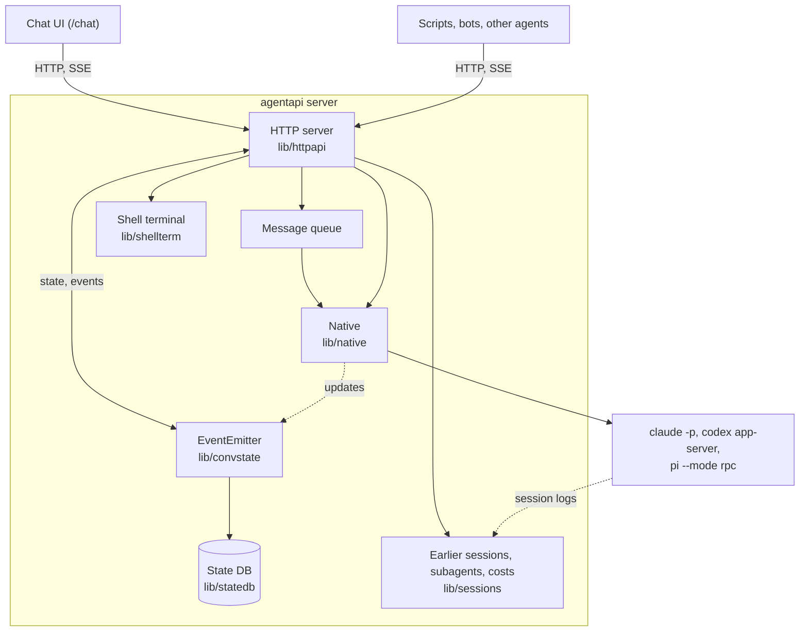
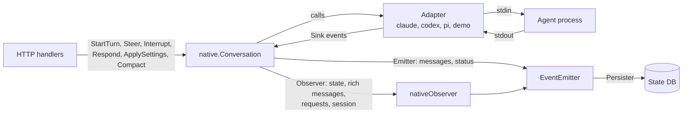

# Architecture

English | [繁體中文](architecture.zh-TW.md)

Each AgentAPI process runs one coding agent (Claude Code, Codex or Pi) through its structured
protocol, the native transport, and exposes it through an HTTP API, an event stream and an embedded
chat UI. This guide covers the implementation of the single Go binary; see the [README](../README.md) for features and usage.

## Contents

- [Overview](#overview)
- [Repository layout](#repository-layout)
- [Startup and shutdown](#startup-and-shutdown)
- [The HTTP server](#the-http-server)
- [The native transport](#the-native-transport)
- [Events and the conversation state](#events-and-the-conversation-state)
- [The message queue](#the-message-queue)
- [Persistence](#persistence)
- [Restarts and updates](#restarts-and-updates)
- [The shell terminal](#the-shell-terminal)
- [Files](#files)
- [Security model](#security-model)
  - [Child process environment](#child-process-environment)
- [The chat UI](#the-chat-ui)
- [Testing](#testing)
- [Design principles](#design-principles)

## Overview



The server drives the agent through a `native.Conversation`, which reports changes to the event
emitter. Handlers call the conversation and read state from the emitter.

## Repository layout

| Path | What it holds |
| --- | --- |
| `main.go`, `cmd/` | The Cobra CLI: `server` (flags, agent type, starting the agent, signals, restarting in place), `list` (the registered AgentAPIs and their summaries), `hub` (`serve`: the hub; `join`, `leave` and `status`: a hub's webhook in the config file and in the running AgentAPIs), `restart` (has registered AgentAPIs restart in place), `update` (self-update with checksum verification) and `host` (`cmd/host`: the issue dispatch's launcher, `serve`, `status`, `install` and `uninstall` of its systemd user service, and the hidden `git-credential` and `gh-token` its jobs run) |
| `lib/httpapi/` | The HTTP server: routes and handlers, the queue, token auth, CORS, the event streams, the files, terminal and webhook endpoints; it wires the three packages below |
| `lib/httpmw/` | What the server and the hub share of HTTP: the `Host` check and the parsing of `--allowed-hosts`, `--allowed-origins` and `--bind`, cross-origin protection, compression, and the embedded chat UI's file server (`lib/httpmw/chat/`) |
| `lib/convstate/` | The conversation state clients read, without HTTP: the `EventEmitter` (its changes numbered by epoch and seq, subscriptions and replay), the tasks and the summary it derives, the queue as the server reported it, and the `Persister` it hands every change to |
| `lib/webhook/` | Webhook delivery (`Dispatcher`: queue, retries, signatures, heartbeats, `{ip}` in the public URL) and the observer that turns the emitter's events into webhook events (`Observe`, through `Source`) |
| `lib/workspacefs/` | What the file viewer reads of the working directory (`Dir`): a file's text, its diff through git, an HTML preview, a file to serve, the search for a path; a refusal is an `Error` whose kind `lib/httpapi` turns into a status |
| `lib/conversation/` | Shared types (imported as `conv`): messages, roles, status and error levels, and the `Emitter` the agent's conversation (`lib/native`) reports changes to |
| `lib/transcript/` | The structured transcript's types: rich messages with their content blocks, and timeline events |
| `lib/agentlog/` | The agents' session-log formats, one package each (`claudelog`, `codexlog`, `pilog`): their records, the parsers into rich messages and timeline events (the adapters use them too), prompts and injected context, model calls and file layout; plus line reading, the incremental file index and format-drift warnings |
| `lib/sessions/` | A server-held `Store` reads earlier sessions and their conversations (`history.go`), subagents (`subagents.go`) and costs (`cost.go`) for a directory |
| `lib/pricing/` | Model prices per million tokens (built-in `prices.json` and a `--prices` file), and per-call cost calculation |
| `lib/native/` | The native transport: `Conversation`, the `Adapter` and `Sink` contracts, requests, settings, usage, logins, the queue's hold (`hold.go`: a usage limit stop or a failed turn that waits to be tried again), its `Policy` (`policy.go`: continue, retry and restart delays) and `ClassifyFailure` (a failed turn's stop reason) |
| `lib/agentstate/` | The values a native agent reports and the API serves: capabilities, login, settings, usage, requests, the limit stop and the retry wait, and `ConversationState`, the conversation's state the observer gets whole, with the `StoredState` that survives a restart. A leaf package (huma and `lib/util` only), so the packages that serve them don't depend on `lib/native` |
| `lib/native/claude`, `codex`, `pi` | One adapter per agent protocol |
| `lib/native/agentio` | What those adapters share to run their agent: the process and its loop (`Host`), writing to its stdin, matching its responses to the requests waiting for them, where the answer to one of its requests stands (`Answer`), lenient decoding with drift warnings, the snapshot throttle |
| `lib/native/demo` | `native-demo`, a simulated agent for working on the chat |
| `lib/native/nativetest` | A scriptable fake adapter for tests |
| `lib/native/procutil` | Child process groups and graceful shutdown |
| `lib/statedb/` | SQLite persistence for `--state-db` |
| `lib/instanceapi/` | The contract between an AgentAPI and the clients that watch many: who it is (`WebhookInstance`, in its webhook events, summary and registry entry, with its `AgentType`), its summary, the webhook envelope with its signature (`Sign`, `Verify`), and the state a hub shows of each instance (`StateOf`). It imports only `lib/agentstate` and `lib/util` |
| `lib/hub/` | `agentapi hub serve`, over `lib/instanceapi` and `lib/httpmw` rather than the server: the instances, the groups and pins set on its page, when each last changed what its row shows and when the hub saw each working (`store.go`, `work.go`, kept in a file by `persist.go`), the favorite prompts (`favorites.go`, `GET`/`PUT /api/favorites`, among the hub's settings in the same file), the schema of its wire types (`schema.go`, `hub-schema.json`, for the page's types), the signed webhook receiver (`webhook.go`), each instance's summary stream (`watch.go`), sign-in, the browser's event stream and the proxy to the instances (`hub.go`, `proxy.go`), where machines join it (`join.go`: its addresses for `GET /api/join` and the startup log); the user guide is [hub.md](hub.md) |
| `lib/dispatch/` | The hub's issue dispatch, which `lib/hub` mounts: the machines whose launchers report (`host.*` events; each name pinned to the launcher token it first came with), the jobs with their runs' costs (`task.*` events) and the last 50 messages their agents were sent (`send`, from the hub's page, a review or an `/agent` comment), `POST /api/dispatch` (a start answers once its job is `starting`; the hub calls the launcher in the background and keeps the start until it ends, adopting it from the machine's next report if the answer was lost), the GitHub App, kept in `dispatch.json` and `github-app.json`. `Subscribe` and `Board` give the hub's stream the machines and jobs after each change (its `dispatch` event); the spec is [issue-dispatch.zh-TW.md](specs/issue-dispatch.zh-TW.md) |
| `lib/host/` | `agentapi host`, the launcher on each machine: its settings (the `host` section of the config file), the repositories it has or clones, a git worktree and an AgentAPI for each job the hub starts (restarted after it exits, kept in `jobs.json`), its API for the hub behind its token (`server.go`), its `host.*` events and heartbeats to the hub (`hub.go`), and each job's GitHub token over a unix socket for its `git` and `gh` (`credentials.go`) |
| `lib/github/` | The hub's GitHub App, with no dependency beyond the standard library: registering it from a manifest, its JWT, installation tokens for one repository (kept until five minutes before they expire) or all, and the REST calls the dispatch makes as the app |
| `lib/jsonapi/` | The JSON plumbing the hub, the dispatch and the launcher share: reading a body (1 MiB at most), writing an answer, and `Error`, a refusal with its status and a code, answered as `{"code", "message", "error"}` |
| `lib/hub/schemagen` | The command `go generate` runs to write `lib/hub/hub-schema.json` from `hub.Schema` |
| `lib/sse/` | Server-sent events as the HTML standard defines them: a reader (data: lines joined, comments skipped, CR, LF or CRLF line ends) and a writer, used by the hub for the instances' summary streams and the browser's stream. `lib/httpapi` writes its streams with huma's `sse` |
| `lib/netaddr/` | The machine's IPv4 addresses: those other machines may reach it at (the hub's join URLs), and the one it reaches a host from (`Resolver`, for `{ip}` in `--public-url`) |
| `lib/userconfig/` | The user's settings file, `~/.agentapi/config.yaml`: flags by name, read by `agentapi server`, written by `agentapi hub` |
| `lib/registry/` | The entries of the AgentAPIs running on a machine (`~/.agentapi/instances`): writing one atomically, listing them and removing those whose process is gone, or whose PID another process got (its start time differs, on Linux and macOS) |
| `lib/atomicfile/` | Replacing a file at once so a crash leaves the old data or the new: a temporary file, synced, renamed into place, then the directory synced (the settings file, registry entries, the hub's file of instances) |
| `lib/selfupdate/` | Installs the latest release of k1dav-c/agentapi in place of the program (`agentapi update`, `POST /update`): the lookup on GitHub, the binary for the platform, its check against the release's `checksums.txt` and that it runs as that version, and the rename under a lock file next to the program, the file and then the directory synced to disk (`Install`); whether the user can replace the program, with the one-time fix (`Program.Blocked`); `selfupdatetest` serves a fake release for tests |
| `lib/shellterm/` | The shared shell terminal |
| `lib/htmlpreview/` | Makes HTML previews self-contained for `GET /files/preview` by embedding resources referenced by relative paths as data: URLs |
| `lib/filelock/` | The flock that AgentAPIs on one machine take in turn: replacing the program (`selfupdate`), an agent CLI updating itself before a restart |
| `lib/procenv/` | The environment of the processes AgentAPI starts: the agent, the terminal's shell |
| `lib/agenthome/` | Where the agents keep their state (`CLAUDE_CONFIG_DIR`, `CODEX_HOME`, `PI_CODING_AGENT_DIR`) |
| `lib/handoff/` | Types of the human-reply API |
| `lib/logctx/`, `lib/util/` | Context-based logging and shared helpers |
| `internal/version/` | The version, stamped at build time |
| `chat/` | The chat UI (Next.js) |
| `e2e/` | End-to-end tests against a scripted Claude Code (`e2e/fakeclaude`) |

The internal imports point one way, from the commands to the leaves:

- `cmd/server` → `lib/httpapi` → `lib/convstate`, `lib/webhook`, `lib/native`, `lib/statedb`,
  `lib/httpmw`
- `lib/convstate`, `lib/webhook` → `lib/instanceapi` → `lib/agentstate` → `lib/util`
- `lib/native` and its adapters, `lib/statedb` → `lib/agentstate`: only the server reaches
  `lib/native`
- `cmd/hub`, `lib/hub` → `lib/instanceapi`, `lib/httpmw`, which imports no package of the
  repository: the hub doesn't build the server
- `lib/hub` → `lib/dispatch` → `lib/host`, `lib/github`, `lib/jsonapi`: the dispatch uses the
  launcher's types; `lib/github` and `lib/jsonapi` import no package of the repository
- `cmd/host` → `lib/host` → `lib/instanceapi`, `lib/jsonapi`: the launcher doesn't build the
  server or the hub

## Startup and shutdown

`agentapi server [flags] -- <agent command>` (`cmd/server/server.go`):

1. Flags come from the command line, `AGENTAPI_*` environment variables or
   `~/.agentapi/config.yaml` (`--config`), in that order (viper).
   `cmd/server/userconfig.go` reports names that aren't flags and ignores a
   file it can't read, and a `state-db` or `pid-file` in it without `{port}`:
   every server reads the file, and only one can lock the database or write
   the PID file. A leading `~` in a path setting is the home directory, and
   `{port}` and `{hostname}` in `--state-db`, `--pid-file` and `--public-url`
   are filled in (`instanceapi.ExpandPlaceholders`). `{ip}` in `--public-url`
   stays: it changes while the server runs (DHCP). The webhook dispatcher
   fills it in whenever it builds the instance for an event, the summary or
   the registry entry (`publicURL` in `lib/webhook/dispatcher.go`), with the
   source address of the route to the webhook URL. `refreshIP` looks that
   address up through `netaddr.Resolver` (kept 30 s, each lookup bounded by
   `netaddr.DialTimeout`), outside the emitter's lock: before
   `instance.started`, after a configuration change, before each heartbeat
   and every 30 s. The events only read the last address found.
   The agent type is `--type`, else the agent command's name (`claude`,
   `codex`, `pi` or `native-demo`); any other agent is refused with a
   pointer to v2.5.1, the last release with the PTY transport.
2. `nativeFactory` builds a `native.Factory` for the agent type (Claude
   Code, Codex, Pi or `native-demo`). Each adapter checks the agent's
   arguments first and refuses the ones that conflict with its protocol.
3. With `--state-db`, `statedb.Open` opens the file, takes its exclusive
   lock and migrates its schema.
4. `httpapi.NewServer` creates the emitter, restores the saved state (refusing
   a file written for another agent type or working directory),
   creates the conversation, registers the routes, and starts the conversation,
   the queue loop and the webhook dispatcher.
   `Start` listens, then writes the registry entry (unless `--registry=false`)
   and serves.
5. On SIGINT, SIGTERM or SIGHUP, the webhook sends
   `instance.stopped` (waiting for it at most 2 s, and no more than half of
   `Stop`'s 5 s) and the registry entry is removed. A restart under way is
   cancelled, the HTTP server shuts down, and the queue loop stops. The
   agent and the shell terminal are closed, and the state DB is flushed and
   closed. SIGUSR1 flushes the state DB without stopping. An agent that exits
   doesn't stop the server: the conversation starts it again (see
   [The native transport](#the-native-transport)).
6. SIGUSR2, or an update through the API, restarts the server in place
   (`cmd/server/reexec.go`, `selfExec.restart`). `selfExec` is the first
   thing the server sets up. It catches SIGUSR2, whose default action ends
   the process, so one that comes while the server starts or stops doesn't
   end it (one that comes before serving restarts the server once it
   serves). It also takes the arguments, the environment and the program
   then: once an update replaced the file, `/proc/self/exe` names a deleted
   one. The program is argv[0] as the shell found it (a path, or a name on
   `PATH`) if that is the running file, so a symlink an update repoints is
   followed; else `os.Executable`. Before it stops, the server runs the
   program with `--version`, then with the arguments and environment it will
   run with plus the hidden `--validate` (`cmd/server/validate.go`), 10 s each.
   `--validate` resolves the flags, variables and config file as a start
   does and checks what it can without starting anything: values,
   placeholders, the port, agent type and transport, the agent's
   arguments, the prices file, the allowed hosts
   and origins, the bind address, the webhook (`httpapi.CheckConfig`) and
   the state DB, read without locks and not migrated (`statedb.Check`). It
   doesn't listen, start the agent or write a file, and prints
   `ok state-db-schema=N` or exits non-zero with the reason. The state DB
   the server holds open can't be read by another process, so the new
   program skips it and the server checks it against N
   (`statedb.DB.CheckWriter`). A program that predates `--validate`
   refuses it as an unknown flag and is only run with `--version`. If a
   check fails, the server logs why (the last line the program wrote) and
   goes on. Otherwise the server stops as in step 5, keeps its PID file (the PID
   stays), and `syscall.Exec` runs the program again with stdin, stdout and
   stderr; every other file Go opened closes on exec. A token a bare
   `--api-token` generated goes along in `AGENTAPI_GENERATED_API_TOKEN`,
   which the new program takes instead of generating one and removes from
   its environment, so clients stay signed in. Without a state DB, an
   initial prompt that went out is marked in `AGENTAPI_INITIAL_PROMPT_SENT`,
   so the agent doesn't get it again; with one, the restored
   conversation has it. Without a state DB, the session the conversation is
   in (`native.Conversation.SessionRef`, read as the program runs again) goes
   along in `AGENTAPI_RESUME_SESSION` as `<agent type>:<session>`. The new
   program takes it out of its environment before it starts the agent, and
   ignores it with a state DB or for another agent type
   (`carriedSession`). `httpapi.NewServer` gets it as
   `ServerConfig.ResumeSession`: it reads the session's log as
   `POST /sessions/{id}/resume` does (`resumeCarriedSession`), reports its
   messages, rich messages and name, and starts the agent resuming it. A
   session whose log it can't read (gone, or an agent without session
   logs) isn't resumed: the agent starts a new session and the chat gets a
   warning. The queue, requests, chosen settings and holds aren't carried. A shutdown signal
   during the stop wins. Each registry entry says the server restarts in
   place (`restarts_in_place`), for `agentapi restart`.

## The HTTP server

`lib/httpapi` uses chi for routing and huma for typed API operations. Huma also produces the OpenAPI
schema, which `make gen` writes to `openapi.json`. Requests pass through the following middleware
in order:

1. Host authorization: the `Host` header must name an allowed host (the port
   is ignored).
2. Request logging, which skips static files, event streams and the terminal.
   A read that worked (`GET`, `HEAD` or `OPTIONS` below 400) logs at Debug,
   which only `--log-level debug` shows: a client that polls `GET /status`
   would fill the log. Changes and refused requests log at Info, server
   errors at Warn.
3. Compression (`lib/httpmw`'s `Compress`): text, JSON, the event streams (flushed event by
   event) and the chat's files are gzipped for clients that take it; images
   go as they are. The hub uses the same middleware, and its proxy passes an
   instance's compressed responses on as they are.
4. CORS for the allowed origins, with credentials, so the chat's cookie works
   from another origin.
5. Token auth, with `--api-token`: a Bearer token or the chat's session
   cookie. It runs after CORS, so preflights pass and a 401 carries the CORS
   headers the chat needs to read it.

The handlers are grouped by file:

| File | Handles |
| --- | --- |
| `server.go`, `routes.go`, `middleware.go` | The server's setup, start and stop, with `lib/httpmw`'s host, cross-origin and compression middleware; the routes, which each feature registers; request logging |
| `conversation_api.go`, `queue.go`, `turngate.go`, `sse.go` | Messages, status and timeline; the queue, its dispatch (with a continuation that is due first, `beforeQueue`) and `queue_update`; whether a turn may start now (`turnGateLocked`); `GET /events` |
| `tasks_api.go` | `GET /tasks`: the tasks the emitter derives (`lib/convstate`) |
| `summary_api.go`, `spend.go`, `registry.go` | `GET /summary` and `POST /tasks/seen`, the summary the emitter keeps for clients that watch many AgentAPIs; the spend worked out once a minute; the server's registry entry (`instanceRegistry`) |
| `native.go` | Delivering a message, requests, settings, interrupt, compaction, login retry; the observer (`nativeObserver`) |
| `limit.go`, `retry.go`, `sessions.go`, `subagents.go` | A turn a usage limit stopped (`/limit`); a failed turn that waits to be tried again (`/retry`); the agent's earlier sessions and what they cost (`/sessions`, `/cost`); its subagents (`/subagents`) |
| `terminal.go`, `files_api.go` | The shell terminal (`terminalAPI`); the file viewer and the search for a file the agent named relative to a repository (`fileAPI`, over `lib/workspacefs`) |
| `webhook_api.go`, `handoff.go` | The webhook's configuration (`GET`/`PUT /webhook`, `POST /webhook/test`), the instance it describes and its start (`lib/webhook` delivers); the human-reply API |
| `auth.go` | Token auth and the chat's sign-in (`authAPI`) |
| `restart.go`, `statedb.go` | Restarts (`beginRestart`); restoring and persisting the state |
| `update.go` | Updating AgentAPI through its API (`POST /update`, `DELETE /update`, the `updater`) and the summary's `update`; see [Restarts and updates](#restarts-and-updates) |
| `models.go` | The API's types |
| `uploads.go` | Uploaded files (`uploadAPI`: `POST /upload`, and the images `GET /uploads` serves) |

Chi routes outside huma serve the chat (`/chat/*`, with `/` redirecting there), uploaded images
(`/uploads/{checksum}/{name}`) and workspace images (`/files/image`).

`Server` holds the conversation, emitter, queue and its lock (`s.mu`), webhook dispatcher, shell
terminal and state DB. Features outside conversation changes use modules created during route
registration: `fileAPI` holds the working directory, `terminalAPI` the shell, `uploadAPI` the upload
store, `authAPI` the token check, and `webhookAPI` the dispatcher and state DB.

`lib/httpapi` wires three packages that don't know HTTP:

- `lib/convstate` holds the conversation's state. Under its lock the
  emitter calls only what doesn't block or take it: the `Persister` (the
  state DB queues the writes), the status change handler
  (`webhook.Dispatcher.StatusChanged`, which queues without waiting) and
  the instance in the summary (`Dispatcher.Instance`, which reads the last
  `{ip}` found). The lock order is the emitter's, then the
  dispatcher's and the state DB's.
- `lib/webhook` reads the emitter only through subscriptions (`Source`),
  like an `/events` client, on goroutines of its own.
- `lib/workspacefs` reads the working directory; `fileAPI` turns its
  refusals into 400, 403 and 404.

Huma names an OpenAPI schema after its Go type's name, whichever package
declares it, so the handlers use `convstate.StatusChangeBody`,
`instanceapi.SummaryBody` or `webhook.Config` as they are, without aliases.

## The native transport

```go
// lib/conversation (imported as conv)
type Emitter interface {
	EmitMessages([]Message)
	EmitStatus(Status) // initializing, changing or stable
	EmitError(message string, level ErrorLevel)
}
```

`stable` becomes the API's backward-compatible `stable` status (the agent is idle, or only waits for
an answer); `initializing` and `changing` become `running`.




`native.Conversation` runs the conversation on top of an `Adapter`, one per agent protocol:

```go
// lib/native
type Adapter interface {
	Start(ctx context.Context, sink Sink) error
	StartTurn(ctx context.Context, input Input) error
	Steer(ctx context.Context, input Input) error
	Interrupt(ctx context.Context) error
	Respond(ctx context.Context, requestID string, response Response) error
	Capabilities() Capabilities
	Wait() error
	Close() error
}

// Resume says which session an adapter opens: Ref, or a copy of it with
// Fork, or a new one when Ref is empty.
type Factory func(resume Resume) (Adapter, error)
```

- **Sink.** An adapter reports what its agent does through a `Sink`: turns
  started and completed, rich messages, timeline events, requests opened and
  closed, the session name and the reference that resumes the session, a
  lost login, errors. Sink calls come from the adapter's read loop and never
  overlap. A rich message is sent whole each time it grows (a snapshot, not a
  delta), and message and request IDs never repeat across the adapters of one
  factory, because the conversation remains active across adapter replacements.
- **Optional parts.** An adapter that implements `Configurable` has settings
  (permission mode, model, reasoning effort) and reports the ones the agent
  changes by itself through `SettingsSink`; `Compacter` compacts the context
  on request; `UsageSink` takes the context and rate limit usage.
  `Capabilities` says which of steer, interrupt, resume, images, settings and
  compact the agent supports. The API and chat offer operations from these
  capabilities, not from the agent type.
- **Generations.** Every adapter belongs to a generation. Restarting or
  replacing the agent starts a new one, and events from an older adapter are
  ignored, so an agent that was replaced can't change the conversation.
- **Lifecycle.** Launching an adapter starts the process and its session, new
  or resumed from the session reference. An adapter that finds no login
  returns `LoginRequiredError`: the conversation reports `login_required` and
  launches it again every 5 seconds, or when `POST /login/retry` asks. Once
  the agent runs, the conversation gives it the settings chosen for the
  session, reports its capabilities and sends the initial prompt. `Restart`
  replaces it with a new session. `Switch` opens another session, or a copy
  of it, with that session's messages. The server reads them from the agent's session log
  (`sessions.Store.ReadHistory`; `GET /sessions` lists the sessions). The
  subagents the agent ran in the session are read the same way, from their
  own logs (`sessions.Store.Subagents`), for `GET /subagents` and the chat's
  Lineage panel. Their state comes from the Agent tool call that started
  them. A subagent's timeline events and messages (`GET /timeline?subagents`,
  `GET /subagents/{id}`) are kept until its log changes.
- **Exits.** An agent that exits on its own, or fails a start the
  conversation made by itself (the first, after an exit or a wait for a
  login), is launched again on its session after the next of
  `RestartDelays` (2, 10 and 30 seconds), in a new generation. The observer
  hears of each attempt (`AgentExited`; the server shows the lifecycle
  `restarting`) and of the conversation giving up after the last (`failed`);
  no agent runs then until a replacement. Once an agent has run 5 minutes,
  the count starts over. One that reported a lost login before it exited
  waits for the login instead. A start a caller waits for (`Replacement.Start`)
  isn't made again: the caller gets its error.
- **Costs.** `sessions.Store.Costs` reads the model calls of every session in
  the directory, its subagents' included, from the same logs (`GET /sessions`,
  `GET /cost`): Claude Code's assistant messages (one per message id), Codex's
  token counts, Pi's reported costs. `lib/pricing` prices each call; Claude
  Code's `cost-state` records add the tokens its log doesn't list
  (compaction) as unitemized calls at the same prices; a cost that differs
  for the same tokens adds nothing and is logged once per model. Calls copied by a fork count once, in the earliest
  session, by the logs' creation times (statx on Linux, stat on macOS;
  elsewhere their first lines'). The Store indexes each log's size, read
  offset and reader state, with its calls priced. It reads only complete new
  lines from growing logs, prices only the calls they add or complete, and
  rereads logs that shrink or are replaced. A reading in which no log's calls
  changed returns the last result; otherwise it works out again only the
  sessions whose logs changed, and adds up the sessions' costs. Concurrent
  requests share the read. The index's size limit doesn't apply to the logs a
  reading of the costs read (`agentlog.Pass`): every reading reads all of them
  in the same order, and a limit that forgot the log read longest ago would
  forget each one just before it is read again. The index removes logs that no
  longer exist.
- **Log formats.** Each format is decoded in one place (`lib/agentlog`):
  what is a prompt, injected context or a tool result is decided once, for
  the adapters, the history and the costs alike.
  Records a parser doesn't know, lines it can't decode, and model calls
  without a model or usage, or whose usage reads as no tokens (a renamed
  field, which would cost $0 without a word), are logged once per log and
  kind at Warn with the CLI version the log records, so a changed format
  shows in the server's log. Claude Code's own messages (`<synthetic>`),
  Codex's counts of the rate limits alone and Pi's failed and aborted calls
  use no tokens, and don't count.
- **Protocol drift.** The adapters decode what the agent sends with
  `agentio.Decode`: a field whose value changed type is left out, not the
  record, as a lost turn end would leave the turn running for good. Record
  types an adapter doesn't know, changed fields and records that don't
  decode are counted per process (`agentio.Drift`) and logged once each at
  Warn, with the CLI version from the handshake, as is behavior an adapter
  works around (`Drift.Unexpected`): Pi refusing a prompt as busy while no
  run was reported, or a Pi run that ends with `agent_end` (`willRetry`
  false) and no `agent_settled`, whose turn the adapter ends once Pi has
  been quiet for 10 seconds (not while it compacts or retries).
- **Usage limits.** When the account's usage limit stops a turn, the adapter
  ends it with the `limited` stop reason (Claude Code's limit messages and a
  `rejected` rate limit event, Codex's `usageLimitExceeded`, a quota error of
  Pi's provider). The conversation keeps it as a `LimitStop` with the reset
  time until a turn starts: the server's queue waits while it holds
  (`HoldsQueue`), and a continuation scheduled for the reset
  (`ScheduleContinue`, `--auto-continue`) goes out on the queue's tick before
  the queued messages. A limit stop and a retry wait (below) are one hold
  (`hold.go`), of which a conversation has at most one: a turn ends it, and
  a turn whose message doesn't reach the agent gives it back. A continuation
  or retry that `ContinueIfDue` sends is decided and begun under the
  conversation's lock; the turn records the hold it continues, so a
  continuation the limit stops again is scheduled again, and the record goes
  with the turn's agent on a restart, a switch or an exit.
- **Transient errors.** A turn that fails on an upstream error that may pass,
  after the agent's own retries, ends with the `transient` stop reason: an
  HTTP 5xx or 429 (Claude Code's `api_error_status`, the `httpStatusCode` of
  Codex's `codexErrorInfo`), Codex's `serverOverloaded`, a connection that
  failed, Pi's `auto_retry_end` without success, or text `IsTransientError`
  matches. Usage limits and login problems are classified first
  (`ClassifyFailure`, which all three adapters call). The conversation
  keeps a `RetryWait` with the next retry's time
  (`Policy.RetryDelays`, `--retry-delays`), warns instead of reporting an
  error, and holds the queue (`HoldsQueue`). `ContinueIfDue` sends
  `ContinuePrompt` on the queue's tick once it is due; if that turn fails the
  same way, the next delay follows (the hold it continued counts them), and after the
  last the failure is an error. A turn that starts ends the wait; `RetryNow`
  and `CancelRetry` back `POST` and `DELETE /retry`.
- **Turns.** A message starts a turn only while the agent is idle; otherwise
  `StartTurn` returns `ErrMessageValidationChanging` and the server queues the
  message. Turns wait the same way while the agent compacts its context. A
  message whose write the agent didn't confirm (`ErrUnconfirmed`: a timeout,
  a cancel, the agent's exit) may still reach it, so it stays in the
  conversation and its turn stays active until the agent's events end it.
  `Interrupt` ends such a turn if the agent never started it.
- **Requests.** Approvals, questions and plans become `RequestState`s with a
  status (`pending`, `resolved`, `withdrawn`, `expired`) and a
  `response_capability` (`live`, `message`, `not_resumable`). An answer
  reaches the adapter at most once, and requests still open when a turn ends
  expire. An answer the agent didn't confirm may still reach it, so the
  request takes no other answer: it stays pending until the agent closes it
  or the turn ends. Secret answers are redacted everywhere except the input sent to the agent.
- **Observer.** Changes besides messages and status go to an `Observer`,
  which the server implements to update the emitter. The conversation's
  state (`agentstate.ConversationState`: capabilities, login, the agent's
  settings, usage, and its `StoredState`: the settings chosen, a limit stop,
  a retry wait) comes whole through `StateChanged`, where a part changes and
  only if something did; what changes together comes as one. The rest are
  events: an agent accepts turns (`Started`), rich messages, the timeline,
  requests, the session's name and reference, an exit. It is called with
  the conversation's lock held, so it must not call back into the
  conversation. A restart restores the stored state through
  `native.Config.State`.
- **Processes.** `procutil` starts the agent in its own process group, with the
  environment the adapter builds with `lib/procenv`, which leaves out the
  variables of a parent agent session. `agentio.Host` runs the process for
  the adapter. It doesn't start one once the adapter was closed, and hands
  its output, line by line, to one loop goroutine, which also runs the
  functions posted to it and one timer: for the snapshots the throttle held
  back (`agentio.Throttle`, 100 ms) and the 10-second wait for an
  interrupted turn to end (`agentio.InterruptDeadline`), which starts when
  the agent accepts the interrupt, also after `Interrupt` stopped waiting for
  that answer. That goroutine
  calls the Sink. The agent has exited, for `Wait`, once the process is gone
  and the loop has handled its output, or 2 seconds after the process is
  gone: a process the agent started can keep the output open. Stopping it
  closes its input, then sends the group SIGTERM after 3 seconds and SIGKILL
  2 seconds later. Before that, the adapters interrupt a running turn and
  wait up to 3 seconds for it to end, so the agent's session log doesn't end
  in a tool call without result. The group outlives the agent while a
  process in it runs, so however the agent exits (on its own, stopped, in a
  restart), `procutil` then sends the group SIGTERM and 2 seconds later
  SIGKILL (`GroupGrace`), and stops signaling it once it is gone.

The adapters:

| Adapter | Process | Protocol |
| --- | --- | --- |
| `claude` | `claude -p --input-format stream-json --output-format stream-json ...` | Stream-json messages on stdin and stdout, plus Claude Code's control protocol: `initialize`, `can_use_tool` (approvals, questions, plans), `set_permission_mode`, `set_model`, `apply_flag_settings`, `get_settings`, `get_context_usage`, `interrupt` |
| `codex` | `codex app-server` | JSON-RPC: `thread/start`, `thread/resume` or `thread/fork`, `turn/start` (carrying the settings), `turn/steer`, `turn/interrupt`, `thread/compact/start`, `model/list`; approvals, questions and MCP elicitations arrive as server requests; the plan mode is a collaboration mode |
| `pi` | `pi --mode rpc --session-id <id>` (`--fork <id>` for a copy) | JSON lines: `prompt` (also for steering), `abort`, `get_state`, `get_available_models`, `set_model`, `set_thinking_level`, `compact`; extension dialogs arrive as UI requests and are answered with `extension_ui_response` |
| `demo` | none | A simulated agent that streams thinking, a tool call and a reply, and opens every kind of request |

## Events and the conversation state

The `EventEmitter` (`lib/convstate`) stores the state clients read: the messages, rich
messages, the timeline, requests, the tasks, the queue, the status snapshot (status, lifecycle,
server ID, turn, the agent's session ID, capabilities, settings, usage with the prompt cache, a
usage limit stop, a retry wait, login).

- Every change to a message, a rich message, a request, a task or the queue
  gets the next sequence number (`seq`); the status and errors
  are replayed whole, and the timeline is read with `GET /timeline`. The
  conversation is identified by an `epoch`, which changes when its history is
  rewritten: a message taken back, a reset, a restore after a crash. Rich
  messages are found by their key through an index, so a resumed session of
  tens of thousands of them loads at once.
- `GET /events` streams the changes as server-sent events: `message_update`,
  `status_change`, `rich_message_update`, `agent_error`, `request_update`, and
  a `heartbeat` every 15 seconds. With `?sync=1` the stream starts with a
  `session_sync` event, adds `task_update` and `queue_update` (which clients
  that don't opt in never get: some reject event types they don't know),
  replays only what changed since `since=<seq>` when the epoch matches, and
  gives events SSE IDs, so a reconnecting `EventSource` resumes from
  `Last-Event-ID`.
- Changes that updates can't express, such as retracting a message, create
  a new epoch and close the conversation's subscriptions. Clients reconnect
  with the old epoch to receive a full replay with the correct SSE IDs.
  Subscriptions also close if they fall behind their buffer, or if opening
  a session would stream more than a quarter of a buffer of rich messages.
- The emitter keeps the pending requests and the 50 that closed last
  (`native.MaxClosedRequests`). It drops an older closed request without an
  event, so a client that resumes with `since=` keeps the same bound: of the
  closed requests it holds, the 50 with the latest `closed_at`, which is what
  a full replay gives. The chat does this in `mergeRequests`.
- The emitter derives tasks (`tasks.go`). A user message
  starts a task; messages added during it steer the task. It ends when the
  agent is idle with no open request. After an answer
  leaves the agent idle, a timer allows 3 seconds for work to resume before
  ending the task; a message sent then starts a new task, since the agent
  isn't working. The server tells the emitter before it sends the message
  (`SendingMessage`). Rich messages get
  the running task's `task_id` on arrival. Restored and resumed messages are
  treated as completed history.
- The emitter maintains a conversation summary (`summary.go`) with the
  instance, status, `attention` (why the agent needs the user), title, latest
  task, pending requests, queue and usage. While a summary subscriber exists,
  it recalculates once per emitter call that changed the conversation,
  after all the call's changes (a turn's end stops the agent and ends its
  task in one call), and sends `summary_update` only if the summary differs.
  Growing reply text therefore sends no summary update. Only
  `/events?only=summary` subscribes to these updates; its stream also sends
  heartbeats. `PUT /webhook` triggers another
  check, and rewrites the registry entry, because it can change the instance
  ID and URL.
- For an agent whose session logs it reads, the server works out the summary's
  `spend` once a minute (`spend.go`): `sessions.Store.Costs` reads the logs
  incrementally, and the hours of its total that end within the last 24 hours
  and 7 days are added up, their cost and their tokens (each hour of a
  `SessionCost` keeps both, so a call's tokens count once, where its cost
  does). `EventEmitter.SetSpend` sends the summary only when the amounts or
  tokens change; `updated_at` says when they did. Its `scope` hashes the
  machine's host name and ID with `sessions.Store.Scope` (the agent, the
  directory's real path, where the agent keeps its logs), so a hub counts two
  AgentAPIs that read the same logs once.
- The emitter also records when a client last showed the conversation
  (`POST /tasks/seen`, which the chat calls while it shows it). The latest
  task is `unread` when it ended after that. The state DB keeps the time; a
  restore without it marks the restored tasks as seen.
- A status change between `running` and `stable` triggers the
  `run.status_changed` webhook event. While the webhook sends events of the
  conversation (`task.*`, `request.*`, `message.*`, `tool.*`, `login.*`,
  `limit.*`, `agent.error`; one of `instance.*` alone, a hub's default,
  doesn't), the
  webhook observer subscribes to the emitter like an `/events` client and
  turns its events into them: the emitter's task updates into `task.*`, an
  agent message once the next one starts or the turn ends. `PUT /webhook`
  starts and stops it. It doesn't send what the emitter held when the
  observer subscribed, or messages older than AgentAPI's start (a resumed
  session's). A subscription the emitter ended is taken up again from the
  seq the observer got to, as a client resumes with `since`. It keeps only
  how far it got through the messages and tasks, the tool calls waiting for
  their result (at most 64), those that returned in the latest 64 messages
  with results, and the open requests, and forgets the conversation on a
  reset. The dispatcher delivers the events one at a time from a queue, with
  retries, and signs them with `--webhook-secret`.
- `SetState` takes the conversation's state whole and diffs it against the
  last: what changed of it goes out as one `status_change`, each part absent
  until the agent reported it (an agent without settings shows none), and the
  capabilities and usage stay while no agent runs.
- With a state DB, the emitter hands every change to its `Persister`, which
  encodes messages and rich messages on its writer goroutine from a copy, so
  a long message streaming in doesn't hold up the emitter. That is the one
  path to the state DB: native → observer → emitter → `Persister`. The
  stored state is handed over when it changed (`SetStoredState`), the session
  reference every time it is reported (a reset deleted it, also when it stays
  the same).

### Adding a piece of conversation state

A value the agent reports or the conversation keeps (beyond messages and requests) goes through
the observer as part of the state:

1. Add a field to `agentstate.ConversationState` (`lib/agentstate/conversation.go`), or to
   `StoredState` if it survives an AgentAPI restart, with its JSON name. `Clone` copies what it
   points to.
2. Set it in `lib/native` where it changes and call `stateChangedLocked`; `stateLocked` puts it in
   the state.
3. Show it in status updates: a field in `convstate.StatusChangeBody` (`lib/convstate/events.go`,
   with `omitempty` if it may be absent) and its diff in `EventEmitter.SetState`
   (`events_status.go`).
4. If clients that watch many need it, add it to `instanceapi.SummaryBody` (`summaryLocked` in
   `lib/convstate/summary.go`) and `instanceapi.WebhookInstanceState`, the data of the
   `instance.*` webhook events (`webhookInstanceState` in `lib/httpapi/webhook_api.go`).
5. Run `make gen` and `bun run gen:api` in `chat/`, and document it.

A field of `StoredState` is stored, restored and given back to the conversation without other
changes, inside version 1 of `conversation_state` (below).

## The message queue

Messages sent while the agent is busy wait in `s.queue`, and so does a human reply to the agent's
last message (`POST /handoff/reply`), which goes out the same way. The queue has its
own lock so reads don't wait on the server lock; mutations also hold `s.mu`. Every 500 ms, a loop
checks whether the first message can be delivered. A continuation or retry that is due goes out
first (`beforeQueue`).

`turnGateLocked` (`turngate.go`) decides whether a turn may start, for every caller. Nothing starts
while AgentAPI stops, restarts for an update or restarts the agent: `POST /message` queues the
message, the human-reply protocol offers nothing, and a restart is refused. While an update waits for
the agent, a continuation, a retry and the queued messages wait too; a message the user sends goes
to the agent. The head of the queue also waits until the agent is idle and no usage limit stop or
failed turn holds the queue.

Rejected messages get up to 5 attempts. Messages that might be delivered twice are dropped
immediately: a write without confirmation (`native.ErrUnconfirmed`, caused by timeout,
cancellation or agent exit). Stdin writes end with the call's context, so an agent that stops
reading can't hold `s.mu`.

Messages can also steer or interrupt a running turn. Queue changes reach the emitter as
`queue_update` events outside the queue lock, with versions to discard late reports of older changes.
The queue is persisted with the conversation, on every change (`storeQueue`, from the queue's
`onChange`): a message that went out or was deleted isn't sent again after a crash.

## Persistence

`lib/statedb` stores conversations in SQLite using the pure-Go `modernc.org/sqlite`, which supports
`CGO_ENABLED=0` builds. The emitter sends it every change.

- The tables are `messages`, `rich_messages`, `session_events`, `requests`,
  `queue`, `tasks` (each as the server encoded it, by the ID of the message
  that started it), and `meta`, which holds the agent type, transport and working
  directory, the epoch and seq, the session reference and name, the
  conversation's stored state (`conversation_state`, below), the webhook settings
  changed through the API (with a fingerprint of the startup flags, which win
  when they change) and when a
  client last showed the conversation (`seen_at`), and which AgentAPI may
  write the file and last did (below).
- Writes are queued and flushed every 200 ms in a transaction, so streaming
  never waits for the disk. A clean shutdown marks the file clean; after a
  crash the conversation gets a new epoch and clients load it again in full.
- The file is opened in exclusive locking mode with WAL, so no second
  AgentAPI can use it, and is created with mode 0600.
- On startup the server restores the conversation, the queue and the session
  reference, which the conversation passes to the factory so the agent
  resumes its own session. A file AgentAPI 2 kept for the same agent with
  the PTY transport opens too: it has no session to resume, so the agent
  starts a new one below its conversation, and `meta` says native from then
  on (its `initial_prompt` isn't read). Requests that were open come back
  expired.
- Unreadable rows are logged and skipped so the server can start. Numbered
  migrations update the schema; `PRAGMA user_version` records its version.
- Each migration names the oldest schema that may write the file once it
  ran. One that only adds a table or a column keeps the value before it, so
  an older AgentAPI goes on with a file a newer one migrated and leaves its
  schema as it is. One that changes what an older AgentAPI writes raises it
  and records it in `meta` (`min_writer_schema`, with the release that
  brought it); an older AgentAPI then refuses the file and names the
  version it needs. `meta` also records the AgentAPI that last closed the
  file (`writer_version`). Releases up to 1.9.0 read neither and refuse any
  schema newer than theirs; the schema hasn't changed since 1.0.
- `conversation_state` holds the settings chosen for the session, a usage
  limit stop and a retry wait as one JSON object,
  `{"version": 1, "settings": {...}, "limit_stop": {...}, "retry_wait": {...}}`;
  a reset keeps it. A field added to it keeps the version, which an older
  AgentAPI reads as far as it knows; one that would mislead it raises the
  version, and an AgentAPI that finds a higher one leaves the object alone
  and starts without stored state. Up to 3.7.2 the three had a key each
  (`settings`, `limit_stop`, `retry_wait`), which AgentAPI 3.7.3 to 3.16
  moved into the object on the first open; AgentAPI 4 doesn't read them, so
  a file only 3.7.2 or earlier opened starts without the stored settings,
  limit stop and retry wait (the conversation is kept). AgentAPI 3.7.2 or
  earlier opened on a newer file starts without them too, and what it
  stores there is ignored.
- What an older AgentAPI doesn't know, its resets and truncations don't
  clear. A restored task whose message is gone or is another one now is
  dropped, as is one whose message row couldn't be read.
- Uploads go to `<state-db>.uploads`, kept with the file (without a state
  database, to a temporary directory removed on stop). On start, every hour
  and after a restart or a switch of sessions cleared the conversation,
  `upload_prune.go` removes the checksum directories that nothing in the
  conversation refers to (messages, rich messages, timeline, requests,
  queue: any run of hex digits holding the checksum counts, which covers
  paths, `/uploads` URLs and JSON) and that are more than 7 days old, both
  by modification time and since this server last stored them. The 7 days
  cover a browser's drafts, whose attachments aren't in the conversation
  yet. Only a
  real directory named by a checksum and holding regular files is removed,
  through `os.Root`; symlinks and anything else are left alone. A prune that
  removed something logs the count and bytes at Info.

The hub (`lib/hub`, `persist.go`) keeps its instances in a JSON file,
`{"version": 1, "instances": [...]}`; it also reads the bare array of hubs of 2.2 and earlier. A
change marks the file behind, and a background writer writes it at most once a second, and on
`Hub.Close`, through a temporary file it syncs and renames. On startup the hub copies the file it
read to `instances.json.bak`. A file that doesn't parse is moved aside (`.corrupt-<time>`) and the
hub starts empty; one of a newer version stops the hub instead. An older hub moves the envelope aside
as damaged, so going back to one takes `jq .instances` first ([hub.md](hub.md#files)). Fields added
inside version 1, such as each instance's work time (`work`: the spans of the last 7 days, written
only when a span starts or ends), are ones an older hub of the envelope ignores. So are the hub's
settings, `"settings": {"favorites": [...]}` next to `instances` (`hubSettings`, changed through
`store.updateSettings`); such a hub drops them at its next write, and the `.bak` it made keeps them.
Hubs of 3.5 to 3.7 kept the favorites at the top level, `"favorites": [...]`, which the hub reads
when `settings` is missing; 3.8 to 3.15.1 wrote that copy too, and later hubs don't. A new version
instead would make every older hub refuse the file. The delivery
IDs of the webhook events it took, each until its signature no longer holds, go the same way into
`instances.deliveries.json`, so a copy replayed after a restart is refused too.

SIGUSR1 flushes the state database. `--state-file`, the PTY transport's persistence before 1.0
(JSON written on shutdown), which AgentAPI 3 imported into a state database next to it, is gone
in AgentAPI 4.

## Restarts and updates

- `DELETE /messages` clears the conversation, requests and queue and restarts
  the agent; before the new agent starts, AgentAPI runs `codex update` or
  `pi update --self` for Codex and Pi, for up to 3 minutes, in its own
  process group, and under a lock in the user's cache directory
  (`~/.cache/agentapi/codex-update.lock` on Linux), so the AgentAPIs that
  run one CLI update it one at a time. The agent is closed and `Restart`
  starts a new session.
- A replacement of the agent (a restart, opening another session)
  has two steps. `BeginRestart` and `BeginSwitch` retire the agent under `s.mu`, and its events are ignored from then on.
  While a turn runs or the context is compacted, `BeginSwitch` refuses with
  `ErrTurnActive` and changes nothing. `Replacement.Start` then closes the
  old agent, updates the CLI and starts the new one without `s.mu`
  (`runRestartLocked`). Meanwhile `s.restarting` holds the queue, and other
  replacements and the human-reply protocol get 409 or nothing.
  Requests that don't take `s.mu` (`/status`, `/handoff`, `/queue`)
  answer. Stop cancels a restart under way. A resumed session's history is
  read before `s.mu` is taken.
- An agent that exits is started again by its conversation (see
  [The native transport](#the-native-transport)), without `s.mu` or
  `s.restarting`: messages wait in the queue because no agent is idle. After the last failed attempt the server goes on
  serving, with the lifecycle `failed`, until a restart or a switch starts an
  agent.
- AgentAPI itself restarts in place on SIGUSR2 (see
  [Startup and shutdown](#startup-and-shutdown)), into the binary an update
  put where it was started from. With `--state-db` the conversation is
  restored and the agent resumes its session; without it the agent
  resumes its session (`AGENTAPI_RESUME_SESSION`), and the conversation is
  read back from the session's log. `agentapi restart [port…|--all]`
  (`cmd/restart`) reads the registry (the invoking user's, also under
  `sudo`: `SUDO_USER`'s home) and keeps the entries of this machine that
  restart in place and whose process is the user's and runs
  `agentapi server` (`/proc/<pid>`, `ps` elsewhere). It signals them one at
  a time, the one it runs under last, and waits until each registers again
  with a new server ID and answers `GET /status` on its port. One whose
  new binary failed the checks before the stop (`--version`, `--validate`)
  still runs as before, which the command reports once `--timeout` passes;
  its log says why. `agentapi update --restart` does that for the
  AgentAPIs that run the binary it replaced.
  The hub doesn't restart in place; its service manager restarts it.
- With `--allow-update`, `POST /update` (`update.go`) updates AgentAPI to the
  latest release and restarts it in place. A goroutine bound to the server's
  life drives it. `checking` looks up the release and runs the program on
  disk with `--version`. `downloading` installs the release in the
  program's place (`lib/selfupdate`), unless the program on disk is that
  new already because another AgentAPI that shares it updated it.
  `waiting` holds the queue, and continuations and retries that fall due,
  until the agent has no turn, compaction or open request
  (`native.Conversation.Busy`; an agent that exited has none), checked at
  each status change. `restarting` begins
  under `s.mu`: from then on messages wait in the queue, no agent restart
  begins and the human-reply protocol offers nothing. It calls the restart
  SIGUSR2 uses. `"now"` skips the wait, and `DELETE /update` cancels the
  update until it restarts. A failure, a failed restart check included (a
  new release that wouldn't start with these settings or this state DB),
  leaves the state `failed` with the error, and the server serving. Every
  step changes the summary's `update`, so `summary_update` carries it to a
  hub. The program's path is resolved
  again on each request, and once a minute for `blocked`, so a symlink set
  up meanwhile counts at once.
- `/status` reports the lifecycle: `starting`, `ready`, `running`,
  `restarting`, `exited` or `failed`. `EmitStatus` derives the first three
  from the conversation's status; the server sets the others
  (`SetLifecycle`), which the status doesn't replace (the old agent may
  still report while it restarts) until
  `ReleaseLifecycle`: when a restart is done, or an agent the
  conversation started again accepts turns or waits for a login.

## The shell terminal

`lib/shellterm` runs one login shell in a pseudo-terminal (`creack/pty`) in the agent's working
directory, with the agent's environment minus AgentAPI's own variables. It starts when the first
client subscribes and keeps running after all clients disconnect. Its output goes to a 256 KiB
scrollback, trimmed at a line start, and to each watcher's buffer. The scrollback is a ring, so adding
output takes time in proportion to the output, not to the scrollback. A watcher that falls 512 chunks
behind is dropped and reconnects for the scrollback. `GET /terminal` streams base64-encoded `output`
and `exit` events. `POST /terminal/input` sends input, one request at a time; a program that
doesn't read it, once the terminal's buffers are full, gets it for 10 seconds, after which the
request gives up with 503 (also when the client leaves). `/terminal/resize` changes the
dimensions; the most recent resize applies. Closing hangs up the terminal and kills the shell's
process group after 2 seconds.

## Files

`GET /files/content` and `GET /files/diff` serve the chat's file viewer. When a path isn't there,
the viewer asks `GET /files/find` for the files below the working directory whose path ends with it,
ignoring case. The search walks breadth-first, leaves out hidden directories, dependencies and Go's
module cache unless the path goes into them, and stops after 50,000 entries or 2 seconds. Paths
resolve inside the agent's working directory, with symlinks followed and checked; only regular files
are read, up to 1 MiB. The diff runs git read-only in the repository (`rev-parse`, `ls-files`,
`cat-file`, with fsmonitor off) and compares copies of the committed and current file with
`git diff --no-index` in a temporary directory, without the user's or the system's git
configuration, so repository-configured programs are not executed.

Previews use the same working-directory root. `GET /files/preview` (`lib/htmlpreview`) returns an
HTML file with the stylesheets, scripts, images, fonts and media it references by relative path
embedded as data URLs: only files whose extension matches their resource type (a stylesheet must be
`.css`, a script `.js`), none in a hidden directory or above the working directory, up to 4 MiB
each and 16 MiB in all. Each file is read once, however often stylesheets import it; once the
16 MiB are spent nothing more is read, and a request that ends stops the work. The chat shows the page in an iframe sandboxed with `allow-scripts` but
without `allow-same-origin`: the page has no origin, so its scripts can't read the chat, send its
session cookie or call the API with it, and nothing it refers to is loaded from AgentAPI (which a
proxy's cookie wouldn't reach either). `GET /files/image` serves raster images judged by content, as
`GET /uploads` does, and SVG judged by extension, which `GET /uploads` never serves; both send
`nosniff` and a sandboxing Content-Security-Policy.

Uploads are stored as `<checksum>/<name>` (`upload_store.go`), the checksum being the first 8 bytes
of the content's SHA-256, so a path never changes; unused ones are removed after 7 days
([Persistence](#persistence)).

## Security model

- There are no separate user accounts or roles. A client that passes the
  host and origin checks, and token authentication when enabled, has the
  agent's capabilities: agents start in the bypass permission mode,
  and the shell terminal runs commands.
- `--api-token`: compared in constant time. Browsers sign in with
  `POST /auth/session`, which sets an HttpOnly, SameSite=Strict cookie holding
  an HMAC of the token rather than the token, so changing the token signs
  every browser out. The static chat files and `/auth/session` skip the
  token check; signing in checks the token itself.
- `--bind` limits who can connect, `--allowed-hosts` which `Host` headers are
  accepted (by default `localhost`, `127.0.0.1` and `[::1]`, against DNS
  rebinding), and `--allowed-origins` which origins may call the API from a
  browser. A request that changes something (not GET, HEAD or OPTIONS) from
  a page of another origin is refused unless that origin is listed; `*`
  trusts none (`lib/httpmw/crossorigin.go`: net/http's
  `CrossOriginProtection`, and the listed origins that hold a `*`).
- The server, the hub and the launcher give a client 10 seconds to send a
  request's headers and close a keep-alive connection after 2 idle minutes.
  Nothing limits how long an answer takes to write, as the event streams stay
  open.
- Uploads go to a private directory, and only images are served back. Files
  outside the working directory can't be opened.
- The webhook sends its configured events, the conversation included, to
  its URL, which `PUT /webhook` can change; its HMAC secret is write-only.
- Updates through the API are off unless `--allow-update` (or
  `allow-update: true` in the config file) turns them on. They install only
  the latest official release of k1dav-c/agentapi for the platform, from
  GitHub: the download must match the release's `checksums.txt` and run as
  that version, and a request can't name a version or a URL. AgentAPI never
  runs `sudo`. It replaces only a program whose directory its user can write
  to, and otherwise reports the one-time fix (`blocked`). `POST /update`
  changes something, so a page of another origin can't send it, and it needs
  the token like every endpoint.
- The hub (`lib/hub`) holds the instances' API tokens and sends them only to
  instance URLs from events signed with its secret (HMAC of the timestamp and
  body, at most 10 minutes old, each delivery once) or added by someone signed
  in. Its proxy forwards only to an instance it is connected to (it reads
  that instance's summary at its URL), so not while it connects, nor where
  another AgentAPI (another instance ID in the summary) answers. An event
  must name its run (`server_id`), and moves only an instance whose URL is
  dead to the hub (it failed there past the connect grace, or another
  AgentAPI answers there), never one it is connected or connecting to, or
  one added by hand; a moved instance leaves its own token behind. The file
  keeps the URL where the hub last read each summary, which a restarted hub
  follows first. Every joined machine has the same secret, so any of them
  can still point a new instance ID, or one whose address stopped answering,
  at an address of its own and get `--instance-token`; a key per machine
  would close that. Browsers sign in with the hub token for an HttpOnly, SameSite=Lax cookie
  that holds its issue time, signed with the token, which the hub refuses
  after 30 days. The proxy drops their cookies and `Authorization`, `Origin`,
  `Referer` and `Sec-Fetch-*` headers and the instances' `Set-Cookie`, so
  neither side's credentials reach the other. The hub refuses requests that
  change something from pages of other origins, as AgentAPI does, and with
  `--allowed-hosts` answers browsers only by those names and by address. The
  proxy marks every answer `Content-Security-Policy: sandbox`, so nothing an
  instance serves runs as a page of the hub's, and refuses changes to an
  instance's webhook, which names where the hub sends its token. A signed-in
  browser gets the secret, for joining a machine (`GET /api/join`), only from
  a hub with a token; the startup log never has it.
- Agents don't inherit the variables (one of them a
  secret) that a parent agent session sets for the commands it runs, nor
  AgentAPI's secrets: its API token, the webhook and hub secrets and tokens
  (`lib/procenv`).

### Child process environment

When AgentAPI starts inside another agent session, it removes inherited session
markers and secrets before launching the agent, and before the
CLI update that precedes a restart (`codex update`, `pi update --self`). This
prevents a child agent from inheriting the parent session's identity or sandbox
markers. The filtering is implemented in [lib/procenv/procenv.go](../lib/procenv/procenv.go).

**Claude Code session variables**

| Variable |
| --- |
| `CLAUDECODE` |
| `CLAUDE_CODE_ENTRYPOINT` |
| `CLAUDE_CODE_SESSION_ID` |
| `CLAUDE_CODE_CHILD_SESSION` |
| `CLAUDE_CODE_SESSION_ATTENDED` |
| `CLAUDE_CODE_EXECPATH` |
| `CLAUDE_CODE_MESSAGING_SOCKET` |
| `CLAUDE_CODE_MESSAGING_TOKEN` |
| `CLAUDE_CODE_SSE_PORT` |
| `CLAUDE_PID` |
| `CLAUDE_EFFORT` |
| `CLAUDE_AGENT_SDK_VERSION` |
| `CLAUDE_CODE_EMIT_SESSION_STATE_EVENTS` |
| `CLAUDE_CODE_SDK_READS_SESSION_STATE` |

**Codex session variables**

| Variable |
| --- |
| `CODEX_THREAD_ID` |
| `CODEX_SANDBOX` |
| `CODEX_SANDBOX_NETWORK_DISABLED` |
| `CODEX_CI` |
| `CODEX_INTERNAL_ORIGINATOR_OVERRIDE` |
| `CODEX_TUI_RECORD_SESSION` |
| `CODEX_TUI_SESSION_LOG_PATH` |

**Other removed variables**

| Variable |
| --- |
| `PI_CODING_AGENT` |
| `AI_AGENT` |
| AgentAPI's secrets: `AGENTAPI_*_TOKEN` and `AGENTAPI_*_SECRET` (`AGENTAPI_API_TOKEN`, `AGENTAPI_WEBHOOK_SECRET`, `AGENTAPI_HUB_SECRET`, `AGENTAPI_HUB_TOKEN`, `AGENTAPI_HUB_INSTANCE_TOKEN`, `AGENTAPI_GENERATED_API_TOKEN`) |

Configuration such as `CLAUDE_CONFIG_DIR`, `CODEX_HOME`, `PI_CODING_AGENT_DIR`,
and `ANTHROPIC_*` is preserved. After filtering, the Claude Code adapter
sets `CLAUDE_CODE_ENTRYPOINT=sdk-cli` and `CLAUDE_CODE_EMIT_SESSION_STATE_EVENTS=1`
again, with the values its protocol relies on. The shared shell also removes
AgentAPI's own `AGENTAPI_*` variables.

## The chat UI

`chat/` is a Next.js 15 and React 19 app, built with bun as a static export. `make embed` copies the
build into `lib/httpmw/chat/`, which `fileserver.go` embeds with `go:embed`. The build uses a
placeholder base path that the server rewrites to `--chat-base-path` (default `/chat`). The UI also
runs as a standalone development server (`bun run dev`, with `?url=<server>`), and `/chat/embed` is
a variant for embedding in other pages (`hub=1`: in the hub's frame it draws the hub's bar for the
instance, from what the hub sends it in window messages, `lib/hub-frame.ts`). The page and the frame
check each message's origin, window and `source: "agentapi.hub"`. The hub sends `instance` and
`favorites` (all of them, for the composer's ☆, `components/message-input/favorites-menu.tsx`) when
the chat says `ready` and when they change; the chat asks for `back`, `cancel-update`, `open` (another
agent of the machine) and `manage-favorites`, which opens the hub's settings. Each side ignores a
message it doesn't know, so a chat and a hub of different versions get along: without `favorites`
the composer shows no ☆. `/chat/hub/` is the
hub's page (`components/hub-view.tsx`, its parts and hooks in `components/hub/`, the rows' shared
props in `HubListContext`; its logic in `lib/hub.ts`, the instance, its state and the stream's
events, and beside it `lib/hub-groups.ts`, `hub-machines.ts`, `hub-filter.ts`, `hub-format.ts`,
`hub-spend.ts`, `hub-work.ts`, `hub-version.ts` and `hub-order.ts`; the changes it makes through
`lib/hub-api.ts`; what the browser keeps through `lib/hub-settings.ts`), which `agentapi hub serve`
serves with the same build. Where the page is, the agent open and whether Issues is open below it,
is a page of the browser's history each (`lib/hub-route.ts`, `useHubRoute`). Its Issues page
(`components/hub/issues/`: the view, its cards, the detail with its status and the runs' timeline,
the assign menu; `use-dispatch.ts` reads the issues and acts) works on the board model of
`lib/hub-issues.ts` (the cards by section, the suggested agent and machine, the timeline), with the
dispatch's calls in `lib/hub-dispatch.ts`, which checks each answer as it comes. The hub's GitHub
App is read once for Issues and the settings' GitHub tab (`lib/hub-github-store.ts`,
`useHubGitHub`), again whenever the page shows again. The machines and jobs come with the stream's
`dispatch` event, which also feeds the badge on the Issues button and the rows' chips of the agents
of issues (`HubListContext.jobs`); an action's answer shows on the board until the stream has the
job as new. The hub's API isn't huma's: its wire types are generated, `make gen`
writing `lib/hub/hub-schema.json` from the Go types (`hub.Schema`) and `bun run gen:api` writing
`lib/hub-schema.ts` from it, with `hubLimits`, the limits the page checks; `parseHubEvent` reads
each event of `/api/events`. The frame's messages are read field by field, `parseToFrame` in the
chat and `parseFromFrame` in the hub.

- `components/chat-provider.tsx` composes the client state and API operations.
  Actions and API calls come from `useChatActions()`, an object that never
  changes, so components that only act don't render again; state is read in
  slices with `useChatSelector` (`lib/store.ts`), so a component renders again
  only when its slice changes. The conversation (messages, rich messages,
  requests, tasks and the point of the server's conversation they are at) is
  one `useReducer`: `conversationReducer` in `lib/conversation-state.ts`
  applies every change to it, tested without React. The hooks
  `use-event-stream.ts`, `use-queue.ts`, `use-drafts.ts` and
  `use-session-cache.ts` dispatch the events, the cached conversation and a
  reset, follow the queued messages, send messages and keep their drafts until
  the server has them, and cache the transcript.
- The event stream uses `/events?sync=1` and keeps the last sequence number
  for incremental replay (`lib/chat-stream.ts`). A long replay shows its
  progress every 1.5 seconds, but the requests and the tasks, which come
  after the messages, keep the chat's earlier ones until the replay's own
  replace them. Those of another conversation go at once: a task whose
  message the replay sends as another one, a request made before the
  replay's first message. `EventSourceConnection`
  (`lib/event-source.ts`, and the `use-event-source.ts` hook) keeps it, the
  hub page's stream and the shell terminal's open: a stream that ends is opened
  again at once, without a notice, unless that keeps failing; one that fails
  (a 401, a proxy's 502), after a backoff; one with heartbeats that goes
  quiet, by a watchdog; and any when the browser comes back online or to the
  tab. The payload types come from
  the generated schema (`lib/events.ts`), and null lists are made empty where
  events arrive. A task or subagent status the chat doesn't know, from a
  newer server (the hub serves its own build to instances of every
  version), becomes one it knows there too. IndexedDB keeps each server's
  conversation for the next visit, one record per message, writing only
  what changed, with the sequence number of what it saved; a server's cache goes after 14 days without use,
  and the least recently used go beyond 100 servers or 50,000 records in
  all; a hub opens each instance as a server of its own
  (`lib/session-cache.ts`).
- `TimelineBuilder` in `lib/task-timeline.ts` groups messages into tasks.
  It rebuilds from the first change and preserves unchanged objects, so
  memoized tasks and tool calls don't render again. A section is one of
  the server's tasks (`task_update`, held and cached like the requests):
  the messages steered into it (`steered`) stay in it, among its steps by
  time; a server that sends no tasks gets a section per user message. A
  section takes its state from the server's task; rich activity
  goes to the task its `task_id` names, and only untagged activity is placed
  by time. A task's cost is the model calls made while it ran. The queue
  follows `queue_update` events; `GET /queue` is read on each connection,
  and every 60 seconds only while no event came. A render error
  shows `chat-error-boundary.tsx`, which offers to clear the cached
  conversation and reload.
- `lib/chat-api.ts` is the typed HTTP client; `lib/api-schema.ts` contains
  types generated from the OpenAPI schema. A request names its route and
  method of the generated `paths` (`route("POST", "/queue/{id}/steer", {id})`),
  so a route the server drops fails to typecheck, and the API's types are
  aliases of the schema's. `lib/` never imports from `components/`.
- `components/chat.tsx` lays out the page: the message list (tasks, tool rows,
  thinking), the dock above the composer (the status strip, the login card, request cards, the usage limit card,
  the retry card, the cold prompt cache note), the composer (`message-input.tsx`, with slash
  commands, the session settings and the usage meter), the Explorer (with the
  earlier sessions and what they cost, `session-history.tsx`, and the webhook,
  `webhook-settings.tsx`), the Lineage panel of the
  subagents (`lineage.tsx`), the file viewer and the shell terminal
  (`shell-view.tsx`, from `/terminal`).
- `lib/` holds the logic in plain modules with bun tests: task grouping, tool
  formatting, file references, diffs, slash commands, settings, usage, costs
  (`cost.ts`: a task's share of the session's calls, totals by period), the
  counts, amounts and ages the chat and the hub show (`format.ts`), terminal
  keys, auth. `use-session-cost.ts` reads `GET /cost` when a turn
  ends and while one runs; after the first read it sends `from` and `digest`,
  and gets only the calls made since. A hook of the chat's state, or of one
  component, sits in `components/` beside what uses it; a hook that knows
  nothing of the chat (`use-loaded.ts`, `use-copy.ts`, `use-persisted.ts`)
  in `lib/`. Fixtures and fakes the tests share are in `src/test/`; a test
  file that renders with effects (react-dom/client, a hook) calls `withDOM`
  (`src/test/dom.ts`) for happy-dom's document, the others render on the
  server.

## Testing

- Go tests sit next to the code and run with `CGO_ENABLED=0`; code that
  depends on time uses `coder/quartz` clocks.
- The adapters have harnesses that fake the agent process, replay
  tests built from sanitized captures of the real CLIs (`testdata/`), and
  parity tests that compare their rich messages with what the session-log
  parsers produce. `nativetest` provides a fake adapter for the conversation
  and HTTP tests.
- `e2e/` runs the server binary against `e2e/fakeclaude`, a scripted
  Claude Code, through a restart in place.
- `golangci-lint` (including the exhaustive check over enums),
  `paralleltestctx` and `make gen` (the OpenAPI schema and the chat's types
  generated from it must match the code) run in CI; the chat has eslint,
  `bun test` and `tsc`. CI also runs the tests of `lib/` and `cmd/` with the
  race detector, on the repository's self-hosted Linux runner for tests;
  nothing tests macOS or Windows. The Release workflow first asks
  `release-version.sh` whether the commit releases anything; only then does
  it run these tests (`go-test.yml`, called as a reusable workflow) on it,
  and it releases only once they pass, for a push to `main`, a manual run
  and a published release alike, on a runner of its own (MAINTAINERS.md).
  Pull requests run every job on their own, except those from forks, whose
  code would run on the runners' machine. The Release workflow checks that
  each binary is built for its platform, and a push that a later push's
  release already holds, or that is no longer on `main`, releases nothing.

## Design principles

- AgentAPI drives Claude Code, Codex and Pi through their structured
  protocols, not their terminal UIs.
- Clients decide what to offer from capabilities, never from the agent type.
- Adapters report full snapshots; the conversation and the emitter turn them
  into updates.
- Generations and unique IDs keep a replaced agent from changing the
  conversation.
- What reaches the browser can be replayed: every change to a message, rich
  message or request has a sequence number, the rest is replayed whole, and a
  client that fell behind loads the state again.
