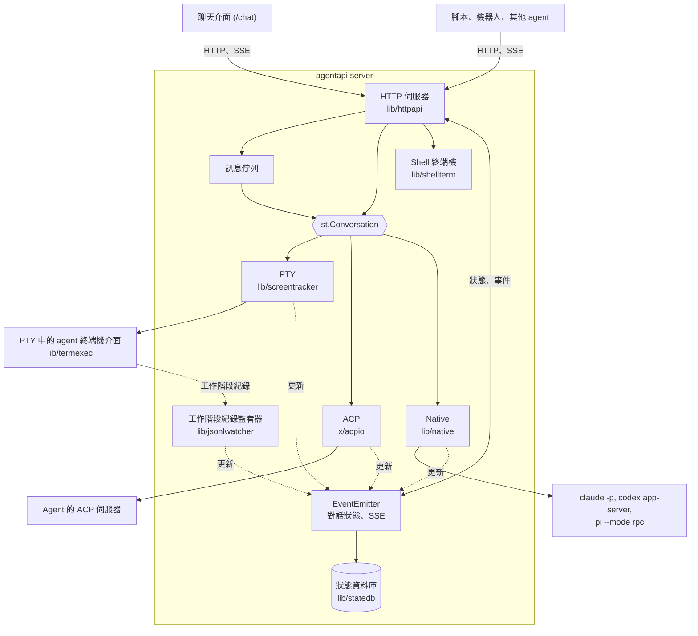
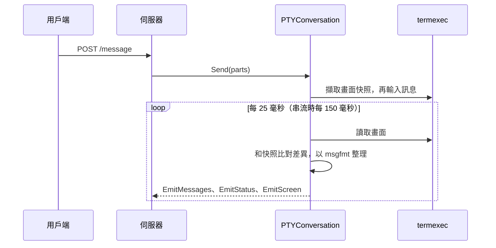
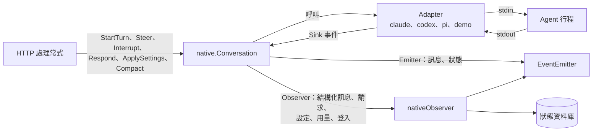

# 架構

[English](architecture.md) | 繁體中文

AgentAPI 是單一的 Go 執行檔。它啟動一個 coding agent，透過三種 transport 之一驅動它，並為它
提供 HTTP API、事件串流和聊天介面。這份文件說明 AgentAPI 的架構；功能與用法請參閱
[README](../README.zh-TW.md)。

## 目錄

- [總覽](#總覽)
- [儲存庫結構](#儲存庫結構)
- [啟動與關閉](#啟動與關閉)
- [HTTP 伺服器](#http-伺服器)
- [對話與 transport](#對話與-transport)
  - [PTY](#pty)
  - [ACP](#acp)
  - [Native](#native)
- [事件與對話狀態](#事件與對話狀態)
- [訊息佇列](#訊息佇列)
- [持久保存](#持久保存)
- [重新啟動與更新](#重新啟動與更新)
- [Shell 終端機](#shell-終端機)
- [檔案](#檔案)
- [MCP 管理](#mcp-管理)
- [安全模型](#安全模型)
- [聊天介面](#聊天介面)
- [測試](#測試)
- [設計原則](#設計原則)

## 總覽



一個 AgentAPI 行程只執行一個 agent。每種 transport 都實作 `st.Conversation`，也就是伺服器
用來送出訊息、讀取對話的介面，並把變更回報給同一個 emitter。因此 HTTP API、事件串流、佇列
和聊天介面在每種 transport 下的行為都一樣；只有某種 transport 才有的東西（native 的請求、
設定、shell 終端機）則有自己的端點。處理常式從不直接和 agent 行程溝通：它們透過對話操作，
並從 emitter 讀取狀態。

## 儲存庫結構

| 路徑 | 內容 |
| --- | --- |
| `main.go`、`cmd/` | cobra CLI：`server`（旗標、agent 類型、transport、啟動 agent、訊號）、`attach`，以及 `update`（會驗證 checksum 的自我更新） |
| `lib/httpapi/` | HTTP 伺服器：路由與處理常式、`EventEmitter`、佇列、token 驗證、webhook、MCP／檔案／終端機端點，以及嵌入的聊天介面 |
| `lib/screentracker/` | `Conversation` 與 `Emitter` 介面，以及 PTY 對話：畫面快照、訊息切分、穩定狀態偵測 |
| `lib/termexec/` | 在虛擬終端機中執行 agent，搭配記憶體內的 VT100 模擬器（`xpty`、`vt10x`）；重新啟動時可以替換行程 |
| `lib/msgfmt/` | 各 agent 專屬的畫面輸出整理：回顯的輸入、輸入框、狀態列、工具呼叫，以及判斷何時可以送出第一個提示 |
| `lib/jsonlwatcher/` | 找到並追蹤 Claude Code、Codex 和 Pi 的工作階段紀錄檔，解析成結構化訊息與時間軸事件 |
| `lib/native/` | Native transport：`Conversation`、`Adapter` 與 `Sink` 的約定、請求、設定、用量、登入 |
| `lib/native/claude`、`codex`、`pi` | 每種 agent 協定各一個 adapter |
| `lib/native/demo` | `native-demo`，開發聊天介面用的模擬 agent |
| `lib/native/nativetest` | 測試用、可以寫腳本控制的假 adapter |
| `lib/native/procutil` | 子行程：process group 與優雅的停止流程 |
| `lib/statedb/` | `--state-db` 的 SQLite 持久保存 |
| `lib/shellterm/` | Native 工作階段共用的 shell 終端機 |
| `lib/mcpconfig/` | 讀寫各 agent 的 MCP 設定檔 |
| `lib/procenv/` | AgentAPI 啟動的行程的環境變數：各種 transport 的 agent，以及終端機的 shell |
| `lib/agenthome/` | 各 agent 保存狀態的目錄（`CLAUDE_CONFIG_DIR`、`CODEX_HOME`、`PI_CODING_AGENT_DIR`） |
| `lib/handoff/` | 人工回覆 API 的型別 |
| `lib/logctx/`、`lib/util/` | 放在 context 裡的 logger；小工具 |
| `x/acpio/` | 實驗性的 ACP transport |
| `internal/version/` | 版本號，建置時寫入 |
| `chat/` | 聊天介面（Next.js） |
| `e2e/` | 以腳本化 echo agent 進行的端對端測試 |

## 啟動與關閉

`agentapi server [旗標] -- <agent 指令>`（`cmd/server/server.go`）：

1. 旗標來自命令列或 `AGENTAPI_*` 環境變數（viper）。agent 類型取自 `--type`；沒有指定時，
   若 agent 指令剛好是類型名稱就用它；否則為 `custom`。
2. Transport 啟動 agent：
   - PTY：`termexec` 在 `--term-width` × `--term-height` 格的虛擬終端機中執行指令。
   - ACP：`acpio` 啟動指令，並透過它的 stdio 開啟 ACP 工作階段。
   - Native：`nativeFactory` 依 agent 類型建立 `native.Factory`（Claude Code、Codex、Pi 或
     `native-demo`）。每個 adapter 會先檢查 agent 的參數，拒絕和它的協定衝突的參數。
3. 使用 `--state-db` 時，`statedb.Open` 會開啟並鎖住檔案，確認它屬於同一種 agent 類型、
   transport 和工作目錄。
4. `httpapi.NewServer` 建立 emitter、還原保存的狀態、建立對話、註冊路由，並啟動對話、佇列
   迴圈、webhook 傳送器，以及（PTY 的）工作階段紀錄監看器。
5. 收到 SIGINT 或 SIGTERM 時，HTTP 伺服器會關閉，native agent 和 shell 終端機會被關閉，
   狀態資料庫會寫入並關閉。使用 `--state-file` 時，PTY 對話會保存它的訊息。

## HTTP 伺服器

`lib/httpapi` 用 chi 處理路由，用 huma 宣告有型別的操作，huma 也會產生 OpenAPI schema
（`make gen` 會寫出 `openapi.json`）。請求會依序經過這些 middleware：

1. 主機授權：`Host` 標頭必須是允許的主機（忽略連接埠）。
2. 請求紀錄，會略過靜態檔案、事件串流和終端機。
3. 允許來源的 CORS，並允許憑證，讓聊天介面的 cookie 在其他來源也能使用。
4. 使用 `--api-token` 時的 token 驗證：Bearer token 或聊天介面的 session cookie。它在 CORS
   之後執行，所以 preflight 可以通過，401 回應也會帶有聊天介面讀取它所需的 CORS 標頭。

處理常式依檔案分組：

| 檔案 | 處理 |
| --- | --- |
| `server.go`、`queue.go` | 訊息、狀態、事件、佇列、上傳；伺服器的設定與路由 |
| `backend.go`、`backend_pty.go`、`backend_native.go` | 依 transport 而不同的部分：派送佇列、送出訊息、重新啟動、人工回覆協定的待處理請求 |
| `native.go` | 請求、設定、中斷、壓縮、重試登入；native observer |
| `terminal.go`、`files.go`、`file_preview.go` | Shell 終端機與檔案檢視器 |
| `mcp.go`、`mcp_management.go` | MCP 伺服器與設定檔 |
| `webhook.go`、`handoff.go`、`dialog_reply.go` | 執行狀態 webhook、人工回覆 API、終端機對話框的回答 |
| `auth.go` | Token 驗證與聊天介面登入 |
| `restart.go`、`statedb.go` | 重新啟動；還原與保存狀態 |
| `events.go`、`models.go` | Emitter 與 API 的型別 |
| `embed.go`、`uploads.go` | 嵌入的聊天介面；上傳的檔案 |

一般的 chi 路由提供聊天介面（`/chat/*`）、上傳的圖片（`/uploads/{checksum}/{name}`）以及
TTY mode 的畫面串流（`/internal/screen`）。`Server` 持有對話、emitter、佇列與它的鎖
（`s.mu`）、webhook 傳送器、MCP 儲存、shell 終端機和狀態資料庫。各 transport 不同的地方，
處理常式會呼叫該 transport 的 `agentBackend`：`ptyBackend` 驅動終端機或 ACP 對話，
`nativeBackend` 驅動 native 對話。

## 對話與 transport

```go
// lib/screentracker
type Conversation interface {
	Messages() []ConversationMessage
	Send(...MessagePart) error
	Start(context.Context)
	Status() ConversationStatus // initializing, changing or stable
	Text() string
	SaveState() error
	Reset()
}

type Emitter interface {
	EmitMessages([]ConversationMessage)
	EmitStatus(ConversationStatus)
	EmitScreen(string)
	EmitError(message string, level ErrorLevel)
}
```

`stable` 對應到 API 向下相容的 `stable` 狀態（agent 閒置中，或只是在等回覆）；
`initializing` 和 `changing` 對應到 `running`。

### PTY



- `termexec` 把 agent 的畫面保存在記憶體內的模擬器中。輸入訊息之前，對話會先擷取畫面快照；
  之後出現在快照下方的內容就是 agent 的回覆，畫面變化時會持續更新。畫面 2 秒沒有變化時，
  就視為穩定。
- `msgfmt` 會移除不屬於回覆的內容（回顯的輸入、輸入框、狀態列），也知道每種 agent 何時
  可以接受第一個提示。
- `jsonlwatcher` 會找到屬於 agent 行程的 Claude Code、Codex 或 Pi 工作階段紀錄檔（依行程 ID
  和工作目錄）並持續追蹤。各 agent 專屬的解析器把每一行轉成結構化訊息（思考、工具呼叫與
  結果、用量）和時間軸事件，和從畫面解析出的訊息一起送進 emitter。
- 終端機對話框（Claude Code 的計畫核准與權限提示、Codex 的核准、Pi 的信任提示）會在畫面上
  被辨識出來，回報為 `terminal_prompt`；`dialog_reply.go` 會把回答轉成對話框需要的按鍵。

### ACP

`x/acpio` 透過 agent 的 stdio 使用 Agent Client Protocol。一則訊息就是一個 prompt，內容是訊
息的文字。`POST /message` 在 turn 開始後就會回傳；turn 進行中送出的訊息會在佇列中等待，prompt
失敗則以 `agent_error` 回報。訊息片段會成為 agent 的回覆，工具呼叫會以文字行附加在回覆中，權限
請求則會自動核准。這個 transport 仍是實驗性的。

### Native



`native.Conversation` 以 `Adapter` 為基礎實作 `st.Conversation`，每種 agent 協定各一個：

```go
// lib/native
type Adapter interface {
	Start(ctx context.Context, sink Sink) error
	StartTurn(ctx context.Context, input Input) error
	Steer(ctx context.Context, input Input) error
	Interrupt(ctx context.Context) error
	Respond(ctx context.Context, requestID string, response Response) error
	Capabilities() Capabilities
	Wait() error
	Close() error
}

type Factory func(resumeRef string) (Adapter, error)
```

- **Sink。** Adapter 透過 `Sink` 回報 agent 的動作：回合開始與結束、結構化訊息、時間軸事件、
  請求的開啟與關閉、工作階段名稱與用來接續工作階段的參照、失去登入、錯誤。Sink 的呼叫來自
  adapter 的讀取迴圈，不會同時發生。結構化訊息每次增長時都會整則送出（快照，不是差異），
  而且同一個 factory 的各個 adapter 之間，訊息和請求的 ID 不會重複，因為對話的生命比它的
  adapter 長。
- **選用的部分。** 實作 `Configurable` 的 adapter 有設定（權限模式、模型、推理強度），並透過
  `SettingsSink` 回報 agent 自己變更的設定；`Compacter` 可以依要求壓縮 context；`UsageSink`
  接收 context 與用量限制的使用量。`Capabilities` 說明 agent 支援 steer、interrupt、resume、
  images、settings 和 compact 中的哪些。API 和聊天介面依它決定要提供什麼，從不依 agent 類型。
- **世代（generation）。** 每個 adapter 都屬於一個世代。重新啟動或替換 agent 會開始新的世代，
  較舊 adapter 的事件會被忽略，所以被替換掉的 agent 無法再改變對話。
- **生命週期。** 啟動 adapter 時會啟動行程和它的工作階段（新的，或依工作階段參照接續）。找不到
  登入的 adapter 會回傳 `LoginRequiredError`：對話會回報 `login_required`，每 5 秒重新啟動它
  一次，或在 `POST /login/retry` 要求時立刻啟動。agent 執行之後，對話會套用為這個工作階段
  選擇的設定、回報它的能力，並送出初始提示。`Restart` 會換成新的工作階段；`Reload` 則接續
  同一個工作階段，讓變更過的 MCP 設定重新被讀取，同時保留對話。
- **回合。** 只有 agent 閒置時訊息才會開始新的回合；否則 `StartTurn` 會回傳
  `ErrMessageValidationChanging`，由伺服器把訊息排入佇列。agent 壓縮 context 期間，回合也會
  以同樣的方式等待。
- **請求。** 核准、提問和計畫會成為 `RequestState`，帶有狀態（`pending`、`resolved`、
  `withdrawn`、`expired`）和 `response_capability`（`live`、`message`、`not_resumable`）。
  一個回答最多只會送到 adapter 一次，回合結束時仍開著的請求會過期。祕密問題的答案除了送給
  agent 的那份之外，一律會被遮蔽。
- **Observer。** 訊息與狀態以外的變更（結構化訊息、請求、設定、用量、工作階段參照、登入）會
  送到 `Observer`，由伺服器實作，用來更新 emitter 和狀態資料庫。呼叫它時對話的鎖仍被持有，
  所以它不能再呼叫回對話。
- **行程。** `procutil` 會在 agent 自己的 process group 中啟動它，並移除上層 agent 工作階段的
  環境變數。停止時會先關閉它的輸入，3 秒後對整個 group 送出 SIGTERM，再過 2 秒送出 SIGKILL。

各個 adapter：

| Adapter | 行程 | 協定 |
| --- | --- | --- |
| `claude` | `claude -p --input-format stream-json --output-format stream-json ...` | stdin 與 stdout 上的 stream-json 訊息，加上 Claude Code 的 control protocol：`initialize`、`can_use_tool`（核准、提問、計畫）、`set_permission_mode`、`set_model`、`apply_flag_settings`、`get_settings`、`get_context_usage`、`interrupt` |
| `codex` | `codex app-server` | JSON-RPC：`thread/start` 或 `thread/resume`、`turn/start`（帶著設定）、`turn/steer`、`turn/interrupt`、`thread/compact/start`、`model/list`；核准、提問和 MCP elicitation 以伺服器請求送來；plan 模式是一種 collaboration mode |
| `pi` | `pi --mode rpc --session-id <id>` | JSON lines：`prompt`（steer 也用它）、`abort`、`get_state`、`get_available_models`、`set_model`、`set_thinking_level`、`compact`；擴充功能的對話框以 UI 請求送來，用 `extension_ui_response` 回答 |
| `demo` | 無 | 模擬的 agent，會串流思考、一個工具呼叫和回覆，並能開啟每一種請求 |

## 事件與對話狀態

`EventEmitter`（`lib/httpapi/events.go`）保存用戶端讀取的內容：訊息、結構化訊息、時間軸、
請求、狀態快照（狀態、生命週期、執行 ID、能力、設定、用量、登入、終端機提示）以及最新的畫面。

- 每次變更都會取得下一個序號（`seq`）。對話以 `epoch` 識別，歷史被改寫時（收回訊息、重設、
  當機後還原）epoch 會改變。
- `GET /events` 以 server-sent events 串流變更：`message_update`、`status_change`、
  `rich_message_update`、`agent_error`、`request_update`，以及每 15 秒一次的 `heartbeat`。
  加上 `?sync=1` 時，串流會以 `session_sync` 事件開頭；epoch 相符時只重播 `since=<seq>`
  之後的變更，事件也會帶有 SSE id，讓重新連線的 `EventSource` 從 `Last-Event-ID` 接續。
- `/internal/screen` 為 TTY mode 串流畫面（`screen_update`）。
- 狀態在 `running` 與 `stable` 之間切換時，會觸發執行狀態 webhook。
- 有狀態資料庫時，emitter 會把每次變更交給它的 `Persister`。

## 訊息佇列

agent 忙碌時送出的訊息會在伺服器的佇列中等待（`s.messageQueue`，由 `s.mu` 保護）。一個迴圈
每 500 毫秒檢查佇列最前面的訊息能不能送出：native agent 要對話閒置，PTY agent 要畫面穩定且
沒有顯示對話框。agent 拒絕的訊息最多重試 5 次；agent 沒有及時回應的訊息會立刻丟棄，因為它
可能已經送達。使用 native transport 時，訊息也可以 steer 進執行中的回合，或中斷它。佇列也是
持久保存狀態的一部分。

## 持久保存

`lib/statedb` 透過 `modernc.org/sqlite` 把 native 工作階段保存在 SQLite 裡；它是純 Go 的實作，
所以 `CGO_ENABLED=0` 的建置也能使用。

- 資料表有 `messages`、`rich_messages`、`session_events`、`requests`、`queue`，以及
  `meta`：保存 agent 類型、transport 和工作目錄、epoch 與 seq、工作階段參照與名稱，以及為
  工作階段選擇的設定。
- 寫入會先排隊，每 200 毫秒在一個交易中寫入，所以串流不必等待磁碟。正常關閉時會把檔案標示為
  乾淨；當機之後，對話會換成新的 epoch，用戶端會重新載入完整的對話。
- 檔案以獨占鎖定模式搭配 WAL 開啟，所以第二個 AgentAPI 無法使用它；新建立的檔案權限為 0600。
- 啟動時伺服器會還原對話、佇列和工作階段參照；native 對話會把參照交給 factory，讓 agent
  接續它自己的工作階段。當時開著的請求還原後會是已過期。

`--state-file` 是較早的 PTY 機制：關閉時以 JSON 保存從畫面解析出的訊息，啟動時載入。

## 重新啟動與更新

- `DELETE /messages`：native agent 會被關閉，接著執行更新程式（`codex update`、
  `pi update --self`），再由 `Restart` 開始新的工作階段；對話、請求和佇列都會清除。PTY agent
  則會在可替換的終端機中取得新的行程，以及新的工作階段紀錄監看器。
- 帶 `?restart=true` 的 MCP 變更：native agent 會接續它的工作階段重新載入（`Reload`），對話
  會保留；有回合在執行時會以 409 拒絕。無法接續工作階段的 agent 則改為重新啟動。
- `/status` 會回報生命週期：`starting`、`ready`、`running`、`restarting`、`exited` 或
  `failed`。

## Shell 終端機

`lib/shellterm` 會在 agent 的工作目錄、以虛擬終端機（`creack/pty`）執行一個 login shell，
環境變數和 agent 相同，但不含 AgentAPI 自己的變數。第一個用戶端開始觀看時它才啟動，沒有人
觀看時也會繼續執行。它的輸出會寫進 256 KiB 的捲動緩衝區（從行首截斷）和每個觀看者的緩衝區；
落後 512 個區塊的觀看者會被斷開，重新連線後再取得捲動緩衝區。`GET /terminal` 串流 `output`
（base64）和 `exit` 事件，`POST /terminal/input` 與 `/terminal/resize` 則輸入按鍵和調整大小，
以最後一次調整為準。關閉時會掛斷終端機，2 秒後終止 shell 的 process group。

## 檔案

`GET /files/content` 和 `GET /files/diff` 提供聊天介面的檔案檢視器。路徑會在 agent 的工作目錄
內解析，symlink 會被追蹤並檢查；只讀取一般檔案，最多 1 MiB。diff 在儲存庫中只以唯讀方式執行
git（`rev-parse`、`ls-files`、`cat-file`，並關閉 fsmonitor），再在暫存目錄中以
`git diff --no-index` 比對已 commit 和目前檔案的副本，不使用使用者或系統的 git 設定，所以
儲存庫設定的任何程式都不會被執行。

預覽透過同一個 root 讀取檔案。`GET /files/preview`（`lib/htmlpreview`）回傳的 HTML 檔中，
以相對路徑引用的樣式表、腳本、圖片、字型和影音都會轉成 data: URL：只收副檔名符合用途的檔案
（樣式表必須是 `.css`，腳本必須是 `.js`），不收隱藏目錄裡或工作目錄以外的檔案，每個最多
4 MiB，合計 16 MiB。聊天介面把頁面放在設了 `allow-scripts`、但沒有 `allow-same-origin` 的
sandbox iframe 中：頁面沒有 origin，所以它的腳本讀不到聊天介面，也無法帶著 session cookie
呼叫 API，而且頁面引用的東西都不會從 AgentAPI 載入（前面若有代理，代理的 cookie 也帶不過
去）。`GET /files/image` 用 `GET /uploads` 提供上傳檔案的方式提供圖片檔：點陣圖依內容判斷，
SVG 依副檔名判斷，並加上 `nosniff` 和會開啟 sandbox 的 Content-Security-Policy。

## MCP 管理

`lib/mcpconfig` 讀寫各 agent 的 MCP 設定（Claude Code 工作目錄中的 `.mcp.json`、Codex 的
`$CODEX_HOME/config.toml`、Pi 的 `~/.pi/agent/mcp.json`），並保留不相關的設定。設定檔
（profile）是可以套用的已儲存設定。agent 在啟動時讀取這些檔案，所以變更要重新啟動後才會生效
（native agent 則是接續同一個工作階段重新載入）。

## 安全模型

- 沒有使用者的概念。通過 token（如果有設定）以及主機、來源檢查的人，就能做 agent 能做的事：
  native agent 以 bypass 權限模式啟動、ACP transport 會核准所有權限請求、shell 終端機可以
  執行指令。
- `--api-token`：以固定時間比對。瀏覽器透過 `POST /auth/session` 登入，它會設定一個
  HttpOnly、SameSite=Strict 的 cookie，裡面存的是 token 的 HMAC 而不是 token 本身，所以更換
  token 會讓所有瀏覽器登出。靜態的聊天介面檔案和 `/auth/session` 會略過 token 檢查；登入時
  會自行檢查 token。
- `--bind` 限制誰能連線，`--allowed-hosts` 決定接受哪些 `Host` 標頭（預設為 `localhost`、
  `127.0.0.1` 和 `[::1]`，用來防範 DNS rebinding），`--allowed-origins` 決定哪些來源可以從
  瀏覽器呼叫 API。
- 上傳的檔案存放在私有目錄，只有圖片會被回傳。工作目錄以外的檔案無法開啟。
- 不論使用哪種 transport，agent 都不會繼承上層 agent 工作階段為它所執行的指令設定的環境變數
  （其中一個是祕密），也不會拿到 AgentAPI 的 API token（`lib/procenv`）。

## 聊天介面

`chat/` 是 Next.js 15 與 React 19 的應用程式，用 bun 建置成靜態輸出。`make embed` 會把建置
結果複製到 `lib/httpapi/chat/`，再由 `embed.go` 以 `go:embed` 嵌入。建置時使用一個佔位的基礎
路徑，由伺服器改寫成 `--chat-base-path`（預設為 `/chat`）。同一份建置結果也能單獨執行
（`bun run dev`，加上 `?url=<伺服器>`），`/chat/embed` 則是嵌入其他頁面用的版本。

- `components/chat-provider.tsx` 保存用戶端狀態。它訂閱 `/events?sync=1`，記住最後的序號以便
  接續，把對話紀錄快取在 IndexedDB（`lib/session-cache.ts`），讓下次開啟時立即顯示，並以退避
  方式重新連線（`lib/reconnect.ts`）。`lib/chat-api.ts` 是 HTTP API 的型別化用戶端。
- `components/chat.tsx` 負責頁面版面：訊息清單（任務、工具呼叫列、思考）、輸入框上方的停靠區
  （狀態列、終端機對話框的決策卡片、登入卡片、請求卡片）、輸入框（`message-input.tsx`，含
  斜線指令、工作階段設定和用量指示）、Explorer、檔案檢視器、TTY mode（`tty-view.tsx`，來自
  `/internal/screen`）以及 native 終端機（`shell-view.tsx`，來自 `/terminal`）。
- `lib/` 以一般模組保存邏輯，並附有 bun 測試：任務分組、工具格式化、檔案參照、diff、斜線
  指令、設定、用量、終端機按鍵、驗證。

## 測試

- Go 測試和程式碼放在一起，以 `CGO_ENABLED=0` 執行；和時間有關的程式碼使用 `coder/quartz`
  的時鐘。
- Native adapter 有模擬 agent 行程的測試骨架、以真實 CLI 的去識別化擷取資料建立的重播測試
  （`testdata/`），以及把它們的結構化訊息和工作階段紀錄解析器的結果相比對的一致性測試。
  `nativetest` 為對話與 HTTP 測試提供假 adapter。
- `e2e/` 以腳本化的 echo agent 測試伺服器。
- CI 執行 `golangci-lint`（包含對列舉的 exhaustive 檢查）、`paralleltestctx` 和 `make gen`
  （OpenAPI schema 必須和程式碼一致）；聊天介面有 eslint、`bun test` 和 `tsc`。

## 設計原則

- PTY transport 仍是預設值，適用於任何終端機 agent；native transport 需要自行啟用。
- 用戶端依能力（capabilities）決定要提供什麼，從不依 agent 類型。
- Adapter 回報完整的快照；由對話和 emitter 把它們轉成更新。
- 世代和不重複的 ID 確保被替換掉的 agent 無法改變對話。
- 送到瀏覽器的內容都可以重播：每次變更都有序號，落後的用戶端會重新載入狀態。
