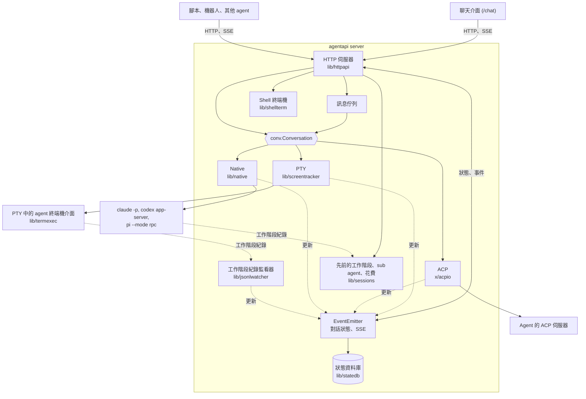
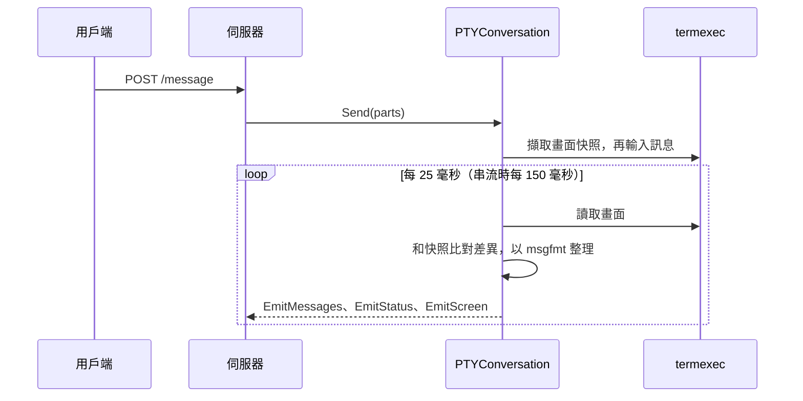
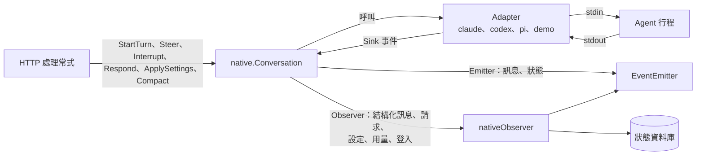

# 架構

[English](architecture.md) | 繁體中文

AgentAPI 是單一的 Go 執行檔，每個行程啟動一個 coding agent，並透過三種 transport 之一
與它溝通。AgentAPI 提供 HTTP API、事件串流與內建聊天介面。本文說明實作架構；功能與用法請參閱
[README](../README.zh-TW.md)。

## 目錄

- [總覽](#總覽)
- [儲存庫結構](#儲存庫結構)
- [啟動與關閉](#啟動與關閉)
- [HTTP 伺服器](#http-伺服器)
- [對話與 transport](#對話與-transport)
  - [PTY](#pty)
  - [ACP](#acp)
  - [Native](#native)
- [事件與對話狀態](#事件與對話狀態)
- [訊息佇列](#訊息佇列)
- [持久保存](#持久保存)
- [重新啟動與更新](#重新啟動與更新)
- [Shell 終端機](#shell-終端機)
- [檔案](#檔案)
- [MCP 管理](#mcp-管理)
- [安全模型](#安全模型)
  - [子行程環境](#子行程環境)
- [聊天介面](#聊天介面)
- [測試](#測試)
- [設計原則](#設計原則)

## 總覽



每個 AgentAPI 行程執行一個 agent。所有 transport 都實作 `conv.Conversation`，供伺服器
傳送訊息與讀取對話，並將變更回報給同一個事件發送器（emitter）。

因此核心 HTTP API、事件串流、佇列與聊天介面在每種 transport 上的運作方式都相同。各 transport
專屬的功能，例如 native 請求、設定與 shell 終端機，則由獨立端點提供。處理常式透過對話介面操作
agent，並從 emitter 讀取狀態，不直接存取 agent 行程；只有原始訊息（raw message）和回答終端機
對話框的按鍵會直接寫入 agent 的終端機。

## 儲存庫結構

| 路徑 | 內容 |
| --- | --- |
| `main.go`、`cmd/` | Cobra CLI：`server`（旗標、agent 類型、transport、啟動 agent、訊號）、`attach`，以及 `update`（會驗證 checksum 的自我更新） |
| `lib/httpapi/` | HTTP 伺服器：路由與處理常式、`EventEmitter`、佇列、token 驗證、webhook、MCP／檔案／終端機端點，以及嵌入的聊天介面 |
| `lib/conversation/` | 各 transport 共用的部分（以 `conv` 匯入）：訊息、角色、狀態與錯誤等級，伺服器驅動 transport 的 `Conversation` 介面，以及 transport 回報變更的 `Emitter` |
| `lib/screentracker/` | PTY 對話：畫面快照、訊息切分、穩定狀態偵測，以及把訊息片段輸入 agent 的終端機（`AgentIO`、`TerminalPart`） |
| `lib/termexec/` | 在虛擬終端機中執行 agent，搭配記憶體內的 VT100 模擬器（`xpty`、`vt10x`）；重新啟動時可以替換行程 |
| `lib/msgfmt/` | 各 agent 專屬的畫面輸出整理：回顯的輸入、輸入框、狀態列、工具呼叫，以及判斷何時可以送出第一個提示 |
| `lib/transcript/` | 各傳輸共用的結構化對話型別：結構化訊息與其內容區塊、時間軸事件 |
| `lib/agentlog/` | 各 agent 工作階段紀錄的格式，一種 agent 一個套件（`claudelog`、`codexlog`、`pilog`）：紀錄型別、解析成結構化訊息與時間軸事件的 parser（native adapter 也使用）、prompt 與注入內容的辨識、模型呼叫、檔案配置與 resolver；另有逐行讀取、增量檔案索引和格式變動警告 |
| `lib/sessions/` | 目錄中先前的工作階段，透過伺服器持有的 `Store` 讀取：清單與單一工作階段的對話（`history.go`）、工作階段執行過的 sub agent（`subagents.go`），以及各工作階段的花費（`cost.go`） |
| `lib/jsonlwatcher/` | 找到並追蹤 PTY agent 行程的工作階段紀錄檔，取得它的結構化訊息 |
| `lib/pricing/` | 每百萬 tokens 的模型價格（內建的 `prices.json` 和 `--prices` 檔案），以及一次呼叫的 tokens 依此價格的金額 |
| `lib/native/` | Native transport：`Conversation`、`Adapter` 與 `Sink` 的約定、請求、設定、用量、登入 |
| `lib/native/claude`、`codex`、`pi` | 每種 agent 協定各一個 adapter |
| `lib/native/agentio` | 這些 adapter 共用的 JSON lines 通訊：逐行讀取 agent 的輸出、寫入它的 stdin，並把它的回應對應到等待中的請求 |
| `lib/native/demo` | `native-demo`，開發聊天介面用的模擬 agent |
| `lib/native/nativetest` | 測試用、可以寫腳本控制的假 adapter |
| `lib/native/procutil` | 子行程：行程群組（process group）與正常關閉流程 |
| `lib/statedb/` | `--state-db` 的 SQLite 持久保存（native 與 PTY），以及 `--state-file` 的匯入 |
| `lib/shellterm/` | Native 工作階段共用的 shell 終端機 |
| `lib/htmlpreview/` | 為 `GET /files/preview` 把 HTML 檔轉成能獨立顯示的頁面：以相對路徑引用的檔案都轉成 data: URL |
| `lib/mcpconfig/` | 讀寫各 agent 的 MCP 設定檔 |
| `lib/procenv/` | AgentAPI 啟動的行程的環境變數：各種 transport 的 agent，以及終端機的 shell |
| `lib/agenthome/` | 各 agent 保存狀態的目錄（`CLAUDE_CONFIG_DIR`、`CODEX_HOME`、`PI_CODING_AGENT_DIR`） |
| `lib/handoff/` | 人工回覆 API 的型別 |
| `lib/logctx/`、`lib/util/` | 透過 context 傳遞的 logger 與共用輔助函式 |
| `x/acpio/` | 實驗性的 ACP transport |
| `internal/version/` | 版本號，建置時寫入 |
| `chat/` | 聊天介面（Next.js） |
| `e2e/` | 以腳本化 echo agent 進行的端對端測試 |

## 啟動與關閉

`agentapi server [旗標] -- <agent 指令>`（`cmd/server/server.go`）：

1. 旗標來自命令列或 `AGENTAPI_*` 環境變數（viper）。agent 類型取自 `--type`；沒有指定時，
   若 agent 指令符合已知類型別名，就採用該類型；否則使用 `custom`。transport 取自
   `--transport`；沒有指定時，`hasNativeAdapter` 涵蓋的 agent（Claude Code、Codex、Pi 和
   `native-demo`）使用 native（除非設定了已棄用的 `--state-file`），其他 agent 使用 PTY。
2. Transport 啟動 agent：
   - PTY：`termexec` 在 `--term-width` × `--term-height` 格的虛擬終端機中執行指令。
   - ACP：`httpapi.SetupACP` 啟動指令，再由 `acpio` 透過它的 stdio 開啟 ACP 工作階段。
   - Native：`nativeFactory` 依 agent 類型建立 `native.Factory`（Claude Code、Codex、Pi 或
     `native-demo`）。每個 adapter 會先檢查 agent 的參數，拒絕和它的協定衝突的參數。
3. 使用 `--state-db`（或 `--state-file` 旁的資料庫）時，`statedb.Open` 會開啟檔案、取得它的獨占鎖，
   並執行資料表結構的 migration；資料庫還沒有對話時，會匯入 `--state-file`。
4. `httpapi.NewServer` 建立 emitter、還原保存的狀態（檔案若屬於其他 agent 類型、transport 或
   工作目錄就拒絕使用）、建立對話、註冊路由，並啟動對話、佇列迴圈、webhook 傳送器，以及
   （PTY 的）工作階段紀錄監看器。
5. 收到 SIGINT、SIGTERM 或 SIGHUP，或 agent 自行結束時，webhook 會送出 `instance.stopped`，進行中的
   重新啟動會被取消，HTTP 伺服器關閉，佇列迴圈與工作階段紀錄監看器停止，仍在執行的 native 或 PTY
   agent 以及 shell 終端機會被關閉，狀態資料庫會寫入並關閉。收到 SIGUSR1 時只寫入狀態資料庫，
   不會停止。

## HTTP 伺服器

`lib/httpapi` 使用 chi 處理路由，透過 huma 宣告型別化的 API 操作並產生 OpenAPI schema。
`make gen` 會將結果寫入 `openapi.json`。請求依序經過下列中介層（middleware）：

1. 主機授權：`Host` 標頭必須是允許的主機（忽略連接埠）。
2. 請求紀錄，會略過靜態檔案、事件串流和終端機。
3. 允許來源的 CORS，並允許憑證，讓聊天介面的 cookie 在其他來源也能使用。
4. 使用 `--api-token` 時的 token 驗證：Bearer token 或聊天介面的 session cookie。它在 CORS
   之後執行，所以 preflight 可以通過，401 回應也會帶有聊天介面讀取它所需的 CORS 標頭。

處理常式依檔案分組：

| 檔案 | 處理 |
| --- | --- |
| `server.go`、`routes.go`、`hosts.go`、`middleware.go` | 伺服器的設定、啟動與停止；各功能自行註冊的路由；允許的主機與來源；請求記錄 |
| `conversation_api.go`、`queue.go`、`sse.go`、`jsonl_watcher.go` | 訊息、狀態與時間軸；佇列、派送與 `queue_update`；`GET /events` 與畫面串流；PTY 傳輸的工作階段紀錄監看 |
| `tasks.go` | emitter 從對話推導出的任務（`taskTracker`）、`task_update` 與 `GET /tasks` |
| `summary.go` | 給監看多個 AgentAPI 的用戶端的摘要（`attention`、標題、最新任務）、`summary_update` 與 `GET /summary` |
| `backend.go`、`backend_pty.go`、`backend_native.go` | 依 transport 而不同的部分：派送佇列與每次檢查要做的事（`beforeQueue`：排定的繼續、Codex 的更新提示）、送出訊息、重新啟動（`beginRestart`、`beginReload`）、人工回覆協定（`handoffOffer`、`answerHandoff`） |
| `setup.go` | 啟動 PTY 或 ACP agent 的行程 |
| `native.go` | 請求、設定、中斷、壓縮、重試登入；native observer |
| `limit.go`、`sessions.go`、`subagents.go` | 因用量限制停下的回合（`/limit`）；agent 先前的工作階段和它們的花費（`/sessions`、`/cost`）；它的 sub agent（`/subagents`） |
| `terminal.go`、`files.go`、`file_preview.go`、`files_find.go` | Shell 終端機（`terminalAPI`），以及檔案檢視器與搜尋 agent 用 repo 相對路徑提到的檔案（`fileAPI`） |
| `mcp.go`、`mcp_management.go` | MCP 伺服器與設定檔 |
| `webhook.go`、`webhook_events.go`、`handoff.go`、`dialog_reply.go` | Webhook 傳送（佇列、重試、簽章、心跳），以及把對話事件轉成 webhook 事件的 observer；人工回覆 API；終端機對話框的回答 |
| `auth.go` | Token 驗證與聊天介面登入（`authAPI`） |
| `restart.go`、`statedb.go` | 重新啟動；還原與保存狀態 |
| `events.go`、`events_*.go`、`models.go` | Emitter（訂閱與重播；它保存的狀態、畫面、請求與訊息）與 API 的型別 |
| `embed.go`、`uploads.go` | 嵌入的聊天介面；上傳的檔案（`uploadAPI`，它從操作的 middleware 處理 `POST /upload`：huma v2.32 每次處理 multipart 請求都會改動共用的操作） |

未透過 huma 宣告的 chi 路由提供聊天介面（`/chat/*`，`/` 會重新導向到這裡）、上傳的圖片
（`/uploads/{checksum}/{name}`），以及工作目錄中的圖片檔（`/files/image`）。TTY mode 的畫面串流
（`/internal/screen`）則是不列入 OpenAPI schema 的 huma 操作。`Server` 持有對話、emitter、
佇列與它的鎖（`s.mu`）、webhook 傳送器、MCP 儲存、shell 終端機和狀態資料庫。不參與對話變更的
功能則由只持有所需依賴的小模組處理，在註冊路由時建立：`fileAPI`（工作目錄）、`terminalAPI`
（shell）、`uploadAPI`（上傳儲存）、`authAPI`（token 檢查）和 `webhookAPI`（傳送器與狀態資料庫）。
遇到依 transport 而異的操作時，處理常式會呼叫對應的 `agentBackend`：`ptyBackend` 驅動終端機或
ACP 對話，`nativeBackend` 驅動 native 對話。

## 對話與 transport

```go
// lib/conversation（以 conv 匯入）
type Conversation interface {
	Messages() []Message
	Send(...MessagePart) error
	Start(context.Context)
	Status() Status // initializing, changing or stable
	Reset()
}

type Emitter interface {
	EmitMessages([]Message)
	EmitStatus(Status)
	EmitScreen(string)
	EmitError(message string, level ErrorLevel)
}
```

`stable` 對應到 API 向下相容的 `stable` 狀態（agent 閒置中，或只是在等回覆）；
`initializing` 和 `changing` 對應到 `running`。

### PTY



- `termexec` 把 agent 的畫面保存在記憶體內的模擬器中。輸入訊息之前，對話會先擷取畫面快照；
  之後出現在快照下方的內容就是 agent 的回覆，畫面變化時會持續更新。畫面 2 秒沒有變化時，
  就視為穩定。
- `msgfmt` 會移除不屬於回覆的內容（回顯的輸入、輸入框、狀態列），也知道每種 agent 何時
  可以接受第一個提示：輸入框出現時；至於可能不會畫出輸入框的 `custom` agent（例如 shell 或
  REPL），畫面穩定後也可以。
- `jsonlwatcher` 會找到屬於 agent 行程的 Claude Code、Codex 或 Pi 工作階段紀錄檔（依行程 ID
  和工作目錄）並持續追蹤。`lib/agentlog` 的解析器把每一行轉成結構化訊息（思考、工具呼叫與
  結果、用量）和時間軸事件，和從畫面解析出的訊息一起送進 emitter。
- 終端機對話框（Claude Code 的計畫核准與權限提示、Codex 的核准、Pi 的信任提示）會在畫面上
  被辨識出來，回報為 `terminal_prompt`。`handoff.go` 會把回答轉成對話框需要的按鍵，
  `dialog_reply.go` 則會打開對話框的文字輸入欄，讓聊天訊息可以作為回答。

### ACP

`x/acpio` 透過 agent 的 stdio 使用 Agent Client Protocol。每則訊息會轉為一個 prompt，
內容為訊息文字。回合開始後，`POST /message` 就會回傳；回合進行中送出的訊息則排入佇列。
prompt 失敗時以 `agent_error` 回報。
訊息片段會組成 agent 的回覆，工具呼叫以文字行附加在回覆中，權限請求則自動核准。
此 transport 仍屬實驗性功能。

### Native



`native.Conversation` 以 `Adapter` 為基礎實作 `conv.Conversation`，每種 agent 協定各一個：

```go
// lib/native
type Adapter interface {
	Start(ctx context.Context, sink Sink) error
	StartTurn(ctx context.Context, input Input) error
	Steer(ctx context.Context, input Input) error
	Interrupt(ctx context.Context) error
	Respond(ctx context.Context, requestID string, response Response) error
	Capabilities() Capabilities
	Wait() error
	Close() error
}

// Resume 說明 adapter 要開啟哪個工作階段：Ref、帶 Fork 時是它的副本，
// Ref 為空時則是新的工作階段。
type Factory func(resume Resume) (Adapter, error)
```

- **Sink。** Adapter 透過 `Sink` 回報 agent 的動作：回合開始與結束、結構化訊息、時間軸事件、
  請求的開啟與關閉、工作階段名稱與用來接續工作階段的參照、失去登入、錯誤。Sink 的呼叫來自
  adapter 的讀取迴圈，不會同時發生。結構化訊息每次增長時都會整則送出（快照，不是差異），
  而且同一個 factory 的各個 adapter 之間，訊息和請求的 ID 不會重複，因為對話會在替換
  adapter 後持續存在。
- **選用的部分。** 實作 `Configurable` 的 adapter 有設定（權限模式、模型、推理強度），並透過
  `SettingsSink` 回報 agent 自己變更的設定；`Compacter` 可以依要求壓縮 context；`UsageSink`
  接收 context 與用量限制的使用量。`Capabilities` 說明 agent 支援 steer、interrupt、resume、
  images、settings 和 compact 中的哪些。API 和聊天介面依這些能力決定可用操作，不以 agent 類型判斷。
- **世代（generation）。** 每個 adapter 都屬於一個世代。重新啟動或替換 agent 會開始新的世代，
  較舊 adapter 的事件會被忽略，所以被替換掉的 agent 無法再改變對話。
- **生命週期。** 啟動 adapter 時會啟動行程和它的工作階段（新的，或依工作階段參照接續）。找不到
  有效登入資訊的 adapter 會回傳 `LoginRequiredError`：對話會回報 `login_required`，每 5 秒重新啟動它
  一次，或在 `POST /login/retry` 要求時立刻啟動。agent 執行之後，對話會套用為這個工作階段
  選擇的設定、回報它的能力，並送出初始提示。`Restart` 會換成新的工作階段；`Reload` 則接續
  同一個工作階段，重新讀取 MCP 設定並保留對話；`Switch` 會開啟另一個工作階段或它的副本，並
  帶入該工作階段的訊息，這些訊息由伺服器從 agent 的工作階段紀錄讀出
  （`sessions.Store.ReadHistory`；`GET /sessions` 會列出它們）。agent 在工作階段中執行過的
  sub agent 也以同樣方式從它們自己的紀錄讀出（`sessions.Store.Subagents`），提供給
  `GET /subagents` 和聊天介面的 Lineage 面板；它們的狀態取自啟動它們的 Agent 工具呼叫。
- **花費。** `sessions.Store.Costs` 從同樣的紀錄讀出目錄中每個工作階段（含 sub agent）的模型呼叫
  （`GET /sessions`、`GET /cost`）：Claude Code 的 assistant 訊息（每個 message id 一次）、Codex 的
  token 計數、Pi 回報的金額。`lib/pricing` 為每次呼叫計價；Claude Code 的 `cost-state` 紀錄會把
  紀錄檔沒有列出的部分（壓縮）補成未逐筆列出的呼叫。分支複製的呼叫只算一次，算在最先建立的
  工作階段。Store 為每個紀錄檔保存增量索引（大小、讀到的位置和讀取器的狀態），所以變長的紀錄檔
  會從上次的位置接著讀，而且只讀完整的行；變短或被換掉的會重新讀取。同時的請求共用一次讀取，
  索引有大小上限，已不存在的紀錄檔會被移除。
- **紀錄格式。** 每種格式只在一個地方解碼（`lib/agentlog`）：什麼是 prompt、注入的內容或工具
  結果只判斷一次，native adapter、歷史、花費和 PTY 監看器都用同一套。parser 不認得的紀錄和無法
  解碼的行，每個紀錄檔只會以 Warn 記錄一次，並附上紀錄中的 CLI 版本，所以格式改變時會出現在
  伺服器的 log 裡。
- **用量限制。** 帳號的用量限制讓回合停下時，adapter 會以 `limited` 停止原因結束回合（Claude Code
  的限制訊息與 `rejected` 的 rate limit 事件、Codex 的 `usageLimitExceeded`、Pi 模型供應商的
  額度錯誤）。對話會把它記成帶有重置時間的 `LimitStop`，直到下一個回合開始：期間伺服器的佇列
  會等待（`HoldsQueue`），而排定在重置時的繼續（`ScheduleContinue`、`--auto-continue`）會在佇列
  的派送迴圈中、排隊的訊息之前送出。
- **回合。** 只有 agent 閒置時訊息才會開始新的回合；否則 `StartTurn` 會回傳
  `ErrMessageValidationChanging`，由伺服器把訊息排入佇列。agent 壓縮 context 期間，回合也會
  以同樣的方式等待。
- **請求。** 核准、提問和計畫會成為 `RequestState`，帶有狀態（`pending`、`resolved`、
  `withdrawn`、`expired`）和 `response_capability`（`live`、`message`、`not_resumable`）。
  一個回答最多只會送到 adapter 一次，回合結束時仍待處理的請求會過期。祕密問題的答案除了送給
  agent 的那份之外，一律會被遮蔽。
- **Observer。** 訊息與狀態以外的變更（結構化訊息、請求、設定、用量、工作階段參照、登入）會
  送到 `Observer`，由伺服器實作，用來更新 emitter 和狀態資料庫。呼叫時仍持有對話的鎖，
  因此 Observer 不能反向呼叫對話介面，以免造成死鎖。
- **行程。** `procutil` 會在 agent 自己的 process group 中啟動它，使用 adapter 透過
  `lib/procenv` 建立的環境變數，其中不含上層 agent 工作階段的變數。停止時會先關閉它的輸入，
  3 秒後對整個 group 送出 SIGTERM，再過 2 秒送出 SIGKILL。在那之前，adapter 會先中斷進行中的
  回合，最多等 3 秒讓它結束，agent 的工作階段紀錄才不會停在沒有結果的工具呼叫。

各個 adapter：

| Adapter | 行程 | 協定 |
| --- | --- | --- |
| `claude` | `claude -p --input-format stream-json --output-format stream-json ...` | stdin 與 stdout 上的 stream-json 訊息，加上 Claude Code 的 control protocol：`initialize`、`can_use_tool`（核准、提問、計畫）、`set_permission_mode`、`set_model`、`apply_flag_settings`、`get_settings`、`get_context_usage`、`interrupt` |
| `codex` | `codex app-server` | JSON-RPC：`thread/start`、`thread/resume` 或 `thread/fork`、`turn/start`（帶著設定）、`turn/steer`、`turn/interrupt`、`thread/compact/start`、`model/list`；核准、提問和 MCP elicitation 以伺服器請求送來；plan 模式是一種 collaboration mode |
| `pi` | `pi --mode rpc --session-id <id>`（副本加上 `--fork <id>`） | JSON lines：`prompt`（steer 也用它）、`abort`、`get_state`、`get_available_models`、`set_model`、`set_thinking_level`、`compact`；擴充功能的對話框以 UI 請求送來，用 `extension_ui_response` 回答 |
| `demo` | 無 | 模擬的 agent，會串流思考、一個工具呼叫和回覆，並能開啟每一種請求 |

## 事件與對話狀態

`EventEmitter`（`lib/httpapi/events.go`）保存用戶端讀取的內容：訊息、結構化訊息、時間軸、
請求、任務、佇列、狀態快照（狀態、生命週期、server ID、回合數、agent 的工作階段 ID、能力、設定、
含 prompt cache 的用量、用量限制造成的停止、登入、終端機提示）以及最新的畫面。

- 訊息、結構化訊息、請求、任務或佇列的每次變更都會取得下一個序號（`seq`）；狀態、錯誤和畫面
  則整份重播，時間軸由 `GET /timeline` 讀取。對話以 `epoch` 識別，歷史被改寫時（收回訊息、
  重設、當機後還原）epoch 會改變。結構化訊息透過索引依 key 查找，所以有數萬則結構化訊息的接續
  工作階段也能一次載入。
- `GET /events` 以 server-sent events 串流變更：`message_update`、`status_change`、
  `rich_message_update`、`agent_error`、`request_update`，以及每 15 秒一次的 `heartbeat`。
  加上 `?sync=1` 時，串流會以 `session_sync` 事件開頭，並加上 `task_update` 和 `queue_update`
  （沒有選用 sync 的用戶端永遠收不到：有些用戶端遇到不認得的事件類型會出錯）；epoch 相符時只重播
  `since=<seq>` 之後的變更，事件也會帶有 SSE id，讓重新連線的 `EventSource` 從
  `Last-Event-ID` 接續。
- 無法用更新表達的變更（收回訊息）會讓對話換成新的 epoch，並結束對話的訂閱，而不是串流整個
  狀態：用戶端用舊的 epoch 重新連線，就會拿到 SSE id 正確的完整重播。落後超過緩衝的訂閱也會
  這樣結束；開啟結構化訊息超過緩衝四分之一的工作階段時，也會結束訂閱，而不是逐則串流。
- emitter 會為所有 transport 推導任務（`tasks.go`）：使用者訊息開始一個任務，任務執行中加進來的
  訊息 steer 它，agent 閒置且沒有開著的請求或終端機對話框時任務結束。若只是因為回答而讓 agent
  閒置，計時器會先給它 3 秒恢復工作，之後才結束任務。結構化訊息會取得它抵達時執行中任務的
  `task_id`。還原或接續的訊息屬於過去，視為已完成。
- emitter 也維護對話的摘要（`summary.go`）：instance、狀態、agent 為什麼在等使用者
  （`attention`）、標題、最新任務、待處理請求、佇列和用量。除了畫面以外的每次變更後，只要有訂閱
  需要，它就重新算出摘要，和上次送出的不同時才送出 `summary_update`，所以回覆變長不會送出任何
  東西。只有 `/events?only=summary` 會訂閱它，而且不會收到其他事件；`PUT /webhook` 可以修改
  instance 的 ID 和網址，所以修改後會要求重新檢查摘要。
- `/internal/screen` 以 `screen` 事件為 TTY mode 串流畫面。
- 狀態在 `running` 與 `stable` 之間切換時，會觸發 `run.status_changed` webhook 事件。webhook
  observer 像 `/events` 用戶端一樣訂閱 emitter，把它的事件轉成其他 webhook 事件：emitter 的任務
  更新轉成 `task.*`，agent 的訊息在下一則開始或回合結束時才送出；observer 訂閱時 emitter 已有的
  內容，以及比 AgentAPI 啟動時間更早的訊息（接續的工作階段的訊息）都不會送出。傳送器從佇列依序
  一次送一個事件，失敗會重試，並以 `--webhook-secret` 簽章。
- 有狀態資料庫時，emitter 會把每次變更交給它的 `Persister`，它在自己的寫入 goroutine 上從副本
  編碼訊息與結構化訊息，所以串流中的長訊息不會拖慢 emitter。

## 訊息佇列

agent 忙碌時送出的訊息會在伺服器的佇列中等待（`s.queue`；它有自己的鎖，所以讀取不必等待，
變更佇列時也都會持有 `s.mu`）。派送迴圈每 500 毫秒檢查第一則訊息是否能送出：native agent 的
對話必須閒置，且沒有因用量限制而暫停佇列；PTY agent 的畫面則必須穩定且未顯示對話框；agent 重新
啟動期間兩者都不送。被拒絕的訊息總共最多嘗試 5 次，但可能重複送達的訊息會立刻丟棄：adapter 已經
寫出、卻沒有得到確認的 native 送出（`native.ErrUnconfirmed`：呼叫逾時、被取消或 agent 結束），
以及 PTY agent 已輸入但沒有送出的訊息（再送一次會重複輸入）。寫入 native agent stdin 的動作會隨
呼叫的 context 結束，所以不再讀取的 agent 無法佔住 `s.mu`。使用 native transport 時，訊息也可以
steer 進執行中的回合，或中斷它。佇列的每次變更都會在佇列的鎖之外、帶著版本號送到 emitter，成為
`queue_update`，所以較舊的變更晚到時會被捨棄。佇列也是持久保存狀態的一部分。

## 持久保存

`lib/statedb` 透過 `modernc.org/sqlite` 把對話保存在 SQLite 裡；它是純 Go 的實作，所以
`CGO_ENABLED=0` 的建置也能使用。不論哪種 transport，emitter 都會把每次變更交給它；只有 ACP
不使用它。

- 資料表有 `messages`、`rich_messages`、`session_events`、`requests`、`queue`、`tasks`（每個
  任務以伺服器編碼後的形式、依開始它的訊息 ID 保存），以及
  `meta`：保存 agent 類型、transport 和工作目錄、epoch 與 seq、工作階段參照與名稱、為
  工作階段選擇的設定、用量限制造成的停止、透過 API 修改的 webhook 設定（附啟動參數的指紋，
  參數改變時以參數為準），以及 PTY 對話收到的 initial prompt。
- 寫入會先排隊，每 200 毫秒在一個交易中寫入，所以串流不必等待磁碟。正常關閉時會將檔案標示為
  已正常關閉；當機之後，對話會換成新的 epoch，用戶端會重新載入完整的對話。
- 檔案以獨占鎖定模式搭配 WAL 開啟，所以第二個 AgentAPI 無法使用它；新建立的檔案權限為 0600。
- 啟動時伺服器會還原對話、佇列和工作階段參照；native 對話會把參照交給 factory，讓 agent
  接續它自己的工作階段。PTY 對話在建立時就收到還原的訊息（`InitialMessages`），所以第一次
  snapshot 會接續它們而不是取代它們，最後一則 agent 訊息在使用者送出下一則訊息前維持原本的內容。
  還原後，先前待處理的請求會標示為已過期。
- 讀不出來的資料列會被略過並記錄，不會讓伺服器無法啟動。資料表結構以編號的 migration 變更，版本記在
  檔案的 `PRAGMA user_version`。

`--state-file` 是較早的 PTY 機制（關閉時寫出 JSON），已棄用：`cmd/server` 會把它一次性匯入
旁邊的狀態資料庫（`statedb.ImportStateFile`，只匯入空的資料庫），之後由資料庫保存對話。SIGUSR1
會把狀態資料庫尚未寫入的變更寫入。

## 重新啟動與更新

- `DELETE /messages` 會清除對話、請求和佇列並重新啟動 agent；新的 agent 啟動前，AgentAPI 會為
  Codex 和 Pi 執行 `codex update` 或 `pi update --self`。native agent 會被關閉，再由 `Restart`
  開始新的工作階段；PTY agent 則會在可替換的終端機中取得新的行程，以及新的工作階段紀錄監看器。
  使用 ACP 時這個請求會以 400 失敗，因為 agent 無法重新啟動。
- 替換 native agent（重新啟動、重新載入、開啟另一個工作階段）分成兩步。`BeginRestart`、
  `BeginReload` 和 `BeginSwitch` 在 `s.mu` 底下讓舊 agent 退役：之後它的事件會被忽略；有回合在
  執行或正在壓縮 context 時，`BeginSwitch` 會以 `ErrTurnActive` 拒絕，而且不改動任何東西。
  `Replacement.Start` 接著在不持有 `s.mu` 的情況下關閉舊 agent、更新 CLI 並啟動新的 agent
  （`runRestartLocked`）：這段期間 `s.restarting` 會暫停佇列，其他替換、原始按鍵和人工回覆協定會
  得到 409 或沒有內容，不需要 `s.mu` 的請求（`/status`、`/handoff`、`/queue`）照常回應。Stop 會
  取消進行中的重新啟動。接續工作階段的歷史會在取得 `s.mu` 之前讀取。
- 帶 `?restart=true` 的 MCP 變更：native agent 會接續它的工作階段重新載入（`Reload`），對話
  會保留。有回合在執行時，重新載入會以 409 拒絕，但設定檔已經寫入。無法接續工作階段的 agent
  則改為重新啟動。
- `/status` 會回報生命週期：`starting`、`ready`、`running`、`restarting`、`exited` 或
  `failed`。

## Shell 終端機

`lib/shellterm` 會在 agent 的工作目錄、以虛擬終端機（`creack/pty`）執行一個 login shell，
環境變數和 agent 相同，但不含 AgentAPI 自己的變數。第一個用戶端開始觀看時它才啟動，沒有人
觀看時也會繼續執行。它的輸出會寫進 256 KiB 的捲動緩衝區（從行首截斷）和每個觀看者的緩衝區；
落後 512 個區塊的觀看者會被斷開，重新連線後再取得捲動緩衝區。`GET /terminal` 串流 `output`
（base64）和 `exit` 事件，`POST /terminal/input` 與 `/terminal/resize` 則輸入按鍵和調整大小，
以最後一次調整為準。關閉時會掛斷終端機，2 秒後終止 shell 的 process group。

## 檔案

`GET /files/content` 和 `GET /files/diff` 提供聊天介面的檔案檢視器。路徑不存在時，檢視器會向
`GET /files/find` 查詢工作目錄底下路徑結尾相符的檔案（不分大小寫）：以廣度優先走訪，略過隱藏目錄、
相依套件和 Go 的 module cache（除非路徑本身就在裡面），並在走過 50,000 筆或 2 秒後停止。路徑會在 agent 的工作目錄
內解析，symlink 會被追蹤並檢查；只讀取一般檔案，最多 1 MiB。diff 在儲存庫中只以唯讀方式執行
git（`rev-parse`、`ls-files`、`cat-file`，並關閉 fsmonitor），再在暫存目錄中以
`git diff --no-index` 比對已 commit 和目前檔案的副本，不使用使用者或系統的 git 設定，所以
儲存庫設定的任何程式都不會被執行。

預覽同樣以 agent 的工作目錄為根目錄讀取檔案。`GET /files/preview`（`lib/htmlpreview`）回傳的 HTML 檔中，
以相對路徑引用的樣式表、腳本、圖片、字型和影音都會轉成 data: URL：只收副檔名符合用途的檔案
（樣式表必須是 `.css`，腳本必須是 `.js`），不接受隱藏目錄內或工作目錄外的檔案，每個最多
4 MiB，合計 16 MiB。聊天介面把頁面放在設了 `allow-scripts`、但沒有 `allow-same-origin` 的
sandbox iframe 中：頁面沒有 origin，所以它的腳本讀不到聊天介面，也無法帶著 session cookie
呼叫 API，而且頁面引用的東西都不會從 AgentAPI 載入（前面若有代理，代理的 cookie 也帶不過
去）。`GET /files/image` 和 `GET /uploads` 一樣依內容判斷點陣圖，另外也依副檔名提供 SVG
（`GET /uploads` 從不提供 SVG）；兩者都會加上 `nosniff` 和會開啟 sandbox 的
Content-Security-Policy。

## MCP 管理

`lib/mcpconfig` 讀寫各 agent 的 MCP 設定（Claude Code 工作目錄中的 `.mcp.json`、Codex 的
`$CODEX_HOME/config.toml`、Pi 的 `$PI_CODING_AGENT_DIR/mcp.json`，預設為
`~/.pi/agent/mcp.json`），並保留不相關的設定。設定檔（profile）是可以套用的已儲存設定。agent
在啟動時讀取這些檔案，所以變更要重新啟動後才會生效（native agent 則是接續同一個工作階段重新
載入）。

## 安全模型

- 系統沒有獨立的使用者帳號或角色。通過 token 驗證（若已啟用）及主機、來源檢查的用戶端，
  即可使用 agent 的能力：
  native agent 以 bypass 權限模式啟動、ACP transport 會核准所有權限請求、shell 終端機可以
  執行指令。
- `--api-token`：以固定時間比對。瀏覽器透過 `POST /auth/session` 登入，它會設定一個
  HttpOnly、SameSite=Strict 的 cookie，裡面存的是 token 的 HMAC 而不是 token 本身，所以更換
  token 會讓所有瀏覽器登出。靜態的聊天介面檔案和 `/auth/session` 會略過 token 檢查；登入時
  會自行檢查 token。
- `--bind` 限制誰能連線，`--allowed-hosts` 決定接受哪些 `Host` 標頭（預設為 `localhost`、
  `127.0.0.1` 和 `[::1]`，用來防範 DNS rebinding），`--allowed-origins` 決定哪些來源可以從
  瀏覽器呼叫 API。
- 上傳的檔案存放在私有目錄，只有圖片會被回傳。工作目錄以外的檔案無法開啟。
- webhook 會把設定要送的內容（包括對話）送到它的網址，而 `PUT /webhook` 可以修改網址；它的
  HMAC secret 只能寫入、無法讀回。
- 不論使用哪種 transport，agent 都不會繼承上層 agent 工作階段為它所執行的指令設定的環境變數
  （包含機密資訊），也不會拿到 AgentAPI 的 API token（`lib/procenv`）。

### 子行程環境

AgentAPI 從另一個 agent 工作階段中啟動時，會先清除繼承的工作階段標記與機密資訊，再啟動
子 agent；所有 transport 都適用，重新啟動前的 CLI 更新（`codex update`、`pi update --self`）
也一樣。這可避免子 agent 沿用上層的工作階段識別或沙箱標記。
實作見 [lib/procenv/procenv.go](../lib/procenv/procenv.go)。

**Claude Code 工作階段變數**

| 變數 |
| --- |
| `CLAUDECODE` |
| `CLAUDE_CODE_ENTRYPOINT` |
| `CLAUDE_CODE_SESSION_ID` |
| `CLAUDE_CODE_CHILD_SESSION` |
| `CLAUDE_CODE_SESSION_ATTENDED` |
| `CLAUDE_CODE_EXECPATH` |
| `CLAUDE_CODE_MESSAGING_SOCKET` |
| `CLAUDE_CODE_MESSAGING_TOKEN` |
| `CLAUDE_CODE_SSE_PORT` |
| `CLAUDE_PID` |
| `CLAUDE_EFFORT` |
| `CLAUDE_AGENT_SDK_VERSION` |
| `CLAUDE_CODE_EMIT_SESSION_STATE_EVENTS` |
| `CLAUDE_CODE_SDK_READS_SESSION_STATE` |

**Codex 工作階段變數**

| 變數 |
| --- |
| `CODEX_THREAD_ID` |
| `CODEX_SANDBOX` |
| `CODEX_SANDBOX_NETWORK_DISABLED` |
| `CODEX_CI` |
| `CODEX_INTERNAL_ORIGINATOR_OVERRIDE` |
| `CODEX_TUI_RECORD_SESSION` |
| `CODEX_TUI_SESSION_LOG_PATH` |

**其他移除的變數**

| 變數 |
| --- |
| `PI_CODING_AGENT` |
| `AI_AGENT` |
| `AGENTAPI_API_TOKEN` |

`CLAUDE_CONFIG_DIR`、`CODEX_HOME`、`PI_CODING_AGENT_DIR` 與 `ANTHROPIC_*` 等設定會保留。
清除之後，native Claude Code adapter 會再設定它的協定需要的 `CLAUDE_CODE_ENTRYPOINT=sdk-cli`
與 `CLAUDE_CODE_EMIT_SESSION_STATE_EVENTS=1`。共用的 shell 另外會移除 AgentAPI 自己的
`AGENTAPI_*` 變數。

## 聊天介面

`chat/` 是 Next.js 15 與 React 19 的應用程式，用 bun 建置成靜態輸出。`make embed` 會把建置
結果複製到 `lib/httpapi/chat/`，再由 `embed.go` 以 `go:embed` 嵌入。建置時使用一個佔位的基礎
路徑，由伺服器改寫成 `--chat-base-path`（預設為 `/chat`）。聊天介面也能以開發伺服器獨立執行
（`bun run dev`，加上 `?url=<伺服器>`），`/chat/embed` 則是嵌入其他頁面用的版本。

- `components/chat-provider.tsx` 組合用戶端狀態與 API 操作。動作與 API 呼叫來自
  `useChatActions()`，這個物件永遠不變，所以只做動作的元件不會重新 render；狀態則用
  `useChatSelector`（`lib/store.ts`）分片讀取，元件只在它讀的那一片改變時才重新 render。
  `use-event-stream.ts`、`use-queue.ts` 與 `use-session-cache.ts` 分別處理事件串流與重新連線、
  訊息佇列及對話快取。
- 事件串流使用 `/events?sync=1`，並記錄最後序號以便增量重播；伺服器關閉的串流會立刻重新開啟、
  不顯示提示，除非一直失敗。事件內容的型別來自產生的 schema（`lib/events.ts`），null 的清單在
  事件抵達時就換成空清單。IndexedDB 為每個伺服器保存對話供下次開啟時載入：每則訊息一筆紀錄，
  只寫入改變的部分，並記下所存內容的序號；超過 14 天沒用的伺服器快取會刪除，最多只保留最近使用
  的 10 個（`lib/session-cache.ts`）。
- `lib/task-timeline.ts` 的 `TimelineBuilder` 把訊息整理成任務，只從第一個改變處重建，沒變的
  部分保留原物件，讓 memo 過的任務和工具呼叫不必重新 render。每一段的狀態取自伺服器的任務
  （`task_update`，和請求一樣保存與快取），也就是它的提示詞開始、或被 steer 進去的那個任務；結構化
  的活動依 `task_id` 歸到所指的任務，只有沒有標記的活動才依時間放置。任務的花費是它執行期間的模型
  呼叫。佇列依 `queue_update` 事件更新；每次連線時讀取 `GET /queue`，只有一直沒收到事件時才每 60 秒
  讀取一次。render 出錯時會顯示
  `chat-error-boundary.tsx`，可以清除快取的對話後重新載入。
- `lib/chat-api.ts` 是型別化的 HTTP 用戶端，`lib/api-schema.ts` 保存由 OpenAPI schema 產生的型別。
- `components/chat.tsx` 負責頁面版面：訊息清單（任務、工具呼叫列、思考）、輸入框上方的停靠區
  （狀態列、終端機對話框的決策卡片、登入卡片、請求卡片、用量限制卡片、prompt cache 過期提醒）、
  輸入框（`message-input.tsx`，含斜線指令、工作階段設定和用量指示）、Explorer（含先前的工作階段和它們的
  花費，`session-history.tsx`，以及 webhook 設定，`webhook-settings.tsx`）、sub agent 的 Lineage 面板（`lineage.tsx`）、檔案檢視器、TTY mode
  （`tty-view.tsx`，來自
  `/internal/screen`）以及 native 終端機（`shell-view.tsx`，來自 `/terminal`）。
- `lib/` 將邏輯封裝為獨立模組，並附有 Bun 測試：任務分組、工具格式化、檔案參照、diff、斜線
  指令、設定、用量、花費（`cost.ts`：任務在工作階段呼叫中的份額、各期間的加總）、終端機按鍵、
  驗證。`use-session-cost.ts` 會在回合結束時和回合執行中讀取 `GET /cost`。

## 測試

- Go 測試和程式碼放在一起，以 `CGO_ENABLED=0` 執行；和時間有關的程式碼使用 `coder/quartz`
  的時鐘。
- Native adapter 有模擬 agent 行程的測試骨架、以真實 CLI 的去識別化擷取資料建立的重播測試
  （`testdata/`），以及把它們的結構化訊息和工作階段紀錄解析器的結果相比對的一致性測試。
  `nativetest` 為對話與 HTTP 測試提供假 adapter。
- `e2e/` 以腳本化的 echo agent 測試伺服器。
- CI 執行 `golangci-lint`（包含對列舉的 exhaustive 檢查）、`paralleltestctx` 和 `make gen`
  （OpenAPI schema 必須和程式碼一致）；聊天介面有 eslint、`bun test` 和 `tsc`。

## 設計原則

- Claude Code、Codex 和 Pi 預設使用 native transport；PTY transport 適用於任何終端機 agent，
  也仍是其他 agent 的預設值。
- 用戶端依能力（capabilities）決定要提供什麼，從不依 agent 類型。
- Adapter 回報完整的快照；由對話和 emitter 把它們轉成更新。
- 世代和不重複的 ID 確保被替換掉的 agent 無法改變對話。
- 送到瀏覽器的內容都可以重播：訊息、結構化訊息和請求的每次變更都有序號，其餘內容整份重播，
  落後的用戶端會重新載入狀態。
