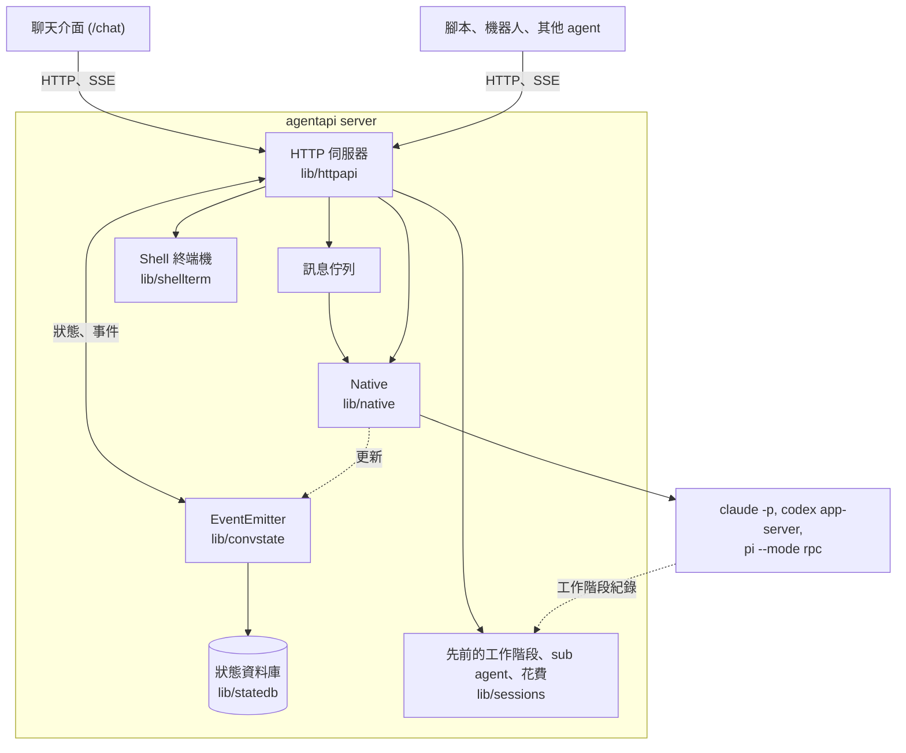
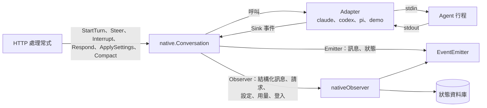

# 架構

[English](architecture.md) | 繁體中文

每個 AgentAPI 行程透過 agent 的結構化協定（native transport）執行一個 coding agent（Claude Code、
Codex 或 Pi），並提供 HTTP API、事件串流與內建聊天介面。本指南說明這個 Go 執行檔的實作架構；功能與用法見 [README](../README.zh-TW.md)。

## 目錄

- [總覽](#總覽)
- [儲存庫結構](#儲存庫結構)
- [啟動與關閉](#啟動與關閉)
- [HTTP 伺服器](#http-伺服器)
- [Native transport](#native-transport)
- [事件與對話狀態](#事件與對話狀態)
- [訊息佇列](#訊息佇列)
- [持久保存](#持久保存)
- [重新啟動與更新](#重新啟動與更新)
- [Shell 終端機](#shell-終端機)
- [檔案](#檔案)
- [安全模型](#安全模型)
  - [子行程環境](#子行程環境)
- [聊天介面](#聊天介面)
- [測試](#測試)
- [設計原則](#設計原則)

## 總覽



伺服器透過 `native.Conversation` 驅動 agent，對話把變更回報給事件發送器（emitter）。處理常式
呼叫對話，從 emitter 讀取狀態。

## 儲存庫結構

| 路徑 | 內容 |
| --- | --- |
| `main.go`、`cmd/` | Cobra CLI：`server`（旗標、agent 類型、啟動 agent、訊號、原地重新啟動）、`list`（已登記的 AgentAPI 和它們的摘要）、`hub`（`serve`：hub；`join`、`leave`、`status`：設定檔和執行中 AgentAPI 的 hub webhook）、`restart`（讓已登記的 AgentAPI 原地重新啟動），以及 `update`（會驗證 checksum 的自我更新） |
| `lib/httpapi/` | HTTP 伺服器：路由與處理常式、佇列、token 驗證、CORS 與跨來源檢查、事件串流、檔案／終端機／webhook 端點，以及嵌入的聊天介面；由它把下面三個套件接起來 |
| `lib/convstate/` | 用戶端讀取的對話狀態，不碰 HTTP：`EventEmitter`（變更以 epoch 和 seq 編號、訂閱與重播）、它推導出的任務和摘要、伺服器最後回報的佇列，以及它把每個變更交給的 `Persister` |
| `lib/webhook/` | Webhook 傳送（`Dispatcher`：佇列、重試、簽章、心跳、public URL 中的 `{ip}`），以及把 emitter 的事件轉成 webhook 事件的 observer（`Observe`，透過 `Source`） |
| `lib/workspacefs/` | 檔案檢視器從工作目錄讀取的內容（`Dir`）：檔案文字、透過 git 取得的 diff、HTML 預覽、要提供的檔案、路徑搜尋；拒絕的請求是 `Error`，由 `lib/httpapi` 依它的種類轉成狀態碼 |
| `lib/conversation/` | 共用型別（以 `conv` 匯入）：訊息、角色、狀態與錯誤等級，以及 agent 的對話（`lib/native`）回報變更的 `Emitter` |
| `lib/transcript/` | 結構化對話的型別：結構化訊息與其內容區塊、時間軸事件 |
| `lib/agentlog/` | 各 agent 工作階段紀錄的格式，一種 agent 一個套件（`claudelog`、`codexlog`、`pilog`）：紀錄型別、解析成結構化訊息與時間軸事件的 parser（adapter 也使用）、prompt 與注入內容的辨識、模型呼叫與檔案配置；另有逐行讀取、增量檔案索引和格式變動警告 |
| `lib/sessions/` | 伺服器持有的 `Store` 讀取目錄中先前的工作階段與對話（`history.go`）、sub agent（`subagents.go`）及花費（`cost.go`） |
| `lib/pricing/` | 每百萬 tokens 的模型價格（內建 `prices.json` 與 `--prices` 檔案），以及單次呼叫的花費計算 |
| `lib/native/` | Native transport：`Conversation`、`Adapter` 與 `Sink` 的約定、請求、設定、用量、登入 |
| `lib/native/claude`、`codex`、`pi` | 每種 agent 協定各一個 adapter |
| `lib/native/agentio` | 這些 adapter 執行 agent 時共用的部分：行程與它的迴圈（`Host`）、寫入 stdin、把回應對應到等待中的請求、寬鬆解碼與協定變動警告、快照節流 |
| `lib/native/demo` | `native-demo`，開發聊天介面用的模擬 agent |
| `lib/native/nativetest` | 測試用、可以寫腳本控制的假 adapter |
| `lib/native/procutil` | 子行程：行程群組（process group）與正常關閉流程 |
| `lib/statedb/` | `--state-db` 的 SQLite 持久保存，以及 `--state-file` 的匯入 |
| `lib/instanceapi/` | AgentAPI 和同時監看多個 AgentAPI 的客戶端之間的約定：它是誰（`WebhookInstance`，出現在 webhook 事件、摘要和登記檔中，含它的 `AgentType`）、它的摘要、webhook 的外層格式和簽章（`Sign`、`Verify`），以及 hub 對每個實例顯示的狀態（`StateOf`）。`lib/httpapi` 以同樣的名稱保留別名，OpenAPI schema 用的就是這些名稱 |
| `lib/hub/` | `agentapi hub serve`：實例、頁面上設定的群組和釘選、每個實例這一列顯示的內容最近一次變動的時間，以及 hub 看到它工作的區段（`store.go`、`work.go`，由 `persist.go` 保存在檔案中）、有簽章的 webhook 接收端（`webhook.go`）、每個實例的摘要串流（`watch.go`）、登入、瀏覽器的事件串流，以及到實例的代理（`hub.go`、`proxy.go`），還有機器怎麼加入（`join.go`：`GET /api/join` 和啟動 log 列出的位址）；使用說明見 [hub.zh-TW.md](hub.zh-TW.md) |
| `lib/sse/` | 依 HTML 標準讀寫 server-sent events：讀取端（合併多行 data:、略過註解、行尾可為 CR、LF 或 CRLF）和寫入端，hub 用它讀實例的摘要串流、寫給瀏覽器的串流。`lib/httpapi` 則用 huma 的 `sse` 寫它的串流 |
| `lib/netaddr/` | 這台機器的 IPv4 位址：其他機器連得到的位址（hub 的加入網址），以及連到某台主機時使用的位址（`Resolver`，供 `--public-url` 的 `{ip}` 使用） |
| `lib/userconfig/` | 使用者的設定檔 `~/.agentapi/config.yaml`：以旗標名稱設定，`agentapi server` 讀取、`agentapi hub` 寫入 |
| `lib/registry/` | 一台機器上執行中 AgentAPI 的登記檔（`~/.agentapi/instances`）：以原子方式寫入、列出，並刪除行程已不在的登記檔 |
| `lib/atomicfile/` | 一次取代整個檔案，當機後只會留下舊資料或新資料：先寫暫存檔並同步到磁碟，再改名就位，最後同步目錄（設定檔、登記檔、hub 的實例檔） |
| `lib/selfupdate/` | 把 k1dav-c/agentapi 的最新 release 安裝到程式的位置（`agentapi update`、`POST /update`）：到 GitHub 查詢、挑出這個平台的執行檔、比對 release 的 `checksums.txt` 並確認執行起來是那個版本，再在程式旁的鎖定檔保護下改名取代，檔案與目錄都會寫入磁碟（`Install`）；判斷使用者能否取代程式，並提供一次性的修正方式（`Program.Blocked`）；`selfupdatetest` 為測試提供假的 release |
| `lib/shellterm/` | 共用的 shell 終端機 |
| `lib/htmlpreview/` | 為 `GET /files/preview` 將相對路徑引用的資源嵌入為 data: URL，產生可獨立顯示的 HTML 預覽 |
| `lib/filelock/` | 同一台機器上的 AgentAPI 輪流取得的 flock：取代程式（`selfupdate`），以及重新啟動前 agent CLI 的自我更新 |
| `lib/procenv/` | AgentAPI 啟動的行程的環境變數：agent，以及終端機的 shell |
| `lib/agenthome/` | 各 agent 保存狀態的目錄（`CLAUDE_CONFIG_DIR`、`CODEX_HOME`、`PI_CODING_AGENT_DIR`） |
| `lib/handoff/` | 人工回覆 API 的型別 |
| `lib/logctx/`、`lib/util/` | 透過 context 傳遞的 logger 與共用輔助函式 |
| `internal/version/` | 版本號，建置時寫入 |
| `chat/` | 聊天介面（Next.js） |
| `e2e/` | 以腳本化 Claude Code（`e2e/fakeclaude`）進行的端對端測試 |

## 啟動與關閉

`agentapi server [旗標] -- <agent 指令>`（`cmd/server/server.go`）：

1. 旗標依序來自命令列、`AGENTAPI_*` 環境變數或 `~/.agentapi/config.yaml`（`--config`；viper）。
   `cmd/server/userconfig.go` 會記下不是旗標的名稱，讀不了的檔案則略過；檔案中沒有 `{port}` 的
   `state-db` 或 `pid-file` 也會略過，因為每個伺服器都會讀這個檔案，而資料庫只能由一個伺服器鎖住，
   PID 檔也只能由一個伺服器寫入。路徑設定開頭的 `~` 代表家目錄，`--state-db`、`--pid-file` 和
   `--public-url` 中的 `{port}` 和 `{hostname}` 會填入實際的值（`instanceapi.ExpandPlaceholders`）。
   `--public-url` 中的 `{ip}` 保留不填：它在伺服器執行期間會變（DHCP）。webhook dispatcher 每次為
   事件、摘要或登記檔組出實例資料時才填入（`lib/webhook/dispatcher.go` 的 `publicURL`），填的是通往
   webhook 網址那條路由的來源位址。`refreshIP` 在 emitter 的鎖之外透過 `netaddr.Resolver` 查詢這個
   位址（結果保留 30 秒，每次查詢最多等 `netaddr.DialTimeout`）：`instance.started` 之前、設定變更後、
   每次 heartbeat 之前，以及每 30 秒一次。事件只讀取最後查到的位址。agent 類型取自 `--type`；沒有指定時，
   取自 agent 指令的名稱（`claude`、`codex`、`pi` 或 `native-demo`）。其他 agent 和
   `--transport pty` 都會被拒絕，並指向最後一個提供 PTY transport 的版本 v2.5.1。
2. `nativeFactory` 依 agent 類型建立 `native.Factory`（Claude Code、Codex、Pi 或
   `native-demo`）。每個 adapter 會先檢查 agent 的參數，拒絕和它的協定衝突的參數。
3. 使用 `--state-db`（或 `--state-file` 旁的資料庫）時，`statedb.Open` 會開啟檔案、取得它的獨占鎖，
   並執行資料表結構的 migration；資料庫還沒有對話時，會匯入 `--state-file`。
4. `httpapi.NewServer` 建立 emitter、還原保存的狀態（檔案若屬於其他 agent 類型或
   工作目錄就拒絕使用）、建立對話、註冊路由，並啟動對話、佇列迴圈與 webhook 傳送器。`Start` 開始監聽後寫入登記檔（除非 `--registry=false`），
   再開始服務。
5. 收到 SIGINT、SIGTERM 或 SIGHUP 時，AgentAPI 以 webhook 送出
   `instance.stopped`（最多等 2 秒，且不超過 `Stop` 5 秒預算的一半）、刪除登記檔、取消進行中的
   重新啟動、關閉 HTTP 伺服器、停止佇列迴圈、關閉 agent 與 shell 終端機，並寫入、關閉狀態資料庫。
   收到 SIGUSR1 時只寫入狀態資料庫，不會停止。agent 結束不會讓伺服器停止：對話會重新
   啟動 agent（見 [Native transport](#native-transport)）。
6. 收到 SIGUSR2，或透過 API 更新時，伺服器會原地重新啟動（`cmd/server/reexec.go`、
   `selfExec.restart`）。伺服器啟動時最先建立 `selfExec`。它接管 SIGUSR2（這個訊號的預設動作會
   結束行程），所以伺服器啟動或停止期間收到的 SIGUSR2 不會結束行程（開始服務前收到的，會在開始
   服務後重新啟動）。它也在這時記下參數、環境變數和程式，因為更新取代檔案之後，`/proc/self/exe`
   指向的是已刪除的檔案。argv[0] 若就是正在執行的檔案，程式就採用 shell 找到它的方式（路徑，或
   `PATH` 上的名稱），這樣更新改指向新版本的 symlink 也會跟著走；否則採用 `os.Executable`。停止前，
   伺服器先以 `--version` 執行程式，再以之後要用的參數、環境變數加上隱藏的 `--validate`
   （`cmd/server/validate.go`）執行一次，各限 10 秒。
   `--validate` 像正式啟動那樣解析旗標、環境變數和設定檔，並在不啟動任何東西的前提下檢查能檢查的
   部分：各項值、佔位符、連接埠、agent 類型與傳輸方式、agent 的參數、
   價格檔、允許的主機與來源、綁定位址、webhook（`httpapi.CheckConfig`），以及狀態資料庫（不加鎖
   讀取、不做遷移，`statedb.Check`）。它不會監聽連接埠、不啟動 agent、不寫任何檔案，成功時印出
   `ok state-db-schema=N`，失敗時以非零狀態結束並說明原因。伺服器開著的狀態資料庫其他行程讀不到，
   所以新程式會略過它，改由伺服器拿 N 檢查（`statedb.DB.CheckWriter`）。比 `--validate` 早的程式
   會把它當成未知旗標拒絕，這時只以 `--version` 檢查。任一檢查失敗時，伺服器記下原因（程式寫出的
   最後一行）並繼續提供服務。成功時，伺服器依第 5 步停止，但保留 PID 檔（PID 不變），再以
   `syscall.Exec` 重新執行程式，沿用 stdin、stdout 和 stderr；Go 開啟的其他檔案都會在 exec 時關閉。
   不帶值的 `--api-token` 產生的 token 會透過 `AGENTAPI_GENERATED_API_TOKEN` 傳下去，新程式直接
   採用它而不另外產生，並從自己的環境變數移除，用戶端因此不必重新登入。沒有狀態資料庫時，送出過的
   初始提示會以 `AGENTAPI_INITIAL_PROMPT_SENT` 標記，新的工作階段不會再收到；有狀態資料庫時，
   還原的對話已經有它了。
   停止期間收到關閉訊號時，以關閉為準。每個登記檔都會註明伺服器能原地重新啟動
   （`restarts_in_place`），供 `agentapi restart` 判斷。

## HTTP 伺服器

`lib/httpapi` 使用 chi 處理路由，透過 huma 宣告型別化的 API 操作並產生 OpenAPI schema。
`make gen` 會將結果寫入 `openapi.json`。請求依序經過下列中介層（middleware）：

1. 主機授權：`Host` 標頭必須是允許的主機（忽略連接埠）。
2. 請求紀錄，會略過靜態檔案、事件串流和終端機。成功的讀取（狀態碼低於 400 的 `GET`、`HEAD`、
   `OPTIONS`）記為 Debug，只有 `--log-level debug` 才會輸出：不然每幾秒輪詢一次 `GET /status` 的
   用戶端會塞滿紀錄。變更和被拒絕的請求記為 Info，伺服器錯誤記為 Warn。
3. 壓縮（`compress.go`）：對接受 gzip 的用戶端，文字、JSON、事件串流（每個事件都會 flush）和聊天介面
   的檔案都會壓縮；圖片則照原樣傳送。hub 使用同一個中介層，它的代理會把實例已壓縮的回應原樣轉送。
4. 允許來源的 CORS，並允許憑證，讓聊天介面的 cookie 在其他來源也能使用。
5. 使用 `--api-token` 時的 token 驗證：Bearer token 或聊天介面的 session cookie。它在 CORS
   之後執行，所以 preflight 可以通過，401 回應也會帶有聊天介面讀取它所需的 CORS 標頭。

處理常式依檔案分組：

| 檔案 | 處理 |
| --- | --- |
| `server.go`、`routes.go`、`hosts.go`、`middleware.go`、`compress.go` | 伺服器的設定、啟動與停止；各功能自行註冊的路由；允許的主機與來源；請求記錄；壓縮 |
| `conversation_api.go`、`queue.go`、`sse.go` | 訊息、狀態與時間軸；佇列、派送（先送出到期的繼續，`beforeQueue`）與 `queue_update`；`GET /events` |
| `tasks_api.go` | `GET /tasks`：emitter 推導出的任務（`lib/convstate`） |
| `summary_api.go`、`spend.go`、`registry.go` | `GET /summary` 與 `POST /tasks/seen`，也就是 emitter 為監看多個 AgentAPI 的用戶端保存的摘要；每分鐘計算的花費；伺服器的登記檔（`instanceRegistry`） |
| `native.go` | 送出訊息、請求、設定、中斷、壓縮、重試登入；observer（`nativeObserver`） |
| `limit.go`、`sessions.go`、`subagents.go` | 因用量限制停下的回合（`/limit`）；agent 先前的工作階段和它們的花費（`/sessions`、`/cost`）；它的 sub agent（`/subagents`） |
| `terminal.go`、`files_api.go` | Shell 終端機（`terminalAPI`）；檔案檢視器與搜尋 agent 用 repo 相對路徑提到的檔案（`fileAPI`，底層是 `lib/workspacefs`） |
| `webhook_api.go`、`handoff.go` | Webhook 設定（`GET`／`PUT /webhook`、`POST /webhook/test`）、它描述的實例與啟動（由 `lib/webhook` 傳送）；人工回覆 API |
| `auth.go` | Token 驗證與聊天介面登入（`authAPI`） |
| `restart.go`、`statedb.go` | 重新啟動（`beginRestart`）；還原與保存狀態 |
| `update.go` | 透過 API 更新 AgentAPI（`POST /update`、`DELETE /update`、`updater`）與摘要的 `update`；見[重新啟動與更新](#重新啟動與更新) |
| `convstate.go`、`models.go` | `lib/convstate` 型別的別名；API 的型別 |
| `embed.go`、`uploads.go` | 嵌入的聊天介面；上傳的檔案（`uploadAPI`，它從操作的 middleware 處理 `POST /upload`：huma v2.32 每次處理 multipart 請求都會改動共用的操作） |

huma 以外的 chi 路由提供聊天介面（`/chat/*`，`/` 會重新導向到這裡）、上傳圖片
（`/uploads/{checksum}/{name}`）與工作目錄圖片（`/files/image`）。

`Server` 持有對話、emitter、佇列與鎖（`s.mu`）、webhook 傳送器、shell 終端機和
狀態資料庫。對話變更以外的功能交給註冊路由時建立的小模組：`fileAPI` 持有工作目錄，
`terminalAPI` 持有 shell，`uploadAPI` 持有上傳儲存，`authAPI` 持有 token 檢查，
`webhookAPI` 持有傳送器與狀態資料庫。

`lib/httpapi` 接起三個不認識 HTTP 的套件：

- `lib/convstate` 保存對話狀態。emitter 持有自己的鎖時，只呼叫不會阻塞、也不會回頭拿這把鎖的
  東西：`Persister`（狀態資料庫把寫入排進佇列）、狀態變更處理器（`webhook.Dispatcher.StatusChanged`，
  只排入佇列、不等待），以及摘要中的實例（`Dispatcher.Instance`，讀取最後查到的 `{ip}`）。
  鎖的順序是先 emitter，再傳送器和狀態資料庫。
- `lib/webhook` 只透過訂閱（`Source`）讀取 emitter，就像 `/events` 用戶端，並在自己的
  goroutine 上執行。
- `lib/workspacefs` 讀取工作目錄；`fileAPI` 把它拒絕的請求轉成 400、403 和 404。

huma 依 Go 型別名稱為 OpenAPI schema 命名，所以 `lib/httpapi` 為搬走的型別保留別名
（`convstate.go`、`FileMatch`、`WebhookConfig`），讓 schema 和這個套件的 API 沿用原本的名稱。

## Native transport

```go
// lib/conversation（以 conv 匯入）
type Emitter interface {
	EmitMessages([]Message)
	EmitStatus(Status) // initializing, changing or stable
	EmitError(message string, level ErrorLevel)
}
```

`stable` 對應到 API 向下相容的 `stable` 狀態（agent 閒置中，或只是在等回覆）；
`initializing` 和 `changing` 對應到 `running`。




`native.Conversation` 以 `Adapter` 為基礎執行對話，每種 agent 協定各一個：

```go
// lib/native
type Adapter interface {
	Start(ctx context.Context, sink Sink) error
	StartTurn(ctx context.Context, input Input) error
	Steer(ctx context.Context, input Input) error
	Interrupt(ctx context.Context) error
	Respond(ctx context.Context, requestID string, response Response) error
	Capabilities() Capabilities
	Wait() error
	Close() error
}

// Resume 說明 adapter 要開啟哪個工作階段：Ref、帶 Fork 時是它的副本，
// Ref 為空時則是新的工作階段。
type Factory func(resume Resume) (Adapter, error)
```

- **Sink。** Adapter 透過 `Sink` 回報 agent 的動作：回合開始與結束、結構化訊息、時間軸事件、
  請求的開啟與關閉、工作階段名稱與用來接續工作階段的參照、失去登入、錯誤。Sink 的呼叫來自
  adapter 的讀取迴圈，不會同時發生。結構化訊息每次增長時都會整則送出（快照，不是差異），
  而且同一個 factory 的各個 adapter 之間，訊息和請求的 ID 不會重複，因為對話會在替換
  adapter 後持續存在。
- **選用的部分。** 實作 `Configurable` 的 adapter 有設定（權限模式、模型、推理強度），並透過
  `SettingsSink` 回報 agent 自己變更的設定；`Compacter` 可以依要求壓縮 context；`UsageSink`
  接收 context 與用量限制的使用量。`Capabilities` 說明 agent 支援 steer、interrupt、resume、
  images、settings 和 compact 中的哪些。API 和聊天介面依這些能力決定可用操作，不以 agent 類型判斷。
- **世代（generation）。** 每個 adapter 都屬於一個世代。重新啟動或替換 agent 會開始新的世代，
  較舊 adapter 的事件會被忽略，所以被替換掉的 agent 無法再改變對話。
- **生命週期。** 啟動 adapter 時會啟動行程和它的工作階段（新的，或依工作階段參照接續）。找不到
  有效登入資訊的 adapter 會回傳 `LoginRequiredError`：對話會回報 `login_required`，每 5 秒重新啟動它
  一次，或在 `POST /login/retry` 要求時立刻啟動。agent 執行之後，對話會套用為這個工作階段
  選擇的設定、回報它的能力，並送出初始提示。`Restart` 會換成新的工作階段；`Switch` 會開啟
  另一個工作階段或它的副本，並帶入該工作階段的訊息，這些訊息由伺服器從 agent 的工作階段紀錄讀出
  （`sessions.Store.ReadHistory`；`GET /sessions` 會列出它們）。agent 在工作階段中執行過的
  sub agent 也以同樣方式從它們自己的紀錄讀出（`sessions.Store.Subagents`），提供給
  `GET /subagents` 和聊天介面的 Lineage 面板；它們的狀態取自啟動它們的 Agent 工具呼叫。sub agent
  的時間軸事件和訊息（`GET /timeline?subagents`、`GET /subagents/{id}`）會保留到它的紀錄改變為止。
- **結束。** agent 自行結束，或對話自己發起的啟動（第一次、結束後、等待登入後）失敗時，對話會在
  下一個 `RestartDelays`（2、10、30 秒）後接續原工作階段重新啟動，並使用新的世代。observer 會
  得知每次嘗試（`AgentExited`；伺服器顯示生命週期 `restarting`），以及最後一次失敗後對話放棄
  （`failed`）；之後直到替換 agent 前都沒有 agent 在執行。agent 執行滿 5 分鐘後，嘗試次數會重新
  計算。結束前已回報登入失效的 agent 則改為等待登入。呼叫端等待的啟動
  （`Replacement.Start`）失敗時不會重試：呼叫端會拿到錯誤。
- **花費。** `sessions.Store.Costs` 從同樣的紀錄讀出目錄中每個工作階段（含 sub agent）的模型呼叫
  （`GET /sessions`、`GET /cost`）：Claude Code 的 assistant 訊息（每個 message id 一次）、Codex 的
  token 計數、Pi 回報的金額。`lib/pricing` 為每次呼叫計價；Claude Code 的 `cost-state` 紀錄會把
  紀錄檔沒有列出的部分（壓縮）補成未逐筆列出的呼叫。分支複製的呼叫只算一次，算在最先建立的
  工作階段，依紀錄檔的建立時間判斷（Linux 用 statx，macOS 用 stat；其他系統用第一行的時間）。
  Store 索引每個紀錄檔的大小、讀取位置、讀取器狀態和已計價的呼叫：只讀取新增的完整行，也只替
  這些行新增或補完的呼叫計價；檔案縮小或被替換時重新讀取。如果沒有任何紀錄檔的呼叫改變，
  就直接回傳上一次的結果；否則只重算紀錄檔有變動的工作階段，再把各工作階段的花費加總。同時發出的
  請求共用一次讀取。索引的大小上限不適用於計算花費時讀到的紀錄檔（`agentlog.Pass`）：每次計算都
  以同樣的順序讀過全部紀錄檔，如果上限淘汰的是最久沒讀的檔案，被淘汰的每次都正好是下一個要讀的。
  索引會移除已不存在的紀錄檔。
- **紀錄格式。** 每種格式只在一個地方解碼（`lib/agentlog`）：什麼是 prompt、注入的內容或工具
  結果只判斷一次，adapter、歷史和花費都用同一套。parser 不認得的紀錄、無法
  解碼的行，以及沒有模型或用量、或讀出的用量是 0 的模型呼叫（欄位改了名，不然會默默算成 $0），
  每個紀錄檔的每一種只會以 Warn 記錄一次，並附上紀錄中的 CLI 版本，所以格式改變時會出現在
  伺服器的 log 裡。Claude Code 自己寫的訊息（`<synthetic>`）、Codex 只有用量上限的計數，以及 Pi
  失敗或中止的呼叫本來就不用 token，不算在內。
- **協定變動。** Adapter 以 `agentio.Decode` 解碼 agent 送來的內容：值的型別變了的欄位會被略過，
  整筆紀錄不會因此遺失，因為遺失回合結束的紀錄會讓回合一直停在進行中。adapter 不認得的紀錄類型、
  型別變了的欄位和無法解碼的紀錄，會依行程分別計數（`agentio.Drift`），每一種只以 Warn 記錄一次，
  並附上握手時取得的 CLI 版本。adapter 自行繞過的異常行為（`Drift.Unexpected`）也一樣：Pi 在沒有
  回報任何 run 時以忙碌為由拒絕 prompt；或 Pi 的 run 以 `agent_end`（`willRetry` 為 false）結束卻
  沒有送出 `agent_settled`，這時 adapter 會在 Pi 安靜 10 秒後自行結束回合（壓縮或重試期間不算）。
- **用量限制。** 帳號的用量限制讓回合停下時，adapter 會以 `limited` 停止原因結束回合（Claude Code
  的限制訊息與 `rejected` 的 rate limit 事件、Codex 的 `usageLimitExceeded`、Pi 模型供應商的
  額度錯誤）。對話會把它記成帶有重置時間的 `LimitStop`，直到下一個回合開始：期間伺服器的佇列
  會等待（`HoldsQueue`），而排定在重置時的繼續（`ScheduleContinue`、`--auto-continue`）會在佇列
  的派送迴圈中、排隊的訊息之前送出。
- **回合。** 只有 agent 閒置時訊息才會開始新的回合；否則 `StartTurn` 會回傳
  `ErrMessageValidationChanging`，由伺服器把訊息排入佇列。agent 壓縮 context 期間，回合也會
  以同樣的方式等待。寫出後 agent 沒有確認的訊息（`ErrUnconfirmed`：逾時、取消或 agent 結束）
  仍可能送達，所以它會留在對話中，回合也維持進行中，直到 agent 的事件結束它。如果 agent
  始終沒有開始這個回合，`Interrupt` 會結束它。
- **請求。** 核准、提問和計畫會成為 `RequestState`，帶有狀態（`pending`、`resolved`、
  `withdrawn`、`expired`）和 `response_capability`（`live`、`message`、`not_resumable`）。
  一個回答最多只會送到 adapter 一次，回合結束時仍待處理的請求會過期。agent 沒有確認的回答仍可能
  送達，所以這個請求不再接受其他回答，會維持待處理，直到 agent 關閉它或回合結束。祕密問題的答案除了送給
  agent 的那份之外，一律遮蔽。
- **Observer。** 訊息與狀態以外的變更（結構化訊息、請求、設定、用量、工作階段參照、登入）會
  送到 `Observer`，由伺服器實作，用來更新 emitter 和狀態資料庫。呼叫時仍持有對話的鎖，
  因此 Observer 不能反向呼叫對話介面，以免死鎖。
- **行程。** `procutil` 會在 agent 自己的 process group 中啟動它，使用 adapter 透過
  `lib/procenv` 建立的環境變數，其中不含上層 agent 工作階段的變數。`agentio.Host` 替 adapter
  執行這個行程：adapter 已關閉就不再啟動，並把輸出逐行交給同一個迴圈 goroutine。這個 goroutine
  也執行投遞給它的函式，以及唯一的計時器：送出節流暫緩的快照（`agentio.Throttle`，100 毫秒），
  以及等待被中斷的回合結束的 10 秒（`agentio.InterruptDeadline`）。Sink 由它呼叫。行程結束、
  迴圈也處理完它的輸出後，`Wait` 才視為 agent 已結束；行程結束 2 秒後則一律視為結束，因為 agent
  啟動的行程可能讓輸出一直開著。停止時會先關閉它的輸入，3 秒後對整個 group 送出 SIGTERM，
  再過 2 秒送出 SIGKILL。在那之前，adapter 會先中斷進行中的回合，最多等 3 秒讓它結束，agent
  的工作階段紀錄才不會停在沒有結果的工具呼叫。只要群組裡還有行程，群組就比 agent 活得久，所以
  不論 agent 怎麼結束（自行結束、被停止、重新啟動），`procutil` 都會接著對群組送出 SIGTERM，2 秒後
  送出 SIGKILL（`GroupGrace`），群組消失後就不再送訊號。

各個 adapter：

| Adapter | 行程 | 協定 |
| --- | --- | --- |
| `claude` | `claude -p --input-format stream-json --output-format stream-json ...` | stdin 與 stdout 上的 stream-json 訊息，加上 Claude Code 的 control protocol：`initialize`、`can_use_tool`（核准、提問、計畫）、`set_permission_mode`、`set_model`、`apply_flag_settings`、`get_settings`、`get_context_usage`、`interrupt` |
| `codex` | `codex app-server` | JSON-RPC：`thread/start`、`thread/resume` 或 `thread/fork`、`turn/start`（帶著設定）、`turn/steer`、`turn/interrupt`、`thread/compact/start`、`model/list`；核准、提問和 MCP elicitation 以伺服器請求送來；plan 模式是一種 collaboration mode |
| `pi` | `pi --mode rpc --session-id <id>`（副本加上 `--fork <id>`） | JSON lines：`prompt`（steer 也用它）、`abort`、`get_state`、`get_available_models`、`set_model`、`set_thinking_level`、`compact`；擴充功能的對話框以 UI 請求送來，用 `extension_ui_response` 回答 |
| `demo` | 無 | 模擬的 agent，會串流思考、一個工具呼叫和回覆，並能開啟每一種請求 |

## 事件與對話狀態

`EventEmitter`（`lib/convstate`）保存用戶端讀取的內容：訊息、結構化訊息、時間軸、
請求、任務、佇列、狀態快照（狀態、生命週期、server ID、回合數、agent 的工作階段 ID、能力、設定、
含 prompt cache 的用量、用量限制造成的停止、登入）。

- 訊息、結構化訊息、請求、任務或佇列的每次變更都會取得下一個序號（`seq`）；狀態和錯誤
  則整份重播，時間軸由 `GET /timeline` 讀取。對話以 `epoch` 識別，歷史被改寫時（收回訊息、
  重設、當機後還原）epoch 會改變。結構化訊息透過索引依 key 查找，所以有數萬則結構化訊息的接續
  工作階段也能一次載入。
- `GET /events` 以 server-sent events 串流變更：`message_update`、`status_change`、
  `rich_message_update`、`agent_error`、`request_update`，以及每 15 秒一次的 `heartbeat`。
  加上 `?sync=1` 時，串流會以 `session_sync` 事件開頭，並加上 `task_update` 和 `queue_update`
  （沒有選用 sync 的用戶端永遠收不到：有些用戶端遇到不認得的事件類型會出錯）；epoch 相符時只重播
  `since=<seq>` 之後的變更，事件也會帶有 SSE id，讓重新連線的 `EventSource` 從
  `Last-Event-ID` 接續。
- 收回訊息等無法用更新表達的變更，會產生新的 epoch 並結束對話訂閱。用戶端以舊 epoch
  重新連線後，會收到 SSE id 正確的完整重播。訂閱落後超過緩衝，或開啟工作階段需串流超過
  緩衝四分之一的結構化訊息時，也會結束訂閱。
- emitter 保留待處理的請求，以及最後關閉的 50 個（`native.MaxClosedRequests`）。更早關閉的請求
  被丟掉時不會送出事件，所以以 `since=` 接續的用戶端也要套用同樣的上限：手上已關閉的請求只留
  `closed_at` 最晚的 50 個，也就是完整重播會給的那些。聊天介面在 `mergeRequests` 裡這樣做。
- emitter 推導任務（`tasks.go`）。使用者訊息開始任務，執行中加入的訊息會
  steer 該任務；agent 閒置且沒有待處理請求時，任務結束。回答後若 agent
  暫時閒置，計時器會先留 3 秒讓它恢復工作；這段時間送出的訊息會開始新任務，因為 agent 沒有在工作。
  伺服器送出訊息前會先通知 emitter（`SendingMessage`）。結構化訊息抵達時，會取得目前任務的 `task_id`。
  還原或接續的訊息視為已完成的歷史紀錄。
- emitter 維護對話摘要（`summary.go`），包含 instance、狀態、`attention`（需要使用者處理的
  原因）、標題、最新任務、待處理請求、佇列和用量。有摘要訂閱者時，emitter 的每次呼叫只要變更了
  對話，就會在這次呼叫的所有變更完成後重新計算一次（回合結束時，agent 停止和任務結束
  在同一次呼叫裡），摘要不同才送出 `summary_update`；回覆文字增長不會送出摘要更新。
  只有 `/events?only=summary` 訂閱這些更新，串流另會送出心跳。`PUT /webhook` 可修改
  instance 的 ID 與網址，因此也會觸發摘要檢查，並重寫登記檔。
- 對於會讀取 session log 的 agent，伺服器每分鐘計算一次摘要的 `spend`（`spend.go`）：
  `sessions.Store.Costs` 以增量方式讀取 log，再把總計中結束於最近 24 小時和 7 天內的各小時加總，
  金額和 token 都算（`SessionCost` 的每個小時兩者都記，所以一個呼叫的 token 只算一次，和金額算在
  同一處）。`EventEmitter.SetSpend` 只在金額或 token 改變時才送出摘要，`updated_at` 記錄改變的時間。`scope` 是機器的
  主機名稱和 ID 加上 `sessions.Store.Scope`（agent、目錄的實際路徑、agent 存放 log 的位置）算出的
  雜湊值，讓 hub 對讀同一批 log 的兩個 AgentAPI 只算一次。
- emitter 也記錄用戶端上次顯示對話的時間（`POST /tasks/seen`，聊天介面顯示對話時會呼叫）：
  最新任務在那之後才結束時就是 `unread`。狀態資料庫會保存這個時間；還原時若沒有，還原的任務
  視為已讀。
- 狀態在 `running` 與 `stable` 之間切換時，會觸發 `run.status_changed` webhook 事件。webhook
  要送對話的事件時（`task.*`、`request.*`、`message.*`、`tool.*`、`login.*`、`limit.*`、
  `agent.error`；只送 `instance.*` 的 webhook 用不到，hub 預設就是這樣），webhook observer 才會
  像 `/events` 用戶端一樣訂閱 emitter，把它的事件轉成這些 webhook 事件：emitter 的任務更新轉成 `task.*`，agent 的訊息在
  下一則開始或回合結束時才送出。`PUT /webhook` 會依設定啟動或停止它。observer 訂閱時 emitter 已有
  的內容，以及比 AgentAPI 啟動時間更早的訊息（來自接續的工作階段）都不會送出。emitter 結束的訂閱，
  observer 會像用戶端以 `since` 接續那樣，從它處理到的 seq 重新訂閱。它只記得訊息和任務處理到哪裡、
  還在等結果的工具呼叫（最多 64 個）、最近 64 則帶有結果的訊息中已回傳的呼叫，以及尚未關閉的請求，
  對話重設時全部忘掉。傳送器從佇列依序一次送一個事件，失敗會重試，並以 `--webhook-secret` 簽章。
- 有狀態資料庫時，emitter 會把每次變更交給它的 `Persister`，它在自己的寫入 goroutine 上從副本
  編碼訊息與結構化訊息，所以串流中的長訊息不會拖慢 emitter。

## 訊息佇列

agent 忙碌時，訊息會在 `s.queue` 等待；對 agent 最後一則訊息的人工回覆（`POST /handoff/reply`）
也以同樣的方式送出，同樣會在這裡等待。佇列有獨立的鎖，讀取不必等待伺服器的鎖；變更時也會
持有 `s.mu`。派送迴圈每 500 毫秒檢查第一則訊息：agent 必須閒置、沒有用量限制暫停佇列，
也不在重新啟動中。

被拒絕的訊息最多嘗試 5 次。可能重複送達的訊息會立即丟棄：已寫出但未確認的訊息
（`native.ErrUnconfirmed`，原因可能是逾時、取消或 agent 結束）。寫入 stdin 的動作會隨呼叫的
context 結束，避免不再讀取的 agent 佔住 `s.mu`。

訊息也能 steer 或中斷目前回合。佇列變更會在佇列鎖之外以 `queue_update` 送到 emitter，
並帶版本號，供 emitter 捨棄晚到的舊變更。佇列會隨對話一起持久保存，每次變更都會寫入（佇列的 `onChange` 呼叫 `storeQueue`）：
當機後，已送出或已刪除的訊息不會再送一次。

## 持久保存

`lib/statedb` 使用純 Go 的 `modernc.org/sqlite`，把對話保存在 SQLite，支援 `CGO_ENABLED=0`
建置。emitter 會交付每次變更。

- 資料表有 `messages`、`rich_messages`、`session_events`、`requests`、`queue`、`tasks`（每個
  任務以伺服器編碼後的形式、依開始它的訊息 ID 保存），以及
  `meta`：保存 agent 類型、transport 和工作目錄、epoch 與 seq、工作階段參照與名稱、為
  工作階段選擇的設定、用量限制造成的停止、透過 API 修改的 webhook 設定（附啟動參數的指紋，
  參數改變時以參數為準）、用戶端上次顯示對話的時間
  （`seen_at`），以及哪些 AgentAPI 可以寫入這個檔案、最後由哪個寫入（見下文）。
- 寫入會先排隊，每 200 毫秒在一個交易中寫入，所以串流不必等待磁碟。正常關閉時會將檔案標示為
  已正常關閉；當機之後，對話會換成新的 epoch，用戶端會重新載入完整的對話。
- 檔案以獨占鎖定模式搭配 WAL 開啟，所以第二個 AgentAPI 無法使用它；新建立的檔案權限為 0600。
- 啟動時伺服器會還原對話、佇列和工作階段參照；對話會把參照交給 factory，讓 agent
  接續它自己的工作階段。AgentAPI 2 以 PTY transport 為同一個 agent 保存的檔案也能開啟：它沒有
  可接續的工作階段，所以 agent 會在對話下方開始新的工作階段，之後 `meta` 記為 native（不讀取它的
  `initial_prompt`）。還原後，先前待處理的請求會標示為已過期。
- 無法讀取的資料列會記錄後略過，讓伺服器仍能啟動。編號的 migration 負責更新資料表結構，
  `PRAGMA user_version` 記錄版本。
- 每個 migration 都標明執行後最舊可以寫入檔案的結構版本。只新增資料表或欄位的 migration 沿用
  先前的值，所以較舊的 AgentAPI 可以繼續使用較新版本 migrate 過的檔案，並維持檔案的結構版本不變。
  改變較舊 AgentAPI 寫入內容的 migration 會提高這個值，並記錄在 `meta`（`min_writer_schema`，
  附上帶來它的版本）；較舊的 AgentAPI 遇到這種檔案會拒絕啟動，並指出需要的版本。`meta` 也記錄
  最後關閉檔案的 AgentAPI（`writer_version`）。1.9.0 以前的版本不讀這些值，遇到結構比自己新的
  檔案一律拒絕；結構從 1.0 起就沒有改變。
- 較舊的 AgentAPI 不認得的資料，它重設或移除訊息時也不會清掉。還原時，訊息已不存在或已換成
  另一則的任務會被丟棄；訊息資料列無法讀取的任務也一樣。
- 上傳的檔案放在 `<state-db>.uploads`，與資料庫一起保留（沒有狀態資料庫時放在暫存目錄，停止時
  刪除）。啟動時、每小時，以及重新啟動或切換工作階段清空對話後，`upload_prune.go` 會刪除對話
  （訊息、rich message、時間軸、請求、佇列）完全沒有引用、而且超過 7 天的 checksum 目錄：只要
  有一串十六進位字元包含該 checksum 就算引用，路徑、`/uploads` URL 和 JSON 都涵蓋在內；修改時間
  和這個伺服器最後一次存入它的時間都要超過 7 天。這 7 天是留給瀏覽器的草稿，草稿的附件還不在對話裡。
  只有以 checksum 命名、裡面只有一般檔案的真實目錄會經由 `os.Root` 刪除；symlink 和其他東西
  都不會動。有刪除檔案時，會以 Info 記錄刪除的數量和 bytes。

hub（`lib/hub`，`persist.go`）把實例保存在 JSON 檔案裡，格式是
`{"version": 1, "instances": [...]}`；2.2 以前的 hub 寫的純陣列也讀得懂。有變動時只標記檔案落後，
由背景的寫入者每秒最多寫一次、`Hub.Close` 時再寫一次，經由先 sync 再改名的暫存檔寫入。hub 啟動時
把讀到的檔案複製成 `instances.json.bak`。無法解析的檔案會改名放到一旁（`.corrupt-<時間>`），hub
從空的清單開始；版本較新的檔案則讓 hub 停止啟動。舊 hub 會把新格式當成損壞的檔案放到一旁，所以
改回舊 hub 前要先用 `jq .instances` 轉換（見 [hub.zh-TW.md](hub.zh-TW.md#檔案)）。version 1 裡後來
加上的欄位，例如每個實例的工作時間（`work`：最近 7 天的區段，只在區段開始或結束時寫入），讀得懂這個
格式的舊 hub 會略過。hub 處理過的
webhook 事件的 delivery ID 也以同樣方式寫入 `instances.deliveries.json`，保留到各自的簽章失效，所以
重新啟動後重送的事件同樣會被拒絕。

`--state-file` 是 1.0 之前 PTY transport 的保存機制（關閉時寫出 JSON），已棄用：`cmd/server`
會把它一次性匯入旁邊的狀態資料庫（`statedb.ImportStateFile`，只匯入空的資料庫），之後由資料庫
保存對話；agent 會在它下方開始新的工作階段。SIGUSR1
會把排隊中的變更寫入狀態資料庫。

## 重新啟動與更新

- `DELETE /messages` 會清除對話、請求和佇列並重新啟動 agent；新的 agent 啟動前，AgentAPI 會為
  Codex 和 Pi 執行 `codex update` 或 `pi update --self`，最多 3 分鐘，在獨立的 process group
  中執行，並持有使用者快取目錄裡的鎖（Linux 為 `~/.cache/agentapi/codex-update.lock`），所以
  執行同一個 CLI 的多個 AgentAPI 會輪流更新。agent 關閉後，由 `Restart`
  開始新的工作階段。
- 替換 agent（重新啟動、開啟另一個工作階段）分成兩步。`BeginRestart` 和
  `BeginSwitch` 在 `s.mu` 底下讓舊 agent 退役：之後忽略它的事件；有回合在
  執行或正在壓縮 context 時，`BeginSwitch` 會以 `ErrTurnActive` 拒絕，而且不改動任何東西。
  `Replacement.Start` 接著在不持有 `s.mu` 的情況下關閉舊 agent、更新 CLI 並啟動新的 agent
  （`runRestartLocked`）：這段期間 `s.restarting` 會暫停佇列，其他替換和人工回覆協定會
  得到 409 或沒有內容，不需要 `s.mu` 的請求（`/status`、`/handoff`、`/queue`）照常回應。Stop 會
  取消進行中的重新啟動。接續工作階段的歷史會在取得 `s.mu` 之前讀取。
- agent 結束後由對話再啟動（見 [Native transport](#native-transport)），不使用 `s.mu` 或 `s.restarting`：沒有閒置的
  agent，所以訊息會在佇列中等待。最後一次嘗試失敗後，伺服器繼續提供服務，生命週期為 `failed`，
  直到重新啟動或切換工作階段啟動新的 agent。
- AgentAPI 本身收到 SIGUSR2 時會原地重新啟動（見[啟動與關閉](#啟動與關閉)），改用更新放在原啟動
  路徑上的執行檔。使用 `--state-db` 時會還原對話，agent 也會接續原本的工作階段；沒有時對話會
  重新開始。`agentapi restart [port…|--all]`（`cmd/restart`）讀取登記目錄（呼叫者的；透過 `sudo`
  執行時是 `SUDO_USER` 的家目錄），挑出這台機器上、行程屬於該使用者、執行的是 `agentapi server`
  （`/proc/<pid>`，其他系統用 `ps`）且能原地重新啟動的登記檔，逐一送出訊號（自己所在的那個最後），
  並等每個 AgentAPI 以新的 server ID 重新登記、在原連接埠回應 `GET /status`。新執行檔沒通過停止
  前的檢查（`--version`、`--validate`）時，AgentAPI 照原樣繼續執行，指令會在 `--timeout` 到了之後
  回報，原因寫在它的紀錄裡。`agentapi update --restart` 會對仍在執行舊執行檔的 AgentAPI 做同樣的事。
  hub 不會原地重新啟動，由服務管理工具重新啟動。
- 開啟 `--allow-update` 時，`POST /update`（`update.go`）會把 AgentAPI 更新到最新發行版並原地重新
  啟動，由一個跟著伺服器生命週期的 goroutine 執行。`checking` 查詢發行版，並以 `--version` 執行
  磁碟上的程式。`downloading` 把發行版安裝到程式的位置（`lib/selfupdate`）；共用程式的另一個
  AgentAPI 已經更新過、磁碟上的程式夠新時就略過。`waiting` 會暫停佇列，等到 agent 處於 stable、
  沒有待回覆的請求，每次狀態變化時檢查一次。`restarting` 在 `s.mu` 底下開始：從此
  訊息留在佇列、不會開始重新啟動 agent，人工回覆協定也不提供內容。接著呼叫和 SIGUSR2 相同的
  重新啟動。`"now"` 會略過等待，`DELETE /update` 在重新啟動前都能取消更新。失敗時（包括重新
  啟動前的檢查：新發行版無法以目前的設定或狀態資料庫啟動），狀態變成 `failed` 並附上錯誤，伺服器
  繼續提供服務。每一步都會改變摘要的 `update`，`summary_update` 會把它帶給 hub。每次請求都會
  重新解析程式路徑，`blocked` 也每分鐘重新檢查，所以中途設好的 symlink 會馬上生效。
- `/status` 會回報生命週期：`starting`、`ready`、`running`、`restarting`、`exited` 或
  `failed`。前三種由 `EmitStatus` 依對話的狀態推得；其他的由伺服器設定（`SetLifecycle`），
  狀態不會取代它們（舊 agent 在重新啟動期間可能仍會回報），直到 `ReleaseLifecycle`：
  重新啟動完成時，或對話自行重新啟動的 agent 可以接受回合或等待登入時。

## Shell 終端機

`lib/shellterm` 會在 agent 的工作目錄、以虛擬終端機（`creack/pty`）執行一個 login shell，
環境變數和 agent 相同，但不含 AgentAPI 自己的變數。第一個用戶端開始觀看時它才啟動，沒有人
觀看時也會繼續執行。它的輸出會寫進 256 KiB 的捲動緩衝區（從行首截斷）和每個觀看者的緩衝區。
捲動緩衝區是環狀的，加入一段輸出所花的時間只和那段輸出的長度成正比，與緩衝區大小無關。落後
512 個區塊的觀看者會被斷開，重新連線後再取得捲動緩衝區。`GET /terminal` 串流 `output`
（base64）和 `exit` 事件，`POST /terminal/input` 與 `/terminal/resize` 則輸入按鍵和調整大小，
以最後一次調整為準。關閉時會掛斷終端機，2 秒後終止 shell 的 process group。

## 檔案

`GET /files/content` 和 `GET /files/diff` 提供聊天介面的檔案檢視器。路徑不存在時，檢視器會向
`GET /files/find` 查詢工作目錄底下路徑結尾相符的檔案（不分大小寫）：以廣度優先走訪，略過隱藏
目錄、相依套件和 Go 的 module cache（除非路徑本身就在裡面），並在走過 50,000 筆或 2 秒後停止。
路徑在 agent 的工作目錄內解析，並追蹤、檢查 symlink；只讀取一般檔案，最多 1 MiB。diff 在儲存庫
中只以唯讀方式執行 git（`rev-parse`、`ls-files`、`cat-file`，並關閉 fsmonitor），再在暫存目錄中
以 `git diff --no-index` 比對已 commit 和目前檔案的副本，不使用使用者或系統的 git 設定，所以不會
執行儲存庫設定的任何程式。

預覽同樣以 agent 的工作目錄為根目錄讀取檔案。`GET /files/preview`（`lib/htmlpreview`）回傳的 HTML 檔中，
以相對路徑引用的樣式表、腳本、圖片、字型和影音都會轉成 data: URL：只收副檔名符合用途的檔案
（樣式表必須是 `.css`，腳本必須是 `.js`），不接受隱藏目錄內或工作目錄外的檔案，每個最多
4 MiB，合計 16 MiB。聊天介面把頁面放在設了 `allow-scripts`、但沒有 `allow-same-origin` 的
sandbox iframe 中：頁面沒有 origin，所以它的腳本讀不到聊天介面，也無法帶著 session cookie
呼叫 API，而且頁面引用的東西都不會從 AgentAPI 載入（前面若有代理，代理的 cookie 也帶不過
去）。`GET /files/image` 和 `GET /uploads` 一樣依內容判斷點陣圖，另外也依副檔名提供 SVG
（`GET /uploads` 從不提供 SVG）；兩者都會加上 `nosniff` 和會開啟 sandbox 的
Content-Security-Policy。

上傳的檔案存成 `<checksum>/<name>`（`upload_store.go`），checksum 是內容 SHA-256 的前 8 bytes，
所以路徑不會改變；沒有被引用的檔案在 7 天後刪除（見[持久保存](#持久保存)）。

## 安全模型

- 系統沒有獨立的使用者帳號或角色。通過 token 驗證（若已啟用）及主機、來源檢查的用戶端，
  即可使用 agent 的能力：
  agent 以 bypass 權限模式啟動，shell 終端機可以執行指令。
- `--api-token`：以固定時間比對。瀏覽器透過 `POST /auth/session` 登入，它會設定一個
  HttpOnly、SameSite=Strict 的 cookie，裡面存的是 token 的 HMAC 而不是 token 本身，所以更換
  token 會讓所有瀏覽器登出。靜態的聊天介面檔案和 `/auth/session` 會略過 token 檢查；登入時
  會自行檢查 token。
- `--bind` 限制誰能連線，`--allowed-hosts` 決定接受哪些 `Host` 標頭（預設為 `localhost`、
  `127.0.0.1` 和 `[::1]`，用來防範 DNS rebinding），`--allowed-origins` 決定哪些來源可以從
  瀏覽器呼叫 API。其他來源的網頁送出會造成改動的請求（GET、HEAD、OPTIONS 以外）時，除非那個來源
  列在清單上，否則一律拒絕；`*` 不信任任何來源（`crossorigin.go`，規則同 Go 1.25 的
  `http.CrossOriginProtection`）。
- 上傳的檔案存放在私有目錄，只回傳圖片。工作目錄以外的檔案無法開啟。
- webhook 會把設定要送的內容（包括對話）送到它的網址，而 `PUT /webhook` 可以修改網址；它的
  HMAC secret 只能寫入、無法讀回。
- 透過 API 更新預設關閉，要用 `--allow-update`（或設定檔中的 `allow-update: true`）開啟。它只會從
  GitHub 安裝 k1dav-c/agentapi 符合這個平台的最新正式發行版：下載的檔案必須符合發行版的
  `checksums.txt`，執行起來也必須是那個版本，請求無法指定版本或網址。AgentAPI 從不執行 `sudo`，
  只取代使用者能寫入其目錄的程式，否則回報一次性的修正方式（`blocked`）。`POST /update` 會造成
  改動，所以其他來源的網頁送不出這個請求；它也和其他端點一樣需要 token。
- hub（`lib/hub`）持有實例的 API token，只會送到以它的 secret 簽章的事件（timestamp 和 body 的
  HMAC，不超過 10 分鐘，每次傳送只處理一次）或已登入者加入的實例網址。代理只轉送到已連上的實例
  （hub 正從它的網址讀到這個實例的摘要），所以連線中不轉送，網址由另一個 AgentAPI 回應時（摘要裡是
  別的實例 ID）也不轉送。事件必須寫明是哪一次執行（`server_id`），而且只能搬動 hub 確定網址已失效的
  實例（超過連線寬限仍連不上，或那裡回應的是另一個 AgentAPI），已連上或連線中的實例、手動加入的實例
  一律不動；實例搬走後，hub 不再送出它自己的 token。檔案記下 hub 最後一次讀到各實例摘要的網址，hub
  重新啟動後先從那裡追蹤。每台加入的機器都有同一個 secret，所以任何一台仍然可以把新的實例 ID，或位址
  已經不回應的實例 ID，指向自己的位址，拿到 `--instance-token`；每台機器各用一把金鑰才能根除。瀏覽器以 hub token 登入，換取
  由 token 推導出的 HttpOnly、SameSite=Lax cookie；代理會移除瀏覽器的 cookie 以及 `Authorization`、
  `Origin`、`Referer`、`Sec-Fetch-*` 標頭，也會移除實例的 `Set-Cookie`，雙方的憑證都不會傳到另一邊。
  hub 和 AgentAPI 一樣，拒絕其他來源的網頁送出會造成改動的請求；設定 `--allowed-hosts` 時，只回應
  用這些名稱或 IP 位址連來的瀏覽器。代理在每個回應加上 `Content-Security-Policy: sandbox`，實例送來的
  內容不會以 hub 的網頁身分執行；代理也拒絕修改實例的 webhook，因為 webhook 決定 hub 把 token 送到哪裡。
  讓機器加入用的 secret，只有設了 token 的 hub 才會交給已登入的瀏覽器（`GET /api/join`）；啟動時的
  log 一律不寫。
- 上層 agent 工作階段會為它執行的指令設定環境變數（包含機密資訊）；agent 不會繼承這些變數，也不會拿到 AgentAPI 的機密：API token、webhook 與 hub 的 secret 和
  token（`lib/procenv`）。

### 子行程環境

AgentAPI 從另一個 agent 工作階段中啟動時，會先清除繼承的工作階段標記與機密資訊，再啟動
子 agent；重新啟動前的 CLI 更新（`codex update`、`pi update --self`）
也一樣。這可避免子 agent 沿用上層的工作階段識別或沙箱標記。
實作見 [lib/procenv/procenv.go](../lib/procenv/procenv.go)。

**Claude Code 工作階段變數**

| 變數 |
| --- |
| `CLAUDECODE` |
| `CLAUDE_CODE_ENTRYPOINT` |
| `CLAUDE_CODE_SESSION_ID` |
| `CLAUDE_CODE_CHILD_SESSION` |
| `CLAUDE_CODE_SESSION_ATTENDED` |
| `CLAUDE_CODE_EXECPATH` |
| `CLAUDE_CODE_MESSAGING_SOCKET` |
| `CLAUDE_CODE_MESSAGING_TOKEN` |
| `CLAUDE_CODE_SSE_PORT` |
| `CLAUDE_PID` |
| `CLAUDE_EFFORT` |
| `CLAUDE_AGENT_SDK_VERSION` |
| `CLAUDE_CODE_EMIT_SESSION_STATE_EVENTS` |
| `CLAUDE_CODE_SDK_READS_SESSION_STATE` |

**Codex 工作階段變數**

| 變數 |
| --- |
| `CODEX_THREAD_ID` |
| `CODEX_SANDBOX` |
| `CODEX_SANDBOX_NETWORK_DISABLED` |
| `CODEX_CI` |
| `CODEX_INTERNAL_ORIGINATOR_OVERRIDE` |
| `CODEX_TUI_RECORD_SESSION` |
| `CODEX_TUI_SESSION_LOG_PATH` |

**其他移除的變數**

| 變數 |
| --- |
| `PI_CODING_AGENT` |
| `AI_AGENT` |
| AgentAPI 的機密：`AGENTAPI_*_TOKEN` 與 `AGENTAPI_*_SECRET`（`AGENTAPI_API_TOKEN`、`AGENTAPI_WEBHOOK_SECRET`、`AGENTAPI_HUB_SECRET`、`AGENTAPI_HUB_TOKEN`、`AGENTAPI_HUB_INSTANCE_TOKEN`、`AGENTAPI_GENERATED_API_TOKEN`） |

`CLAUDE_CONFIG_DIR`、`CODEX_HOME`、`PI_CODING_AGENT_DIR` 與 `ANTHROPIC_*` 等設定會保留。
清除之後，Claude Code adapter 會再設定它的協定需要的 `CLAUDE_CODE_ENTRYPOINT=sdk-cli`
與 `CLAUDE_CODE_EMIT_SESSION_STATE_EVENTS=1`。共用的 shell 另外會移除 AgentAPI 自己的
`AGENTAPI_*` 變數。

## 聊天介面

`chat/` 是 Next.js 15 與 React 19 的應用程式，用 bun 建置成靜態輸出。`make embed` 會把建置
結果複製到 `lib/httpapi/chat/`，再由 `embed.go` 以 `go:embed` 嵌入。建置時使用一個佔位的基礎
路徑，由伺服器改寫成 `--chat-base-path`（預設為 `/chat`）。聊天介面也能以開發伺服器獨立執行
（`bun run dev`，加上 `?url=<伺服器>`），`/chat/embed` 則是嵌入其他頁面用的版本（`hub=1`：在 hub
的框架裡，它依 hub 用視窗訊息送來的內容畫出 hub 的實例列，見 `lib/hub-frame.ts`）。`/chat/hub/`
是 hub 的頁面（`components/hub-view.tsx`，各部分與 hook 在 `components/hub/`，邏輯在 `lib/hub.ts`，
所做的變更經由 `lib/hub-api.ts`），由 `agentapi hub serve` 以同一份建置提供。

- `components/chat-provider.tsx` 組合用戶端狀態與 API 操作。動作與 API 呼叫來自
  `useChatActions()`，這個物件永遠不變，所以只做動作的元件不會重新 render；狀態則用
  `useChatSelector`（`lib/store.ts`）分片讀取，元件只在它讀的那一片改變時才重新 render。
  `use-event-stream.ts`、`use-queue.ts`、`use-drafts.ts` 與 `use-session-cache.ts` 分別把事件套用
  到狀態、追蹤訊息佇列、送出訊息並保留草稿直到伺服器收到，以及快取對話。
- 事件串流使用 `/events?sync=1`，並記錄最後序號以便增量重播（`lib/chat-stream.ts`）。很長的
  重播每 1.5 秒先顯示一次進度，但排在訊息之後的請求和任務會沿用 chat 原有的，等重播自己的送到
  才取代；屬於別的對話的會立刻拿掉：重播送來的同 ID 訊息已是另一則的任務，以及在重播第一則訊息
  之前就提出的請求。
  `EventSourceConnection`（`lib/event-source.ts`，以及 hook `use-event-source.ts`）讓它、hub 頁面
  的串流和 shell 終端機的串流保持連線：結束的串流會立刻重新開啟、不顯示提示，除非一直失敗；失敗的串流
  （401、proxy 的 502）在退避後重試；有心跳的串流沒了動靜，由 watchdog 重新連線；瀏覽器恢復連網
  或回到分頁時也會重新連線。事件內容的型別來自產生的 schema（`lib/events.ts`），null 的清單在
  事件抵達時就換成空清單。chat 不認得的任務或 sub agent 狀態（來自較新的伺服器；hub 會用自己的
  建置開啟各版本的實例），也在這裡換成認得的值。IndexedDB 為每個伺服器保存對話供下次開啟時載入：
  每則訊息一筆紀錄，只寫入改變的部分，並記下所存內容的序號；超過 14 天沒用的伺服器快取會刪除，超過 100 個伺服器或
  總計 50,000 筆紀錄時，刪除最久沒用的；hub 的每個實例各算一個伺服器（`lib/session-cache.ts`）。
- `lib/task-timeline.ts` 的 `TimelineBuilder` 將訊息分組為任務，從第一個變更處重建並保留未變的
  物件，讓經過 memo 的任務與工具呼叫不必重新 render。每一段就是伺服器的一個任務（`task_update`，
  和請求一樣保存與快取）：steer 進去的訊息（`steered`）留在其中，依時間排在它的步驟之間；伺服器
  不送任務時，每則使用者訊息各成一段。每一段的狀態取自伺服器的任務；結構化的活動依 `task_id`
  歸到所指的任務，只有沒有標記的活動才依時間放置。任務的花費是它執行期間的模型呼叫。佇列依
  `queue_update` 事件更新；每次連線時讀取 `GET /queue`，只有一直沒收到事件時才每 60 秒讀取一次。
  render 出錯時會顯示 `chat-error-boundary.tsx`，可以清除快取的對話後重新載入。
- `lib/chat-api.ts` 是型別化的 HTTP 用戶端，`lib/api-schema.ts` 保存由 OpenAPI schema 產生的型別。
- `components/chat.tsx` 負責頁面版面：訊息清單（任務、工具呼叫列、思考）、輸入框上方的停靠區
  （狀態列、登入卡片、請求卡片、用量限制卡片、prompt cache 過期提醒）、
  輸入框（`message-input.tsx`，含斜線指令、工作階段設定和用量指示）、Explorer（含先前的工作階段和
  它們的花費，`session-history.tsx`，以及 webhook 設定，`webhook-settings.tsx`）、sub agent 的
  Lineage 面板（`lineage.tsx`）、檔案檢視器以及 shell
  終端機（`shell-view.tsx`，來自 `/terminal`）。
- `lib/` 將邏輯封裝為獨立模組，並附有 Bun 測試：任務分組、工具格式化、檔案參照、diff、斜線
  指令、設定、用量、花費（`cost.ts`：任務在工作階段呼叫中的份額、各期間的加總）、終端機按鍵、
  驗證。`use-session-cost.ts` 會在回合結束時和回合執行中讀取 `GET /cost`；第一次讀取之後會帶上
  `from` 和 `digest`，只取得之後新增的呼叫。

## 測試

- Go 測試和程式碼放在一起，以 `CGO_ENABLED=0` 執行；和時間有關的程式碼使用 `coder/quartz`
  的時鐘。
- Adapter 有模擬 agent 行程的測試骨架、以真實 CLI 的去識別化擷取資料建立的重播測試
  （`testdata/`），以及把它們的結構化訊息和工作階段紀錄解析器的結果相比對的一致性測試。
  `nativetest` 為對話與 HTTP 測試提供假 adapter。
- `e2e/` 以腳本化的 Claude Code `e2e/fakeclaude` 測試伺服器執行檔，包括原地重新啟動。
- CI 執行 `golangci-lint`（包含對列舉的 exhaustive 檢查）、`paralleltestctx` 和 `make gen`
  （OpenAPI schema 必須和程式碼一致）；聊天介面有 eslint、`bun test` 和 `tsc`。CI 也以 race
  detector 執行 `lib/` 和 `cmd/` 的測試，在 macOS 上執行所有測試，在 Windows 上建置所有測試，
  並執行含 Windows 程式碼的套件的測試。Release workflow 會對要發行的 commit 執行這些測試
  （以可重複使用的 workflow 呼叫 `go-test.yml`），Linux 的 job 通過後才發行；推送到 `main`、手動執行和
  手動發布的發行版都一樣。macOS 和 Windows 的 job 在另一次呼叫中執行，發行不等它們。pull request 則
  自己執行所有 job。Release workflow 也會檢查每個執行檔都是為對應平台建置的。之後的推送發行的版本已包含這個 commit，或這個 commit 已不在 `main` 上時，這次推送不會發行。

## 設計原則

- AgentAPI 透過 Claude Code、Codex 和 Pi 的結構化協定驅動它們，而不是它們的終端機介面。
- 用戶端依能力（capabilities）決定要提供什麼，從不依 agent 類型。
- Adapter 回報完整的快照；由對話和 emitter 把它們轉成更新。
- 世代和不重複的 ID 確保被替換掉的 agent 無法改變對話。
- 送到瀏覽器的內容都可以重播：訊息、結構化訊息和請求的每次變更都有序號，其餘內容整份重播，
  落後的用戶端會重新載入狀態。
