# Chat UI guide

English | [繁體中文](chat-ui.zh-TW.md)

AgentAPI serves a chat UI at `/chat`. It is embedded in the `agentapi` binary, works with every
transport, on a desktop and on a phone, and talks to the server only through the
[HTTP API](../README.md#http-api-reference). This guide goes through every part of it.

The screenshots and the animations show AgentAPI v0.27.0 with the built-in `native-demo` agent
working on a small sample site; the demo's replies, tool results, models and usage are simulated,
and TTY mode shows bash run as a PTY agent. The animations draw a blue dot where the pointer is and
where it clicks. [scripts/capture-docs.mjs](../scripts/capture-docs.mjs) takes all of them again
(see the [screenshot guide](screenshots/README.md)). Parts marked *native* need the [native
transport](../README.md#native-transport), which Claude Code, Codex and Pi use by default.

## Contents

- [The window](#the-window)
- [Tasks and the transcript](#tasks-and-the-transcript)
- [Sending tasks](#sending-tasks)
- [Agent settings](#agent-settings)
- [Requests and decision cards](#requests-and-decision-cards)
- [Files](#files)
- [Session Explorer](#session-explorer)
- [Lineage](#lineage)
- [Terminals](#terminals)
- [Session details and alerts](#session-details-and-alerts)
- [Phones](#phones)
- [Connection and caching](#connection-and-caching)

## The window

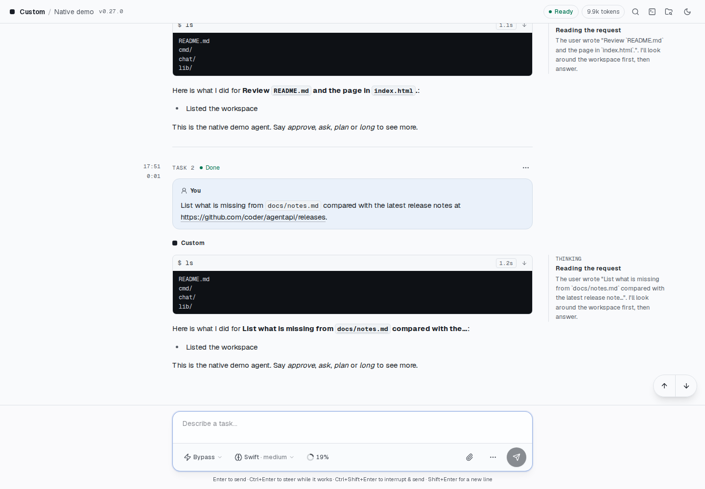

- **Header.** The agent's mark and type, the session name and the AgentAPI version. On the right:
  the status (Ready, Working with a timer, or Needs you; click it for the
  [session details](#session-details-and-alerts)), the tokens used so far, and buttons for
  [search](#search), the [terminal](#terminals) (the shell terminal with the native transport,
  TTY mode with PTY), the [Session Explorer](#session-explorer) and the light or dark theme.
- **Transcript.** One block per task, oldest first. The left column shows when each task started
  and how long it took.
- **Composer.** The message box and its toolbar: *native* the permission mode, the model and
  reasoning effort, and how full the context is; then the attachment button, more input options
  and the send button. The line under it lists the keys.
- The ↑ and ↓ buttons at the bottom right jump to the previous and the next task.

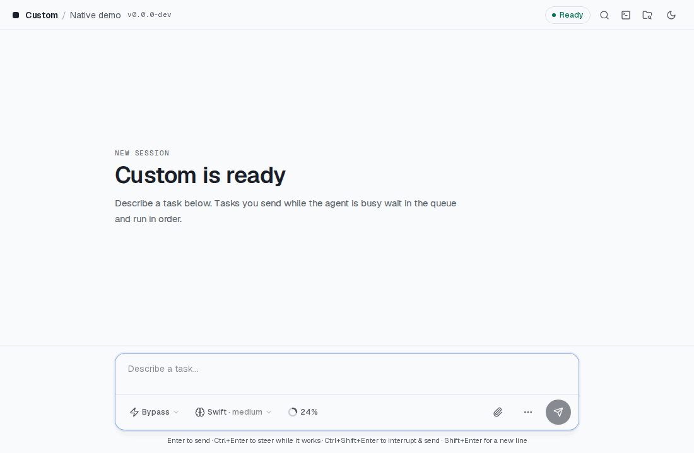

## Tasks and the transcript

Every message you send starts a task. A task shows your prompt in a tinted block labelled "You",
then what the agent did, in order: its reply in Markdown, a row for each tool call, and its
thinking. The task's header shows its number and state (Queued, Working, Waiting for you, Done or
Failed), a Stop button while it works, and its ⋯ menu.

### Tool calls

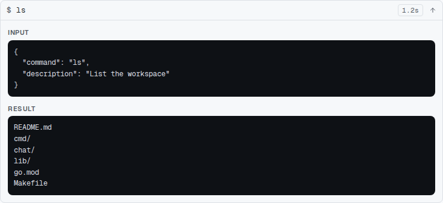

A tool call takes one row: its command (`$ ls`) or the tool's name, its state (waiting for approval,
an error, a failed command's exit code) and how long it took. Click the row for the tool's input and
its whole result. File names on the row, from the tools that read, write or edit files, open the
[file viewer](#files), and an expanded call that changed a file shows the change as a diff, with
the raw input a click away. Tool results that are images (Claude Code reading a screenshot, Codex's
`view_image`) show as thumbnails that open in full size.

### Thinking

On a wide screen the agent's thinking appears as notes in the right margin, next to the step it
belongs to; a note taller than its step makes room beside it rather than pushing the notes after it
away from their steps, and a long note shows six lines until you click it. On a narrow screen it
folds into a "Thinking · *title*" line inside the task.

### Messages and long tasks

Each agent message has buttons to show it as raw text instead of Markdown (each message on its own),
to search inside it, and to copy it; your prompt has a copy button. A task with many steps shows its
latest 40; **Show *n* earlier steps** brings back the rest.

### The task menu

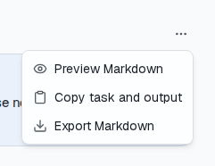

The ⋯ button in a task's header turns the task into Markdown: the prompt, the agent's output and
every tool call with its input and result. **Copy task and output** puts it on the clipboard,
**Export Markdown** downloads it as a file, and **Preview Markdown** shows it first, with Copy and
Download buttons.

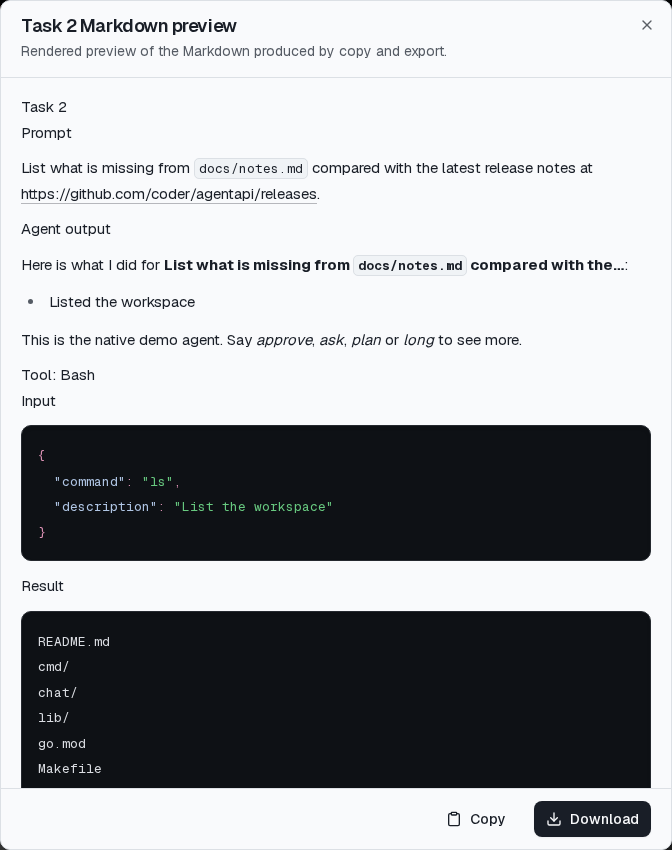

### Search

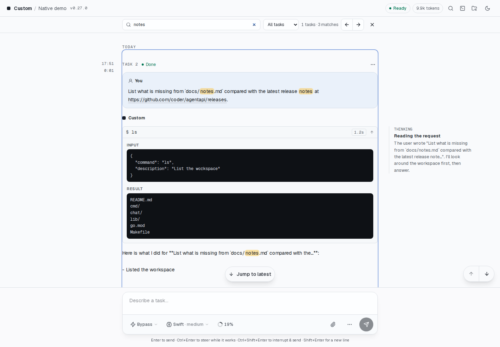

The search button (⌘F / Ctrl+F) opens a search bar above the transcript. It counts the matching
tasks and matches, highlights them and steps through them with the arrows. The menu next to it
narrows the tasks to those that are running, queued, failed, completed, or had a tool error. While
you search, the matching messages show as plain text, every step of a long task shows, and tool
calls with a match open.

## Sending tasks

### The composer

Enter sends; Shift+Enter starts a new line. The paperclip attaches files of up to 10 MB each, and
pasting an image attaches it too (pasted text stays text). Attachments show in the composer, images
as thumbnails that open in full size, and can be removed before you send.

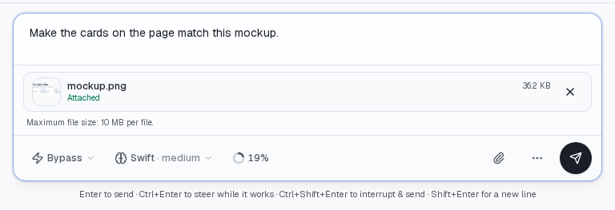

The agent gets the path of each attachment. *native* An agent that takes images (Claude Code, Codex
and Pi) also gets PNG, JPEG, GIF and WebP attachments as images. **More input options** (⋯) has
voice input where the browser supports speech recognition: it dictates into the composer in the
browser's language.

The draft and its attachments survive a reload. A message that didn't reach the server stays in the
chat marked as not sent, with buttons to retry or dismiss it, also after a reload.

### While the agent works

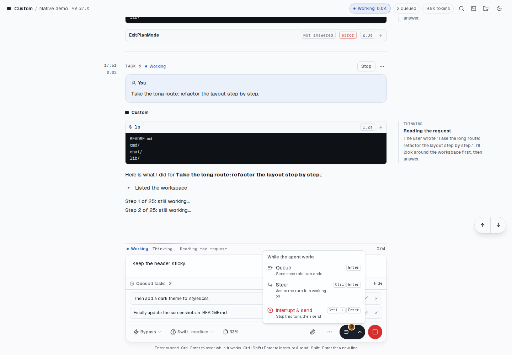

Messages you send while the agent works wait in a queue, shown in the composer under the message
box, and run one after the other when the turn ends; the queue is kept on the server, so every open
chat sees it. Each queued task can be edited, moved up or down, removed, or *native* steered into
the turn right away (the ↳ button). *native* The send button's menu offers three ways to send:

- **Queue** (Enter): send it once this turn ends.
- **Steer** (⌘/Ctrl+Enter): add it to the turn the agent is working on.
- **Interrupt & send** (⌘/Ctrl+Shift+Enter): stop this turn, then send it.

The red button next to it, and the task's Stop button, interrupt the turn. While the agent waits for
an answer to a request, a new message queues behind it.

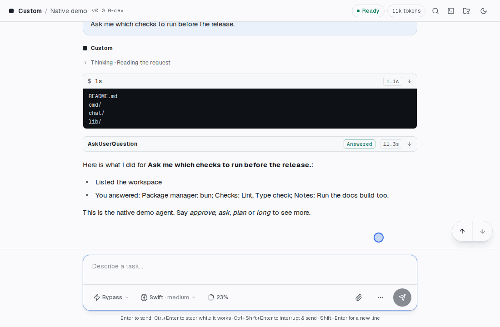

### Slash commands

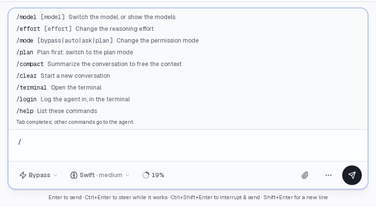

*native* Typing `/` lists the commands the chat runs itself, for what an agent's terminal UI would
do; Tab completes one. Anything else that starts with `/` goes to the agent as typed, so its own
commands (such as Claude Code's `/code-review`) still work.

| Command | What it does |
| --- | --- |
| `/model [model]` | Switches the model, or lists the models |
| `/effort [effort]` | Changes the reasoning effort |
| `/mode [bypass\|auto\|ask\|plan]` | Changes the permission mode |
| `/plan` | Switches to the plan mode |
| `/compact` | Summarizes the conversation to free the context (Claude Code compacts on its own `/compact`, which the chat sends it) |
| `/clear` | Starts a new conversation: restarts the agent in a new session |
| `/terminal` | Opens the shell terminal |
| `/login` | Runs the agent's login command in the shell terminal |
| `/help` | Lists these commands |

`/model`, `/effort`, `/mode` and `/plan` appear for an agent with settings, `/terminal` and `/login`
when the shell terminal is on.

### Keyboard shortcuts

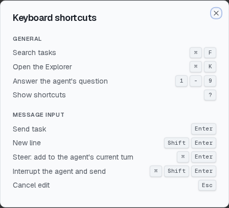

? shows the shortcuts; the session details menu has them too.

## Agent settings

*native* The composer's toolbar changes the agent's settings while it runs (`PUT /settings`). They
stay for the session: AgentAPI gives them to the agent again after a restart, a new login and, with
`--state-db`, an AgentAPI restart.

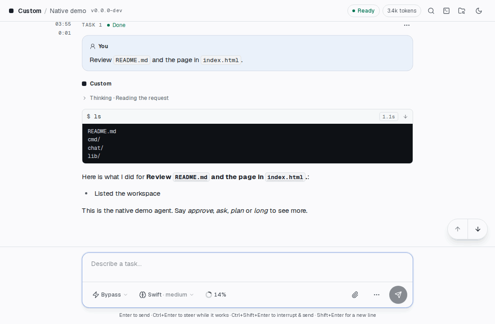

### Permission mode

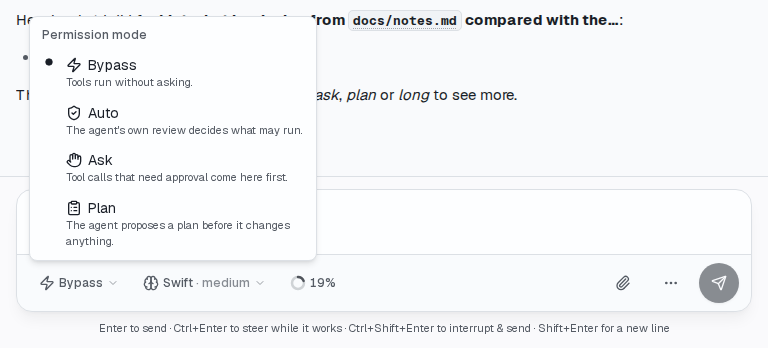

- **Bypass**, the default: tools run without asking.
- **Auto**: the agent's own review decides what may run.
- **Ask**: tool calls that need approval come to the chat first, as [approvals](#approvals).
- **Plan**: the agent proposes a [plan](#plans) before it changes anything.

Pi has no permission modes, so its toolbar has no mode menu.

### Model and reasoning effort

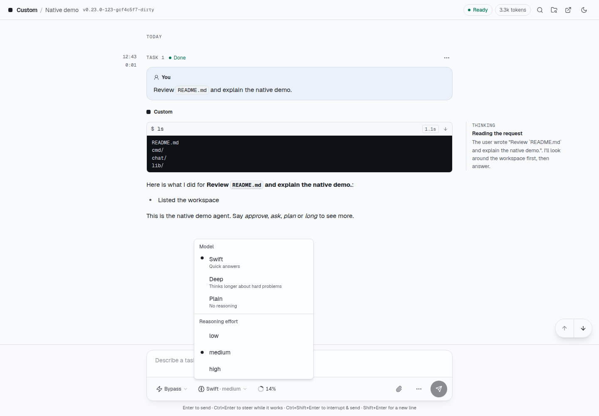

The menu lists the agent's models with their descriptions, and the reasoning efforts the chosen
model supports. Codex takes a new model or effort with its next turn.

### Context and usage limits

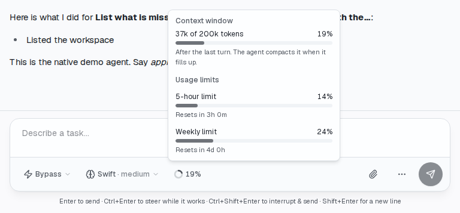

The ring shows how full the context window is. Its popover has the tokens in the context after the
last turn, and the account's usage limits with how much is used and when each resets: Claude Code's
5-hour and weekly limits, Codex's windows. When the context fills up, the agent compacts it;
`/compact` does it now.

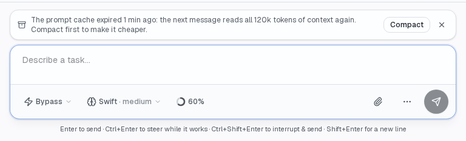

*native* Claude Code keeps the conversation in the model provider's prompt cache for an hour after
its last use on a subscription, five minutes with an API key. Once the cache expired, the next
message has the model read the whole context again, at the full price and against the usage
limits. While the agent is idle with an expired cache and at least 50k tokens of context, a note
above the composer says so, with **Compact**. Closed, it stays away until the next turn.

### A usage limit

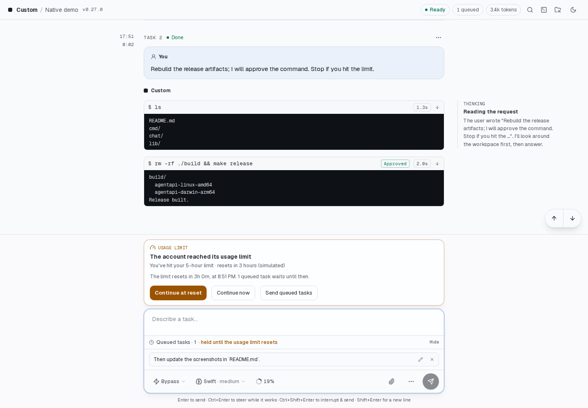

*native* When the account reaches a usage limit, the agent stops its turn, and a card above the
composer says when the limit resets. The queued tasks wait until then, marked *held until the usage
limit resets*, instead of failing one by one. **Continue at reset** sends a message that has the
agent go on with the task a minute after the reset, **Continue now** sends it now, and **Send queued
tasks** lets the queue go at once. A task you send yourself goes out right away.

## Requests and decision cards

What the agent asks you appears above the composer as a card, and the agent waits. The status line
above the card, the header and the tab title say "Needs you", the task shows "Waiting for you", and
its tool row shows what it waits for. Number keys pick an option. A request is answered once, from
any open chat; one that can no longer be answered says so.

### Approvals

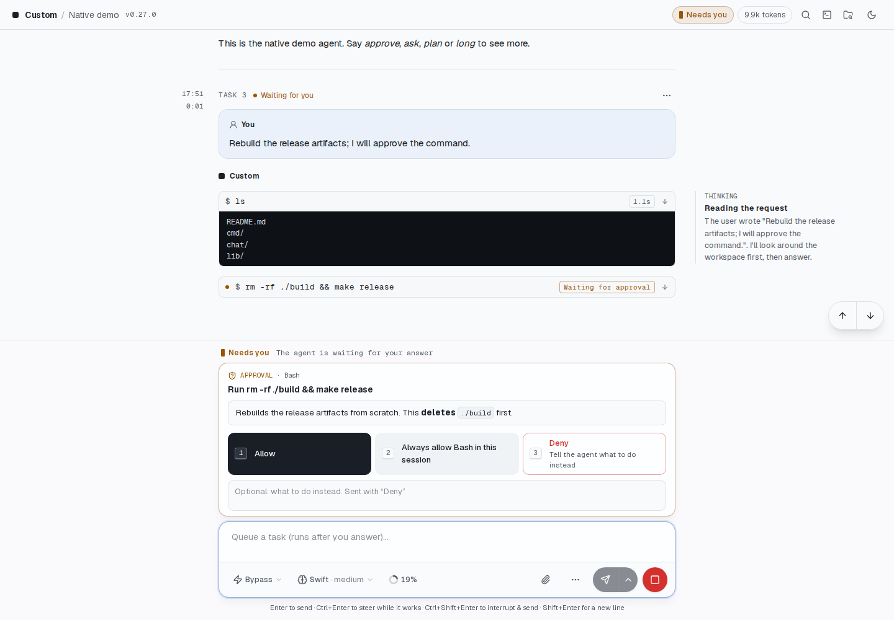

*native* A command or file change that needs your approval (in the ask mode, or when the agent's
own policy asks) shows what would run and why. **Allow** runs it once, **Always allow** allows the
tool for the rest of the session, and **Deny** refuses it; the optional note tells the agent what to
do instead.

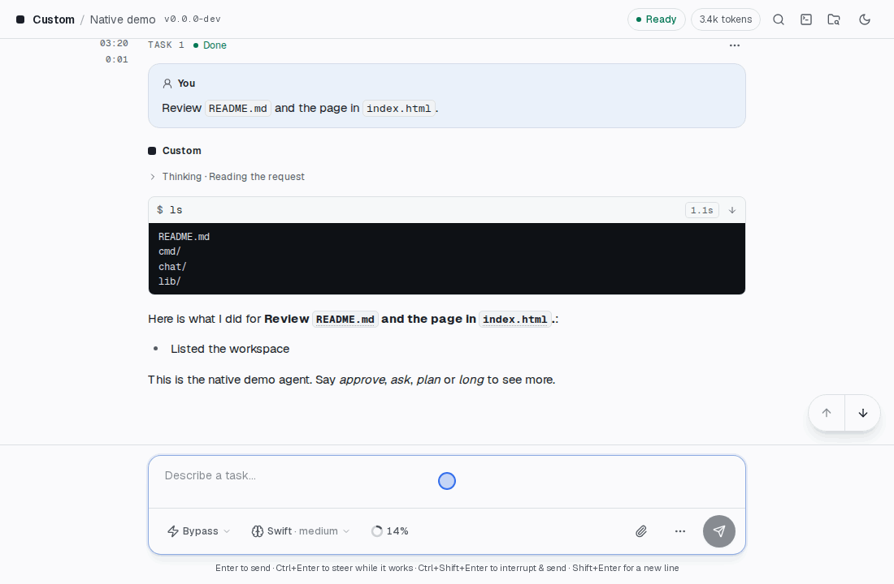

### Questions

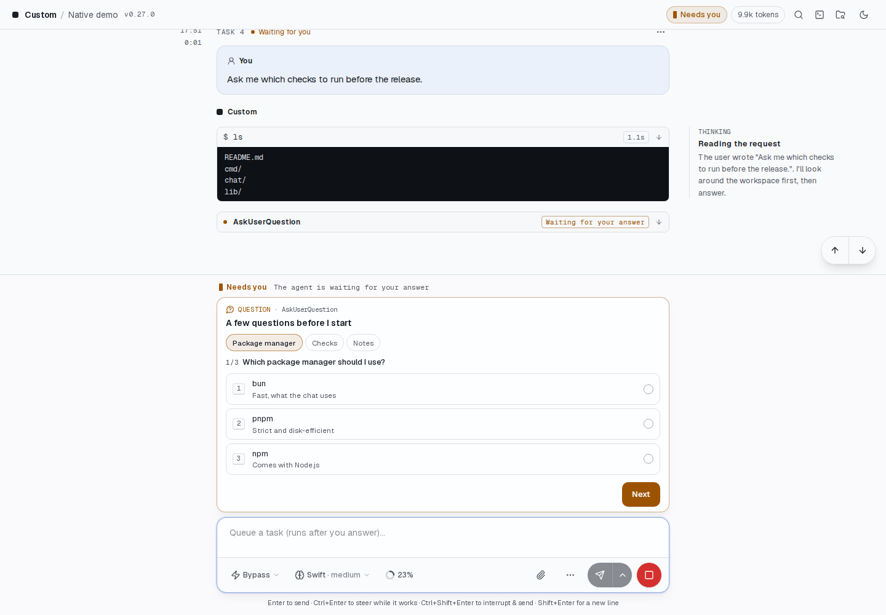

*native* The agent's questions come one step at a time: single choice, several choices or free
text. **Next** moves to the next step and the last one sends every answer together. Secret answers
are masked while you type and stored as `[redacted]`.

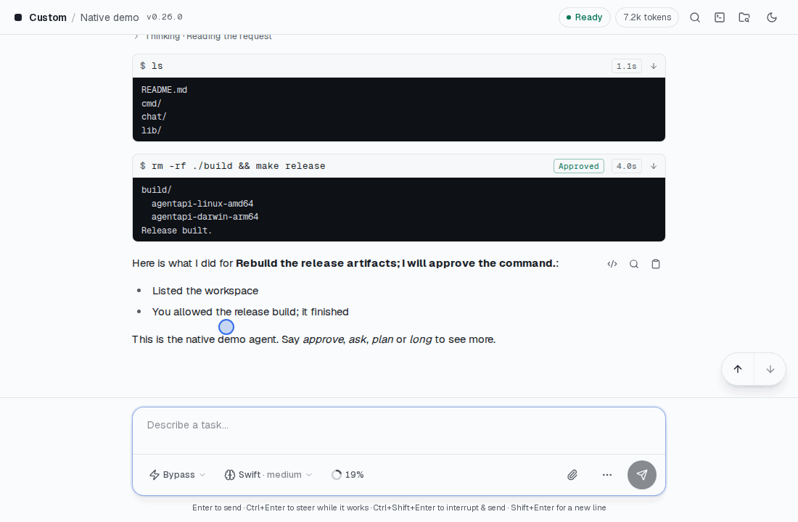

### Plans

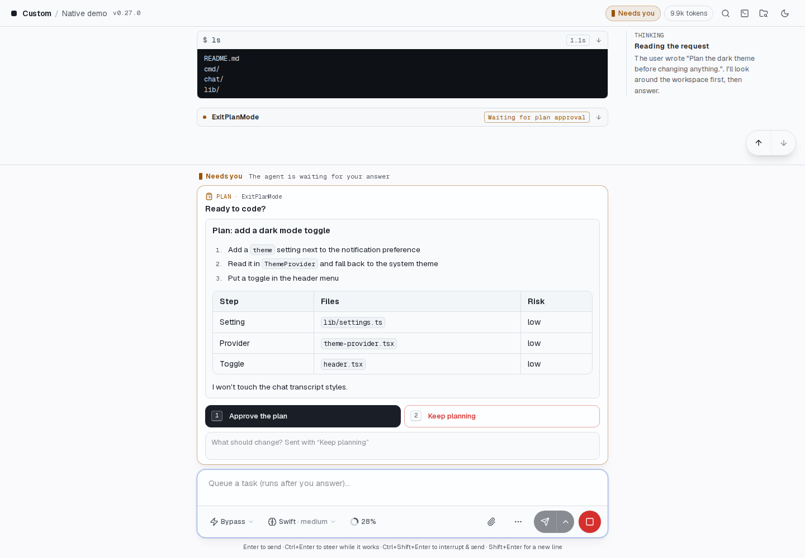

*native* A plan shows in Markdown. Approve it, or keep planning and tell the agent what to change.
Claude Code and Codex also let you choose how the agent then implements the plan: Claude Code with
bypassed permissions, auto-accepted edits or edits you approve, Codex in the bypass, auto review or
ask mode.

### Terminal dialogs

With the PTY transport, the agent's own terminal dialogs (Claude Code's "Do you want to proceed?",
for example) become the same kind of card, and the chat answers them with the keys the dialog
expects. A dialog with a free-text field can also be answered with a normal message.

### Logging in

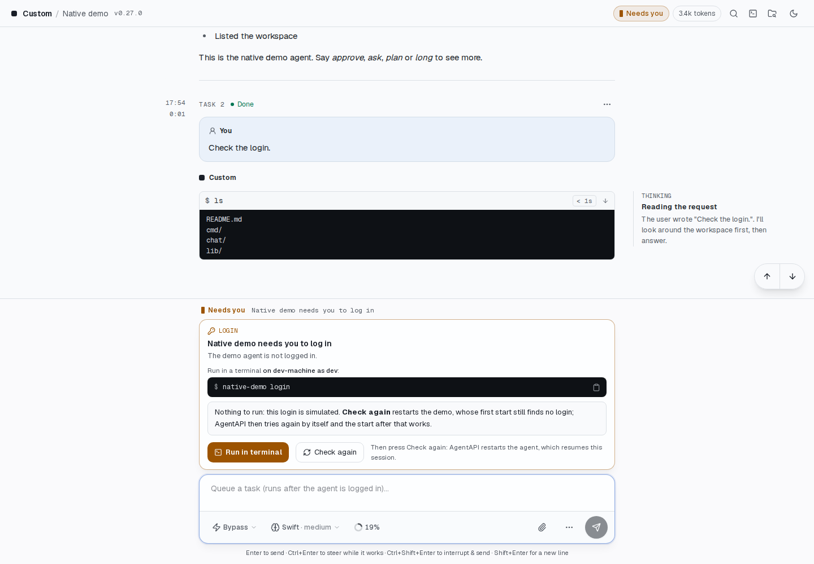

When the agent isn't logged in, or loses its login during a session, a login card names the command
to run (`claude auth login`, `codex login --device-auth`, or Pi's `/login`) and the host and user to
run it as. Codex signs in with a device code: open the link it prints, on any device, and enter its
one-time code, so no browser has to run where AgentAPI runs.
**Run in terminal** runs it in the [shell terminal](#shell-terminal); **Check again** checks right
away. AgentAPI also tries again every 5 seconds, and messages wait in the queue meanwhile. (The
screenshot shows `dev-machine` and `dev` in place of the real host and user.)

## Files

File names in the chat open a viewer on the file the agent works on: a file name on a tool call's
row, a path in inline code in the agent's reply (`lib/foo.go:12` opens at line 12) and the
Explorer's Files tab. Only files inside the agent's working directory open. The viewer's header
reloads the file; on a phone the viewer takes the whole screen.

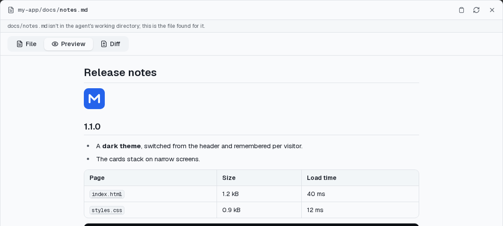

An agent started in a home directory works in a repository below it and names files relative to the
repository, sometimes in the wrong case. When a path isn't in the working directory, the viewer
looks for it below: one match opens, with a note naming the path the agent wrote, and several are
listed to choose from.

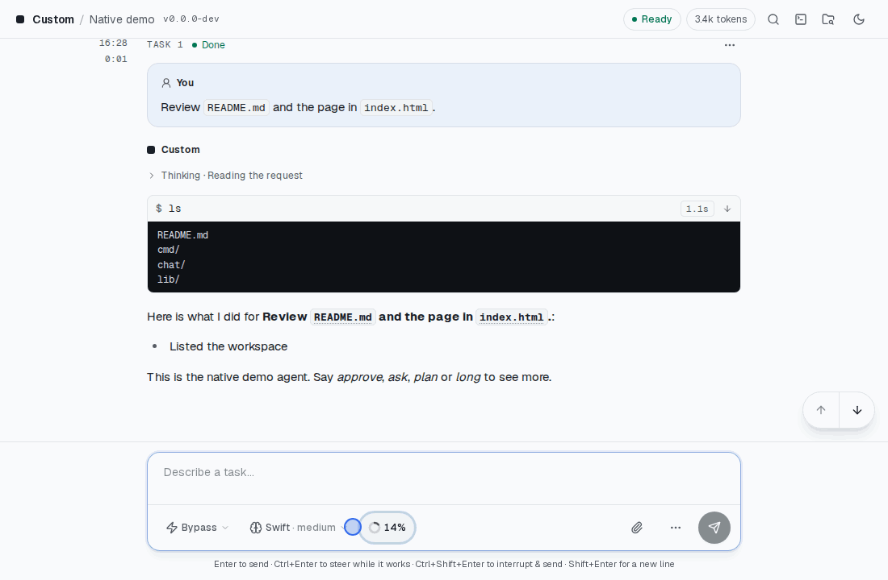

### The file

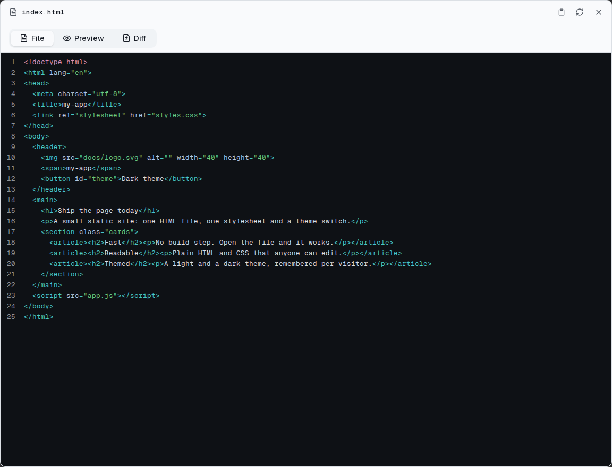

**File** shows the file with line numbers and syntax highlighting, up to 1 MiB.

### The preview

HTML, Markdown and SVG files have a **Preview** tab, and an image file shows as the image.

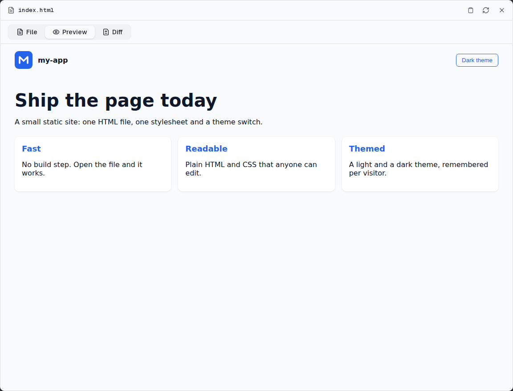

An HTML page renders with the stylesheets, scripts, images, fonts and media it refers to by
relative path inlined (up to 4 MiB each, 16 MiB in all; a note lists what was left out). It runs in
a sandboxed frame without an origin of its own: its scripts run, but they can't reach the chat, its
session or the API, and storage and cookies last only while the preview is open.

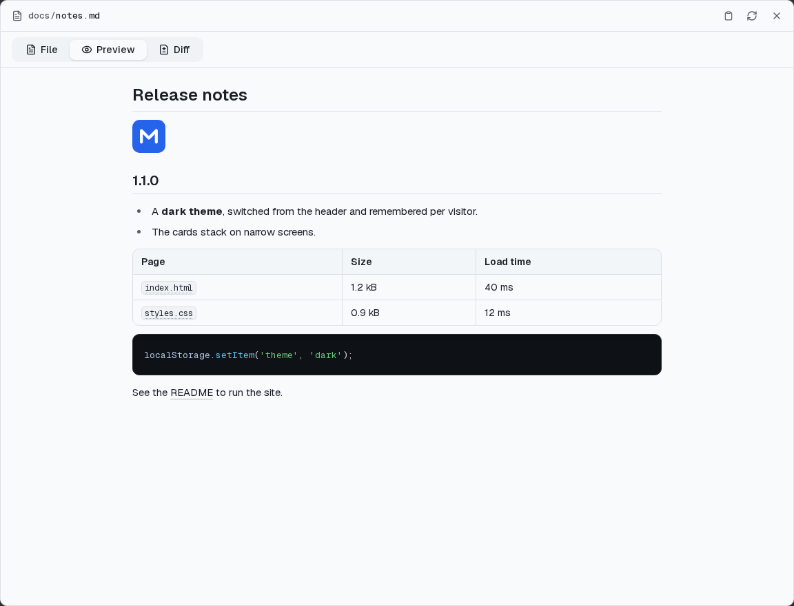

A Markdown file opens on its preview. Relative images load from the working directory, and relative
links open their file in the viewer (`#L12` at its line). PNG, JPEG, GIF, WebP, BMP, ICO and SVG
files show as images.

### The diff

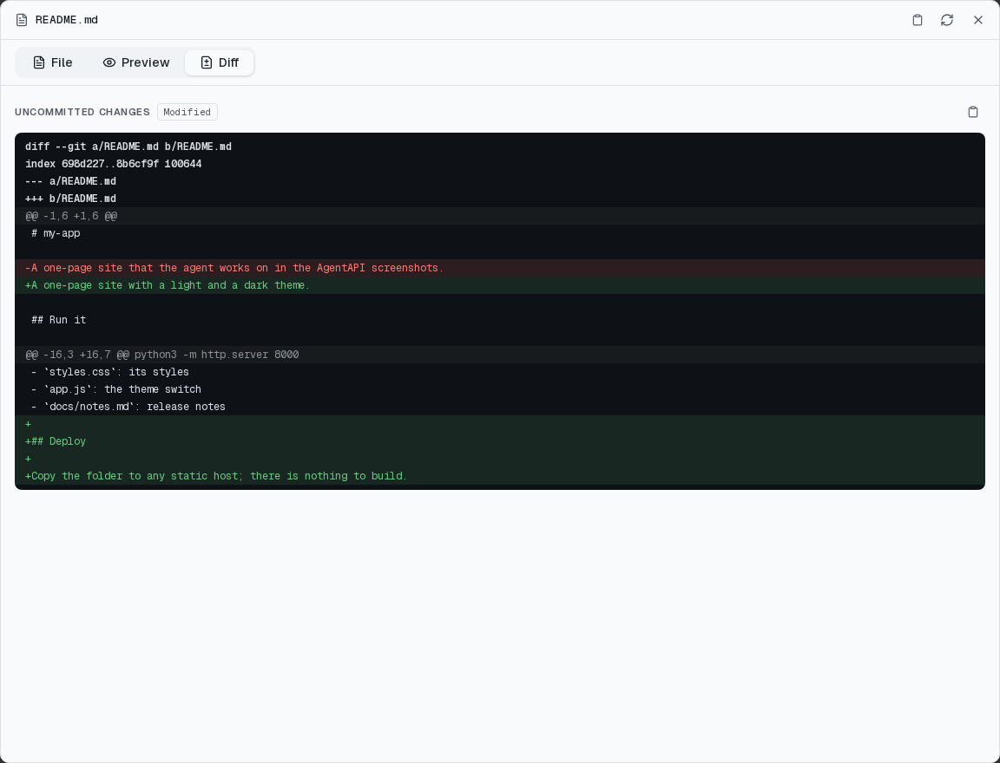

**Diff** shows the change the tool call made (**This change**) and the file's uncommitted changes
against `HEAD` (**Uncommitted changes**). The diff reads only the git repository: no diff driver,
textconv or fsmonitor of the repository or the user runs.

## Session Explorer

The Explorer (⌘K / Ctrl+K, or the folder button) has five tabs. The Index, Files and Links lists
have a filter box.

### Index

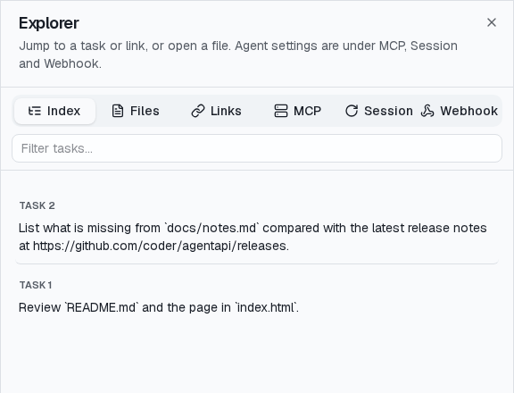

The tasks of the session, newest first; click one to jump to it.

### Files and Links

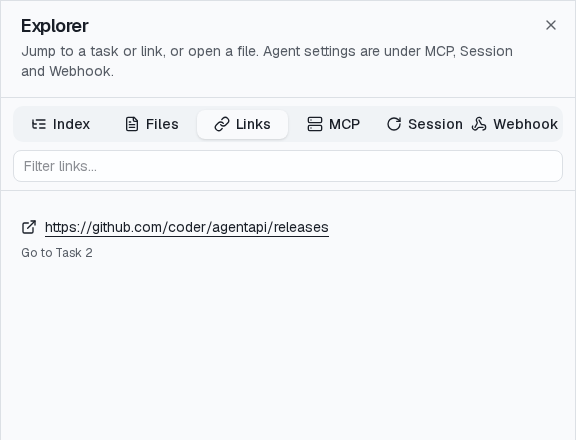

**Files** lists the absolute file paths the session mentions, to open in the file viewer. **Links**
lists the web links, each with the task it came from, including links a terminal wrapped onto the
next line.

### MCP

For Claude Code, Codex and Pi, the MCP tab edits the agent's MCP servers in AgentAPI's managed
config file (`.mcp.json` in the working directory for Claude Code, `$CODEX_HOME/config.toml` for
Codex, `$PI_CODING_AGENT_DIR/mcp.json` for Pi):

- **MCP servers**: the servers as JSON in the agent's own format, with import and export. Saving
  writes the file atomically and, unless you turn it off, restarts the agent to load it. With the
  native transport an agent that can resume its session does, so the conversation stays.
- **Connectivity**: checks that each server starts or answers.
- **Profiles**: saves, applies, imports and exports whole sets of servers.

See [MCP management](../README.md#mcp-management) for the API.

### Session

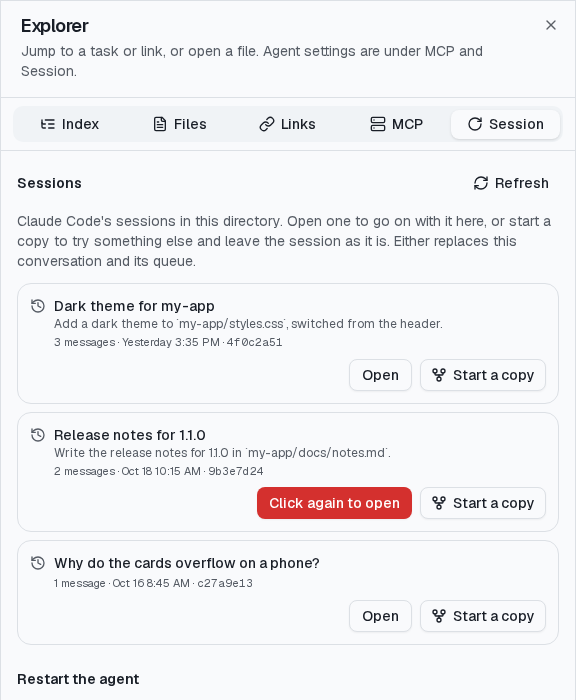

*native* For Claude Code, Codex and Pi the tab starts with the agent's sessions in its working
directory, read from the agent's own logs: each with its name, first message, number of messages
and when it last changed. **Open** restarts the agent on that session and shows its conversation;
**Start a copy** opens a copy under a new id and leaves the session as it was. Both replace this
conversation and its queue, and ask for a second click.

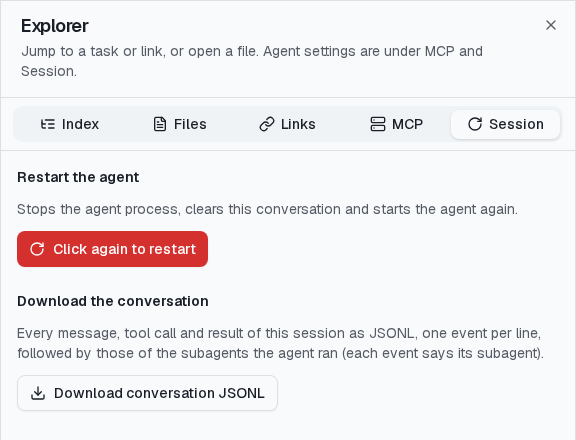

**Restart agent** stops the agent, clears the conversation and starts it again in a new session; it
asks for a second click. Codex and Pi, when AgentAPI starts their CLI directly, update to their
latest release first. **Download conversation JSONL** saves every message, tool call and result of
the session, one event per line, followed by those of the subagents the agent ran; the session
details menu has it too.

## Lineage

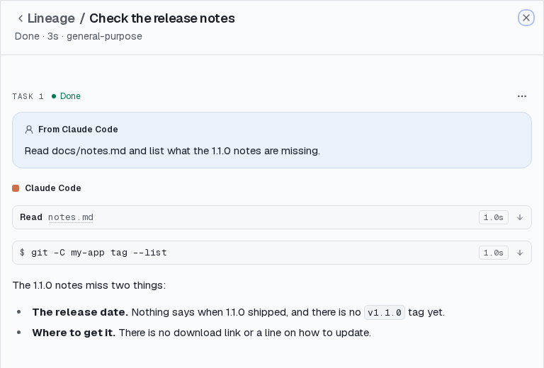

*native* When Claude Code or Codex hands work to subagents, a button in the header counts them, with
how many still work. It opens the Lineage panel, which lists each subagent with its task, kind,
state and time. Choosing one shows what it did the way the transcript shows a task: its thinking,
tool calls and answer, updated while it works. The **Steps** button on the Agent (or spawn_agent)
tool call that started a subagent opens it directly. The steps come from the subagents' own logs,
so a session opened from the Session tab shows its subagents too.

## Terminals

### Shell terminal

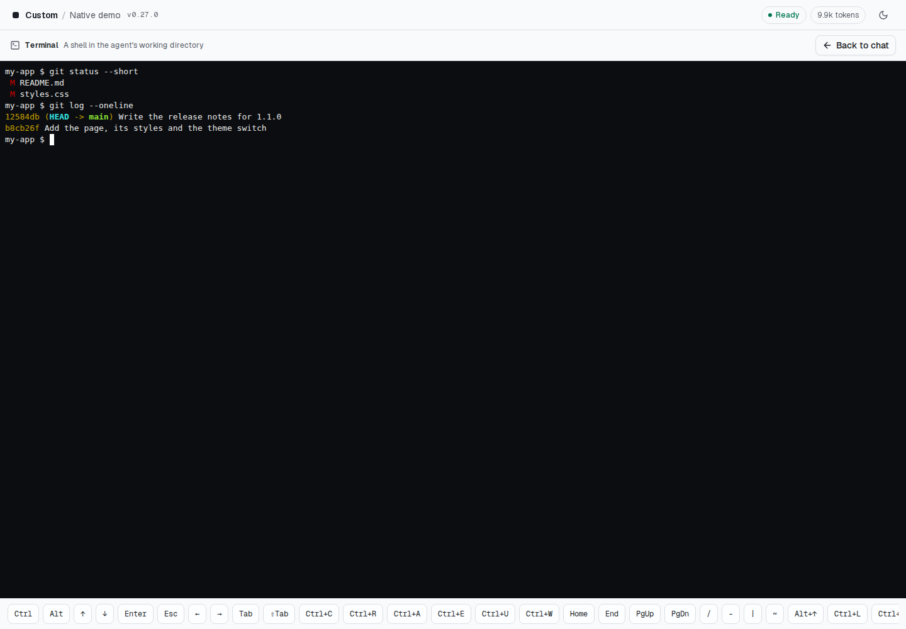

*native* The terminal button (or `/terminal`) opens a shell in the agent's working directory, for
logins and quick commands. It is a real terminal sized to the window. Everyone who opens it shares
the same shell, which keeps running while nobody watches. The key bar sends the keys a phone
keyboard lacks: arrows, Enter, Esc, Tab, Shift+Tab, Ctrl+C, a shell's Ctrl+R, Ctrl+A, Ctrl+E, Ctrl+U
and Ctrl+W, Home, End, Page up and Page down, / - | ~, Alt+↑ and Ctrl+L. Its **Ctrl** and **Alt**
buttons hold the modifier for the next key you type, for any other combination. Ctrl+D and Ctrl+Z
ask for a second press. Web links in the terminal open on a click, also when they run over several
lines, and the last link a command printed (such as a login link) shows above the terminal,
shortened, to open or copy with one tap. Start AgentAPI with `--terminal=false` to turn it off.

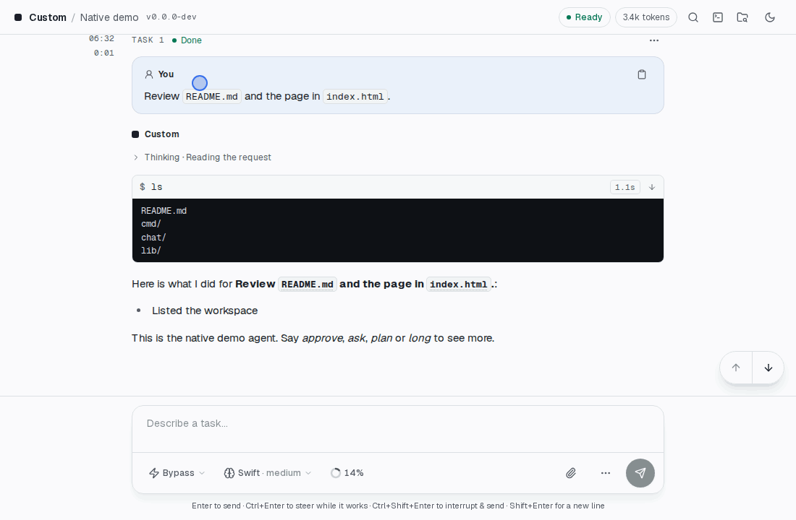

### TTY mode

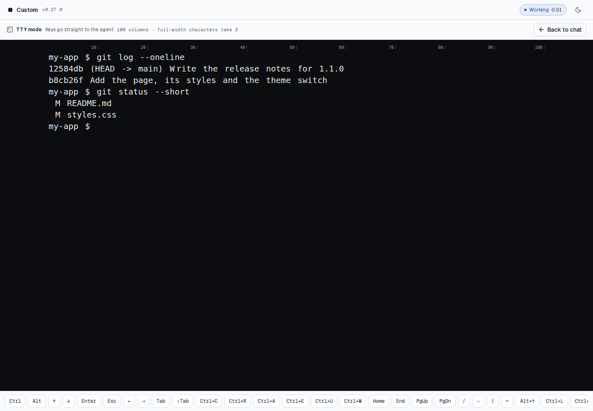

With the PTY transport, the terminal button switches the conversation for the agent's own terminal
screen, for when the chat view looks wrong. Every key goes straight to the agent: arrows, Ctrl and
Alt keys, pastes and IME input. The ruler shows the agent's real terminal width (here
`--term-width 100`); the font grows with the window (11–20px). Links open on a click and the last
one shows above the screen, as in the shell terminal. **Back to chat** returns.

## Session details and alerts

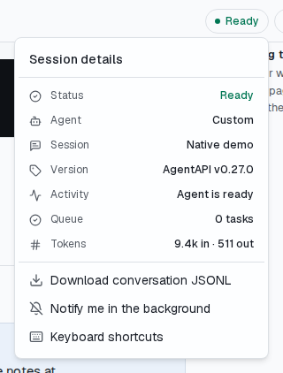

Clicking the status in the header opens the session details: the status, agent, session name,
AgentAPI version, what the agent is doing, the queue and the tokens in and out. Its menu downloads
the conversation as JSONL (as the Explorer's Session tab does), turns on browser notifications, and
shows the keyboard shortcuts. (How full the context is and the usage limits are in the composer's
toolbar; see [Context and usage limits](#context-and-usage-limits).)

While the tab is in the background, its icon shows an amber dot when the agent needs you, a blue dot
while it works and a green dot when a task finishes. With notifications on, the browser also shows
"*Agent* needs you" or "*Agent* finished".

## Phones

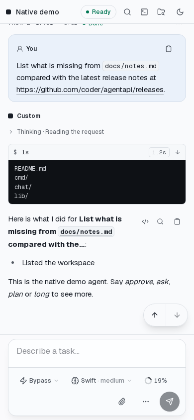

On a phone the transcript takes the full width, thinking folds into the task and the toolbar wraps
under the message box. A request card takes at most 60% of the screen and a title cut to two lines
can be shown in full. The file viewer takes the whole screen, and the terminals have the key bar.

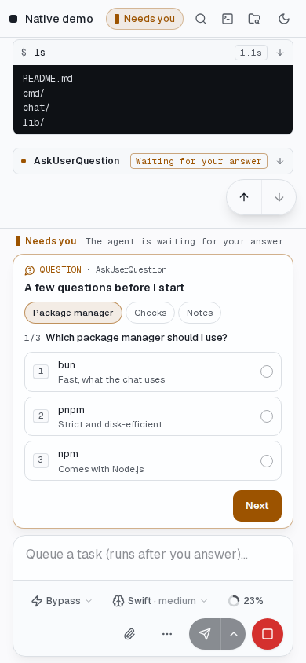

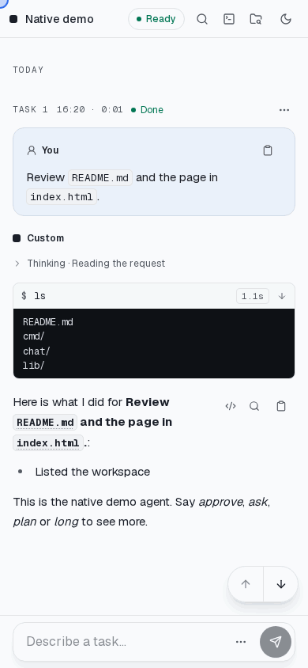

## Connection and caching

The chat follows the server with server-sent events. Heartbeats show a lost connection; it
reconnects by itself and replays only what changed while it was away. The status and the page title
show the connection state. Reopening a long conversation is fast: the chat caches the transcript in
the browser (IndexedDB), shows it at once and asks the server only for what changed since.
