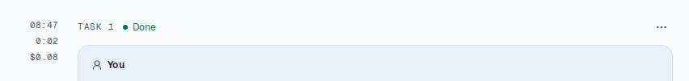
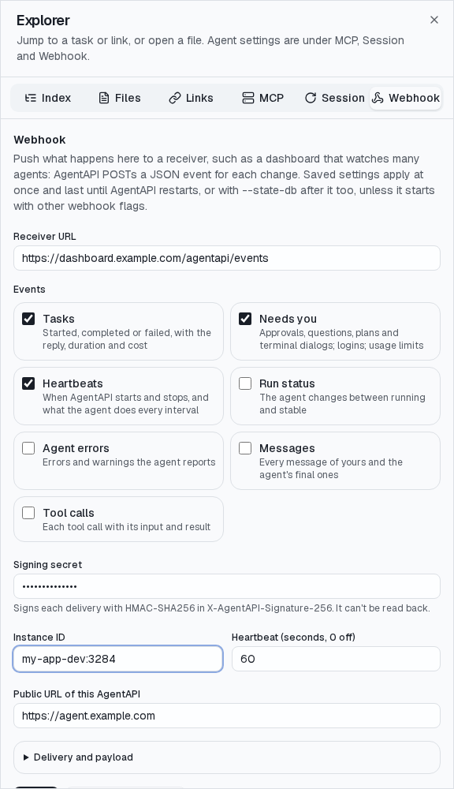
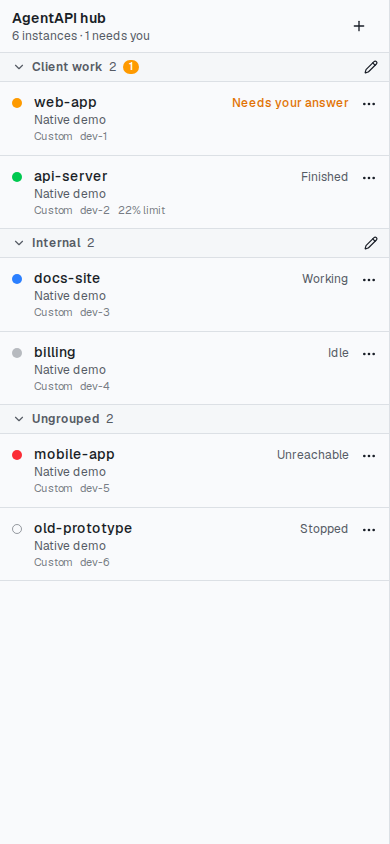

# 聊天介面導覽

[English](chat-ui.md) | 繁體中文

開啟 `/chat` 即可使用 `agentapi` 執行檔內建的聊天介面。它支援所有 transport，適用於桌面與手機，
透過 [HTTP API](../README.zh-TW.md#http-api-參考) 與伺服器溝通。

截圖和動畫是 AgentAPI v0.28.0 搭配內建 `native-demo` agent 處理一個小型範例網站的畫面；
demo 的回覆、工具結果、模型和用量都是模擬的，TTY mode 則是以 PTY agent 執行的 bash。動畫會
在滑鼠指標所在及點擊的位置畫上藍點。[scripts/capture-docs.mjs](../scripts/capture-docs.mjs)
可以重新擷取所有截圖和動畫（見[截圖說明](screenshots/README.md)）。標示 *native* 的部分需要
[native transport](../README.zh-TW.md#native-transport)，Claude Code、Codex 和 Pi 預設就使用它。

## 目錄

- [視窗](#視窗)
- [任務與對話紀錄](#任務與對話紀錄)
- [送出任務](#送出任務)
- [Agent 設定](#agent-設定)
- [請求與決策卡片](#請求與決策卡片)
- [檔案](#檔案)
- [工作階段瀏覽器](#工作階段瀏覽器)
- [Lineage](#lineage)
- [終端機](#終端機)
- [工作階段詳細資訊與提醒](#工作階段詳細資訊與提醒)
- [手機](#手機)
- [hub](#hub)
- [連線與快取](#連線與快取)

## 視窗

- **標頭。** agent 的標誌和類型、工作階段名稱和 AgentAPI 版本。右側是狀態（Ready、附計時器的
  Working 或 Needs you；點一下會開啟[工作階段詳細資訊](#工作階段詳細資訊與提醒)）、到目前為止
  用掉的 token 數，以及[搜尋](#搜尋)、[終端機](#終端機)（native transport 是 shell 終端機，
  PTY 則是 TTY mode）、[工作階段瀏覽器](#工作階段瀏覽器)和淺色或深色主題的按鈕。
- **對話紀錄。** 每個任務一個區塊，由舊到新排列。左欄顯示每個任務的開始時間和花了多久。
- **輸入框。** 訊息欄和它的工具列：*native* 權限模式、模型與推理強度，以及 context 用了多少；
  接著是附件按鈕、更多輸入選項和送出按鈕。下方那一行列出可用的按鍵。
- 右下角的 ↑ 和 ↓ 按鈕會跳到上一個和下一個任務。

## 任務與對話紀錄

你送出的每則訊息都會開始一個任務。任務會先在標示「You」的色塊中顯示你的提示詞，接著依序呈現
agent 做了什麼：以 Markdown 顯示的回覆、每個工具呼叫各一列，以及它的思考內容。任務的標頭會
顯示它的編號和狀態（Queued、Working、Waiting for you、Done、Failed 或 Limit reached）、工作中時
的 Stop 按鈕，以及它的 ⋯ 選單。狀態由伺服器的[任務](../README.zh-TW.md#任務)決定：agent 回報錯誤或結束時顯示 Failed，
滑鼠移上去可看第一個錯誤；因用量限制停止時顯示 Limit reached，可看 agent 的訊息。
工具呼叫與思考內容的任務歸屬也由伺服器指定。steer 進來的訊息會共用目前任務的狀態，
之後的活動也會歸在同一任務。

寬螢幕上，開始時間與耗時顯示在左側空白處；窄螢幕上則接在標頭的任務編號後。
*native* Claude Code、Codex 和 Pi 另會顯示任務執行期間的模型呼叫花費，含 sub agent，
依供應商牌價計算。任務之間的呼叫，例如壓縮，不算入任何任務。

這是 API 等價金額，訂閱方案不按此收費。滑鼠移上去可看呼叫次數與 tokens。花費會在回合結束時，
以及執行期間每 15 秒更新。計算與價格設定見[工作階段花費](../README.zh-TW.md#工作階段花費)。

### 工具呼叫

每個工具呼叫占一列：指令（`$ ls`）或工具名稱、狀態（等待核准、錯誤、失敗指令的結束代碼）
和耗時。點一下這一列就能看到工具的輸入和完整結果。讀取、寫入或編輯檔案的工具，列上的檔名會
開啟[檔案檢視器](#檔案)；展開修改過檔案的呼叫會以 diff 顯示變更，點一下可看原始輸入。圖片
形式的工具結果（Claude Code 讀取截圖、Codex 的 `view_image`）會顯示為縮圖，點開就能看原尺寸。

### 思考內容

寬螢幕上，思考內容以旁註顯示在對應步驟右側。較高的旁註會在該步驟旁預留空間，讓後面的旁註
保持對齊；長旁註先顯示六行，點選可展開。窄螢幕上則收合為任務中的一行「Thinking · *標題*」。

### 訊息與較長的任務

每則 agent 訊息都有按鈕，可以改以原始文字而非 Markdown 顯示（每則訊息分開切換）、在訊息中
搜尋，以及複製；你的提示詞則有複製按鈕。步驟很多的任務只會顯示最近的 40 個步驟，
**Show *n* earlier steps** 會顯示其餘步驟。

### 任務選單

任務標頭的 ⋯ 按鈕會把任務轉成 Markdown：提示詞、agent 的輸出，以及每個工具呼叫和它的輸入與
結果。**Copy task and output** 複製到剪貼簿，**Export Markdown** 下載成檔案，
**Preview Markdown** 則先預覽，並提供 Copy 和 Download 按鈕。

### 搜尋

搜尋按鈕（⌘F / Ctrl+F）會在對話紀錄上方開啟搜尋列。搜尋列會計算符合的任務數和符合處數並
醒目標示，可用箭頭逐一切換。旁邊的選單可以只列出執行中、排隊中、失敗、因用量限制停止、
已完成，或有工具錯誤的任務。搜尋期間，符合的訊息會以純文字顯示，較長任務的每個步驟都會
顯示出來，含有符合內容的工具呼叫也會展開。

## 送出任務

### 輸入框

按 Enter 送出，Shift+Enter 換行。迴紋針按鈕可以附加檔案，每個最大 10 MB；貼上的圖片也會
成為附件（貼上的文字仍然是文字）。附件會顯示在輸入框中，圖片以縮圖呈現、點開就能看原尺寸，
送出前也可以移除。

agent 收到的是每個附件的路徑。*native* 接受圖片的 agent（Claude Code、Codex 和 Pi）也會以
圖片的形式收到 PNG、JPEG、GIF 和 WebP 附件。瀏覽器支援語音辨識時，
**More input options**（⋯）提供語音輸入：以瀏覽器的語言把你說的話聽寫進輸入框。

草稿和它的附件在重新載入頁面後仍會保留。沒有送達伺服器的訊息會留在聊天中並標示為未送出，
附有重試或捨棄的按鈕，重新載入後也一樣。

### Agent 工作中時

agent 工作中時，訊息會排入伺服器的佇列，顯示在訊息欄下方，等回合結束後依序執行。
所有開啟的聊天畫面都會即時同步佇列。排隊中的任務可編輯、移動或移除。
*native* ↳ 按鈕可立即 steer 進目前回合，送出選單則有三種模式：

- **Queue**（Enter）：等這個回合結束再送出。
- **Steer**（⌘/Ctrl+Enter）：加進 agent 正在進行的回合。
- **Interrupt & send**（⌘/Ctrl+Shift+Enter）：停止這個回合，然後送出。

旁邊的紅色按鈕和任務的 Stop 按鈕都會中斷回合。agent 在等待某個請求的回覆時，新的訊息會
排在該請求之後。

### 斜線指令

*native* 輸入 `/` 可列出聊天介面處理的指令，按 Tab 補完建議。其他斜線指令會直接送給 agent，
包括 Claude Code 的 `/code-review`。

| 指令 | 作用 |
| --- | --- |
| `/model [model]` | 切換模型，或列出模型 |
| `/effort [effort]` | 變更推理強度 |
| `/mode [bypass\|auto\|ask\|plan]` | 變更權限模式 |
| `/plan` | 切換到 plan 模式 |
| `/compact` | 摘要對話以騰出 context（Claude Code 由聊天介面送出它自己的 `/compact` 來壓縮） |
| `/clear` | 開始新的對話：在新的工作階段中重新啟動 agent |
| `/terminal` | 開啟 shell 終端機 |
| `/login` | 在 shell 終端機中執行 agent 的登入指令 |
| `/help` | 列出這些指令 |

`/model`、`/effort`、`/mode` 和 `/plan` 只在 agent 有設定可以切換時出現，`/terminal` 和
`/login` 則在 shell 終端機啟用時出現。

### 鍵盤快捷鍵

按 ? 會顯示快捷鍵；工作階段詳細資訊的選單裡也有。

## Agent 設定

*native* 輸入框的工具列可以在 agent 執行時變更它的設定（`PUT /settings`）。這些設定在整個
工作階段中都有效：重新啟動、重新登入之後，以及使用 `--state-db` 時 AgentAPI 重新啟動之後，
AgentAPI 都會再把它們套用到 agent。

### 權限模式

- **Bypass**（預設）：工具直接執行，不會詢問。
- **Auto**：由 agent 自己的審查決定什麼可以執行。
- **Ask**：需要核准的工具呼叫會先以[核准](#核准)的形式送到聊天介面。
- **Plan**：agent 會先提出[計畫](#計畫)，然後才修改任何東西。

Pi 沒有權限模式，所以它的工具列沒有模式選單。

### 模型與推理強度

選單會列出 agent 的模型及說明，以及所選模型支援的推理強度。Codex 會在下一個回合才採用
新的模型或推理強度。

### Context 與用量限制

圓環顯示 context window 用了多少。它的彈出視窗列出上一個回合後 context 中的 token 數，以及
帳號的用量限制、各用了多少和何時重置：Claude Code 的 5 小時與每週限制、Codex 的用量週期。
context 滿了時，agent 會壓縮它；`/compact` 則會立刻壓縮。

*native* 使用訂閱帳號時，Claude Code 會把對話保留在模型供應商的 prompt cache 裡，最後一次使用
後保留一小時；使用 API key 時則是五分鐘。快取過期後，下一則訊息會讓模型重新讀取整個 context，
以全額計價，也會算進用量限制。agent 閒置、快取已過期且 context 至少有 50k token 時，輸入框
上方會出現提醒和 **Compact** 按鈕。關掉後，要到下一個回合結束才會再出現。

### 達到用量限制

*native* 帳號達到用量限制時，agent 會停下它的回合，輸入框上方的卡片會說明限制何時重置。排隊
中的任務會等到那時，並標示 *held until the usage limit resets*，而不是一個接一個失敗。
**Continue at reset** 會在重置一分鐘後送出一則請 agent 繼續任務的訊息，**Continue now** 則
立刻送出，**Send queued tasks** 會讓佇列馬上送出。你自己送出的任務會立刻送出。

## 請求與決策卡片

agent 需要你回應時，會在輸入框上方顯示卡片並等待。卡片上方的狀態列、標頭和分頁標題會顯示
「Needs you」，任務會顯示「Waiting for you」，工具呼叫列則標示 agent 在等什麼。數字鍵可以
選擇選項。每個請求只能回覆一次，任何開著的聊天畫面都能回覆；已經無法回覆的請求會註明這一點。

### 核准

*native* 需要你核准的指令或檔案變更（在 ask 模式下，或 agent 自己的政策要求詢問時）會顯示
將要執行什麼，以及原因。**Allow** 只執行這一次，**Always allow** 在這個工作階段剩下的時間裡
都允許這個工具，**Deny** 則拒絕它；可選的附註會告訴 agent 改做什麼。

### 提問

*native* agent 的提問一次一個步驟：單選、複選或自由輸入文字。**Next** 會前往下一個步驟，
最後一個步驟會一起送出所有答案。祕密答案在輸入時會被遮蔽，並以 `[redacted]` 保存。

### 計畫

*native* 計畫以 Markdown 顯示。你可以核准它，或繼續規劃並告訴 agent 要改什麼。Claude Code
和 Codex 還會讓你選擇 agent 接下來如何實作計畫：Claude Code 可以略過權限、自動接受編輯，或由你
核准編輯；Codex 則是 bypass、auto review 或 ask 模式。

### 終端機對話框

使用 PTY transport 時，agent 自己的終端機對話框（例如 Claude Code 的
「Do you want to proceed?」）也會變成同樣的卡片，聊天介面會用對話框預期的按鍵回答它們。
有自由文字欄位的對話框也可以用一般訊息回答。

### 登入

agent 尚未登入，或在工作階段中登入失效時，登入卡片會列出要執行的指令（`claude auth login`、
`codex login --device-auth` 或 Pi 的 `/login`），以及要在哪台主機上、以哪個使用者執行。
Codex 以裝置代碼登入：在任何裝置上開啟它印出的連結，再輸入它的一次性代碼，所以執行 AgentAPI
的地方不需要瀏覽器。
**Run in terminal** 會在 [shell 終端機](#shell-終端機)中執行它；**Check again** 會立刻檢查。
AgentAPI 也會每 5 秒重試一次，期間的訊息會在佇列中等待。（截圖以 `dev-machine` 和 `dev`
代替真實的主機和使用者。）

## 檔案

聊天裡的檔名會開啟檢視器，顯示 agent 正在處理的檔案：工具呼叫列上的檔名、agent 回覆中
inline code 裡的路徑（`lib/foo.go:12` 會開在第 12 行），以及 Explorer 的 Files 分頁。只能
開啟 agent 工作目錄裡的檔案。檢視器的標頭可以重新載入檔案；在手機上，檢視器會占滿整個螢幕。

從 home 目錄啟動的 agent 可能用下層 repo 的相對路徑提到檔案，也可能寫錯大小寫。
路徑無法在工作目錄中解析時，檢視器會往下搜尋：一個符合結果會直接開啟，並註明原路徑；
多個結果則列出供選擇。

### 檔案內容

**File** 以行號和語法高亮顯示檔案，最多 1 MiB。

### 預覽

HTML、Markdown 和 SVG 檔案有 **Preview** 分頁，圖片檔則直接顯示圖片。

呈現 HTML 頁面時，頁面以相對路徑引用的樣式表、腳本、圖片、字型和影音都會內嵌進去（每個檔案
最多 4 MiB，合計 16 MiB；沒有內嵌的項目會列在提示中）。頁面在有 sandbox、沒有自己 origin
的 frame 中執行：腳本可以執行，但無法存取聊天介面、它的登入狀態或 API，儲存空間和
cookie 也只在預覽開著的期間保留。

Markdown 檔案會直接開在預覽。相對路徑的圖片會從工作目錄載入，相對連結會在檢視器中
開啟該檔案（`#L12` 會開在那一行）。PNG、JPEG、GIF、WebP、BMP、ICO 和 SVG 檔案會以圖片顯示。

### 差異

**Diff** 顯示工具呼叫造成的變更（**This change**），以及檔案相對於 `HEAD` 尚未 commit 的
變更（**Uncommitted changes**）。diff 只讀取 git 儲存庫：不會執行儲存庫或使用者設定的
diff driver、textconv 或 fsmonitor。

## 工作階段瀏覽器

Explorer（⌘K / Ctrl+K，或資料夾按鈕）有六個分頁。Index、Files 和 Links 清單有篩選框。

### Index 分頁

工作階段中的任務，最新的在最上面，各自顯示狀態；點一下就會跳到該任務。

### Files 與 Links 分頁

**Files** 列出工作階段中提到的絕對檔案路徑，可以在檔案檢視器中開啟。
**Links** 列出網頁連結，每個都附上它出自的任務，終端機折到下一行的連結也包括在內。

### MCP 分頁

使用 Claude Code、Codex 和 Pi 時，MCP 分頁會在 AgentAPI 管理的設定檔中編輯 agent 的 MCP
伺服器（Claude Code 是工作目錄中的 `.mcp.json`，Codex 是 `$CODEX_HOME/config.toml`，Pi 是
`$PI_CODING_AGENT_DIR/mcp.json`）：

- **MCP servers**：以 agent 自己格式的 JSON 呈現伺服器，可以匯入和匯出。儲存時會以原子方式
  寫入檔案，除非你關閉這個選項，否則會重新啟動 agent 來載入它。使用 native transport 時，
  能接續工作階段的 agent 會接續原本的工作階段，所以對話會保留。
- **Connectivity**：檢查每個伺服器能否啟動或回應。
- **Profiles**：儲存、套用、匯入和匯出整組伺服器。

API 請參閱 [MCP 管理](../README.zh-TW.md#mcp-管理)。

### Session 分頁

*native* 此分頁從 Claude Code、Codex 和 Pi 的紀錄列出工作目錄中的工作階段，包含名稱、第一則
訊息、訊息數、最後變動時間和花費。上方卡片加總工作階段及 sub agent 今天、最近 7 天和 30 天
（含今天，依你的時區），以及全部期間的花費。金額以牌價計算，為 API 等價金額；滑鼠移上去可看 tokens。

**Open** 會在該工作階段重新啟動 agent 並顯示對話；**Start a copy** 會以新 id 開啟副本，保留原工作階段。
兩者都會取代目前的對話與佇列，並要求再點一次確認。

**Restart agent** 會停止 agent、清除對話，並在新的工作階段中重新啟動它；需要再點一次。
AgentAPI 直接啟動 Codex 和 Pi 的 CLI 時，它們會先更新到最新的發行版。
**Download conversation JSONL** 會儲存這個工作階段的每則訊息、工具呼叫和結果，每行一個事件，
後面接著 agent 執行過的 sub agent 的事件；工作階段詳細資訊的選單裡也有。

### Webhook 分頁

即使 AgentAPI 啟動時沒有設定 webhook，也能在這裡設定接收端網址、簽章 secret、instance ID、
公開網址和心跳間隔。事件群組包括 **Tasks**、**Needs you**（核准、提問、計畫、終端機對話框、
登入與用量限制）、**Heartbeats**、**Run status**、**Agent errors**、**Messages** 和
**Tool calls**。secret 可替換或移除，但無法讀回。**Delivery and payload** 提供逾時、嘗試次數與範本。

**Save** 立即套用設定，維持到 AgentAPI 重新啟動；使用 `--state-db` 時也會跨重新啟動保留，
除非新的 webhook 參數覆蓋設定。**Send test event** 向已儲存的網址送出 `webhook.test` 並顯示回應；
**Turn off** 清除網址。透過 `--webhook-events` 單獨選取的事件，例如 `task.completed`，即使未涵蓋
整個群組，也會列出並保留。事件與格式見 [Webhook](../README.zh-TW.md#webhook)。

## Lineage

*native* Claude Code 或 Codex 把工作交給 sub agent 時，標頭上會出現一個按鈕，顯示 sub agent
的數量和還在執行的數量。點下去會打開 Lineage 面板，列出每個 sub agent 的任務、類型、狀態和
執行時間。選一個就能看到它做了什麼，呈現方式和對話紀錄裡的任務一樣：思考內容、工具呼叫和
它的回答，執行中會持續更新。啟動 sub agent 的 Agent（或 spawn_agent）工具呼叫上的 **Steps**
按鈕可以直接打開它。這些步驟來自 sub agent 自己的紀錄，所以從 Session 分頁開啟的工作階段，
也能看到它的 sub agent。

## 終端機

### Shell 終端機

*native* 終端機按鈕（或 `/terminal`）會在 agent 的工作目錄中開啟一個 shell，方便登入和執行
簡單的指令。它是真正的終端機，大小會配合視窗。所有開啟它的人共用同一個 shell，沒有人在看時
它也會繼續執行。按鍵列可以送出手機鍵盤沒有的按鍵：方向鍵、Enter、Esc、Tab、Shift+Tab、
Ctrl+C，shell 的 Ctrl+R、Ctrl+A、Ctrl+E、Ctrl+U 和 Ctrl+W，Home、End、Page up 和 Page down、
/ - | ~、Alt+↑ 和 Ctrl+L。
按鍵列的 **Ctrl** 和 **Alt** 按鈕會按住修飾鍵，套用到你輸入的下一個按鍵，任何其他組合鍵都能這樣
輸入。Ctrl+D 和 Ctrl+Z 會要求你再按一次。終端機裡的網頁連結點一下就會開啟，折成多行的連結
也一樣；指令最後印出的連結（例如登入連結）會縮短後顯示在終端機上方，點一下就能開啟或複製。以
`--terminal=false` 啟動 AgentAPI 可以關閉它。

### TTY mode

使用 PTY transport 時，終端機按鈕會把對話換成 agent 自己的終端機畫面，供聊天畫面顯示
不正常時使用。每個按鍵都會直接送給 agent：方向鍵、Ctrl 和 Alt 組合鍵、貼上的內容和
輸入法輸入。尺規顯示 agent 實際的終端機寬度（這裡是 `--term-width 100`）；字型大小會隨
視窗縮放（11–20px）。連結點一下就會開啟，最後一個連結會顯示在畫面上方，和 shell 終端機一樣。
**Back to chat** 會回到聊天畫面。

## 工作階段詳細資訊與提醒

點選標頭中的狀態會開啟工作階段詳細資訊：狀態、agent、工作階段名稱、*native* agent 的工作階段
ID（前幾個字元，附複製按鈕）、AgentAPI 版本、agent 正在做什麼、佇列，以及輸入和輸出的 token 數。它的選單可以把對話下載成 JSONL（和 Explorer 的
Session 分頁一樣）、開啟瀏覽器通知，以及顯示鍵盤快捷鍵。（context 用了多少和用量限制在輸入框
的工具列上，見 [Context 與用量限制](#context-與用量限制)。）

分頁在背景時，圖示會以圓點顯示狀態：琥珀色表示 agent 需要你回應，藍色表示工作中，綠色表示
任務完成。開啟通知時，瀏覽器也會顯示「*agent 名稱* needs you」或「*agent 名稱* finished」。

任務在聊天介面顯示時結束，或任務結束後聊天介面再次顯示時，聊天介面會告訴伺服器你已經看過
（`POST /tasks/seen`），所以監看多個 AgentAPI 的儀表板、`agentapi list` 和其他分頁都不會再把這個
任務顯示為未讀（見 README 的[監看多個實例](../README.zh-TW.md#監看多個實例)）。

agent 的警告和錯誤（失敗的回合、它忽略的設定）會以角落的通知顯示，直到你關掉為止。雖然伺服器
每次連線都會重送最近的通知，關掉的通知在重新整理後也不會再出現；agent 每次啟動都會重複的警告，
每個頁面只顯示一次。

## 手機

在手機上，對話紀錄會占滿整個寬度，思考內容收合在任務中，工具列則在訊息欄下方換行。請求卡片
最多占螢幕的 60%，截成兩行的標題可以展開看完整內容。檔案檢視器會占滿整個螢幕，終端機
則有按鍵列。

## hub

[hub](../README.zh-TW.md#執行-hub)（`agentapi hub serve`）會替它監看的每個 AgentAPI 提供這個聊天
介面。它的頁面列出所有實例，需要你處理的排最前面：琥珀色圓點加上原因（核准或提問、登入、用量
限制）、工作中閃爍的藍點、完成而你還沒看過的綠點，接著是閒置、連不到和已停止的，並顯示標題、
agent、機器、佇列和用得最多的用量限制。分頁標題會顯示需要你處理的數量。點選一個，就會在清單旁
（手機上則取代清單，並有返回按鈕）透過 hub 以這個聊天介面開啟它，hub 會替你送出實例的 token。
`+` 可以用網址和 token 加入實例。每一列的 `⋯` 選單可以把實例放進自己建立的群組（清單會為每個群組
加上可收合的標題），或移除已停止、連不到的實例。架設方式、群組和每種狀態的細節見
[hub 指南](hub.zh-TW.md)。

## 連線與快取

聊天介面追蹤 server-sent events，以心跳偵測斷線，並自動重新連線、增量重播。
狀態列與網頁標題會顯示連線狀態。重新開啟時，介面先顯示 IndexedDB 快取的對話紀錄，
再向伺服器取得變更。
