# The hub

[English](hub.md) | [繁體中文](hub.zh-TW.md)

A hub watches the AgentAPIs of many machines from one page. It lists every instance, puts the ones
that need you first, and opens any of them in the chat, on a desktop or a phone. It runs from the
same binary: `agentapi hub serve`.

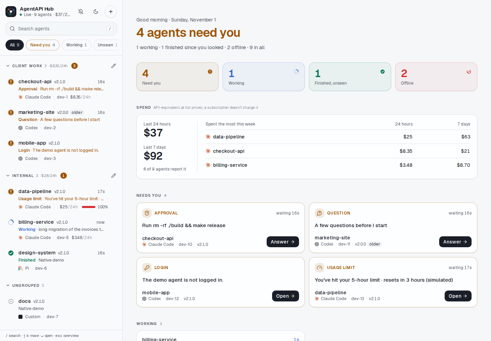

The [README](../README.md#running-a-hub) has the short version. This guide covers setup step by
step, what each state means, the tokens, troubleshooting and the hub's API.

## Contents

- [How it works](#how-it-works)
- [Setting it up](#setting-it-up)
- [Using the hub](#using-the-hub)
- [Tokens and security](#tokens-and-security)
- [Troubleshooting](#troubleshooting)
- [Reference](#reference)
- [Limits](#limits)

## How it works

```text
 phone / desktop browser ──HTTPS──▶ hub (agentapi hub serve, an always-on machine)
                                      ▲ signed webhook events   │ summary streams and the chat,
                                      │ (instance.*)            ▼ with each instance's token
            ┌─────────────────────────┴────────┬────────────────────────────────┐
     AgentAPI on workspace A          AgentAPI on workspace B          AgentAPI on your laptop
```

The hub and the AgentAPIs reach each other over a network you control, such as your own VPN. The
hub never has to be on the public internet.

1. An AgentAPI joins with its webhook. `agentapi hub join` writes the hub's address and secret into
   `~/.agentapi/config.yaml`, which every `agentapi server` of that user reads when it starts. Each
   AgentAPI then sends signed `instance.started`, `instance.heartbeat` (every minute) and
   `instance.stopped` events, and the hub adds, updates or stops the instance (`instance.stopped`
   doesn't stop one added by hand: the hub keeps trying it). One the hub can't
   reach that also missed three heartbeats, such as one whose workspace was killed, counts as
   stopped, and the hub stops trying until its next heartbeat. These events only add instances
   and say where they are; what each one does comes from its summary. An event that names another
   URL moves the instance there only while the hub isn't connected to it, and never one added by
   hand: an AgentAPI whose machine got another address (`{ip}` in its `--public-url`) moves with
   its first heartbeat after the old address stopped answering.
2. The hub follows each instance's summary (`GET /events?only=summary`), the source of truth for
   what the instance does: its state, what it waits for, its title, latest task, queue and usage
   limits. One connection per instance, reopened after 1 s, then up to every 30 s when it fails. A
   stream silent for 45 s counts as lost. An instance stays connecting for the first 10 s of
   failures (one that is starting isn't listening yet when its first event comes); after that it
   is unreachable. The summary names the AgentAPI that answers: when it is another one (the address
   went to another machine), the instance is unreachable at once, and the hub sends it none of the
   instance's requests.
3. A browser signs in with the hub token and gets every instance and each change from one stream.
4. Opening an instance loads the chat through the hub (`/i/<id>/…`). The hub forwards each request
   with the instance's API token in place of the browser's credentials.

## Setting it up

The example uses three made-up names: the hub runs on `hub.vpn`, the AgentAPIs on `dev-1.vpn` and
`dev-2.vpn`. Use your machines' VPN names or addresses instead.

### 1. Make up the secrets

You need up to three values. Keep them out of shell history and repositories, for example in your
password manager:

```bash
openssl rand -hex 32   # HUB_TOKEN: what you sign in with
openssl rand -hex 32   # HUB_SECRET: what the AgentAPIs sign their events with
```

The third is the AgentAPIs' own API token (`--api-token`), if they run with one. The hub sends it
to them. All instances can share one, or an instance added by hand can have its own.

### 2. Run the hub

Pick a machine that stays up and that both the AgentAPIs and your phone can reach over the VPN:

```bash
agentapi hub serve --bind hub.vpn --token "$HUB_TOKEN" --secret "$HUB_SECRET" \
  --instance-token "$AGENTAPI_TOKEN"
```

It listens on port 3290 and keeps the instances in `~/.agentapi/hub/instances.json`, so it still
knows them after a restart. `--bind` limits it to the VPN interface; leave it out to listen
everywhere. The values can come from `AGENTAPI_HUB_TOKEN`, `AGENTAPI_HUB_SECRET` and
`AGENTAPI_HUB_INSTANCE_TOKEN` instead of flags.

Once it listens, the hub logs the `agentapi hub join` command for each address machines may reach
it at: the `--bind` address, or else each address of the machine, private networks first, then
CGNAT ones such as Tailscale's. Containers' and bridges' interfaces don't count. The log leaves out
the secret: `join` takes it from `AGENTAPI_HUB_SECRET`.

```text
level=INFO msg="To join a machine, run this on it with AGENTAPI_HUB_SECRET set to the hub's secret" interface=eth0 command="agentapi hub join http://192.168.1.20:3290/hooks --public-url 'http://{ip}:{port}'"
```

To keep it running, start it the way the machine starts its other services. A systemd user unit,
for example:

```ini
# ~/.config/systemd/user/agentapi-hub.service
[Service]
EnvironmentFile=%h/.config/agentapi-hub.env
ExecStart=/usr/local/bin/agentapi hub serve --bind hub.vpn
Restart=on-failure

[Install]
WantedBy=default.target
```

`agentapi-hub.env` holds the three `AGENTAPI_HUB_*` variables; make it readable by its owner only.

After an update, restart the hub this way too (`systemctl --user restart agentapi-hub`). The
AgentAPIs restart in place with `agentapi update --restart` or
[`agentapi restart`](../README.md#agentapi-restart); the hub isn't one of them. The overview's
[Versions](#versions) card shows the AgentAPIs still on an older version, and updates those whose
machine allows it.

### 3. Join each machine's AgentAPIs

On every machine whose AgentAPIs the hub should watch, once:

```bash
sudo agentapi update   # {ip} needs AgentAPI newer than 2.1.2 on each machine
agentapi hub join http://hub.vpn:3290/hooks --secret "$HUB_SECRET" \
  --public-url 'http://{ip}:{port}'
```

The hub's page has this command ready, with the hub's address and secret filled in, and a prompt
for an agent on the machine: [Joining a machine from the page](#joining-a-machine-from-the-page).

- `join` first sends the hub a signed test event and stops if the hub doesn't take it (unreached, a
  sign-in page in the way, or another secret); see the [reference](#agentapi-hub-join-leave-status).
- `join` writes the hub into `~/.agentapi/config.yaml`. Every `agentapi server` of this user reads
  that file when it starts, so AgentAPIs started by a script with fixed flags, such as a Coder
  workspace's start script, join without a change to the script. Flags and `AGENTAPI_*` variables
  still win over the file.
- `--public-url` is where the hub reaches each AgentAPI. `{port}` becomes each one's port, so one
  line serves the Claude Code AgentAPI on 3286 and the Codex one on 3285 alike. `{ip}` becomes the
  machine's IPv4 address on the route to the hub. Each AgentAPI looks it up again while it runs (at
  most every 30 seconds), so when DHCP gives the machine another address, as after a Coder
  workspace restarts, its next heartbeat names the new one and the hub follows it
  ([How it works](#how-it-works)). `{ip}` needs AgentAPI newer than 2.1.2; a name that
  always resolves, such as `http://dev-1.vpn:{port}`, works too.
- The same file can keep each AgentAPI's conversation when it restarts (an update, a reboot): add
  `state-db: ~/.agentapi/state/{port}.db` to it; see
  [Persistent sessions](../README.md#persistent-sessions).
- Add `--allow-update` to let the hub update this machine's AgentAPIs
  ([Updating from the hub](#updating-from-the-hub)).
- AgentAPIs that are running now get the change at once and appear in the hub within a second.
  Ones that started before 1.2 aren't registered on the machine, so `join` can't reach them:
  restart them, or the workspace, once.
- The hub forwards requests with the host of the instance's URL as the `Host` header. By default an
  AgentAPI accepts `localhost`, `127.0.0.1`, `[::1]` and the address `{ip}` stands for now. For a
  VPN name, start it with `--allowed-hosts '*'` (the Coder module does), or add the name
  to the config file:

  ```yaml
  allowed-hosts: [localhost, 127.0.0.1, "[::1]", dev-1.vpn]
  ```

Check it with:

```bash
agentapi hub status   # the hub in the config file, and where each running AgentAPI reports
agentapi list         # the AgentAPIs running here and what each one's summary says
```

An agent on the machine can do this step for you. The
[agentapi-hub-join skill](../skills/agentapi-hub-join/SKILL.md) has Claude Code check the version
and that the hub answers, ask you for the hub's URL, its secret, this machine's address and whether
the hub may update this machine's AgentAPIs, join, and check where each AgentAPI reports. It never
restarts an AgentAPI or prints the secret, and asks before it runs anything with `sudo`. Install it
on that machine:

```bash
mkdir -p ~/.claude/skills/agentapi-hub-join
curl -fsSL https://raw.githubusercontent.com/k1dav-c/agentapi/main/skills/agentapi-hub-join/SKILL.md \
  -o ~/.claude/skills/agentapi-hub-join/SKILL.md
```

Then give the agent the prompt from the hub page's Add dialog, which has these values, or ask it,
for example: "Join this machine to the hub at http://hub.vpn:3290".

### 4. Open it

Open `http://hub.vpn:3290/` on a desktop or a phone that is on the VPN, and sign in with
`HUB_TOKEN`. The session lasts 30 days.

## Using the hub

### Signing in

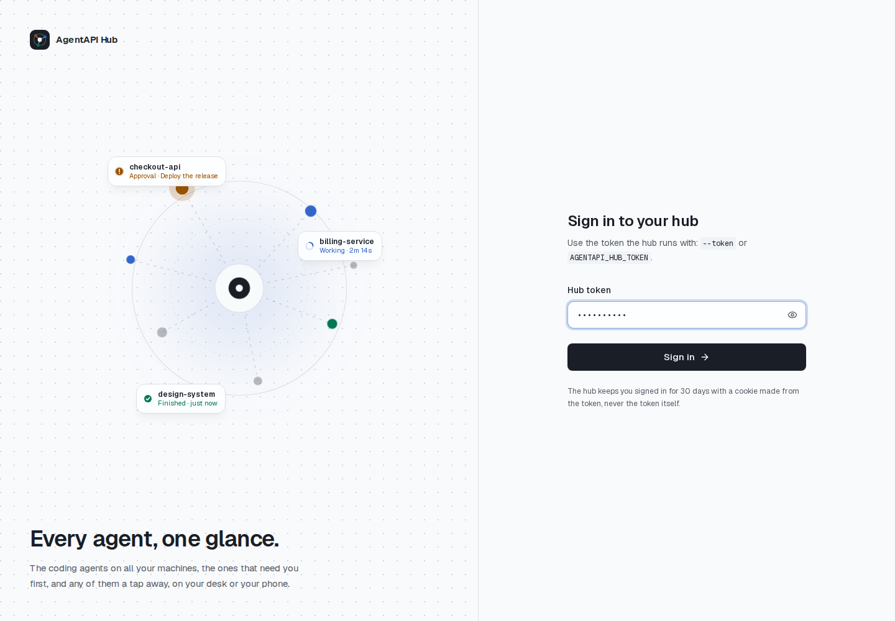

The token goes to the hub once and comes back as an HttpOnly cookie derived from it; the page never
stores the token. Changing `--token` signs every browser out. A wrong token is refused on the spot,
and the eye button shows what you pasted.

A hub that only a sign-in of its own reaches, such as a Coder workspace app or a private VPN, can
run without a token: `--no-token` (instead of `--token`) skips this page, and everyone who reaches
the hub is in. The hub refuses to start with neither.

When the hub doesn't answer (it stopped, or a proxy in front of it answers with an error page), the
page says it can't reach the hub and tries again; only a hub that says the session ended asks for
the token.

### The overview


With no agent open, the right side says how many agents need you and why. A tile per state (need
you, working, finished unseen, offline) counts them; pick one to filter the list. Below, a card per
agent that needs you names what it waits for (the approval's command, the question, the login, the
usage limit) and since when, with **Answer** or **Open**. Running agents show their prompt and how
long they've run; finished ones you haven't seen show their title. At the bottom, the
[Versions](#versions) card counts the AgentAPI versions the agents run.

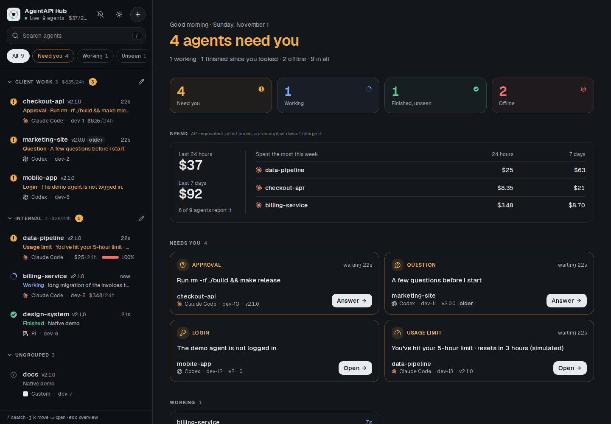

### Spend

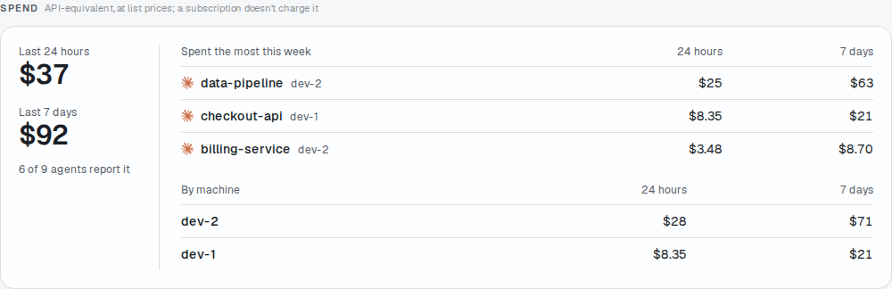

Each AgentAPI works out what its agent's sessions in its working directory cost over the last 24
hours and the last 7 days, from the agent's session logs, once a minute, and puts it in its summary
(`spend`). It is the API-equivalent cost: the tokens at the model providers' list prices, which a
subscription doesn't charge. Only native Claude Code, Codex and Pi have it; other agents show none.

A row shows its agent's last 24 hours (`$110/24h`), a group header its group's, and the top of the
list all of them; hover for the 7 days too. On a desktop the overview has a **Spend** card: the 24
hours and 7 days of every agent that reports it, and the five that spent the most this week.

Two AgentAPIs of one agent in one directory of a machine read the same sessions and report the same
amounts, with the same `scope` (a hash of the machine, the agent, the directory and where the agent
keeps its logs). The totals count each scope once, with its latest figure (`updated_at`). An agent
the hub doesn't follow right now (stopped, unreachable, connecting) shows its last figure dimmed,
as last known, and the totals leave it out.

### Versions

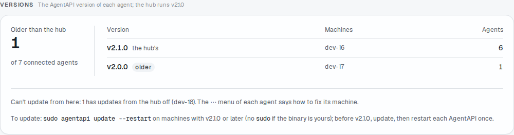

Each row shows the AgentAPI version its instance runs next to its name (`v2.0.0`), and on a desktop
so does the bar above an open agent. A version older than the hub's says **older**: the hub serves
its own chat to every instance ([Limits](#limits)), so those are the ones to update. Hover for both
versions. A development build (`0.0.0-dev`, or what `make build` stamps after a release, such as
`2.0.0-21-g61be34f`) compares with nothing: it gets no mark, and a hub that runs one marks none. An
agent the hub doesn't follow right now (stopped, unreachable, connecting) shows the version it ran
last, dimmed and unmarked. After an update and a restart, the row shows the new version as soon as
the AgentAPI is back.

At the bottom of the overview, the **Versions** card counts the agents the hub follows by version,
with their machines, and says how many run an older version than the hub.

#### Updating from the hub

An AgentAPI updates itself when the hub asks, if its machine allows it. **Update AgentAPI…** in the
row's **⋯** menu asks you first. By default the update waits until the agent is idle: its task
finished, and no approval, question, plan or terminal dialog waits for an answer. **Update now**
doesn't wait: it interrupts the task. The AgentAPI then installs the latest official release for
its OS and architecture, checked against the release's `checksums.txt`, and restarts in place, as
[`agentapi restart`](../README.md#agentapi-restart) does. The AgentAPIs of one machine share the
binary: the first one replaces it, the others only restart.

The row shows how far the update got: checking, downloading, waiting for the task, restarting.
While it waits for the task, **Cancel the update** in the **⋯** menu, or **Cancel** in the bar above
the open agent, calls it off. A failed update says so; hover for the error, or open
**Update AgentAPI…** to read it and try again. Once the AgentAPI is back, the row shows its new
version.

On the **Versions** card, **Update the older ones** does this for every connected agent that runs an
older version than the hub and can update this way, all at once; the AgentAPIs of one machine take
turns on their own. It asks first, and says how many will start a fresh conversation. Then the card
says how many it asked, which agents it can't update, and why.

Each machine needs:

- **To allow it.** Updates from the hub are off by default. Turn them on once per machine: add
  `allow-update: true` to `~/.agentapi/config.yaml`, or join with
  `agentapi hub join … --allow-update`. AgentAPIs read it when they start, so restart them once
  (`agentapi restart --all`). Until then, the menu item says updates are off there, and its dialog
  shows the line to add.
- **Write access to its binary's directory.** The AgentAPI replaces its own binary (symlinks
  resolved) and never runs `sudo`. A binary in a directory owned by root, such as `/usr/local/bin`,
  blocks it. The menu item then says it needs a one-time setup, and its dialog shows the command:
  it moves the binary to your `~/.local/bin` and leaves a symlink in its place. For
  `/usr/local/bin`:

  ```bash
  mkdir -p ~/.local/bin && cp /usr/local/bin/agentapi ~/.local/bin/agentapi \
    && sudo ln -sf ~/.local/bin/agentapi /usr/local/bin/agentapi
  ```

- **A state DB, to keep the conversation.** Only an AgentAPI with a state DB keeps its conversation
  and the agent's session across the restart, and sends its queued messages after it. Without one
  the conversation starts fresh, and the confirmation says so. Add
  `state-db: ~/.agentapi/state/{port}.db` to the config file ([step 3](#3-join-each-machines-agentapis)).

#### Updating by hand

Older AgentAPIs that can't update from the hub show nothing new in the menu; the card says how to
update them. On the machine:

- From 2.1.0 on, AgentAPI restarts in place: `sudo agentapi update --restart` on the machine
  updates the binary and restarts its AgentAPIs into it (without `sudo` when the binary is yours).
- Before 2.1.0, run `sudo agentapi update`, then restart each AgentAPI once, or its workspace.

### The list

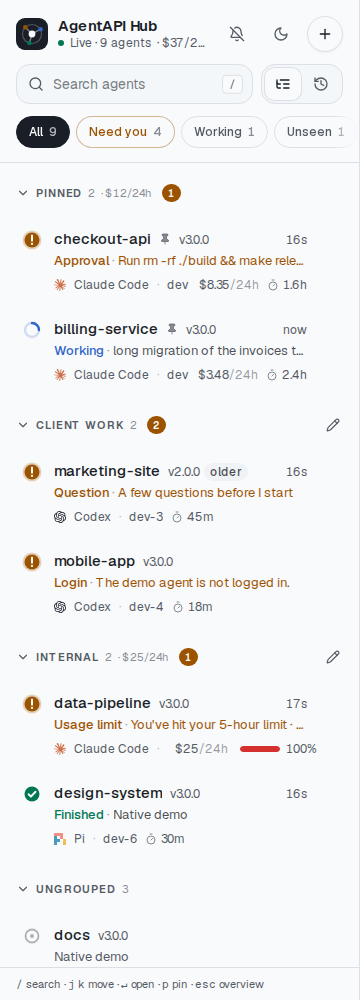

Each row shows the agent's name (`--name`, by default its working directory's name) and AgentAPI
version ([Versions](#versions)), what it waits for or does, how long ago, the agent and the machine;
a queue that isn't empty, what the agent spent in the last 24 hours ([Spend](#spend)) and a usage
limit above 60% join them. An AgentAPI update under way, or one that failed, gets a line of its own
([Updating from the hub](#updating-from-the-hub)). [Pinned](#pinning) agents come first, in your
order. Within a [group](#groups), the rows sort by state in this order, then by name;
[Recent changes](#recent-changes) puts the agents with tasks first and sorts by the latest change
instead. Each state has a shape
of its own, so it reads without its color:

| Glyph | Second line starts with | Meaning |
| --- | --- | --- |
| Amber ! | Approval, Question, Plan, Dialog | A request waits for your answer; the line shows it |
| Amber ! | Login | The agent can't work until you log in on its machine |
| Amber ! | Usage limit | A usage limit stopped its turn; queued messages wait for the reset |
| Turning blue arc | Working | The agent works on the task shown |
| Green check | Finished | A task ended since anyone last looked at this agent |
| Grey ring | (its title) | Idle |
| Struck-through bell, grey | Muted | It needs you, and you muted that until it changes ([Muting](#muting)) |
| Dashed ring, turning | Connecting | The hub is opening its summary stream, or opening it again |
| Broken red ring | Unreachable | The hub hasn't reached it for 10 s; the line says why |
| Square | Stopped, Exited | The AgentAPI stopped (or missed three heartbeats while unreachable), or its agent exited (a native agent: AgentAPI gave up starting it again) |

Search (**/**) matches any word of a name, group, title, machine, agent or version. The chips under it show
all agents or only those that need you, work, finished unseen, or are offline, each with its count.
The header says whether the hub's stream is live and how many agents there are; the tab's title and
icon count the ones that need you, so a pinned tab shows it. The stream reconnects as the chat's
does, and a stream silent for 45 s (the hub sends a heartbeat every 15 s) counts as lost.

"Finished" follows the agent's unread mark, which every client of that AgentAPI shares: opening it
in the hub, or in its own chat, marks it read everywhere.

The hub works out each row's state. A page older than the hub, kept open across an update, shows
a state it doesn't know as Unknown, with a question mark; reload the page.

### Groups

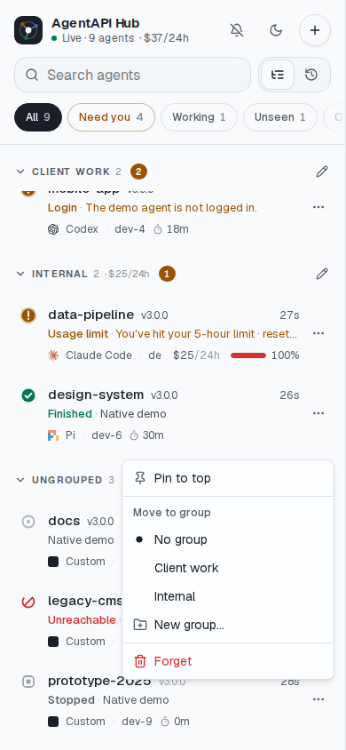

Sort the instances into groups of your own, by client, project or machine. The **⋯** at the end of
each row moves the instance to a group, to a **New group…**, or to **No group**. The same menu pins
it ([Pinning](#pinning)), mutes it ([Muting](#muting)), updates its AgentAPI
([Updating from the hub](#updating-from-the-hub)) and forgets a stopped one
([Adding and forgetting instances](#adding-and-forgetting-instances)). Groups are kept on the hub,
so the phone and the desktop show the same ones, and an instance's own events never move it.

Once there is a group, the list gets a header per group, by name, with the instances in no group
last under **Ungrouped**; [Recent changes](#recent-changes) shows no group headers. A header shows
how many instances the group has and, in amber, how many need you, so a folded group still tells
you. Tap a header to fold or unfold it; each browser remembers which groups it folded. The pencil
renames the group, moving all its instances. A group name has at most 40 characters, and a group
with no instance left disappears.

### Recent changes

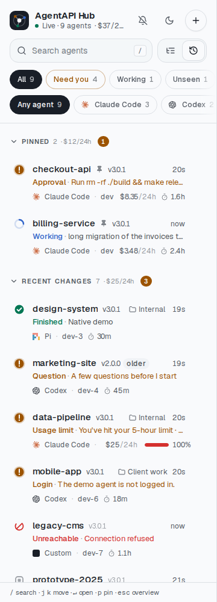

The switch beside the search sets the list's order. **Groups**, the default, is the order above:
what needs you first within each group. **Recent changes** is one list below the
[pinned](#pinning) agents, whatever the group: first the agents that have had a task (one runs,
finished, or ran before), then those with no task yet and the muted ones, each part with the most
recent change first, so an unused agent that just reconnected doesn't push the others down. Each row
then shows how long ago it last changed and, where there is room, its group. The filters and the
search apply in both orders, and `j` and `k` follow the rows as they show. Rows move as the agents
change; the open one stays selected. Each browser remembers its order.

These count as changes: a new state (it needs you, works, finishes, waits, stops, or the hub loses
or finds it), a new task, something new to wait for (a request, a login, a usage limit), a new
title, a change in the queue, an update under way and a new version. These don't: heartbeats, what
people do (a group, a pin, a mute, reading a finished task), the spend and usage figures, the
agent's messages while it works, and a summary stream that drops and comes back within 10 s.

The hub records when each instance last changed (`changed_at`) and keeps it in its file, so
restarting the hub doesn't reorder the list. For a new instance, that is when the hub first saw it.
A hub updated from an earlier version has no record yet: until an instance changes, the list places
it by the time its row shows, else by when the hub last heard of it.

### Pinning

**Pin to top** in a row's **⋯** menu keeps an agent at the top of the list, under **Pinned**, in
both orders. A new pin goes last. **Move up** and **Move down** in the same menu move it past the
next pinned agent the list shows, and **Unpin** takes it out. `p` pins or unpins the row with the
focus.

A pinned agent shows only there, not again in its group or below in the recent list. Its row has a
pin after the name and, where there is room, names its group. The section's header counts its
agents and those that need you, and folds like a group's. Below it, the rest of the list gets headers too: the groups and
**Ungrouped**, or **Recent changes**. The filters and the search apply to pinned agents as well: one
they leave out is hidden, and the section disappears once none is left.

Pins are kept on the hub, like groups, so every browser shows the same ones in the same order.
Pinning, unpinning and moving an agent aren't changes for [Recent changes](#recent-changes).
Forgetting an agent drops its pin.

### Muting

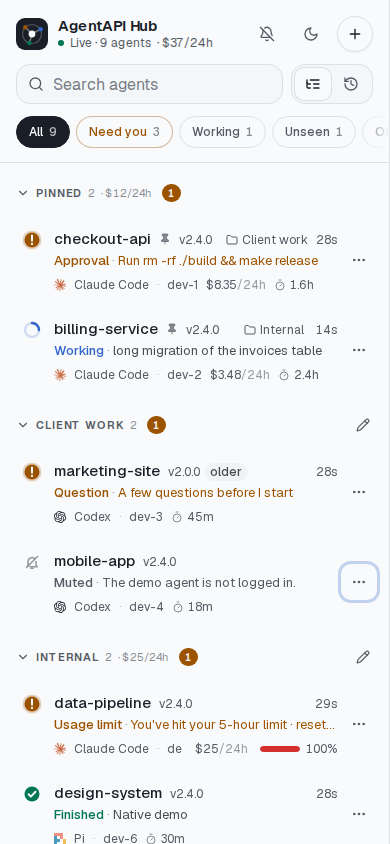

An agent may wait for something you won't do soon, such as a login on a machine you don't use it
on. **Mute until it changes** in its **⋯** menu takes it out of what needs you: it stops counting
in **Need you**, the group's badge, the tab and the overview, and sends no notification. The row
stays, grey, with a struck-through bell and what it waits for. The mute lasts as long as that
does: once the agent logs in, or asks something else (another request, a usage limit), it counts
again. **Unmute** in the same menu ends it sooner. Mutes are kept on the hub, like groups.

### Opening an instance

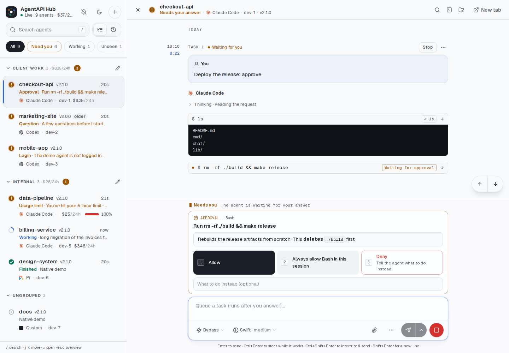

Pick a row or a card to open the agent's chat beside the list: everything the chat does works here,
answering requests included. The bar above it shows the agent's state, agent, machine and AgentAPI
version, with the chat's own search, terminal and Explorer buttons; **New tab** opens the chat on its own, and **×** (or **Esc**) goes back to the overview. Opening an agent
is a page in the browser's history, so Back returns to the list or the overview; moving from one
agent to another doesn't add one. The URL keeps the agent (`#<id>`), so a reload or a bookmark
comes back to it. An AgentAPI update under way shows in the bar too, with **Cancel** while it waits
for the task ([Updating from the hub](#updating-from-the-hub)).

### Keys and notifications

| Key | Does |
| --- | --- |
| `/` | Search |
| `j`, `k` (or the arrows) | Move between the rows |
| `Enter` | Open the row |
| `p` | Pin or unpin the row ([Pinning](#pinning)) |
| `Esc` | Clear the search, or go back to the overview |

On a desktop, drag the list's edge, or focus it and press ← or →, to change the list's width; each
browser remembers it, and a double-click on the edge resets it.

The keys work while the hub has the focus; inside an open chat, keys go to the chat. The bell asks
the browser to notify you when an agent starts needing you while the hub's tab is in the background,
and a screen reader hears the same as it happens.

### On a phone

| The list | An instance |
| --- | --- |
| 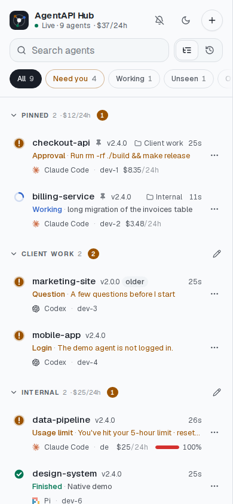 | 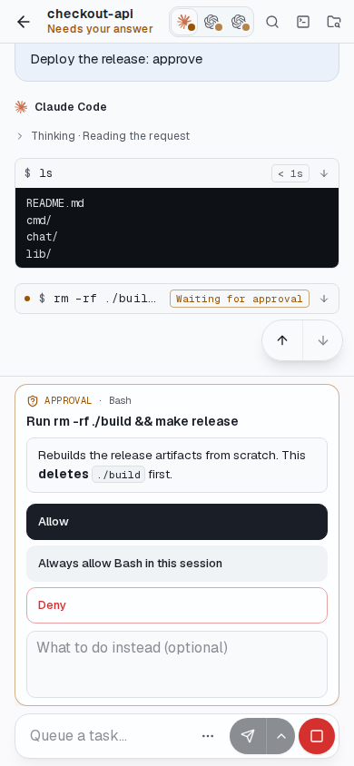 |

On a narrow screen the list and the chat take turns; the back arrow at the top, or the phone's
back gesture, goes back to the list. The chat keeps the screen for the conversation: one bar above
it, and the composer one row. Answering
an approval from the phone:

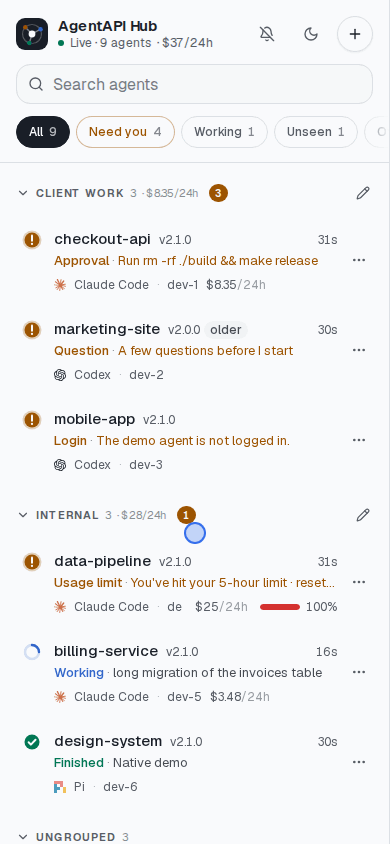

### Connecting the first agents

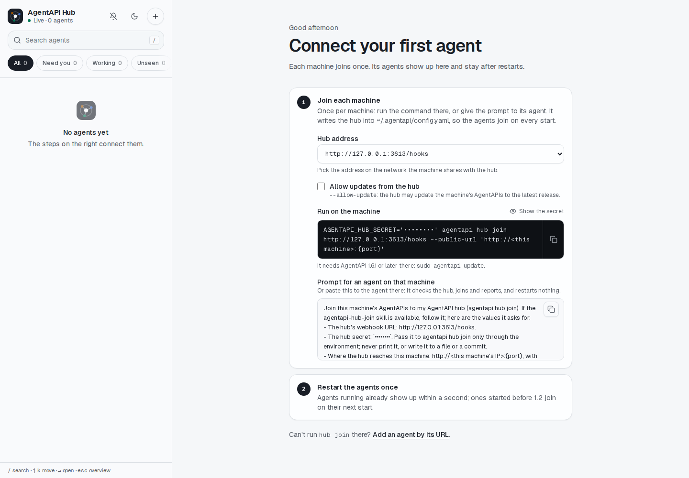

A hub no agent has joined yet shows how to join a machine, as the
[Add dialog](#joining-a-machine-from-the-page) does, and then to restart the agents once. An
AgentAPI's own chat has steps for its machine too: **Add to an AgentAPI hub…** in the menu of the
status in its header ([Session details](chat-ui.md#session-details-and-alerts)).

### Joining a machine from the page

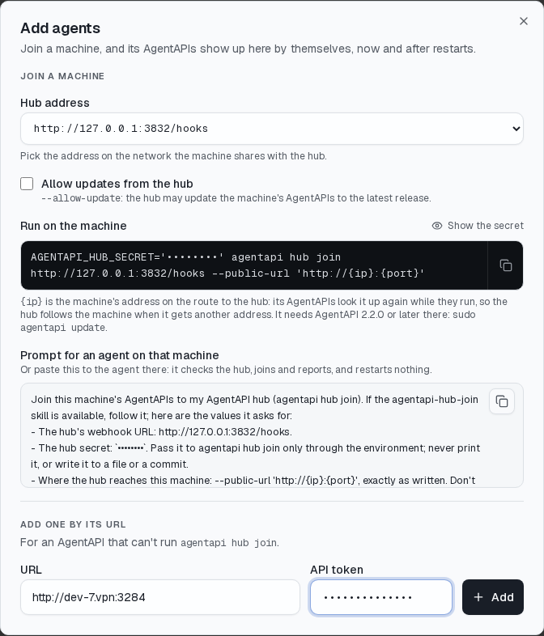

**+** opens the Add dialog. Its **Join a machine** section has
[step 3](#3-join-each-machines-agentapis) ready to copy:

- **Hub address** lists where machines reach the hub: the `--bind` address, or each address of the
  hub's machine with its interface, as the startup log has them. Pick the one on the network the
  machine shares with the hub. A hub that found none offers the page's own address, which works only
  without a sign-in page in front of it, unlike a Coder port URL.
- **Allow updates from the hub** adds `--allow-update` ([Updating from the hub](#updating-from-the-hub)).
- **Run on the machine** is the `agentapi hub join` command, with the secret in
  `AGENTAPI_HUB_SECRET` and `--public-url 'http://{ip}:{port}'`: `{ip}` follows the machine's
  address, so there is nothing to fill in.
- **Prompt for an agent on that machine** has an agent there join it: the hub's URL and the others
  to try, the secret, `--public-url` with `{ip}` as it is, and the steps: the version, a check that
  the hub answers, `join` and `agentapi hub status`. The agent restarts no
  AgentAPI and never shows the secret. With updates allowed, it explains the one-time setup `join`
  may print and suggests a state DB, asking you before either. An agent with the
  [agentapi-hub-join skill](../skills/agentapi-hub-join/SKILL.md) follows the skill; one without
  follows the steps.

The secret shows masked until **Show the secret**; the copy buttons copy it as it is. Only a hub with
a token shows its secret, to whoever signs in. A hub with `--no-token` never does, since everyone
who reaches it would see it: the command has `<hub secret>` in its place, and the prompt has the
agent ask you for it.

### Adding and forgetting instances

**Add one by its URL**, at the bottom of the Add dialog, adds an AgentAPI that can't run
`agentapi hub join` (an older version, or one you don't log in to). The hub asks it for its summary
first, so it must be reachable and run AgentAPI 1.1 or later. A token given here is kept for that
instance and sent instead of `--instance-token`. An instance added this way doesn't report starting
or stopping; the hub just finds it reachable or not.

The **⋯** menu of a stopped or unreachable row has **Forget**, which removes it from the hub. An
instance that joined with its webhook comes back the next time it starts.

## Tokens and security

| Value | Who holds it | What it does |
| --- | --- | --- |
| Hub token (`--token`) | You, and the hub | Signs a browser in to the hub |
| Hub secret (`--secret`) | The hub, and each machine's config file | Signs the AgentAPIs' events, so only your machines can add instances |
| Instance token (`--instance-token`, or one per added instance) | The hub, and the AgentAPIs | Lets the hub call the AgentAPIs; browsers never get it |

- The hub takes an event only with a valid `X-AgentAPI-Signature-256` (HMAC-SHA256 of
  `<timestamp>.<body>`), a timestamp at most 10 minutes off, and a delivery ID (`id`) it hasn't
  taken yet. AgentAPI always sends one; an event without it is refused, since a copy of it would
  work again for those 10 minutes. This matters because an event names the URL the hub sends an
  instance token to. The hub reads an event for at most 10 seconds, and 1 MiB.
- A signed event can add an instance the hub doesn't have, and move one the hub doesn't follow
  right now (stopped, or its summary stream isn't open) to the event's URL. It never moves an
  instance the hub follows, whatever run it names, or one added by hand. An `instance.*` event
  must name its run (`server_id`, which AgentAPI 1.0 and later send). An instance that moves leaves
  the token given for its old URL behind; `--instance-token` still applies.
- Every joined machine has the same secret, in a file any agent there can read (one in the bypass
  permission mode reads files without asking). Such an agent, steered by something it read, can
  still announce an instance ID the hub isn't following right now at an address of its own. The
  hub then sends that address `--instance-token`, and the messages and approvals you send that
  instance. Join only machines you would give the instance token, and add an instance by hand if
  it must never move. A key per machine would close this; the hub doesn't have one yet.
- The hub sends an instance's requests only while the AgentAPI at its URL says it is that
  instance.
- The session cookie is HttpOnly and SameSite=Lax, derived from the hub token rather than holding
  it. The proxy drops the browser's cookies and its `Authorization`, `Origin`, `Referer` and
  `Sec-Fetch-*` headers, and drops the instance's `Set-Cookie`, so neither side's credentials
  reach the other.
- A page of another site can't make the hub change anything or send an instance a task, with or
  without a token: the hub refuses requests that change something unless the browser says they
  come from the hub's own page.
- Nothing an instance answers runs as a page of the hub's (`Content-Security-Policy: sandbox`),
  so a workspace someone took over can't reach the others through your browser. Through the hub,
  an instance's webhook can be read but not changed: it names where the hub sends the token.
- Adding a URL never moves an instance the hub has; forget it first.
- `~/.agentapi/hub/instances.json` holds the tokens of instances added by hand; it is created
  readable by its owner only. `~/.agentapi/config.yaml` holds the hub secret; `agentapi hub join`
  writes it the same way.
- Signing in sends the hub token. Serve the hub only on the VPN, or behind HTTPS.
- Anyone signed in to the hub can do what the AgentAPIs allow: send tasks, answer approvals, use
  their terminals, update those whose machine allows it. Give the hub token only to people you
  would give the instance token.
- Anyone signed in also gets the hub secret, which joins a machine (`GET /api/join`, for the
  [Add dialog](#joining-a-machine-from-the-page)). A hub with `--no-token` never sends it, since
  everyone who reaches it would get it.
- An AgentAPI the hub asks to update installs only the latest official release, checked against the
  release's `checksums.txt`: the hub can't choose a version or a URL. It never runs `sudo`, and
  does nothing unless its machine allows it (`allow-update: true`).
- With `--no-token`, that is everyone who reaches the hub's port: keep it behind a sign-in of its
  own, and never on a public address. Set `--allowed-hosts` to the names you open it by (a Coder
  port URL's host, a VPN name): a site's page can otherwise reach the hub through a name of the
  site's that it points at the hub's address (DNS rebinding). IP addresses and `localhost` always
  work.

  ```bash
  agentapi hub serve --no-token --secret "$AGENTAPI_HUB_SECRET" \
    --allowed-hosts 3290--app--dev--me.coder.example.com
  ```

## Troubleshooting

| What you see | Why | What to do |
| --- | --- | --- |
| An instance never appears | Its AgentAPI started before `join`, or before 1.2 | Restart it, or its workspace |
| `join` says a sign-in page is in front of the hub | The hub's URL is a Coder port URL (or another behind a login) | Join with the hub's address on your network or VPN; the AgentAPIs send events themselves |
| `join` says the hub is on another machine | `--public-url` names `localhost` | Give the address the hub reaches this machine at |
| The Add dialog's command has `<hub secret>` | The hub runs with `--no-token`, so its page never shows the secret | Put in the hub's `--secret` |
| The Add dialog lists no address of the network the machine is on | The hub binds one address (`--bind`), or machines reach it at an address its machine doesn't have (NAT, a port forward) | Use the address the machine reaches the hub at, plus `/hooks` |
| An instance never appears; the hub logs "Refused an event" (at most once a minute for a bad signature, with `refused_since_last_logged`) | `--secret` of `join` and of the hub differ, or the clocks are more than 10 minutes apart | Run `agentapi hub join` again with the hub's secret; check the clocks |
| An instance never appears; `agentapi hub status` shows no hub | `join` wrote to another config file than the one the AgentAPI reads | Use the same user, or pass the same `--config` to both |
| Unreachable: `400 Bad Request` | The AgentAPI refuses the VPN name as `Host` | Allow it in `--allowed-hosts` (step 3) |
| Unreachable: `needs an API token` | The AgentAPI runs with `--api-token` and the hub has another | Give the hub `--instance-token`, or the token when adding |
| Unreachable: connection refused or timed out | Wrong `--public-url`, or the hub can't reach the VPN | Check the URL from the hub's machine with `curl <url>/summary` |
| Unreachable (`no route to host`, or timed out) after the machine got a new IP address | It joined with a fixed IP in `--public-url`, which DHCP changed, as after a Coder workspace restarts | Run `agentapi hub join` again with `--public-url 'http://{ip}:{port}'`; the hub follows it with its next heartbeat, and after every later change |
| Unreachable: `another AgentAPI answers at this URL` | The instance's address now belongs to another machine (a new DHCP lease), or `--public-url` names another machine | Check `--public-url`; an instance that moved sends its new address with its next heartbeat, within a minute |
| The hub logs "Two AgentAPIs report the same instance ID" | Two machines have the same name, so their AgentAPIs on the same port have the same ID; the hub keeps the one it follows | Rename one machine, or give its AgentAPIs `--instance-id` |
| The hub logs "An instance's event names another URL" | Its `--public-url` changed while the hub follows it at the old one | Nothing: the hub keeps the URL that works, and takes the new one once the old one stops answering |
| The hub logs "An instance added by hand keeps its URL" | It was added by one URL, and its webhook names another | Make `--public-url` the URL it was added by, or forget it and let its webhook add it |
| The hub logs "Refused an instance event that names no server ID" | Something that isn't AgentAPI 1.0 or later sent it, signed with the hub's secret | Update the sender; if you don't know it, find which machine with the secret sends it |
| Unreachable, and the hub's VPN client runs in userspace | The hub's connections don't go through the VPN | Set `ALL_PROXY` to the VPN client's SOCKS5 proxy for the hub |
| "is it AgentAPI 1.1 or later?" when adding | The instance has no summary | Update it with `agentapi update` |
| The page says the hub didn't answer | Wrong address, or the hub isn't running | Open `http://<hub>:3290/api/session`; it answers JSON when the hub runs |
| Behind Coder's port URL, the page asks for Coder first | Coder's port URLs need a Coder login | Sign in to Coder in that browser, then to the hub |
| `the hub doesn't answer to <name>; add it to --allowed-hosts` | The hub runs with `--allowed-hosts` and you opened it by another name | Add the name to `--allowed-hosts` |
| **Update AgentAPI…** says updates are off | The machine doesn't allow updates from the hub | Add `allow-update: true` to `~/.agentapi/config.yaml` there, then run `agentapi restart --all` |
| **Update AgentAPI…** asks for a one-time setup | The AgentAPI can't write its binary's directory, such as a root-owned `/usr/local/bin` | Run the command it shows on that machine, once |
| A row says **Update failed** | Checking or downloading the release failed | Hover it, or open **Update AgentAPI…**, for the error; then try again |
| A connected agent's **⋯** menu has nothing about updating it | Its AgentAPI is too old to update from the hub | Update it by hand ([Updating by hand](#updating-by-hand)) |
| The hub logs "The hub's file of instances doesn't parse" | The file was cut short, such as by a crash or a full disk | The hub moved it aside (`instances.json.corrupt-<time>`) and started empty. Joined instances come back with their next heartbeat; add the others again, and set groups, pins and mutes again |

`agentapi hub status` on an instance's machine shows which hub its config file names and where
each running AgentAPI reports. The hub logs each instance it starts following, stops or can't
reach (with the error), and each event it refuses; the AgentAPI logs each webhook delivery that
failed.

## Reference

### `agentapi hub serve`

| Flag | Default | Description |
| --- | --- | --- |
| `--token` | `AGENTAPI_HUB_TOKEN` | Token browsers sign in with; required, unless `--no-token` |
| `--no-token` | `false` | No sign-in: everyone who reaches the hub is in (only behind a sign-in of its own) |
| `--secret` | `AGENTAPI_HUB_SECRET` | Secret the AgentAPIs sign their events with; required |
| `--instance-token` | `AGENTAPI_HUB_INSTANCE_TOKEN`, else `AGENTAPI_API_TOKEN` | API token sent to the AgentAPIs |
| `--state` | `~/.agentapi/hub/instances.json` | File that keeps the instances |
| `--port` | `3290` | Port to listen on |
| `--bind` | all interfaces | Address to listen on, such as the VPN address |
| `--allowed-hosts` | any | Names browsers open the hub by, besides IP addresses and `localhost` (comma-separated, `*` for any); instances' events come by any name |
| `--log-level` | `AGENTAPI_HUB_LOG_LEVEL`, else `info` | Least important level to log: `debug`, `info`, `warn` or `error` |

The hub reaches the instances through the proxy of the environment (`HTTP_PROXY`, `HTTPS_PROXY`,
`ALL_PROXY`). It gives up connecting after 30 seconds (10 for the TLS handshake) and waiting for an
answer's headers after 15; the summary streams and the pages it proxies stay open.

### `agentapi hub join`, `leave`, `status`

| Flag | Default | Description |
| --- | --- | --- |
| `--secret` | `AGENTAPI_HUB_SECRET` | Secret that signs the events; without it the hub refuses them |
| `--public-url` | | Where the hub reaches the AgentAPIs, such as `http://{ip}:{port}`; `{port}` and `{hostname}` are filled in, and `{ip}` with the machine's IPv4 address on the route to the hub, which each AgentAPI looks up again while it runs |
| `--events` | `instance.*` | Events sent to the hub; it needs only these |
| `--api-token` | `AGENTAPI_API_TOKEN` | Token for running AgentAPIs that need one |
| `--config` | `~/.agentapi/config.yaml` | Config file to write |
| `--registry-dir` | `~/.agentapi/instances` | Where the running AgentAPIs are registered |
| `--no-check` | `false` | Join without checking that the hub takes the events (for a hub that doesn't run yet) |
| `--allow-update` | `false` | Let the hub update this machine's AgentAPIs (`allow-update: true` in the config file); see [Updating from the hub](#updating-from-the-hub) |

Before it writes anything, `join` checks that the hub takes this machine's events: it sends the hub
a signed `webhook.test` event and stops, saying why, when the hub isn't reached, a sign-in page is
in front of it (a Coder port URL redirects to Coder's login), or the secret differs. It also stops
when the hub is on another machine and `--public-url` names `localhost`, which the hub can't reach.
For these checks it fills in `{ip}` toward the hub, and prints the address.

`join` writes `webhook-url`, `webhook-secret`, `webhook-events` and `public-url` into the config
file and applies them to the running AgentAPIs with `PUT /webhook`, keeping their timeout and
attempts. The file keeps `{ip}`, and so do the running AgentAPIs that fill it in themselves (newer
than 2.1.2, by their registry entry); an older one gets the address now, keeps it until it restarts,
and `join` says so. `join` reaches each one at its registry URL, or else at its port on localhost.
`leave` removes them and turns the running AgentAPIs' webhook off. An AgentAPI that can't be changed
now applies the file when it restarts. With `--allow-update`, `join` also writes
`allow-update: true`, which AgentAPIs read when they start.

A machine that joined with an earlier version still sends `task.*`, `request.*`, `login.*`,
`limit.*` and `agent.error` as well, up to 64 KiB each; the hub only takes them as signs of life.
Run the same `agentapi hub join` again to send only `instance.*`: it rewrites the file and the
running AgentAPIs, which then no longer follow their conversation for the webhook.

### The hub's HTTP API

| Endpoint | Description |
| --- | --- |
| `POST /hooks` | AgentAPI webhook events; signed with `--secret`, no session needed |
| `GET /api/session` | `{"authenticated": true}` when the request carries the session or the hub token |
| `POST /api/session` | `{"token": …}` signs in and sets the session cookie |
| `DELETE /api/session` | Signs out |
| `GET /api/instances` | The instances: who each one is, its summary, its connection, the state its row shows (`state`: `needs-you`, `working`, `unread`, `idle`, `muted`, `connecting`, `unreachable` or `stopped`), when what its row shows last changed (`changed_at`, RFC 3339; see [Recent changes](#recent-changes)) and its place among the pinned ones (`pin`, from 1; none when it isn't pinned); and the hub's own version (`hub_version`) |
| `POST /api/instances` | `{"url": …, "token": …}` adds an instance by its URL |
| `PATCH /api/instances/{id}` | `{"group": …}` puts an instance in a group, `""` in none; `{"muted": true}` mutes what it waits for now, until that changes (409 when it waits for nothing), `false` ends the mute; `{"pinned": true}` pins it below the pinned ones, `false` unpins it |
| `DELETE /api/instances/{id}` | Forgets an instance, and its pin |
| `PUT /api/pins` | `{"ids": […]}` orders the pinned instances, from the top. It lists each pinned instance once and no other; 409, with the pinned ones in their order (`ids`), when it doesn't, such as after one was pinned, unpinned or forgotten; 404 for an instance the hub doesn't have |
| `GET /api/events` | Server-sent events: `instances` (all of them and `hub_version`, as `GET /api/instances` has them), then `instance` (one changed what the page shows; when it was last heard of counts only while it is offline), `removed` (`{"id"}`) and a `heartbeat` every 15 s |
| `GET /api/join` | Where machines join the hub: `urls`, each a webhook URL (`url`) with the interface of its address (`interface`; none for `--bind`'s), in the order the startup log has them; and the secret (`secret`, with `secret_shown: true`) only on a hub with a token |
| `/i/{id}/…` | The instance's own API and chat, through the hub; the page updates an instance with `POST /i/{id}/update` and cancels with `DELETE` |

Every endpoint but `/hooks` and `/api/session` needs the session cookie or
`Authorization: Bearer <hub token>`. Instance tokens never appear in any response.

### Files

| File | Written by | Holds |
| --- | --- | --- |
| `~/.agentapi/config.yaml` | `agentapi hub join` | The hub's webhook and `allow-update`, read by every `agentapi server` |
| `~/.agentapi/instances/` | `agentapi server` | The AgentAPIs running on this machine, for `join` and `agentapi list` |
| `~/.agentapi/hub/instances.json` | `agentapi hub serve` | The instances the hub knows, their groups and pins, when each last changed, and tokens of the ones added by hand |

## Limits

- The hub serves the chat of its own version to every instance. Run the same AgentAPI version on
  the hub and the instances; [Versions](#versions) shows the ones that differ.
- One hub token for everyone: there are no per-user accounts or permissions.
- The hub watches and opens AgentAPIs, and updates those whose machine allows it; it doesn't start
  or stop them.
- Nothing reaches your phone while the hub's page is closed: the hub doesn't send push
  notifications yet. Each AgentAPI has one webhook, and the hub uses it.
