# hub

[English](hub.md) | [繁體中文](hub.zh-TW.md)

hub 在一個頁面上監看多台主機的 AgentAPI：列出每個實例，需要你處理的排最前面，點一下就能在聊天
介面中開啟，桌面和手機都能用。hub 也在 AgentAPI 的 binary 裡：`agentapi hub serve`。

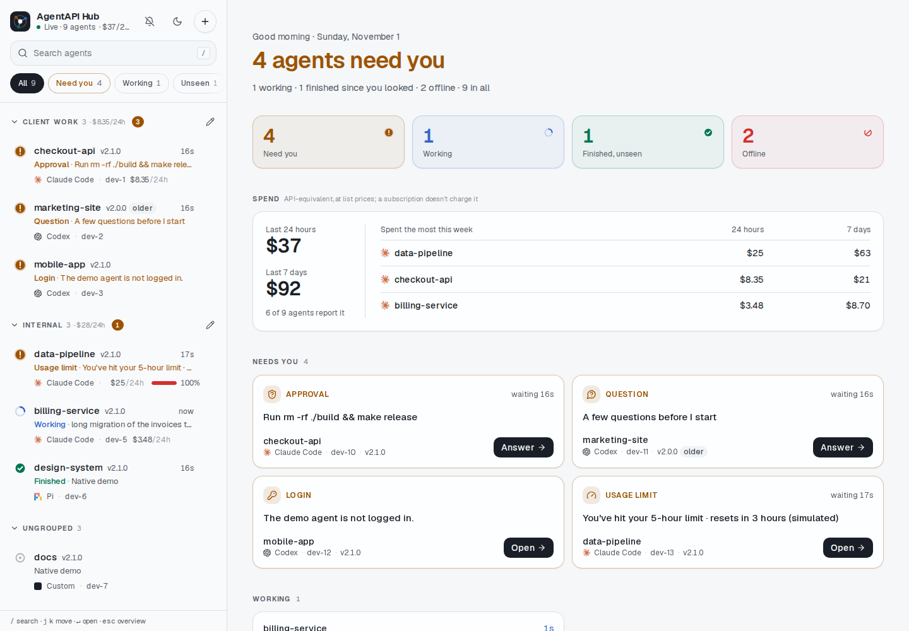

[HTTP API 說明](api.zh-TW.md#執行-hub)有精簡版說明。

## 目錄

- [運作方式](#運作方式)
- [架設](#架設)
- [使用 hub](#使用-hub)
- [Token 與安全性](#token-與安全性)
- [疑難排解](#疑難排解)
- [參考](#參考)
- [限制](#限制)

## 運作方式

```text
 手機／桌面瀏覽器 ──HTTPS──▶ hub（agentapi hub serve，放在常開的主機上）
                               ▲ 有簽章的 webhook 事件    │ 摘要串流和聊天介面，
                               │ （instance.*）           ▼ 帶著各實例的 token
          ┌────────────────────┴───────────┬────────────────────────────────┐
   workspace A 上的 AgentAPI      workspace B 上的 AgentAPI       你筆電上的 AgentAPI
```

hub 和各個 AgentAPI 透過你掌控的網路互連，例如你自己的 VPN。hub 完全不必放上公開網路。

1. AgentAPI 用 webhook 加入。`agentapi hub join` 把 hub 的位址和 secret 寫進
   `~/.agentapi/config.yaml`，這個使用者的每個 `agentapi server` 啟動時都會讀取。之後每個
   AgentAPI 都送出有簽章的 `instance.started`、`instance.heartbeat`（每分鐘一次）和
   `instance.stopped`，hub 據此新增、更新或停止實例（手動加入的實例不會因 `instance.stopped`
   停止，hub 會持續嘗試連線）。hub 連不到、又錯過三次 heartbeat 的實例，例如 workspace 被強制
   關掉的，視為已停止；在它下一次送 heartbeat 之前，hub 不再嘗試連線。這些事件只用來新增實例、告訴
   hub 它在哪裡；每個實例在做什麼，以它的摘要為準。事件寫了另一個網址時，只有 hub 確定舊網址
   已經失效，才會改用新網址：在舊網址連線失敗超過 10 秒的寬限（Unreachable，或錯過 heartbeat 而視為
   已停止），或那裡回應的是另一個 AgentAPI。hub 已連上或還在連線中（hub 剛重新啟動，或串流斷線
   未滿 10 秒）時一律不改，手動加入的實例也一律不改。因 `instance.stopped` 而停止的實例，hub 會先
   回舊網址試一次。主機換了位址的 AgentAPI（`--public-url` 裡用 `{ip}`），會在舊位址變成
   Unreachable 後的第一次 heartbeat 搬到新位址，大約兩分鐘內（見[疑難排解](#疑難排解)）。實例檔案會記下
   hub 最後一次讀到每個實例摘要的網址，hub 重新啟動後先從那裡追蹤。
2. hub 追蹤每個實例的摘要（`GET /events?only=summary`），以它為實例狀況的依據：狀態、在等什麼、
   標題、最新任務、佇列和用量限制。每個實例一條連線；斷線時 1 秒後重連，之後間隔逐次拉長，最多
   30 秒。串流 45 秒沒有任何動靜就視為斷線。連線失敗的前 10 秒，實例仍顯示為連線中（剛啟動的實例
   送出第一個事件時，可能還沒開始接受連線）；超過 10 秒才算連不到。摘要會寫明回應的是哪個
   AgentAPI：若是別的 AgentAPI（位址換到了另一台主機），實例立刻顯示為連不到，hub 也不會把這個
   實例的請求轉給它。
3. 瀏覽器用 hub token 登入，從一條串流取得所有實例和每次變更。
4. 開啟實例時，聊天介面透過 hub 載入（`/i/<id>/…`）。hub 轉送每個請求時，用實例的 API token 取代
   瀏覽器的憑證。

## 架設

範例用三個虛構的名稱：hub 在 `hub.vpn`，AgentAPI 在 `dev-1.vpn` 和 `dev-2.vpn`。請換成你主機的
VPN 名稱或位址。

### 1. 產生 secret

最多需要三個值。不要留在 shell 歷史紀錄或儲存庫裡，可以放進密碼管理工具：

```bash
openssl rand -hex 32   # HUB_TOKEN：登入用
openssl rand -hex 32   # HUB_SECRET：AgentAPI 為事件簽章用
```

第三個是 AgentAPI 自己的 API token（`--api-token`），有設定才需要，hub 會把它送給各實例。所有
實例可以共用一個；手動加入的實例也可以各有各的。

### 2. 執行 hub

挑一台會一直開著、而且 AgentAPI 和你的手機都能透過 VPN 連到的主機：

```bash
agentapi hub serve --bind hub.vpn --token "$HUB_TOKEN" --secret "$HUB_SECRET" \
  --instance-token "$AGENTAPI_TOKEN"
```

hub 監聽 port 3290，並把實例保存在 `~/.agentapi/hub/instances.json`，重新啟動後仍然記得。
有變動時，hub 會在一秒內寫入這個檔案，停止時也會寫一次。`--bind` 讓 hub 只聽 VPN 介面；不加的話
監聽所有介面。這些值也可以改用 `AGENTAPI_HUB_TOKEN`、`AGENTAPI_HUB_SECRET` 和
`AGENTAPI_HUB_INSTANCE_TOKEN` 設定。

hub 開始監聽後，會把加入用的 `agentapi hub join` 指令寫進 log，主機可能連到它的每個位址各一行：
有 `--bind` 時是那個位址，否則是這台主機的各個位址，私有網路的排前面，接著是 Tailscale 這類 CGNAT
位址；容器和 bridge 的介面不列。log 裡不會出現 secret，`join` 會從 `AGENTAPI_HUB_SECRET` 讀取。

```text
level=INFO msg="To join a machine, run this on it with AGENTAPI_HUB_SECRET set to the hub's secret" interface=eth0 command="agentapi hub join http://192.168.1.20:3290/hooks --public-url 'http://{ip}:{port}'"
```

要讓 hub 持續執行，就用這台主機啟動其他服務的方式啟動它。例如 systemd 的使用者 unit：

```ini
# ~/.config/systemd/user/agentapi-hub.service
[Service]
EnvironmentFile=%h/.config/agentapi-hub.env
ExecStart=/usr/local/bin/agentapi hub serve --bind hub.vpn
Restart=on-failure

[Install]
WantedBy=default.target
```

`agentapi-hub.env` 放三個 `AGENTAPI_HUB_*` 變數；只讓擁有者能讀取。

更新之後，hub 也用同樣的方式重新啟動（`systemctl --user restart agentapi-hub`）。AgentAPI 可以用
`agentapi update --restart` 或 [`agentapi restart`](cli.zh-TW.md#agentapi-restart) 原地重新
啟動，hub 不在其中。哪些 AgentAPI 還停在舊版，總覽的[版本](#版本)卡片會列出來；主機允許的話，
也能從那裡直接更新。

### 3. 讓每台主機的 AgentAPI 加入

在每台要讓 hub 監看的主機上執行一次：

```bash
sudo agentapi update   # 每台主機的 AgentAPI 都要在 2.1.2 之後才有 {ip}
agentapi hub join http://hub.vpn:3290/hooks --secret "$HUB_SECRET" \
  --public-url 'http://{ip}:{port}'
```

hub 的頁面已經備好這行指令，填好 hub 的位址和 secret，另附一段給那台主機上 agent 的提示：
見[從頁面讓主機加入](#從頁面讓主機加入)。

- `join` 會先送給 hub 一個有簽章的測試事件，hub 沒收下就停止（連不到、被登入頁擋住，或 secret 不同），
  見[參考資料](#agentapi-hub-joinleavestatus)。
- `join` 把 hub 寫進 `~/.agentapi/config.yaml`。這個使用者的每個 `agentapi server` 啟動時都會讀
  這個檔案，所以由腳本以固定參數啟動的 AgentAPI（例如 Coder workspace 的啟動腳本）不必改腳本也能
  加入。旗標和 `AGENTAPI_*` 環境變數仍然優先於這個檔案。
- `--public-url` 是 hub 連回各 AgentAPI 的網址。`{port}` 會換成各自的 port，所以同一行設定可以
  同時用在 3286 的 Claude Code 和 3285 的 Codex。`{ip}` 會換成這台主機通往 hub 那條路由上的 IPv4
  位址。每個 AgentAPI 執行期間會重新查詢（最多每 30 秒一次），所以 DHCP 給了主機新位址時（例如
  Coder workspace 重新啟動後），下一次 heartbeat 就會帶著新位址，hub 也會跟著改用
  （見[運作方式](#運作方式)）。`{ip}` 需要 2.1.2 之後的 AgentAPI；固定能解析的名稱，例如
  `http://dev-1.vpn:{port}`，也可以用。
- 同一個檔案也能讓各 AgentAPI 重新啟動（更新、重新開機）後保留對話：加上
  `state-db: ~/.agentapi/state/{port}.db`，見[持久保存的工作階段](agents.zh-TW.md#持久保存的工作階段)。
- 想讓 hub 更新這台主機的 AgentAPI，加入時再加上 `--allow-update`（見[從 hub 更新](#從-hub-更新)）。
- 正在執行的 AgentAPI 會立刻套用，一秒內就出現在 hub 上。1.2 之前啟動的 AgentAPI 沒有在這台主機
  上登記，`join` 找不到它們：重新啟動它們或整個 workspace 一次。
- hub 轉送請求時，`Host` 標頭是實例網址裡的主機。AgentAPI 預設只接受 `localhost`、`127.0.0.1`、
  `[::1]`，以及 `{ip}` 目前代表的位址。用 VPN 名稱時要允許它：用 `--allowed-hosts '*'` 啟動
  （Coder module 就是這樣做），或把名稱加進設定檔：

  ```yaml
  allowed-hosts: [localhost, 127.0.0.1, "[::1]", dev-1.vpn]
  ```

用這兩個指令確認：

```bash
agentapi hub status   # 設定檔裡的 hub，以及每個執行中的 AgentAPI 回報到哪裡
agentapi list         # 這台主機上執行中的 AgentAPI，以及各自的摘要
```

這一步也可以交給那台主機上的 agent。[agentapi-hub-join skill](../skills/agentapi-hub-join/SKILL.md)
會讓 Claude Code 檢查版本和 hub 是否有回應，向你詢問 hub 的網址、secret、這台主機的位址，以及要不要
讓 hub 更新這台主機的 AgentAPI，然後加入，並確認每個 AgentAPI 回報到哪裡。它不會重新啟動 AgentAPI，
也不會印出 secret；要用 `sudo` 執行的指令，都會先問過你。在那台主機上安裝：

```bash
mkdir -p ~/.claude/skills/agentapi-hub-join
curl -fsSL https://raw.githubusercontent.com/k1dav-c/agentapi/main/skills/agentapi-hub-join/SKILL.md \
  -o ~/.claude/skills/agentapi-hub-join/SKILL.md
```

然後把 hub 頁面新增對話框裡的提示貼給它，裡面已經有這些值；或直接跟它說，例如：「把這台主機加入
http://hub.vpn:3290 的 hub」。

### 4. 開啟 hub

在連上 VPN 的桌面或手機開啟 `http://hub.vpn:3290/`，用 `HUB_TOKEN` 登入。登入狀態維持 30 天。

## 使用 hub

### 登入

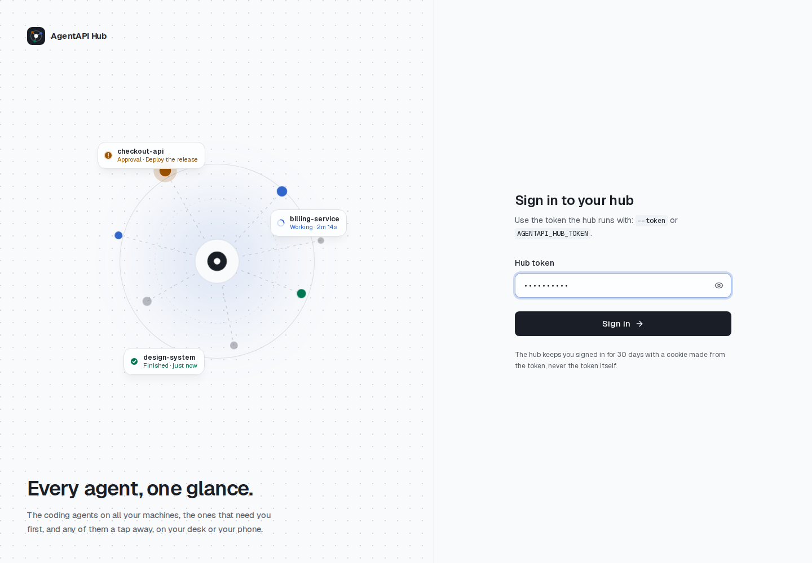

token 只送給 hub 一次，換回一個以 token 簽章的 HttpOnly cookie；頁面不會保存 token。cookie
從登入起有效 30 天，由 hub 自己檢查。更換 `--token` 會讓所有瀏覽器登出。token 錯誤時會當場拒絕，眼睛按鈕可以顯示你貼上的內容。

如果 hub 本身就在另一層登入後面，例如 Coder workspace app 或私人 VPN，可以不設 token：用
`--no-token` 取代 `--token`，就不會出現這個頁面，連得到 hub 的人都能直接進入。兩個都沒給時，hub
不會啟動。

hub 沒有回應時（它停了，或它前面的 proxy 回了錯誤頁），頁面會說連不到 hub 並自動重試；只有 hub
回答登入已失效時，才會要求輸入 token。

### 總覽


沒有開啟任何 agent 時，右側會顯示有幾個 agent 需要你、各自為了什麼。每種狀態一格（需要你、工作中、
已完成未讀、離線），點一下就會依該狀態篩選清單，已選的 agent 不變（見[下方](#清單)）。下方每個需要你的 agent 各有一張卡片，寫出它在等什麼（核准
的指令、提問、登入、用量限制）和等了多久，並有 **Answer** 或 **Open** 按鈕。工作中的 agent 會顯示
提示和已經跑了多久；你還沒看過的已完成 agent 會顯示標題。狀態格和這些卡片之間是[花費](#花費)、
[Token 用量](#token-用量)、[供應商用量](#供應商用量)、[工作時間](#工作時間)和[活動](#活動)卡片；最下方的[版本](#版本)卡片
統計各 agent 執行的 AgentAPI 版本。點卡片標題前的箭頭可以把卡片收合成一行，只留 7 天的數字（活動卡片
留一年的）；瀏覽器會記得你收合了哪些卡片。

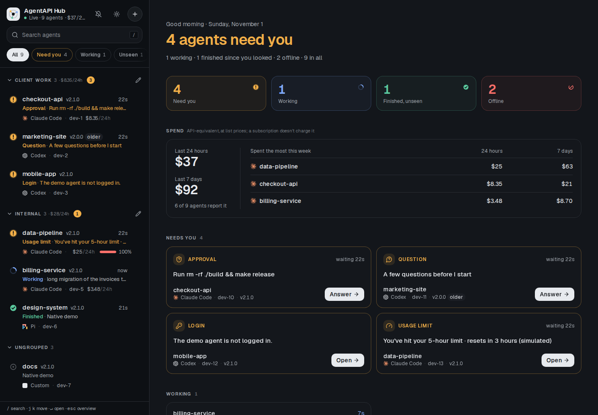

### 花費

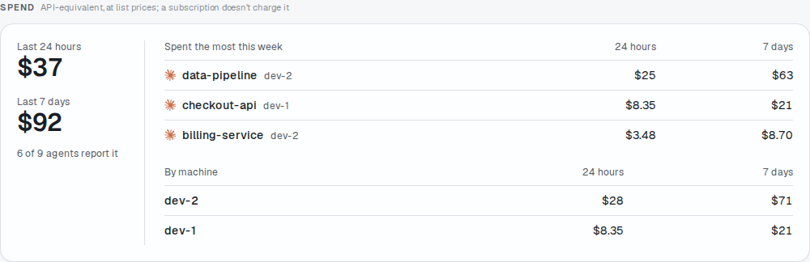

每個 AgentAPI 每分鐘從 agent 的 session log 算出工作目錄裡所有 session 在最近 24 小時和最近
7 天花了多少，放進摘要（`spend`）。這是換算成 API 的金額：依模型供應商的牌價計算 token，訂閱方案
並不會實際收取。Claude Code、Codex 和 Pi 有這個數字；`native-demo` 和 AgentAPI 2 的 PTY agent
不會顯示。

每一列顯示它最近 24 小時的花費（`$110/24h`），群組標題顯示群組的合計，清單頂端顯示全部的合計；
滑鼠移上去還會看到 7 天的金額。桌面版的總覽有一張 **Spend** 卡片：所有回報花費的 agent 最近 24 小時
和 7 天的合計、這週花最多的五個，以及 agent 分散在不只一台主機時的 **By machine**（各主機的小計）。

同一台主機上，同一個 agent 在同一個目錄的兩個 AgentAPI 讀的是同一批 session，回報的金額也相同，
而且帶著相同的 `scope`（由主機、agent、目錄和 agent 存放 log 的位置算出的雜湊值）。合計時每個
scope 只算一次，取最新的數字（`updated_at`）。hub 目前沒在追蹤的 agent（已停止、連不到或連線中）
會以淡色顯示最後一次的數字，標示為最後已知的金額，不算進合計。一個 scope 只屬於一台主機，所以各主機的
小計加起來就是合計。

不同主機上的 agent 常常同名（都是家目錄的名稱），所以總覽的表格會在每個 agent 的名稱後面標出主機。
**By machine** 把這週最多的排前面，這週為零的主機不列出。超過八台時，只列出最多的七台，其餘的加總成
一列（**Other 9 machines**）。沒有回報主機的 agent 合計在 **Not reported**。

### Token 用量

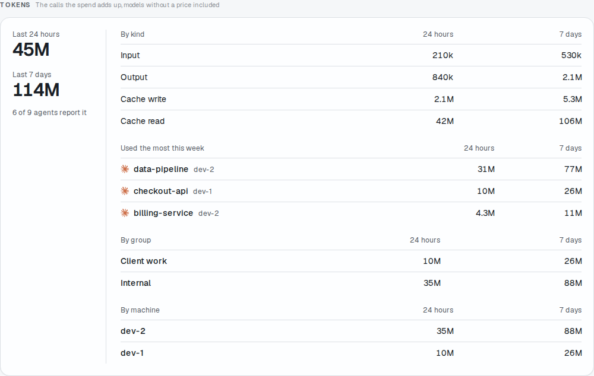

算花費的同一輪也會算出同一批呼叫的 token：`spend` 裡有最近 24 小時（`day_tokens`）和 7 天
（`week_tokens`）的 `input`、`output`、`cache_write`（Anthropic 五分鐘和一小時的快取合計）、
`cache_read`，以及四者的合計 `total`。每個呼叫只算一次，和它的金額算在同一個地方：session 副本
複製自先前 session 的呼叫，算在先前那個 session。沒有已知價格的模型只計 token、不計金額。Claude Code
自己算了、但沒有逐筆記在 log 裡的部分（壓縮 context 等），token 取自它自己的計數。

`spend.providers` 把同一批呼叫依[模型供應商](providers.zh-TW.md)分開：最近 7 天有呼叫的每個
供應商各一筆，有它的 `provider`（agent 自己的是 `default`）、`day_usd`、`week_usd`、`day_tokens` 和
`week_tokens`，這週花最多的排最前面。Codex 的呼叫算在 log 寫明的供應商；Claude Code 的呼叫算在 AgentAPI
最後記錄該 session 所用的供應商（`~/.agentapi/provider-ledger.jsonl`）。較早的版本不會送出這個欄位。

總覽在 Spend 下方有一張 **Tokens** 卡片：所有回報 token 的 agent 最近 24 小時和 7 天的合計、各類別、
這週用最多的五個、有群組時各群組的小計，以及有多台主機時各主機的小計。
加總方式和花費相同：每個 scope 只算一次，也只算已連線的 agent。AgentAPI 2.4.0 和更舊的版本回報的花費不含 token，卡片會寫出有幾個 agent 回報。數字以簡短的
形式顯示（`950`、`12k`、`3.4M`、`1.2B`），滑鼠移到合計上可以看到確切的數字。每一列已經放不下另一個
數字：滑鼠移到那一列的花費上，就能看到它最近 24 小時的 token。

### 供應商用量

最近 7 天內有 agent 用過自己以外的[模型供應商](#模型供應商)時，總覽在 Tokens 下方會有一張 **Providers**
卡片，依 `spend.providers` 列出每個供應商最近 24 小時和 7 天的數字：agent 自己的寫成 **Own provider**，
其他的用 hub 保存的名稱，找不到時（只定義在某台主機設定檔裡的供應商）用 ID。每格上面是金額、下面是
token；gateway 的模型常常沒有已知價格，所以呼叫沒有金額卻用了 token 的供應商會寫 **no price**，而不是
`$0`。這週花最多的排前面，其次是 token 最多的。卡片的合計是用在 agent 自己以外的供應商上的 token；
每個 scope 只算一次，也只算已連線的 agent，並寫出有幾個 agent 回報。這個版本之前的 AgentAPI，以及最近
7 天沒有呼叫的，都不會回報。

### 工作時間

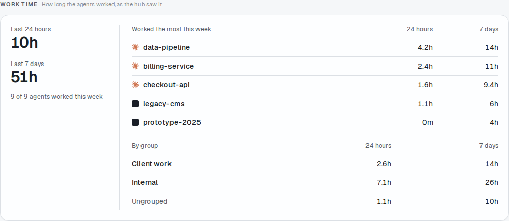

agent 那一列顯示工作中（`working`）時，hub 就替它計時：從開始一輪的摘要算到結束這一輪、或開始問你
事情的那份摘要。等你處理、閒置、連線中、連不到和已停止都不算。hub 只算它看到的時間，所以 hub 還沒有
這項功能之前、hub 停機的期間，以及連不到 agent 的期間都不在裡面。摘要串流斷線時，計時停在串流最後
一個事件；hub 停止時，計時停在那一刻。agent 從下一份摘要起重新計時。

每一列在花費後面以計時器圖示顯示最近 24 小時的工作時間（`2.3h`），顯示用量限制時則不顯示；滑鼠移上去
還會看到 7 天的數字。總覽在 Tokens 和 Providers 下方有一張 **Work time** 卡片：所有 agent 最近 24 小時和 7 天的合計、
這週工作最久的五個、有群組時各群組的小計，以及有多台主機時各主機的小計。
數字一律無條件捨去：不到一小時以分鐘表示（`45m`），不到十小時以
0.1 小時表示（`2.3h`），再長就以小時表示（`31h`）。和花費不同，每個 agent 都算，已停止的也算：
這是 hub 自己對每個實例的紀錄。

hub 把最近 7 天的工作區段存在檔案裡，送出的是它們的合計（`work`）；正在進行的那一段由頁面自己加上。

### 活動

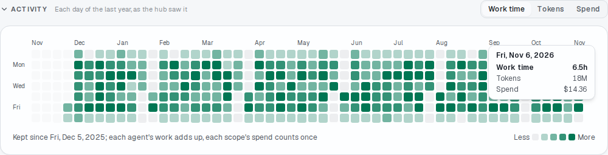

總覽在 Work time 下方有一張 **Activity** 卡片，像 GitHub 的貢獻圖一樣畫出最近一年：一週一欄，
星期日在最上面，今天在最後一欄，月份名稱標在該月第一週的上方。每天一格，依卡片上方選的
**Work time**、**Tokens** 或 **Spend** 上色（瀏覽器會記得你選的）：共五種深淺，沒有任何數字的一天
最淡，其餘的日子依數字大小分成四等份，各一種顏色，所以某一天特別忙也不會讓其他天看不出差別。
滑鼠移到格子上，或把焦點移進格子後用方向鍵移動，就會看到那一天的三個數字。日期依瀏覽器的時區劃分；
頁面每 10 分鐘和你回到頁面時都會重新讀取。

hub 從執行有這項功能的版本那天開始逐小時記錄，在實例檔案旁的 `activity.json` 保留一年（366 天）。
在那之前的日子是空白的，卡片會寫出從哪天開始記錄。工作時間把每個 agent 的區段加起來，算法和 Work
time 卡片相同；第一次啟動時，hub 會補上實例檔案裡已有的 7 天。花費和 token 來自 agent 的摘要：
從 4.2 起，AgentAPI 的 `spend` 會列出所屬 scope 最近 25 小時每小時的花費（`hours`）。hub 把每個
scope 的這些小時設成最新的數字，所以同一個 scope 不論有幾個 AgentAPI 回報都只算一次，還在進行中的
那一小時也會跟著增加。較舊的 AgentAPI 要更新後，花費才會計入。過了 48 小時的那一小時就不再變動：
摘要不會再列出，hub 把它併進那一天的合計。

### 版本

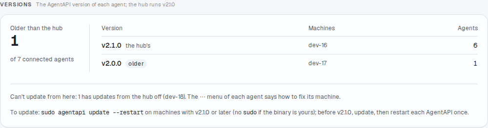

每一列在名稱旁顯示實例執行的 AgentAPI 版本（`v2.0.0`），桌面上開啟的 agent 上方那一列也會顯示。
比 hub 舊的版本會標上 **older**：hub 對所有實例都提供它自己版本的聊天介面（見[限制](#限制)），
所以這些就是該更新的實例。滑鼠移上去可以看到兩邊的版本。開發版本（`0.0.0-dev`，或 release 之後用
`make build` 建置出的版本，例如 `2.0.0-21-g61be34f`）無從比較：不會標上 older；hub 本身是開發版本
時，也不會標記任何實例。hub 目前沒在追蹤的 agent（已停止、連不到或連線中）以淡色顯示它最後一次
執行的版本，不加標記。更新並重新啟動之後，AgentAPI 一回來，那一列就會顯示新版本。

總覽最下方的 **Versions** 卡片依版本統計 hub 正在追蹤的 agent 和它們所在的主機，並寫出有幾個比
hub 舊。

#### 從 hub 更新

主機允許的話，AgentAPI 會在 hub 要求時自行更新。在那一列的 **⋯** 選單選 **Update AgentAPI…**，
會先請你確認。預設會等 agent 閒置才更新：手上的任務做完，也沒有核准、提問或計畫在等回覆。
**Update now** 不等，會直接中斷正在跑的任務。AgentAPI 下載符合主機作業系統和架構的最新正式版，用
該版的 `checksums.txt` 驗證後安裝，依指定的方式等待，再像
[`agentapi restart`](cli.zh-TW.md#agentapi-restart) 一樣原地重新啟動。同一台主機上的 AgentAPI
共用一個 binary：第一個負責替換，其他的只要重新啟動。

重新啟動之前，AgentAPI 會用自己的設定以 `agentapi server --validate` 執行新程式。新程式用這些設定
無法啟動時（有它不接受的旗標或 agent），AgentAPI 會繼續服務，更新則以失敗結束並說明原因。AgentAPI 3
只執行 Claude Code、Codex 和 Pi：執行其他 agent、或任何以 `--transport pty` 執行的 AgentAPI 2 都會
這樣失敗，但它的主機上已經換成 AgentAPI 3。請在那個 AgentAPI 重新啟動之前，把 v2.5.1 裝回去。

更新期間，那一列會顯示進度：檢查中、下載中、等任務結束、重新啟動中。還在等任務結束時，可以用
**⋯** 選單的 **Cancel the update**，或開啟的 agent 上方那一列的 **Cancel** 取消。更新失敗時會標示
出來；滑鼠移上去可以看到錯誤，或再開一次 **Update AgentAPI…** 查看並重試。AgentAPI 回來之後，那一列
就會顯示新版本。

**Versions** 卡片上的 **Update the older ones**，會一次替所有比 hub 舊、又能這樣更新的已連線 agent
送出更新；同一台主機上的 AgentAPI 會自己輪流。送出前會先確認，並寫出有幾個會開始新的工作階段。之後
卡片會寫出送出了幾個，以及哪些 agent 無法更新、原因是什麼。

每台主機需要：

- **允許更新。** 預設不接受 hub 的更新，每台主機要開啟一次：在 `~/.agentapi/config.yaml` 加上
  `allow-update: true`，或加入 hub 時用 `agentapi hub join … --allow-update`。AgentAPI 啟動時才會讀
  這個設定，所以要重新啟動一次（`agentapi restart --all`）。在那之前，選單項目會註明這台主機關閉了
  更新，點開的對話框附有要加的那一行。
- **binary 所在目錄的寫入權限。** AgentAPI 替換的是自己的 binary（會先解析 symlink），而且從不執行
  `sudo`。binary 放在 root 擁有的目錄（例如 `/usr/local/bin`）時就無法替換，選單項目會註明需要一次性
  設定，點開的對話框附有指令：把 binary 搬到你的 `~/.local/bin`，原處改放 symlink。binary 在
  `/usr/local/bin` 時：

  ```bash
  mkdir -p ~/.local/bin && cp /usr/local/bin/agentapi ~/.local/bin/agentapi \
    && sudo ln -sf ~/.local/bin/agentapi /usr/local/bin/agentapi
  ```

- **狀態資料庫，才能保留完整的對話。** 使用狀態資料庫的 AgentAPI 重新啟動後會保留對話和 agent 的
  工作階段，並接著送出佇列中的訊息。沒有的話，agent 會接續自己的工作階段（Claude Code、Codex 和
  Pi），對話從工作階段的紀錄讀回，但佇列中的訊息和在聊天介面選擇的設定會重新開始，對話框會說明。
  較早版本的 AgentAPI 會開始新的工作階段，確認時也會提醒。在設定檔加上
  `state-db: ~/.agentapi/state/{port}.db`（見[步驟 3](#3-讓每台主機的-agentapi-加入)）。

#### 手動更新

還不支援從 hub 更新的舊版 AgentAPI，選單裡不會多出這個項目；卡片會說明怎麼更新。在那台主機上：

- 2.1.0 以後的 AgentAPI 能原地重新啟動：執行 `sudo agentapi update --restart`，更新 binary 後，
  這台主機的 AgentAPI 會原地重新啟動到新版（binary 屬於你自己時不必加 `sudo`）。
- 想讓之後都能從 hub 更新，就加上 `--allow-update`（3.8.0 起），它會先把 `allow-update: true`
  寫進設定檔。舊版的 `agentapi` 沒有這個旗標：先自己把這一行加進 `~/.agentapi/config.yaml`，
  再執行 `sudo agentapi update --restart`。
- 2.1.0 之前的版本：先執行 `sudo agentapi update`，再把每個 AgentAPI（或它的 workspace）重新啟動
  一次。

### 清單

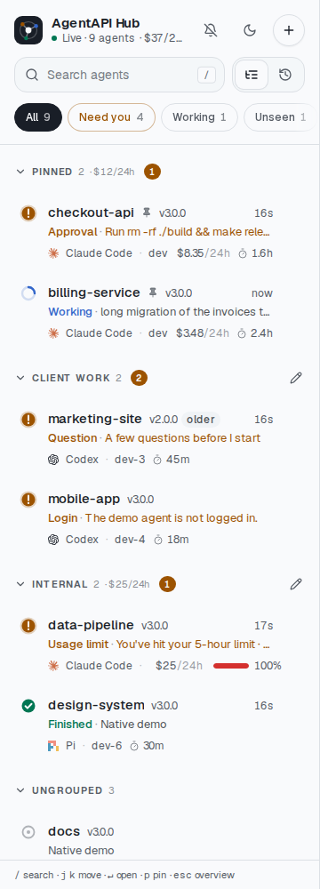

每一列顯示 agent 的名稱（`--name`，預設為工作目錄名稱）和 AgentAPI 版本（見[版本](#版本)）、它在等
什麼或在做什麼、多久以前、agent 和主機；也會顯示不是空的佇列、最近 24 小時的花費和工作時間（見
[花費](#花費)、[工作時間](#工作時間)），以及超過 60% 的用量限制。AgentAPI 正在更新或更新失敗時，
會另起一行顯示（見[從 hub 更新](#從-hub-更新)）。[釘選](#釘選)的 agent 排在最前面，順序由你決定。同一個
[群組](#群組)內，各列依下表的狀態順序排列，同狀態再依名稱排序；改用[最近變動](#最近變動)時，
則先排有過任務的，再依各列最近一次變動排序；打開[依主機](#依主機)時，兩種排序都會把同一台主機的 agent 放在一起。
每種狀態都有自己的形狀，不靠顏色也看得出來：

| 圖示 | 第二行開頭 | 意思 |
| --- | --- | --- |
| 琥珀色 ! | Approval、Question、Plan | 有請求在等你回覆；這一行會顯示內容 |
| 琥珀色 ! | Login | 要先在它的主機上登入，agent 才能工作 |
| 琥珀色 ! | Usage limit | 用量限制停下了回合；佇列中的訊息等重置後才送出 |
| 轉動的藍色弧線 | Working | agent 正在處理顯示的任務 |
| 轉動的藍色弧線 | Retrying | 回合因 API 錯誤（例如 502）失敗，AgentAPI 會自己再試；這行顯示狀態碼和第幾次 |
| 綠色勾勾 | Finished | 上次有人查看這個 agent 之後，有任務結束了 |
| 綠色圓環加勾勾 | （它的標題） | 閒置，30 分鐘內剛完成（已看過） |
| 灰色圓環 | （它的標題） | 閒置 |
| 灰色、劃掉的鈴鐺 | Muted | 它需要你處理，但你把這件事靜音到它改變為止（見[靜音](#靜音)） |
| 轉動的虛線圓環 | Connecting | hub 正在開啟或重新開啟它的摘要串流 |
| 斷開的紅色圓環 | Unreachable | hub 已經 10 秒連不到它；這一行會說明原因 |
| 方塊 | Stopped、Exited | AgentAPI 已停止（或連不到時錯過三次 heartbeat），或它的 agent 已結束、AgentAPI 也已放棄重新啟動 |

搜尋（**/**）會比對名稱、群組、標題、主機、agent 或版本中的任何字詞。搜尋框下方的標籤可以顯示
全部，或只顯示需要你、工作中、已完成未讀、離線的 agent。hub 監看的 agent 不只一種時，下面會多一排
標籤用來挑 agent：Claude Code、Codex、Pi，其他的歸在 **Other**（AgentAPI 2 的 agent，例如
aider、`native-demo`，或還沒回報是哪種 agent 的實例），hub 有監看的種類才會出現。可以同時選好幾個，
符合任一個就顯示；再點一次取消，或點 **Any agent** 全部清掉。agent 要同時符合搜尋、狀態和其中一個
選取的 agent 才會顯示。每個標籤
的數量是另一排篩選後的結果，也就是點下去會看到的筆數；搜尋不影響這些數量。清單篩到沒東西時，
**Show all** 會把三者一起清除。每個瀏覽器會記住選了哪些 agent。

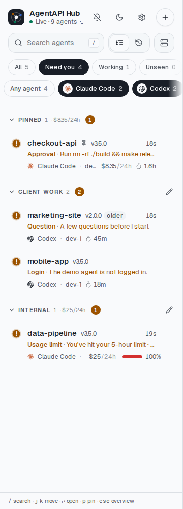

頁首顯示 hub 的串流是否連線中，以及共有幾個 agent；分頁的標題和圖示會顯示需要你處理的數量，釘選的
分頁也看得到。這條串流和聊天介面一樣會重新連線，45 秒沒有動靜就視為斷線（hub 每 15 秒送一次心跳）。

「Finished」依據 agent 的未讀標記，這個標記由該 AgentAPI 的所有用戶端共用：在 hub 或它自己的聊天
介面開啟，各處都會變成已讀。

每一列的狀態由 hub 判斷。hub 更新後仍開著的舊頁面，遇到不認得的狀態會顯示 Unknown 和問號；重新整理
頁面即可。

### 群組

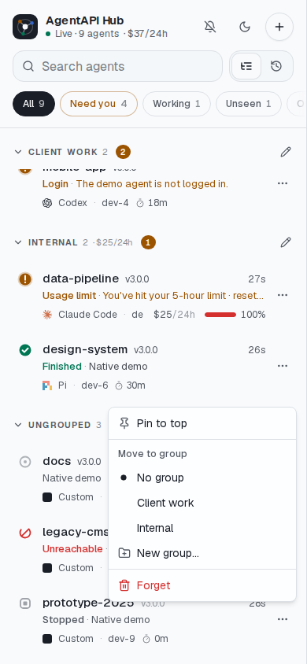

可以依客戶、專案或主機，把實例分成自己的群組。每一列最後的 **⋯** 可以把實例移到某個群組、
**New group…**（新群組）或 **No group**（不分組）。同一個選單也能釘選（見[釘選](#釘選)）、靜音
（見[靜音](#靜音)）、更新 AgentAPI（見[從 hub 更新](#從-hub-更新)），以及移除已停止的實例
（見[加入與移除實例](#加入與移除實例)）。群組保存在 hub 上，所以手機和桌面看到的一樣；實例自己的
事件不會改動它所屬的群組。hub 拒絕或沒收到的變更（群組、釘選、靜音、移除）不會生效，並以通知
說明原因。

有了群組之後，清單會依名稱為每個群組加上標題，沒有分組的實例排在最後的 **Ungrouped** 底下，
打開[依主機](#依主機)時也一樣；[最近變動](#最近變動)的排序不顯示群組標題。
標題會顯示群組裡的實例數，並以琥珀色顯示需要你處理的數量，所以收合的群組仍然看得到。點標題可以收合或展開；每個瀏覽器各自記住收合了哪些群組。
鉛筆圖示可以為群組改名，裡面的實例會一起移過去。群組名稱最多 40 個字元；群組裡沒有實例時就會消失。

### 最近變動

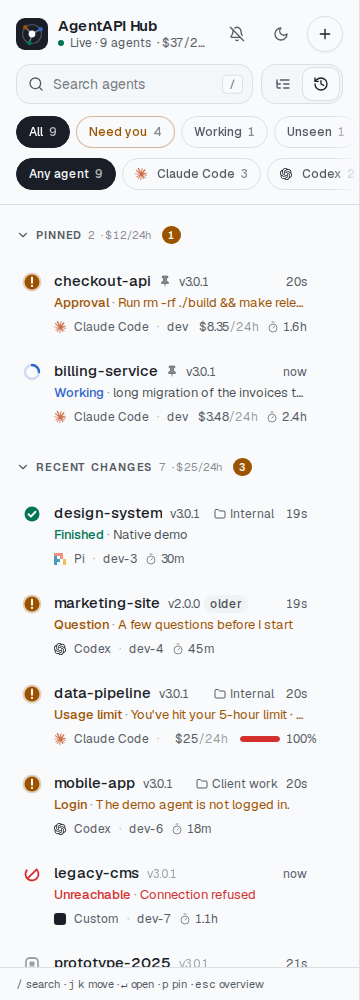

搜尋框旁的切換鈕決定清單的排序。**Groups** 是預設的排序，也就是上面說的：在每個群組內，需要你處理的
排最前面。切換鈕旁的[依主機](#依主機)開關會把同一台主機的 agent 放在一起，兩種排序都能用。
**Recent changes** 則把[釘選](#釘選)以外的實例排成一個清單，不分群組：先排有過任務的（正在執行、
已完成或以前跑過），再排還沒有任務的和靜音的，兩部分各自依最近一次變動排序。所以沒在用的 agent 剛重新
連上，也不會把其他的擠下去。這時每一列顯示的是它多久以前變動，有空間時也會標出所屬的群組。篩選和
搜尋在每種排序下都有效，`j`、`k` 也依畫面上的順序移動。agent 有變動時，各列會跟著換位置，開啟中的那一個仍保持選取。每個瀏覽器
各自記住排序。

下列情況算是變動：狀態改變（需要你、開始工作、完成、閒置、停止，或 hub 連不到、又連上它）、新的任務、
開始等新的事（請求、登入、用量限制）、標題改變，以及佇列、更新和版本的變化。下列則不算：heartbeat、
有人做的操作（群組、釘選、靜音、讀過已完成的任務）、花費、工作時間和用量數字、agent 工作中送出的
訊息，以及斷線後 10 秒內又接回的摘要串流。

hub 會記錄每個實例最近一次變動的時間（`changed_at`）並保存在檔案中，所以重新啟動 hub 不會打亂清單的
順序。新實例的這個時間，就是 hub 第一次看到它的時候。從舊版更新上來的 hub 還沒有這項紀錄：實例下一次
變動之前，清單依這一列顯示的時間排列，沒有的話就依 hub 最後一次聽到它的時間。

### 依主機

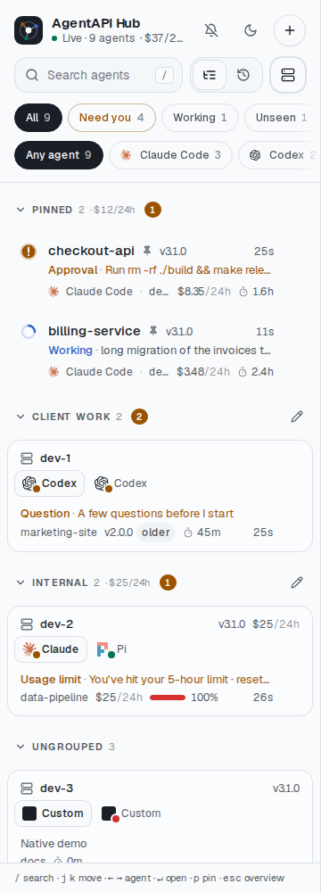

一台主機常在同一個目錄跑兩三個 agent（Claude Code、Codex、Pi），各列看起來幾乎一樣。排序切換鈕旁的
**By machine** 開關會把同一台主機的 agent 收進一張卡片，兩種排序都能用；每個瀏覽器各自記住開關。卡片
第一行只放主機名稱，太長時會換行，不會截掉；多數主機名稱共同的開頭（例如 `coder-<user>-`）會淡化，
讓後面能分辨主機的部分比較醒目。

主機名稱下方，每個 agent 有一個分頁，上面是它的圖示和表示狀態的圓點：需要你處理是琥珀色、工作中是
藍色、完成未讀是綠色、靜音、已停止或閒置是灰色、連不到是紅色。閒置的 agent 完成後 30 分鐘內（不論看過沒有），圓點是綠色空心圈，剛跑完的 agent 一眼就看得出來；還沒執行過（沒有任務，這週 hub 也沒看到它工作）時，圓點是灰色空心圈，所以不看名稱也知道狀態。選取的分頁會另外寫出簡短
名稱（Claude、Codex、Pi），其他分頁把滑鼠移上去就會顯示。分頁固定依 agent 種類排列，不隨狀態移動。
分頁旁邊是這些 agent 共通的資訊：AgentAPI 版本和最近 24 小時的花費合計。卡片只顯示一個 agent 時
（主機上只有一個，或篩選後只剩一個），分頁會改成單純的標籤，花費也只在下方顯示一次。分頁下方只顯示
一個 agent：它在等什麼或在做什麼、多久以前，以及花費、工作時間、佇列或用量限制；主機名稱沒有包含
目錄名稱時會顯示目錄名稱，卡片裡各 agent 版本不同時也會顯示版本。點這一塊就會開啟
那個 agent，它的 **⋯** 選單和清單裡的一列相同：釘選、靜音、群組、更新、移除。點分頁會直接開啟那個
agent，和點一列一樣。

在 **Groups** 排序下，群組照舊，同一個群組內最需要你處理的 agent 所在的主機排前面，同狀態再依名稱排序。
同一台主機的 agent 分在不同群組時，每個群組各有一張卡片，只放那個群組的 agent。清單旁開啟的 agent 在
這台主機上時，卡片就顯示它；否則顯示這張卡片上次選的分頁（瀏覽器會記住，重新整理後也在），都沒有就
顯示最需要你處理的那一個。

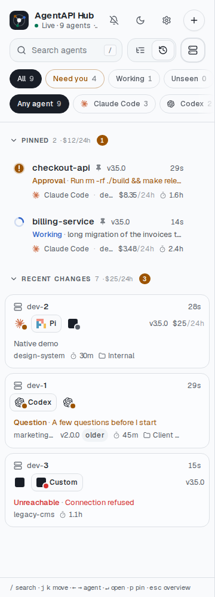

在 **Recent changes** 排序下，沒有群組標題：每台主機一張卡片，依[最近變動](#最近變動)各列的順序，
agent 最近有變動的主機排最前面，卡片標題會寫出那次變動是多久以前。清單旁開啟的 agent 在這台主機上時，
卡片就顯示它；否則只要你是在卡片最近一次變動之後選的分頁，就顯示那個分頁；都不是就顯示最近變動的
agent。所以選的分頁會一直保留，直到這台主機上有新的變動，卡片才改顯示變動的那一個。下方那一塊會標出
agent 所屬的群組和它最近一次變動的時間，和最近變動的各列一樣。這個排序下選的分頁和 **Groups** 下的分開記。

`j`、`k` 在卡片之間移動，停在卡片顯示的 agent 上；按 ← 和 → 可以在原處換成同一張卡片的其他 agent，
但不會開啟，按 `Enter` 才開啟。焦點在分頁上時，← 和 →（以及 `Home`、`End`）在分頁之間移動，按 `Enter`
開啟。

兩種排序下，[釘選](#釘選)的 agent 都在最上方各自占一列，沒有回報主機的 agent 也自己占一列。篩選和搜尋
套用在每個 agent 上：卡片只為符合的 agent 顯示分頁，一個都不符合時整張卡片就不顯示；搜尋也會比對主機
名稱。只有一個 agent 的主機就只有一個分頁。區段標題算的是 agent 數量，不是主機數量。關掉
**By machine** 時，兩種排序都是每個 agent 一列。

### 釘選

在一列的 **⋯** 選單選 **Pin to top**，就會把這個 agent 固定在清單最上方的 **Pinned** 區，每種排序
都一樣。新釘選的排在最後。同一個選單的 **Move up**、**Move down** 會讓它越過清單上顯示的上一個或
下一個釘選 agent，**Unpin** 則取消釘選。按 `p` 可以釘選或取消釘選焦點所在的那一列。

釘選的 agent 只出現在這一區，不會在它的群組、它主機的卡片或下方最近變動的清單裡重複出現；打開[依主機](#依主機)
時也各自占一列。這一列的名稱後面有圖釘圖示，有空間時也會標出所屬的群組。
這一區的標題顯示 agent 數量和需要你處理的數量，也能像群組一樣收合。下方其餘的部分也會加上標題：各個群組和 **Ungrouped**，或是 **Recent changes**。篩選和搜尋對釘選的 agent
同樣有效：不符合的會隱藏，一個都不剩時，這一區就會消失。

釘選和群組一樣保存在 hub 上，所以每個瀏覽器看到的釘選和順序都相同。釘選、取消釘選和調整順序都不算
[最近變動](#最近變動)。移除 agent 時，釘選會一起刪除。

### 靜音

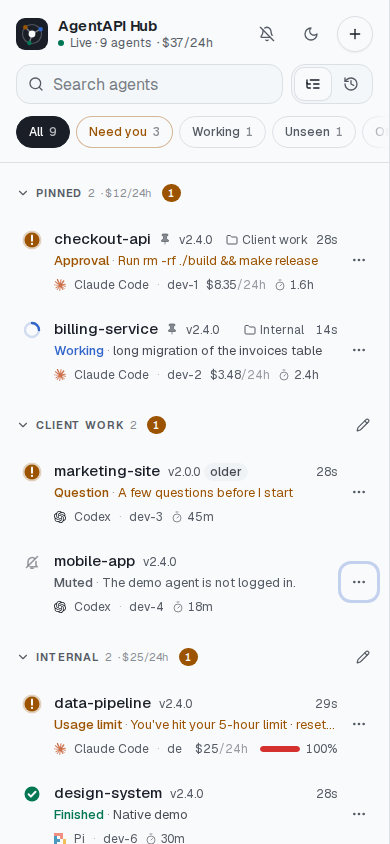

agent 可能在等一件你短期內不會處理的事，例如在一台你不會用它的主機上等登入。在它的 **⋯** 選單選
**Mute until it changes**，就會把它移出需要你處理的項目：不再計入 **Need you**、群組徽章、分頁標題
和總覽，也不發通知。這一列仍然保留，以灰色和劃掉的鈴鐺顯示它在等什麼。靜音只維持到這件事改變為止：
agent 登入了，或改為等別的事（另一個請求、用量限制），就會重新計入。同一個選單的 **Unmute** 可以
提早結束靜音。和群組一樣，靜音保存在 hub 上。

### 開啟實例

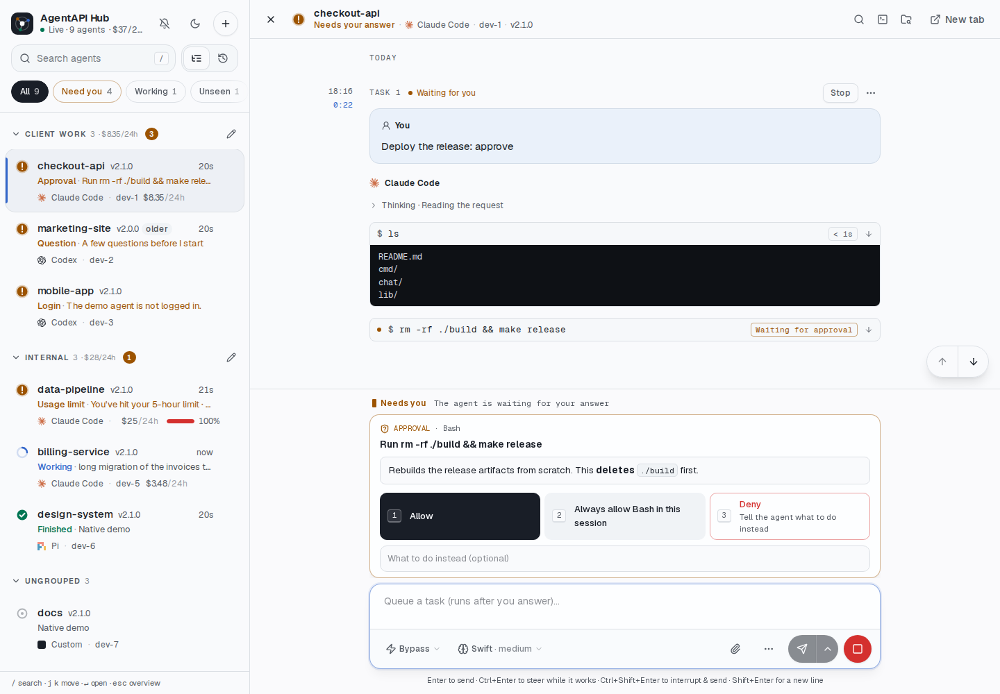

點選一列或一張卡片，就會在清單旁開啟這個 agent 的聊天介面：聊天介面的功能在這裡都能用，包括回覆
請求。上方的列顯示 agent 的狀態、agent、主機和 AgentAPI 版本，也放著聊天介面自己的搜尋、終端機和
Explorer 按鈕。這台主機上還有 hub 監看的其他 agent 時，不論清單用哪種排序，這一列都會為每個 agent
放一個按鈕：圖示和[依主機](#依主機)的分頁一樣帶著狀態圓點，開啟中的那個會標出來。點另一個就在原處開啟它，
不必回到清單，就能在同一台主機的 Claude Code 和 Codex 之間切換。
hub 會讓最近開啟的幾個 agent 保持載入（四個，手機上兩個），所以回到其中一個會立刻顯示，不必重新載入聊天介面。
**New tab** 會單獨開啟聊天介面，**×** 會回到總覽，從 Issues 開啟的 agent 也會越過 Issues 直接回到總覽；
**Esc** 則是往回一層（從 Issues 開啟的 agent 會先回到 Issues）。清單最上方的 hub 標誌在任何地方都能回到總覽。每開啟一個 agent 都會在
瀏覽紀錄新增一頁，所以「上一頁」會回到前一個 agent，從第一個再往前才回到清單或總覽；**×** 則會越過這些頁面，直接回到總覽。網址會記住目前的 agent（`#<id>`），重新整理或從書籤開啟都會回到同一個。
AgentAPI 正在更新時，上方那一列也會顯示進度，還在等任務結束時附有 **Cancel**（見[從 hub 更新](#從-hub-更新)）。

### 我的最愛

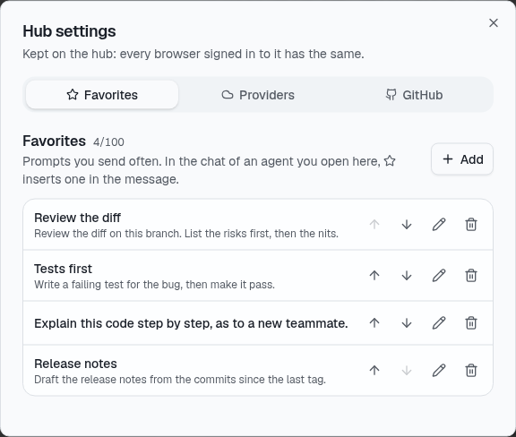

我的最愛是你常送出的提示，保存在 hub 上。標題列的齒輪按鈕會開啟 **Hub settings** 的
**Favorites** 分頁（其他分頁是 [Providers](#模型供應商) 和 [GitHub](#github-設定)），列出所有項目，可以新增、編輯、刪除和上下移動。每一項有一段最多 20,000 字的提示，
以及最多 100 字、可省略的標題；沒有標題時，以提示的第一行當名稱。hub 最多保存 100 項。每次修改都
會立即儲存，登入這個 hub 的每個頁面也會跟著更新，所以手機和桌機看到的我的最愛都一樣。**Undo** 可以
救回最後刪除的那一項。在編輯區裡，⌘/Ctrl+Enter 儲存，**Esc** 取消。

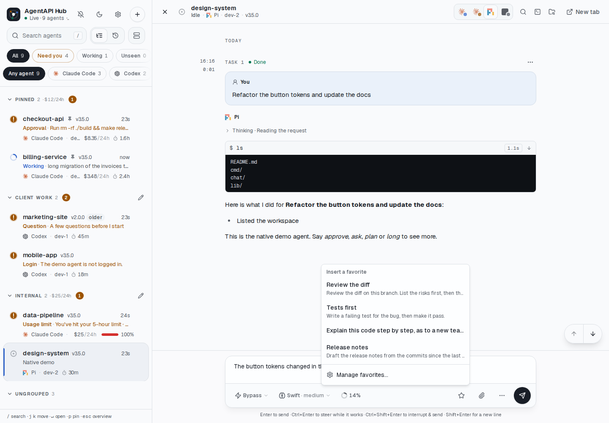

在 hub 開啟的 agent 聊天介面裡，輸入框的 **☆** 會列出我的最愛，每一項附上一行提示內容。選一項就會
把它插入訊息，但不會送出：訊息是空的，就直接換成這一項；訊息已有內容，就接在最後成為獨立的一段，
游標停在它後面。按 Ctrl/⌘+Z 可以把它拿掉。超過七項時會出現搜尋框，在清單上直接打字也會輸入到搜尋框。
**Manage favorites…** 會開啟 hub 設定的我的最愛區。還沒有任何一項時選單照樣出現，裡面只有這個連結。
單獨開啟的聊天介面（新分頁，或 AgentAPI 自己的網址）沒有 ☆。

### 模型供應商

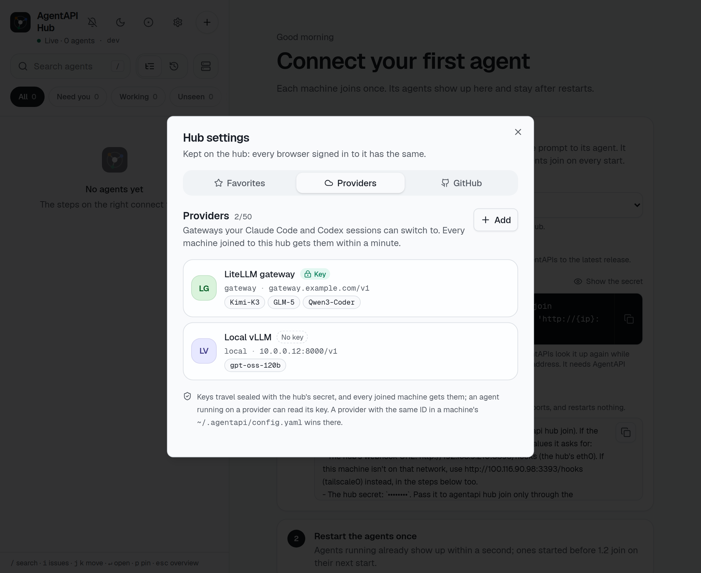

hub 會替每台向它回報的主機保存[模型供應商](providers.zh-TW.md)：Claude Code 和 Codex
的工作階段可以換用的端點，例如 LiteLLM gateway。**Hub settings** 的 **Providers** 分頁列出所有
供應商，可以新增、編輯和刪除。每個供應商有 ID（小寫英文字母、數字、`-` 和 `_`）、可省略的名稱、
base URL、可省略的 Anthropic base URL、API 金鑰，以及它提供的模型；沒有填模型時，各 AgentAPI 會向
供應商的 `<base_url>/models` 查詢。hub 最多保存 50 個。金鑰只能寫入：頁面只顯示供應商有沒有金鑰，
只有在供應商 ID 與端點都不變時，編輯器金鑰欄留空才會保留原本的金鑰；更改任一端點後都要重新輸入金鑰，
勾選 **Remove the key** 則移除。ID 新增後就不能更改。保存時會帶上清單的 revision，如果另一個分頁在你開啟
這個分頁後已經保存，會回報衝突，而不是悄悄讓其中一邊的變更消失。

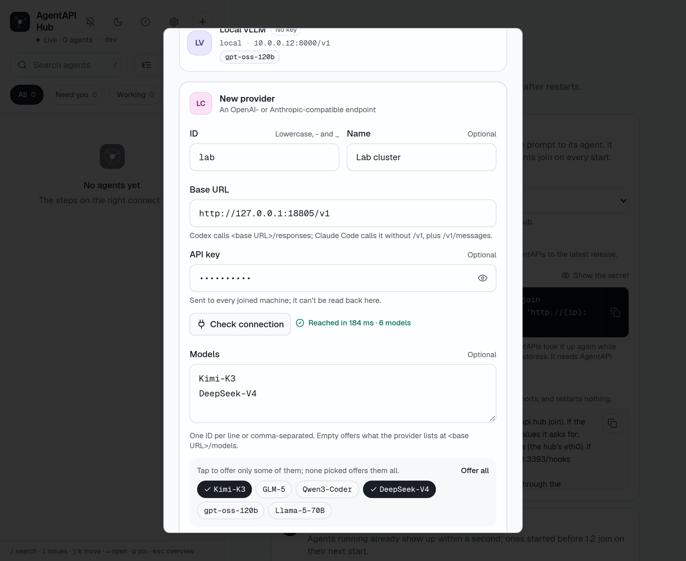

編輯器裡的 **Check connection** 會由 hub 向供應商查詢模型，用你輸入的金鑰；沒輸入時，只有端點未變才會用
hub 保存的金鑰。結果會顯示花了多久、列出幾個模型，失敗時則說明原因（金鑰被拒、更改端點後沒有輸入金鑰、
網址底下沒有 API、hub 連不到供應商）。結果只適用於送檢查時的欄位，不會套用在等待期間所做的修改上。
點選模型就只提供選取的那些；一個都沒選時提供全部。

每個向 hub 回報的 AgentAPI 會在啟動時和之後每分鐘向 hub 取得供應商，請求以 hub 的 secret 簽章；
回應含有金鑰，以從 secret 衍生的金鑰加密（AES-256-GCM），所以即使透過一般 HTTP 連線，金鑰也不會以
明文在網路上傳送。另有證明會把回應綁定到這次請求的 nonce，避免觀察者重播舊的供應商清單。新版 AgentAPI 會拒絕
沒有綁定的回應；請先升級 hub，再升級回報的主機。變更會在一分鐘內出現在聊天介面。在主機上，自己設定檔裡的
供應商和 hub 的 ID 相同時，以設定檔的為準。

有 agent 回報供應商之後，分頁裡每個供應商都會多一行，寫出 agent 用了它多少：最近 24 小時和 7 天的
token 與金額（或 **no price**），算法和 [Providers 卡片](#供應商用量)相同；沒有用到時寫
**No calls in the last 7 days**。

每台加入 hub 的主機都拿得到這些金鑰：有 hub secret 的人都能取得。存到 hub 的金鑰，必須是你願意交給
每一台這類主機、也願意交給每個用這個供應商的 agent 的金鑰。

### GitHub 設定

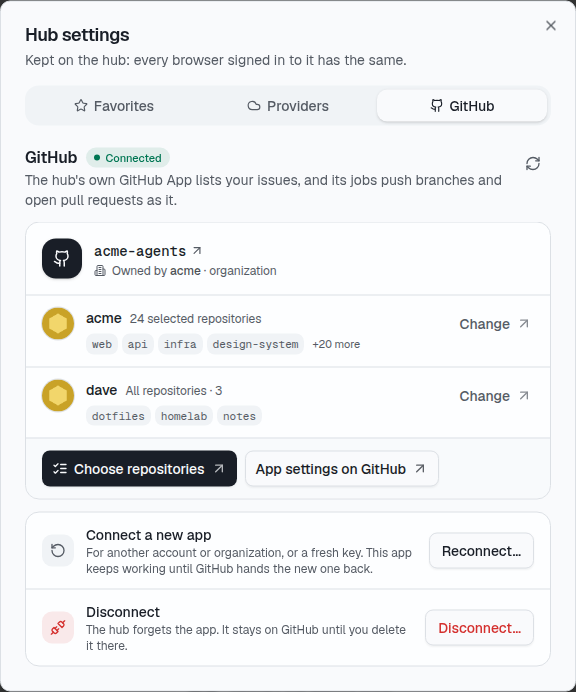

**Hub settings** 的 **GitHub** 分頁顯示 hub 的 GitHub App：[Issues](#issues) 靠它列出 issue，job 也以它
的身分推分支、開 PR。在 Issues 頁上，**Issues** 旁的 App 名稱，以及 repo 選單最下面的
**GitHub settings…**，也會開到這裡。分頁上有 App 的名稱（連到它在 GitHub 的頁面）和擁有它的帳號或組織；
下面列出安裝了 App 的每個帳號，附上大頭貼、**All repositories** 或選了幾個 repo，以及前幾個 repo 的名稱。
hub 的頁面重新顯示時，這個分頁和 Issues 頁都會再讀一次，所以從 GitHub 切回來就看得到改動。

- **Choose repositories** 在新分頁開啟 GitHub，可以把 App 裝到其他帳號，或改選已安裝帳號的 repo。帳號旁的
  **Change** 直接開到那個帳號的安裝設定。
- **App settings on GitHub** 開啟 App 的設定：名稱、權限，以及 **Delete GitHub App**。3.14 以前建立
  App 的 hub，要等 GitHub 從安裝頁導回一次（按 **Choose repositories** 再按 **Save**）才知道設定在誰底下；
  在那之前，這個連結開的是 App 的公開頁面。
- **Reconnect…** 從 hub 的 `/github/connect` 建立新的 App，可以建在你的帳號或組織底下（目前的 App
  屬於組織時，預設就是那個組織）。GitHub 把新 App 交回來之前，hub 照常使用目前的 App，所以在 GitHub
  上取消不會有任何改變。接著要安裝新 App；裝好之前，job 拿不到 repo 的 token，Issues 也列不出 issue。
  舊的 App 會留在 GitHub 上，請到它的設定頁刪除。
- **Disconnect…** 會先確認，然後 hub 忘掉它的 App（`DELETE /api/github`）：金鑰和安裝在哪裡都不留。
  正在跑的 job 拿不到新的 repo token，手上的 token 到期後（一小時內）推送和開 PR 都會失敗；Issues 要
  重新連接 GitHub 才能用。App 本身留在 GitHub 上，仍裝在原來的地方，要到 GitHub 刪除。

還沒有 App 時，這個分頁顯示和 Issues 一樣的 **Connect GitHub**，可以建在你的帳號或組織底下。

### Issues

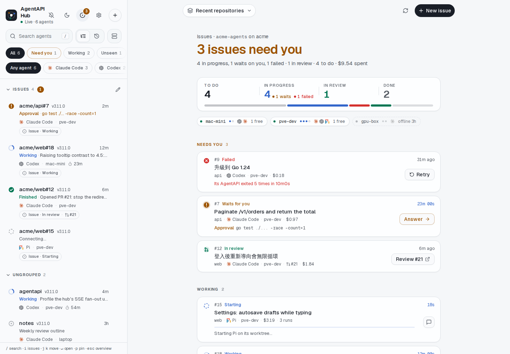

**Issues** 把 GitHub issue 交給你各台主機上的 agent，背後是 hub 的
[issue 派工](specs/issue-dispatch.zh-TW.md)（[流程圖解](specs/issue-dispatch-flow.zh-TW.md)）。按標題列
的 ◎ 或 `i`，會在總覽的位置開啟它；◎ 上的數字是需要你處理的 issue 數：失敗的 job、等你 review 的
PR，以及在等你回應的 agent。再按一次 ◎、按 `Esc`，或在手機上按返回箭頭就會關閉。

這一頁把目前範圍內各 repo 的 issue 放在同一個看板上。大標題說明有多少需要你處理，下一行是各階段的
數量。再下面的長條依比例顯示 To do、In progress、In review、Done 各有幾個 issue；In progress 另外標出
其中有幾個在等你、幾個失敗。接著是有 launcher 回報的主機：是否在線、job 數與上限（●●●○）、能跑的
agent。離線的主機有 **×**，確認後 hub 會移除這台主機，以及為它的名稱記下的 launcher token，讓重新安裝、
換了 token 的 launcher 能以同一個名稱加入。它還有進行中的 job（done、stopped、failed 以外）時按鈕無法
使用，請先停掉 job。主機本身不受影響，launcher 再次回報時它就會重新出現。最後依區塊列出 issue：

- **Needs you**：失敗的 job，接著是在等你回應（核准、問題）的 agent，再來是等你 review 的 PR。
- **Working**：正在工作的 agent，做最久的排前面，各自附上正在做的事。
- **To do**：還沒有 agent 處理的 open issue。
- **Done**：已完成或已停止的，最新的在前；超過三個時按 **Show all** 展開。

每張卡片顯示 issue 編號、狀態和標題，負責的 agent 與主機、PR、各次 run 的花費與次數，以及這個狀態
下該做的那件事：**Assign**、**Answer**、**Review #21**、**Retry**。卡片換狀態時，會移到新的區塊。主機
和 job 有變動時，hub 會透過串流推給頁面。你在頁面上做的操作，hub 一回應就會顯示，之後再以串流為準。

上方的 repo 選單決定看板的範圍。**Recent repositories** 從 hub 的 GitHub App 看得到的 repo 中，取最近
有 push 或變動的 20 個，顯示它們的 open issue，以及所有 repo 的 job。選一個 repo 就只看它的 issue；超過八個時
有搜尋框可以找。頁面會記住你的選擇。

#### 交辦 issue

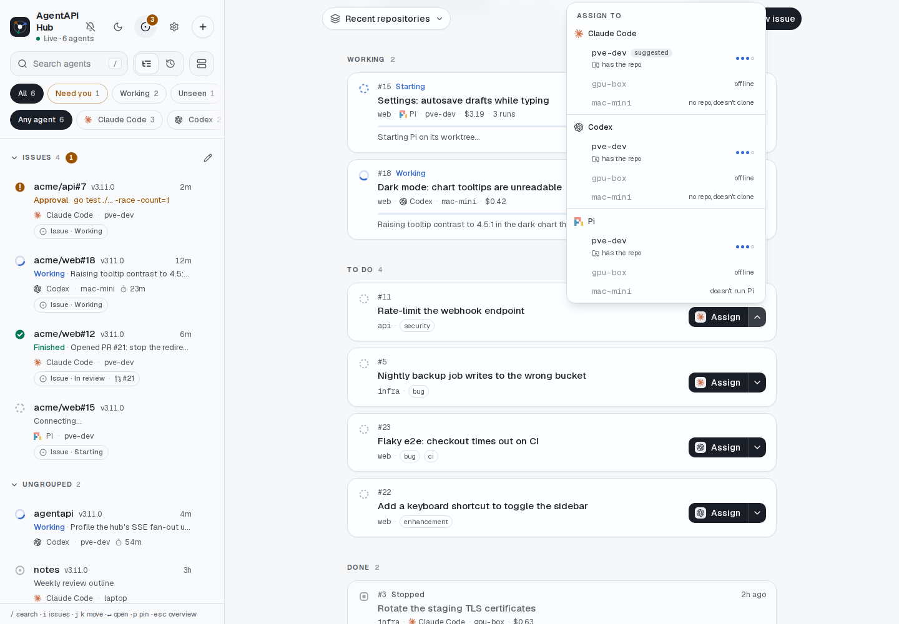

**Assign** 把 issue 交給按鈕上標示的 agent 和主機：也就是 hub 自己會挑的主機（先挑有這個 repo 的，
再挑最不忙的）和它的預設 agent；如果你上次手動選過某個 agent，就改用能跑它的主機。旁邊的箭頭會列出
每個 agent 和能接這個 issue 的主機，接不了的主機以灰色列出並附上原因：離線、已滿、沒有這個 agent，
或沒有這個 repo 也不允許 clone。從這裡選的主機就會接到 issue。焦點所在的卡片按 `a` 即可交辦。沒有
主機能接時，按鈕會說明原因。

交辦後 issue 立刻在那台主機上顯示 **Starting**：hub 先替它保留主機上的名額，主機再 clone 或 fetch
repo、啟動 agent，大的 repo 可能要幾分鐘。完成後卡片會顯示 agent 在工作，或 job 失敗與原因。主機實際
上已滿時，issue 會改交給 hub 會挑的另一台主機；手動選的主機則不會換。

#### issue 的詳細資料

| 等 review 的 issue | 失敗的 job |
| --- | --- |
| 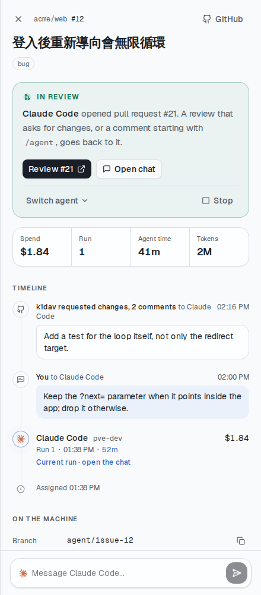 | 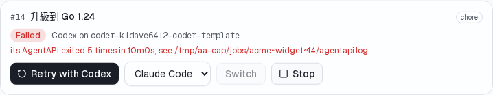 |

點卡片會開啟 issue 的詳細資料：寬螢幕上出現在看板旁邊，窄螢幕上蓋在看板上面。最上面的區塊用一句話
說明 issue 的狀態，附上 agent 正在做什麼或問了什麼，以及可以做的事：**Retry with …**、**Answer in the
chat**、**Review #…**、**Open chat**；再下面是 **Switch agent**（保留分支、worktree 和 PR）與
**Stop**（會刪除分支）。兩者都會先確認：

| Switch agent | Stop |
| --- | --- |
| 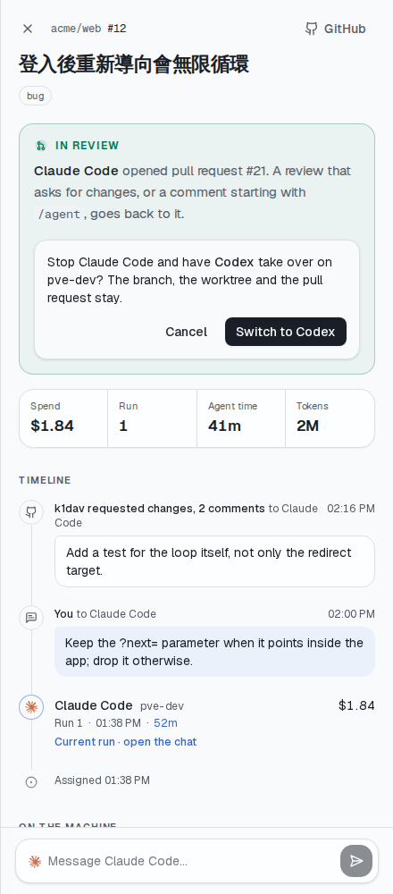 | 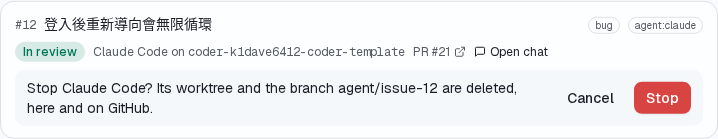 |

接著是這個 job 的花費、run 數、agent 工作時間和 token 數，以及由新到舊的時間軸：每次 run（agent 與
主機、執行時間、花費、怎麼結束），和每則送給 agent 的訊息，不論來自這一頁，還是 GitHub 上的 review 或
`/agent` 留言。hub 為每個 job 保留最近 50 則訊息。**On the machine** 列出分支和 worktree，可以複製。
agent 還在工作時，可以從最下面的輸入框傳訊息給它（⌘/Ctrl+Enter 送出）。

每次 run 只採計自己那個 AgentAPI process 的任務事件（launcher 回報的 `server_id`），所以前一次 run
晚到的事件不會改變目前 run 的狀態或花費。比這個 hub 舊的 launcher 不會回報 `server_id`，hub 會忽略
它的 job 的任務事件，狀態和花費就停在原處。升級 hub 時請一併升級 launcher；升級後的 launcher 會在
下一次回報時帶上它接手的 job 的身分。

hub 也要自己讀得到那個 AgentAPI：只有在 hub 正從 job 所在主機的位址（launcher 網址的主機，或解析到
同一個位址的名稱）讀到事件所指的實例、而且是同一次執行時，才採計它的任務事件。在 hub 連上實例之前
送到的事件（例如剛啟動時）會丟掉，花費留言就會註明 hub 可能漏算。hub 在別台主機上讀到的實例，
事件不會改變任何東西，hub 會記下 "Refused a task event of an instance the hub doesn't reach on
its job's machine"。同一台主機上的 launcher 和 AgentAPI 在各自的 `public-url` 裡用不同方式指名主機時
（一個寫位址、一個寫解析到別的位址的名稱），也會這樣。事件仍然是用每台主機共用的 secret 簽章，所以擋不住完整複製 job
的 AgentAPI 身分的主機（[Token 與安全性](#token-與安全性)）。

#### 清單上的列

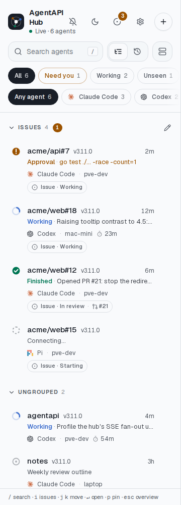

處理 issue 的 agent，在清單上那一列下方會有一個標籤：issue 目前的階段和 PR；如果這一列不是以 issue
命名，就直接顯示 issue。點標籤會在 Issues 開啟這個 issue。

#### 開新 issue，以及沒有 GitHub 的 hub

**New issue**（或 `n`）會以 hub 的 App 身分，在選定的 repo 開一個 issue；打開 **Assign to** 時，會立刻
交給 agent（⌘/Ctrl+Enter 送出）。

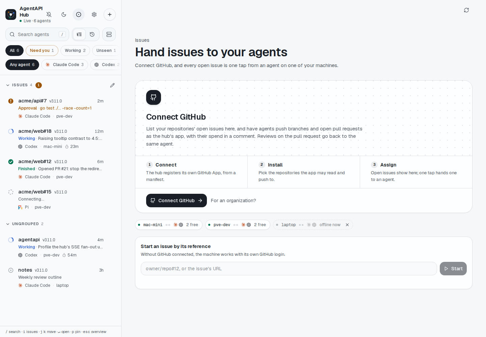

hub 還沒有 GitHub App 時，Issues 會顯示 **Connect GitHub**，從 manifest 為你的帳號或組織建立一個 App。
[GitHub 設定](#github-設定)可以改 App 的 repo、換一個新的 App，或中斷連接。
沒有 App 也能用 issue 的代號（`owner/repo#12` 或 issue 網址）開工，這時主機用自己的 GitHub 登入。
上方會列出主機，離線的同樣有 **×**。沒有任何主機裝了 launcher 時，頁面會顯示安裝指令。
加入 hub 的主機不裝 launcher，主機上的 AgentAPI 也會出現在清單上；只有要接 issue 才需要 launcher（見
[`agentapi host`](cli.zh-TW.md#agentapi-host)，也說明沒有 systemd 的主機怎麼辦）。

| 手機上的看板 | 手機上的 issue |
| --- | --- |
| 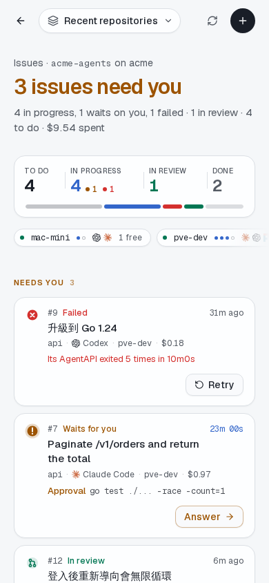 | 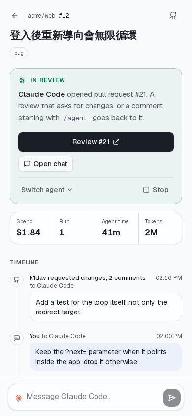 |

### 快捷鍵與通知

| 按鍵 | 作用 |
| --- | --- |
| `/` | 搜尋 |
| `i` | 開啟 [Issues](#issues) |
| `j`、`k`（或方向鍵） | 在各列之間移動（[依主機](#依主機)時是在卡片之間） |
| ←、→ | [依主機](#依主機)時：換成卡片的其他 agent |
| `Enter` | 開啟該列 |
| `p` | 釘選或取消釘選該列（見[釘選](#釘選)） |
| `Esc` | 清除搜尋，或往回一層：從 Issues 開啟的 agent 回到 Issues，再回到總覽 |

在桌面上，拖曳清單的邊緣，或把焦點移到邊緣再按 ← 或 →，可以調整清單的寬度；每個瀏覽器各自記住
調整後的寬度，在邊緣按兩下則恢復預設。清單窄於預設寬度時，標題列只留下 hub 標誌，把空間讓給按鈕。

`/`、`i` 和 `Esc` 在 hub 頁面上輸入框以外的任何地方都有效；`j`、`k`、方向鍵和 `p` 只在焦點位於清單或沒有焦點時有效，
所以在其他地方，方向鍵照常捲動總覽。在 Issues 裡，`j`、`k` 在卡片之間移動，`Enter` 開啟，`a` 交辦，
`c` 開啟它的聊天介面，`n` 開新 issue，`r` 重新讀取 issue。在開啟的聊天介面裡，按鍵會交給聊天介面。

鈴鐺的選單決定有 agent 開始需要你時怎麼提醒你：
**Notifications** 在 hub 分頁位於背景時由瀏覽器顯示通知（只限 https 頁面）；**Sound** 在你沒在看這個頁面時
（分頁在背景，或前面是別的視窗）發出短短的提示音，純 http 也能用。兩個選擇都由瀏覽器記住。螢幕閱讀器也會即時讀出
同樣的訊息。

### 在手機上

| 清單 | 實例 |
| --- | --- |
| 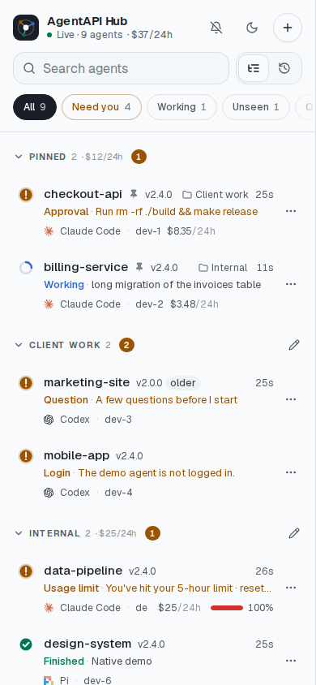 | 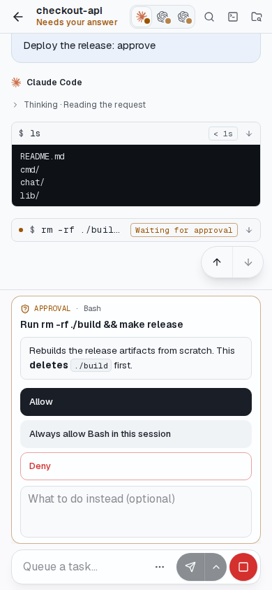 |

在窄螢幕上，清單和聊天介面輪流顯示；上方的返回箭頭或手機的「上一頁」手勢都會回到清單。聊天介面
把螢幕留給對話：上方只有一列，同一台主機的其他 agent 只顯示圖示，輸入框也只占一行，[我的最愛](#我的最愛)的 ☆ 就在 ⋯ 旁邊。在手機上回覆核准：

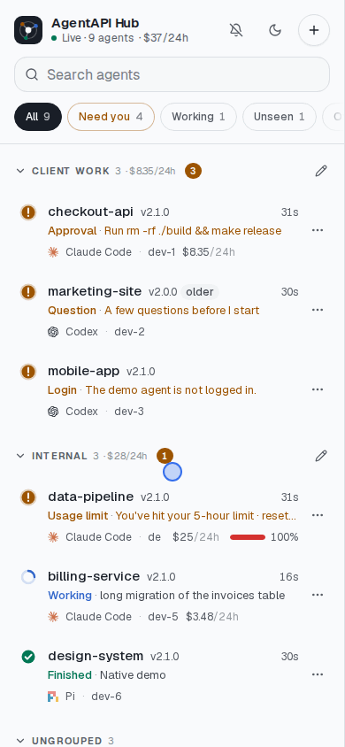

### 接上第一批 agent

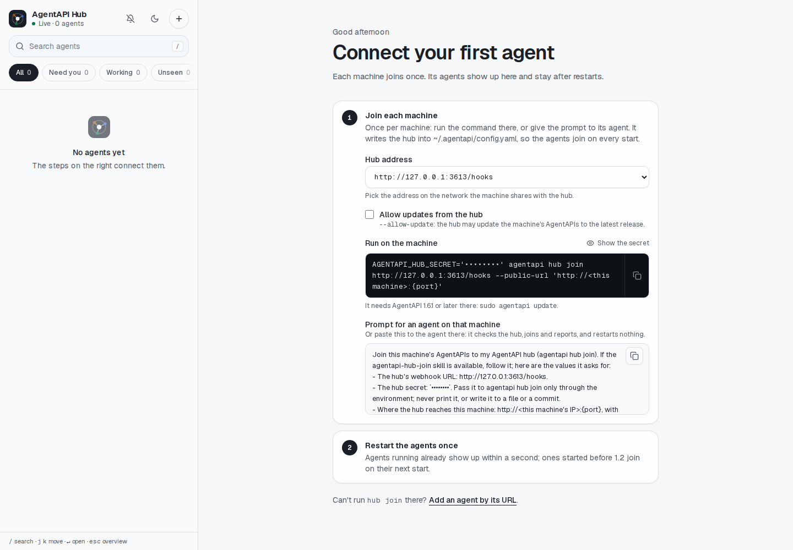

還沒有 agent 加入的 hub，會顯示怎麼讓主機加入，內容和[新增對話框](#從頁面讓主機加入)相同，接著提醒
agent 要重新啟動一次。AgentAPI 自己的聊天介面也有針對它所在主機的步驟：標頭狀態選單裡的
**Add to an AgentAPI hub…**（見[工作階段詳細資訊](chat-ui.zh-TW.md#工作階段詳細資訊與提醒)）。

### 從頁面讓主機加入

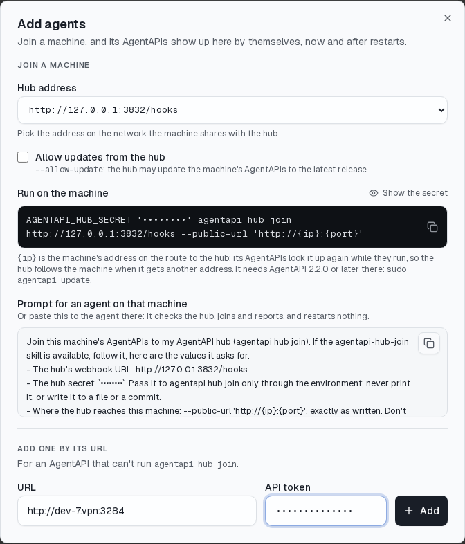

**+** 會開啟新增對話框，其中 **Join a machine** 一節備好了[第 3 步](#3-讓每台主機的-agentapi-加入)，
可以直接複製：

- **Hub address** 列出主機連到 hub 的位址：有 `--bind` 時是那個位址，否則是 hub 所在主機的各個位址
  和所屬的網路介面，順序和啟動時的 log 相同。請選那台主機和 hub 共同所在網路上的位址。hub 一個位址都
  找不到時，會改用頁面本身的位址；前面若有登入頁（例如 Coder 的 port 網址），這個位址就不能用。
- **Allow updates from the hub** 會加上 `--allow-update`（見[從 hub 更新](#從-hub-更新)）。
- **Run on the machine** 是 `agentapi hub join` 指令，secret 透過 `AGENTAPI_HUB_SECRET` 傳入，
  並帶 `--public-url 'http://{ip}:{port}'`：`{ip}` 會跟著主機的位址走，不必另外填。
- **Prompt for an agent on that machine** 讓那台主機上的 agent 替你加入：hub 的網址和連不到時可以改試的
  其他網址、secret、`--public-url`（`{ip}` 原樣保留），以及各個步驟：檢查版本、確認 hub 有回應、`join`
  和 `agentapi hub status`。agent 不會重新啟動任何 AgentAPI，也不會顯示 secret。勾選允許更新時，
  它還會說明 `join` 可能印出的一次性設定，並建議設定狀態資料庫，兩件事都會先問過你。
  裝了 [agentapi-hub-join skill](../skills/agentapi-hub-join/SKILL.md) 的 agent 照 skill 做，沒裝的
  照提示裡的步驟做。

secret 預設遮住，按 **Show the secret** 才會顯示；複製按鈕複製的是真正的值。只有設了 token 的 hub
會顯示 secret，而且只給登入的人看。用 `--no-token` 的 hub 一律不顯示，否則連得到它的人都看得到：
指令裡改放 `<hub secret>`，提示則會讓 agent 向你詢問。

### 加入與移除實例

新增對話框最下方的 **Add one by its URL** 可以用網址加入 AgentAPI，適用於無法執行
`agentapi hub join` 的實例（舊版，或你不會登入的主機）。hub 會先向它要摘要，所以它必須連得到，而且是
AgentAPI 1.1 以上。在這裡輸入的 token 會為這個實例保存，取代 `--instance-token` 送出。這樣加入的實例
不會回報啟動或停止；hub 只會發現它連得到或連不到。

已停止或連不到的那一列，**⋯** 選單裡有 **Forget**，可以把它從 hub 移除。用 webhook 加入的實例，
下次啟動時會再出現。

要一次移除所有已停止的 agent（例如測試跑完留下的 AgentAPI），可以按總覽「Offline」格下方的
**Forget N stopped**；在手機上則選 Offline 篩選，清單最上方會寫出目前顯示的 agent 中有幾個已停止，並有
**Forget all**。hub 移除前會先開對話框，列出每個 agent 的名稱和主機。只會移除已停止的 agent；連不到的
可能自己恢復，所以會留著，這段期間又啟動的也會保留。右側開著的 agent 若被移除，會一併關閉。

## Token 與安全性

| 值 | 誰持有 | 用途 |
| --- | --- | --- |
| hub token（`--token`） | 你和 hub | 讓瀏覽器登入 hub |
| hub secret（`--secret`） | hub 和每台主機的設定檔 | 為 AgentAPI 的事件簽章，只有你的主機能新增實例；可取得[模型供應商](#模型供應商)和它們的金鑰 |
| 實例 token（`--instance-token`，或手動加入時各自的） | hub 和各 AgentAPI | 讓 hub 呼叫 AgentAPI；瀏覽器永遠拿不到 |

- hub 只接受具備有效 `X-AgentAPI-Signature-256`（`<timestamp>.<body>` 的 HMAC-SHA256）、
  timestamp 誤差不超過 10 分鐘、而且 delivery ID（`id`）沒處理過的事件。AgentAPI 一定會送
  delivery ID；沒有的事件一律拒絕，否則同一份事件在這 10 分鐘內重送也會生效。這很重要：事件裡的
  網址，就是 hub 送出實例 token 的地方。hub 會把 delivery ID 保存在
  `instances.deliveries.json`，直到事件的簽章失效，所以重新啟動後也照樣拒絕重送的事件。hub 讀一個
  事件最多花 10 秒、最多讀 1 MiB。其他以 secret 簽章、不需要 session 的請求（AgentAPI 同步供應商、
  launcher 換 token）也一樣要在 10 秒內送完 body。
- 有簽章的事件可以新增 hub 還沒有的實例，也可以把 hub 確定舊網址已失效的實例（超過 10 秒寬限仍
  Unreachable、錯過 heartbeat 而視為已停止，或那裡回應的是另一個 AgentAPI）改到事件裡的網址。hub
  已連上或還在連線中的實例，不論事件寫的是哪一次執行，事件都改不了它的網址；手動加入的實例也一樣。
  `instance.stopped` 不代表網址已失效：hub 會先回舊網址試一次。`instance.*` 事件必須寫明是哪一次
  執行（`server_id`，AgentAPI 1.0 以後都會送）。實例換了網址後，hub 不再送出為舊網址設定的
  token；`--instance-token` 照常適用。
- 每台加入的主機都有同一個 secret，存在那台主機上任何 agent 都讀得到的檔案裡（bypass 權限模式的
  agent 讀檔不會先問）。這樣的 agent 若受到讀到的內容誘導，仍然可以用新的實例 ID，或位址已經
  不回應的實例 ID（例如它的主機正在重新開機），宣告一個它自己的位址；hub 就會把
  `--instance-token` 送到那個位址，等它以那個實例的身分回應後，再把你送給那個實例的訊息和核准
  也送過去。只讓你願意交出實例 token 的主機加入；網址絕不能變的實例，請手動加入。每台主機各用一把金鑰
  才能根除這個問題，hub 目前還沒有這個功能。
- job 的任務事件會改變它的狀態、累加它的花費。hub 只採計它在 job 所在主機上讀到的那個 AgentAPI
  送來的事件（[issue 的詳細資料](#issue-的詳細資料)），所以在自己的位址宣告某個 job 實例 ID 的主機，
  改不了那個 job 的狀態或花費。但送出的事件若帶著 job 的 AgentAPI 的實例 ID 和執行（`server_id`，兩者都在
  摘要裡），hub 仍然會採計：這裡的界線同樣是 secret。
- launcher 的事件寫明 hub 要以那個 launcher 的 token 呼叫它的網址，而 hub 會主動呼叫這個網址，停掉沒人
  要求啟動的 job。所以 hub 只呼叫其他主機的位址，每次連線都檢查，直接連線、不跟隨重新導向：絕不連到
  自己的 loopback（除非設了 `--allow-loopback-launchers`）、雲端 metadata 這類 link-local 位址或
  `0.0.0.0`（見 [`agentapi host`](#agentapi-host)）。內網位址都還連得到，所以持有 secret 的機器仍然
  可以讓 hub 對網路上的其他機器送出請求（`POST /jobs`、`DELETE /jobs/<key>`）。
- 只有在已連上時，也就是 hub 正從那個網址讀到這個實例的摘要時，hub 才會轉送這個實例的請求
  （對話、核准、更新）。hub 重新啟動、串流斷線或事件把實例搬走後，連線中的期間 proxy 一律回 503，
  什麼都不送出。
- session cookie 是 HttpOnly、SameSite=Lax，裡面是簽發時間和以 hub token 算出的簽章（HMAC），
  沒有 token 本身。超過 30 天的 cookie，不論瀏覽器還留著與否，hub 都會拒絕。登出只會清掉瀏覽器
  裡的那一份：複製到別處的 cookie 在過期或 `--token` 更換前仍然有效。proxy 會
  移除瀏覽器的 cookie 以及 `Authorization`、`Origin`、`Referer`、`Sec-Fetch-*` 標頭，也會移除實例的
  `Set-Cookie`，雙方的憑證都不會傳到另一邊。
- 不論有沒有 token，其他網站的網頁都無法讓 hub 做任何改動，也無法替實例送任務：除非瀏覽器表明請求
  來自 hub 自己的網頁，否則會造成改動的請求一律拒絕。
- 實例回應的內容不會以 hub 的網頁身分執行（`Content-Security-Policy: sandbox`），所以就算某個
  workspace 被人控制，也無法透過你的瀏覽器碰到其他 workspace。經由 hub 只能讀取實例的 webhook，
  不能修改：webhook 決定 hub 把 token 送到哪裡。
- 以網址加入不會搬動 hub 已有的實例；要先把它移除。
- `~/.agentapi/hub/instances.json` 和它的 `.bak` 保存手動加入的實例的 token，建立時只有擁有者
  能讀取。`~/.agentapi/config.yaml` 保存 hub secret，`agentapi hub join` 也以同樣的權限寫入。
- 登入時會送出 hub token。hub 請只開在 VPN 上，或放在 HTTPS 後面。
- 登入 hub 的人能做的事，等同各 AgentAPI 允許的事：送任務、回覆核准、使用終端機，以及更新主機允許
  更新的 AgentAPI。hub token 只給你也願意給實例 token 的人。
- 登入的人也拿得到讓主機加入用的 hub secret（`GET /api/join`，供[新增對話框](#從頁面讓主機加入)
  使用）。用 `--no-token` 的 hub 一律不送，否則連得到它的人都拿得到。
- hub 要求更新時，AgentAPI 只會安裝最新的正式版，並用該版的 `checksums.txt` 驗證：hub 無法指定版本
  或網址。AgentAPI 從不執行 `sudo`，主機沒有允許（`allow-update: true`）時也不會更新。
- 用 `--no-token` 時，連得到 hub port 的人都算已登入：hub 一定要放在另一層登入後面，不能開在公開
  位址上。請用 `--allowed-hosts` 列出你開啟 hub 用的名稱（Coder port 網址的主機名、VPN 名稱）：
  否則網站可以把自己的名稱指向 hub 的位址，讓它的網頁連到 hub（DNS rebinding）。IP 位址和
  `localhost` 一律可用。

  ```bash
  agentapi hub serve --no-token --secret "$AGENTAPI_HUB_SECRET" \
    --allowed-hosts 3290--app--dev--me.coder.example.com
  ```

## 疑難排解

| 看到的狀況 | 原因 | 處理方式 |
| --- | --- | --- |
| 實例一直沒出現 | AgentAPI 在 `join` 之前、或 1.2 之前就啟動了 | 重新啟動它，或重開它的 workspace |
| `join` 說 hub 前面有登入頁 | hub 的網址是 Coder 的 port 網址（或其他需要登入的網址） | 改用 hub 在你的網路或 VPN 上的位址；事件是由 AgentAPI 自己送出的 |
| `join` 說 hub 在另一台主機上 | `--public-url` 寫的是 `localhost` | 改成 hub 連得到這台主機的位址 |
| 新增對話框的指令裡是 `<hub secret>` | hub 以 `--no-token` 執行，頁面一律不顯示 secret | 填入 hub 的 `--secret` |
| 新增對話框沒有列出主機所在網路的位址 | hub 只綁一個位址（`--bind`），或主機透過 hub 那台主機本身沒有的位址連到它（NAT、port forwarding） | 改用主機連到 hub 的位址，加上 `/hooks` |
| 實例一直沒出現；hub 的 log 有「Refused an event」（簽章不對的事件每分鐘最多記一次，`refused_since_last_logged` 是中間拒絕的次數） | `join` 和 hub 的 `--secret` 不同，或兩邊時鐘差超過 10 分鐘 | 用 hub 的 secret 重新執行 `agentapi hub join`；檢查時鐘 |
| 實例一直沒出現；`agentapi hub status` 顯示沒有 hub | `join` 寫入的設定檔，不是 AgentAPI 讀的那個 | 用同一個使用者，或兩邊傳同一個 `--config` |
| Unreachable：`400 Bad Request` | AgentAPI 拒絕以 VPN 名稱作為 `Host` | 在 `--allowed-hosts` 允許它（步驟 3） |
| Unreachable：`needs an API token` | AgentAPI 以 `--api-token` 執行，hub 給的 token 不同 | 給 hub `--instance-token`，或加入時輸入 token |
| Unreachable：connection refused 或逾時 | `--public-url` 錯誤，或 hub 連不上 VPN | 在 hub 的主機上用 `curl <url>/summary` 檢查網址 |
| 主機換了 IP 位址後，實例顯示 Unreachable（`no route to host` 或逾時） | 加入時 `--public-url` 寫的是固定 IP，DHCP 換掉了它，例如 Coder workspace 重新啟動後 | 用 `--public-url 'http://{ip}:{port}'` 重新執行 `agentapi hub join`；hub 會在下一次 heartbeat 跟上，之後每次換位址也一樣 |
| Unreachable：`another AgentAPI answers at this URL` | 實例的位址現在屬於另一台主機（DHCP 換了位址），或 `--public-url` 指向別台主機 | 檢查 `--public-url`；搬走的實例會在下一次 heartbeat（一分鐘內）送出新位址 |
| hub 的 log 有「Two AgentAPIs report the same instance ID」 | 兩台主機名稱相同，同一個 port 上的 AgentAPI 就有相同的 ID；hub 保留它正在追蹤的那個 | 把其中一台改名，或給它的 AgentAPI 設定 `--instance-id` |
| hub 的 log 有「An instance's event names another URL」（或「… while the hub connects to its URL」） | hub 還在用舊網址追蹤它或連線時，它的 `--public-url` 改了 | 不用處理：hub 繼續用連得上的網址，等舊網址變成 Unreachable 才改用新的 |
| 主機換了位址後，實例要顯示 Unreachable 一兩分鐘才搬過去 | 舊位址連線失敗滿 10 秒後，hub 才會在實例下一次 heartbeat（每分鐘一次）時搬動它；舊位址完全沒回應時更久：每次嘗試最多花 30 秒，串流沒有動靜 45 秒後才算斷線。3.0.1 以前的 hub 在串流一斷線後的第一次 heartbeat 就搬 | 不用處理：最多比以前晚一分鐘 |
| hub 的 log 有「A stopped instance's event names another URL」 | 送過 `instance.stopped` 的實例在另一個網址啟動 | 不用處理：hub 先回舊網址試一次，失敗後在下一次 heartbeat 搬動它 |
| 開啟實例時回應 `the hub isn't connected to the instance yet`（503） | hub 啟動、串流斷線或實例搬走後，還沒在它的網址讀到摘要 | 等它那一列顯示已連上 |
| hub 的 log 有「An instance added by hand keeps its URL」 | 它是用某個網址手動加入的，它的 webhook 卻寫了另一個網址 | 把 `--public-url` 改成加入時用的網址，或在 hub 移除它，讓它的 webhook 重新加入 |
| hub 的 log 有「Refused an instance event that names no server ID」 | 送出事件的不是 AgentAPI 1.0 以後的版本，卻有 hub 的 secret 簽章 | 更新送出事件的程式；若不知道是誰，找出是哪台有 secret 的主機送的 |
| Unreachable，而且 hub 的 VPN 用戶端以 userspace 模式執行 | hub 的連線沒有經過 VPN | 為 hub 設定 `ALL_PROXY`，指向 VPN 用戶端的 SOCKS5 proxy |
| 加入時出現「is it AgentAPI 1.1 or later?」 | 這個實例沒有摘要 | 用 `agentapi update` 更新它 |
| 頁面說 hub 沒有回應 | 位址錯誤，或 hub 沒有執行 | 開啟 `http://<hub>:3290/api/session`；hub 執行中會回傳 JSON |
| 透過 Coder 的 port 網址開啟時，先要求登入 Coder | Coder 的 port 網址需要登入 Coder | 在那個瀏覽器先登入 Coder，再登入 hub |
| `the hub doesn't answer to <name>; add it to --allowed-hosts` | hub 設了 `--allowed-hosts`，而你用了別的名稱開啟 | 把這個名稱加進 `--allowed-hosts` |
| **Update AgentAPI…** 說更新已關閉 | 這台主機不接受 hub 的更新 | 在那台主機的 `~/.agentapi/config.yaml` 加上 `allow-update: true`，再執行 `agentapi restart --all` |
| **Update AgentAPI…** 要求一次性設定 | AgentAPI 無法寫入 binary 所在的目錄，例如 root 擁有的 `/usr/local/bin` | 在那台主機上執行一次畫面上的指令 |
| 那一列顯示 **Update failed** | 檢查或下載新版時出錯，或新版無法以這個 AgentAPI 的設定啟動，例如執行 PTY agent 的 AgentAPI 2 | 滑鼠移上去，或開啟 **Update AgentAPI…** 查看錯誤，再試一次。AgentAPI 4.3.1 以後，磁碟上的程式會維持原樣；更舊的版本則已經把新版放到磁碟上：如果錯誤指出某個設定（例如 AgentAPI 4 移除的 `unknown flag: --transport`），請在那個 AgentAPI 重新啟動前，從啟動方式拿掉那個設定，否則它會起不來。AgentAPI 2 要保留原本的 agent 時，在它的主機上把 v2.5.1 裝回去（見[從 hub 更新](#從-hub-更新)） |
| 已連線的 agent，**⋯** 選單裡沒有任何更新項目 | 它的 AgentAPI 太舊，還不支援從 hub 更新 | 手動更新（見[手動更新](#手動更新)） |
| hub 的 log 有「The hub's file of instances doesn't parse」 | 檔案損壞，例如手動改壞了；或是 2.2 以前的 hub 讀到較新 hub 寫的檔案 | hub 已把它改名放到一旁（`instances.json.corrupt-<時間>`），從空的清單開始。用 webhook 加入的實例會在下一次 heartbeat 回來。其餘的要找回來，先停掉 hub，再用 `instances.json.bak`（hub 上次啟動時看到的檔案）覆蓋 `instances.json`；2.2 以前的 hub 請見[檔案](#檔案) |
| hub 無法啟動：`instances.json is of a newer hub` | 檔案是較新的 hub 寫的 | 改用較新的 hub，或從 `instances.json.bak` 開始 |
| Issues 裡某台主機一直離線，hub 的 log 有 "Refused a host event with another launcher's token than the machine's" | hub 會把主機名稱綁定到它第一次帶來的 launcher token。這台 launcher 換了 token（`~/.agentapi/host.token` 被刪除，或主機重新安裝），或是另一台持有 hub secret 的機器冒用這個名稱 | 是你自己的主機時：先停掉它的 job，等它顯示離線後在 [Issues](#issues) 按它的 **×** 移除，下一次 heartbeat 就會重新加入。不是你的主機時，更換 hub 的 `--secret`，再讓你的主機重新 join |
| 主機沒出現在 Issues，或一直離線；hub 的 log 有 "Refused a host event with a URL the hub doesn't call" | launcher 回報的網址是 hub 不會呼叫的：loopback（在 hub 這台主機上以 `localhost` 加入）、link-local，或含有帳號密碼（見 [`agentapi host`](#agentapi-host)） | 用 hub 的內網位址讓主機加入（`agentapi hub join http://<hub 的內網位址>:3290/hooks …`）再重新啟動 launcher，或設定 `host` 區段的 `public-url`；hub 這台主機上的 launcher，也可以改用 `--allow-loopback-launchers` 啟動 hub |
| issue 停在 **Starting** 好幾分鐘 | 主機正在 clone 或 fetch 大的 repo（最多 10 分鐘），之後再等 agent 最多 1 分鐘 | 稍候；主機上的 `~/.agentapi/jobs/<owner>~<repo>~<issue>/agentapi.log` 有 agent 這端的紀錄。hub 沒收到回應的啟動，會在主機下一次 heartbeat 時改為工作中或失敗 |

在實例所在的主機上執行 `agentapi hub status`，可以看到設定檔指向哪個 hub，以及每個執行中的
AgentAPI 回報到哪裡。hub 的 log 會記下開始追蹤、已停止和連不到的實例（附上錯誤），以及拒絕的事件；
AgentAPI 的 log 會記下傳送失敗的 webhook。

## 參考

### `agentapi hub serve`

| 旗標 | 預設值 | 說明 |
| --- | --- | --- |
| `--token` | `AGENTAPI_HUB_TOKEN` | 瀏覽器登入用的 token；除非用 `--no-token`，否則必填 |
| `--no-token` | `false` | 不需登入：連得到 hub 的人都能進入（只用在另一層登入後面） |
| `--secret` | `AGENTAPI_HUB_SECRET` | AgentAPI 為事件簽章用的 secret；必填 |
| `--instance-token` | `AGENTAPI_HUB_INSTANCE_TOKEN`，否則 `AGENTAPI_API_TOKEN` | 送給 AgentAPI 的 API token |
| `--state` | `~/.agentapi/hub/instances.json` | 保存實例的檔案 |
| `--port` | `3290` | 監聽的 port |
| `--bind` | 所有介面 | 監聽的位址，例如 VPN 位址 |
| `--allowed-hosts` | 任何名稱 | 瀏覽器開啟 hub 用的名稱，IP 位址和 `localhost` 以外（以逗號分隔，`*` 表示任何名稱）；實例的事件不受限制 |
| `--log-level` | `AGENTAPI_HUB_LOG_LEVEL`，否則 `info` | 記錄的最低層級：`debug`、`info`、`warn` 或 `error` |
| `--dispatch-token` | `AGENTAPI_HUB_DISPATCH_TOKEN` | 用戶端（GitHub workflow 的 runner）呼叫 `POST /api/dispatch` 用的 token，不能做別的事（見 [Issues](#issues)） |
| `--github-app-file` | `--state` 旁的 `github-app.json` | hub 的 GitHub App，由 `/github/connect` 註冊 |
| `--allow-loopback-launchers` | `false` | 允許呼叫 loopback 位址上的 launcher，例如在 hub 這台主機上、以 `localhost` 加入的 launcher（[`agentapi host`](#agentapi-host)） |

hub 透過環境變數中的 proxy（`HTTP_PROXY`、`HTTPS_PROXY`、`ALL_PROXY`）連到實例。連線 30 秒內沒建立（TLS
交握 10 秒）、回應的標頭 15 秒內沒來，就放棄；摘要串流和經 proxy 開啟的頁面則一直保持連線。hub 連
launcher 則不經 proxy、直接連線，也不跟隨 launcher 的重新導向。

### `agentapi host`

[Issues](#issues) 透過每台主機上的 launcher（`agentapi host`）啟動 job：它用主機的 webhook 設定
（`agentapi hub join`）向 hub 回報，hub 派一個 issue 到這台主機，它就啟動一個 AgentAPI。在每台主機上：

```sh
agentapi hub join http://<hub>:3290/hooks --secret "$HUB_SECRET" --public-url 'http://{ip}:{port}'
echo "$INSTANCE_TOKEN" > ~/.agentapi/instance.token && chmod 600 ~/.agentapi/instance.token  # hub 的 --instance-token
agentapi host install --now  # 裝成 systemd user service；agentapi host serve 則在前景執行
agentapi host status
```

launcher 的設定（`~/.agentapi/config.yaml` 的 `host` 區段）、它的檔案和 `agentapi host uninstall`
見 [CLI 參考](cli.zh-TW.md#agentapi-host)；[examples/issue-dispatch](../examples/issue-dispatch/README.md)
另外說明 hub 的 dispatch token、GitHub App 和 workflow 的架設。hub 會把主機名稱綁定到它第一次帶來的
launcher token（`~/.agentapi/host.token`）：重灌過、或 token 檔被刪掉的主機，要先
在 hub 上移除它，才能以原名稱加入：在 [Issues](#issues) 按主機的 **×**，或呼叫 `DELETE /api/hosts/{name}`
（見[疑難排解](#疑難排解)）。

hub 依 launcher 事件裡的網址呼叫它（`host` 區段的 `public-url`，預設 `http://{ip}:3291`），所以只接受
http 或 https、不含帳號密碼的網址，而且只連到其他主機的位址：內網和 VPN 位址都可以；hub 自己這台主機的
loopback（`127.0.0.1`、`::1`）、link-local 位址（`169.254.0.0/16`、`fe80::/10`，例如雲端的 metadata
`169.254.169.254`）和 `0.0.0.0` 則不行。名稱解析出的位址，每次連線都會檢查。hub 這台主機上的 launcher
請用 hub 的內網位址加入（啟動 log 列出的那個），它回報的就是那個位址。以 `localhost` 加入的 launcher 會
回報 `127.0.0.1`，除非 hub 以 `--allow-loopback-launchers` 啟動，否則 hub 會拒絕。

### `agentapi hub join`、`leave`、`status`

| 旗標 | 預設值 | 說明 |
| --- | --- | --- |
| `--secret` | `AGENTAPI_HUB_SECRET` | 為事件簽章的 secret；沒有的話 hub 會拒絕事件 |
| `--public-url` | | hub 連回 AgentAPI 的網址，例如 `http://{ip}:{port}`；`{port}` 和 `{hostname}` 會填入，`{ip}` 則是這台主機通往 hub 那條路由上的 IPv4 位址，每個 AgentAPI 執行期間會重新查詢 |
| `--events` | `instance.*` | 送給 hub 的事件；hub 只需要這些 |
| `--api-token` | `AGENTAPI_API_TOKEN` | 給需要 token 的執行中 AgentAPI |
| `--config` | `~/.agentapi/config.yaml` | 要寫入的設定檔 |
| `--registry-dir` | `~/.agentapi/instances` | 執行中 AgentAPI 的登記目錄 |
| `--no-check` | `false` | 不檢查 hub 是否收得到事件就加入（用於還沒啟動的 hub） |
| `--allow-update` | `false` | 讓 hub 可以更新這台主機的 AgentAPI（在設定檔寫入 `allow-update: true`）；見[從 hub 更新](#從-hub-更新) |

`join` 在寫入任何東西之前，會先確認 hub 收得到這台主機的事件：它送給 hub 一個有簽章的
`webhook.test` 事件。hub 連不到、前面有登入頁（Coder 的 port 網址會導向 Coder 登入），或 secret
不一樣時，它會停下來並說明原因。hub 在另一台主機上、`--public-url` 卻寫 `localhost`（hub 連不到）
時，它也會停下來。做這些檢查時，它會以通往 hub 的路由填入 `{ip}`，並印出這個位址。

`join` 把 `webhook-url`、`webhook-secret`、`webhook-events` 和 `public-url` 寫進設定檔，並用
`PUT /webhook` 套用到執行中的 AgentAPI，保留各自的逾時和重試次數。設定檔保留 `{ip}`，會自己填入
`{ip}` 的執行中 AgentAPI（依登記資料，版本在 2.1.2 之後）也拿到原樣的 `{ip}`；較舊的則拿到當下的
位址，在重新啟動前都用這個位址，`join` 也會註明。`join` 透過登記的網址連到各個 AgentAPI，連不到
時改用 localhost 上它的 port。`leave` 移除這些設定，並關掉執行中 AgentAPI 的 webhook。當下無法
修改的 AgentAPI，會在重新啟動時套用設定檔。加上 `--allow-update` 時，
`join` 還會寫入 `allow-update: true`，AgentAPI 啟動時才會讀取。

用較早版本加入的主機，還會另外送出 `task.*`、`request.*`、`login.*`、`limit.*` 和 `agent.error`，
每個最多 64 KiB；hub 只把它們當成實例還在的跡象。再執行一次同樣的 `agentapi hub join`，就只會送
`instance.*`：它會改寫設定檔，也會套用到執行中的 AgentAPI，它們從此不必為 webhook 追蹤對話。

### hub 的 HTTP API

| 端點 | 說明 |
| --- | --- |
| `POST /hooks` | AgentAPI 的 webhook 事件；以 `--secret` 簽章，不需要登入 |
| `GET /api/session` | 請求帶有 session 或 hub token 時回傳 `{"authenticated": true}` |
| `POST /api/session` | `{"token": …}` 登入並設定 session cookie |
| `DELETE /api/session` | 登出 |
| `GET /api/instances` | 所有實例：各自是誰、摘要、連線、列表上顯示的狀態（`state`：`needs-you`、`working`、`unread`、`idle`、`muted`、`connecting`、`unreachable` 或 `stopped`）、這一列顯示的內容最近一次變動的時間（`changed_at`，RFC 3339；見[最近變動](#最近變動)），在釘選的實例中排第幾（`pin`，從 1 開始；沒有釘選就沒有這個欄位），以及 hub 看到它工作了多久（`work`：已結束區段在回應當下的 `last_24h_seconds` 和 `last_7d_seconds`，工作中時另有 `working_since`；見[工作時間](#工作時間)）；另外附上 hub 自己的版本（`hub_version`） |
| `POST /api/instances` | `{"url": …, "token": …}` 以網址加入實例 |
| `PATCH /api/instances/{id}` | `{"group": …}` 把實例放進群組，`""` 為不分組；`{"muted": true}` 把它目前在等的事靜音到改變為止（沒有在等時回 409），`false` 結束靜音；`{"pinned": true}` 把它釘選在已釘選的實例後面，`false` 取消釘選 |
| `DELETE /api/instances/{id}` | 移除實例，釘選也一併刪除 |
| `POST /api/instances/forget` | `{"ids": […]}` 一次移除清單中此刻 `state` 為 `stopped` 的實例，釘選也一併刪除；回應列出實際移除的實例（`{"ids": […]}`）。沒有停止或 hub 沒有的實例維持原狀。每移除一個就送出一次 `removed` 事件 |
| `PUT /api/pins` | `{"ids": […]}` 由上而下排定釘選實例的順序。必須列出每個釘選的實例各一次，不能有其他實例；不符合時回 409，並在 `ids` 附上目前釘選實例的順序，例如這段期間有人釘選、取消釘選或移除了實例；hub 沒有的實例回 404 |
| `GET /api/favorites` | [我的最愛](#我的最愛)，依排列順序：`{"favorites": [{"id", "title", "text"}, …]}`；沒有標題的項目沒有 `title` |
| `PUT /api/favorites` | `{"favorites": […]}` 依這個順序整份取代。最多 100 項；標題最多 100 字、只能一行；內容不能空白，最多 20,000 字；ID 為 1 到 64 個英文字母、數字、`-` 或 `_`，不能重複。沒有 ID 的項目由 hub 指定一個；回應是 hub 保存後的清單。hub 不接受的清單回 400，什麼都不改 |
| `GET /api/providers` | [模型供應商](#模型供應商)，不含金鑰，以及清單的 revision：`{"revision", "providers": [{"id", "name", "base_url", "anthropic_base_url", "models": [{"id", "name"}], "has_key"}, …]}`。revision 是不透明的 token |
| `PUT /api/providers` | `{"revision", "providers": […]}` 整份取代，revision 帶最後一次 `GET` 或 `PUT` 拿到的值。供應商的 `api_key` 設定它的金鑰；沒有這個欄位時，只有在 `base_url` 和 `anthropic_base_url` 都沒變時才保留同一 ID 的供應商原本的金鑰，`""` 則移除金鑰。最多 50 個；ID 不能重複，也不能是 `default`；網址必須是 http 或 https。回應是 `GET` 格式的清單與新的 revision。清單在那個 revision 之後已被改過時回 409，什麼都不改，請重新讀取；hub 不接受的清單、缺少 revision，或網址改了卻沒給金鑰時回 400，什麼都不改 |
| `POST /api/providers/check` | `{"id", "base_url", "anthropic_base_url", "api_key"}` 由 hub 向 `base_url` 的供應商查詢模型（`GET <base_url>/models`）：`{"models": [{"id", "name"}], "latency_ms"}`。沒有 `api_key` 時，網址沒變才用 ID 為 `id` 的供應商保存的金鑰；網址改了則不發出查詢，直接回 400。供應商沒有回傳模型時回 502，並附上原因 |
| `POST /api/providers/sync` | AgentAPI 取得含金鑰的供應商，以 hub 的 secret 加密：`{"sealed", "nonce", "proof"}`，`proof` 把 `sealed` 綁定到請求的 `nonce`。請求和事件一樣以 `--secret` 簽章，不需要 session |
| `GET /api/events` | Server-sent events：先送 `instances`（全部實例和 `hub_version`，格式同 `GET /api/instances`）和 `favorites`（格式同 `GET /api/favorites`），再送 `instance`（某個實例有頁面看得到的變動，或工作時間變動滿一分鐘；最後聯絡時間只在它離線時才算）、`removed`（`{"id"}`）、`favorites`（有變動時送出全部）、`dispatch`（[issue 派工](#issues)的主機和 job，格式同 `GET /api/hosts` 和 `GET /api/jobs`，一開始和每次變動時送出），以及每 15 秒一次的 `heartbeat`。瀏覽器 30 秒都沒收下事件，就會失去串流 |
| `GET /api/hosts` | 有 launcher 回報的主機：能跑的 agent、有的 repo、job 與上限，以及是否在線（`online`） |
| `DELETE /api/hosts/{name}` | 移除主機，以及 hub 為這個主機名稱記下的 launcher token，讓換了 token 的 launcher 能以同一個名稱重新加入。主機在線（`host_online`）或還有進行中的 job（`host_busy`）時回 409，請先停掉它的 job；hub 沒有這台主機時回 404 |
| `GET /api/jobs` | 各 job（一個 issue 的工作）：狀態、agent 與主機、PR、各次 run 與花費，以及最近 50 則送給 agent 的訊息（`messages`：`at`；`source` 為 `hub`、`review` 或 `comment`；`author`、`agent`；`text`，最多 2,000 字） |
| `GET /api/github` | hub 的 GitHub App（若有：`slug`、`owner`、hub 知道時的 `owner_type`（`User` 或 `Organization`）、`html_url`、`settings_url`、`install_url`）及安裝在哪些帳號（`installations`：`account`、`account_type`、`repository_selection`（`all` 或 `selected`）、`avatar_url`、`settings_url`）；`DELETE` 讓 hub 忘掉 App，GitHub 上的 App 不受影響 |
| `GET /api/github/repos` | App 看得到的 repo，最近有 push 或變動的在前（`pushed_at`、`updated_at`） |
| `GET /api/github/issues?repo=` | repo 的 open issue；`POST` 開新 issue，帶 `assign` 時直接開工 |
| `POST /api/dispatch` | 開工、傳訊息、連結 PR、停止（`action`：`start`、`send`、`link_pr`、`stop`）；也接受 `--dispatch-token`。`start` 在 job 於主機上進入 `starting` 時就回應，之後的狀態由串流和 `GET /api/jobs` 得知 |
| `GET /api/activity?tz=&days=` | 最近 `days` 天（1 到 371，預設 371，即 53 週）每天的[活動](#活動)，由舊到新，依 `tz` 指定的時區（IANA 名稱，例如 `Asia/Taipei`；預設 UTC）劃分：`{"days": [{"date": "2026-11-10", "work_seconds", "usd", "tokens": {"input", "output", "cache_write", "cache_read", "total"}}, …], "since", "time_zone"}`。`since` 是 hub 開始記錄的那一天（同一時區）；每一小時算在它開始的那一天。不接受的時區或天數回 400 |
| `GET /api/join` | 主機加入 hub 用的資訊：`urls` 的每一項是一個 webhook 網址（`url`）和這個位址所在的網路介面（`interface`；`--bind` 的位址沒有），順序和啟動時的 log 相同；只有設了 token 的 hub 才會附上 secret（`secret`，並帶 `secret_shown: true`） |
| `/i/{id}/…` | 透過 hub 存取實例自己的 API 和聊天介面；頁面用 `POST /i/{id}/update` 更新實例，用 `DELETE` 取消 |

除了 `/hooks`、`/api/providers/sync` 和 `/api/session`，每個端點都需要 session cookie 或
`Authorization: Bearer <hub token>`。任何回應裡都不會出現實例 token。請求被拒或失敗時回
`{"code": …, "message": …, "error": …}`：`code` 是端點自己的代碼（例如 `host_online`），或 snake
case 的 HTTP 狀態（例如 `not_found`）；`error` 和 `message` 相同，較舊的 hub 只回這個欄位。

### 檔案

| 檔案 | 寫入者 | 內容 |
| --- | --- | --- |
| `~/.agentapi/config.yaml` | `agentapi hub join` | hub 的 webhook 和 `allow-update`，每個 `agentapi server` 都會讀取 |
| `~/.agentapi/instances/` | `agentapi server` | 這台主機上執行中的 AgentAPI，供 `join` 和 `agentapi list` 使用 |
| `~/.agentapi/hub/instances.json` | `agentapi hub serve` | hub 記得的實例、它們的群組和釘選、各自最近一次變動的時間、最近 7 天各自工作的區段、hub 最後一次讀到各自摘要的網址，以及手動加入的實例的 token；還有[我的最愛](#我的最愛) |
| `~/.agentapi/hub/instances.json.bak` | `agentapi hub serve` | hub 上次啟動時看到的實例檔案 |
| `~/.agentapi/hub/activity.json` | `agentapi hub serve` | 最近 366 天逐小時（UTC）的[活動](#活動)：工作時間，以及每個 scope 的花費和 token；最多每 15 秒寫入一次。`activity.json.bak` 是 hub 上次啟動時看到的檔案；hub 會把無法解析的檔案移到一旁（`.corrupt-<時間>`），重新開始記錄 |
| `~/.agentapi/hub/instances.deliveries.json` | `agentapi hub serve` | hub 處理過、簽章仍有效的事件的 delivery ID，用來拒絕重送的事件 |
| `~/.agentapi/hub/dispatch.json` | `agentapi hub serve` | [issue 派工](#issues)的主機（含 launcher 的 token）和 job：各次 run、花費與最近 50 則訊息 |
| `~/.agentapi/hub/github-app.json` | `agentapi hub serve` | hub 的 GitHub App 與它的私鑰 |
| `~/.agentapi/hub/providers.json` | `agentapi hub serve` | [模型供應商](#模型供應商)和它們的金鑰（0600） |
| `~/.agentapi/hub-providers.json` | `agentapi server` | 每台主機上、設定檔旁邊：hub 上次回應的供應商，以 hub 的 secret 加密；下次啟動時在 hub 回應前先拿來用 |

`instances.json` 的格式是 `{"version": 1, "instances": [...]}`。2.2 以前的 hub 只寫、也只讀陣列：
現在的 hub 讀得懂舊格式，但舊 hub 會把新格式當成損壞的檔案放到一旁，從空的清單開始。要改回舊
hub，先停掉 hub，只留下陣列：

```sh
cd ~/.agentapi/hub && jq .instances instances.json > instances.json.new && mv instances.json.new instances.json
```

每個實例的工作時間是同一個 version 1 裡多出來的欄位（`work`）。2.3 和 2.4 的 hub 會略過它，下次寫入
檔案時就把它丟掉。3.0.1 以前的 hub 對 `confirmed_url`（hub 最後一次讀到實例摘要的網址）也一樣，
3.5 以前的 hub 對我的最愛（和 `instances` 並列的 `"favorites": [...]`）也一樣。改回這種 hub 之後，
它啟動時留下的 `.bak` 仍保有我的最愛。hub 把我的最愛存在 `"settings": {"favorites": [...]}`；
沒有 `settings` 時，讀 3.5 到 3.7 的 hub 寫在最上層的 `"favorites"`。3.8 到 3.15.1 的 hub 也會在最上層
多寫一份，現在不寫了，所以用 3.5 到 3.7 的 hub 開這個檔案時沒有我的最愛；它啟動時留下的 `.bak` 仍保有，可以給新版 hub 用。

## 限制

- hub 對所有實例都提供它自己版本的聊天介面。hub 和各實例請使用相同的 AgentAPI 版本；哪些不同，
  見[版本](#版本)。AgentAPI 2 的 PTY agent 在終端機裡等你回覆對話框時，hub 不會標示出來，那一列
  只顯示閒置或工作中。請到那個 AgentAPI 自己的聊天介面（它的網址）回覆。
- 所有人共用一個 hub token：沒有個別帳號或權限，登入的人也共用同一份[我的最愛](#我的最愛)。
- [工作時間](#工作時間)只有 hub 看到的部分：hub 還沒有這項功能之前、hub 停機或連不到 agent 的期間都
  不算。一個 hub 也不知道另一個 hub 算了多少。
- [活動](#活動)從 hub 執行有這項功能的版本那天開始，花費和 token 只計入 AgentAPI 4.2 以後的版本。
  hub 沒聽到的小時（hub 停機或連不到 agent 超過一天）的花費不會計入。
- hub 監看和開啟 AgentAPI，也能更新主機允許更新的 AgentAPI，但不會啟動或停止它們。
- 關掉 hub 的頁面後，手機就收不到任何通知：hub 還不會送推播。每個 AgentAPI 只有一個 webhook，而
  hub 已經用掉了。
