# hub

[English](hub.md) | [繁體中文](hub.zh-TW.md)

hub 在一個頁面上監看多台機器的 AgentAPI：列出每個實例，需要你處理的排最前面，點一下就能在聊天
介面中開啟，桌面和手機都能用。hub 就在同一個 binary 裡：`agentapi hub serve`。

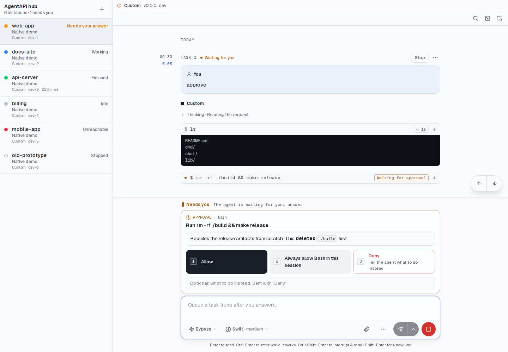

[README](../README.zh-TW.md#執行-hub) 有精簡版說明。這份指南一步步說明怎麼架設、每種狀態的意思、
各個 token、疑難排解，以及 hub 的 API。

## 目錄

- [運作方式](#運作方式)
- [架設](#架設)
- [使用 hub](#使用-hub)
- [Token 與安全性](#token-與安全性)
- [疑難排解](#疑難排解)
- [參考](#參考)
- [限制](#限制)

## 運作方式

```text
 手機／桌面瀏覽器 ──HTTPS──▶ hub（agentapi hub serve，放在常開的機器上）
                               ▲ 有簽章的 webhook 事件    │ 摘要串流和聊天介面，
                               │ （instance.*、task.*…）  ▼ 帶著各實例的 token
          ┌────────────────────┴───────────┬────────────────────────────────┐
   workspace A 上的 AgentAPI      workspace B 上的 AgentAPI       你筆電上的 AgentAPI
```

hub 和各個 AgentAPI 透過你掌控的網路互連，例如你自己的 VPN。hub 完全不必放上公開網路。

1. AgentAPI 用 webhook 加入。`agentapi hub join` 把 hub 的位址和 secret 寫進
   `~/.agentapi/config.yaml`，這個使用者的每個 `agentapi server` 啟動時都會讀取。之後每個
   AgentAPI 都送出有簽章的 `instance.started`、`instance.heartbeat` 和 `instance.stopped`，
   hub 據此新增、更新或停止實例。
2. hub 追蹤每個實例的摘要（`GET /events?only=summary`）：狀態、在等什麼、標題、最新任務、佇列和
   用量限制。每個實例一條連線；斷線時 1 秒後重連，之後間隔逐次拉長，最多 30 秒。串流 45 秒沒有任何
   動靜就視為斷線。連線失敗的前 10 秒，實例仍顯示為連線中（剛啟動的實例送出第一個事件時，可能還沒
   開始接受連線）；超過 10 秒才算連不到。
3. 瀏覽器用 hub token 登入，從一條串流取得所有實例和每次變更。
4. 開啟實例時，聊天介面透過 hub 載入（`/i/<id>/…`）。hub 轉送每個請求時，用實例的 API token 取代
   瀏覽器的憑證。

## 架設

範例用三個虛構的名稱：hub 在 `hub.vpn`，AgentAPI 在 `dev-1.vpn` 和 `dev-2.vpn`。請換成你機器的
VPN 名稱或位址。

### 1. 產生 secret

最多需要三個值。不要留在 shell 歷史紀錄或儲存庫裡，例如放進密碼管理工具：

```bash
openssl rand -hex 32   # HUB_TOKEN：登入用
openssl rand -hex 32   # HUB_SECRET：AgentAPI 為事件簽章用
```

第三個是 AgentAPI 自己的 API token（`--api-token`），有設定的話才需要，hub 會把它送給各實例。所有
實例可以共用一個；手動加入的實例也可以各有各的。

### 2. 執行 hub

挑一台會一直開著、而且 AgentAPI 和你的手機都能透過 VPN 連到的機器：

```bash
agentapi hub serve --bind hub.vpn --token "$HUB_TOKEN" --secret "$HUB_SECRET" \
  --instance-token "$AGENTAPI_TOKEN"
```

hub 監聽 port 3290，並把實例保存在 `~/.agentapi/hub/instances.json`，重新啟動後仍然記得。
`--bind` 讓 hub 只聽 VPN 介面；不加的話監聽所有介面。這些值也可以改用 `AGENTAPI_HUB_TOKEN`、
`AGENTAPI_HUB_SECRET` 和 `AGENTAPI_HUB_INSTANCE_TOKEN` 設定。

要讓 hub 持續執行，就用這台機器啟動其他服務的方式啟動它。例如 systemd 的使用者 unit：

```ini
# ~/.config/systemd/user/agentapi-hub.service
[Service]
EnvironmentFile=%h/.config/agentapi-hub.env
ExecStart=/usr/local/bin/agentapi hub serve --bind hub.vpn
Restart=on-failure

[Install]
WantedBy=default.target
```

`agentapi-hub.env` 放三個 `AGENTAPI_HUB_*` 變數；只讓擁有者能讀取。

### 3. 讓每台機器的 AgentAPI 加入

在每台要讓 hub 監看的機器上執行一次：

```bash
sudo agentapi update   # 每台機器都需要 AgentAPI 1.3 以上
agentapi hub join http://hub.vpn:3290/hooks --secret "$HUB_SECRET" \
  --public-url 'http://dev-1.vpn:{port}'
```

- `join` 會先送給 hub 一個有簽章的測試事件，hub 沒收下就停止（連不到、被登入頁擋住，或 secret 不同），
  見[參考資料](#agentapi-hub-joinleavestatus)。
- `join` 把 hub 寫進 `~/.agentapi/config.yaml`。這個使用者的每個 `agentapi server` 啟動時都會讀
  這個檔案，所以由腳本以固定參數啟動的 AgentAPI（例如 Coder workspace 的啟動腳本）不必改腳本也能
  加入。旗標和 `AGENTAPI_*` 環境變數仍然優先於這個檔案。
- `--public-url` 是 hub 連回各 AgentAPI 的網址。`{port}` 會換成各自的 port，所以同一行設定可以
  同時用在 3286 的 Claude Code 和 3285 的 Codex。
- 正在執行的 AgentAPI 會立刻套用，一秒內就出現在 hub 上。1.2 之前啟動的 AgentAPI 沒有在這台機器
  上登記，`join` 找不到它們：重新啟動它們或整個 workspace 一次。
- hub 轉送請求時，`Host` 標頭是實例的 VPN 名稱。AgentAPI 預設只接受 `localhost`、`127.0.0.1` 和
  `[::1]`，所以要允許它的 VPN 名稱：用 `--allowed-hosts '*'` 啟動（Coder module 就是這樣做），
  或把名稱加進設定檔：

  ```yaml
  allowed-hosts: [localhost, 127.0.0.1, "[::1]", dev-1.vpn]
  ```

用這兩個指令確認：

```bash
agentapi hub status   # 設定檔裡的 hub，以及每個執行中的 AgentAPI 回報到哪裡
agentapi list         # 這台機器上執行中的 AgentAPI，以及各自的摘要
```

這一步也可以交給那台機器上的 agent。[agentapi-hub-join skill](../skills/agentapi-hub-join/SKILL.md)
會讓 Claude Code 檢查版本和 hub 是否有回應，向你詢問 hub 的網址、secret 和這台機器的位址，然後加入，
並確認每個 AgentAPI 回報到哪裡。它不會重新啟動 AgentAPI，也不會印出 secret。在那台機器上安裝：

```bash
mkdir -p ~/.claude/skills/agentapi-hub-join
curl -fsSL https://raw.githubusercontent.com/k1dav-c/agentapi/main/skills/agentapi-hub-join/SKILL.md \
  -o ~/.claude/skills/agentapi-hub-join/SKILL.md
```

然後跟 agent 說，例如：「把這台機器加入 http://hub.vpn:3290 的 hub」。

### 4. 開啟 hub

在連上 VPN 的桌面或手機開啟 `http://hub.vpn:3290/`，用 `HUB_TOKEN` 登入。登入狀態維持 30 天。

## 使用 hub

### 登入

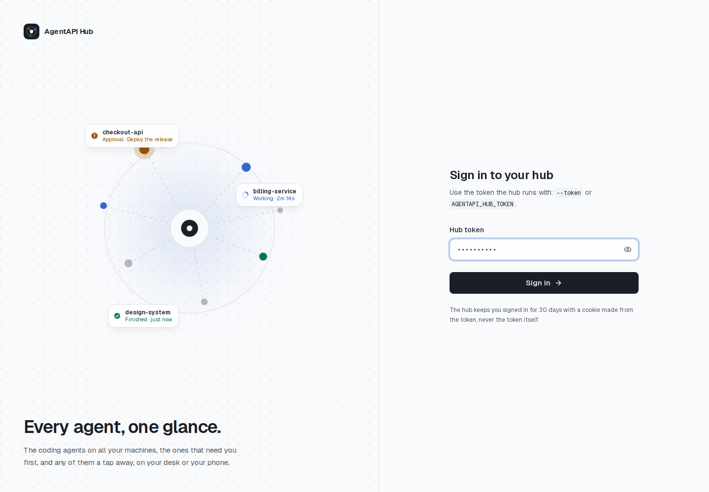

token 只送給 hub 一次，換回一個由 token 推導出的 HttpOnly cookie；頁面不會保存 token。更換
`--token` 會讓所有瀏覽器登出。token 錯誤時會當場拒絕，眼睛按鈕可以顯示你貼上的內容。

如果 hub 本身就在另一層登入後面，例如 Coder workspace app 或私人 VPN，可以不設 token：用
`--no-token` 取代 `--token`，就不會出現這個頁面，連得到 hub 的人都能直接進入。兩個都沒給時，hub
不會啟動。

hub 沒有回應時（它停了，或它前面的 proxy 回了錯誤頁），頁面會說連不到 hub 並自動重試；只有 hub
回答登入已失效時，才會要求輸入 token。

### 總覽


沒有開啟任何 agent 時，右側會顯示有幾個 agent 需要你、各自為了什麼。每種狀態一格（需要你、工作中、
已完成未讀、離線），點一下就會篩選清單。下方每個需要你的 agent 各有一張卡片，寫出它在等什麼（核准
的指令、提問、登入、用量限制）和等了多久，並有 **Answer** 或 **Open** 按鈕。工作中的 agent 會顯示
提示和已經跑了多久；你還沒看過的已完成 agent 會顯示標題。

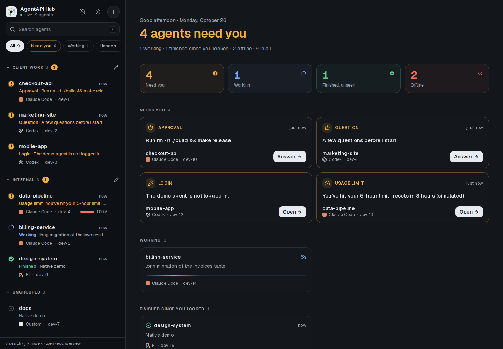

### 花費

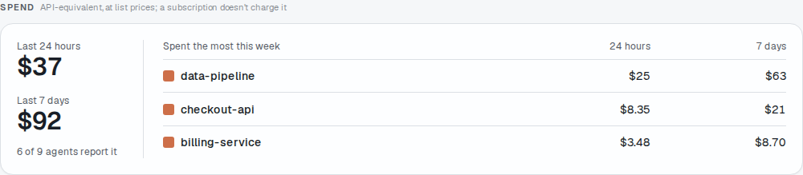

每個 AgentAPI 每分鐘從 agent 的 session log 算出它在工作目錄裡的所有 session，最近 24 小時和最近
7 天花了多少，放進摘要（`spend`）。這是換算成 API 的金額：依模型供應商的牌價計算 token，訂閱方案
並不會實際收取。只有 native 模式的 Claude Code、Codex 和 Pi 有這個數字，其他 agent 不會顯示。

每一列顯示它最近 24 小時的花費（`$110/24h`），群組標題顯示群組的合計，清單頂端顯示全部的合計；
滑鼠移上去還會看到 7 天的金額。桌面版的總覽有一張 **Spend** 卡片：所有回報花費的 agent 最近 24 小時
和 7 天的合計，以及這週花最多的五個。

### 清單

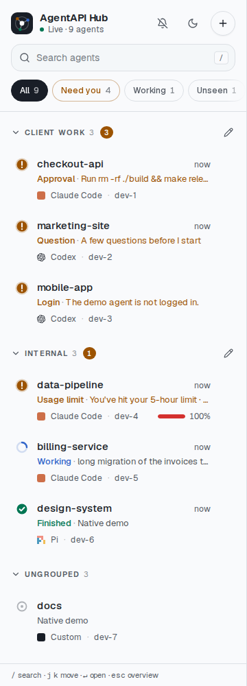

每一列顯示 agent 的名稱（`--name`，預設為工作目錄名稱）、它在等什麼或在做什麼、多久以前、agent 和
機器；佇列有訊息、最近 24 小時的花費（見[花費](#花費)），以及用量限制超過 60% 時也會顯示。同一個[群組](#群組)內，各列依下表的狀態順序排列，
同狀態再依名稱排序。每種狀態都有自己的形狀，不靠顏色也看得出來：

| 圖示 | 第二行開頭 | 意思 |
| --- | --- | --- |
| 琥珀色 ! | Approval、Question、Plan、Dialog | 有請求在等你回覆；這一行會顯示內容 |
| 琥珀色 ! | Login | 要先在它的機器上登入，agent 才能工作 |
| 琥珀色 ! | Usage limit | 用量限制停下了回合；佇列中的訊息等重置後才送出 |
| 轉動的藍色弧線 | Working | agent 正在處理顯示的任務 |
| 綠色勾勾 | Finished | 上次有人查看這個 agent 之後，有任務結束了 |
| 灰色圓環 | （它的標題） | 閒置 |
| 灰色、劃掉的鈴鐺 | Muted | 它需要你處理，但你把這件事靜音到它改變為止（見[靜音](#靜音)） |
| 轉動的虛線圓環 | Connecting | hub 正在開啟或重新開啟它的摘要串流 |
| 斷開的紅色圓環 | Unreachable | hub 已經 10 秒連不到它；這一行會說明原因 |
| 方塊 | Stopped、Exited | AgentAPI 已停止，或它的 agent 已結束 |

搜尋（**/**）會比對名稱、群組、標題、機器或 agent 中的任何字詞。搜尋框下方的標籤可以顯示全部，或只
顯示需要你、工作中、已完成未讀、離線的 agent，並附上數量。頁首顯示 hub 的串流是否連線中，以及共有
幾個 agent；分頁的標題和圖示會顯示需要你處理的數量，釘選的分頁也看得到。這條串流和聊天介面一樣會
重新連線，45 秒沒有動靜就視為斷線（hub 每 15 秒送一次心跳）。

「Finished」依據 agent 的未讀標記，這個標記由該 AgentAPI 的所有用戶端共用：在 hub 或它自己的聊天
介面開啟，各處都會變成已讀。

每一列的狀態由 hub 判斷。hub 更新後仍開著的舊頁面，遇到不認得的狀態會顯示 Unknown 和問號；重新整理
頁面即可。

### 群組

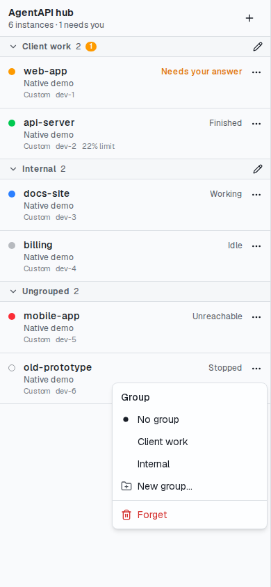

可以依客戶、專案或機器，把實例分成自己的群組。每一列最後的 **⋯** 可以把實例移到某個群組、
**New group…**（新群組）或 **No group**（不分組）。群組保存在 hub 上，所以手機和桌面看到的一樣；
實例自己的事件不會改動它所屬的群組。

有了群組之後，清單會依名稱為每個群組加上標題，沒有分組的實例排在最後的 **Ungrouped** 底下。標題會
顯示群組裡的實例數，並以琥珀色顯示需要你處理的數量，所以收合的群組仍然看得到。點標題可以收合或
展開；每個瀏覽器各自記住收合了哪些群組。鉛筆圖示可以為群組改名，裡面的實例會一起移過去。群組名稱
最多 40 個字元；群組裡沒有實例時就會消失。

### 靜音

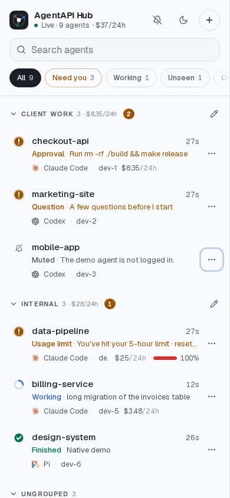

agent 可能在等一件你短期內不會處理的事，例如在一台你不會用它的機器上等登入。在它的 **⋯** 選單選
**Mute until it changes**，就會把它移出需要你處理的項目：不再計入 **Need you**、群組徽章、分頁標題
和總覽，也不發通知。這一列仍然保留，以灰色和劃掉的鈴鐺顯示它在等什麼。靜音只維持到這件事改變為止：
agent 登入了，或改為等別的事（另一個請求、用量上限），就會重新計入。同一個選單的 **Unmute** 可以
提早結束靜音。和群組一樣，靜音保存在 hub 上。

### 開啟實例

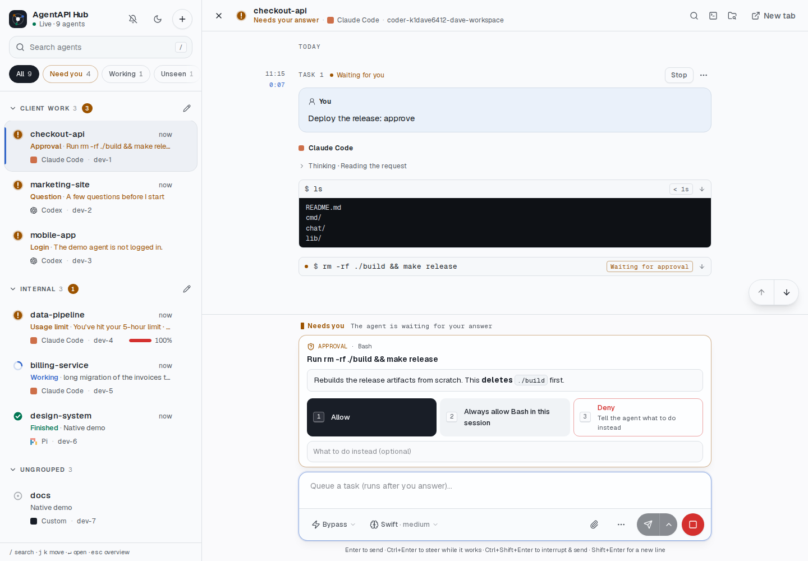

點選一列或一張卡片，就會在清單旁開啟這個 agent 的聊天介面：聊天介面的功能在這裡都能用，包括回覆
請求。上方的列顯示 agent 的狀態、agent 和機器，也放著聊天介面自己的搜尋、終端機和 Explorer 按鈕；**New tab** 會單獨開啟聊天介面，**×**（或
**Esc**）會回到總覽。開啟 agent 會在瀏覽紀錄新增一頁，所以「上一頁」會回到清單或總覽；從一個 agent
換到另一個則不會再新增。網址會記住目前的 agent（`#<id>`），重新整理或從書籤開啟都會回到同一個。

### 快捷鍵與通知

| 按鍵 | 作用 |
| --- | --- |
| `/` | 搜尋 |
| `j`、`k`（或方向鍵） | 在各列之間移動 |
| `Enter` | 開啟該列 |
| `Esc` | 清除搜尋，或回到總覽 |

快捷鍵在焦點位於 hub 時有效；在開啟的聊天介面裡，按鍵會交給聊天介面。鈴鐺按鈕會請瀏覽器在 hub 分頁
位於背景、有 agent 開始需要你時通知你；螢幕閱讀器也會即時讀出同樣的訊息。

### 在手機上

| 清單 | 實例 |
| --- | --- |
|  | 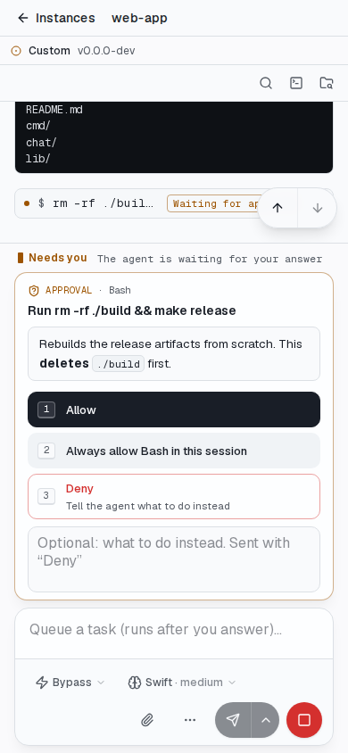 |

在窄螢幕上，清單和聊天介面輪流顯示；上方的返回箭頭或手機的「上一頁」手勢都會回到清單。聊天介面把螢幕留給對話：上方只有一列，輸入框也只占一行。在手機上回覆核准：

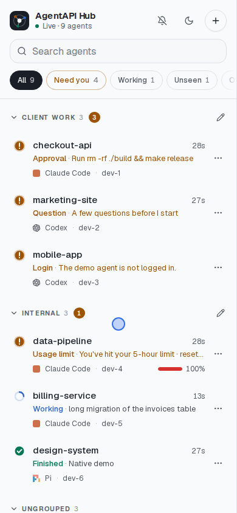

### 接上第一批 agent

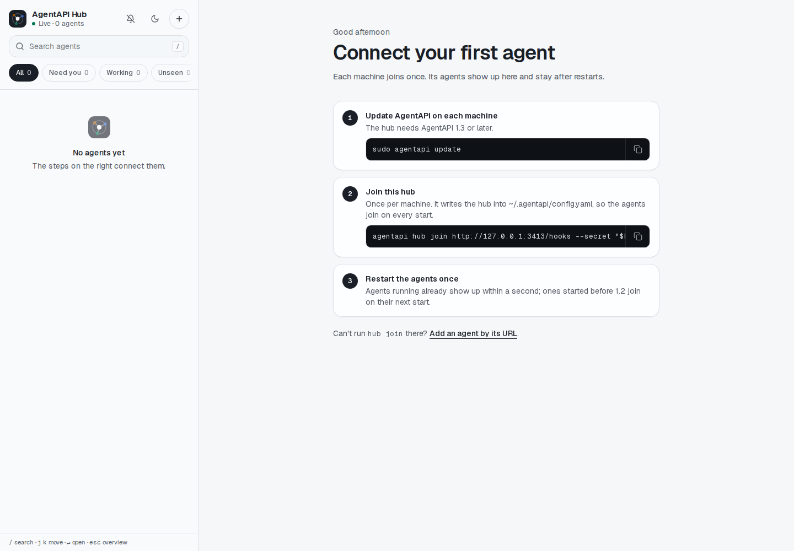

還沒有 agent 加入的 hub，會顯示[架設](#3-讓每台機器的-agentapi-加入)的三個步驟，附上可以複製的指令，
並已填好 hub 自己的位址。AgentAPI 自己的聊天介面也有同樣的步驟，針對它所在的機器：標頭狀態選單裡的
**Add to an AgentAPI hub…**（見[工作階段詳細資訊](chat-ui.zh-TW.md#工作階段詳細資訊與提醒)）。

### 加入與移除實例

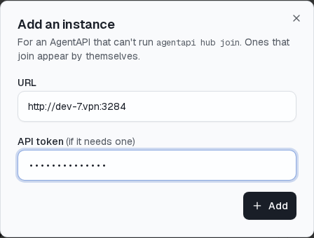

**+** 可以用網址加入 AgentAPI，適用於無法執行 `agentapi hub join` 的實例（舊版，或你不會登入的
機器）。hub 會先向它要摘要，所以它必須連得到，而且是 AgentAPI 1.1 以上。在這裡輸入的 token 會為
這個實例保存，取代 `--instance-token` 送出。這樣加入的實例不會回報啟動或停止；hub 只會發現它連得到
或連不到。

已停止或連不到的那一列，**⋯** 選單裡有 **Forget**，可以把它從 hub 移除。用 webhook 加入的實例，
下次啟動時會再出現。

## Token 與安全性

| 值 | 誰持有 | 用途 |
| --- | --- | --- |
| hub token（`--token`） | 你和 hub | 讓瀏覽器登入 hub |
| hub secret（`--secret`） | hub 和每台機器的設定檔 | 為 AgentAPI 的事件簽章，只有你的機器能新增實例 |
| 實例 token（`--instance-token`，或手動加入時各自的） | hub 和各 AgentAPI | 讓 hub 呼叫 AgentAPI；瀏覽器永遠拿不到 |

- hub 只接受具備有效 `X-AgentAPI-Signature-256`（`<timestamp>.<body>` 的 HMAC-SHA256）、
  timestamp 誤差不超過 10 分鐘、而且 delivery ID 沒處理過的事件。這很重要：事件裡的網址，就是
  hub 送出實例 token 的地方。
- session cookie 是 HttpOnly、SameSite=Lax，由 hub token 推導而來，裡面沒有 token 本身。代理會
  移除瀏覽器的 cookie 以及 `Authorization`、`Origin`、`Referer` 標頭，也會移除實例的
  `Set-Cookie`，雙方的憑證都不會傳到另一邊。
- `~/.agentapi/hub/instances.json` 保存手動加入的實例的 token，建立時只有擁有者能讀取。
  `~/.agentapi/config.yaml` 保存 hub secret，`agentapi hub join` 也以同樣的權限寫入。
- 登入時會送出 hub token。hub 只開在 VPN 上，或放在 HTTPS 後面。
- 登入 hub 的人能做的事，等同各 AgentAPI 允許的事：送任務、回覆核准、使用終端機。hub token 只給
  你也願意給實例 token 的人。
- 用 `--no-token` 時，這指的是所有連得到 hub port 的人：hub 一定要放在另一層登入後面，不能開在公開
  位址上。

## 疑難排解

| 看到的狀況 | 原因 | 處理方式 |
| --- | --- | --- |
| 實例一直沒出現 | AgentAPI 在 `join` 之前、或 1.2 之前就啟動了 | 重新啟動它，或重開它的 workspace |
| `join` 說 hub 前面有登入頁 | hub 的網址是 Coder 的 port 網址（或其他需要登入的網址） | 改用 hub 在你的網路或 VPN 上的位址；事件是由 AgentAPI 自己送出的 |
| `join` 說 hub 在另一台機器上 | `--public-url` 寫的是 `localhost` | 改成 hub 連得到這台機器的位址 |
| 實例一直沒出現；hub 的 log 有「Refused an event」 | `join` 和 hub 的 `--secret` 不同，或兩邊時鐘差超過 10 分鐘 | 用 hub 的 secret 重新執行 `agentapi hub join`；檢查時鐘 |
| 實例一直沒出現；`agentapi hub status` 顯示沒有 hub | `join` 寫入的設定檔，不是 AgentAPI 讀的那個 | 用同一個使用者，或兩邊傳同一個 `--config` |
| Unreachable：`400 Bad Request` | AgentAPI 拒絕以 VPN 名稱作為 `Host` | 在 `--allowed-hosts` 允許它（步驟 3） |
| Unreachable：`needs an API token` | AgentAPI 以 `--api-token` 執行，hub 給的 token 不同 | 給 hub `--instance-token`，或加入時輸入 token |
| Unreachable：connection refused 或逾時 | `--public-url` 錯誤，或 hub 連不上 VPN | 在 hub 的機器上用 `curl <url>/summary` 檢查網址 |
| Unreachable，而且 hub 的 VPN 用戶端以 userspace 模式執行 | hub 的連線沒有經過 VPN | 為 hub 設定 `ALL_PROXY`，指向 VPN 用戶端的 SOCKS5 proxy |
| 加入時出現「is it AgentAPI 1.1 or later?」 | 這個實例沒有摘要 | 用 `agentapi update` 更新它 |
| 頁面說 hub 沒有回應 | 位址錯誤，或 hub 沒有執行 | 開啟 `http://<hub>:3290/api/session`；hub 執行中會回傳 JSON |
| 透過 Coder 的 port 網址開啟時，先要求登入 Coder | Coder 的 port 網址需要登入 Coder | 在那個瀏覽器先登入 Coder，再登入 hub |

在實例所在的機器上執行 `agentapi hub status`，可以看到設定檔指向哪個 hub，以及每個執行中的
AgentAPI 回報到哪裡。hub 的 log 會記下開始追蹤、已停止和連不到的實例（附上錯誤），以及拒絕的事件；
AgentAPI 的 log 會記下傳送失敗的 webhook。

## 參考

### `agentapi hub serve`

| 旗標 | 預設值 | 說明 |
| --- | --- | --- |
| `--token` | `AGENTAPI_HUB_TOKEN` | 瀏覽器登入用的 token；除非用 `--no-token`，否則必填 |
| `--no-token` | `false` | 不需登入：連得到 hub 的人都能進入（只用在另一層登入後面） |
| `--secret` | `AGENTAPI_HUB_SECRET` | AgentAPI 為事件簽章用的 secret；必填 |
| `--instance-token` | `AGENTAPI_HUB_INSTANCE_TOKEN`，否則 `AGENTAPI_API_TOKEN` | 送給 AgentAPI 的 API token |
| `--state` | `~/.agentapi/hub/instances.json` | 保存實例的檔案 |
| `--port` | `3290` | 監聽的 port |
| `--bind` | 所有介面 | 監聽的位址，例如 VPN 位址 |

hub 透過環境變數中的 proxy（`HTTP_PROXY`、`HTTPS_PROXY`、`ALL_PROXY`）連到實例。

### `agentapi hub join`、`leave`、`status`

| 旗標 | 預設值 | 說明 |
| --- | --- | --- |
| `--secret` | `AGENTAPI_HUB_SECRET` | 為事件簽章的 secret；沒有的話 hub 會拒絕事件 |
| `--public-url` | | hub 連回 AgentAPI 的網址；`{port}` 和 `{hostname}` 會被填入 |
| `--events` | `instance.*`、`task.*`、`request.*`、`login.*`、`limit.*`、`agent.error` | 送給 hub 的事件 |
| `--api-token` | `AGENTAPI_API_TOKEN` | 給需要 token 的執行中 AgentAPI |
| `--config` | `~/.agentapi/config.yaml` | 要寫入的設定檔 |
| `--registry-dir` | `~/.agentapi/instances` | 執行中 AgentAPI 的登記目錄 |
| `--no-check` | `false` | 不檢查 hub 是否收得到事件就加入（用於還沒啟動的 hub） |

`join` 在寫入任何東西之前，會先確認 hub 收得到這台機器的事件：它送給 hub 一個有簽章的
`webhook.test` 事件。hub 連不到、前面有登入頁（Coder 的 port 網址會導向 Coder 登入），或 secret
不一樣時，它會停下來並說明原因。hub 在另一台機器上、`--public-url` 卻寫 `localhost`（hub 連不到）
時，它也會停下來。

`join` 把 `webhook-url`、`webhook-secret`、`webhook-events` 和 `public-url` 寫進設定檔，並用
`PUT /webhook` 套用到執行中的 AgentAPI，保留各自的逾時和重試次數。`leave` 移除這些設定，並關掉執行中
AgentAPI 的 webhook。當下無法修改的 AgentAPI，會在重新啟動時套用設定檔。

### hub 的 HTTP API

| 端點 | 說明 |
| --- | --- |
| `POST /hooks` | AgentAPI 的 webhook 事件；以 `--secret` 簽章，不需要登入 |
| `GET /api/session` | 請求帶有 session 或 hub token 時回傳 `{"authenticated": true}` |
| `POST /api/session` | `{"token": …}` 登入並設定 session cookie |
| `DELETE /api/session` | 登出 |
| `GET /api/instances` | 所有實例：各自是誰、摘要、連線，以及列表上顯示的狀態（`state`：`needs-you`、`working`、`unread`、`idle`、`muted`、`connecting`、`unreachable` 或 `stopped`） |
| `POST /api/instances` | `{"url": …, "token": …}` 以網址加入實例 |
| `PATCH /api/instances/{id}` | `{"group": …}` 把實例放進群組，`""` 為不分組；`{"muted": true}` 把它目前在等的事靜音到改變為止（沒有在等時回 409），`false` 結束靜音 |
| `DELETE /api/instances/{id}` | 移除實例 |
| `GET /api/events` | Server-sent events：先送 `instances`（全部，格式同 `GET /api/instances`），再送 `instance`（某個有變動）、`removed`（`{"id"}`），以及每 15 秒一次的 `heartbeat` |
| `/i/{id}/…` | 透過 hub 存取實例自己的 API 和聊天介面 |

除了 `/hooks` 和 `/api/session`，每個端點都需要 session cookie 或
`Authorization: Bearer <hub token>`。任何回應裡都不會出現實例 token。

### 檔案

| 檔案 | 寫入者 | 內容 |
| --- | --- | --- |
| `~/.agentapi/config.yaml` | `agentapi hub join` | hub 的 webhook，每個 `agentapi server` 都會讀取 |
| `~/.agentapi/instances/` | `agentapi server` | 這台機器上執行中的 AgentAPI，供 `join` 和 `agentapi list` 使用 |
| `~/.agentapi/hub/instances.json` | `agentapi hub serve` | hub 記得的實例、它們的群組，以及手動加入的實例的 token |

## 限制

- hub 對所有實例都提供它自己版本的聊天介面。hub 和各實例請使用相同的 AgentAPI 版本。
- 所有人共用一個 hub token：沒有個別帳號或權限。
- hub 只監看和開啟 AgentAPI，不會啟動或停止它們。
- 關掉 hub 的頁面後，手機就收不到任何通知：hub 還不會送推播。每個 AgentAPI 只有一個 webhook，而
  hub 已經用掉了。
