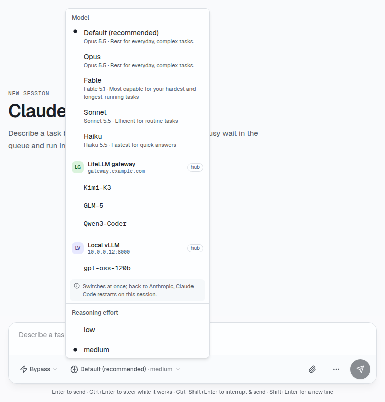

# Model providers

English | [繁體中文](providers.zh-TW.md)

Claude Code and Codex can switch to another model provider while they run: an endpoint that speaks
the Anthropic Messages API (Claude Code) or the OpenAI Responses API (Codex), such as a LiteLLM or
vLLM gateway. One gateway that speaks both serves both agents. Define providers in the machine's
`~/.agentapi/config.yaml` (`--config`):

```yaml
providers:
  - id: kimi                      # lowercase letters, digits, - and _
    name: Kimi K3                 # optional
    base_url: https://gateway.example.com/v1
    api_key: sk-...               # optional
    models: [Kimi-K3-NVFP4]       # optional: by default, those GET <base_url>/models lists
```

Codex calls `<base_url>/responses`. Claude Code calls the same URL without `/v1`, plus
`/v1/messages`; set `anthropic_base_url` when its endpoint is elsewhere. A `base_url` without a
version gets `/v1` for Codex. AgentAPI reads the file again when it changes. Keep it readable by
you only (`chmod 600`): it holds the keys, and AgentAPI warns when others can read it.

A hub keeps providers for every machine that reports to it (see
[Running a hub](api.md#running-a-hub)). On a machine, a provider in its config file wins over the hub's
with the same `id`.

`GET /settings` lists the providers under `options.providers`, with their models, and the setting
`provider` says which one the agent runs on: `default` for its own (Claude Code's Anthropic login or
key, Codex's OpenAI login or its config's `model_provider`). Switch with `PUT /settings`:

```bash
curl -X PUT localhost:3284/settings -d '{"provider": "kimi", "model": "Kimi-K3-NVFP4"}'
curl -X PUT localhost:3284/settings -d '{"provider": "default"}'
```

Without `model`, the agent takes the provider's first model; back on its own provider, the model
it had before. On a provider, `{"model": ...}` picks among that provider's models. In the chat, the
model menu lists the agent's own models, then each provider's.



The two agents switch differently:

- **Claude Code** switches while it runs, from its next API call, also during a turn. Going back to
  its own provider starts it again on the same session, which takes a few seconds; during a turn it
  is refused (409). If a switch fails, AgentAPI restores the previous environment and model. If an
  answer is unconfirmed or restoration fails, it starts a replacement on the previous known provider
  instead of allowing another turn with settings that might not match the UI.
- **Codex** binds a thread to its provider, and an OpenAI thread holds items another provider
  refuses (OpenAI's tool definitions, encrypted reasoning). A switch starts app-server again on the
  other provider, in a new thread that gets the conversation's messages as text, without the tool
  calls. During a turn the switch is refused (409).

The chosen provider applies to every agent that starts in the session, also after an AgentAPI
restart with `--state-db`. A provider that is no longer defined is dropped, with a warning: the
agent starts on its own provider. The hub's providers are kept beside the config file
(`hub-providers.json`, sealed with the hub's secret) for the next start, so a session on one of
them starts on it again while the hub can't be reached. Until the hub answers, a chosen provider
that may be one of the hub's stays chosen while the agent starts on its own provider; the agent goes
back to it at its first start after the hub answered.

A provider's models (those it lists at `<base_url>/models`) are kept for 10 minutes, then listed
again in the background. `GET /settings` waits 3 seconds at most for a provider that doesn't
answer, and doesn't ask it again for a minute.

The agent never gets a provider's key. AgentAPI calls the provider for it, through a proxy on
`127.0.0.1` that listens on a random port from the first time an agent runs on a provider, until
AgentAPI stops. Claude Code gets `ANTHROPIC_BASE_URL=http://127.0.0.1:<port>/<id>/anthropic`,
Codex a provider whose `base_url` is `http://127.0.0.1:<port>/<id>/openai`. Both get a token
AgentAPI makes up for the process instead of the key (`ANTHROPIC_AUTH_TOKEN`, Codex's
`AGENTAPI_PROVIDER_API_KEY`). The proxy answers a call without that token with 401, and sends the
others on to the provider with its key as a bearer token, the way the agents send one, and streams
the answer back as it comes. It looks the provider up on each call: a key or URL changed in the
config file or on the hub applies at once, and a removed provider answers 404. It follows a
redirect with the key only to the same origin. AgentAPI still lists a provider's models itself,
with the key. If the proxy can't start, the agent can't run on a provider rather than get the key.
With an HTTP proxy set (`HTTP_PROXY`, `HTTPS_PROXY`, `ALL_PROXY`), AgentAPI adds `127.0.0.1`,
`localhost` and `::1` to the agent's `NO_PROXY` and `no_proxy`, so it reaches the proxy directly. A
process of your user can still read the token in the agent's environment and call the providers
through the proxy while AgentAPI runs, but it can't see a key.

The proxy also learns how each provider answers. Over the last hour it counts the calls, the
failures (a network error or timeout, a 5xx or 429 answer, an answer that broke off) and the client
errors (another 4xx, such as a key or model the provider refuses, which aren't the provider's
failures), the median and 95th percentile time to the first byte of the latest 100 answers that weren't failures, and the
last success and failure. `GET /settings` has it in each provider's `health`, and the summary in
`provider_health`, for the providers the agent called in the hour. The chat's model menu marks a
provider whose latest call failed, or half of the hour's, with how many failed and the last error in
its tooltip; the hub's Providers settings show each provider's hour over the agents that report it.

`GET /sessions`, `GET /cost` and the summary's `spend` count each provider's calls, tokens and cost
apart (`providers`, `default` for the agent's own); `GET /sessions` and `GET /cost` give each
provider its `name` as the server's providers have it then. Claude Code's log doesn't say which
endpoint a call went to, so AgentAPI records in `~/.agentapi/provider-ledger.jsonl` which provider
each session ran on, and from when.

## Prices

A gateway's models, such as `Kimi-K3-NVFP4`, aren't in AgentAPI's price table, so without a price
their calls add tokens but no cost (**no price** in the chat). A provider can carry a price for each
of its models, in USD per million tokens, and a call that went to the provider is priced at it
before the table (the built-in prices and `--prices`, which still price the other calls). A
provider of the hub gets prices from OpenRouter; one of the config file gets them under `prices`,
by model ID:

```yaml
providers:
  - id: kimi
    base_url: https://gateway.example.com/v1
    models: [Kimi-K3-NVFP4, Kimi-K3.1-Pro-NVFP4]
    prices:
      Kimi-K3-NVFP4: {input: 0.19, output: 16, cache_read: 0.18}
      Kimi-K3.1-Pro-NVFP4: {input: 2, output: 10, cache_read: 0.2, cache_write: 0}
```

`input`, `output`, `cache_read` and `cache_write` (the last two the tokens read from and written to
the prompt cache) are 0 when left out. A price applies to the model whose ID matches, ignoring
case, also when the provider lists its models itself rather than in `models`. A price below zero
leaves the provider out, with a warning. A change of the prices reprices every session's calls
within a minute, when the costs are worked out again.

The [hub](hub.md#model-providers) looks its providers' models up in OpenRouter's public model list
(`https://openrouter.ai/api/v1/models`, no key needed), once a day and on **Refresh prices** in its
Providers settings, and sends each machine the prices with the providers. It matches a model to an
OpenRouter model by name: both lowercase, without a vendor prefix up to the last `/`
(`moonshotai/`), and without a trailing precision or quantization suffix (`-nvfp4`, `-fp8`, `-fp4`,
`-int4`, `-int8`, `-awq`, `-gptq`, `-bf16`, `-fp16`, also after `_`). `Kimi-K3-NVFP4` is then
`moonshotai/kimi-k3`, and `Kimi-K3.1-Pro-NVFP4` `moonshotai/kimi-k3.1-pro`. OpenRouter's variants
(`moonshotai/kimi-k3:batch`, `…:free`) and aliases (`~moonshotai/kimi-latest`) aren't matched by name,
and a name two OpenRouter models share matches neither. In the Providers settings, pick another
OpenRouter model for a model (variants too), **No price**, or **Automatic** to go back to the match
by name. A provider that defines no models has the hub list them, with the provider's key, when it
refreshes the prices.

These are OpenRouter's list prices, what OpenRouter charges for the model: for a gateway that
serves the model itself, such as a self-hosted vLLM, they are an estimate of what the calls would
cost elsewhere, not what they cost you. A provider of the config file with the same ID as the
hub's wins with its own prices, or none.
