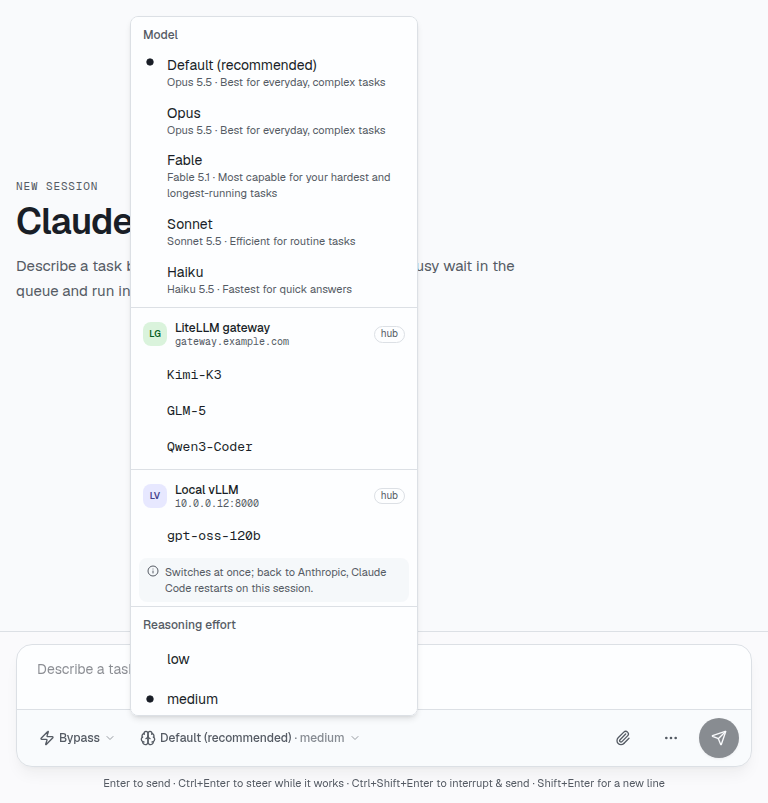

# 模型供應商

[English](providers.md) | 繁體中文

Claude Code 和 Codex 可以在執行中換到其他模型供應商，也就是支援 Anthropic Messages API（Claude
Code）或 OpenAI Responses API（Codex）的端點，例如 LiteLLM 或 vLLM gateway。兩種 API 都支援的
gateway，兩個 agent 都能用。供應商寫在主機的 `~/.agentapi/config.yaml`（`--config`）：

```yaml
providers:
  - id: kimi                      # lowercase letters, digits, - and _
    name: Kimi K3                 # optional
    base_url: https://gateway.example.com/v1
    api_key: sk-...               # optional
    models: [Kimi-K3-NVFP4]       # optional: by default, those GET <base_url>/models lists
```

Codex 呼叫 `<base_url>/responses`。Claude Code 呼叫同一個網址去掉 `/v1` 再加上
`/v1/messages`；它的端點在別處時，設定 `anthropic_base_url`。沒有版本的 `base_url`，Codex 會
加上 `/v1`。檔案有變動時，AgentAPI 會重新讀取。檔案裡有金鑰，請設成只有你能讀（`chmod 600`），
其他人讀得到時 AgentAPI 會發出警告。

hub 可以替每台向它回報的主機保存供應商（見[執行 hub](api.zh-TW.md#執行-hub)）。在主機上，設定檔和 hub 有
相同 `id` 的供應商時，以設定檔的為準。

`GET /settings` 在 `options.providers` 列出供應商和它們的模型，設定 `provider` 則表示 agent 目前
用哪一個：`default` 是 agent 自己的（Claude Code 的 Anthropic 登入或金鑰，Codex 的 OpenAI 登入或
它設定檔裡的 `model_provider`）。用 `PUT /settings` 切換：

```bash
curl -X PUT localhost:3284/settings -d '{"provider": "kimi", "model": "Kimi-K3-NVFP4"}'
curl -X PUT localhost:3284/settings -d '{"provider": "default"}'
```

沒有指定 `model` 時，agent 會用供應商的第一個模型；換回自己的供應商時，則用換過去之前的模型。
在供應商上，`{"model": ...}` 只能從該供應商的模型中挑選。在聊天介面中，模型選單先列出 agent 自己的
模型，再列出每個供應商的模型。



兩個 agent 的切換方式不同：

- **Claude Code** 在執行中切換，從下一次 API 呼叫起生效，回合進行中也可以。換回自己的供應商時，
  會以同一個工作階段重新啟動，需要幾秒鐘；回合進行中會回 409。切換失敗時，AgentAPI 會恢復原先的環境與模型。
  如果回應未確認或恢復失敗，則會用先前已知的供應商啟動替代 adapter，不讓下一個回合在設定可能與介面不一致的
  狀態下繼續。
- **Codex** 的 thread 綁定建立時的供應商，而 OpenAI 的 thread 裡有其他供應商不接受的項目（OpenAI
  的工具定義、加密的推理內容）。切換時會在另一個供應商上重新啟動 app-server，開一個新的 thread，
  把對話的訊息以文字帶過去，不含工具呼叫。回合進行中切換會回 409。

選定的供應商適用於這個工作階段之後啟動的每個 agent；使用 `--state-db` 時，AgentAPI 重新啟動後
也一樣。選定的供應商若已不存在，AgentAPI 會放棄這個選擇並發出警告，agent 改用自己的供應商啟動。
hub 的供應商會存在設定檔旁邊（`hub-providers.json`，以 hub 的 secret 加密），留給下次啟動用；所以 hub
暫時連不上時，使用 hub 供應商的工作階段仍會在原本的供應商上啟動。hub 還沒回應前，選定的供應商若可能是 hub 的，
就仍保持選定，agent 這次先用自己的供應商啟動，等 hub 回應後下次啟動時就會換回去。

供應商的模型（它在 `<base_url>/models` 列出的）會保留 10 分鐘，之後在背景重新查詢。供應商沒有回應時，
`GET /settings` 最多等 3 秒，一分鐘內也不會再問。

用供應商的 agent 讀得到該供應商的金鑰：agent 以你的使用者身分執行，金鑰就在它的環境變數裡。
只把你願意交給 agent 的金鑰設給供應商。

`GET /sessions`、`GET /cost` 和摘要的 `spend` 會依供應商分開計算呼叫次數、token 和花費
（`providers`，agent 自己的是 `default`）；`GET /sessions` 和 `GET /cost` 還會附上每個供應商的
`name`，也就是伺服器當下設定裡的名稱。Claude Code 的 log 不會寫出呼叫送往哪個端點，所以
AgentAPI 在 `~/.agentapi/provider-ledger.jsonl` 記錄每個工作階段從什麼時候起用哪個供應商。

## 價格

gateway 的模型（例如 `Kimi-K3-NVFP4`）不在 AgentAPI 的價格表裡，沒有價格時，這些呼叫只計
token、不計花費（聊天介面顯示 **no price**）。供應商可以替每個模型帶一個價格，單位是每百萬 token 的
美元；送往該供應商的呼叫會先用這個價格計算，再輪到價格表（內建價格和 `--prices`，其他呼叫照舊用
價格表計價）。hub 上的供應商從 OpenRouter 取得價格；設定檔裡的供應商則寫在 `prices` 底下，以模型 ID
為鍵：

```yaml
providers:
  - id: kimi
    base_url: https://gateway.example.com/v1
    models: [Kimi-K3-NVFP4, Kimi-K3.1-Pro-NVFP4]
    prices:
      Kimi-K3-NVFP4: {input: 0.19, output: 16, cache_read: 0.18}
      Kimi-K3.1-Pro-NVFP4: {input: 2, output: 10, cache_read: 0.2, cache_write: 0}
```

`input`、`output`、`cache_read` 和 `cache_write`（後兩個是從 prompt 快取讀取和寫入的 token）沒寫
就是 0。價格套用在 ID 相符（不分大小寫）的模型上，供應商自己列出模型、沒寫在 `models` 裡時也一樣。
有價格小於零的供應商會略過不用，並留下警告。價格改了之後，一分鐘內所有工作階段的呼叫都會重新計價，
因為花費每分鐘都會重新計算。

[hub](hub.zh-TW.md#模型供應商) 會到 OpenRouter 公開的模型清單（`https://openrouter.ai/api/v1/models`，
不需要金鑰）查各供應商的模型，每天一次，在供應商設定按 **Refresh prices** 時也會查，再把價格和
供應商一起送給每台主機。hub 依名稱把模型對到 OpenRouter 的模型：兩邊都轉小寫、去掉最後一個 `/` 之前的
廠商前綴（`moonshotai/`）、去掉結尾的精度或量化後綴（`-nvfp4`、`-fp8`、`-fp4`、`-int4`、`-int8`、
`-awq`、`-gptq`、`-bf16`、`-fp16`，接在 `_` 後面也算）。於是 `Kimi-K3-NVFP4` 對到
`moonshotai/kimi-k3`，`Kimi-K3.1-Pro-NVFP4` 對到 `moonshotai/kimi-k3.1-pro`。OpenRouter 的變體
（`moonshotai/kimi-k3:batch`、`…:free`）和別名（`~moonshotai/kimi-latest`）不會用名稱自動對應；兩個
OpenRouter 模型同名時，兩個都不對應。在供應商設定裡，可以替模型改選另一個 OpenRouter 模型（變體也行）、
選 **No price**，或選 **Automatic** 回到依名稱對應。沒有定義模型的供應商，hub 會在更新價格時用該供應商的
金鑰列出模型。

這些是 OpenRouter 的牌價，也就是 OpenRouter 對該模型的收費：對自己提供模型的 gateway（例如自架的
vLLM）來說，這只是估計這些呼叫在別處要花多少，不是你實際的成本。設定檔裡和 hub 同 ID 的供應商以
設定檔為準，價格也用設定檔裡的（或沒有）。
